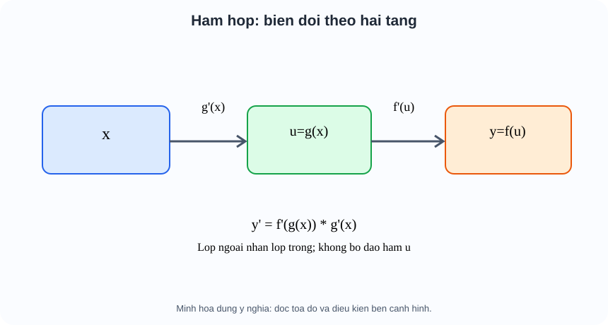

# Bài 32. Các quy tắc tính đạo hàm

TOÁN 11 · CHƯƠNG IX · SGK KNTT TẬP HAI

Chọn đúng quy tắc đạo hàm theo cấu trúc hàm số, giữ miền xác định và giải thích tốc độ biến đổi trong ứng dụng.
<nav class="thpt-r4-lesson-tabs"><a href="../">Chương IX</a><a href="../luyen-tap/">Core và Luyện tập</a><a href="../tu-kiem-tra-chuong/">Tự kiểm tra cuối chương</a></nav>

=== "Khám phá kiến thức"

    Định nghĩa đạo hàm ở B31 cho ta ý nghĩa của tốc độ biến đổi. Tuy nhiên, khi một hàm gồm nhiều phép tính, lập lại giới hạn từ đầu rất dài. Ta tách biểu thức thành các thành phần: mỗi thành phần thay đổi theo quy tắc nào, và các thay đổi ấy kết hợp ra sao? Luôn kiểm miền trước khi tính.

    ### 1.1. Lũy thừa nguyên
    
    Khi x thay đổi rất ít, độ biến thiên bậc nhất của $x^n$ là $nx^{n-1}\Delta x$. Với số nguyên dương n, công thức đúng trên $\mathbb R$.
    
    **Vận dụng.** Tính đạo hàm $3x^4$ tại x=2.
    
    
    
    ??? question "Đối chiếu"
    
        **Lời giải:** $f'=12x^3$ nên $f'(2)=96$.
    
    
    
    ??? tip "Kiểm lỗi"
    
        Không quên hệ số 4. [Luyện lại B32-C01](../luyen-tap/?item=THPT-G11-CHIX-B32-C01)

    ### 1.2. Căn bậc hai
    
    Rational hoá thương sai phân của $\sqrt{x}$ bằng nhân liên hợp, giới hạn tại x>0 có mẫu $2\sqrt{x}$. Điểm x=0 có giá trị hàm nhưng không có đạo hàm hai phía hữu hạn.
    
    **Vận dụng.** Tính đạo hàm của $3\sqrt{x}$ tại x=9.
    
    
    
    ??? question "Đối chiếu"
    
        **Lời giải:** $3/(2\sqrt{x})$ trên x>0, tại 9 bằng $1/2$.
    
    
    
    ??? tip "Kiểm lỗi"
    
        Miền có đạo hàm khác miền xác định. [Luyện lại B32-C02](../luyen-tap/?item=THPT-G11-CHIX-B32-C02)

    ### 1.3. Tổng, hiệu và nhân hằng số
    
    Độ tăng của tổng chính là tổng độ tăng; chia cùng một $\Delta x$ rồi lấy giới hạn cho quy tắc cộng, trừ. Hằng số không thay đổi.
    
    **Vận dụng.** Tính đạo hàm $7x^3+2x-5$.
    
    
    
    ??? question "Đối chiếu"
    
        **Lời giải:** $21x^2+2$.
    
    
    
    ??? tip "Kiểm lỗi"
    
        Đạo hàm của −5 bằng 0. [Luyện lại B32-C03](../luyen-tap/?item=THPT-G11-CHIX-B32-C03)

    ### 1.4. Tích của hai hàm
    
    Hai thừa số đều có thể thay đổi. Hình dưới minh hoạ thêm hai dải và một góc nhỏ; chia biến thiên cho $\Delta x$ cho hai số hạng bậc nhất.
    
    <figure class="thpt-r4-plot thpt-r4-calculus-figure"><figcaption>Đọc hình: Hình chữ nhật diện tích uv có hai dải vΔu và uΔv cùng một góc ΔuΔv. Khi u,v khả vi, Δu và Δv đều cỡ Δx; chia góc cho Δx thì giới hạn bằng 0. Hình minh họa khi hai kích thước tăng, đẳng thức đại số vẫn đúng với độ tăng âm.</figcaption></figure>
    
    **Vận dụng.** Tính đạo hàm $(x^2+1)(x+4)$.
    
    
    
    ??? question "Đối chiếu"
    
        **Lời giải:** $2x(x+4)+(x^2+1)=3x^2+8x+1$.
    
    
    
    ??? tip "Kiểm lỗi"
    
        Nếu chỉ nhân hai đạo hàm sẽ bỏ mất hai phần biến thiên. [Luyện lại B32-C04](../luyen-tap/?item=THPT-G11-CHIX-B32-C04)

    ### 1.5. Thương và mẫu số
    
    Khi mẫu thay đổi, tỉ số cũng đổi dù tử giữ nguyên. Công thức cần hiệu của hai tích theo đúng thứ tự và bình phương mẫu.
    
    **Vận dụng.** Tính đạo hàm $(3x+2)/(x-2)$ và nêu miền.
    
    
    
    ??? question "Đối chiếu"
    
        **Lời giải:** $[3(x-2)-(3x+2)]/(x-2)^2=-8/(x-2)^2$, x≠2.
    
    
    
    ??? tip "Kiểm lỗi"
    
        Giữ điều kiện mẫu khác 0 từ biểu thức gốc. [Luyện lại B32-C05](../luyen-tap/?item=THPT-G11-CHIX-B32-C05)

    ### 1.6. Hàm hợp
    
    Tốc độ biến đổi truyền theo hai tầng: x làm u=g(x) thay đổi rồi u làm y=f(u) thay đổi. Vì vậy tốc độ cuối là tích hai tốc độ.
    
    <figure class="thpt-r4-plot thpt-r4-calculus-figure"><figcaption>Đọc hình: Đọc từ trái sang phải: x → u=g(x) → y=f(u). Hai tốc độ g′(x) và f′(u) được nhân; tính f′ tại chính u=g(x). Sơ đồ biểu diễn quy tắc đạo hàm, không yêu cầu thương Δy/Δu xác định khi Δu=0.</figcaption></figure>
    
    **Vận dụng.** Tính đạo hàm $(4x+1)^3$.
    
    
    
    ??? question "Đối chiếu"
    
        **Lời giải:** $3(4x+1)^2\cdot4=12(4x+1)^2$.
    
    
    
    ??? tip "Kiểm lỗi"
    
        Viết u′ trước khi thay vào công thức. [Luyện lại B32-C06](../luyen-tap/?item=THPT-G11-CHIX-B32-C06)

    ### 1.7. Sin và cos
    
    Độ biến đổi của các hàm lượng giác chuẩn dùng góc đo radian. Sin và cos liên hệ nhưng đạo hàm của cos mang dấu âm.
    
    **Vận dụng.** Tính đạo hàm $4\sin x+2\cos x$.
    
    
    
    ??? question "Đối chiếu"
    
        **Lời giải:** $4\cos x-2\sin x$.
    
    
    
    ??? tip "Kiểm lỗi"
    
        Kiểm dấu trừ ở cos. [Luyện lại B32-C07](../luyen-tap/?item=THPT-G11-CHIX-B32-C07)

    ### 1.8. Tan và cot
    
    Tan và cot là các thương của sin và cos. Từ quy tắc thương, mẫu được bình phương, dấu của cot khác tan.
    
    **Vận dụng.** Tính đạo hàm $\tan x+2\cot x$, nêu miền.
    
    
    
    ??? question "Đối chiếu"
    
        **Lời giải:** $1/\cos^2 x-2/\sin^2 x$, trên các khoảng có $\sin x\ne0,\cos x\ne0$.
    
    
    
    ??? tip "Kiểm lỗi"
    
        Không dùng tại các điểm mẫu gốc bằng 0. [Luyện lại B32-C08](../luyen-tap/?item=THPT-G11-CHIX-B32-C08)

    ### 1.9. Lượng giác hợp
    
    Nếu góc là u(x), quy tắc lượng giác mới cho biến thiên theo u; phải nhân tiếp u′ để có biến thiên theo x.
    
    **Vận dụng.** Tính đạo hàm $\sin(7x-1)$.
    
    
    
    ??? question "Đối chiếu"
    
        **Lời giải:** $7\cos(7x-1)$.
    
    
    
    ??? tip "Kiểm lỗi"
    
        Không bỏ hệ số 7. [Luyện lại B32-C09](../luyen-tap/?item=THPT-G11-CHIX-B32-C09)

    ### 1.10. Hàm mũ
    
    Hàm $e^x$ có tốc độ biến đổi bằng chính giá trị hàm. Với cơ số a>0 cố định khác 1, viết $a^x=e^{x\ln a}$ để thấy hệ số $\ln a$.
    
    **Vận dụng.** Tính đạo hàm $7^x$ và cho biết dấu.
    
    
    
    ??? question "Đối chiếu"
    
        **Lời giải:** $7^x\ln7>0$ với mọi x.
    
    
    
    ??? tip "Kiểm lỗi"
    
        Giữ ln7, không chỉ viết $7^{x-1}$. [Luyện lại B32-C10](../luyen-tap/?item=THPT-G11-CHIX-B32-C10)

    ### 1.11. Logarit và trị tuyệt đối
    
    $\ln x$ chỉ nhận đối số dương. Hàm $\ln|x|$ nhận x khác 0: ở x<0, đó là $\ln(-x)$. Đạo hàm theo quy tắc hợp bằng $(-1)/(-x)=1/x$.
    
    **Vận dụng.** Tính đạo hàm $\ln|x|$ tại x=−4 và $\log_3 x$ tại x=3.
    
    
    
    ??? question "Đối chiếu"
    
        **Lời giải:** Lần lượt −1/4 và $1/(3\ln3)$. Hàm thứ hai chỉ trên x>0.
    
    
    
    ??? tip "Kiểm lỗi"
    
        Không đồng nhất miền ln x và ln|x|. [Luyện lại B32-C11](../luyen-tap/?item=THPT-G11-CHIX-B32-C11)

    ### 1.12. Mũ và logarit hợp
    
    Đặt u là biểu thức trong. Với logarit cần kiểm đối số trước; với mũ cơ số cố định dương không đòi u dương.
    
    **Vận dụng.** Tính đạo hàm $e^{x^2-2x}+\ln(3x+2)$ và miền.
    
    
    
    ??? question "Đối chiếu"
    
        **Lời giải:** $(2x-2)e^{x^2-2x}+3/(3x+2)$, với x>−2/3.
    
    
    
    ??? tip "Kiểm lỗi"
    
        Mỗi thành phần có đạo hàm hàm trong riêng. [Luyện lại B32-C12](../luyen-tap/?item=THPT-G11-CHIX-B32-C12)

    ### 1.13. Kiểm miền của đạo hàm
    
    Miền khả vi là nơi hàm gốc xác định và các quy tắc được áp dụng hợp lệ. Một biểu thức rút gọn có mẫu khác 0 chưa đủ nếu log hoặc căn gốc không có nghĩa.
    
    **Vận dụng.** Tìm khoảng khả vi và đạo hàm $\sqrt{16-x^2}$.
    
    
    
    ??? question "Đối chiếu"
    
        **Lời giải:** $-4<x<4$; $f'=-x/\sqrt{16-x^2}$. Hai đầu mút không có đạo hàm hữu hạn hai phía.
    
    
    
    ??? tip "Kiểm lỗi"
    
        Kiểm dấu của biểu thức dưới căn, không chỉ khác 0. [Luyện lại B32-C13](../luyen-tap/?item=THPT-G11-CHIX-B32-C13)

    ### 1.14. Chọn phép toán ngoài cùng
    
    Trước khi tính, nhìn cây biểu thức. Nếu cả biểu thức là tích, dùng tích trước; sau đó tính đạo hàm từng thừa số bằng quy tắc hợp nếu cần.
    
    **Vận dụng.** Tính đạo hàm $(x^2+3)\cos(3x)$.
    
    
    
    ??? question "Đối chiếu"
    
        **Lời giải:** $2x\cos(3x)-3(x^2+3)\sin(3x)$.
    
    
    
    ??? tip "Kiểm lỗi"
    
        Hai số hạng của tích, cos hợp có dấu âm. [Luyện lại B32-C14](../luyen-tap/?item=THPT-G11-CHIX-B32-C14)

    ### 1.15. Vận tốc và giới hạn mô hình
    
    Đạo hàm tọa độ cho vận tốc. Muốn tìm vận tốc lúc vật chạm mốc phải tìm thời điểm trước; muốn chặn vận tốc dao động có thể dùng biên độ sin/cos, không cần phương pháp cực trị Toán 12.
    
    **Vận dụng.** $s(t)=6+2\sin(5t)$ cm, t giây. Tìm vận tốc và tốc độ lớn nhất trên t≥0.
    
    
    
    ??? question "Đối chiếu"
    
        **Lời giải:** $v=10\cos(5t)$ cm/s, $|v|\le10$; đạt tại $t=k\pi/5$ với k nguyên không âm. Tốc độ lớn nhất 10 cm/s.
    
    
    
    ??? tip "Kiểm lỗi"
    
        Phân biệt vận tốc v và tốc độ |v|; góc tính radian. [Luyện lại B32-C15](../luyen-tap/?item=THPT-G11-CHIX-B32-C15)

    ### 1.16. Áp dụng logarit trong mô hình pH
    
    Vận dụng kiến thức vào một tình huống mới. Xác định điều kiện và phương pháp trước khi tính.
    
    **Vận dụng.** Với $p(c)=-\log_{10}c$ (c>0 tính bằng giá trị số mol/L), tính $p'(0,01)$ và giải thích dấu.
    
    
    
    ??? question "Đối chiếu"
    
        **Lời giải:** $p'(0,01)=-100/\ln10$. Dấu âm: khi nồng độ tăng rất ít, pH giảm.
    
    
    
    ??? tip "Kiểm lỗi"
    
        Giữ dấu âm và hệ số ln10; phân biệt độ nhạy với giá trị pH. [Luyện lại B32-P11](../luyen-tap/?item=THPT-G11-CHIX-B32-P11)

    ### 1.17. Tìm thời điểm từ mô hình
    
    Vận dụng kiến thức vào một tình huống mới. Xác định điều kiện và phương pháp trước khi tính.
    
    **Vận dụng.** $h(t)=12t-2t^2$ m cho đến khi vật về đất. Tìm vận tốc ngay trước lúc trở về đất.
    
    
    
    ??? question "Đối chiếu"
    
        **Lời giải:** $h=2t(6-t)=0$; trở lại ở t=6. $h'=12-4t$, nên −12 m/s; tốc độ 12 m/s.
    
    
    
    ??? tip "Kiểm lỗi"
    
        Chọn nghiệm khác 0 và không dùng thời gian ngoài khoảng mô hình. [Luyện lại B32-C15](../luyen-tap/?item=THPT-G11-CHIX-B32-C15)

=== "Kiến thức SGK"

    ### 2.1. Đạo hàm của một số hàm số thường gặp
    
    
<strong>Đạo hàm của một số hàm số thường gặp.</strong>
Trên \(\mathbb R\), \((c)'=0\), \((x)'=1\), \((x^n)'=nx^{n-1}\) với n nguyên dương. Với \(x&gt;0\), \((\sqrt{x})'=1/(2\sqrt{x})\); nhân liên hợp trong thương sai phân tạo mẫu \(\sqrt{x+h}+\sqrt{x}\). Tại x=0 công thức không có nghĩa, hàm không có đạo hàm hai phía hữu hạn.

    ### 2.2. Đạo hàm của tổng, hiệu, tích, thương
    
    
<strong>Đạo hàm của tổng, hiệu, tích, thương.</strong>
Giả sử u,v khả vi. Vì độ tăng của tổng/hiệu bằng tổng/hiệu các độ tăng, \((u\pm v)'=u'\pm v'\), \((cu)'=cu'\) với c hằng. Từ \(\Delta(uv)=v\Delta u+u\Delta v+\Delta u\Delta v\) và \(\Delta u,\Delta v\) đều tiến về 0 và thương của chúng với \(\Delta x\) có giới hạn hữu hạn khi khả vi, phần tích hai độ tăng chia \(\Delta x\) tiến về 0 (nói cách khác, một thương sai phân hữu hạn nhân một độ tăng tiến về 0).
    
    \[(uv)'=u'v+uv',\qquad \left(\frac uv\right)'=\frac{u'v-uv'}{v^2}\quad(v\ne0).\]
    
    Tử của thương xuất hiện khi quy đồng hai tỉ số trước và sau thay đổi. Không đảo thứ tự tử hoặc bỏ điều kiện mẫu.

    ### 2.3. Đạo hàm của hàm số hợp
    
    
<strong>Đạo hàm của hàm số hợp.</strong>
Nếu \(g\) khả vi tại x, \(f\) khả vi tại \(u=g(x)\), hàm hợp \(y=f(g(x))\) có đạo hàm
    
    \[y'=f'(g(x))g'(x).\]
    
    Đây là tốc độ qua hai tầng, không phải phép cộng. Diễn giải bằng tích các thương sai phân chỉ ở nơi các mẫu khác 0; định lí còn đúng khi g′=0. Với u khả vi, \((u^n)'=nu^{n-1}u'\) (n nguyên dương), \((\sqrt u)'=u'/(2\sqrt u)\) khi u&gt;0. Không mặc nhiên loại mọi điểm u=0 khỏi khả vi của mọi hàm hợp; ví dụ \(\sqrt{x^4}=x^2\) khả vi tại 0 nhờ xét hàm gốc.

    ### 2.4. Đạo hàm của hàm số lượng giác
    
    
<strong>Đạo hàm của hàm số lượng giác.</strong>
Góc đo radian. Từ các giới hạn lượng giác hoặc quy tắc thương:
    
    \[(\sin x)'=\cos x,\quad(\cos x)'=-\sin x;\]
    
    
    \[(\tan x)'=\frac1{\cos^2x}\ (\cos x\ne0),\qquad
    (\cot x)'=-\frac1{\sin^2x}\ (\sin x\ne0).\]
    
    Thay x bằng u và nhân u′ cho hàm hợp trên miền hợp lệ. Ví dụ \((\cos u)'=-u'\sin u\). Khi mô hình dao động \(s=A\sin(\omega t+\phi)+c\), đạo hàm \(v=A\omega\cos(\omega t+\phi)\), tốc độ không vượt \(|A\omega|\); phải kiểm thời điểm đạt nếu giới hạn khoảng thời gian.

    ### 2.5. Đạo hàm của hàm số mũ và logarit
    
    
<strong>Đạo hàm của hàm số mũ và logarit.</strong>
Với cơ số a là hằng số, \(a&gt;0,a\ne1\), \((e^x)'=e^x\), \((a^x)'=a^x\ln a\) trên \(\mathbb R\); \((\ln x)'=1/x\), \((\log_a x)'=1/(x\ln a)\) khi x&gt;0. Vì \(\ln|x|=\ln x\) nếu x&gt;0, và \(\ln(-x)\) nếu x&lt;0, \((\ln|x|)'=1/x\) trên hai khoảng không chứa 0. Với u khả vi, \((e^u)'=u'e^u\), \((a^u)'=u'a^u\ln a\), \((\ln u)'=u'/u\) nếu u&gt;0, \((\log_a u)'=u'/(u\ln a)\) nếu u&gt;0; \((\ln|u|)'=u'/u\) nếu u≠0. Trong mô hình SGK pH(c)=−log₁₀c, c&gt;0 là giá trị số nồng độ tính bằng mol/L, đạo hàm đo độ nhạy của pH theo c; dấu âm cho thấy pH giảm khi c tăng. Đây là mô hình toán học, không phải hướng dẫn xử lý dung dịch.

=== "Ví dụ"

    ### 3.1. Quy tắc lũy thừa
    
    

<strong>Đề bài:</strong> \(f(x)=4x^5-3x^2+7\); tìm \(f'\).

<strong>Phân tích:</strong> Dùng hệ số n; không chuyển thành 4x^4.

<strong>Lời giải:</strong> \(f'=20x^4-6x\); số hằng 7 có đạo hàm 0.

    ### 3.2. Căn và miền
    
    

<strong>Đề bài:</strong> \(f(x)=2\sqrt{x}+x\); đạo hàm ở x&gt;0.

<strong>Phân tích:</strong> Áp dụng \((\sqrt{x})'=1/(2\sqrt{x})\) và nhân 2.

<strong>Lời giải:</strong> \(f'(x)=1/\sqrt{x}+1\) với x&gt;0; f xác định ở 0 nhưng công thức đạo hàm không có ở đó.

    ### 3.3. Tích
    
    

<strong>Đề bài:</strong> \(f(x)=(x^2+2)(x-3)\); đạo hàm chưa khai triển.

<strong>Phân tích:</strong> Hai cạnh cùng thay đổi; không chỉ lấy hai đạo hàm nhân nhau.

<strong>Lời giải:</strong> \(f'=2x(x-3)+(x^2+2)\), hay \(3x^2-6x+2\).

    ### 3.4. Thương
    
    

<strong>Đề bài:</strong> \(f(x)=(2x-1)/(x+2)\); tính f' và TXĐ.

<strong>Phân tích:</strong> Tử số 2(x+2)-(2x-1)=5; mẫu bình phương.

<strong>Lời giải:</strong> \(f'=5/(x+2)^2\), x≠-2.

    ### 3.5. Hàm hợp lũy thừa
    
    

<strong>Đề bài:</strong> \(f(x)=(x^2+3x)^4\); tính f'.

<strong>Phân tích:</strong> Đạo hàm ngoài 4u³, nhân u'=2x+3.

<strong>Lời giải:</strong> \(f'=4(x^2+3x)^3(2x+3)\).

    ### 3.6. Tích và hợp
    
    

<strong>Đề bài:</strong> \(f(x)=x\sin(2x)\); tính f'.

<strong>Phân tích:</strong> Áp tích; sin(2x) cần chain nhân 2.

<strong>Lời giải:</strong> \(f'=\sin(2x)+2x\cos(2x)\).

    ### 3.7. Cos hợp
    
    

<strong>Đề bài:</strong> \(f(x)=3\cos(4x)\); tính f'.

<strong>Phân tích:</strong> Đạo hàm cos có dấu âm và hàm trong 4x có đạo hàm 4.

<strong>Lời giải:</strong> \(f'=-12\sin(4x)\).

    ### 3.8. Tan với miền
    
    

<strong>Đề bài:</strong> \(f(x)=\tan(2x)\); đạo hàm và điều kiện.

<strong>Phân tích:</strong> Không áp dụng ở tiệm cận tan.

<strong>Lời giải:</strong> \(f'=2/\cos^2(2x)\) tại cos(2x)≠0 (x≠π/4+kπ/2).

    ### 3.9. Cot với dấu
    
    

<strong>Đề bài:</strong> \(f(x)=\cot(3x)\); đạo hàm.

<strong>Phân tích:</strong> Cot âm và chain nhân 3.

<strong>Lời giải:</strong> \(f'=-3/\sin^2(3x)\) với sin(3x)≠0.

    ### 3.10. Mũ e hợp
    
    

<strong>Đề bài:</strong> \(f(x)=e^{x^2+1}\); tính f'.

<strong>Phân tích:</strong> e^u đạo hàm bằng chính e^u nhân u'.

<strong>Lời giải:</strong> \(f'=2xe^{x^2+1}\).

    ### 3.11. Mũ cơ số 3
    
    

<strong>Đề bài:</strong> \(f(x)=3^{2x}\); tính f'.

<strong>Phân tích:</strong> Cơ số 3 đưa ln 3; chain nhân 2.

<strong>Lời giải:</strong> \(f'=2\ln(3)\,3^{2x}\) với x∈ℝ.

    ### 3.12. Log tự nhiên
    
    

<strong>Đề bài:</strong> \(f(x)=\ln(4-x)\); f' trên miền.

<strong>Phân tích:</strong> Miền đối số 4-x&gt;0; không bỏ dấu âm.

<strong>Lời giải:</strong> \(f'=-1/(4-x)\) trên x&lt;4.

    ### 3.13. Log cơ số 2
    
    

<strong>Đề bài:</strong> \(f(x)=\log_2(3x+1)\); f' trên miền.

<strong>Phân tích:</strong> Nhân đạo hàm đối số 3 và giữ ln2.

<strong>Lời giải:</strong> \(f'=3/[(3x+1)\ln2]\) với x&gt;-1/3.

    ### 3.14. Quy tắc tích lẫn mũ
    
    

<strong>Đề bài:</strong> \(f(x)=(x+1)e^{-x}\); tính f'.

<strong>Phân tích:</strong> Đạo hàm của e^{-x} mang dấu âm; rồi áp tích.

<strong>Lời giải:</strong> \(f'=e^{-x}-(x+1)e^{-x}=-xe^{-x}\).

    ### 3.15. Thương của hai hàm
    
    

<strong>Đề bài:</strong> \(f(x)=\sin x/(x^2+1)\); tính f'.

<strong>Phân tích:</strong> Mẫu luôn &gt;0, trừ tử hai tích đúng thứ tự.

<strong>Lời giải:</strong> \(f'=[(x^2+1)\cos x-2x\sin x]/(x^2+1)^2\) với mọi x.

    ### 3.16. Điều kiện log hợp
    
    

<strong>Đề bài:</strong> \(f(x)=\ln(x^2-4)\), tìm miền và f'.

<strong>Phân tích:</strong> x²−4 dương ngoài [-2,2], không dùng ở -2&lt;x&lt;2.

<strong>Lời giải:</strong> Miền x&lt;-2 hoặc x&gt;2; f'=2x/(x^2-4) chỉ trên miền đó.

    ### 3.17. Hàm hợp căn
    
    

<strong>Đề bài:</strong> \(f(x)=\sqrt{5x+1}\); f' trên miền thích hợp.

<strong>Phân tích:</strong> f có giá trị ở x=-1/5 nhưng không có đạo hàm hữu hạn hai phía.

<strong>Lời giải:</strong> \(f'=5/[2\sqrt{5x+1}]\) tại x&gt;-1/5.

    ### 3.18. Trộn tan và cot
    
    

<strong>Đề bài:</strong> \(f(x)=\tan x-\cot x\); tính đạo hàm và miền.

<strong>Phân tích:</strong> Trừ cot làm hai dấu âm thành dấu cộng.

<strong>Lời giải:</strong> \(f'=1/\cos^2x+1/\sin^2x\) tại sin x≠0 và cos x≠0.

    ### 3.19. Logarit trị tuyệt đối trên cả hai phía
    
    

<strong>Đề bài:</strong> Tìm đạo hàm và miền của \(y=\ln|2x-6|\).

<strong>Phân tích:</strong> Đối số của ln là trị tuyệt đối, nên chỉ cần \(2x-6\ne0\). Khi bên trong âm dùng \(\ln(6-2x)\).

<strong>Lời giải:</strong> Nếu x&gt;3, đạo hàm \(2/(2x-6)\); nếu x&lt;3, đạo hàm \(-2/(6-2x)=2/(2x-6)\). Do đó \(y'=1/(x-3)\) cho x≠3.

<strong>Kiểm lại:</strong> Tại x=2, y′=−1; x=3 không thuộc miền. Không thay \(\ln|u|\) bằng \(\ln u\) trên cả miền.

    ### 3.20. Độ nhạy pH theo nồng độ
    
    

<strong>Đề bài:</strong> Theo mô hình \(p(c)=-\log_{10}c\) với c&gt;0 (giá trị số của nồng độ mol/L), tính đạo hàm và so độ nhạy tại \(c=10^{-4}\) và \(c=10^{-3}\).

<strong>Phân tích:</strong> Độ nhạy cục bộ là đạo hàm theo c, không phải đạo hàm theo thời gian.

<strong>Lời giải:</strong> \(p'(c)=-1/(c\ln10)\). Hai độ lớn lần lượt \(10^4/\ln10\) và \(10^3/\ln10\), nên tại nồng độ nhỏ hơn độ nhạy theo một đơn vị nồng độ lớn gấp 10.

<strong>Kiểm lại:</strong> Dấu âm ở cả hai điểm; không dùng xấp xỉ tuyến tính cho bước thay đổi nồng độ lớn.

    ### 3.21. Tìm tốc độ lớn nhất của dao động
    
    

<strong>Đề bài:</strong> Tọa độ \(s(t)=9+0,6\sin(3\pi t)\) cm. Tìm vận tốc và tốc độ lớn nhất khi t≥0.

<strong>Phân tích:</strong> Dùng hàm hợp; \(|\cos z|\le1\) giúp chặn tốc độ.

<strong>Lời giải:</strong> \(v=1,8\pi\cos(3\pi t)\) cm/s. Tốc độ lớn nhất \(1,8\pi\) cm/s, đạt khi \(t=k/3\) (k nguyên không âm).

<strong>Kiểm lại:</strong> Thời điểm 0 nằm trong mô hình nên cận trên đạt được (xét vận tốc từ phía thời gian mô hình hoặc công thức mở rộng).

    ### 3.22. Vận tốc khi về mặt đất
    
    

<strong>Đề bài:</strong> Vật có độ cao \(h(t)=20t-5t^2\) m từ lúc phóng ở mặt đất tới khi trở lại đất, t giây. Tính vận tốc ngay trước khi chạm đất.

<strong>Phân tích:</strong> Tìm thời điểm trở lại đất khác 0 trước khi tính đạo hàm.

<strong>Lời giải:</strong> \(h=5t(4-t)=0\) cho t=0 hoặc 4. Chọn t=4 s. \(h'=20-10t\), nên vận tốc giới hạn ngay trước chạm đất −20 m/s, tốc độ 20 m/s.

<strong>Kiểm lại:</strong> Dấu âm là chuyển động xuống; không sử dụng mô hình sau 4 s.

=== "Lỗi thường gặp"

    
    
    ??? tip "4.1. Nhân hai đạo hàm thay cho đạo hàm tích"
    
        Với $x\cdot x^3$, tính theo tích được $x^3+3x^3=4x^3$; khai triển $x^4$ để kiểm. [Luyện lại B32-P04](../luyen-tap/?item=THPT-G11-CHIX-B32-P04)

    
    
    ??? tip "4.2. Quên đạo hàm hàm trong"
    
        Đặt $u=5x+1$; $(u^3)'=3u^2u'=15(5x+1)^2$. [Luyện lại B32-P06](../luyen-tap/?item=THPT-G11-CHIX-B32-P06)

    
    
    ??? tip "4.3. Quên miền logarit hoặc căn"
    
        $\ln(x-4)$ chỉ tồn tại khi x>4; ở x=1 không thể đạo hàm hàm này. [Luyện lại B32-P13](../luyen-tap/?item=THPT-G11-CHIX-B32-P13)

    
    
    ??? tip "4.4. Bỏ dấu trừ cos hoặc cot"
    
        $(\cos2x)'=-2\sin2x$; viết quy tắc cơ bản trước khi nhân hàm trong. [Luyện lại B32-P09](../luyen-tap/?item=THPT-G11-CHIX-B32-P09)

    
    
    ??? tip "4.5. Đảo tử quy tắc thương"
    
        $(x/(x+3))'=3/(x+3)^2$ với x≠−3; giữ ngoặc khi trừ. [Luyện lại B32-P05](../luyen-tap/?item=THPT-G11-CHIX-B32-P05)

    [Core và Luyện tập Bài 32](luyen-tap.md) · [Tự luận Chương IX](../../../thu-vien/tu-luan-g11-chuong-ix.md) · [Tự kiểm tra cuối chương](tu-kiem-tra-chuong.md)

*Nguồn đối chiếu: SGK Toán 11 Kết nối tri thức với cuộc sống, Tập hai, Bài 32, trang in 88–94.*
