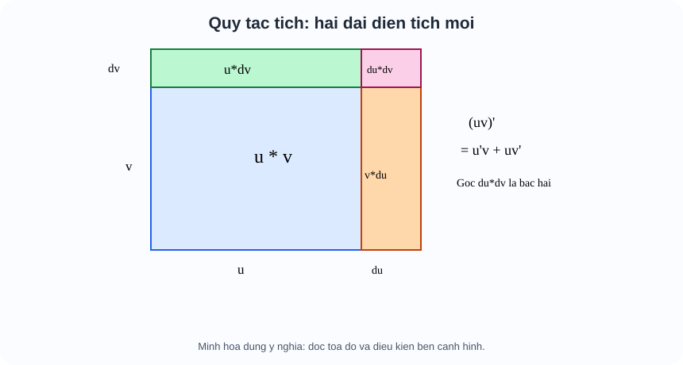
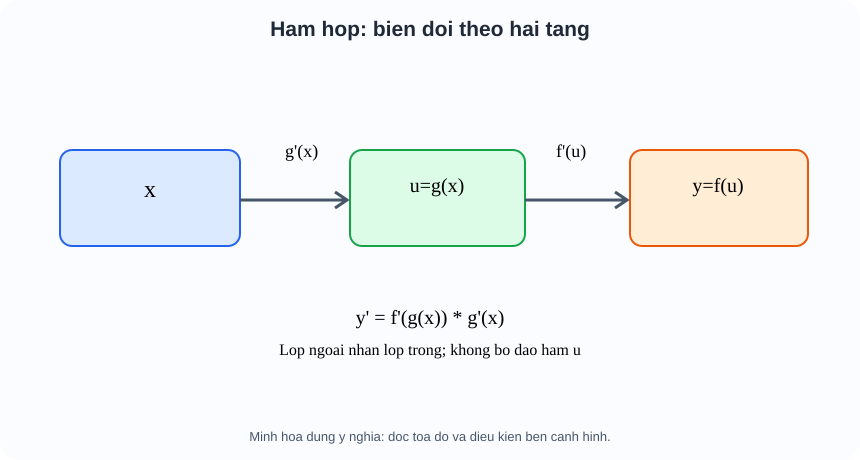

# Toán 11 · Bài 32. Các quy tắc tính đạo hàm

TOÁN 11 · CHƯƠNG IX · BÀI 32 · SGK KNTT TẬP HAI

Hiểu nhu cầu → điều kiện → bản chất trước công thức → xem hình minh họa → Tự thử trước Core → ví dụ có suy luận → Core, Luyện tập và tự khắc phục. Không ghi Mastery từ hoạt động tự học.
<nav class="thpt-r4-lesson-tabs"><a href="../">Chương IX</a><a href="../luyen-tap/">Core/Luyện tập</a><a href="../tu-kiem-tra-chuong/">Tự kiểm tra tự đối chiếu</a></nav>

=== "Khám phá kiến thức"

    ### Cùng tìm hiểu

    ### 1.1. Không thể giải mọi bài bằng giới hạn từ đầu
    Định nghĩa giới hạn giúp ta **hiểu** đạo hàm, nhưng với $f(x)=(x^2+1)\sin(3x)$, khai triển $f(x+h)$ rất dài. Cần các quy tắc bảo toàn ý nghĩa **tốc độ biến đổi** khi cộng, nhân, chia và lồng các hàm. Quy tắc là hệ quả của định nghĩa, không phải mẹo đại số.

    ### Ví dụ trực quan

    Việc tính đạo hàm hàm hợp từng lần bằng định nghĩa sẽ rất dài; các quy tắc đạo hàm diễn tả cách thay đổi của tổng, tích, thương và hàm lồng nhau.

    **Quan sát bằng số liệu:** Với y=(x²+1)³, đạo hàm không phải 3(x²+1)²; phải nhân thêm đạo hàm bên trong 2x để được 6x(x²+1)².

    ### Thuật ngữ và kiến thức, kỹ năng

    **Thuật ngữ:** đạo hàm tổng, tích, thương, hàm hợp, hàm mũ/log/lượng giác.

    **Sau bài học, em cần:** nhận diện lớp hàm ngoài/trong, kiểm miền xác định và không bỏ hệ số dây chuyền.

=== "Kiến thức SGK"

    ### 1.2. Đạo hàm hàm sơ cấp và kiểm điều kiện
    - $(c)'=0$, $(x)'=1$; với $n$ nguyên dương $(x^n)'=nx^{n-1}$. Ví dụ $(x^3)'=3x^2$. Không nhầm $(x^n)'$ với $x^{n-1}$ (thiếu hệ số n).
    - Với $x>0$, $(\sqrt{x})'=1/(2\sqrt{x})$, vì $[\sqrt{x+h}-\sqrt{x}]/h=1/[\sqrt{x+h}+\sqrt{x}]$. **Tại x=0** có giá trị căn nhưng công thức đạo hàm không xác định; không dùng nó tại 0.
    - Đạo hàm $\sin x$ là $\cos x$, đạo hàm $\cos x$ là $-\sin x$ khi góc $x$ đo **radian**. $(\tan x)'=1/\cos^2x$ với $\cos x\ne0$; $(\cot x)'=-1/\sin^2x$ với $\sin x\ne0$. Giải thích: tan=sin/cos nên dấu và mẫu của quy tắc thương quyết định kết quả.
    - $(e^x)'=e^x$, $(a^x)'=a^x\ln a$ với $a>0,a\ne1$; $(\ln x)'=1/x$ khi $x>0$; $(\log_a x)'=1/(x\ln a)$ khi $a>0,a\ne1$, $x>0$. Cơ số $a$ ở đây là **hằng số**, không phải biến.

    ### 1.3. Vì sao đạo hàm của tích không chỉ là tích đạo hàm?
    Khi cả $u$ lẫn $v$ thay đổi, $(u+\Delta u)(v+\Delta v)-uv=v\Delta u+u\Delta v+\Delta u\Delta v$. Chia $\Delta x$ rồi lấy giới hạn, số hạng tích hai độ tăng nhỏ không đóng góp vào đạo hàm: **$(uv)'=u'v+uv'$**. Hình FIG-G11-CHIX-B32-01 cho thấy hình chữ nhật rộng $u$, cao $v$ xuất hiện hai dải diện tích chính khi cả hai cạnh tăng, giải thích vì sao phải cộng **hai** tích. Ví dụ $(x(x^2+1))'=(x^2+1)+x(2x)=3x^2+1$, không phải $1\cdot2x$.

    ### 1.4. Tổng, hiệu, thương — và điều kiện mẫu
    $(u\pm v)'=u'\pm v'$, $(cu)'=cu'$. Với $v(x)\ne0$ và u,v khả vi, $(u/v)'=[u'v-uv']/v^2$. Dấu trừ và mẫu bình phương là bắt buộc; tại nghiệm của v, hàm ban đầu không có nghĩa, dù một biểu thức đạo hàm sau rút gọn có vẻ hữu hạn. Ví dụ $f(x)=(x+2)/(x-1)$ với $x\ne1$: $f'(x)=[(x-1)-(x+2)]/(x-1)^2=-3/(x-1)^2$.

    ### 1.5. Hàm số hợp và quy tắc dây chuyền
    Trong $y=f(g(x))$, x thay đổi làm $u=g(x)$ thay đổi, sau đó y=f(u) thay đổi. Vì $\Delta y/\Delta x=(\Delta y/\Delta u)(\Delta u/\Delta x)$ khi các thương có nghĩa, sau lấy giới hạn nhận được **$(f\circ g)'(x)=f'(g(x))\,g'(x)$**. Với $y=(3x-2)^5$, bước trong $u=3x-2$ có $u'=3$, bước ngoài $u^5$ có đạo hàm $5u^4$, kết quả $15(3x-2)^4$. **Không** được bỏ nhân 3. Hình FIG-G11-CHIX-B32-02 vẽ hai tầng đầu vào và nhân các tốc độ biến đổi.

    ### 1.6. Hàm lượng giác hợp, mũ hợp, logarit hợp
    Với $u=u(x)$ khả vi và biểu thức xác định: $(\sin u)'=u'\cos u$, $(\cos u)'=-u'\sin u$, $(\tan u)'=u'/\cos^2 u$ (cos u≠0), $(\cot u)'=-u'/\sin^2 u$ (sin u≠0); $(e^u)'=u'e^u$, $(a^u)'=u'a^u\ln a$ (a>0,a≠1); $(\ln u)'=u'/u$ **khi $u>0$**; $(\log_a u)'=u'/(u\ln a)$ khi u>0. Ví dụ $\ln(4-x^2)$ chỉ có nghĩa khi $-2<x<2$, đạo hàm $-2x/(4-x^2)$ trên **chính** miền đó.

    ### 1.7. Quy trình lựa chọn phương pháp, không học bảng thuộc lòng
    **(i)** Xác định miền xác định trước; **(ii)** tách các lớp ngoài–trong: tổng, tích, thương, hàm hợp; **(iii)** dùng quy tắc; **(iv)** rút gọn vừa đủ; **(v)** kiểm đơn vị, dấu và miền. Với $f(x)=x^2 e^{3x}$: dùng tích ở ngoài, chain ở thành phần mũ → $f'=2xe^{3x}+3x^2e^{3x}=e^{3x}(2x+3x^2)$. Chỉ $(x^2)'(e^{3x})'$ cho kết quả sai.

    ### Vận dụng — tự giải trước khi đối chiếu
    Tự giải $y=(x+1)\cos(2x)$; $z=\ln(5-x)$; $w=e^{x^2}$. Hãy nêu **mỗi biểu thức dùng quy tắc ngoài nào và vì sao**.

    

Em đã tự thử? Mở lời giải đối chiếu

<strong>Đối chiếu sau khi thử:</strong> $y'=\cos2x-2(x+1)\sin2x$ (tích+dây chuyền); $z'=-1/(5-x)$, chỉ $x&lt;5$ (log+dây chuyền); $w'=2xe^{x^2}$ (hàm mũ hợp). Cần biết mũ, log, lượng giác trong cùng một chương, không chỉ đa thức.

    **Liên kết D6:** `HELP-G11-CHIX-B32-01` (quy tắc tích), `...-02` (chain), `...-03` (miền log/căn), `...-04` (sin/cos/tan/cot), `...-05` (thương).

    ### 1.9. Đọc hình để hiểu lập luận

    <figure class="thpt-r4-plot thpt-r4-calculus-figure"><figcaption>Hình minh họa 1 — đọc hình theo lời giải thích trong phần Kiến thức ở trên.</figcaption></figure>

    <figure class="thpt-r4-plot thpt-r4-calculus-figure"><figcaption>Hình minh họa 2 — đọc hình theo lời giải thích trong phần Kiến thức ở trên.</figcaption></figure>

=== "Ví dụ"

    #### EX-G11-CHIX-B32-01: Quy tắc lũy thừa

    **Bài toán:** $f(x)=4x^5-3x^2+7$; tìm $f'$.

    **Phân tích, đáp án:** $f'=20x^4-6x$; số hằng 7 có đạo hàm 0.

    **Vì sao:** Dùng hệ số n; không chuyển thành 4x^4.

    #### EX-G11-CHIX-B32-02: Căn và miền

    **Bài toán:** $f(x)=2\sqrt{x}+x$; đạo hàm ở x>0.

    **Phân tích, đáp án:** $f'(x)=1/\sqrt{x}+1$ với x>0; f xác định ở 0 nhưng công thức đạo hàm không có ở đó.

    **Vì sao:** Áp dụng $(\sqrt{x})'=1/(2\sqrt{x})$ và nhân 2.

    #### EX-G11-CHIX-B32-03: Tích

    **Bài toán:** $f(x)=(x^2+2)(x-3)$; đạo hàm chưa khai triển.

    **Phân tích, đáp án:** $f'=2x(x-3)+(x^2+2)$, hay $3x^2-6x+2$.

    **Vì sao:** Hai cạnh cùng thay đổi; không chỉ lấy hai đạo hàm nhân nhau.

    #### EX-G11-CHIX-B32-04: Thương

    **Bài toán:** $f(x)=(2x-1)/(x+2)$; tính f' và TXĐ.

    **Phân tích, đáp án:** $f'=5/(x+2)^2$, x≠-2.

    **Vì sao:** Tử số 2(x+2)-(2x-1)=5; mẫu bình phương.

    #### EX-G11-CHIX-B32-05: Hàm hợp lũy thừa

    **Bài toán:** $f(x)=(x^2+3x)^4$; tính f'.

    **Phân tích, đáp án:** $f'=4(x^2+3x)^3(2x+3)$.

    **Vì sao:** Đạo hàm ngoài 4u³, nhân u'=2x+3.

    #### EX-G11-CHIX-B32-06: Tích và hợp

    **Bài toán:** $f(x)=x\sin(2x)$; tính f'.

    **Phân tích, đáp án:** $f'=\sin(2x)+2x\cos(2x)$.

    **Vì sao:** Áp tích; sin(2x) cần chain nhân 2.

    #### EX-G11-CHIX-B32-07: Cos hợp

    **Bài toán:** $f(x)=3\cos(4x)$; tính f'.

    **Phân tích, đáp án:** $f'=-12\sin(4x)$.

    **Vì sao:** Đạo hàm cos có dấu âm và hàm trong 4x có đạo hàm 4.

    #### EX-G11-CHIX-B32-08: Tan với miền

    **Bài toán:** $f(x)=\tan(2x)$; đạo hàm và điều kiện.

    **Phân tích, đáp án:** $f'=2/\cos^2(2x)$ tại cos(2x)≠0 (x≠π/4+kπ/2).

    **Vì sao:** Không áp dụng ở tiệm cận tan.

    #### EX-G11-CHIX-B32-09: Cot với dấu

    **Bài toán:** $f(x)=\cot(3x)$; đạo hàm.

    **Phân tích, đáp án:** $f'=-3/\sin^2(3x)$ với sin(3x)≠0.

    **Vì sao:** Cot âm và chain nhân 3.

    #### EX-G11-CHIX-B32-10: Mũ e hợp

    **Bài toán:** $f(x)=e^{x^2+1}$; tính f'.

    **Phân tích, đáp án:** $f'=2xe^{x^2+1}$.

    **Vì sao:** e^u đạo hàm bằng chính e^u nhân u'.

    #### EX-G11-CHIX-B32-11: Mũ cơ số 3

    **Bài toán:** $f(x)=3^{2x}$; tính f'.

    **Phân tích, đáp án:** $f'=2\ln(3)\,3^{2x}$ với x∈ℝ.

    **Vì sao:** Cơ số 3 đưa ln 3; chain nhân 2.

    #### EX-G11-CHIX-B32-12: Log tự nhiên

    **Bài toán:** $f(x)=\ln(4-x)$; f' trên miền.

    **Phân tích, đáp án:** $f'=-1/(4-x)$ trên x<4.

    **Vì sao:** Miền đối số 4-x>0; không bỏ dấu âm.

    #### EX-G11-CHIX-B32-13: Log cơ số 2

    **Bài toán:** $f(x)=\log_2(3x+1)$; f' trên miền.

    **Phân tích, đáp án:** $f'=3/[(3x+1)\ln2]$ với x>-1/3.

    **Vì sao:** Nhân đạo hàm đối số 3 và giữ ln2.

    #### EX-G11-CHIX-B32-14: Quy tắc tích lẫn mũ

    **Bài toán:** $f(x)=(x+1)e^{-x}$; tính f'.

    **Phân tích, đáp án:** $f'=e^{-x}-(x+1)e^{-x}=-xe^{-x}$.

    **Vì sao:** Đạo hàm của e^{-x} mang dấu âm; rồi áp tích.

    #### EX-G11-CHIX-B32-15: Thương của hai hàm

    **Bài toán:** $f(x)=\sin x/(x^2+1)$; tính f'.

    **Phân tích, đáp án:** $f'=[(x^2+1)\cos x-2x\sin x]/(x^2+1)^2$ với mọi x.

    **Vì sao:** Mẫu luôn >0, trừ tử hai tích đúng thứ tự.

    #### EX-G11-CHIX-B32-16: Điều kiện log hợp

    **Bài toán:** $f(x)=\ln(x^2-4)$, tìm miền và f'.

    **Phân tích, đáp án:** Miền x<-2 hoặc x>2; f'=2x/(x^2-4) chỉ trên miền đó.

    **Vì sao:** x²−4 dương ngoài [-2,2], không dùng ở -2<x<2.

    #### EX-G11-CHIX-B32-17: Hàm hợp căn

    **Bài toán:** $f(x)=\sqrt{5x+1}$; f' trên miền thích hợp.

    **Phân tích, đáp án:** $f'=5/[2\sqrt{5x+1}]$ tại x>-1/5.

    **Vì sao:** f có giá trị ở x=-1/5 nhưng không có đạo hàm hữu hạn hai phía.

    #### EX-G11-CHIX-B32-18: Trộn tan và cot

    **Bài toán:** $f(x)=\tan x-\cot x$; tính đạo hàm và miền.

    **Phân tích, đáp án:** $f'=1/\cos^2x+1/\sin^2x$ tại sin x≠0 và cos x≠0.

    **Vì sao:** Trừ cot làm hai dấu âm thành dấu cộng.

=== "Lỗi thường gặp"

    

<strong>Chẩn đoán lỗi:</strong> Lấy u'v' thay cho u'v+uv'.
<ol><li><strong>Phát hiện lỗi:</strong> Lấy u'v' thay cho u'v+uv'.</li><li><strong>Truy lại bản chất + điều kiện:</strong> Tích hai hàm tăng/giảm tạo hai phần biến thiên tương ứng.</li><li><strong>Xem lại vì sao (WHY/HOW):</strong> Mở D1 B32, so sánh mệnh đề định nghĩa với ví dụ D2; giải thích bằng lời trước khi biến đổi ký hiệu.</li><li><strong>Tự luyện câu khác có dẫn dắt:</strong> Tính (x·x³)' theo hai cách. <strong>Tự kiểm sau khi thử:</strong> x³+3x³=4x³.</li><li><strong>Trở về câu canonical:</strong> <code>THPT-G11-CHIX-B32-P04</code> và giải lại, tự giải thích lí do từng bước; không lấy xem lời giải làm chứng cứ độc lập cho Mastery.</li></ol>
<a href="../luyen-tap/?item=THPT-G11-CHIX-B32-P04">Quay lại câu canonical THPT-G11-CHIX-B32-P04</a>

    

<strong>Chẩn đoán lỗi:</strong> Quên đạo hàm hàm trong.
<ol><li><strong>Phát hiện lỗi:</strong> Quên đạo hàm hàm trong.</li><li><strong>Truy lại bản chất + điều kiện:</strong> Xác định lớp ngoài u^n và lớp trong u(x); viết u' rồi nhân.</li><li><strong>Xem lại vì sao (WHY/HOW):</strong> Mở D1 B32, so sánh mệnh đề định nghĩa với ví dụ D2; giải thích bằng lời trước khi biến đổi ký hiệu.</li><li><strong>Tự luyện câu khác có dẫn dắt:</strong> Tính [(5x+1)³]'. <strong>Tự kiểm sau khi thử:</strong> 15(5x+1)².</li><li><strong>Trở về câu canonical:</strong> <code>THPT-G11-CHIX-B32-P06</code> và giải lại, tự giải thích lí do từng bước; không lấy xem lời giải làm chứng cứ độc lập cho Mastery.</li></ol>
<a href="../luyen-tap/?item=THPT-G11-CHIX-B32-P06">Quay lại câu canonical THPT-G11-CHIX-B32-P06</a>

    

<strong>Chẩn đoán lỗi:</strong> Dùng đạo hàm của log/căn ở điểm hàm không tồn tại.
<ol><li><strong>Phát hiện lỗi:</strong> Dùng đạo hàm của log/căn ở điểm hàm không tồn tại.</li><li><strong>Truy lại bản chất + điều kiện:</strong> ĐKXĐ của hàm gốc phải kiểm trước khi đạo hàm, đặc biệt ln u cần u&gt;0.</li><li><strong>Xem lại vì sao (WHY/HOW):</strong> Mở D1 B32, so sánh mệnh đề định nghĩa với ví dụ D2; giải thích bằng lời trước khi biến đổi ký hiệu.</li><li><strong>Tự luyện câu khác có dẫn dắt:</strong> ln(x-4) có nghĩa ở x=1?. <strong>Tự kiểm sau khi thử:</strong> Không, chỉ x&gt;4.</li><li><strong>Trở về câu canonical:</strong> <code>THPT-G11-CHIX-B32-P13</code> và giải lại, tự giải thích lí do từng bước; không lấy xem lời giải làm chứng cứ độc lập cho Mastery.</li></ol>
<a href="../luyen-tap/?item=THPT-G11-CHIX-B32-P13">Quay lại câu canonical THPT-G11-CHIX-B32-P13</a>

    

<strong>Chẩn đoán lỗi:</strong> Bỏ dấu trừ cos hoặc cot.
<ol><li><strong>Phát hiện lỗi:</strong> Bỏ dấu trừ cos hoặc cot.</li><li><strong>Truy lại bản chất + điều kiện:</strong> Nhớ cos'=-sin, cot'=-1/sin², rồi nhân u'.</li><li><strong>Xem lại vì sao (WHY/HOW):</strong> Mở D1 B32, so sánh mệnh đề định nghĩa với ví dụ D2; giải thích bằng lời trước khi biến đổi ký hiệu.</li><li><strong>Tự luyện câu khác có dẫn dắt:</strong> Tính [cos(2x)]'. <strong>Tự kiểm sau khi thử:</strong> -2sin(2x).</li><li><strong>Trở về câu canonical:</strong> <code>THPT-G11-CHIX-B32-P09</code> và giải lại, tự giải thích lí do từng bước; không lấy xem lời giải làm chứng cứ độc lập cho Mastery.</li></ol>
<a href="../luyen-tap/?item=THPT-G11-CHIX-B32-P09">Quay lại câu canonical THPT-G11-CHIX-B32-P09</a>

    

<strong>Chẩn đoán lỗi:</strong> Đổi nhầm thứ tự tử quy tắc thương.
<ol><li><strong>Phát hiện lỗi:</strong> Đổi nhầm thứ tự tử quy tắc thương.</li><li><strong>Truy lại bản chất + điều kiện:</strong> (u/v)'=(u'v-uv')/v², v≠0; giữ ngoặc.</li><li><strong>Xem lại vì sao (WHY/HOW):</strong> Mở D1 B32, so sánh mệnh đề định nghĩa với ví dụ D2; giải thích bằng lời trước khi biến đổi ký hiệu.</li><li><strong>Tự luyện câu khác có dẫn dắt:</strong> Tính [x/(x+3)]'. <strong>Tự kiểm sau khi thử:</strong> 3/(x+3)², x≠-3.</li><li><strong>Trở về câu canonical:</strong> <code>THPT-G11-CHIX-B32-P05</code> và giải lại, tự giải thích lí do từng bước; không lấy xem lời giải làm chứng cứ độc lập cho Mastery.</li></ol>
<a href="../luyen-tap/?item=THPT-G11-CHIX-B32-P05">Quay lại câu canonical THPT-G11-CHIX-B32-P05</a>

    ### Học tiếp

    [Core/Luyện tập Bài 32](luyen-tap.md) · [Tự luận Chương IX](../../../thu-vien/tu-luan-g11-chuong-ix.md) · [Tự kiểm tra cuối chương](tu-kiem-tra-chuong.md)
