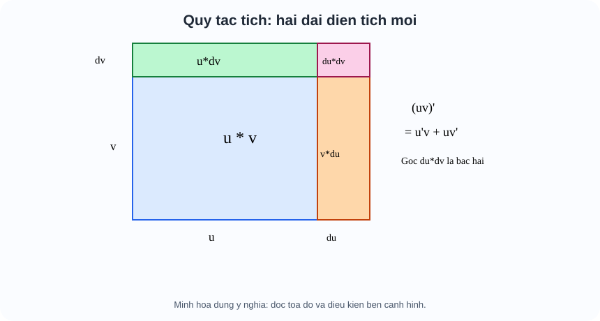

# Bài 32. Các quy tắc tính đạo hàm

TOÁN 11 · CHƯƠNG IX · KẾT NỐI TRI THỨC · TẬP HAI

Định nghĩa cho biết đạo hàm là gì; các quy tắc giúp tìm đạo hàm của những hàm số phức tạp mà không phải tính lại giới hạn từ đầu.

<nav class="thpt-r4-lesson-tabs"><a href="../">Chương IX</a><a href="../luyen-tap/">Core/Luyện tập</a><a href="../tu-kiem-tra-chuong/">Tự kiểm tra cuối chương</a></nav>

=== "Khám phá kiến thức"

    Ở bài trước, em đã tính đạo hàm bằng giới hạn của thương sai phân. Cách ấy rất quan trọng vì giải thích **đạo hàm đo điều gì**. Nhưng nếu một hàm số là tổng, tích hoặc gồm nhiều lớp như \(y=\sqrt{x^2+1}\), việc khai triển từ định nghĩa mỗi lần sẽ rất dài. Những quy tắc trong bài này cho phép tận dụng đạo hàm của các phần nhỏ để tìm đạo hàm của cả hàm số. Ta sẽ tìm hiểu từng quy tắc qua **cách hàm số được tạo thành**.

    ### 1.1. Đạo hàm của một số hàm số thường gặp

    Trước hết xét \(y=x^3\). Tại một điểm \(x\) bất kì, thương sai phân là

    \[
    \frac{(x+h)^3-x^3}{h}
    =3x^2+3xh+h^2\quad(h\ne0).
    \]

    Khi \(h\to0\), hai số hạng chứa \(h\) tiến về \(0\), còn lại \(3x^2\). Như vậy \((x^3)'=3x^2\). Cùng cách lập luận ấy cho số nguyên \(n\ge2\), ta thu được \((x^n)'=nx^{n-1}\). Riêng \((x)'=1\), kể cả tại \(x=0\). Con số \(n\) không xuất hiện tùy tiện: nó đến từ **hệ số của phần biến thiên bậc nhất** khi khai triển \((x+h)^n\).

    Còn với \(y=\sqrt{x}\), việc khai triển không thuận tiện. Ta nhân tử và mẫu của thương sai phân với biểu thức liên hợp:

    \[
    \frac{\sqrt{x+h}-\sqrt{x}}{h}
    =\frac{1}{\sqrt{x+h}+\sqrt{x}}\quad(h\ne0).
    \]

    Nếu \(x>0\), cho \(h\to0\) nhận được \(1/(2\sqrt{x})\). Tại \(x=0\), hàm vẫn có giá trị nhưng công thức này không cho một đạo hàm hữu hạn trên một khoảng chứa \(0\). **Có giá trị tại một điểm không có nghĩa là có đạo hàm tại điểm ấy.**

    Hai cách tính trên cho thấy các công thức đạo hàm không tách rời định nghĩa. Chúng chỉ giúp ta **ghi nhớ kết quả đã có lí do** và chú ý đúng nơi có thể áp dụng.

    **Vận dụng.** Từ công thức lũy thừa và căn bậc hai, tìm đạo hàm của \(f(x)=x^5\) trên \(\mathbb R\), và tính đạo hàm của \(g(x)=\sqrt{x}\) tại \(x=9\).

    ??? question "Đối chiếu"

        **Lời giải.** \(f'(x)=5x^4\) với mọi \(x\in\mathbb R\). Với \(x>0\), \(g'(x)=1/(2\sqrt{x})\), vì vậy \(g'(9)=1/(2\cdot3)=1/6\).

        **Kiểm lại:** Tại \(x=9\), căn bậc hai xác định và \(x>0\). Không lấy \(g'(0)\) bằng cách thay \(0\) vào công thức có mẫu \(2\sqrt{x}\).

        **Kiểm lỗi:** Nếu viết \((x^5)'=x^4\), em đã thiếu hệ số \(5\) được tạo ra khi khai triển thương sai phân.

    ### 1.2. Đạo hàm của tổng, hiệu, tích, thương

    Nếu \(u(x)\), \(v(x)\) đều thay đổi theo \(x\), thì tổng của chúng thay đổi một lượng \(\Delta u+\Delta v\); vì thế đạo hàm của tổng bằng \(u'+v'\), của hiệu bằng \(u'-v'\). Nhân cả hàm số với một số không đổi \(k\) thì tốc độ biến đổi cũng được nhân với \(k\). Nhờ đó, ta tính được đạo hàm của đa thức mà không cần khai triển \(f(x+h)\) mỗi lần.

    Đối với **tích** \(uv\), không thể chỉ nhân \(u'\) với \(v'\). Hãy hình dung một hình chữ nhật có chiều dài \(u\), chiều rộng \(v\), diện tích \(uv\). Khi chiều dài tăng thêm \(\Delta u\) và chiều rộng tăng thêm \(\Delta v\), diện tích mới tăng gồm **dải do chiều dài tăng**, **dải do chiều rộng tăng** và **góc nhỏ** có diện tích \(\Delta u\,\Delta v\):

    \[
    \Delta(uv)=v\,\Delta u+u\,\Delta v+\Delta u\,\Delta v.
    \]

    Chia cho \(\Delta x\ne0\) rồi lấy giới hạn: \(\Delta u/\Delta x\to u'\), \(\Delta v/\Delta x\to v'\) và \(\Delta v\to0\), vì hàm có đạo hàm thì liên tục. Do đó \((\Delta u/\Delta x)\Delta v\to0\): phần góc nhỏ không đóng góp vào giới hạn. Vì thế \((uv)'=u'v+uv'\): **hai thành phần cùng biến đổi nên có hai số hạng**.

    <figure class="thpt-r4-plot thpt-r4-calculus-figure"><figcaption><strong>Đọc hình:</strong> miền giữa là diện tích ban đầu \(uv\), hai dải bên trên và bên phải biểu diễn \(u\,\Delta v\) và \(v\,\Delta u\); góc nhỏ là \(\Delta u\,\Delta v\). Hình minh họa khi hai kích thước tăng; công thức đạo hàm của tích vẫn đúng khi các hàm biến thiên theo chiều ngược lại.</figcaption></figure>

    Ví dụ, với \(u=x\), \(v=x^2+1\), quy tắc tích cho \(\bigl[x(x^2+1)\bigr]'=(x^2+1)+x(2x)=3x^2+1\). Nếu em nhân hai đạo hàm, chỉ được \(2x\), rõ ràng sai: khai triển hàm gốc là \(x^3+x\), đạo hàm phải bằng \(3x^2+1\).

    Với **thương** \(u/v\), điều đầu tiên phải hỏi là **\(v\) có bằng \(0\) không?**. Để hiểu công thức, cố định một điểm \(x\) có \(v(x)\ne0\), đặt \(u=u(x),v=v(x)\), và gọi \(\Delta u,\Delta v\) là các độ thay đổi khi \(x\) đổi thêm \(h\). Quy đồng thương sai phân:

    \[
    \frac{(u+\Delta u)/(v+\Delta v)-u/v}{h}
    =\frac{v(\Delta u/h)-u(\Delta v/h)}{v(v+\Delta v)}.
    \]

    Vì \(v\) có đạo hàm nên liên tục, \(v+\Delta v\) khác 0 khi \(h\) đủ gần 0. Khi \(h\to0\), ta có \(\Delta u/h\to u'\), \(\Delta v/h\to v'\), và \(\Delta v\to0\). Vậy thương sai phân có giới hạn hữu hạn và ta được

    \[
    \left(\frac uv\right)'=\frac{u'v-uv'}{v^2}\quad(v\ne0).
    \]

    Dấu trừ ở tử số và mẫu bình phương là phần không được bỏ. Chẳng hạn, với \(y=(2x+1)/(x-1)\), điều kiện là \(x\ne1\), còn đạo hàm bằng \([2(x-1)-(2x+1)]/(x-1)^2=-3/(x-1)^2\).

    **Vận dụng.** Tính đạo hàm của \(f(x)=x^2(x+1)\) theo quy tắc tích rồi kiểm lại bằng cách khai triển. Tính đạo hàm của \(g(x)=(x+2)/(x-1)\) và nêu điều kiện.

    ??? question "Đối chiếu"

        **Lời giải.** \(f'(x)=2x(x+1)+x^2=3x^2+2x\). Nếu khai triển \(f=x^3+x^2\), ta cũng được \(3x^2+2x\).

        Với \(x\ne1\),

        \[
        g'(x)=\frac{(x-1)-(x+2)}{(x-1)^2}
        =-\frac3{(x-1)^2}.
        \]

        **Kiểm lỗi:** Nếu đảo thành \(uv'-u'v\), kết quả sẽ đổi dấu. Hãy giữ rõ thứ tự **đạo hàm tử × mẫu trừ tử × đạo hàm mẫu**.

    ### 1.3. Đạo hàm của hàm số hợp

    Không phải hàm số nào cũng được tạo bởi phép cộng hoặc nhân hai biểu thức. Xét diện tích chiếc đĩa tròn \(S=\pi r^2\). Nếu bán kính \(r\) thay đổi theo nhiệt độ \(t\), diện tích cũng thay đổi theo nhiệt độ, nhưng **qua hai bước**: nhiệt độ \(t\) làm thay đổi bán kính \(r(t)\); bán kính lại quyết định diện tích \(S(r)\).

    Cách ghép ấy gọi là **hàm số hợp**. Với \(u=g(x)\), \(y=f(u)\), ta được \(y=f(g(x))\). Để tính tốc độ thay đổi của \(y\) theo \(x\), ta nhân tốc độ thay đổi **từ \(x\) sang \(u\)** với tốc độ thay đổi **từ \(u\) sang \(y\)**:

    \[
    \frac{dy}{dx}=\frac{dy}{du}\cdot\frac{du}{dx},
    \]

    khi các đạo hàm tương ứng tồn tại. Đó chính là **quy tắc dây chuyền**, viết \(y'=f'(g(x))\,g'(x)\).

    <figure class="thpt-r4-plot thpt-r4-calculus-figure"><figcaption><strong>Đọc hình:</strong> theo mũi tên từ \(x\) sang \(u=g(x)\), sau đó sang \(y=f(u)\). Hệ số \(g'(x)\) thuộc bước thứ nhất, \(f'(u)\) thuộc bước thứ hai. Đạo hàm theo \(x\) bằng **tích** hai hệ số, không phải chỉ đạo hàm lớp ngoài.</figcaption></figure>

    Ví dụ \(y=(2x+1)^3\) là hàm hợp của \(y=u^3\) với \(u=2x+1\). Đạo hàm theo \(u\) bằng \(3u^2\), còn \(u'(x)=2\), nên

    \[
    y'=3(2x+1)^2\cdot2=6(2x+1)^2.
    \]

    Hệ số \(2\) xuất hiện vì một thay đổi nhỏ của \(x\) làm \(u\) thay đổi **gấp đôi**. Tương tự, với \(y=\sqrt{x^2+1}\), ta có \(u=x^2+1>0\), nên \(y'=(1/(2\sqrt u))\cdot2x=x/\sqrt{x^2+1}\). Điều kiện của lớp ngoài vẫn phải được giữ.

    **Vận dụng.** Tìm đạo hàm của \(y=(3x-2)^5\) và \(z=\sqrt{1-x^2}\). Hãy chỉ rõ “hàm trong” và khoảng mà công thức đạo hàm của \(z\) áp dụng.

    ??? question "Đối chiếu"

        **Lời giải.** Với \(u=3x-2\), ta có \(u'=3\), do đó \(y'=5(3x-2)^4\cdot3=15(3x-2)^4\).

        Với \(v=1-x^2\), đạo hàm của \(\sqrt v\) có nghĩa khi \(v>0\), tức \(-1<x<1\). Vì \(v'=-2x\),

        \[
        z'=\frac{-2x}{2\sqrt{1-x^2}}=-\frac{x}{\sqrt{1-x^2}}\quad(-1<x<1).
        \]

        **Kiểm lỗi:** Hàm \(z\) có giá trị tại \(x=\pm1\), nhưng công thức đạo hàm có mẫu bằng \(0\) ở đó. Không ghi \(z'\) trên đoạn đóng \([-1;1]\).

    ### 1.4. Đạo hàm của hàm số lượng giác

    Ở bài về lượng giác, em đã quen \(y=\sin x\) và \(y=\cos x\). Với đạo hàm, **\(x\) được đo bằng rađian**. Để tìm \((\sin x)'\) bằng định nghĩa, biến đổi hiệu \(\sin(x+h)-\sin x\) thành

    \[
    2\cos\left(x+\frac h2\right)\sin\frac h2.
    \]

    Chia cho \(h\), ta có \(\cos(x+h/2)\cdot\frac{\sin(h/2)}{h/2}\). Khi \(h\to0\), dùng giới hạn cơ bản \(\lim_{t\to0}\sin t/t=1\) (với \(t\) đo bằng rađian), thừa số thứ hai tiến đến \(1\), thừa số thứ nhất tiến đến \(\cos x\). Vì vậy **\((\sin x)'=\cos x\)**.

    Còn \(\cos x=\sin(\pi/2-x)\). Áp dụng quy tắc dây chuyền vừa học, \((\cos x)'=\cos(\pi/2-x)\cdot(-1)=-\sin x\). Dấu trừ giải thích vì sao gần \(x=0\), khi \(x\) dương tăng một chút thì giá trị \(\cos x\) bắt đầu giảm.

    Từ \(\tan x=\sin x/\cos x\), dùng quy tắc thương:

    \[
    (\tan x)'=\frac{\cos^2x+\sin^2x}{\cos^2x}
    =\frac{1}{\cos^2x}\quad(\cos x\ne0).
    \]

    Tương tự, \((\cot x)'=-1/\sin^2x\) tại những điểm \(\sin x\ne0\). Không được bỏ điều kiện: \(\tan x\) không có nghĩa khi \(\cos x=0\), còn \(\cot x\) không có nghĩa khi \(\sin x=0\).

    Khi góc không phải \(x\) mà là \(u(x)\), **nhớ nhân \(u'(x)\)**. Chẳng hạn \(y=\sin(2x+\pi/8)\) có đạo hàm \(2\cos(2x+\pi/8)\), còn \(y=\cos(4x-\pi/3)\) có đạo hàm \(-4\sin(4x-\pi/3)\). Sự khác nhau nằm ở **dấu** của cos và **hệ số** của hàm trong.

    **Vận dụng.** Tính đạo hàm của \(y=2\cos(\pi/4-2x)\) và \(z=\tan(2x)\). Với \(z\), nêu điều kiện xác định.

    ??? question "Đối chiếu"

        **Lời giải.** Đặt \(u=\pi/4-2x\), \(u'=-2\). Khi đó \(y'=2[-\sin(u)](-2)=4\sin(\pi/4-2x)\).

        Với \(z=\tan(2x)\), theo dây chuyền:

        \[
        z'=\frac{2}{\cos^2(2x)}.
        \]

        Công thức áp dụng khi \(\cos(2x)\ne0\), hay \(x\ne\pi/4+k\pi/2\) với \(k\in\mathbb Z\).

        **Kiểm lỗi:** Nếu đạo hàm \(y\) mang dấu âm, em đã quên đạo hàm của hàm trong \(\pi/4-2x\) là \(-2\).

    ### 1.5. Đạo hàm của hàm số mũ và hàm số lôgarit

    Với hàm mũ \(e^x\), một giới hạn cơ bản là \(\lim_{h\to0}(e^h-1)/h=1\). Vì \(e^{x+h}-e^x=e^x(e^h-1)\), thương sai phân trở thành

    \[
    \frac{e^{x+h}-e^x}{h}
    =e^x\frac{e^h-1}{h}\longrightarrow e^x.
    \]

    Đó là nét đặc biệt của cơ số \(e\): **đạo hàm của \(e^x\) chính là \(e^x\)**. Với cơ số \(a>0\), \(a\ne1\), dùng \(a^x=e^{x\ln a}\) và quy tắc dây chuyền được \((a^x)'=a^x\ln a\). Hệ số \(\ln a\) là điều không được quên khi cơ số khác \(e\).

    Với hàm lôgarit tự nhiên, từ \(\ln(x+h)-\ln x=\ln(1+h/x)\) và \(\lim_{t\to0}\ln(1+t)/t=1\). Đặt \(t=h/x\) với \(x>0\); thương sai phân bằng \(\frac1x\frac{\ln(1+t)}t\), suy ra

    \[
    (\ln x)'=\frac1x\qquad(x>0).
    \]

    Vì \(\log_a x=\ln x/\ln a\), đạo hàm là \(1/(x\ln a)\) khi \(x>0\), \(a>0\), \(a\ne1\). Nếu thay \(x\) bằng một biểu thức \(u(x)\), ta lại dùng **quy tắc dây chuyền**. Ví dụ, \(y=\ln(x^2+1)\) có đạo hàm \(2x/(x^2+1)\) trên \(\mathbb R\), vì đối số \(x^2+1\) luôn dương.

    Điều kiện của lôgarit rất quan trọng. \(y=\ln(4-x^2)\) chỉ xác định khi \(-2<x<2\), và công thức \(y'=-2x/(4-x^2)\) cũng chỉ được dùng trong khoảng ấy. Với \(\ln|x|\), ta xét hai trường hợp \(x>0\) và \(x<0\); cả hai cho đạo hàm \(1/x\), nhưng tại \(x=0\) hàm **không xác định**.

    Một ứng dụng quen thuộc là độ pH của dung dịch: \(\mathrm{pH}=-\log_{10}c\), với \(c=[H^+]>0\) đo bằng mol/lít theo mô hình đã cho. Khi nồng độ \(c\) biến đổi, đạo hàm theo \(c\) là \(-1/(c\ln10)\). Dấu âm nói rằng **nồng độ ion hiđrô tăng thì pH giảm**. Nếu nồng độ tăng lên **10 lần**, pH giảm đúng **1 đơn vị** trong mô hình này.

    **Vận dụng.** Tính đạo hàm của \(f(x)=3^{\sin x}\) và \(g(x)=\ln(5-x^2)\); với \(g\), nêu miền xác định của hàm và của công thức đạo hàm.

    ??? question "Đối chiếu"

        **Lời giải.** Với \(f\), hàm trong \(u=\sin x\) có \(u'=\cos x\), nên

        \[
        f'(x)=3^{\sin x}\ln3\cdot\cos x.
        \]

        Với \(g\), điều kiện \(5-x^2>0\) tương đương \(-\sqrt5<x<\sqrt5\). Trên khoảng ấy:

        \[
        g'(x)=\frac{-2x}{5-x^2}.
        \]

        **Kiểm lỗi:** Nếu ghi \(g'\) với mọi \(x\in\mathbb R\), em đã quên hàm lôgarit **không tồn tại** khi đối số không dương.

=== "Kiến thức SGK"

    ### 2.1. Đạo hàm của một số hàm số thường gặp

    
<strong>Các công thức đạo hàm cơ bản</strong>
Với \(c\) là hằng số: \((c)'=0\), \((x)'=1\) trên \(\mathbb R\). Với số nguyên \(n\ge2\), \((x^n)'=nx^{n-1}\) trên \(\mathbb R\); \(\displaystyle (\sqrt{x})'=\frac{1}{2\sqrt{x}}\) khi \(x>0\). Hàm \(\sqrt{x}\) xác định tại \(x=0\) nhưng <strong>không có đạo hàm hữu hạn</strong> tại điểm biên đó theo giới hạn từ phải.

    **Đọc công thức:** Bậc \(n\) trở thành hệ số, số mũ giảm \(1\). Với căn thức, phải kiểm \(x>0\) trước khi thay vào công thức. Khi gặp biểu thức được tạo từ nhiều hàm, cần kết hợp các quy tắc ở những mục tiếp theo.

    ### 2.2. Đạo hàm của tổng, hiệu, tích, thương

    
<strong>Các quy tắc tính đạo hàm</strong>
Cho \(u=u(x),v=v(x)\) có đạo hàm trên khoảng đang xét. Khi đó \((u+v)'=u'+v'\), \((u-v)'=u'-v'\), \((uv)'=u'v+uv'\), và \(\displaystyle\left(\frac uv\right)'=\frac{u'v-uv'}{v^2}\) <strong>tại các điểm \(v\ne0\)</strong>.

    
<strong>Hệ quả cần nhớ</strong>
Với hằng số \(k\), \((ku)'=ku'\). Với \(v\ne0\), \(\displaystyle\left(\frac1v\right)'=-\frac{v'}{v^2}\). Riêng \(\displaystyle\left(\frac1x\right)'=-\frac1{x^2}\) khi \(x\ne0\).

    <figure class="thpt-r4-plot thpt-r4-calculus-figure"><figcaption><strong>Tra hình:</strong> khi \(u\) và \(v\) cùng biến đổi, tích có hai phần biến thiên bậc nhất, nên đạo hàm có **hai số hạng** \(u'v\) và \(uv'\), không phải \(u'v'\).</figcaption></figure>

    **Ví dụ minh họa:** Với \(u=x\), \(v=x^2+1\), ta được \((uv)'=(x^2+1)+2x^2=3x^2+1\). Với \((2x+1)/(x-1)\), phải giữ \(x\ne1\) và được \(-3/(x-1)^2\).

    ### 2.3. Đạo hàm của hàm số hợp

    
<strong>Khái niệm — Hàm số hợp</strong>
Với \(u=g(x)\) và \(y=f(u)\), nếu giá trị của \(g(x)\) thuộc miền xác định của \(f\), ta có hàm số hợp \(y=f(g(x))\): biến \(x\) tác động đến \(y\) <strong>thông qua</strong> \(u\).

    
<strong>Quy tắc dây chuyền</strong>
Nếu \(g\) có đạo hàm tại \(x\) và \(f\) có đạo hàm tại \(u=g(x)\), thì \(\displaystyle(f(g(x)))'=f'(g(x))\cdot g'(x)\). Đặc biệt, nếu \(u=u(x)\): \((u^n)'=nu^{n-1}u'\) với số nguyên \(n\ge2\); riêng \(n=1\), đạo hàm là \(u'\) tại mọi điểm có đạo hàm; \(\displaystyle(\sqrt u)'=\frac{u'}{2\sqrt u}\) khi \(u>0\).

    <figure class="thpt-r4-plot thpt-r4-calculus-figure"><figcaption><strong>Tra hình:</strong> từ \(x\) sang \(u\) có tốc độ \(g'(x)\); từ \(u\) sang \(y\) có tốc độ \(f'(u)\). Nhân **hai tốc độ** để được đạo hàm theo \(x\).</figcaption></figure>

    **Ví dụ minh họa:** \(y=\sqrt{x^2+1}\) có \(u=x^2+1>0\) nên \(y'=2x/(2\sqrt{x^2+1})=x/\sqrt{x^2+1}\) trên \(\mathbb R\).

    ### 2.4. Đạo hàm của hàm số lượng giác

    
<strong>Bảng đạo hàm lượng giác</strong>
Với góc đo bằng <strong>rađian</strong>: \((\sin x)'=\cos x\), \((\cos x)'=-\sin x\) trên \(\mathbb R\); \(\displaystyle(\tan x)'=\frac1{\cos^2x}\) khi \(\cos x\ne0\), \(\displaystyle(\cot x)'=-\frac1{\sin^2x}\) khi \(\sin x\ne0\).

    
<strong>Lượng giác của hàm số hợp</strong>
Với \(u=u(x)\) có đạo hàm: \((\sin u)'=u'\cos u\), \((\cos u)'=-u'\sin u\), \(\displaystyle(\tan u)'=\frac{u'}{\cos^2u}\) khi \(\cos u\ne0\); \(\displaystyle(\cot u)'=-\frac{u'}{\sin^2u}\) khi \(\sin u\ne0\).

    **Giải thích dấu:** \(\cos x=\sin(\pi/2-x)\) nên đạo hàm cos có dấu âm; đạo hàm cot cũng có dấu âm. Khi đối số là \(u(x)\), phải xét đạo hàm **lớp trong**, không chỉ đạo hàm hàm lượng giác ngoài.

    ### 2.5. Đạo hàm của hàm số mũ và hàm số lôgarit

    
<strong>Hàm số mũ và hàm hợp</strong>
\((e^x)'=e^x\); nếu \(a>0,\ a\ne1\), \((a^x)'=a^x\ln a\). Với \(u=u(x)\) có đạo hàm, \((e^u)'=u'e^u\), \((a^u)'=u'a^u\ln a\).

    
<strong>Hàm số lôgarit và hàm hợp</strong>
Khi \(x>0\), \(\displaystyle(\ln x)'=\frac1x\), \(\displaystyle(\log_a x)'=\frac1{x\ln a}\) với \(a>0,\ a\ne1\). Với \(u=u(x)>0\), \(\displaystyle(\ln u)'=\frac{u'}{u}\), \(\displaystyle(\log_a u)'=\frac{u'}{u\ln a}\).

    
<strong>Ghi nhớ — Trường hợp giá trị tuyệt đối</strong>
Với \(x\ne0\), \(\displaystyle(\ln|x|)'=\frac1x\). Hàm không xác định tại \(x=0\). Nói chung, nếu \(u(x)\ne0\) và có đạo hàm thì \((\ln|u|)'=u'/u\) ở những điểm tương ứng.

    **Các giới hạn liên quan trong SGK:** \(\displaystyle\lim_{h\to0}\frac{e^h-1}{h}=1\), \(\displaystyle\lim_{h\to0}\frac{\ln(1+h)}h=1\), và \(\displaystyle\lim_{h\to0}(1+h)^{1/h}=e\). Chúng là cơ sở để hiểu vì sao công thức mũ và lôgarit xuất hiện, không phải ba mẹo tính riêng.

    **Kiểm điều kiện trước khi làm:** Mũ \(e^{u(x)}\) có nghĩa với mọi \(u(x)\) thực xác định; lôgarit \(\ln u\) hoặc \(\log_a u\) đòi \(u>0\). Ví dụ \(\ln(4-x^2)\) chỉ dùng khi \(-2<x<2\), còn \(\ln(x^2+1)\) có nghĩa với mọi \(x\).

=== "Ví dụ"

    ### 3.1. Đạo hàm của lũy thừa và căn thức

    **Đề bài.** Tính đạo hàm của \(f(x)=4x^5-3x^2+7\) trên \(\mathbb R\), và tính đạo hàm của \(g(x)=\sqrt{x}\) tại \(x=4\) và \(x=1/4\).

    **Phân tích:** Lũy thừa dùng công thức \(nx^{n-1}\), hằng số có đạo hàm \(0\). Với căn bậc hai, chỉ thay số sau khi kiểm \(x>0\).

    

<strong>Lời giải.</strong> \(f'(x)=4\cdot5x^4-3\cdot2x=20x^4-6x\). Với \(x>0\), \(g'(x)=1/(2\sqrt{x})\), nên \(g'(4)=1/4\), \(g'(1/4)=1\).

    **Kiểm lại:** Các điểm \(4\), \(1/4\) đều thuộc khoảng \(x>0\); không áp công thức \(g'\) tại \(0\).

    ### 3.2. Quy tắc tích với căn thức

    **Đề bài.** Tính đạo hàm của \(y=(2x^3+1)(\sqrt{x}-3)\) trên khoảng đạo hàm tồn tại.

    **Phân tích:** Đây là **tích của hai hàm**; mỗi thừa số đều biến đổi. Hàm chứa \(\sqrt{x}\) nên công thức đạo hàm sử dụng trên \(x>0\).

    

<strong>Lời giải.</strong> Đặt \(u=2x^3+1\), \(v=\sqrt{x}-3\), ta có \(u'=6x^2\), \(v'=1/(2\sqrt{x})\). Do đó \(\displaystyle y'=u'v+uv'=6x^2(\sqrt{x}-3)+\frac{2x^3+1}{2\sqrt{x}}\) với \(x>0\).

    **Kiểm lại:** Hàm gốc xác định khi \(x\ge0\), nhưng công thức đạo hàm này chỉ áp dụng tại \(x>0\). Tại \(x=0\), thương sai phân chứa thành phần bậc \(\sqrt h/h\) không cho đạo hàm hữu hạn.

    ### 3.3. Quy tắc thương và dấu trừ

    **Đề bài.** Tính đạo hàm của \(y=(2x+1)/(x-1)\), nêu miền xác định.

    **Phân tích:** Mẫu \(x-1\) không được bằng \(0\). Quy tắc thương có tử số \(u'v-uv'\), không phải \(u'v+uv'\).

    

<strong>Lời giải.</strong> Miền xác định là \(x\ne1\). Lấy \(u=2x+1\), \(v=x-1\), nên \(u'=2\), \(v'=1\). Khi ấy \(\displaystyle y'=\frac{2(x-1)-(2x+1)}{(x-1)^2}=-\frac3{(x-1)^2}\), với \(x\ne1\).

    **Kiểm lại:** Viết \(y=2+3/(x-1)\) cũng được \(y'=-3/(x-1)^2\); hai cách khớp nhau.

    ### 3.4. Vật phóng thẳng đứng — vận tốc khi lên cao và khi chạm đất

    **Đề bài.** Một vật được phóng thẳng đứng từ mặt đất với vận tốc ban đầu \(20\) m/s, bỏ qua lực cản không khí. Độ cao \(h(t)=20t-4{,}9t^2\) (m), \(t\ge0\) (s). Tính vận tốc khi vật đạt độ cao cực đại và khi chạm lại mặt đất.

    **Phân tích:** Vận tốc là đạo hàm \(h'(t)\). Thời điểm đạt đỉnh được xác định khi \(v(t)=0\). Để tìm lúc chạm đất **lần sau**, giải \(h(t)=0\) rồi loại nghiệm \(t=0\) lúc bắt đầu.

    

<strong>Lời giải.</strong> \(v(t)=h'(t)=20-9{,}8t\) (m/s). Tại đỉnh quỹ đạo, \(v(t_1)=0\), nên \(t_1=20/9{,}8\) s và vận tốc khi đó bằng \(0\). Khi vật chạm đất, \(20t-4{,}9t^2=0\), tức \(t(20-4{,}9t)=0\). Nghiệm \(t=0\) là lúc phóng; nghiệm tiếp theo \(t_2=20/4{,}9=40/9{,}8\) s. Thay vào \(v(t)\), được \(v(t_2)=20-9{,}8(40/9{,}8)=-20\) m/s.

    **Kiểm lại:** Dấu âm cho biết lúc chạm đất vật đi **xuống**, ngược chiều dương hướng lên. **Tốc độ** khi đó là \(20\) m/s, không phải \(-20\) m/s.

    ### 3.5. Lũy thừa của hàm hợp

    **Đề bài.** Tính đạo hàm của \(y=(2x-3)^{10}\).

    **Phân tích:** Đặt \(u=2x-3\) rồi xem \(y=u^{10}\). Đạo hàm lớp ngoài phải **nhân** đạo hàm của \(u\).

    

<strong>Lời giải.</strong> Vì \(u'=2\), \(\displaystyle y'=10u^9u'=10(2x-3)^9\cdot2=20(2x-3)^9\).

    **Kiểm lại:** Nếu khai triển đa thức rồi tính đạo hàm (rất dài), vẫn phải được cùng kết quả; việc thiếu hệ số \(2\) là sai quy tắc dây chuyền.

    ### 3.6. Căn thức của hàm hợp

    **Đề bài.** Tính đạo hàm của \(y=\sqrt{x^2+1}\).

    **Phân tích:** Hàm trong \(u=x^2+1\) luôn lớn hơn \(0\); hàm ngoài là \(\sqrt u\). Dùng quy tắc dây chuyền với đạo hàm căn.

    

<strong>Lời giải.</strong> \(u'=2x\), \(\displaystyle y'=\frac{u'}{2\sqrt u}=\frac{2x}{2\sqrt{x^2+1}}=\frac{x}{\sqrt{x^2+1}}\) với mọi \(x\in\mathbb R\).

    **Kiểm lại:** Ở \(x=0\), hàm đạt giá trị \(1\) và \(y'(0)=0\), phù hợp tính đối xứng của \(y=\sqrt{x^2+1}\).

    ### 3.7. Đạo hàm của sin và cos hợp

    **Đề bài.** Tính đạo hàm của (a) \(y=\sin(2x+\pi/8)\); (b) \(z=\cos(4x-\pi/3)\).

    **Phân tích:** Ở (a), đạo hàm \(\sin u\) bằng \(u'\cos u\). Ở (b), đạo hàm \(\cos u\) có dấu âm, sau đó nhân đạo hàm hàm trong.

    

<strong>Lời giải.</strong> (a) Đặt \(u=2x+\pi/8\), \(u'=2\), nên \(y'=2\cos(2x+\pi/8)\). (b) Đặt \(v=4x-\pi/3\), \(v'=4\), nên \(z'=-4\sin(4x-\pi/3)\). Hai hàm đều có đạo hàm trên \(\mathbb R\).

    **Kiểm lại:** Bỏ dấu trừ ở (b) hoặc hệ số \(2\) ở (a) đều là lỗi dây chuyền; góc đo theo rađian.

    ### 3.8. Tan, cot và điều kiện xác định

    **Đề bài.** Tìm đạo hàm của \(y=\tan(2x+\pi/4)\) và \(z=\cot(3x)\); nêu điều kiện.

    **Phân tích:** Tan là sin chia cos, chỉ xác định khi cos của đối số khác \(0\). Cot chỉ xác định khi sin của đối số khác \(0\). Không được chỉ tính công thức rồi bỏ miền.

    

<strong>Lời giải.</strong> Với \(\cos(2x+\pi/4)\ne0\), \(\displaystyle y'=\frac2{\cos^2(2x+\pi/4)}\). Với \(\sin(3x)\ne0\), \(\displaystyle z'=-\frac3{\sin^2(3x)}\). Tương đương \(x\ne\pi/8+k\pi/2\) cho \(y\), và \(x\ne k\pi/3\) cho \(z\), \(k\in\mathbb Z\).

    **Kiểm lại:** Khi \(x=0\), \(y\) có nghĩa nhưng \(z=\cot0\) không có nghĩa; không được lấy đạo hàm của \(z\) tại \(0\).

    ### 3.9. Hàm mũ có cơ số khác e

    **Đề bài.** Tính đạo hàm của \(y=2^{x^2-x}\).

    **Phân tích:** Hàm ngoài là \(2^u\), có đạo hàm \(2^u\ln2\). Hàm trong \(u=x^2-x\) có đạo hàm \(2x-1\).

    

<strong>Lời giải.</strong> \(\displaystyle y'=2^{x^2-x}\ln2\cdot(2x-1)\), với mọi \(x\in\mathbb R\).

    **Kiểm lại:** Nếu \(x=1/2\), hàm trong có đạo hàm \(0\), nên \(y'(1/2)=0\). Điều này phù hợp công thức.

    ### 3.10. Hàm mũ trong một tích

    **Đề bài.** Tính đạo hàm của \(y=(x+1)e^{-x}\) với mọi \(x\in\mathbb R\).

    **Phân tích:** Hàm là tích \(u=x+1\), \(v=e^{-x}\). Với \(v\), lớp trong \(-x\) có đạo hàm \(-1\).

    

<strong>Lời giải.</strong> \(u'=1\), \(v'=-e^{-x}\). Theo quy tắc tích, \(\displaystyle y'=u'v+uv'=e^{-x}-(x+1)e^{-x}=-xe^{-x}\).

    **Kiểm lại:** \(y'(0)=0\); nếu bỏ dấu âm của \((-x)'\), sẽ cho đáp án sai \(e^{-x}(x+2)\).

    ### 3.11. Hàm lôgarit có đối số là đa thức

    **Đề bài.** Tính đạo hàm của \(y=\ln(x^2+1)\) và \(z=\ln(4-x^2)\), nêu miền áp dụng.

    **Phân tích:** Cả hai là hàm \(\ln u\), đạo hàm \(u'/u\), nhưng **điều kiện \(u>0\)** khác nhau.

    

<strong>Lời giải.</strong> Vì \(x^2+1>0\) với mọi \(x\), \(\displaystyle y'=\frac{2x}{x^2+1}\) trên \(\mathbb R\). Với \(z\), \(4-x^2>0\Leftrightarrow-2<x<2\); trên khoảng ấy, \(\displaystyle z'=\frac{-2x}{4-x^2}\).

    **Kiểm lại:** Tại \(x=2\), \(\ln(4-4)=\ln0\) không xác định; không được nói đạo hàm \(z'\) có nghĩa tại đó.

    ### 3.12. Lôgarit cơ số 2

    **Đề bài.** Tính đạo hàm của \(y=\log_2(2x-1)\), chỉ rõ tập xác định.

    **Phân tích:** Điều kiện là \(2x-1>0\); đạo hàm của \(\log_a u\) có mẫu \(u\ln a\) và cần nhân \(u'\).

    

<strong>Lời giải.</strong> Tập xác định là \((1/2;+\infty)\). Trên khoảng ấy, \(\displaystyle y'=\frac{(2x-1)'}{(2x-1)\ln2}=\frac2{(2x-1)\ln2}\).

    **Kiểm lại:** Nếu lấy \(\ln2=1\) hoặc quên đạo hàm \(2x-1\) bằng \(2\), công thức sẽ sai.

    ### 3.13. Vận dụng: tốc độ biến thiên của pH

    **Đề bài.** Theo mô hình \(\mathrm{pH}=-\log_{10}c\), với \(c>0\) là nồng độ ion hiđrô tính bằng mol/lít, hãy tìm tốc độ biến thiên của pH theo \(c\), và cho biết điều gì xảy ra với pH nếu \(c\) tăng lên \(10\) lần.

    **Phân tích:** Dùng đạo hàm của \(\log_a x\), chú ý dấu trừ và điều kiện \(c>0\). Khi nồng độ tăng lên \(10\) lần, sử dụng tính chất \(\log_{10}(10c)=1+\log_{10}c\) để đối chiếu.

    

<strong>Lời giải.</strong> \(\displaystyle\frac{d\,\mathrm{pH}}{dc}=-\frac1{c\ln10}\) với \(c>0\). Vì \(c\ln10>0\), đạo hàm âm: nồng độ tăng làm pH giảm. Hơn nữa, \(\mathrm{pH}(10c)=-\log_{10}(10c)=-1-\log_{10}c=\mathrm{pH}(c)-1\). Vậy nếu nồng độ tăng gấp mười, pH giảm đúng \(1\) đơn vị theo mô hình.

    **Kiểm lại:** Đạo hàm âm phù hợp với kết luận pH giảm. Dùng cơ số \(10\) nên mẫu có \(\ln10\), không phải chỉ có \(c\).

    ### 3.14. Vận dụng: vận tốc của chuyển động lượng giác

    **Đề bài.** Một vật chuyển động có phương trình \(s(t)=4\cos(2\pi t-\pi/8)\) (m), \(t\) tính bằng giây. Tính vận tốc tại \(t=5\) giây, làm tròn đến \(0{,}1\) m/s.

    **Phân tích:** Vận tốc \(v(t)=s'(t)\) là đạo hàm theo \(t\). Đây là hàm hợp \(4\cos u(t)\), \(u(t)=2\pi t-\pi/8\), nên cần nhân \(u'(t)=2\pi\).

    

<strong>Lời giải.</strong> \(\displaystyle v(t)=-8\pi\sin(2\pi t-\pi/8)\) m/s. Tại \(t=5\), \(\sin(10\pi-\pi/8)=-\sin(\pi/8)\), nên \(\displaystyle v(5)=8\pi\sin(\pi/8)\approx9{,}6\) m/s.

    **Kiểm lại:** Dấu dương cho biết tại thời điểm đó vật đi theo chiều dương đã chọn; tốc độ là \(9{,}6\) m/s. Góc tính theo rađian.

=== "Lỗi thường gặp"

    ### 4.1. Thiếu hệ số của công thức lũy thừa

    **Sai ở đâu:** Lấy \((x^5)'=x^4\) thay vì \(5x^4\).

    **Vì sao sai:** Số mũ tạo ra **hệ số \(5\)** khi lấy giới hạn thương sai phân.

    **Cách sửa:** Ghi công thức \((x^n)'=nx^{n-1}\), rồi thử với \(x^3\): rút từ định nghĩa cho \(3x^2\).

    ### 4.2. Lấy tích hai đạo hàm

    **Sai ở đâu:** Viết \((uv)'=u'v'\).

    **Vì sao sai:** Hai thừa số cùng thay đổi tạo hai phần biến thiên chính. Với \(u=x\), \(v=x^2+1\), tích đúng cho \(3x^2+1\), không phải \(2x\).

    **Cách sửa:** Nhìn hai dải diện tích trong hình và viết **đạo hàm phần thứ nhất × phần thứ hai + phần thứ nhất × đạo hàm phần thứ hai**.

    ### 4.3. Đổi nhầm thứ tự của quy tắc thương

    **Sai ở đâu:** Dùng \((uv'-u'v)/v^2\), hoặc quên bình phương mẫu.

    **Vì sao sai:** Quy tắc đúng là \((u'v-uv')/v^2\), chỉ áp dụng tại \(v\ne0\).

    **Cách sửa:** Viết riêng \(u,u',v,v'\), giữ đủ ngoặc trong tử rồi rút gọn. Tự kiểm bằng ví dụ \((1/x)'=-1/x^2\).

    ### 4.4. Bỏ quên đạo hàm của hàm trong

    **Sai ở đâu:** Viết \(\bigl((3x-2)^5\bigr)'=5(3x-2)^4\).

    **Vì sao sai:** Đạo hàm của lớp trong \(3x-2\) bằng \(3\), không phải \(1\).

    **Cách sửa:** Đặt \(u=3x-2\), tính riêng \(u'=3\), rồi nhân: \(15(3x-2)^4\).

    ### 4.5. Không kiểm miền của căn và lôgarit

    **Sai ở đâu:** Viết \(\bigl(\sqrt{1-x^2}\bigr)'=-x/\sqrt{1-x^2}\) cho mọi số thực.

    **Vì sao sai:** Hàm gốc chỉ có nghĩa khi \(|x|\le1\), còn công thức đạo hàm hữu hạn ở các điểm \(-1<x<1\).

    **Cách sửa:** Tìm miền xác định **trước**; riêng \(\ln u\) phải có \(u>0\) mới áp dụng \(u'/u\).

    ### 4.6. Nhầm dấu đạo hàm cos và cot

    **Sai ở đâu:** Lấy \((\cos u)'=u'\sin u\), hoặc \((\cot u)'=u'/\sin^2u\).

    **Vì sao sai:** Cả đạo hàm cos và cot đều mang **dấu âm** theo công thức SGK.

    **Cách sửa:** Giữ dấu âm ở lớp ngoài rồi nhân \(u'\). Nếu \(u'\) cũng âm, hai dấu âm có thể triệt tiêu, nhưng phải chỉ rõ cả hai.

    ### 4.7. Quên điều kiện của tan và cot

    **Sai ở đâu:** Tính đạo hàm \(\tan(2x)\) tại \(x=\pi/4\).

    **Vì sao sai:** Khi \(x=\pi/4\), \(\cos(2x)=0\), nên **hàm gốc không có nghĩa**.

    **Cách sửa:** Ghi \(\cos u\ne0\) với tan và \(\sin u\ne0\) với cot, rồi mới lấy đạo hàm.

    ### 4.8. Dùng sai công thức cho hàm mũ và lôgarit

    **Sai ở đâu:** Viết \((3^{2x})'=3^{2x}\) hoặc \((\log_2x)'=1/x\).

    **Vì sao sai:** Cơ số khác \(e\) tạo thêm \(\ln a\). Với \(3^{2x}\) còn có đạo hàm hàm trong bằng \(2\).

    **Cách sửa:** \((3^{2x})'=2\ln3\,3^{2x}\); \((\log_2x)'=1/(x\ln2)\) khi \(x>0\).

    ### 4.9. Quên kiểm giá trị và đơn vị trong bài toán thực tế

    **Sai ở đâu:** Lấy \(h(t)\) (m) làm vận tốc (m/s), hoặc nghĩ vận tốc chạm đất \(-20\) m/s nghĩa vật đi lên.

    **Vì sao sai:** Vận tốc là **đạo hàm của độ cao theo thời gian**; dấu phụ thuộc chiều dương đã chọn.

    **Cách sửa:** Viết \(v(t)=h'(t)\), ghi đơn vị m/s và diễn giải dấu theo trục thẳng đứng hướng lên hay xuống.

    ### 4.10. Coi đạo hàm pH âm là nồng độ không thể tăng

    **Sai ở đâu:** Thấy \(\mathrm{pH}'(c)<0\), kết luận nồng độ ion hiđrô đang giảm.

    **Vì sao sai:** Đạo hàm này đo **pH biến đổi theo nồng độ**, không phải đạo hàm của nồng độ theo thời gian. Nó nói rằng **nếu** nồng độ tăng, pH giảm.

    **Cách sửa:** Đọc đúng biến lấy đạo hàm trong \(\mathrm{pH}'(c)=-1/(c\ln10)\); phân biệt “pH thay đổi theo nồng độ” với “nồng độ thay đổi theo thời gian”.
