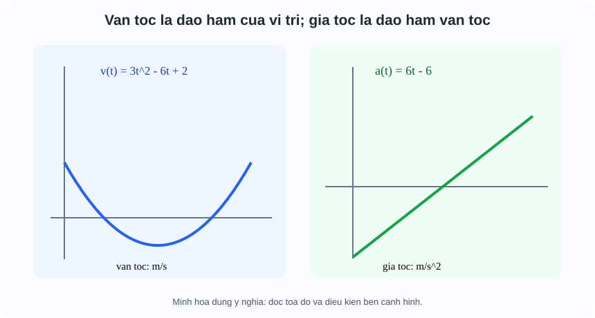

# Toán 11 · Bài 33. Đạo hàm cấp hai

TOÁN 11 · CHƯƠNG IX · BÀI 33 · SGK KNTT TẬP HAI

Hiểu nhu cầu → điều kiện → bản chất trước công thức → xem hình minh họa → Tự thử trước Core → ví dụ có suy luận → Core, Luyện tập và tự khắc phục. Không ghi Mastery từ hoạt động tự học.
<nav class="thpt-r4-lesson-tabs"><a href="../">Chương IX</a><a href="../luyen-tap/">Core/Luyện tập</a><a href="../tu-kiem-tra-chuong/">Tự kiểm tra tự đối chiếu</a></nav>

=== "Khám phá kiến thức"

    ### Cùng tìm hiểu

    ### 1.1. Vận tốc thay đổi nhanh hay chậm?
    Đạo hàm thứ nhất của quãng đường/tọa độ theo thời gian cho **vận tốc tức thời**. Nhưng khi đang lái xe, vận tốc cũng có thể tăng hoặc giảm: cần tốc độ biến đổi của **vận tốc**, tức **gia tốc**. Đó là động cơ của đạo hàm cấp hai, không phải kí hiệu bí hiểm có hai dấu phẩy.

    ### Ví dụ trực quan

    Một vật có thể đang chuyển động nhưng vẫn tăng hoặc giảm vận tốc. Đạo hàm cấp hai đo mức độ thay đổi của vận tốc, không phải bình phương đạo hàm.

    **Quan sát bằng số liệu:** Nếu s(t)=t³ mét, v(t)=3t² m/s và a(t)=6t m/s²; tại t=1, v=3 m/s, a=6 m/s². Mỗi lần đạo hàm thêm một lần chia cho đơn vị thời gian.

    ### Thuật ngữ và kiến thức, kỹ năng

    **Thuật ngữ:** đạo hàm cấp hai, gia tốc, đơn vị, tốc độ.

    **Sau bài học, em cần:** lấy đạo hàm liên tiếp, xét dấu vận tốc và gia tốc cùng nhau và giới hạn miền mô hình.

=== "Kiến thức SGK"

    ### 1.2. Lấy đạo hàm của chính hàm đạo hàm
    Nếu $f$ có đạo hàm $f'$ trên một khoảng và $f'$ lại có đạo hàm thì $f''=(f')'$ là **đạo hàm cấp hai**. Không nhầm $f''$ với $(f')^2$. Chẳng hạn $f(x)=x^3-2x^2+5$: $f'=3x^2-4x$, $f''=6x-4$; còn $(f')^2=(3x^2-4x)^2$ rất khác. Đạo hàm cấp hai không tự tồn tại ở mọi điểm chỉ vì f có đạo hàm lần một.

    ### 1.3. Dùng quy tắc đã học để tính lần hai
    Với $y=e^{2x+1}$, $y'=2e^{2x+1}$, $y''=4e^{2x+1}$: mỗi lần lấy đạo hàm hàm hợp phải nhân đạo hàm hàm trong. Với $y=\sin(3x)$, $y'=3\cos(3x)$, $y''=-9\sin(3x)$, không được quên dấu âm hoặc hệ số 3 lần thứ hai.

    ### 1.4. Ý nghĩa cơ học: hướng chuyển động và gia tốc
    Nếu $s(t)$ tính bằng **mét**, $t$ bằng **giây**, thì $v(t)=s'(t)$ có đơn vị m/s, $a(t)=v'(t)=s''(t)$ có đơn vị m/s². Gia tốc âm không nhất thiết có nghĩa “chậm dần”: nếu vật đang đi về chiều âm ($v<0$) và gia tốc cũng âm ($a<0$), **độ lớn vận tốc tăng**, vật nhanh dần theo chiều âm. Khi $v$ và $a$ trái dấu, độ lớn vận tốc giảm (trong một khoảng không qua điểm đổi chiều); khi cùng dấu, tăng. Hình FIG-G11-CHIX-B33-01 cho thấy $s(t)=t^3-3t^2+2t$ có $v=3t^2-6t+2$ và $a=6t-6$; học sinh đọc ba độ biến đổi khác nhau, không lấy chiều cao đường cong làm đạo hàm.

    ### 1.5. Lưu ý về tính thực tế
    Mô hình chuyển động phải chỉ xét thời gian vật còn ở trạng thái mô tả, ví dụ không dùng công thức rơi tự do sau khi đã chạm đất. Với hàm chiều cao $h(t)=12t-3t^2$ (m) đến lúc trở về mặt đất, $h(0)=0$, $h(4)=0$, do đó thời gian thực tế là $0\le t\le4$; $v(t)=12-6t$ (m/s), gia tốc $a(t)=-6$ m/s² trên khoảng mô hình. Tại $t=2$, v=0 không đồng nghĩa a=0.

    ### Vận dụng — tự giải trước khi đối chiếu
    Cho $s(t)=t^3-6t$ cm, $t$ giây. Hãy viết vận tốc, gia tốc và đơn vị. Tại $t=1$, vật đang đi theo chiều nào và gia tốc theo chiều nào?

    

Em đã tự thử? Mở lời giải đối chiếu

<strong>Đối chiếu sau khi thử:</strong> $v=3t^2-6$ cm/s, $a=6t$ cm/s²; tại t=1, $v=-3$ cm/s (chiều âm), $a=+6$ cm/s² (chiều dương), hai dấu trái nhau nên tốc độ tức thời đang giảm. Không suy một gia tốc dương là vật luôn nhanh dần.

    **Liên kết D6:** `HELP-G11-CHIX-B33-01` (nhầm lần hai), `...-02` (vận tốc/gia tốc và dấu), `...-03` (suy đơn vị và phạm vi thời gian).

    ### 1.7. Đọc hình để hiểu lập luận

    <figure class="thpt-r4-plot thpt-r4-calculus-figure"><figcaption>Hình minh họa 1 — đọc hình theo lời giải thích trong phần Kiến thức ở trên.</figcaption></figure>

=== "Ví dụ"

    #### EX-G11-CHIX-B33-01: Hai lần đa thức

    **Bài toán:** $f(x)=2x^4-3x^2+6$; tìm f''.

    **Phân tích, đáp án:** $f'=8x^3-6x$, $f''=24x^2-6$.

    **Vì sao:** Lấy đạo hàm hai lần, không bình phương f'.

    #### EX-G11-CHIX-B33-02: Hàm sin bậc hai

    **Bài toán:** $f(x)=\sin(2x)$; tìm f''.

    **Phân tích, đáp án:** $f'=2\cos(2x)$, $f''=-4\sin(2x)$.

    **Vì sao:** Chain được nhân cả hai lượt; dấu cos'=-sin.

    #### EX-G11-CHIX-B33-03: Mũ bậc hai

    **Bài toán:** $f(x)=e^{3x}$; tìm f''.

    **Phân tích, đáp án:** $f'=3e^{3x}$, $f''=9e^{3x}$.

    **Vì sao:** Nhân 3 ở mỗi lần lấy đạo hàm.

    #### EX-G11-CHIX-B33-04: Gia tốc từ vị trí

    **Bài toán:** $s(t)=t^3-2t^2+1$ m; gia tốc t=1.

    **Phân tích, đáp án:** $v=3t^2-4t$ m/s; $a=6t-4$ m/s², $a(1)=2$ m/s².

    **Vì sao:** Không nhầm vận tốc v(1)=-1 với a(1)=2.

    #### EX-G11-CHIX-B33-05: Ngược dấu

    **Bài toán:** Vật có v=-5 m/s, a=-2 m/s² tại t0; đang nhanh hay chậm dần?

    **Phân tích, đáp án:** Vì v và a cùng âm, tốc độ |v| đang tăng tại thời điểm đó (nhanh dần theo chiều âm).

    **Vì sao:** Gia tốc âm không đồng nghĩa chậm dần.

    #### EX-G11-CHIX-B33-06: Mô hình bóng bay

    **Bài toán:** $h(t)=8t-2t^2$ m trong 0≤t≤4; tìm h'' và đơn vị.

    **Phân tích, đáp án:** $v=8-4t$ m/s, $a=-4$ m/s²; chỉ diễn giải trong khoảng thời gian mô hình đang áp dụng.

    **Vì sao:** Đối chiếu h(0)=h(4)=0 trước suy chuyển động. 

    ---

=== "Lỗi thường gặp"

    

<strong>Chẩn đoán lỗi:</strong> Nhầm f'' với (f')².
<ol><li><strong>Phát hiện lỗi:</strong> Nhầm f'' với (f')².</li><li><strong>Truy lại bản chất + điều kiện:</strong> Đạo hàm cấp hai là đạo hàm tiếp của hàm f', không phải bình phương.</li><li><strong>Xem lại vì sao (WHY/HOW):</strong> Mở D1 B33, so sánh mệnh đề định nghĩa với ví dụ D2; giải thích bằng lời trước khi biến đổi ký hiệu.</li><li><strong>Tự luyện câu khác có dẫn dắt:</strong> Với f=x², tính f'' và (f')². <strong>Tự kiểm sau khi thử:</strong> f''=2; (f')²=4x².</li><li><strong>Trở về câu canonical:</strong> <code>THPT-G11-CHIX-B33-C01</code> và giải lại, tự giải thích lí do từng bước; không lấy xem lời giải làm chứng cứ độc lập cho Mastery.</li></ol>
<a href="../luyen-tap/?item=THPT-G11-CHIX-B33-C01">Quay lại câu canonical THPT-G11-CHIX-B33-C01</a>

    

<strong>Chẩn đoán lỗi:</strong> Cứ gia tốc âm là chậm dần.
<ol><li><strong>Phát hiện lỗi:</strong> Cứ gia tốc âm là chậm dần.</li><li><strong>Truy lại bản chất + điều kiện:</strong> Cần xét dấu v và a cùng lúc, tốc độ là |v|.</li><li><strong>Xem lại vì sao (WHY/HOW):</strong> Mở D1 B33, so sánh mệnh đề định nghĩa với ví dụ D2; giải thích bằng lời trước khi biến đổi ký hiệu.</li><li><strong>Tự luyện câu khác có dẫn dắt:</strong> Với v=-2,a=-1, nhanh hay chậm?. <strong>Tự kiểm sau khi thử:</strong> Nhanh dần theo chiều âm.</li><li><strong>Trở về câu canonical:</strong> <code>THPT-G11-CHIX-B33-P05</code> và giải lại, tự giải thích lí do từng bước; không lấy xem lời giải làm chứng cứ độc lập cho Mastery.</li></ol>
<a href="../luyen-tap/?item=THPT-G11-CHIX-B33-P05">Quay lại câu canonical THPT-G11-CHIX-B33-P05</a>

    

<strong>Chẩn đoán lỗi:</strong> Nhầm đơn vị v và a hoặc áp mô hình sai thời gian.
<ol><li><strong>Phát hiện lỗi:</strong> Nhầm đơn vị v và a hoặc áp mô hình sai thời gian.</li><li><strong>Truy lại bản chất + điều kiện:</strong> s m; t s ⇒ v m/s, a m/s²; luôn kiểm miền thời gian mô hình.</li><li><strong>Xem lại vì sao (WHY/HOW):</strong> Mở D1 B33, so sánh mệnh đề định nghĩa với ví dụ D2; giải thích bằng lời trước khi biến đổi ký hiệu.</li><li><strong>Tự luyện câu khác có dẫn dắt:</strong> s(t)=6t-2t² m, t∈[0,3]; gia tốc?. <strong>Tự kiểm sau khi thử:</strong> -4 m/s² trên khoảng mô hình.</li><li><strong>Trở về câu canonical:</strong> <code>THPT-G11-CHIX-B33-P04</code> và giải lại, tự giải thích lí do từng bước; không lấy xem lời giải làm chứng cứ độc lập cho Mastery.</li></ol>
<a href="../luyen-tap/?item=THPT-G11-CHIX-B33-P04">Quay lại câu canonical THPT-G11-CHIX-B33-P04</a>

    ### Học tiếp

    [Core/Luyện tập Bài 33](luyen-tap.md) · [Tự luận Chương IX](../../../thu-vien/tu-luan-g11-chuong-ix.md) · [Tự kiểm tra cuối chương](tu-kiem-tra-chuong.md)
