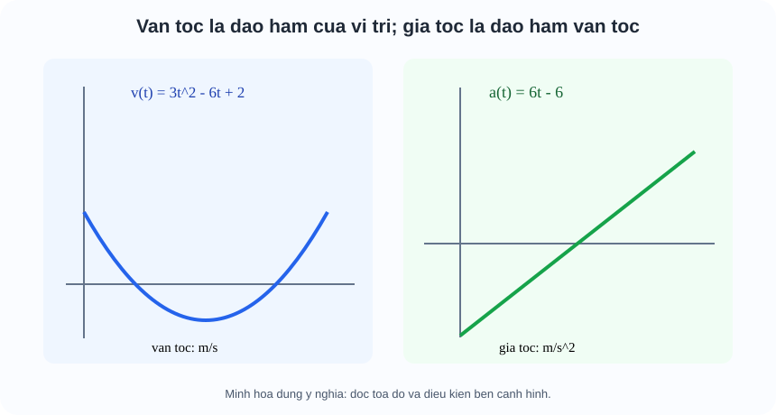

# Bài 33. Đạo hàm cấp hai

TOÁN 11 · CHƯƠNG IX · KẾT NỐI TRI THỨC · TẬP HAI

Một vật có thể đang chuyển động mà vận tốc vẫn thay đổi. Lấy đạo hàm thêm một lần giúp ta mô tả chính sự thay đổi ấy.

<nav class="thpt-r4-lesson-tabs"><a href="../">Chương IX</a><a href="../luyen-tap/">Core/Luyện tập</a><a href="../tu-kiem-tra-chuong/">Tự kiểm tra cuối chương</a></nav>

=== "Khám phá kiến thức"

    Ở Bài 31, đạo hàm của tọa độ theo thời gian cho biết **vận tốc tức thời**. Nhưng hai chiếc xe có cùng vận tốc tại một lúc chưa chắc chuyển động giống nhau: một xe có thể đang tăng tốc, xe kia đang giảm tốc. Muốn mô tả **vận tốc biến đổi như thế nào**, ta cần nhìn tiếp vào tốc độ thay đổi của chính hàm vận tốc. Đây là ý nghĩa trực quan của **đạo hàm cấp hai**.

    ### 1.1. Khái niệm đạo hàm cấp hai

    Xét hàm số \(y=f(x)=x^3-3x^2+2x\). Từ các quy tắc ở Bài 32, ta tính được

    \[
    f'(x)=3x^2-6x+2.
    \]

    Khi xét đạo hàm tại mọi điểm của một khoảng, ta có hàm mới \(f'\). Hàm này có thể biến đổi hoặc là hàm hằng; tại một điểm cụ thể, \(f'(x_0)\) là một số. Nếu muốn biết giá trị \(f'(x)\) đang biến đổi nhanh đến đâu quanh một điểm, ta lại lấy đạo hàm của **chính hàm mới này**:

    \[
    f''(x)=(f'(x))'=6x-6.
    \]

    Hai dấu phẩy trong \(f''\) có nghĩa **lấy đạo hàm hai lần liên tiếp**, hoàn toàn không phải bình phương. Chẳng hạn, ở \(x=1\), ta có \(f'(1)=-1\), \(f''(1)=0\); còn \((f'(1))^2=1\). Chúng là hai đại lượng khác nhau.

    Nếu hàm số \(f\) có đạo hàm trên một khoảng và **hàm \(f'\) cũng có đạo hàm** tại điểm đang xét, thì \(f''\) tồn tại tại điểm đó. Việc \(f'\) tồn tại chưa tự bảo đảm \(f''\) tồn tại; để lấy đạo hàm lần hai, phải kiểm rằng **hàm đạo hàm còn có đạo hàm** ở điểm ấy.

    Chẳng hạn, hàm \(f(x)=x|x|\) bằng \(x^2\) khi \(x\ge0\) và bằng \(-x^2\) khi \(x<0\). Với \(x\ne0\), đạo hàm của hai nhánh cho \(f'(x)=2|x|\); tại \(0\), thương sai phân là \(\frac{h|h|-0}{h}=|h|\to0\), nên công thức cũng đúng tại \(0\). Nhưng đồ thị \(f'\) có điểm gấp khúc tại \(0\): độ dốc bên trái là \(-2\), bên phải là \(2\). Vì vậy \(f''(0)\) không tồn tại, dù \(f'(0)=0\).

    Ta cũng có thể lặp lại thao tác với hàm lượng giác hoặc hàm mũ. Ví dụ \(y=\sin(2x+\pi/4)\) có

    \[
    y'=2\cos(2x+\pi/4),\qquad
    y''=-4\sin(2x+\pi/4).
    \]

    Mỗi lần lấy đạo hàm của hàm hợp đều phải nhân đạo hàm của **hàm bên trong**, ở đây là \(2\). Vì thế hệ số ở đạo hàm cấp hai là \(4\), và dấu âm xuất hiện khi đạo hàm của cos.

    **Vận dụng.** Tính đạo hàm cấp hai của \(f(x)=xe^{3x}\). Em cần dùng quy tắc gì ở mỗi lần?

    ??? question "Đối chiếu"

        **Phân tích.** \(f\) là tích của \(x\) và \(e^{3x}\). Sau lần một, kết quả vẫn có thể viết dưới dạng tích, nên phải dùng tiếp quy tắc tích và quy tắc hàm hợp.

        **Lời giải.** Lần một:

        \[
        f'(x)=e^{3x}+3xe^{3x}=(1+3x)e^{3x}.
        \]

        Lần hai:

        \[
        f''(x)=3e^{3x}+3(1+3x)e^{3x}
        =(6+9x)e^{3x}.
        \]

        **Kiểm lại:** Tính theo dạng tổng \(f'=e^{3x}+3xe^{3x}\) cũng cho \(f''=3e^{3x}+3e^{3x}+9xe^{3x}\).

        **Kiểm lỗi:** Nếu chỉ viết \(f''=3e^{3x}\), em đã bỏ qua đạo hàm của số hạng \(3xe^{3x}\).

    ### 1.2. Ý nghĩa cơ học của đạo hàm cấp hai

    Một vật chuyển động thẳng có tọa độ \(s(t)\) theo thời gian \(t\). Vận tốc tức thời là \(v(t)=s'(t)\). Trong khoảng từ \(t\) đến \(t+\Delta t\), vận tốc thay đổi một lượng

    \[
    \Delta v=v(t+\Delta t)-v(t).
    \]

    Lấy \(\Delta v/\Delta t\), ta được **gia tốc trung bình** trong khoảng thời gian ấy. Khi khoảng đo co lại đến thời điểm \(t\), giới hạn của thương này là **gia tốc tức thời**:

    \[
    a(t)=\lim_{\Delta t\to0}\frac{v(t+\Delta t)-v(t)}{\Delta t}
    =v'(t)=s''(t).
    \]

    Vì vậy, đạo hàm hai lần có một cách hiểu rất cụ thể: **tọa độ → vận tốc → gia tốc**. Nếu tọa độ tính bằng mét (m) và thời gian tính bằng giây (s), thì vận tốc đo bằng m/s và gia tốc đo bằng m/s². Đơn vị thứ hai xuất hiện vì ta lấy **đạo hàm của vận tốc theo thời gian**.

    Chẳng hạn, với \(s(t)=3t^2+t^3\) (m), ta có \(v(t)=6t+3t^2\) (m/s) và \(a(t)=6+6t\) (m/s²). Tại \(t=2\), gia tốc \(a(2)=18\) m/s². Không được lấy chính \(s(2)\) hoặc \(v(2)\) làm gia tốc vì đó là các đại lượng khác nhau.

    Một chuyển động dao động cũng có gia tốc dù tại một số thời điểm vận tốc bằng \(0\). Ví dụ vật dao động có tọa độ \(x(t)=3\cos(2\pi t)\) (cm), với \(t\) tính bằng giây. Khi ấy

    \[
    v(t)=-6\pi\sin(2\pi t),\qquad
    a(t)=-12\pi^2\cos(2\pi t).
    \]

    Tại \(t=1\), vật có \(v(1)=0\) cm/s nhưng \(a(1)=-12\pi^2\) cm/s². Vật đang ở vị trí biên, vận tốc bằng \(0\) trong chốc lát rồi đổi chiều. Gia tốc âm chỉ hướng ngược chiều dương đã chọn; nó **không tự nói rằng vật chậm dần**.

    <figure class="thpt-r4-plot thpt-r4-calculus-figure"><figcaption><strong>Đọc hình:</strong> hình bên trái mô tả \(v(t)=3t^2-6t+2\), hình bên phải mô tả \(a(t)=6t-6\). Khi vận tốc đạt giá trị nhỏ nhất tại \(t=1\), gia tốc bằng \(0\) vì độ dốc đồ thị \(v\) lúc ấy bằng \(0\). <strong>Hai ô có trục dọc và đơn vị khác nhau</strong>, nên không so sánh độ cao hai đường; hãy so dấu của từng đại lượng và quan hệ \(a=v'\).</figcaption></figure>

    Cũng cần phân biệt **gia tốc âm** với **chậm dần**. Giả sử tại một thời điểm \(v=-3\) m/s và \(a=-2\) m/s². Vật đang đi theo chiều âm, đồng thời vận tốc trở nên âm hơn trong một khoảng ngắn: **tốc độ \(|v|\) tăng**. Nếu \(v=-3\) nhưng \(a=+2\), gia tốc hướng ngược vận tốc nên tốc độ đang giảm, miễn là chưa đổi chiều. Vì \(v\) liên tục, khi \(v>0\) thì gần thời điểm xét \(|v|=v\) có đạo hàm \(a\); khi \(v<0\) thì \(|v|=-v\) có đạo hàm \(-a\). Vì thế, tại thời điểm \(v\ne0\), nếu \(v,a\) cùng dấu thì tốc độ đang tăng; nếu trái dấu thì tốc độ đang giảm. Khi \(a=0\) tại một thời điểm, chưa thể kết luận chuyển động đều trên cả khoảng; khi \(v=0\), cần xét thêm chuyển động lân cận thời điểm ấy.

    **Vận dụng.** Một vật chuyển động theo \(s(t)=t^3-3t^2+2t\) (m), với \(t\) tính bằng giây trong một khoảng chứa \(0{,}5\) và \(1{,}5\). Tính \(v\) và \(a\) tại hai thời điểm đó. Ở mỗi thời điểm, vật đang nhanh dần hay chậm dần?

    ??? question "Đối chiếu"

        **Phân tích.** Tính \(v=s'\) và \(a=s''\) trước. Để nhận xét độ lớn vận tốc tăng hay giảm tại thời điểm có \(v\ne0\), xét xem **hai dấu có cùng nhau không**.

        **Lời giải.**

        \[
        v(t)=3t^2-6t+2,\qquad a(t)=6t-6.
        \]

        Tại \(t=0{,}5\): \(v=3(0{,}5)^2-6(0{,}5)+2=-0{,}25\) m/s, \(a=-3\) m/s². Cùng dấu âm, nên vật **nhanh dần theo chiều âm** tại thời điểm ấy.

        Tại \(t=1{,}5\): \(v=3(1{,}5)^2-6(1{,}5)+2=-0{,}25\) m/s, \(a=3\) m/s². Hai dấu trái nhau, nên vật **chậm dần theo chiều âm** tại thời điểm ấy.

        **Kiểm lại:** Ở cả hai thời điểm, vật đang đi theo chiều âm. Gia tốc khác dấu, nên kết luận về việc \(|v|\) tăng hay giảm khác nhau.

        **Kiểm lỗi:** Không kết luận “gia tốc âm nên chậm dần” hay “gia tốc dương nên nhanh dần” khi chưa biết hướng chuyển động.

=== "Kiến thức SGK"

    ### 2.1. Khái niệm đạo hàm cấp hai

    
<strong>Định nghĩa — Đạo hàm cấp hai</strong>
Giả sử hàm số \(y=f(x)\) có đạo hàm tại mọi điểm trên khoảng \((a;b)\). Nếu hàm \(y'=f'(x)\) lại có đạo hàm tại \(x\in(a;b)\), thì đạo hàm của \(f'\) tại \(x\) gọi là <strong>đạo hàm cấp hai</strong> của \(f\) tại \(x\), kí hiệu \(y''\) hoặc \(f''(x)\). Nghĩa là \(f''(x)=(f'(x))'\) tại các điểm mà đạo hàm này tồn tại.

    **Cách tính:** Lấy đạo hàm lần thứ nhất để được \(f'\). Sau đó tiếp tục lấy đạo hàm của **toàn bộ \(f'\)**, không bình phương kết quả. Nếu hàm số có đạo hàm lần thứ nhất nhưng \(f'\) không khả vi tại điểm cần xét, thì không thể nói \(f''\) tồn tại tại điểm ấy.

    **Ví dụ minh họa.** Với \(f(x)=x^3+e^x\), ta có \(f'(x)=3x^2+e^x\), rồi \(f''(x)=6x+e^x\). Do đó \(f''(0)=1\).

    ### 2.2. Ý nghĩa cơ học của đạo hàm cấp hai

    
<strong>Khái niệm — Gia tốc tức thời</strong>
Cho vật chuyển động có vận tốc tức thời \(v(t)\). Khi \(\Delta t\ne0\), tỉ số \(\displaystyle\frac{v(t+\Delta t)-v(t)}{\Delta t}\) là <strong>gia tốc trung bình</strong> trên khoảng thời gian ấy. Nếu giới hạn của tỉ số này tồn tại hữu hạn khi \(\Delta t\to0\), thì đó là <strong>gia tốc tức thời</strong> \(a(t)=v'(t)\).

    
<strong>Ý nghĩa cơ học của đạo hàm cấp hai</strong>
Nếu phương trình chuyển động là \(s=f(t)\) và đạo hàm cấp hai tồn tại, thì \(\displaystyle v(t)=f'(t),\quad a(t)=v'(t)=f''(t)\). Khi \(s\) tính bằng m, \(t\) bằng s, đơn vị của \(v\) là m/s và của \(a\) là m/s².

    <figure class="thpt-r4-plot thpt-r4-calculus-figure"><figcaption><strong>Tra hình:</strong> với \(s(t)=t^3-3t^2+2t\), ta có \(v(t)=3t^2-6t+2\) và \(a(t)=6t-6\). Đồ thị \(a\) thể hiện **độ dốc** đồ thị \(v\), không phải độ cao của đường \(v\).</figcaption></figure>

    **Điều kiện và cách đọc kết quả:** Nếu gia tốc âm, vật không nhất thiết đang chậm dần; phải xem vận tốc đang hướng nào. Với \(v\ne0\), hai dấu \(v,a\) **cùng nhau** thì tốc độ đang tăng tại thời điểm đó, **trái nhau** thì tốc độ đang giảm. Khi vận tốc bằng \(0\), không dùng quy tắc dấu này một cách máy móc; cần xét chuyển động gần thời điểm ấy. Khi mô hình chỉ đúng trong một khoảng thời gian, chỉ giải thích các kết quả trong khoảng có ý nghĩa đó.

    **Ví dụ minh họa.** Với \(s(t)=5t^2+2t\) (m), ta có \(v(t)=10t+2\) (m/s) và \(a(t)=10\) m/s² tại mọi thời điểm nằm trong khoảng áp dụng của mô hình.

=== "Ví dụ"

    ### 3.1. Đạo hàm cấp hai của đa thức

    **Đề bài.** Tìm đạo hàm cấp hai của \(f(x)=2x^4-3x^2+6\).

    **Phân tích.** Đây là tổng các lũy thừa. Tính đạo hàm **lần một** của từng số hạng, sau đó lặp lại trên kết quả.

    

<strong>Lời giải.</strong> \(f'(x)=8x^3-6x\). Tiếp tục lấy đạo hàm, \(f''(x)=24x^2-6\), với mọi \(x\in\mathbb R\).

    **Kiểm lại:** \(f'(0)=0\), nhưng \(f''(0)=-6\), cho thấy đạo hàm cấp hai không phải bình phương đạo hàm cấp một.

    ### 3.2. Đạo hàm cấp hai của hàm mũ hợp

    **Đề bài.** Tính \(f''(0)\) với \(f(x)=x^2+e^{2x-1}\).

    **Phân tích.** Sau lần một, phần mũ **vẫn là hàm hợp**; đạo hàm tiếp của nó vẫn phải nhân đạo hàm của \(2x-1\).

    

<strong>Lời giải.</strong> \(f'(x)=2x+2e^{2x-1}\); \(f''(x)=2+4e^{2x-1}\). Thay \(x=0\), \(f''(0)=2+4e^{-1}=2+4/e\).

    **Kiểm lại:** \(e^{-1}>0\), nên \(f''(0)>2\). Nếu thiếu nhân \(2\) ở lần hai, sẽ cho sai hệ số trước \(e^{-1}\).

    ### 3.3. Hai lần quy tắc tích

    **Đề bài.** Tính đạo hàm cấp hai của \(f(x)=xe^{2x}\).

    **Phân tích.** Ở cả hai lượt, biểu thức có một **tích**; dùng \((uv)'=u'v+uv'\) và quy tắc dây chuyền với \(e^{2x}\).

    

<strong>Lời giải.</strong> \(f'(x)=e^{2x}+2xe^{2x}=(1+2x)e^{2x}\). Do đó \(f''(x)=2e^{2x}+2(1+2x)e^{2x}=(4+4x)e^{2x}\).

    **Kiểm lại:** Viết \(f''(x)=4(1+x)e^{2x}\) là biểu thức tương đương; không được chỉ đạo hàm một số hạng của \(f'\).

    ### 3.4. Đạo hàm cấp hai của lôgarit có điều kiện

    **Đề bài.** Tìm \(y''\) của \(y=\ln(2x+3)\), nêu miền có đạo hàm cấp hai.

    **Phân tích.** Hàm lôgarit đòi hỏi đối số dương. Sau lần một, cần tính đạo hàm của một phân thức \(\frac{2}{2x+3}\).

    

<strong>Lời giải.</strong> Điều kiện \(2x+3>0\) hay \(x>-3/2\). Trên khoảng ấy \(y'=\frac2{2x+3}\). Tiếp tục lấy đạo hàm, \(\displaystyle y''=-\frac4{(2x+3)^2}\), với \(x>-3/2\).

    **Kiểm lại:** \(y''<0\) trên miền xác định. Không dùng công thức tại \(x=-3/2\), nơi hàm gốc không có nghĩa.

    ### 3.5. Đạo hàm cấp hai của hàm số lượng giác

    **Đề bài.** Tính \(y''\) khi \(y=\sin(2x+\pi/4)\).

    **Phân tích.** Lần một dùng \((\sin u)'=u'\cos u\); lần hai dùng \((\cos u)'=-u'\sin u\). Hệ số của hàm trong vẫn là \(2\) ở cả hai lượt.

    

<strong>Lời giải.</strong> \(y'=2\cos(2x+\pi/4)\), nên \(y''=-4\sin(2x+\pi/4)\), với mọi \(x\in\mathbb R\).

    **Kiểm lại:** \(y''=-4y\). Số \(4\) bằng bình phương **hệ số góc trong đối số**, không phải \((y')^2\).

    ### 3.6. Con lắc lò xo: gia tốc tức thời

    **Đề bài.** Chuyển động của một vật gắn trên con lắc lò xo được mô tả bởi \(x(t)=4\cos(2\pi t+\pi/3)\) (cm), với \(t\) tính bằng giây, bỏ qua ma sát. Tính gia tốc tức thời tại \(t=5\) giây, làm tròn đến hàng đơn vị.

    **Phân tích.** Tọa độ \(x\) là hàm của **thời gian**. Đạo hàm lần một là vận tốc, lần hai là gia tốc; do đối số lượng giác là \(2\pi t+\pi/3\), phải nhân \(2\pi\) ở **mỗi lượt**.

    

<strong>Lời giải.</strong> \(v(t)=x'(t)=-8\pi\sin(2\pi t+\pi/3)\) (cm/s). Gia tốc \(a(t)=v'(t)=-16\pi^2\cos(2\pi t+\pi/3)\) (cm/s²). Tại \(t=5\), \(\cos(10\pi+\pi/3)=\cos(\pi/3)=1/2\); do đó \(a(5)=-8\pi^2\approx-79\) cm/s².

    **Kiểm lại:** Kết quả có đơn vị cm/s², không phải cm/s. Gia tốc âm chỉ hướng, không tự kết luận vật chậm dần.

    ### 3.7. Từ tọa độ đến vận tốc và gia tốc

    **Đề bài.** Một vật chuyển động thẳng có \(s(t)=2t^2+\frac12t^4\) (m), với \(t\ge0\) (s). Tìm vận tốc và gia tốc tại \(t=4\) giây.

    **Phân tích.** Lấy đạo hàm theo \(t\) lần thứ nhất để có **vận tốc**, thêm một lần nữa để có **gia tốc**. Tại \(t=4>0\), các đạo hàm có nghĩa trên khoảng đang xét.

    

<strong>Lời giải.</strong> \(v(t)=4t+2t^3\) (m/s). \(a(t)=4+6t^2\) (m/s²). Thay \(t=4\): \(v(4)=16+128=144\) m/s và \(a(4)=4+96=100\) m/s².

    **Kiểm lại:** 144 m/s là **vận tốc**, 100 m/s² là **gia tốc**; không thể so sánh trực tiếp hai số do đơn vị khác nhau.

    ### 3.8. Tìm hệ số từ dữ kiện đạo hàm

    **Đề bài.** Cho \(P(x)=ax^2+bx+3\) với \(a,b\) là hằng số. Biết \(P'(1)=0\) và \(P''(1)=-2\). Tìm \(a,b\).

    **Phân tích.** Điều kiện \(P''(1)=-2\) cho trực tiếp hệ số của \(x^2\); sau đó dùng điều kiện \(P'(1)=0\) tìm hệ số còn lại.

    

<strong>Lời giải.</strong> \(P'(x)=2ax+b\), \(P''(x)=2a\). Từ \(2a=-2\) có \(a=-1\). Thay vào \(P'(1)=2a+b=0\), được \(-2+b=0\), nên \(b=2\).

    **Kiểm lại:** Với \(P(x)=-x^2+2x+3\), ta có \(P'(1)=-2+2=0\), \(P''(1)=-2\), đúng hai dữ kiện.

    ### 3.9. Giới hạn độ lớn đạo hàm cấp hai

    **Đề bài.** Cho \(f(x)=2\sin^2(x+\pi/4)\). Chứng minh \(|f''(x)|\le4\) với mọi \(x\in\mathbb R\).

    **Phân tích.** Lấy đạo hàm hai lần trực tiếp được, nhưng dùng công thức \(\,2\sin^2 u=1-\cos2u\) giúp giảm số phép tính. Sau đó dùng giới hạn độ lớn \(|\cos\theta|\le1\).

    

<strong>Lời giải.</strong> Đặt \(u=x+\pi/4\). Ta viết \(f(x)=1-\cos(2x+\pi/2)\), nên \(f'(x)=2\sin(2x+\pi/2)\) và \(f''(x)=4\cos(2x+\pi/2)\). Do \(|\cos(2x+\pi/2)|\le1\), suy ra \(|f''(x)|\le4\) với mọi số thực \(x\).

    **Kiểm lại:** Tại \(x=-\pi/4\), ta có \(2x+\pi/2=0\) nên \(|f''(x)|=4\); dấu bằng có thể xảy ra.

=== "Lỗi thường gặp"

    ### 4.1. Bình phương đạo hàm thay vì lấy đạo hàm lần hai

    **Sai ở đâu:** Viết \(f''(x)=(f'(x))^2\).

    **Vì sao sai:** Dấu phẩy thứ hai là **lệnh lấy đạo hàm thêm lần nữa**, không phải số mũ. Với \(f(x)=x^2\), \(f''(x)=2\) còn \((f'(x))^2=4x^2\).

    **Cách sửa:** Ghi rõ hai dòng \(f'=...\) và \(f''=(f')'=...\), rồi so với phép bình phương để thấy khác nhau.

    ### 4.2. Quên quy tắc tích hoặc dây chuyền ở lần hai

    **Sai ở đâu:** Với \(f(x)=xe^{2x}\), sau khi được \(f'=(1+2x)e^{2x}\), chỉ đạo hàm \(e^{2x}\) rồi bỏ \(1+2x\), hoặc quên đạo hàm của hệ số này.

    **Vì sao sai:** Kết quả lần một vẫn là một **tích hai hàm**, nên lần hai vẫn phải dùng quy tắc tích.

    **Cách sửa:** Đặt \(u=1+2x\), \(v=e^{2x}\); \(f''=u'v+uv'=2e^{2x}+2(1+2x)e^{2x}\).

    ### 4.3. Nhầm dấu hoặc thiếu hệ số ở lượng giác

    **Sai ở đâu:** Viết \((\sin3x)''=9\sin3x\).

    **Vì sao sai:** \((\sin3x)'=3\cos3x\), còn đạo hàm cos có **dấu âm**.

    **Cách sửa:** Tính thành hai dòng: \((\sin3x)''=(3\cos3x)'=-9\sin3x\).

    ### 4.4. Bỏ qua miền xác định và sự tồn tại của đạo hàm lần hai

    **Sai ở đâu:** Với \(y=\ln(2x+3)\), thay \(x=-2\) vào công thức \(y''=-4/(2x+3)^2\).

    **Vì sao sai:** Tại \(-2\), đối số lôgarit bằng \(-1\), nên **hàm gốc không xác định**.

    **Cách sửa:** Ghi \(x>-3/2\) trước mọi phép lấy đạo hàm và chỉ thay giá trị thuộc miền đó.

    ### 4.5. Lấy vận tốc làm gia tốc

    **Sai ở đâu:** Với \(s(t)=2t^2+\frac12t^4\), tính \(v(4)=144\) m/s rồi ghi gia tốc là \(144\) m/s².

    **Vì sao sai:** \(v=s'\) là vận tốc; gia tốc phải là \(a=v'=s''\), bằng \(100\) m/s² tại \(t=4\).

    **Cách sửa:** Viết chuỗi \(s\xrightarrow{\text{đạo hàm}}v\xrightarrow{\text{đạo hàm}}a\), kiểm cả **tên đại lượng và đơn vị**.

    ### 4.6. Cho rằng gia tốc âm luôn là chậm dần

    **Sai ở đâu:** Khi \(v=-3\) m/s, \(a=-2\) m/s², kết luận vật chậm dần.

    **Vì sao sai:** Vận tốc và gia tốc cùng hướng âm nên **độ lớn vận tốc đang tăng**.

    **Cách sửa:** Khi \(v\ne0\), xét dấu cả \(v,a\). Cùng dấu thì nhanh dần tại thời điểm ấy, trái dấu thì chậm dần; không suy chỉ từ dấu gia tốc.

    ### 4.7. Dùng gia tốc vào thời điểm mô hình không còn đúng

    **Sai ở đâu:** Một phương trình mô tả chuyển động của quả bóng **chỉ trước khi chạm đất**, nhưng vẫn dùng đạo hàm của nó để nói về gia tốc sau khi bóng đã bật lên hoặc dừng lại.

    **Vì sao sai:** Đạo hàm có thể tính được về đại số nhưng không còn mô tả hiện tượng vật lí đã thay đổi chế độ chuyển động.

    **Cách sửa:** Trước khi thay \(t\), tìm và kiểm **khoảng thời gian mô hình được phép sử dụng**; chỉ diễn giải kết quả trong khoảng ấy.

    ### 4.8. Kết luận sai khi vận tốc bằng không

    **Sai ở đâu:** Thấy \(v(t_0)=0\) liền kết luận \(a(t_0)=0\) hoặc vật đứng yên mãi.

    **Vì sao sai:** Vận tốc tức thời bằng \(0\) không nói rằng vận tốc **không đang thay đổi**. Ví dụ vật được ném thẳng lên có \(v=0\) tại đỉnh nhưng gia tốc vẫn hướng xuống.

    **Cách sửa:** Tính riêng \(a(t_0)=v'(t_0)\) từ hàm vận tốc; không suy gia tốc chỉ từ một giá trị \(v(t_0)\).
