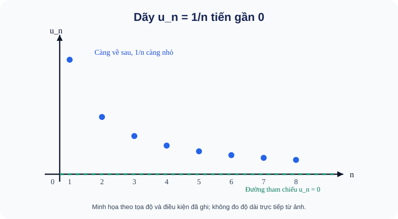

# Bài 15. Giới hạn của dãy số

TOÁN 11 · CHƯƠNG V · SGK KNTT

Khám phá bản chất và điều kiện → ví dụ giải thích phương pháp → Tự thử trước Core → Core/Luyện tập/Vận dụng → tự khắc phục. Không ghi Skill Mastery từ tự học.
<nav class="thpt-r4-lesson-tabs"><a href="../">Chương V</a><a href="../luyen-tap/">Core và Luyện tập</a><a href="../tu-kiem-tra-chuong/">Tự kiểm tra cuối chương</a></nav>

=== "Khám phá kiến thức"

    ### Cùng tìm hiểu

    ### 1.1. Vì sao cần khái niệm "giới hạn"?

    Em hãy nhìn dãy số: **1; 1/2; 1/3; 1/4; 1/5; ...**. Mỗi số hạng đều lớn hơn 0, nhưng càng về sau giá trị càng nhỏ. Nếu tiếp tục mãi, các số hạng **tiến gần đến 0**, dù không bắt buộc có số hạng nào bằng 0. Ta muốn mô tả chính xác chuyện "ngày càng gần" này, vì nó giúp hiểu những quá trình có thể tiếp tục vô hạn (ví dụ các phần tiết kiệm ngày càng nhỏ).

    **Cầu nối kiến thức:** dãy số là các số xếp theo thứ tự u₁,u₂,u₃,...; chỉ số n là số thứ tự. Không phải giới hạn là một "số hạng cuối": dãy có thể không có số hạng cuối.

    ### 1.2. Quan sát trước khi định nghĩa

    **Hình trực quan D5:** <figure class="thpt-r4-plot thpt-r4-probability-figure"><figcaption>Dãy 1/n giảm dần, tiến về trục 0, không có số hạng cuối</figcaption></figure>

    **Cách đọc hình:** Mỗi chấm ứng với một chỉ số n và giá trị uₙ=1/n. Các chấm càng về bên phải càng sát trục ngang uₙ=0 nhưng luôn ở phía trên. Vì vậy “tiến đến 0” KHÔNG có nghĩa “đến một số hạng cuối bằng 0”. Hãy quan sát điều này trước khi đọc ε và N trong định nghĩa.

    Với u_n=1/n: u₁=1, u₂=0,5, u₁₀=0,1, u₁₀₀=0,01. Nếu chọn một vùng rất gần 0, chẳng hạn khoảng cách nhỏ hơn 0,01, từ khi n>100 trở đi **mọi** u_n đều nằm trong vùng ấy. Nếu em muốn gần hơn nữa, vẫn có thể chọn n đủ lớn. Đó là ý cốt lõi của "giới hạn bằng 0".

    Không phải dãy nào cũng tiến gần một số. Với v_n=(−1)^n, các số hạng thay đổi liên tục −1,1,−1,1,..., không thể ngày càng ở sát một số cố định. Dãy này **không có giới hạn**, không phải "có giới hạn vô cực".

    ### Ví dụ trực quan

    Dãy số có thể tiến gần một số dù không bao giờ nhận đúng số ấy. Giới hạn ghi lại xu hướng khi chỉ số tăng không ngừng, thay vì chỉ nhìn một vài số đầu.

    **Quan sát bằng số liệu:** Với uₙ=1/n, các giá trị 1, 1/2, 1/10 vẫn dương nhưng tiến gần 0 khi n tăng. Không nên suy rằng có n hữu hạn nào làm uₙ bằng 0.

    ### Thuật ngữ và kiến thức, kỹ năng

    **Thuật ngữ:** giới hạn dãy số, hội tụ, vô cực, tổng cấp số nhân lùi.

    **Sau bài học, em cần:** so sánh xu hướng, kiểm điều kiện quy tắc giới hạn và không nhầm tiến gần với bằng đúng.

=== "Kiến thức SGK"

    ### 1.3. Phát biểu toán học và giải thích ký hiệu

    Ta viết **lim_{n→∞}u_n=a** khi các số hạng từ một lúc đủ muộn trở đi có thể gần a tùy ý. Nói chặt chẽ: với mọi sai số ε>0 mà ta chọn, tồn tại một chỉ số N sao cho **mọi n≥N** đều thỏa **|u_n−a|<ε**.

    - ε (đọc là *ép-si-lon*) chỉ một mức sai số dương tùy nhỏ, **không** phải số cố định do giáo viên chọn sẵn.
    - N là mốc có thể phụ thuộc mức sai số ε; sau mốc đó **tất cả** số hạng đều gần a, không chỉ một vài số hạng.
    - |u_n−a| là khoảng cách trên trục số từ số hạng u_n đến a.
    - n→∞ nghĩa là xét các chỉ số n tăng mãi, **không** thay n bằng một số gọi là "vô cực".
    - Khi a=0, điều kiện trở thành |u_n|<ε từ một lúc đủ muộn; muốn chứng minh lim u_n=a thường đưa về lim(u_n−a)=0.

    **Ví dụ áp dụng định nghĩa:** Cho u_n=1/n và sai số ε>0. Chọn một số tự nhiên N lớn hơn 1/ε. Khi n≥N, 1/n≤1/N<ε, nên lim_{n→∞}1/n=0.

    ### 1.4. Giới hạn vô cực khác giới hạn hữu hạn thế nào?

    Nếu u_n cuối cùng vượt **mọi mốc lớn** M>0, ta viết lim u_n=+∞; nếu u_n cuối cùng nhỏ hơn −M với mọi M>0, viết lim u_n=−∞. Đây là mô tả cách dãy lớn/nhỏ không bị chặn về một phía, **không phải cộng/trừ một số thực có tên "∞"**. Ví dụ u_n=n→+∞; còn (−1)^n n đổi dấu và có độ lớn tăng nên không có giới hạn theo hai nghĩa ±∞ vừa nêu.

    ### 1.5. Quy tắc tính được dùng khi nào?

    Những giới hạn cơ bản: lim 1/n^p=0 với p>0; lim q^n=0 khi **|q|<1**. Nếu u_n→a, v_n→b **đều hữu hạn**, tổng/hiệu/tích có giới hạn lần lượt a±b, ab. Thương có giới hạn a/b **chỉ khi b≠0**, và mẫu v_n phải khác 0 từ một chỉ số đủ lớn. Nếu cả tử và mẫu tiến đến 0, không được lấy 0/0; hãy biến đổi biểu thức hoặc chọn phương pháp khác.

    ### 1.6. Vì sao có tổng của vô hạn số hạng?

    Xét 5+5/4+5/16+... . Mỗi số hạng sau bằng **1/4** số hạng trước. Cộng lần lượt các số hạng đầu ta được những tổng riêng tăng dần, nhưng các phần tăng thêm nhỏ dần. Với cấp số nhân có số hạng đầu a và công bội q, khi **|q|<1** thì q^n→0; từ S_n=a(1−q^n)/(1−q) suy ra tổng vô hạn S=a/(1−q). Điều kiện |q|<1 không chỉ là chú thích: nó giải thích vì sao phần còn lại nhỏ dần.

    **Tự thử trước Core:** Dãy 2+1/n tiến gần số nào? Tại sao không cần có số hạng nào đúng bằng số đó?

    

Đã tự thử? Mở đối chiếu

tiến gần 2 vì 1/n→0. Đây là formative tự học, không ghi Skill Mastery.

=== "Ví dụ"

    ### Bốn ví dụ độc lập

    **EX-G11-B15-01 — Giới hạn hữu hạn bằng chia bậc cao nhất.** Tính lim_{n→∞}(3n+1)/(n+4). Chia cả tử và mẫu cho n: (3+1/n)/(1+4/n)→3. Mẫu giới hạn 1 khác 0, do đó phép chia giới hạn hợp lệ. **Bẫy:** không được thay n=∞ như một số.

    **EX-G11-B15-02 — Dao động và giới hạn 0.** Xét u_n=(−1)^n/n và v_n=(−1)^n. Ta có |u_n|≤1/n→0, nên u_n→0. Nhưng v_n có hai dãy con n chẵn, n lẻ lần lượt bằng 1 và −1, không thể có cùng giới hạn. **Bẫy:** dấu luân phiên không tự quyết định hội tụ.

    **EX-G11-B15-03 — Tổng cấp số nhân lùi vô hạn.** Tính T=5+5/4+5/16+... . Ta có a=5, q=1/4, |q|<1; S=5/(1−1/4)=20/3. Thử tổng 3 số hạng đầu 105/16<20/3 để đối chiếu chiều tăng. **Bẫy:** không dùng công thức khi |q|≥1.

    **EX-G11-B15-04 — Tình huống vận dụng.** Một thiết bị lần đầu tiết kiệm 120 đơn vị năng lượng, mỗi đợt sau chỉ tiết kiệm bằng 2/5 đợt liền trước. Tổng tiết kiệm lý thuyết sau vô hạn đợt: 120/(1−2/5)=200 đơn vị. Mô hình giả định công bội không đổi; số đợt thực tế hữu hạn thì tổng nhỏ hơn 200. **Bẫy:** phân biệt giới hạn mô hình và quá trình hữu hạn.

=== "Lỗi thường gặp"

    

Nhầm 'giới hạn' với số hạng cuối cùng.
<ol><li><strong>Nhận diện:</strong> Nhầm 'giới hạn' với số hạng cuối cùng.</li>
    <li><strong>Nhắc bản chất và điều kiện:</strong> Dãy vô hạn không cần có số hạng cuối; yêu cầu các số hạng sau một mốc đều gần cùng một số.</li>
    <li><strong>Sửa cách nghĩ:</strong> Hãy nói lại bằng lời tại sao bước trước chưa đủ để kết luận, rồi kiểm tra giả thiết trước phép biến đổi.</li>
    <li><strong>Tự thử trước khi mở đáp án:</strong> Với uₙ=7+3/n, hãy nhìn khoảng cách |uₙ−7|=3/n. <strong>Tự đối chiếu sau khi thử:</strong> Khi n&gt;300, khoảng cách nhỏ hơn 0,01; vì vậy giới hạn là 7.</li>
    <li><strong>Quay lại bài gốc:</strong> làm lại <code>THPT-G11-CHV-B15-C01</code> và giải thích bằng lời vì sao kết luận đúng.</li></ol>
<a href="../luyen-tap/?item=THPT-G11-CHV-B15-C01">Quay lại THPT-G11-CHV-B15-C01</a>

    

Thấy vô hạn số hạng thì kết luận tổng luôn vô hạn.
<ol><li><strong>Nhận diện:</strong> Thấy vô hạn số hạng thì kết luận tổng luôn vô hạn.</li>
    <li><strong>Nhắc bản chất và điều kiện:</strong> Tổng cấp số nhân hữu hạn cần |q|&lt;1; khi q=1 mỗi số hạng không nhỏ dần.</li>
    <li><strong>Sửa cách nghĩ:</strong> Hãy nói lại bằng lời tại sao bước trước chưa đủ để kết luận, rồi kiểm tra giả thiết trước phép biến đổi.</li>
    <li><strong>Tự thử trước khi mở đáp án:</strong> Dự đoán tổng 2+1+1/2+… và so với 2+2+2+…. <strong>Tự đối chiếu sau khi thử:</strong> Dãy thứ nhất có q=1/2 nên tổng 4; dãy thứ hai q=1 nên tổng tăng không chặn.</li>
    <li><strong>Quay lại bài gốc:</strong> làm lại <code>THPT-G11-CHV-B15-C03</code> và giải thích bằng lời vì sao kết luận đúng.</li></ol>
<a href="../luyen-tap/?item=THPT-G11-CHV-B15-C03">Quay lại THPT-G11-CHV-B15-C03</a>

    ### Học tiếp

    [Core và Luyện tập Bài 15](luyen-tap.md) · [Tự luận Chương V](../../../thu-vien/tu-luan-g11-chuong-v.md) · [Tự kiểm tra cuối chương](tu-kiem-tra-chuong.md)
