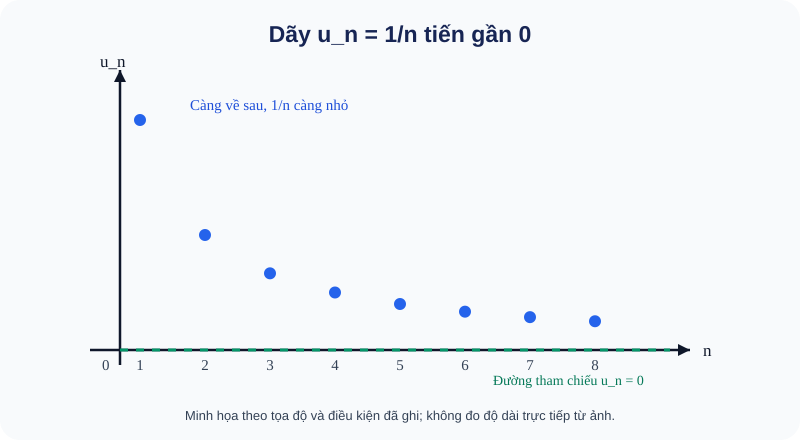
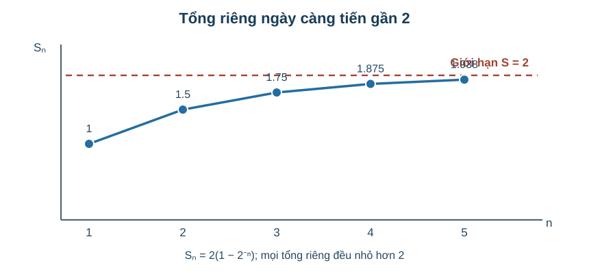

# Bài 15. Giới hạn của dãy số

TOÁN 11 · CHƯƠNG V · SGK KẾT NỐI TRI THỨC

Hiểu vì sao số hạng tiến gần một giá trị, cách tính giới hạn, tổng vô hạn có thể hữu hạn và giới hạn vô cực. Kiểm điều kiện trước mọi phép biến đổi.

<nav class="thpt-r4-lesson-tabs"><a href="../">Chương V</a><a href="../luyen-tap/">Core và Luyện tập</a><a href="../tu-kiem-tra-chuong/">Tự kiểm tra cuối chương</a></nav>

=== "Khám phá kiến thức"

    Mỗi lần Achilles chạy hết khoảng cách đến vị trí cũ của con rùa, rùa lại nhích lên một đoạn. Nếu cứ chia quãng đường như vậy, ta có **vô số đoạn**; nhưng điều ấy có đồng nghĩa thời gian đuổi kịp là vô hạn? Câu hỏi này dẫn đến hai điều khác nhau: **giới hạn các số hạng** và **giới hạn của tổng các số hạng**. Trước khi dùng công thức, em cần hình dung thế nào là “đủ gần”, “tổng riêng” và “vượt mọi mốc”.

    ### 1.1. Giới hạn hữu hạn của dãy số

    Xét dãy \(u_n=\frac1n\) với \(n=1,2,\ldots\). Các giá trị đầu là \(1;\frac12;\frac13;\frac14;\ldots\). Không có số hạng cuối cùng và **không số hạng nào bằng 0**. Nhưng các số hạng càng về sau càng gần 0. Nếu yêu cầu khoảng cách tới 0 nhỏ hơn \(0{,}01\), chỉ cần \(n>100\); từ đó về sau **mọi** số hạng đều đáp ứng. Yêu cầu khoảng cách nhỏ hơn \(0{,}0001\) thì lại chọn mốc lớn hơn. Một mốc cố định cho tất cả độ chính xác là không cần thiết.

    <figure class="thpt-r4-plot"><figcaption><strong>Đọc hình:</strong> trục ngang là số thứ tự \(n\), trục đứng là \(u_n\); các điểm \(1/n\) luôn dương nhưng tiến sát đường \(u_n=0\). Không cần tồn tại số hạng “cuối” bằng 0.</figcaption></figure>

    Ta nói \(u_n\to0\) khi các giá trị tuyệt đối \(|u_n|\) cuối cùng **nhỏ hơn mọi mức sai số dương** được chọn. Chữ “cuối cùng” nghĩa là kể từ một chỉ số \(N\), tất cả số hạng đều thỏa điều kiện; không phải chỉ vài số hạng tình cờ gần 0. Khi muốn dãy tiến đến \(a\), ta xét khoảng cách \(|u_n-a|\). Nói \(u_n\to a\) tương đương \(u_n-a\to0\). Chẳng hạn \(3+\frac2n\to3\) vì khoảng cách đến 3 là \(2/n\to0\).

    **Kết quả cơ bản:** \(\frac1{n^k}\to0\) với số nguyên dương \(k\); \(q^n\to0\) khi \(|q|<1\). Vì thế \(0{,}8^n\to0\), và \((-\frac12)^n\to0\) dù đổi dấu. Nếu \(|u_n|\le v_n\) với \(v_n\ge0\) và \(v_n\to0\), thì \(u_n\to0\): một khoảng cách nhỏ hơn khoảng cách khác đang tiến về 0 cũng phải tiến về 0.

    Không phải mọi dãy đều có giới hạn hữu hạn. Dãy \((-1)^n\) lần lượt nhận \( -1,1,-1,1,\ldots\); dù bị chặn trong khoảng \([-1,1]\), nó **không tiến gần một số thực duy nhất**. Nhưng \(\frac{(-1)^n}{n}\to0\) vì giá trị tuyệt đối bằng \(1/n\to0\). Điều quan trọng là **khoảng cách tới giới hạn**, không chỉ có hay không có dấu âm.

    **Vận dụng.** Hai dãy \(a_n=4+\frac{3}{n}\) và \(b_n=\frac{(-1)^n}{n}\) có giới hạn hữu hạn nào? Giải thích bằng khoảng cách chứ không chỉ thay số lớn.

    ??? question "Đối chiếu"

        **Lời giải:** \(|a_n-4|=3/n\to0\) nên \(a_n\to4\). Với \(b_n\), \(|b_n|=1/n\to0\), nên \(b_n\to0\). Dãy \(b_n\) đổi dấu nhưng vẫn có giới hạn 0 vì độ lớn ngày càng nhỏ.

    ??? tip "Kiểm lỗi"

        Đừng nói “dãy không có giới hạn vì có số hạng âm”. Hãy kiểm \(|u_n-a|\) có tiến về 0 không; và nhớ \(n\to+\infty\) **không có nghĩa** thay \(n\) bằng một số mang tên “vô cực”.

    ### 1.2. Định lí về giới hạn hữu hạn của dãy số

    Khi đã biết hai dãy \(u_n\to a\), \(v_n\to b\) với \(a,b\) là **số thực**, ta có thể cộng, trừ, nhân và — với điều kiện — chia các giới hạn. Tại sao? Nếu từ một mốc đủ lớn, \(u_n\) gần \(a\) và \(v_n\) gần \(b\), thì tổng và tích của chúng gần \(a+b\), \(ab\). Nhưng với phép chia, nếu **mẫu tiến về 0**, giá trị thương có thể biến động mạnh; không thể lấy \(a/b\) khi \(b=0\).

    Lấy dãy \(w_n=\frac{5n^2-3}{2n^2+n}\). Ta không “thay \(n=\infty\)”; thay vào đó chia **cả tử và mẫu cho cùng \(n^2\)**:
    
    \[
    w_n=\frac{5-\frac3{n^2}}{2+\frac1n}\longrightarrow\frac52.
    \]

    Đây là chọn phương pháp có lí do: tử và mẫu đều bậc hai, sau khi chia cho \(n^2\), mỗi phần còn lại có giới hạn hữu hạn, và **mẫu tiến đến 2 khác 0**. Nếu mẫu sau khi chuẩn hóa tiến đến 0, ta không được áp dụng ngay định lí phép chia.

    Nếu \(u_n\ge0\) và \(u_n\to a\ge0\), thì \(\sqrt{u_n}\to\sqrt a\). Chẳng hạn \(\sqrt{\frac{n+1}{4n+5}}\to\sqrt{\frac14}=\frac12\), vì biểu thức trong căn không âm và mẫu giới hạn sau chia cho \(n\) bằng 4. **Không thể tự lấy căn** nếu biểu thức bên trong âm hoặc ngoài miền xác định.

    **Vận dụng.** Tính \(\lim\limits_{n\to+\infty}\frac{2n+3}{n-1}\) (dãy xác định từ \(n\ge2\)), và nêu vì sao phép chia giới hạn hợp lệ.

    ??? question "Đối chiếu"

        **Lời giải:** Chia tử, mẫu cho \(n\): \(\frac{2+3/n}{1-1/n}\to\frac{2+0}{1-0}=2\). Mẫu của biểu thức đã chuẩn hóa tiến về 1 khác 0 (và \(n-1\ne0\) với \(n\ge2\)), nên định lí phép chia áp dụng được.

    ??? tip "Kiểm lỗi"

        Sai phổ biến là viết \(\frac{0}{0}\) rồi tùy tiện “rút gọn” vì nhìn thấy \(n\to\infty\), hoặc quên kiểm mẫu. Trước khi chia giới hạn, hãy chỉ ra **giới hạn của mẫu khác 0**.

    ### 1.3. Tổng của cấp số nhân lùi vô hạn

    Khi biết \(\frac1n\to0\), em có thể nghĩ: “Số hạng ngày càng nhỏ thì tổng vô số số hạng có thể vẫn rất lớn không?” Câu trả lời tùy dãy. Với cấp số nhân \(1,\frac12,\frac14,\frac18,\ldots\), tổng riêng \(S_n\) sau \(n\) số hạng không ngừng tăng, nhưng luôn nhỏ hơn 2; phần thiếu so với 2 giảm dần. Đây là ví dụ tổng của **vô hạn số hạng nhưng hữu hạn**.

    <figure class="thpt-r4-plot"><figcaption><strong>Đọc hình:</strong> các chấm là \(S_1=1\), \(S_2=1{,}5\), \(S_3=1{,}75\),...; đường ngang tại 2 là **giới hạn của các tổng riêng**, không phải số hạng mới được cộng vào. Mỗi số hạng tiếp theo nhỏ dần, các tổng riêng tiến gần 2.</figcaption></figure>

    Với cấp số nhân có số hạng đầu \(u_1\), công bội \(q\), tổng \(n\) số hạng đầu (khi \(q\ne1\)) là \(S_n=u_1\frac{1-q^n}{1-q}\). Nếu \(|q|<1\), \(q^n\to0\), nên \(S_n\to\frac{u_1}{1-q}\). **Tổng của cấp số nhân lùi vô hạn** là giới hạn đó. Điều kiện \(|q|<1\) bảo đảm phần còn lại \(u_1q^n/(1-q)\to0\); không phải “vô hạn số hạng nào cũng cộng được”.

    Thử dãy \(6,-3,\frac32,-\frac34,\ldots\) có \(q=-\frac12\). Công bội âm không cản trở hội tụ, vì \(|q|=\frac12<1\); tổng vô hạn bằng \(6/(1+\frac12)=4\). Các tổng riêng của ví dụ **luân phiên trên và dưới 4**, không tăng đều như dãy có \(q>0\). Nếu \(q=1\), tổng \(2+2+2+\cdots\) tăng không bị chặn; không áp dụng công thức tổng vô hạn.

    **Vận dụng.** Một mô hình ghi nhận các khoản đóng góp \(8,4,2,1,\ldots\) (đơn vị). Tính tổng lý thuyết nếu mô hình kéo dài mãi. Vì sao tổng thực tế sau hữu hạn đợt nhỏ hơn tổng đó?

    ??? question "Đối chiếu"

        **Lời giải:** Đây là cấp số nhân lùi vô hạn với \(u_1=8\), \(q=\frac12\), \(|q|<1\). Tổng vô hạn bằng \(8/(1-\frac12)=16\) đơn vị. Sau \(n\) đợt, \(S_n=16(1-2^{-n})<16\) do \(2^{-n}>0\); khoảng thiếu tiến về 0 khi \(n\) tăng.

    ??? tip "Kiểm lỗi"

        Đừng lấy \(S_n\) hữu hạn rồi gọi nó **bằng** tổng vô hạn; cũng đừng áp dụng \(u_1/(1-q)\) khi \(|q|\ge1\). Kiểm công bội trước, sau đó mới tính.

    ### 1.4. Giới hạn vô cực của dãy số

    Từ ngữ “tiến tới vô cực” khác hẳn “tiến tới một số rất lớn cố định”. Dãy \(u_n=n^2\) có thể vượt **mọi mốc dương \(M\)** mà em chỉ định, và từ một chỉ số đủ lớn trở đi **mọi số hạng** đều vượt \(M\). Ta viết \(n^2\to+\infty\). Tương tự, \(-n^2\to-\infty\) vì cuối cùng mọi số hạng nhỏ hơn \(-M\).

    Chẳng hạn nếu đặt \(M=10^6\), chỉ cần \(n>1000\) thì \(n^2>M\). Nếu đặt một mốc lớn hơn nữa, chọn \(n\) lớn hơn. Dấu \(+\infty\) không phải **một số thực để thay vào phép tính**. Với \(v_n=(-1)^n n\), độ lớn tăng mãi nhưng dấu thay đổi, nên dãy không tiến đến \(+\infty\) hay \(-\infty\); không thể chỉ nhìn \(|v_n|\).

    Các ví dụ cơ bản: \(n^k\to+\infty\) với \(k\) nguyên dương; \(q^n\to+\infty\) khi \(q>1\). Với tổng có thành phần hữu hạn, nếu \(u_n\to+\infty\) và \(v_n\to b\) hữu hạn, thì \(u_n+v_n\to+\infty\). Với tích, nếu \(u_n\to+\infty\) và \(v_n\to b>0\) thì \(u_nv_n\to+\infty\); còn nếu \(b<0\) thì \(u_nv_n\to-\infty\). **Nếu \(b=0\)** thì không được suy ra giới hạn của tích từ các mệnh đề này.

    Ví dụ \(\frac{n^2}{2n+1}=\frac n{2+1/n}\to+\infty\) vì mẫu đã chuẩn hóa tiến về 2 dương, cuối cùng nằm giữa hai số dương cố định (chẳng hạn \(2<2+1/n\le3\)), còn tử \(n\) tăng không bị chặn. Không viết \(\infty/\infty=1\) hoặc coi vô cực như số để rút gọn.

    **Vận dụng.** Dãy \(a_n=\frac{n^2}{2n+1}\) và \(b_n=(-1)^n n\) có cùng giới hạn \(+\infty\) không? Chứng minh bằng một ước lượng hoặc xét dấu.

    ??? question "Đối chiếu"

        **Lời giải:** \(a_n=\frac n{2+1/n}\ge n/3\) với \(n\ge1\), nên \(a_n\to+\infty\). Dãy \(b_n\) có các số hạng chẵn dương và lẻ âm với độ lớn tăng, nên không có giới hạn \(+\infty\) cũng không có giới hạn \(-\infty\).

    ??? tip "Kiểm lỗi"

        \(\lvert b_n\rvert\to+\infty\) **không đủ** kết luận \(b_n\to+\infty\). Với dãy dạng phân thức bậc khác nhau, chia cho lũy thừa thích hợp và kiểm dấu, không coi ký hiệu vô cực là số thực.

=== "Kiến thức SGK"

    ### 2.1. Giới hạn hữu hạn của dãy số

    
<strong>Định nghĩa — Dãy có giới hạn bằng 0</strong>
Dãy \((u_n)\) có <strong>giới hạn 0</strong> khi \(n\to+\infty\) nếu \(|u_n|\) có thể nhỏ hơn <strong>một số dương bé tùy ý</strong> kể từ một số hạng nào đó trở đi. Viết \(\lim_{n\to+\infty}u_n=0\). Nói chính xác: với mỗi \(\varepsilon>0\), có \(N\) sao cho mọi \(n\ge N\) đều có \(|u_n|<\varepsilon\).

    
<strong>Định nghĩa — Dãy có giới hạn hữu hạn \(a\)</strong>
Với \(a\in\mathbb R\), dãy \((u_n)\) có <strong>giới hạn là \(a\)</strong> khi \(n\to+\infty\) nếu \(\lim_{n\to+\infty}(u_n-a)=0\). Kí hiệu \(\lim_{n\to+\infty}u_n=a\) hoặc \(u_n\to a\). Như vậy điều kiện chỉ yêu cầu từ một lúc đủ muộn các số hạng sát \(a\); không yêu cầu có số hạng bằng \(a\).

    **Những giới hạn cơ bản SGK:** Với \(k\) nguyên dương, \(\lim 1/n^k=0\); với \(|q|<1\), \(\lim q^n=0\). Dãy hằng \(u_n=c\) có giới hạn \(c\). Nếu \(|u_n|\le v_n\) và \(v_n\to0\) với \(v_n\ge0\), thì \(u_n\to0\) (định lí kẹp trong dạng SGK dùng).

    <figure class="thpt-r4-plot"><figcaption><strong>Tra hình:</strong> \(\frac1n\to0\) vì với mỗi khoảng cách nhỏ \(\varepsilon\) tới 0 có thể chọn \(n\) đủ lớn; không có số hạng cuối cùng cần bằng 0.</figcaption></figure>

    **Phân biệt:** Dãy \((-1)^n\) không có giới hạn hữu hạn vì luân phiên \(-1,1\). Dãy \(\frac{(-1)^n}{n}\to0\) nhờ \(\left|\frac{(-1)^n}{n}\right|=1/n\to0\).

    ### 2.2. Định lí về giới hạn hữu hạn của dãy số

    
<strong>Định lí — Các phép toán với giới hạn hữu hạn</strong>
Nếu \(u_n\to a\) và \(v_n\to b\) với \(a,b\in\mathbb R\), thì \(u_n\pm v_n\to a\pm b\); \(u_nv_n\to ab\); và \(u_n/v_n\to a/b\) khi <strong>\(b\ne0\)</strong> (khi ấy \(v_n\ne0\) từ một chỉ số đủ lớn). Nếu \(u_n\ge0\) và \(u_n\to a\ge0\), thì \(\sqrt{u_n}\to\sqrt a\).

    **Điều kiện/giới hạn:** Các phép toán trên áp dụng cho **hai giới hạn hữu hạn**. Không dùng phép chia khi giới hạn mẫu là 0. Với căn bậc hai phải bảo đảm dãy dưới căn không âm; nếu các số hạng \(u_n\ge0\) và \(u_n\to a\), thì nhất thiết \(a\ge0\).

    **Phương pháp với phân thức theo \(n\):** Chia cả tử và mẫu cho cùng lũy thừa \(n\) cao nhất thích hợp; sau khi chuẩn hóa, dùng định lí khi giới hạn mẫu khác 0. Ví dụ \(\lim\frac{5n^2-3}{2n^2+n}=\frac52\). Với biểu thức căn, chỉ lấy giới hạn căn khi dãy dưới căn xác định và không âm.

    ### 2.3. Tổng của cấp số nhân lùi vô hạn

    
<strong>Định nghĩa — Cấp số nhân lùi vô hạn và tổng của nó</strong>
Cấp số nhân vô hạn có số hạng đầu \(u_1\) và công bội \(q\) thỏa <strong>\(|q|<1\)</strong> được gọi là <strong>cấp số nhân lùi vô hạn</strong>. Tổng vô hạn của cấp số nhân ấy là <strong>giới hạn của dãy tổng riêng</strong> \(S_n=u_1+u_1q+\cdots+u_1q^{n-1}\), chứ không phải phép cộng đến một số hạng cuối cùng.

    
<strong>Công thức — Tổng cấp số nhân lùi vô hạn</strong>
Với \(|q|<1\): \(\displaystyle S_n=\frac{u_1(1-q^n)}{1-q}\), và \(\displaystyle S=\lim_{n\to+\infty}S_n=\frac{u_1}{1-q}\).

Nếu \(|q|\ge1\), <strong>không dùng công thức</strong> tổng vô hạn này; giới hạn tổng riêng phải được xem xét riêng.

    <figure class="thpt-r4-plot"><figcaption><strong>Tra hình:</strong> với \(u_1=1,q=\frac12\), \(S_n=2(1-2^{-n})\to2\). Đây là giới hạn của **tổng riêng**, không phải giới hạn của các số hạng \(u_n\), vốn bằng 0.</figcaption></figure>

    **Cách kiểm hợp lí:** Với \(u_1>0\), \(0<q<1\), mọi tổng riêng dương tăng dần và nhỏ hơn \(S\). Nếu \(q<0\) nhưng \(|q|<1\), các tổng riêng có thể luân phiên quanh \(S\), dù vẫn hội tụ về \(S\).

    ### 2.4. Giới hạn vô cực của dãy số

    
<strong>Định nghĩa — Giới hạn \(+\infty\) và \(-\infty\)</strong>
Dãy \((u_n)\) có <strong>giới hạn \(+\infty\)</strong> khi từ một số hạng nào đó trở đi, \(u_n\) lớn hơn <strong>mọi mốc dương</strong> cho trước; kí hiệu \(u_n\to+\infty\). Dãy có <strong>giới hạn \(-\infty\)</strong> nếu từ một lúc đủ muộn \(u_n\) nhỏ hơn <strong>mọi mốc âm có độ lớn tùy ý</strong>, tức với mọi \(M>0\) có \(u_n<-M\) kể từ một chỉ số đủ lớn.

    **Giới hạn cơ bản SGK:** \(n^k\to+\infty\) với số nguyên dương \(k\), \(q^n\to+\infty\) khi \(q>1\); \(-n^k\to-\infty\). Vô cực không phải một số thực.

    
<strong>Quy tắc — Một số giới hạn vô cực và điều kiện dấu</strong>
Nếu \(u_n\to+\infty\), \(v_n\to b\in\mathbb R\) thì \(u_n+v_n\to+\infty\). Nếu thêm \(b>0\), \(u_nv_n\to+\infty\); nếu \(b<0\), \(u_nv_n\to-\infty\). Với \(b=0\), <strong>không thể suy ngay</strong> giới hạn tích chỉ từ hai giới hạn đó. Các trường hợp \(\infty-\infty\), \(0\cdot\infty\), \(\infty/\infty\) là dạng cần biến đổi hoặc xét riêng.

    **Lí do chọn phương pháp:** Với \(u_n=\frac{n^2}{2n+1}=\frac n{2+1/n}\), mẫu chuẩn hóa dương và tiến về 2, nên \(u_n\to+\infty\). Cũng có thể kẹp: với \(n\ge1\), \(n/3\le u_n<n/2\). Việc thấy bậc tử lớn hơn bậc mẫu chỉ là dự đoán; cần kiểm cả **dấu của mẫu**.

    **Không nhầm:** \((-1)^n n\) có độ lớn tăng vô hạn nhưng **không** có giới hạn \(+\infty\) hay \(-\infty\) vì dấu đổi qua lại. Không lấy \(\infty\) như số để thay vào biểu thức.
