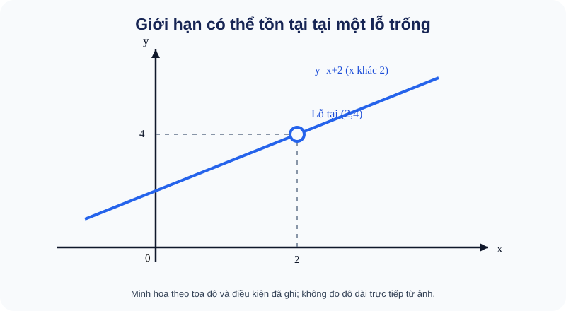

# Bài 16. Giới hạn của hàm số

TOÁN 11 · CHƯƠNG V

Quan sát hành vi gần điểm trước khi tính: giới hạn hai phía/một phía, phương pháp khử dạng chưa xác định và giới hạn vô cực.
<nav class="thpt-r4-lesson-tabs"><a href="../">Chương V</a><a href="../luyen-tap/">Core và Luyện tập</a><a href="../tu-kiem-tra-chuong/">Tự kiểm tra cuối chương</a></nav>

=== "Khám phá kiến thức"

    Ở Bài 15, khi chỉ số \(n\) tăng mãi thì dãy có thể tiến tới một số. Với **hàm số**, ta xét \(x\) tiến gần một điểm \(a\) (từ hai phía hoặc một phía) hoặc tiến ra vô cực. Giá trị **tại** \(a\) và xu hướng **gần** \(a\) có thể khác nhau. Cần nhớ phép phân tích đa thức, hằng đẳng thức và ý nghĩa của miền xác định.

    ### 1.1. Giới hạn tại điểm không nhất thiết là giá trị tại điểm

    Với \(f(x)=\frac{x^2-4}{x-2}\) chỉ xét \(x\ne2\), ta rút gọn thành \(x+2\). Ở gần \(2\), các giá trị tiến về **4** nhưng \(f(2)\) không có nghĩa. Giới hạn nói về những \(x\) **gần, khác điểm đang xét**; nó không đòi hàm phải được xác định tại điểm ấy. Cầu nối: giới hạn dãy số ở Bài 15 và các phép phân tích đa thức.

    **Vận dụng — Tự thử trước Core.** Hàm \(f(x)=\frac{x^2-9}{x-3}\) (\(x\ne3\)) có \(\lim_{x\to3}f(x)\) bằng bao nhiêu? \(f(3)\) có tồn tại không?

    

    ??? question "Đối chiếu"

        **Lời giải:** Với \(x\ne3\), \((x^2-9)/(x-3)=x+3\). Vì vậy \(\lim_{x\to3}f(x)=6\). Tuy nhiên \(f(3)\) **không xác định**; rút gọn chỉ giữ giá trị khi \(x\ne3\), không tự tạo ra giá trị tại 3.

    

    ??? tip "Kiểm lỗi"

        **Dấu hiệu:** Thế ngay x=3 thấy 0/0 rồi kết luận không có giới hạn.

        **Tự sửa:** Phân biệt miền xác định và xu hướng. Ôn mục 2.1; thử Core B16-C01, Practice B16-P02 trong <a href="../luyen-tap/">Luyện tập</a>.

    ### 1.2. Tại sao phải xét cả bên trái lẫn bên phải?

    Một con đường có thể có biển báo trước và sau mốc khác nhau. Với hàm \(f(x)=x+1\) khi \(x<0\) và \(f(x)=3-x\) khi \(x\ge0\), giới hạn trái tại 0 là **1**, giới hạn phải là **3**. Hai phía không đồng ý, nên không có giới hạn **hai phía hữu hạn**; giá trị \(f(0)=3\) không sửa được khác biệt ấy.

    **Vận dụng — Tự thử trước Core.** Với \(g(x)=2x+1\) khi \(x<1\), \(g(x)=x+2\) khi \(x\ge1\), hãy tính hai giới hạn một phía tại 1 và kết luận giới hạn hai phía.

    

    ??? question "Đối chiếu"

        **Lời giải:** Khi \(x\to1^-\), \(g(x)=2x+1\to3\). Khi \(x\to1^+\), \(g(x)=x+2\to3\). Hai giới hạn hữu hạn **cùng bằng 3**, nên \(\lim_{x\to1}g(x)=3\); đồng thời \(g(1)=3\), dù điều cuối không phải điều kiện bắt buộc để giới hạn tồn tại.

    

    ??? tip "Kiểm lỗi"

        **Dấu hiệu:** Chỉ tính phía có dấu bằng trong công thức rồi coi đó là giới hạn hai phía.

        **Tự sửa:** Tính **riêng trái và phải** rồi so. Ôn mục 2.2, luyện Core B16-C02 và Practice B16-P03 tại <a href="../luyen-tap/">Luyện tập</a>.

    ### 1.3. Nhân liên hợp để biến dạng (0/0) thành phép tính hợp lệ

    Dạng \(0/0\) sau khi thay số **không phải giá trị giới hạn**. Với biểu thức căn \(\sqrt{x+4}-2\), nhân cả tử và mẫu với \(\sqrt{x+4}+2\) vì hai biểu thức liên hợp có tích bằng \(x\). Bước biến đổi chỉ đúng **khi mẫu và căn có nghĩa** trong miền đang xét, chẳng hạn \(x\ne0\), \(x\ge-4\).

    **Vận dụng — Tự thử trước Core.** Tính \(\lim_{x\to0}\frac{\sqrt{x+4}-2}{x}\). Hãy ghi rõ tại sao được rút gọn x.

    

    ??? question "Đối chiếu"

        **Lời giải:** Với \(x\ne0\) đủ gần 0 và \(x\ge-4\),

        \[
        \frac{\sqrt{x+4}-2}{x}=\frac{(\sqrt{x+4}-2)(\sqrt{x+4}+2)}{x(\sqrt{x+4}+2)}=\frac1{\sqrt{x+4}+2}.
        \]

        Vậy giới hạn là \(1/(2+2)=\boxed{1/4}\). Chỉ rút gọn **với \(x\ne0\)**, không khẳng định phân thức gốc xác định tại 0.

    

    ??? tip "Kiểm lỗi"

        **Dấu hiệu:** Lấy 0/0 bằng 0, hoặc nhân liên hợp nhưng quên nhân cả mẫu.

        **Tự sửa:** Viết hằng đẳng thức \((\sqrt A-b)(\sqrt A+b)=A-b^2\) với \(A\ge0\); ôn mục 2.3, luyện Practice B16-P01/P02.

    ### 1.4. Dấu của mẫu quyết định hướng giới hạn vô cực

    Khi tử tiến tới số dương khác 0 còn mẫu tiến tới 0, dấu của mẫu là then chốt. Ví dụ \(1/(x-2)\) tiến tới \(+\infty\) khi \(x\to2^+\) nhưng tới \(-\infty\) khi \(x\to2^-\). Vì vậy không được viết một “giới hạn bằng vô cực” hai phía nếu dấu không nhất quán.

    **Vận dụng — Tự thử trước Core.** Xét \(h(x)=\frac{x+1}{2-x}\). Hãy tìm xu hướng khi \(x\to2^-\) và khi \(x\to2^+\).

    

    ??? question "Đối chiếu"

        **Lời giải:** Tử \(x+1\to3>0\). Khi \(x\to2^-\), mẫu \(2-x>0\) rất nhỏ nên \(h(x)\to+\infty\); khi \(x\to2^+\), mẫu \(2-x<0\) rất nhỏ nên \(h(x)\to-\infty\). Hai phía khác nhau, không có giới hạn hai phía theo nghĩa thông thường.

    

    ??? tip "Kiểm lỗi"

        **Dấu hiệu:** Bỏ dấu và ghi cả hai phía +∞, hoặc lấy trung bình hai vô cực.

        **Tự sửa:** Lập bảng dấu **tử/mẫu** cho từng phía, ôn mục 2.4; luyện Core B16-C03 và Practice B16-P06 tại <a href="../luyen-tap/">Core và Luyện tập</a>.

    ### 1.5. Ở (x	o-infty), vì sao (sqrt{x^2}=|x|) mà không phải x?

    Ta biết \(\sqrt{x^2}\) là căn bậc hai **không âm**, nên bằng \(|x|\). Khi \(x\) âm rất lớn về độ lớn, \(|x|=-x\). Đây là điểm quyết định dấu của các giới hạn có căn tại âm vô cực. Với phân thức hữu tỉ, hãy so bậc và chia cho lũy thừa trội; với căn, tách đúng \(|x|\).

    **Vận dụng — Tự thử trước Core.** Tính \(\lim_{x\to-\infty}\frac{\sqrt{x^2+9}}x\). Vì sao kết quả không phải \(1\)?

    

    ??? question "Đối chiếu"

        **Lời giải:** Ta có

        \[
        \frac{\sqrt{x^2+9}}{x}=\frac{|x|}{x}\sqrt{1+\frac9{x^2}}.
        \]

        Khi \(x<0\), \(|x|/x=-1\). Thừa số căn tiến về 1 nên giới hạn là \(-1\), **không phải \(+1\)**.

    

    ??? tip "Kiểm lỗi"

        **Dấu hiệu:** Rút (sqrt{x^2}=x) dù x âm.

        **Tự sửa:** Ghi rõ (|x|/x=-1) cho (x<0); ôn mục 2.4, luyện Practice B16-P04 và B16-P05 tại <a href="../luyen-tap/">Luyện tập</a>.

    ### 1.6. Một ngưỡng trong đời sống có thể tạo hai giới hạn khác nhau

    Một bãi gửi xe giả định tính phí \(10\) nghìn đồng khi \(0<t\le1\) giờ và \(20\) nghìn đồng khi \(t>1\). Giá đúng tại \(t=1\) là \(10\), nhưng trước và sau ngưỡng khách hàng thấy **hai xu hướng phí khác nhau**. Mô hình bước nhảy giúp phân biệt **giá tại ngưỡng** với **giới hạn**; đó không phải chỉ là kỹ thuật tính.

    **Vận dụng — Tự thử trước Core.** Với \(C(t)=10\) khi \(0<t\le1\), \(C(t)=20\) khi \(t>1\) (nghìn đồng), tính \(C(1)\), giới hạn trái và phải tại 1; có giới hạn hai phía không?

    

    ??? question "Đối chiếu"

        **Lời giải:** Ta có \(C(1)=10\). Khi \(t\to1^-\), \(C(t)\to10\); khi \(t\to1^+\), \(C(t)\to20\). Do \(10\ne20\), **giới hạn hai phía tại 1 không tồn tại**, dù giá tại ngưỡng được xác định.

    

    ??? tip "Kiểm lỗi"

        **Dấu hiệu:** Lấy trung bình 15 hoặc lấy C(1)=10 làm giới hạn hai phía.

        **Tự sửa:** Viết hai cột (t<1), (t>1), rồi so; ôn mục 2.2/2.4, luyện tình huống mô hình ở Practice B16-P07.

=== "Kiến thức SGK"

    ### 2.1. Giới hạn hữu hạn của hàm số tại một điểm

    
<strong>Ý nghĩa:</strong> \(\lim_{x\to a}f(x)=L\) khi \(x\) thuộc miền xác định, <strong>khác \(a\)</strong> và tiến tới \(a\), thì \(f(x)\) tiến gần \(L\). Giới hạn phụ thuộc hành vi quanh điểm, <strong>không bắt buộc</strong> \(f(a)\) có nghĩa hoặc bằng \(L\).

    **Chính xác hơn:** Điều kiện cần xem \(a\) là điểm có thể tiến gần từ các giá trị của miền xác định. Với mọi \(\varepsilon>0\) phải chọn được \(\delta>0\) để \(0<|x-a|<\delta\) (và \(x\) thuộc miền xác định) kéo theo \(|f(x)-L|<\varepsilon\). Khi chỉ có miền từ một phía, phải ghi rõ hướng tiến gần.

    <figure class="thpt-r4-plot"><figcaption>Đọc hình: <strong>vòng tròn rỗng</strong> ở (2;4) chỉ hàm gốc không xác định tại điểm ấy; các điểm trên hai nhánh đường vẫn tiến gần mức 4. Không kết luận giới hạn không tồn tại chỉ vì có lỗ.</figcaption></figure>

    ### 2.2. Giới hạn một phía và điều kiện giới hạn hai phía

    
<strong>Một phía:</strong> \(x\to a^-\) nghĩa là \(x<a\), \(x\to a^+\) nghĩa là \(x>a\). Khi miền xác định có điểm đủ gần ở <strong>cả hai phía</strong>, giới hạn hữu hạn hai phía \(\lim_{x\to a}f(x)=L\) tồn tại <strong>khi và chỉ khi</strong> hai giới hạn trái/phải đều bằng cùng \(L\).

    **Không nhầm:** Hàm có thể có \(f(a)\) xác định nhưng vẫn không có giới hạn hai phía; ngược lại có thể có giới hạn nhưng \(f(a)\) không xác định. Giá trị tại ngưỡng cần xử lý riêng.

    ### 2.3. Phép toán và cách giải dạng \(0/0\)

    
<strong>Điều kiện:</strong> Với các giới hạn hữu hạn, tổng/hiệu/tích tuân theo các phép toán thông thường; thương cần <strong>giới hạn mẫu khác 0</strong>. Nếu thay trực tiếp ra \(0/0\), cần <strong>biến đổi biểu thức đúng trên miền gần điểm</strong> (phân tích nhân tử, rút gọn khi \(x\ne a\), nhân liên hợp) rồi mới áp dụng quy tắc.

    **Nhân liên hợp:** \((\sqrt A-\sqrt B)(\sqrt A+\sqrt B)=A-B\), với \(A,B\ge0\). Nhân cả tử và mẫu, kiểm mẫu mới khác 0 trong vùng đang xét. Không coi \(0/0\) là kết quả.

    ### 2.4. Giới hạn vô cực tại điểm và giới hạn ở vô cực

    Một hàm có thể tăng/giảm không bị chặn khi \(x\to a^-\) hoặc \(a^+\); ký hiệu \(+\infty,-\infty\) diễn tả xu hướng chứ không phải số thực để cộng/chia tùy tiện.

    Khi \(x\to\pm\infty\), ta phân tích bậc trội hoặc nhân liên hợp. **Bẫy dấu:** \(\sqrt{x^2}=|x|\). Khi \(x\to-\infty\), \(|x|=-x\), nên các giới hạn kiểu \(\sqrt{x^2+c}/x\) thường tiến đến \(-1\), không phải \(1\).

    **Ứng dụng:** Hàm bước phí gửi xe có giới hạn trái/phải khác nhau tại một ngưỡng; hàm hiệu suất \(100t/(t+5)\) tiến về mức 100 dù giá trị mô hình tại mọi \(t\) hữu hạn vẫn nhỏ hơn 100. Không dùng một điểm dữ liệu để suy cả xu hướng.

=== "Ví dụ"

    Mỗi Ví dụ nêu phương pháp trước, rồi giải và kiểm miền/điều kiện.

    ### 3.1. Khử dạng (0/0) bằng phân tích nhân tử

    

    
<strong>Đề bài:</strong> Tính \(\lim_{x\to2}\frac{x^2-4}{x-2}\).

    
<strong>Chọn phương pháp:</strong> Thế trực tiếp ra \(0/0\), cần phân tích tử.

    
<strong>Lời giải:</strong> Với \(x\ne2\), \((x-2)(x+2)/(x-2)=x+2\), do đó giới hạn bằng \(4\).

    
<strong>Kiểm lại:</strong> Hàm gốc không xác định tại 2 nhưng tiến gần 4 khi \(x\) gần 2.

    

    ### 3.2. Hai phía có dấu mẫu trái nhau

    

    
<strong>Đề bài:</strong> Tính \(\lim_{x\to1^-}1/(x-1)\) và \(\lim_{x\to1^+}1/(x-1)\).

    
<strong>Chọn phương pháp:</strong> Tử dương; dấu mẫu khác phía.

    
<strong>Lời giải:</strong> Bên trái mẫu âm rất nhỏ → \(-\infty\); bên phải mẫu dương rất nhỏ → \(+\infty\).

    
<strong>Kiểm lại:</strong> Không kết luận có giới hạn hai phía hữu hạn.

    

    ### 3.3. Giới hạn chứa căn ở dương vô cực

    

    
<strong>Đề bài:</strong> Tính \(\lim_{x\to+\infty}(\sqrt{x^2+x}-x)\).

    
<strong>Chọn phương pháp:</strong> Hiệu hai số lớn gây dạng \(\infty-\infty\), dùng liên hợp.

    
<strong>Lời giải:</strong> \(\sqrt{x^2+x}-x=\frac{x}{\sqrt{x^2+x}+x}=\frac1{\sqrt{1+1/x}+1}\) khi \(x>0\) đủ lớn, nên giới hạn \(=1/2\).

    
<strong>Kiểm lại:</strong> \(x>0\) cho phép \(\sqrt{x^2}=x\).

    

    ### 3.4. Âm vô cực cần giữ đúng trị tuyệt đối

    

    
<strong>Đề bài:</strong> Tính \(\lim_{x\to-\infty}\frac{\sqrt{x^2+1}}x\).

    
<strong>Chọn phương pháp:</strong> Tách \(|x|\), không tách x tùy tiện.

    
<strong>Lời giải:</strong> \(\frac{|x|}{x}\sqrt{1+1/x^2}\to(-1)\cdot1=-1\).

    
<strong>Kiểm lại:</strong> Biểu thức gốc âm với mọi \(x<0\) đủ xa, không thể có giới hạn \(+1\).

    

    ### 3.5. Hai phía khớp dù biểu thức thay đổi

    

    
<strong>Đề bài:</strong> Cho \(f(x)=x^2\) nếu \(x\le2\), \(f(x)=3x-2\) nếu \(x>2\). Tìm \(\lim_{x\to2}f(x)\).

    
<strong>Chọn phương pháp:</strong> Xét trái và phải độc lập.

    
<strong>Lời giải:</strong> \(\lim_{x\to2^-}x^2=4\); \(\lim_{x\to2^+}(3x-2)=4\); nên giới hạn hai phía bằng \(4\).

    
<strong>Kiểm lại:</strong> Giá \(f(2)=4\) khớp nhưng không thay cho bước so hai phía.

    

    ### 3.6. Mô hình hiệu suất có mức bão hòa

    

    
<strong>Đề bài:</strong> \(H(t)=\frac{100t}{t+5}\) với \(t\ge0\). Mức hiệu suất mô hình tiến đến đâu khi \(t\to+\infty\)?

    
<strong>Chọn phương pháp:</strong> Chia cả tử/mẫu cho t, kiểm miền t>0.

    
<strong>Lời giải:</strong> \(H(t)=100/(1+5/t)\to100\).

    
<strong>Kiểm lại:</strong> Với mọi \(t\ge0\), \(H(t)<100\) và tăng về mức 100; mô hình không bảo đảm thiết bị thực đạt đúng 100.

    

=== "Lỗi thường gặp"

    Mỗi sai lầm có hướng sửa liên kết về mạch lý thuyết và câu luyện tập khác số liệu.

    

    ??? tip "4.1. Nhầm giá trị tại điểm với giới hạn"

        **Vì sao sai:** Bỏ điều kiện hoặc hiểu sai ý nghĩa giới hạn.

        **Tự sửa:** Phân biệt (f(a)) và xu hướng (x	o a); ôn mục 2.1, giải Core B16-C01.

    

    ??? tip "4.2. Chỉ tính giới hạn từ một phía"

        **Vì sao sai:** Bỏ điều kiện hoặc hiểu sai ý nghĩa giới hạn.

        **Tự sửa:** Tách (x	o a^-) và (x	o a^+), so kết quả; ôn 2.2 và Practice B16-P03.

    

    ??? tip "4.3. Lấy (0/0) làm đáp số hoặc nhân liên hợp sai"

        **Vì sao sai:** Bỏ điều kiện hoặc hiểu sai ý nghĩa giới hạn.

        **Tự sửa:** Kiểm điều kiện \(x\ne a\) khi rút gọn quanh mốc lấy giới hạn; phân tích hoặc dùng liên hợp, rồi luyện B16-P01.

    

    ??? tip "4.4. Bỏ dấu của mẫu hoặc căn khi (x	o-infty)"

        **Vì sao sai:** Bỏ điều kiện hoặc hiểu sai ý nghĩa giới hạn.

        **Tự sửa:** Bảng dấu từng phía, (sqrt{x^2}=|x|); ôn mục 2.4, giải Practice B16-P04/P06.

    **Học tiếp:** <a href="../luyen-tap/">Core và Luyện tập</a> · <a href="../tu-kiem-tra-chuong/">Tự kiểm tra cuối chương</a> · <a href="../../../../thu-vien/tu-luan-g11-chuong-v/">Tự luận Chương V</a>.

    
Nguồn tham khảo: SGK Toán 11 – Kết nối tri thức với cuộc sống, tập một, Bài 16 (trang in 111–118).

