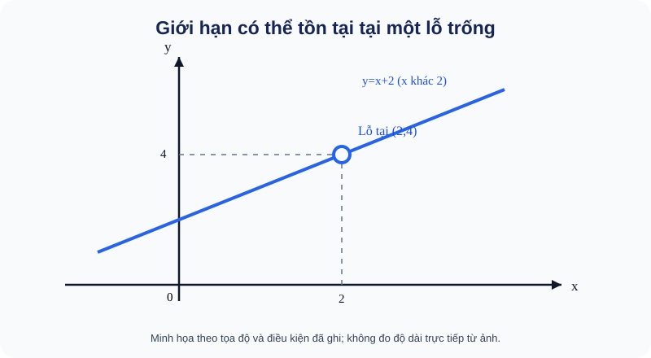

# Bài 16. Giới hạn của hàm số

TOÁN 11 · CHƯƠNG V · SGK KNTT

Khám phá bản chất và điều kiện → ví dụ giải thích phương pháp → Tự thử trước Core → Core/Luyện tập/Vận dụng → tự khắc phục. Không ghi Skill Mastery từ tự học.
<nav class="thpt-r4-lesson-tabs"><a href="../">Chương V</a><a href="../luyen-tap/">Core và Luyện tập</a><a href="../tu-kiem-tra-chuong/">Tự kiểm tra cuối chương</a></nav>

=== "Khám phá kiến thức"

    ### Cùng tìm hiểu

    ### 1.1. Câu hỏi mở đầu: tại một điểm chưa tính được thì sao?

    Xét f(x)=(x²−4)/(x−2). Em thử thế x=2: mẫu bằng 0, phép chia không xác định. Nhưng nếu xét **gần 2**, ta có bảng:

    | x | 1,9 | 1,99 | 2,01 | 2,1 |
    |---|---:|---:|---:|---:|
    | f(x) | 3,9 | 3,99 | 4,01 | 4,1 |

    Vì x≠2, ta có thể rút gọn f(x)=x+2. Khi x tiến về 2, các giá trị f(x) tiến về **4**, mặc dù chính f(2) **không tồn tại**. Khái niệm **giới hạn của hàm số** giúp mô tả xu hướng ở gần một điểm, không đòi biết giá trị ngay tại điểm ấy.

    **Cầu nối:** Em đã biết đọc đồ thị và tính giá trị f(x) tại x có nghĩa. Bài này khác ở chỗ quan sát x **tiến gần** a, không chỉ thay đúng x=a vào công thức.

    **Hình trực quan D5:** <figure class="thpt-r4-plot thpt-r4-probability-figure"><figcaption>Đồ thị y=x+2 có lỗ rỗng tại (2,4)</figcaption></figure>

    **Cách đọc hình:** Đường màu xanh đi tới độ cao 4 khi x tiến từ trái hoặc phải về 2; vòng tròn rỗng tại (2,4) cho biết hàm gốc **không có giá trị ở x=2**. Đừng nhầm lỗ trống với việc giới hạn không tồn tại.

    ### Ví dụ trực quan

    Có hàm số không xác định tại một điểm nhưng vẫn có xu hướng rõ ràng khi tiến sát điểm đó. Giới hạn nhìn các giá trị xung quanh, không nhất thiết nhìn ngay tại điểm.

    **Quan sát bằng số liệu:** Với f(x)=(x²−4)/(x−2), x≠2, ta có f(x)=x+2. Vì vậy giới hạn khi x→2 là 4 dù f(2) không tồn tại; điều kiện x≠2 không được quên.

    ### Thuật ngữ và kiến thức, kỹ năng

    **Thuật ngữ:** giới hạn hàm, giới hạn một phía, vô cực, liên hợp.

    **Sau bài học, em cần:** kiểm miền xác định, nhận dạng 0/0 và thử hai phía trước khi kết luận.

=== "Kiến thức SGK"

    ### 1.2. Định nghĩa và kí hiệu

    Viết **lim_{x→a}f(x)=L** nghĩa là: khi x thuộc miền xác định, khác a và tiến gần a, giá trị f(x) tiến gần L. **Giới hạn không nhất thiết bằng f(a)**, và f(a) có thể chưa được định nghĩa. Một hàm có giới hạn khi x tiến về a qua các giá trị thuộc miền xác định đủ gần a, dù nó có thể bị "thủng" ngay tại a.

    - "Giới hạn trái" **x→a⁻** là xét các x<a tiến gần a; "giới hạn phải" **x→a⁺** là xét x>a.
    - Nếu miền xác định cho phép tiến gần từ hai phía, một giới hạn hữu hạn hai phía bằng L **chỉ khi cả hai giới hạn một phía đều tồn tại và bằng L**.
    - Không được suy giới hạn hai phía từ một phía duy nhất.

    ### 1.3. Nhìn đường đi của giá trị

    Với g(x)=1/(x−1), khi x→1⁺ thì mẫu là số dương rất nhỏ, g(x)→+∞; khi x→1⁻ thì mẫu âm rất nhỏ, g(x)→−∞. Hai phía **không cùng tiến đến một giá trị hữu hạn**, nên không có giới hạn hữu hạn hai phía tại 1. Dấu của mẫu là thông tin thiết yếu, không phải chi tiết phụ.

    Khi nói x→+∞, ta cho x tăng mãi; x→−∞ là cho x giảm mãi về phía âm. **Phải kiểm tra dấu trước khi đưa x ra ngoài căn:** √(x²)=|x|, bằng −x nếu x<0.

    **Thuật ngữ mới — “nhân liên hợp” nghĩa là gì?** Khi gặp biểu thức có dạng `√A−b`, ta thường nhân cả tử và mẫu với `√A+b` (giữ nguyên giá trị phân thức ở nơi mẫu khác 0). Hai biểu thức `√A−b` và `√A+b` được gọi là **liên hợp** của nhau; tích của chúng là `A−b²`, nhờ hằng đẳng thức hiệu hai bình phương. Ví dụ `(√(x+4)−2)(√(x+4)+2)=x`, giúp khử căn khi tính giới hạn ở x=0. **Vì sao làm bước này?** Để biến dạng `0/0` chưa thể kết luận thành một biểu thức có giới hạn tính được. Trước khi rút gọn, phải kiểm tra đang xét `x≠0` và căn có nghĩa.

    ### 1.4. Cách lựa chọn phương pháp

    - Thay trực tiếp cho kết quả hữu hạn hợp lệ → có thể dùng tính liên tục/phép toán giới hạn thích hợp.
    - Nếu thay trực tiếp ra **0/0** → đây chưa phải đáp số; tìm nhân tử chung, phân tích hoặc nhân liên hợp.
    - Nếu tử tiến đến giá trị khác 0, mẫu tiến đến 0 → xét dấu ở từng phía trước khi kết luận ±∞.
    - Khi x→±∞ → chia lũy thừa trội hoặc nhân liên hợp; với căn phải nhớ dấu của |x|.

    **Tự thử trước Core:** Nếu k(x)=(x²−9)/(x−3) với x≠3, em đoán lim_{x→3}k(x) bằng bao nhiêu? Hãy giải thích tại sao phép "rút gọn" chỉ dùng cho x≠3, không phải xác định k(3).

    

Đã tự thử? Mở đối chiếu

6.

=== "Ví dụ"

    ### Bốn ví dụ độc lập

    **EX-G11-B16-01 — Khử 0/0.** lim_{x→2}(x²−4)/(x−2) = lim_{x→2}(x+2)=4 vì x²−4=(x−2)(x+2) khi x≠2. Hàm gốc không xác định tại 2 nhưng giới hạn vẫn bằng 4.

    **EX-G11-B16-02 — Giới hạn một phía khác nhau.** Với f(x)=1/(x−1), khi x→1^+ mẫu dương nhỏ, f(x)→+∞; khi x→1^- mẫu âm nhỏ, f(x)→−∞. Không tồn tại giới hạn hữu hạn hai phía ở 1. Phải ghi **riêng từng phía**, không cộng hai vô cực.

    **EX-G11-B16-03 — Liên hợp tại +∞.** Tính lim_{x→+∞}(√(x²+x)−x). Nhân liên hợp được x/(√(x²+x)+x)=1/(√(1+1/x)+1)→1/2, vì x>0 khi x→+∞. **Bẫy:** rút x khỏi căn phải dùng dấu x.

    **EX-G11-B16-04 — Dấu của căn khi x âm lớn.** lim_{x→−∞}√(x²+1)/x=lim_{x→−∞}(|x|√(1+1/x²))/x=−1. **Bẫy:** viết √(x²)=x cho x<0 là sai.

    **EX-G11-B16-05 — Vì sao giới hạn một phía quan trọng trong tình huống thực tế?** Một bãi xe thu **10 nghìn đồng** nếu thời gian gửi t thỏa 0<t≤1 giờ, và thu **20 nghìn đồng** nếu t>1 giờ. Gọi C(t) là chi phí (nghìn đồng), ta có C(t)=10 khi 0<t≤1, C(t)=20 khi t>1. Khi t tiến gần 1 **từ phía nhỏ hơn**, C(t) luôn là 10 nên giới hạn trái là 10; khi t tiến gần 1 **từ phía lớn hơn**, C(t) là 20 nên giới hạn phải là 20. Do hai phía khác nhau nên **không có giới hạn hai phía** tại t=1. Giá đúng tại t=1 là C(1)=10 nhưng điều này **không làm giới hạn hai phía xuất hiện**. **Ý nghĩa:** tại một ngưỡng tính phí, hai quá trình tiến gần từ hai phía có thể dẫn đến kết quả khác nhau. **Bẫy:** không được lấy trung bình (10+20)/2=15 hay lấy C(1) làm giới hạn.

=== "Lỗi thường gặp"

    

Nhầm giá trị hàm tại điểm với giới hạn.
<ol><li><strong>Nhận diện:</strong> Nhầm giá trị hàm tại điểm với giới hạn.</li>
    <li><strong>Nhắc bản chất và điều kiện:</strong> Giới hạn nói về giá trị gần điểm, xét x≠a; hàm có thể không xác định đúng tại a.</li>
    <li><strong>Sửa cách nghĩ:</strong> Hãy nói lại bằng lời tại sao bước trước chưa đủ để kết luận, rồi kiểm tra giả thiết trước phép biến đổi.</li>
    <li><strong>Tự thử trước khi mở đáp án:</strong> Với h(x)=(x²−16)/(x−4), x≠4, hãy rút gọn. <strong>Tự đối chiếu sau khi thử:</strong> h(x)=x+4 khi x≠4; giới hạn tại 4 là 8 dù h(4) chưa xác định.</li>
    <li><strong>Quay lại bài gốc:</strong> làm lại <code>THPT-G11-CHV-B16-C01</code> và giải thích bằng lời vì sao kết luận đúng.</li></ol>
<a href="../luyen-tap/?item=THPT-G11-CHV-B16-C01">Quay lại THPT-G11-CHV-B16-C01</a>

    

Chỉ nhìn một phía rồi kết luận giới hạn hai phía.
<ol><li><strong>Nhận diện:</strong> Chỉ nhìn một phía rồi kết luận giới hạn hai phía.</li>
    <li><strong>Nhắc bản chất và điều kiện:</strong> Khi tiến gần được từ cả hai phía, giới hạn trái và phải phải bằng nhau.</li>
    <li><strong>Sửa cách nghĩ:</strong> Hãy nói lại bằng lời tại sao bước trước chưa đủ để kết luận, rồi kiểm tra giả thiết trước phép biến đổi.</li>
    <li><strong>Tự thử trước khi mở đáp án:</strong> Với k(x)=|x|/x, x≠0, tìm giá trị ở x&gt;0 và x&lt;0. <strong>Tự đối chiếu sau khi thử:</strong> Bên phải bằng 1, bên trái bằng −1, nên không có giới hạn hai phía tại 0.</li>
    <li><strong>Quay lại bài gốc:</strong> làm lại <code>THPT-G11-CHV-B16-C02</code> và giải thích bằng lời vì sao kết luận đúng.</li></ol>
<a href="../luyen-tap/?item=THPT-G11-CHV-B16-C02">Quay lại THPT-G11-CHV-B16-C02</a>

    ### Học tiếp

    [Core và Luyện tập Bài 16](luyen-tap.md) · [Tự luận Chương V](../../../thu-vien/tu-luan-g11-chuong-v.md) · [Tự kiểm tra cuối chương](tu-kiem-tra-chuong.md)
