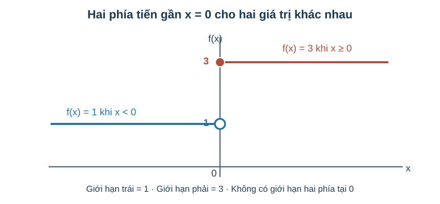

# Bài 16. Giới hạn của hàm số

TOÁN 11 · CHƯƠNG V · SGK KẾT NỐI TRI THỨC

Không cần biết giá trị ngay tại điểm vẫn có thể xét giới hạn; phải phân biệt tiến từ trái/phải, tiến tới vô cực và tiến đến giá trị vô cực.

<nav class="thpt-r4-lesson-tabs"><a href="../">Chương V</a><a href="../luyen-tap/">Core và Luyện tập</a><a href="../tu-kiem-tra-chuong/">Tự kiểm tra cuối chương</a></nav>

=== "Khám phá kiến thức"

    Ở Bài 15, ta đã học một dãy số \(u_n\) tiến gần một số khi chỉ số \(n\) tăng mãi. Bây giờ em sẽ cho **biến thực \(x\)** tiến gần một vị trí hoặc tiến mãi về hai phía trục số, rồi quan sát **giá trị hàm \(f(x)\)**. Có ba câu hỏi khác nhau theo SGK: khi \(x\) gần một điểm thì \(f(x)\) có thể gần một số hữu hạn không; khi \(x\) rất lớn hoặc rất âm thì sao; và khi \(x\) gần một điểm mà \(f(x)\) lớn không bị chặn thì phải phát biểu thế nào?

    ### 1.1. Giới hạn hữu hạn của hàm số tại một điểm

    Thử tính \(f(x)=\frac{x^2-4}{x-2}\) tại \(x=2\): phép chia **không xác định**. Nhưng với \(x\ne2\), ta phân tích tử và rút gọn \(f(x)=x+2\). Lấy các giá trị gần 2, chẳng hạn \(x=1{,}9;1{,}99;2{,}01;2{,}1\), giá trị tương ứng là \(3{,}9;3{,}99;4{,}01;4{,}1\), tiến gần **4** từ cả hai phía.

    <figure class="thpt-r4-plot"><figcaption><strong>Hướng dẫn đọc:</strong> chấm tròn rỗng ở \((2,4)\) nói rằng **hàm gốc không xác định tại \(x=2\)**; hai nhánh xanh tiến gần cao độ 4 khi \(x\to2\). Giới hạn bằng 4 không có nghĩa \(f(2)=4\).</figcaption></figure>

    Đây là điểm cốt lõi: **giới hạn xét ở gần \(x_0\)** chứ không bắt buộc biết hàm số **ngay tại \(x_0\)**. SGK định nghĩa qua dãy: nếu mọi dãy \((x_n)\) trong miền xác định, \(x_n\ne x_0\), \(x_n\to x_0\) đều cho \(f(x_n)\to L\) thì \(f(x)\to L\) khi \(x\to x_0\). Không thể chỉ thử **một** dãy rồi coi đã chứng minh toàn bộ, vì dãy khác có thể cho kết quả khác.

    **Hai phía có thể không giống nhau.** Hãy xét một quy tắc tính phí: \(g(x)=1\) khi \(x<0\), \(g(x)=3\) khi \(x\ge0\). Khi tiến về 0 từ bên trái, mọi giá trị hàm bằng 1; từ bên phải bằng 3. Vậy giới hạn trái là 1, giới hạn phải là 3; **không có giới hạn hai phía** ở 0, dù \(g(0)=3\) hoàn toàn được định nghĩa.

    <figure class="thpt-r4-plot"><figcaption><strong>Hướng dẫn đọc:</strong> vòng tròn **rỗng** ở \((0,1)\) là phía trái không lấy giá trị tại 0; chấm **đặc** ở \((0,3)\) cho giá trị \(g(0)=3\). Hai nhánh tiến về hai độ cao khác nhau, nên không thể có một giới hạn hữu hạn hai phía.</figcaption></figure>

    Khi miền xác định cho phép tiến lại gần từ **cả hai phía**, điều kiện \(\lim_{x\to x_0^-}f(x)=\lim_{x\to x_0^+}f(x)=L\) là **cần và đủ** để giới hạn hai phía bằng \(L\). Nếu hàm chỉ xác định về một phía gần đầu mút, ta dùng khái niệm giới hạn **một phía**, không tự phát biểu giới hạn hai phía theo giả thiết thiếu miền xác định.

    **Vận dụng.** Với \(h(x)=\frac{x^2-9}{x-3}\) khi \(x\ne3\), tính \(\lim_{x\to3}h(x)\). Hàm có giá trị tại \(x=3\) không?

    ??? question "Đối chiếu"

        **Lời giải:** Với \(x\ne3\), \(h(x)=\frac{(x-3)(x+3)}{x-3}=x+3\), do đó \(\lim_{x\to3}h(x)=6\). Theo biểu thức ban đầu, \(h(3)\) **không xác định**. Giới hạn tồn tại vì chỉ xét các \(x\) khác 3 nhưng gần 3.

    ??? tip "Kiểm lỗi"

        Không thể viết \(h(3)=6\) chỉ vì giới hạn bằng 6. Dấu rút gọn \(x-3\) hợp lệ khi \(x\ne3\); chính điều kiện loại điểm đó cho phép tính giới hạn mà không thay đổi giá trị hàm ngay tại điểm.

    ### 1.2. Giới hạn hữu hạn của hàm số tại vô cực

    Tại điểm \(x_0\), ta thu nhỏ khoảng cách \(|x-x_0|\). Nhưng khi \(x\to+\infty\), ta không tới gần một số thực nào cả: \(x\) lớn hơn mọi mốc cho trước. Tương tự \(x\to-\infty\), \(x\) nhỏ hơn mọi mốc âm. Câu hỏi về **giới hạn hữu hạn** vẫn có nghĩa: chẳng hạn \(f(x)=2+\frac1x\) tiến gần 2 cả khi \(x\) rất lớn dương lẫn rất lớn âm.

    Với phân thức \(f(x)=\frac{3x^2+1}{x^2+2}\), cả tử và mẫu đều bậc hai. Chia cả hai cho \(x^2\) (với \(x\ne0\)) để được
    \[
    f(x)=\frac{3+1/x^2}{1+2/x^2}\longrightarrow3
    \]
    khi \(x\to+\infty\) **hoặc** \(x\to-\infty\). Mẫu chuẩn hóa tiến đến 1 khác 0; đây là lí do dùng được phép chia giới hạn hữu hạn.

    **Dấu của căn là điểm khó nhất khi \(x\to-\infty\).** Với \(\sqrt{x^2+1}/x\), ta phải viết \(\sqrt{x^2+1}=|x|\sqrt{1+1/x^2}\). Khi \(x\to+\infty\), \(|x|=x\) nên thương tiến đến \(1\). Khi \(x\to-\infty\), \(|x|=-x\) nên thương tiến đến \(-1\). Hai giới hạn **khác nhau**, dù biểu thức có cùng \(x^2\) trong căn.

    **Vận dụng.** Tính hai giới hạn \(\lim_{x\to+\infty}\frac{\sqrt{x^2+4}}x\) và \(\lim_{x\to-\infty}\frac{\sqrt{x^2+4}}x\). Vì sao không thể viết \(\sqrt{x^2}=x\) cho cả hai?

    ??? question "Đối chiếu"

        **Lời giải:** \(\frac{\sqrt{x^2+4}}x=\frac{|x|}{x}\sqrt{1+\frac4{x^2}}\). Với \(x\to+\infty\), \(|x|/x=1\), giới hạn là \(1\). Với \(x\to-\infty\), \(|x|/x=-1\), giới hạn là \(-1\). Vì \(\sqrt{x^2}=|x|\), không phải luôn bằng \(x\).

    ??? tip "Kiểm lỗi"

        Nếu cả hai kết quả đều là \(1\), hãy kiểm lại dấu của \(x\) ở phía âm. Không thể đem \(|x|\) ra khỏi căn như \(x\) khi \(x<0\).

    ### 1.3. Giới hạn vô cực của hàm số tại một điểm

    Đừng nhầm hai câu: **“\(x\to+\infty\)”** nói về vị trí đầu vào, còn **“\(f(x)\to+\infty\)”** nói về giá trị đầu ra tăng không bị chặn. Chẳng hạn khi \(x\to1\), các giá trị \(x\) vẫn gần 1, nhưng \(f(x)=\frac1{(x-1)^2}\) có mẫu dương rất nhỏ, nên **\(f(x)\to+\infty\)** từ cả hai phía.

    Với \(g(x)=1/(x-1)\), mẫu tiến đến 0 nhưng **dấu khác nhau**. Khi \(x\to1^+\), \(x-1>0\) và nhỏ, nên \(g(x)\to+\infty\); khi \(x\to1^-\), \(x-1<0\), nên \(g(x)\to-\infty\). Chỉ đọc “mẫu bằng 0” chưa cho biết là \(+\infty\) hay \(-\infty\). Trong trường hợp này không thể nói giới hạn hai phía là \(+\infty\) hay \(-\infty\).

    Khi \(f(x)\to L\) hữu hạn khác 0 và \(g(x)\to0\), giới hạn thương \(f(x)/g(x)\) phụ thuộc **dấu của tử và mẫu ở gần điểm đang xét**. Nếu tử dương và mẫu tiến về \(0^+\), thương có thể tiến \(+\infty\); nếu mẫu tiến về \(0^-\), thương tiến \(-\infty\). Nếu cả tử và mẫu đều về 0, đó là dạng \(0/0\) chưa kết luận: hãy phân tích nhân tử, nhân liên hợp hoặc biến đổi hợp lệ trước.

    **Một tình huống thực tiễn từ SGK:** Theo mô hình thuyết tương đối, khối lượng phụ thuộc vận tốc \(v\) của vật theo \(m(v)=\frac{m_0}{\sqrt{1-v^2/c^2}}\) với \(m_0>0\), \(c>0\), \(0\le v<c\). Khi \(v\to c^-\), mẫu dương và tiến về \(0^+\); vì vậy \(m(v)\to+\infty\) **trong mô hình này**. Không xét \(v>c\) vì không thuộc miền xác định thực của công thức.

    **Vận dụng.** Tìm \(\lim_{x\to2^+}\frac1{x-2}\) và \(\lim_{x\to2^-}\frac1{x-2}\). Có giới hạn hai phía bằng \(+\infty\) không?

    ??? question "Đối chiếu"

        **Lời giải:** Khi \(x\to2^+\), mẫu \(x-2\to0^+\), thương \(\to+\infty\). Khi \(x\to2^-\), mẫu \(\to0^-\), thương \(\to-\infty\). Hai phía không cùng tiến tới \(+\infty\) nên **không** có giới hạn hai phía bằng \(+\infty\) (cũng không bằng một số hữu hạn).

    ??? tip "Kiểm lỗi"

        Muốn dùng bảng dấu, hãy xác nhận rõ miền \(x<2\) hay \(x>2\). Không viết “\(1/0=\infty\)”; phân số không được tính tại điểm mẫu bằng 0, còn **giới hạn** xét các điểm ở gần.

=== "Kiến thức SGK"

    ### 2.1. Giới hạn hữu hạn của hàm số tại một điểm

    
<strong>Định nghĩa — Giới hạn hữu hạn tại \(x_0\)</strong>
Giả sử hàm \(f\) xác định trên khoảng chứa \(x_0\), có thể trừ chính \(x_0\). Ta nói \(\lim_{x\to x_0}f(x)=L\) với \(L\in\mathbb R\) nếu với <strong>mọi</strong> dãy \((x_n)\) thuộc miền xét, \(x_n\ne x_0\), \(x_n\to x_0\), ta có \(f(x_n)\to L\). Giới hạn chỉ phụ thuộc giá trị hàm <strong>gần</strong> \(x_0\), không đòi \(f(x_0)\) tồn tại.

    
<strong>Định lí — Phép toán trên các giới hạn hữu hạn</strong>
Nếu \(\lim_{x\to x_0}f(x)=L\) và \(\lim_{x\to x_0}g(x)=M\) đều hữu hạn, giới hạn của \(f\pm g\), \(fg\) lần lượt là \(L\pm M\), \(LM\). Giới hạn của \(f/g\) bằng \(L/M\) khi <strong>\(M\ne0\)</strong> và thương được xác định gần \(x_0\). Nếu \(f(x)\ge0\) gần \(x_0\) và \(L\ge0\), giới hạn \(\sqrt{f(x)}=\sqrt L\).

    
<strong>Định nghĩa — Giới hạn hữu hạn một phía</strong>
\(\lim_{x\to x_0^-}f(x)=L_-\) là giới hạn khi \(x<x_0\) tiến tới \(x_0\); \(\lim_{x\to x_0^+}f(x)=L_+\) là giới hạn khi \(x>x_0\) tiến tới \(x_0\), đều xét các giá trị trong miền xác định. Nếu có miền xét đủ gần từ cả hai phía, <strong>giới hạn hữu hạn hai phía bằng \(L\)</strong> khi và chỉ khi <strong>\(L_-=L_+=L\)</strong>.

    **Ghi nhớ cách giải:** Thay trực tiếp nếu các phép toán hợp lệ; khi được \(0/0\), tìm nhân tử chung hoặc nhân liên hợp **với \(x\ne x_0\)** rồi mới lấy giới hạn. Phép rút gọn không cho phép tự gán giá trị cho hàm ở đúng điểm bị loại khỏi miền xác định.

    <figure class="thpt-r4-plot"><figcaption><strong>Tra hình:</strong> \(f(x)=\frac{x^2-4}{x-2}\) với \(x\ne2\) có giới hạn \(4\) khi \(x\to2\); vòng rỗng tại \((2,4)\) nhắc \(f(2)\) không xác định.</figcaption></figure>

    <figure class="thpt-r4-plot"><figcaption><strong>Tra hình:</strong> giới hạn trái tại 0 bằng 1, phải bằng 3, nên **không có giới hạn hữu hạn hai phía**. Hàm tại \(0\) bằng 3 không thay kết luận đó.</figcaption></figure>

    ### 2.2. Giới hạn hữu hạn của hàm số tại vô cực

    
<strong>Định nghĩa — Giới hạn hữu hạn tại \(+\infty\) và \(-\infty\)</strong>
Ta nói \(\lim_{x\to+\infty}f(x)=L\) khi với <strong>mọi</strong> dãy \(x_n\to+\infty\) thuộc miền xác định đủ xa, đều có \(f(x_n)\to L\). Tương tự, \(\lim_{x\to-\infty}f(x)=L\) khi điều ấy đúng với mọi dãy \(x_n\to-\infty\) thuộc miền xác định đủ xa về phía âm. \(L\) là số thực, còn \(x\) đang tiến ra vô hạn.

    **Giới hạn cơ bản:** \(1/x^k\to0\) khi \(x\to+\infty\) hoặc \(-\infty\) với \(k\) nguyên dương. Dùng các phép toán giới hạn hữu hạn khi giới hạn mẫu khác 0. Với căn bậc hai cần nhớ \(\sqrt{x^2}=|x|\): \(|x|=x\) khi \(x>0\), và \(|x|=-x\) khi \(x<0\).

    **Ví dụ:** \(\lim_{x\to\pm\infty}\frac{3x^2+1}{x^2+2}=3\); nhưng \(\lim_{x\to+\infty}\frac{\sqrt{x^2+1}}x=1\) và \(\lim_{x\to-\infty}\frac{\sqrt{x^2+1}}x=-1\).

    ### 2.3. Giới hạn vô cực của hàm số tại một điểm

    
<strong>Định nghĩa — Giới hạn vô cực tại \(x_0\)</strong>
\(\lim_{x\to x_0}f(x)=+\infty\) nếu với mọi dãy \(x_n\to x_0\), \(x_n\ne x_0\), trong miền xác định, ta có \(f(x_n)\to+\infty\). Giới hạn \(-\infty\) được định nghĩa tương tự khi mọi dãy giá trị hàm tiến tới \(-\infty\). <strong>Không phải</strong> giới hạn hữu hạn là một số thực.

    
<strong>Định nghĩa — Giới hạn vô cực một phía</strong>
Kí hiệu \(\lim_{x\to x_0^+}f(x)=\pm\infty\) khi \(x\) chỉ tiến tới \(x_0\) từ <strong>phía lớn hơn</strong> và giá trị hàm tiến vô cực có dấu tương ứng. Tương tự, \(\lim_{x\to x_0^-}f(x)=\pm\infty\) xét <strong>phía nhỏ hơn</strong>. Cần kiểm hai phía riêng; nếu hai giới hạn một phía không cùng chiều vô cực, không kết luận có giới hạn vô cực hai phía.

    
<strong>Quy tắc — Tích và thương khi có giới hạn vô cực</strong>
Nếu \(f(x)\to L\ne0\) hữu hạn, \(g(x)\to+\infty\) hay \(-\infty\), thì \(f(x)g(x)\) tiến đến vô cực với dấu bằng tích dấu của \(L\) và \(g(x)\). Nếu \(f(x)\to L\ne0\), \(g(x)\to0\) với <strong>dấu xác định ở phía đang xét</strong>, thì \(f(x)/g(x)\) có giới hạn vô cực với dấu theo tử và mẫu. Nếu \(f(x)\to L\) hữu hạn, \(g(x)\to\pm\infty\), thì \(f(x)/g(x)\to0\) khi thương xác định. Không dùng trực tiếp các quy tắc này cho dạng \(0/0\), \(0\cdot\infty\) hoặc \(\infty/\infty\).

    **Tìm dấu và xác định phía:** \(1/(x-1)^2\to+\infty\) khi \(x\to1\) do mẫu dương ở cả hai bên. Ngược lại, \(1/(x-1)\to-\infty\) khi \(x\to1^-\), \(+\infty\) khi \(x\to1^+\). Trước khi kết luận hãy xét **miền xác định, phía tiếp cận và dấu**.

    **Chú ý về giới hạn vô cực tại vô cực:** Những kí hiệu như \(\lim_{x\to+\infty}x^2=+\infty\) được hiểu tương tự bằng quy tắc mọi dãy \(x_n\to+\infty\), giá trị hàm tiến \(+\infty\). Không đánh đồng “đầu vào ra vô hạn” với “đầu ra cũng phải ra vô hạn”; ví dụ \(1/x\to0\) khi \(x\to+\infty\).
