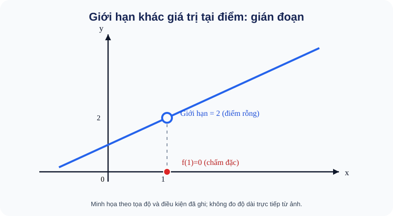

# Bài 17. Hàm số liên tục

TOÁN 11 · CHƯƠNG V · SGK KNTT

Khám phá bản chất và điều kiện → ví dụ giải thích phương pháp → Tự thử trước Core → Core/Luyện tập/Vận dụng → tự khắc phục. Không ghi Skill Mastery từ tự học.
<nav class="thpt-r4-lesson-tabs"><a href="../">Chương V</a><a href="../luyen-tap/">Core và Luyện tập</a><a href="../tu-kiem-tra-chuong/">Tự kiểm tra cuối chương</a></nav>

=== "Khám phá kiến thức"

    ### Cùng tìm hiểu

    ### 1.1. Từ giới hạn sang liên tục

    Ở Bài 16, em thấy một hàm vẫn có thể tiến tới 4 khi x→2 nhưng không được định nghĩa tại x=2. Điều gì xảy ra nếu ta **bổ sung giá trị tại điểm ấy**?

    Xét h(x)=x+2 khi x≠2. Nếu đặt h(2)=4, đồ thị không bị "lỗ" ở điểm tương ứng và giá trị tại 2 khớp với những giá trị xung quanh. Nếu cố tình đặt h(2)=0, x ở gần 2 vẫn làm h(x) gần 4, **nhưng h(2) lại bằng 0**: điểm riêng lẻ bị lệch khỏi xu hướng. Ta gọi hiện tượng "khớp" đó là **liên tục tại một điểm**.

    **Cầu nối:** Cần biết ở Bài 16 rằng **lim_{x→a}f(x)** mô tả xu hướng ở gần a, còn **f(a)** là giá trị đúng tại a; hai thứ không tự động giống nhau.

    **Hình trực quan D5:** <figure class="thpt-r4-plot thpt-r4-probability-figure"><figcaption>Đồ thị có lỗ tại (1,2) và chấm đặc tại (1,0)</figcaption></figure>

    **Cách đọc hình:** Vòng tròn rỗng ở (1,2) thể hiện xu hướng giá trị hàm khi x gần 1; chấm đỏ đặc ở (1,0) là giá trị f(1) thực sự. Hai độ cao không khớp nên hàm gián đoạn tại 1. Hình cho trực giác; định nghĩa dưới đây mới là tiêu chuẩn kiểm tra chính thức.

    ### Ví dụ trực quan

    Một đường biểu diễn không đứt tại x=a khi giá trị tại a khớp với xu hướng từ hai phía. Tính liên tục kết nối giới hạn với giá trị thật của hàm.

    **Quan sát bằng số liệu:** Hàm f(x)=x² liên tục tại x=2 vì lim(x→2)x²=4=f(2). Ngược lại, nếu chỉ gán f(2)=5 mà giữ công thức khác tại các điểm lân cận, hàm không liên tục ở 2.

    ### Thuật ngữ và kiến thức, kỹ năng

    **Thuật ngữ:** liên tục tại điểm, liên tục trên khoảng, định lí giá trị trung gian.

    **Sau bài học, em cần:** kiểm ba điều kiện liên tục và áp dụng định lí chỉ khi giả thiết được bảo đảm.

=== "Kiến thức SGK"

    ### 1.2. Định nghĩa và điều kiện

    Hàm f **liên tục tại a** khi (1) a thuộc tập xác định để f(a) có nghĩa; (2) giới hạn hữu hạn lim_{x→a}f(x) tồn tại; (3) **lim_{x→a}f(x)=f(a)**. Cả ba ý đều phải kiểm tra. "Đồ thị vẽ một nét không nhấc bút" là trực giác giúp hình dung, **không thay thế** điều kiện toán học.

    Với hàm cho bởi các công thức khác nhau ở các khoảng, hãy so sánh giới hạn trái, giới hạn phải và **giá trị thật tại điểm nối**. Ví dụ f(x)=x+1 khi x<1 và f(x)=m khi x≥1: phía trái tiến đến 2, phía phải tiến đến m, đồng thời f(1)=m. Liên tục tại 1 khi và chỉ khi m=2.

    ### 1.3. Từ điểm sang khoảng, đoạn

    Liên tục trên khoảng (a,b) nghĩa là liên tục tại mọi điểm bên trong. Liên tục trên đoạn [a,b] còn cần:
    - ở a: **lim_{x→a⁺}f(x)=f(a)**;
    - ở b: **lim_{x→b⁻}f(x)=f(b)**.

    Tại đầu mút không đòi hỏi phía nằm **ngoài** đoạn xác định. Ví dụ √x liên tục trên [0,9], kiểm tra tại 0 từ bên phải và tại 9 từ bên trái.

    Các hàm đa thức liên tục trên R; hàm phân thức liên tục ở nơi mẫu khác 0. Tổng/hiệu/tích của các hàm liên tục là liên tục; thương chỉ khi **mẫu tại điểm xét khác 0**. Không được nói phân thức liên tục trên toàn R nếu mẫu có nghiệm thực.

    ### 1.4. Ứng dụng: biết có nghiệm dù chưa giải ra

    Nếu f **liên tục trên cả đoạn [a,b]** và f(a), f(b) trái dấu, đồ thị phải đi qua trục hoành ở **ít nhất một điểm** nằm giữa a và b. Ta viết điều kiện f(a)f(b)<0 và kết luận tồn tại c∈(a,b) sao cho f(c)=0. Không thể kết luận chỉ có đúng một nghiệm; muốn chứng minh duy nhất phải có lập luận bổ sung.

    Ví dụ f(x)=x³+x−1: f(0)=−1, f(1)=1, và f là đa thức liên tục trên [0,1]. Vậy tồn tại một nghiệm trong (0,1).

    **Tự thử trước Core:** Giả sử f có giới hạn tại a bằng 3 nhưng f(a)=5. Hàm có liên tục tại a không? Vì sao? Sau đó chuyển sang Core/Practice để luyện độc lập, không tính điểm mastery từ câu tự thử.

    

Đã tự thử? Mở đối chiếu

không, vì giá trị tại a khác giới hạn.

=== "Ví dụ"

    ### Bốn ví dụ độc lập

    **EX-G11-B17-01 — Tham số ghép nhánh.** Cho f(x)=x+1 nếu x<1; f(x)=m nếu x≥1. Hai phía tại 1 lần lượt tiến tới 2 và m, f(1)=m. Để liên tục tại 1 cần và đủ m=2.

    **EX-G11-B17-02 — Miền liên tục của phân thức.** Với h(x)=(x+1)/(x−2), mẫu chỉ bằng 0 tại x=2. Vì vậy h liên tục trên (−∞,2) và (2,+∞), không liên tục tại 2 do hàm không xác định. **Bẫy:** không thể gọi liên tục trên toàn R.

    **EX-G11-B17-03 — Đoạn có đầu mút.** f(x)=√x liên tục trên [0,9]: với mọi điểm trong (0,9) hàm liên tục; lim_{x→0^+}√x=0=f(0), lim_{x→9^-}√x=3=f(9). Không xét lim_{x→0^-} trong miền R, vì căn không xác định khi x<0.

    **EX-G11-B17-04 — Chứng minh tồn tại nghiệm.** Đặt g(x)=x³+x−1. Đa thức liên tục trên [0,1], g(0)=−1<0, g(1)=1>0. Vậy tồn tại c∈(0,1) sao cho g(c)=0. Kết luận mới là **ít nhất một nghiệm**; chưa dùng phép đổi dấu để suy duy nhất.

=== "Lỗi thường gặp"

    

Biết lim f(x) mà quên kiểm tra f(a).
<ol><li><strong>Nhận diện:</strong> Biết lim f(x) mà quên kiểm tra f(a).</li>
    <li><strong>Nhắc bản chất và điều kiện:</strong> Liên tục tại điểm yêu cầu f(a) xác định VÀ bằng giới hạn hữu hạn hai phía.</li>
    <li><strong>Sửa cách nghĩ:</strong> Hãy nói lại bằng lời tại sao bước trước chưa đủ để kết luận, rồi kiểm tra giả thiết trước phép biến đổi.</li>
    <li><strong>Tự thử trước khi mở đáp án:</strong> Giới hạn g khi x→3 là 9, nhưng g(3)=0: liên tục không?. <strong>Tự đối chiếu sau khi thử:</strong> Không, vì giá trị tại điểm không khớp với giới hạn.</li>
    <li><strong>Quay lại bài gốc:</strong> làm lại <code>THPT-G11-CHV-B17-C02</code> và giải thích bằng lời vì sao kết luận đúng.</li></ol>
<a href="../luyen-tap/?item=THPT-G11-CHV-B17-C02">Quay lại THPT-G11-CHV-B17-C02</a>

    

Suy ngay nghiệm duy nhất từ việc đổi dấu.
<ol><li><strong>Nhận diện:</strong> Suy ngay nghiệm duy nhất từ việc đổi dấu.</li>
    <li><strong>Nhắc bản chất và điều kiện:</strong> Định lí giá trị trung gian chỉ bảo đảm ít nhất một nghiệm khi liên tục trên đoạn và hai đầu trái dấu.</li>
    <li><strong>Sửa cách nghĩ:</strong> Hãy nói lại bằng lời tại sao bước trước chưa đủ để kết luận, rồi kiểm tra giả thiết trước phép biến đổi.</li>
    <li><strong>Tự thử trước khi mở đáp án:</strong> Với p(x)=x³−2 trên [1,2], hãy xác định dấu hai đầu. <strong>Tự đối chiếu sau khi thử:</strong> p(1)=−1, p(2)=6, nên có ít nhất một nghiệm; muốn duy nhất cần lí do khác.</li>
    <li><strong>Quay lại bài gốc:</strong> làm lại <code>THPT-G11-CHV-B17-P03</code> và giải thích bằng lời vì sao kết luận đúng.</li></ol>
<a href="../luyen-tap/?item=THPT-G11-CHV-B17-P03">Quay lại THPT-G11-CHV-B17-P03</a>

    ### Học tiếp

    [Core và Luyện tập Bài 17](luyen-tap.md) · [Tự luận Chương V](../../../thu-vien/tu-luan-g11-chuong-v.md) · [Tự kiểm tra cuối chương](tu-kiem-tra-chuong.md)
