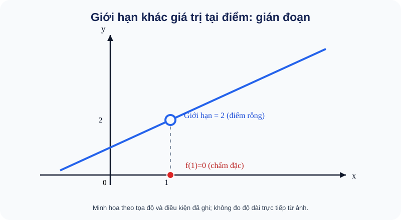

# Bài 17. Hàm số liên tục

TOÁN 11 · CHƯƠNG V

Giá trị tại điểm phải khớp với giới hạn: kiểm liên tục tại điểm và trên đoạn, chọn đúng miền, vận dụng định lý tồn tại nghiệm.
<nav class="thpt-r4-lesson-tabs"><a href="../">Chương V</a><a href="../luyen-tap/">Core và Luyện tập</a><a href="../tu-kiem-tra-chuong/">Tự kiểm tra cuối chương</a></nav>

=== "Khám phá kiến thức"

    Ở Bài 16, một hàm có thể tiến đến một số khi \(x\) gần \(a\) nhưng có “lỗ” hoặc giá trị khác tại \(a\). **Liên tục** mô tả sự khớp giữa **giá trị tại điểm** và **giới hạn gần điểm**. Muốn học chắc, cần hiểu giới hạn trái/phải, miền xác định và cách đọc đồ thị trước khi dùng công thức.

    ### 1.1. Giới hạn khớp giá trị hàm: vì sao là liên tục?

    Ở Bài 16, hàm \(g(x)=\frac{x^2-1}{x-1}\) với \(x\ne1\) tiến đến \(2\) khi \(x\to1\), nhưng có “lỗ” tại \(x=1\). Nếu đặt \(g(1)=2\), lỗ được lấp đúng xu hướng; nếu đặt \(g(1)=0\), một điểm đơn lẻ lệch khỏi xu hướng. Tính **liên tục tại điểm** yêu cầu giá trị tại điểm có nghĩa, có giới hạn hữu hạn và **hai giá trị bằng nhau**.

    **Vận dụng — Tự thử trước Core.** Đặt \(f(x)=\frac{x^2-1}{x-1}\) khi \(x\ne1\) và \(f(1)=m\). Tìm \(m\) để f liên tục tại 1.

    

    ??? question "Đối chiếu"

        **Lời giải:** Với \(x\ne1\), \(f(x)=x+1\) nên \(\lim_{x\to1}f(x)=2\). Điều kiện liên tục là \(f(1)=m=2\). Nếu \(m\ne2\), giới hạn vẫn bằng 2 nhưng hàm **gián đoạn tại 1**.

    

    ??? tip "Kiểm lỗi"

        **Dấu hiệu:** Chỉ thấy giới hạn bằng 2 rồi kết luận liên tục bất kể f(1).

        **Tự sửa:** Kiểm đủ ba bước: f(a) có nghĩa, giới hạn hữu hạn tồn tại, chúng bằng nhau. Ôn mục 2.1; luyện Core B17-C01/C02 ở <a href="../luyen-tap/">Luyện tập</a>.

    ### 1.2. Tại điểm nối của hàm từng đoạn, phải kiểm hai phía và giá trị thật

    Nếu quy tắc tính thay đổi tại \(x=a\), ta không thể tự dùng một công thức duy nhất. Hãy tính \(\lim_{x\to a^-}f(x)\), \(\lim_{x\to a^+}f(x)\), và \(f(a)\). Ba giá trị phải khớp mới liên tục. Câu hỏi “tham số bao nhiêu?” chính là bài toán **ép ba giá trị khớp**.

    **Vận dụng — Tự thử trước Core.** Cho \(f(x)=mx+1\) khi \(x<2\) và \(f(x)=x^2-1\) khi \(x\ge2\). Tìm \(m\) để f liên tục tại 2.

    

    ??? question "Đối chiếu"

        **Lời giải:** Giới hạn trái là \(2m+1\), giới hạn phải là \(2^2-1=3\); \(f(2)=3\). Liên tục khi \(2m+1=3\), suy ra \(\boxed{m=1}\). Phải dùng **nhánh phải** để xác định giá trị tại 2 vì dấu \(\ge\).

    

    ??? tip "Kiểm lỗi"

        **Dấu hiệu:** Cho x=2 vào nhánh có dấu < hoặc chỉ so hai biểu thức mà quên f(2).

        **Tự sửa:** Đánh dấu nhánh chứa dấu bằng để lấy f(a), rồi so trái/phải. Ôn mục 2.1; luyện Practice B17-P02/P06 trong <a href="../luyen-tap/">Core và Luyện tập</a>.

    ### 1.3. Liên tục trên đoạn cần kiểm hai đầu mút theo đúng phía

    Liên tục trên khoảng \((a,b)\) nghĩa là liên tục ở mọi điểm bên trong. Với đoạn **đóng** \([a,b]\), còn phải kiểm \(\lim_{x\to a^+}f(x)=f(a)\) và \(\lim_{x\to b^-}f(x)=f(b)\). Không đòi xét giá trị từ bên **ngoài đoạn**; ví dụ \(\sqrt x\) có nghĩa cho \(x\ge0\) mà vẫn liên tục trên \([0,9]\).

    **Vận dụng — Tự thử trước Core.** Hàm \(f(x)=\sqrt{x}\) liên tục trên \([0,4]\) không? Tại \(x=0\) phải xét giới hạn từ phía nào?

    

    ??? question "Đối chiếu"

        **Lời giải:** Có. Trên \((0,4)\), căn bậc hai liên tục. Tại 0, xét \(\lim_{x\to0^+}\sqrt x=0=f(0)\); tại 4, xét \(\lim_{x\to4^-}\sqrt x=2=f(4)\). Vì vậy f liên tục trên **đoạn \([0,4]\)**; không cần giới hạn trái tại 0.

    

    ??? tip "Kiểm lỗi"

        **Dấu hiệu:** Cho rằng không liên tục vì \(\sqrt x\) không định nghĩa với \(x<0\).

        **Tự sửa:** Phân biệt **điểm trong** và **đầu mút** đoạn. Ôn mục 2.2; luyện Core B17-C03 và Practice B17-P05.

    ### 1.4. Các hàm thường gặp liên tục ở đâu?

    Hàm đa thức liên tục tại mọi số thực. Hàm phân thức hữu tỉ liên tục **trên miền mà mẫu khác 0**, không nhất thiết trên toàn trục thực. Căn bậc hai liên tục ở miền xác định (kiểm một phía tại đầu mút). Vì thế trước khi tuyên bố “hàm liên tục”, phải nêu rõ **miền hoặc khoảng đang xét**.

    **Vận dụng — Tự thử trước Core.** Cho \(h(x)=\frac{x+3}{x-2}\). Hãy nêu các khoảng mà h liên tục và lý do không được ghi “liên tục trên \(\mathbb R\)”.

    

    ??? question "Đối chiếu"

        **Lời giải:** Mẫu bằng 0 khi \(x=2\), nên h không xác định tại 2. Là phân thức, h liên tục trên mỗi khoảng \((-\infty,2)\) và \((2,+\infty)\). Không thể liên tục tại điểm **không thuộc tập xác định**.

    

    ??? tip "Kiểm lỗi"

        **Dấu hiệu:** Bỏ điều kiện mẫu khác 0.

        **Tự sửa:** Tìm miền xác định trước, sau đó áp dụng định lý hàm sơ cấp. Ôn mục 2.3; luyện Practice B17-P01 trong <a href="../luyen-tap/">Luyện tập</a>.

    ### 1.5. Tổng, tích và thương các hàm liên tục vẫn cần điều kiện

    Nếu \(f,g\) liên tục tại \(a\), tổng, hiệu, tích cũng liên tục tại \(a\). Thương \(f/g\) chỉ liên tục nếu **\(g(a)\ne0\)**. Đây chính là điều kiện phép chia của giới hạn Bài 16. Những quy tắc ấy không cho phép bỏ qua miền xác định hoặc lấy giá trị tại chỗ phân thức có mẫu bằng 0.

    **Vận dụng — Tự thử trước Core.** Hai hàm \(f(x)=x+1\), \(g(x)=x-3\) liên tục mọi nơi. Thương \(f/g\) có liên tục tại \(x=3\) không?

    

    ??? question "Đối chiếu"

        **Lời giải:** Không. Tại \(x=3\), \(g(3)=0\) nên \((f/g)(3)\) **không xác định**. Thương \((x+1)/(x-3)\) liên tục ở mọi \(x\ne3\), nhưng không thể gọi liên tục tại 3 dù từng hàm f,g đều liên tục.

    

    ??? tip "Kiểm lỗi"

        **Dấu hiệu:** Cho rằng thương hai hàm liên tục luôn liên tục ở mọi số thực.

        **Tự sửa:** Kiểm \(g(a)\ne0\) trước quy tắc thương; ôn mục 2.3 và luyện B17-P01/P04.

    ### 1.6. Đổi dấu và liên tục: vì sao bảo đảm ít nhất một nghiệm?

    Nếu một hàm **liên tục trên cả đoạn \([a,b]\)** và \(f(a)f(b)<0\), nó phải đi qua giá trị 0 tại **ít nhất một** điểm trong \((a,b)\). Đây là ứng dụng định lý giá trị trung gian. Nhưng **đổi dấu không tự chứng minh nghiệm duy nhất**: một đường liên tục có thể đi qua trục hoành nhiều lần.

    **Vận dụng — Tự thử trước Core.** Cho \(p(x)=x^3-5\) trên \([1,2]\). Chứng minh tồn tại nghiệm trong \((1,2)\). Có được kết luận ngay “nghiệm duy nhất” chỉ từ hai giá trị ở đầu đoạn không?

    

    ??? question "Đối chiếu"

        **Lời giải:** Đa thức liên tục trên \([1,2]\). \(p(1)=-4<0\), \(p(2)=3>0\), nên theo định lý giá trị trung gian tồn tại **ít nhất một** \(c\in(1,2)\) với \(p(c)=0\). Chỉ từ điều kiện liên tục và đổi dấu chưa thể khẳng định **duy nhất**; nếu muốn chứng minh riêng tính duy nhất của bài này, cần thêm lập luận đơn điệu \(x^3-5\) tăng nghiêm ngặt.

    

    ??? tip "Kiểm lỗi"

        **Dấu hiệu:** Viết “đổi dấu nên có đúng một nghiệm” mà không xét thêm tính đơn điệu.

        **Tự sửa:** Chỉ kết luận **ít nhất một**, sau đó nêu yêu cầu riêng để chứng minh duy nhất. Ôn mục 2.4; làm Practice B17-P03/P07 tại <a href="../luyen-tap/">Luyện tập</a>.

    ### 1.7. Nối giới hạn dãy số, giới hạn hàm số và tính liên tục

    Ở Bài 15, một **dãy số** có thể tiến dần đến \(a\) mà không bao giờ nhận giá trị \(a\). Ở Bài 16, muốn biết giới hạn của \(f(x)\) khi \(x\to a\), ta phải kiểm hành vi khi \(x\) tiến gần \(a\) **từ các phía trong miền xác định**, không được chỉ nhìn \(f(a)\) hoặc thử một dãy đặc biệt. Bài 17 mới trả lời câu tiếp: **giới hạn ấy có bằng giá trị hàm tại \(a\) hay không**? Đó là điều kiện liên tục.

    **Vận dụng — Tự thử tích hợp ba bài.** Cho \(u_n=1+\frac1n\) với \(n\ge1\) và
    \[
    F(x)=\begin{cases}
      \dfrac{x^2-1}{x-1},&x\ne1,\\
      4,&x=1.
    \end{cases}
    \]
    (a) Tính \(\lim u_n\) và \(\lim F(u_n)\). (b) **Không suy giới hạn hàm chỉ từ một dãy**, hãy biến đổi công thức cho **mọi** \(x\ne1\) gần \(1\) để tính \(\lim_{x\to1}F(x)\). (c) \(F\) có liên tục tại \(1\) không? Phải sửa riêng giá trị \(F(1)\) thành bao nhiêu để liên tục?

    

    ??? question "Đối chiếu — ba khái niệm, ba điều kiện"

        **Bước 1 — giới hạn dãy:** \(u_n=1+1/n\to1\) và \(u_n\ne1\) với mọi \(n\ge1\). Do \(F(u_n)=u_n+1=2+1/n\), nên \(\lim F(u_n)=2\).

        **Bước 2 — giới hạn hàm thực sự:** Với **mọi** \(x\ne1\), \(\dfrac{x^2-1}{x-1}=\dfrac{(x-1)(x+1)}{x-1}=x+1\). Do đó khi \(x\to1\) từ cả hai phía, \(\lim F(x)=2\). Việc thử chỉ một dãy không đủ làm chứng minh giới hạn hai phía cho một hàm bất kì; ở đây ta đã chứng minh được công thức trên cả lân cận thủng.

        **Bước 3 — tính liên tục:** \(F(1)=4\ne2\), vậy **gián đoạn tại \(1\)**. Nếu thay riêng \(F(1)=2\), hàm mới bằng \(x+1\) cả tại \(1\) lẫn ngoài \(1\), nên liên tục ở \(1\).

        **Kiểm:** \(F(1+1/n)\) đi gần \(2\) dù \(F(1)=4\); giá trị tại đúng điểm **không quyết định** giới hạn.

    

    ??? tip "Kiểm lỗi — lấy giá trị hàm hoặc một dãy thay giới hạn hai phía"

        **Dấu hiệu:** Em trả lời \(\lim_{x\to1}F(x)=4\) do \(F(1)=4\), hoặc dùng mỗi \(\lim F(u_n)=2\) để coi như đã chứng minh giới hạn hàm.

        **Vì sao sai:** Giới hạn hàm xét \(x\) gần \(1\) (khác \(1\)) trên **toàn miền phù hợp**. Một dãy thí dụ có thể giúp đoán, nhưng không đủ chứng minh điều kiện mọi cách tiến gần.

        **Tự sửa:** Rút gọn tử bằng hiệu hai bình phương trên miền \(x\ne1\), rồi mới cho \(x\to1\); so sánh riêng \(F(1)\). Ôn Bài 15 giới hạn dãy, Bài 16 khử dạng \(0/0\), Bài 17 liên tục; luyện lại B16-P01 và B17-P01 trong <a href="../luyen-tap/">Core và Luyện tập</a>. Sau đó thử bài Written tích hợp **khác kỹ thuật** ở <a href="../../../../thu-vien/tu-luan-g11-chuong-v/#thpt-g11-chv-w-integrated">thư viện tự luận</a>.

=== "Kiến thức SGK"

    ### 2.1. Hàm số liên tục tại một điểm

    
<strong>Định nghĩa:</strong> Hàm \(f\) liên tục tại \(a\) nếu <strong>\(f(a)\) xác định</strong>, giới hạn hữu hạn \(\lim_{x\to a}f(x)\) tồn tại (theo các phía phù hợp của miền xác định) và
    \[
      \lim_{x\to a}f(x)=f(a).
    \]
    Với điểm trong miền có hai phía, phải khớp cả giới hạn trái và phải. Không sử dụng một hình vẽ “liền nét” thay cho ba điều kiện toán học.

    <figure class="thpt-r4-plot"><figcaption>Đọc hình: <strong>vòng tròn rỗng</strong> tại \((1;2)\) mô tả giá trị được tiến gần; <strong>chấm đặc</strong> tại \((1;0)\) là \(f(1)\) thật. Hai độ cao không khớp ⇒ hàm <strong>không liên tục tại 1</strong>.</figcaption></figure>

    ### 2.2. Liên tục trên khoảng và trên đoạn

    Hàm liên tục trên \((a,b)\) nếu liên tục ở mọi điểm thuộc khoảng. Hàm liên tục trên **đoạn \([a,b]\)** nếu liên tục trên \((a,b)\), và
    \[
    \lim_{x\to a^+}f(x)=f(a),\qquad \lim_{x\to b^-}f(x)=f(b).
    \]
    **Ở hai đầu mút** chỉ xét phía thuộc đoạn. Điều kiện còn cần mọi điểm trên đoạn đều thuộc miền xác định.

    ### 2.3. Hàm sơ cấp và phép toán với hàm liên tục

    
<strong>Quy tắc:</strong> Hàm đa thức liên tục trên \(\mathbb R\). Hàm phân thức liên tục tại nơi mẫu khác \(0\). Hàm căn liên tục trên miền xác định (đầu mút xét một phía). Tổng, hiệu, tích của hai hàm liên tục tại a cũng liên tục; thương cần thêm <strong>mẫu tại a khác 0</strong>.

    Với hàm từng phần, **tính hai giới hạn một phía và giá trị tại điểm ghép**; không chỉ xét công thức có dấu bằng rồi kết luận.

    ### 2.4. Định lý giá trị trung gian và hệ quả về nghiệm

    
<strong>Định lý và hệ quả:</strong> Nếu \(f\) <strong>liên tục trên đoạn \([a,b]\)</strong> thì với mọi số \(L\) nằm giữa \(f(a)\) và \(f(b)\), tồn tại \(c\in[a,b]\) sao cho \(f(c)=L\). Đặc biệt, nếu \(f(a)f(b)<0\), tồn tại <strong>ít nhất một</strong> \(c\in(a,b)\) có \(f(c)=0\).

    **Giới hạn suy luận:** Không khẳng định nghiệm duy nhất từ đổi dấu. Nếu muốn kết luận duy nhất còn cần cơ sở khác, chẳng hạn chứng minh hàm **tăng/giảm nghiêm ngặt** trên đoạn.

=== "Ví dụ"

    Mỗi Ví dụ có lí do chọn phương pháp và bước kiểm điều kiện.

    ### 3.1. Lấp lỗ bằng giá trị đúng giới hạn

    

    
<strong>Đề bài:</strong> Với \(f(x)=\frac{x^2-16}{x-4}\) khi \(x\ne4\) và \(f(4)=m\), tìm m để liên tục tại 4.

    
<strong>Chọn phương pháp:</strong> Tính giới hạn quanh 4 trước.

    
<strong>Lời giải:</strong> Với \(x\ne4\), \(f(x)=x+4\); giới hạn bằng 8. Do đó \(m=8\).

    
<strong>Kiểm lại:</strong> Khi đặt m=8, giá trị tại 4 khớp giới hạn.

    

    ### 3.2. Nối hai công thức với tham số

    

    
<strong>Đề bài:</strong> \(f(x)=x+1\) nếu \(x<1\), \(f(x)=m\) nếu \(x\ge1\).

    
<strong>Chọn phương pháp:</strong> So trái, phải và giá trị tại điểm nối.

    
<strong>Lời giải:</strong> Giới hạn trái bằng 2, giới hạn phải bằng m, \(f(1)=m\). Liên tục tại 1 khi và chỉ khi \(m=2\).

    
<strong>Kiểm lại:</strong> Khi m khác 2, hàm bị nhảy tại 1.

    

    ### 3.3. Hàm căn trên đoạn đóng

    

    
<strong>Đề bài:</strong> Chứng minh \(f(x)=\sqrt x\) liên tục trên \([0,9]\).

    
<strong>Chọn phương pháp:</strong> Kiểm trong khoảng và <strong>hai giới hạn một phía</strong> ở đầu.

    
<strong>Lời giải:</strong> Căn liên tục trên \((0,9)\); \(\lim_{x\to0^+}\sqrt x=0=f(0)\); \(\lim_{x\to9^-}\sqrt x=3=f(9)\).

    
<strong>Kiểm lại:</strong> Không đòi giá trị với \(x<0\).

    

    ### 3.4. Miền liên tục của phân thức

    

    
<strong>Đề bài:</strong> \(h(x)=\frac{x+1}{x-2}\) liên tục ở đâu?

    
<strong>Chọn phương pháp:</strong> Tìm miền xác định trước.

    
<strong>Lời giải:</strong> Hàm phân thức liên tục khi mẫu khác 0, tức trên \((-\infty,2)\) và \((2,\infty)\).

    
<strong>Kiểm lại:</strong> Tại 2, mẫu 0 và h không xác định.

    

    ### 3.5. Tồn tại nghiệm nhưng chưa đủ để nói duy nhất

    

    
<strong>Đề bài:</strong> Chứng minh \(g(x)=x^3+x-1\) có nghiệm trong \((0,1)\).

    
<strong>Chọn phương pháp:</strong> Dùng định lý giá trị trung gian.

    
<strong>Lời giải:</strong> g là đa thức nên liên tục trên \([0,1]\); \(g(0)=-1<0\), \(g(1)=1>0\), suy ra tồn tại \(c\in(0,1)\) với \(g(c)=0\).

    
<strong>Kiểm lại:</strong> Lập luận này <strong>chỉ xác nhận ít nhất một nghiệm</strong>; nếu cần duy nhất, chứng minh thêm g tăng nghiêm ngặt.

    

    ### 3.6. Phản ví dụ: đổi dấu vẫn có thể có ba nghiệm

    

    
<strong>Đề bài:</strong> Xét \(p(x)=x(x-1)(x+1)\) trên \([-2,2]\). Hai đầu có trái dấu không, và p có bao nhiêu nghiệm phân biệt?

    
<strong>Chọn phương pháp:</strong> Tính hai đầu và phân tích nhân tử, không suy duy nhất từ đổi dấu.

    
<strong>Lời giải:</strong> \(p(-2)=(-2)(-3)(-1)=-6<0\), \(p(2)=2\cdot1\cdot3=6>0\). Nhưng p có <strong>ba nghiệm</strong> \(-1,0,1\) nằm trong đoạn.

    
<strong>Kiểm lại:</strong> Ví dụ bác bỏ kết luận “trái dấu ⇒ đúng một nghiệm”.

    

    ### 3.7. Ứng dụng: kiểm tính liên tục của bảng cước taxi theo quãng đường

    

<strong>Đề bài:</strong> Trong một <strong>mô hình giả định tính cước liên tục theo kilômét</strong>, khách trả 10.000 đồng cho \(0<x\le0{,}5\) km; phần quãng đường vượt \(0{,}5\) đến \(30\) km tính 13.500 đồng/km; phần <strong>vượt 30</strong> km tính 11.000 đồng/km. Viết hàm cước \(C(x)\) và kiểm tính liên tục tại \(x=0{,}5\) và \(x=30\).

    
<strong>Chọn phương pháp:</strong> Mỗi mức giá theo kilomet chỉ áp cho <strong>phần vượt ngưỡng</strong>, nên sau ngưỡng phải cộng số tiền tích lũy ở ngưỡng trước. Sau đó so giới hạn trái/phải với giá tại ngưỡng, không lấy giá 13.500 làm toàn bộ cước của km sau.

    
<strong>Lời giải:</strong> Với \(x>0\), đơn vị đồng:
    \[
    C(x)=\begin{cases}
    10000,&0<x\le0{,}5,\\
    10000+13500(x-0{,}5),&0{,}5<x\le30,\\
    10000+13500(30-0{,}5)+11000(x-30),&x>30.
    \end{cases}
    \]
    Khi \(x\to0{,}5^-\) và \(x\to0{,}5^+\), hai phía đều tiến tới 10.000 đồng, đúng \(C(0{,}5)\). Tại \(x=30\), hai phía đều tiến tới \(10000+13500\cdot29{,}5=408250\) đồng, đúng \(C(30)\). Vì vậy mô hình liên tục ở <strong>hai điểm ghép</strong>.

    
<strong>Kiểm lại:</strong> Mỗi nhánh là hàm liên tục trên khoảng của nó. Đây là <strong>mô hình cước lũy tiến giả định</strong> giúp học điều kiện liên tục, không khẳng định biểu phí thực tế hay cơ chế làm tròn từng km của hãng taxi.

    ### 3.8. Giới hạn dãy làm tiền đề, tính liên tục cho phép dùng định lí

    

    
<strong>Đề bài:</strong> Với \(u_n=1+1/n\), xét hàm \(g(x)=x^2-2\). Tính \(\lim_{n\to\infty}g(u_n)\), rồi chứng minh phương trình \(g(x)=0\) có **ít nhất một nghiệm** trên \((1;2)\) bằng định lí giá trị trung gian.

    
<strong>Chọn phương pháp:</strong> Vì \(u_n\to1\) và \(g\) là đa thức liên tục, giá trị \(g(u_n)\) hội tụ về \(g(1)\). Để chứng minh nghiệm thuộc một **khoảng thực**, cần tính liên tục trên đoạn và **hai giá trị trái dấu**; dãy gần \(1\) không tự chứng minh có nghiệm.

    
<strong>Lời giải:</strong> \(u_n^2-2=(1+1/n)^2-2=-1+2/n+1/n^2\to-1\). Đa thức \(g\) liên tục trên \([1;2]\); \(g(1)=-1<0\), \(g(2)=2>0\). Theo hệ quả định lí giá trị trung gian, tồn tại \(c\in(1;2)\) sao cho \(g(c)=0\). Đây là kết luận **tồn tại ít nhất một nghiệm**; bản thân định lí không bảo đảm tính duy nhất.

    
<strong>Kiểm lại:</strong> Hàm được xác định trên toàn đoạn; hai đầu không phải nghiệm và có dấu đối nhau, nên nghiệm được bảo đảm nằm **bên trong** khoảng. \(\sqrt2\) là một nghiệm kiểm chứng, nhưng không được lấy nghiệm đó thay cho việc nêu giả thiết định lí.

    

=== "Lỗi thường gặp"

    Nếu sai Vận dụng, hãy mở Kiểm lỗi tương ứng và giải lại Core/Practice khác số liệu.

    

    ??? tip "4.1. Biết giới hạn nhưng quên kiểm (f(a))"

        **Vì sao sai:** Kết luận chưa đủ điều kiện để áp định nghĩa hoặc định lý.

        **Tự sửa:** Kiểm đủ 3 điều kiện liên tục tại a; ôn 2.1, làm Core B17-C01/C02.

    

    ??? tip "4.2. Chọn nhầm nhánh tại điểm ghép"

        **Vì sao sai:** Kết luận chưa đủ điều kiện để áp định nghĩa hoặc định lý.

        **Tự sửa:** Đọc dấu (<,le,ge) để lấy f(a), so trái/phải; ôn 2.1 và Practice B17-P02/P06.

    

    ??? tip "4.3. Đòi giới hạn hai phía tại đầu mút đoạn"

        **Vì sao sai:** Kết luận chưa đủ điều kiện để áp định nghĩa hoặc định lý.

        **Tự sửa:** Ở đầu trái xét giới hạn phải, ở đầu phải xét giới hạn trái; ôn 2.2, Practice B17-P05.

    

    ??? tip "4.4. Quên miền xác định hoặc kết luận duy nhất từ đổi dấu"

        **Vì sao sai:** Kết luận chưa đủ điều kiện để áp định nghĩa hoặc định lý.

        **Tự sửa:** Thương yêu cầu mẫu khác 0; định lý giá trị trung gian chỉ đảm bảo **ít nhất một nghiệm**; luyện B17-P01/P07.

    

    ??? tip "4.5. Trộn lẫn giới hạn dãy, giới hạn hàm và giá trị tại điểm"

        **Dấu hiệu:** Em dùng một dãy số gần \(a\) để kết luận ngay giới hạn hai phía của hàm, hoặc quên đối chiếu \(f(a)\) khi xét liên tục.

        **Vì sao sai:** Mỗi khái niệm có điều kiện riêng; phép thử dãy không thay thế chứng minh giới hạn hai phía trong mọi trường hợp. Định lí giá trị trung gian còn đòi hỏi liên tục trên đoạn và đổi dấu.

        **Tự sửa:** Ôn §1.7, Ví dụ 3.8, rồi làm bài Written `G11-CHV-W-INTEGRATED` tại <a href="../../../../thu-vien/tu-luan-g11-chuong-v/#thpt-g11-chv-w-integrated">thư viện</a>; xác minh đầy đủ miền xác định, giới hạn và dấu ở hai đầu trước khi mở lời giải.

    **Học tiếp:** <a href="../luyen-tap/">Core và Luyện tập</a> · <a href="../tu-kiem-tra-chuong/">Tự kiểm tra cuối chương</a> · <a href="../../../../thu-vien/tu-luan-g11-chuong-v/">Tự luận Chương V</a>.

    
Nguồn tham khảo: SGK Toán 11 – Kết nối tri thức với cuộc sống, tập một, Bài 17 (trang in 119–122).

