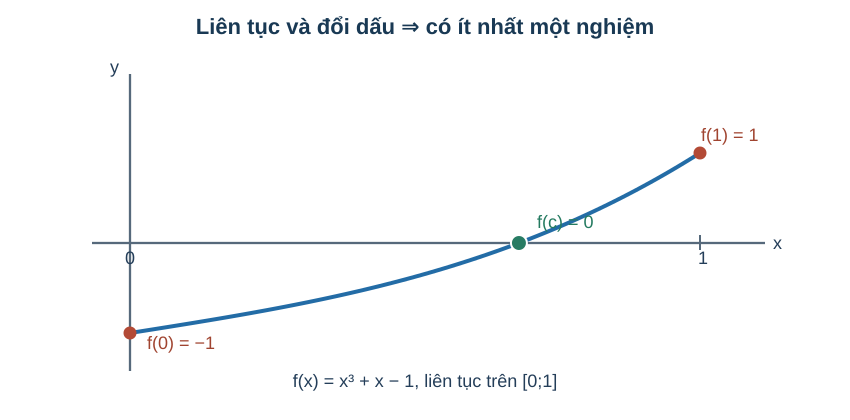

# Bài 17. Hàm số liên tục

TOÁN 11 · CHƯƠNG V · SGK KẾT NỐI TRI THỨC

Liên tục nghĩa là xu hướng gần điểm khớp với giá trị tại điểm; mở rộng tới khoảng và đoạn, rồi dùng tính chất phép toán và đổi dấu để chứng minh có nghiệm.

<nav class="thpt-r4-lesson-tabs"><a href="../">Chương V</a><a href="../luyen-tap/">Core và Luyện tập</a><a href="../tu-kiem-tra-chuong/">Tự kiểm tra cuối chương</a></nav>

=== "Khám phá kiến thức"

    Bài 16 cho thấy một hàm có thể có giới hạn khi tiến gần điểm \(a\) nhưng **không có giá trị tại \(a\)**. Nếu ta điền giá trị thích hợp vào “lỗ”, đồ thị trở nên nối liền; còn điền giá trị khác, một chấm đứng riêng sẽ vẫn lệch khỏi xu hướng. Đó là lí do học **tính liên tục**. Bài này từ tiêu chuẩn tại một điểm, sang cả khoảng/đoạn, rồi tới tính chất giúp tính giới hạn và chứng minh tồn tại nghiệm.

    ### 1.1. Hàm số liên tục tại một điểm

    Xét \(f(x)=x+1\) với \(x\ne1\). Các giá trị ở gần 1 tiến về 2. Nếu quy định thêm **\(f(1)=2\)**, giá trị tại điểm khớp đúng giới hạn: hàm liên tục tại 1. Nếu lại quy định **\(f(1)=0\)**, các giá trị gần 1 vẫn tiến về 2, nhưng ngay tại 1 hàm bằng 0, nên hàm **gián đoạn** tại điểm đó.

    <figure class="thpt-r4-plot"><figcaption><strong>Hướng dẫn đọc:</strong> vòng rỗng tại \((1,2)\) thể hiện giá trị mà đồ thị tiến tới; chấm đặc tại \((1,0)\) là giá trị **thực** \(f(1)\). Hai điểm không trùng nên \(\lim_{x\to1}f(x)\ne f(1)\).</figcaption></figure>

    Vì vậy, để kiểm liên tục tại \(a\) cần đủ **ba việc**: (1) \(f(a)\) xác định; (2) \(\lim_{x\to a}f(x)\) tồn tại và hữu hạn; (3) giới hạn đó bằng \(f(a)\). Đây không phải ba định nghĩa khác nhau mà là cách **kiểm tra đủ điều kiện của cùng một định nghĩa**. Hình vẽ “nét bút liền” chỉ là trực giác, không được thay cho kiểm toán học.

    Với hàm cho bằng nhiều công thức, ở điểm nối phải kiểm hai giới hạn một phía. Ví dụ \(g(x)=x+1\) khi \(x<1\), \(g(x)=m\) khi \(x\ge1\). Bên trái tiến về 2; bên phải tiến về \(m\); giá trị ngay tại 1 cũng là \(m\). Hàm liên tục tại 1 **nếu và chỉ nếu \(m=2\)**, vì khi đó giới hạn trái/phải đều bằng 2 và bằng \(g(1)\).

    **Vận dụng.** Cho \(h(x)=\frac{x^2-1}{x-1}\) nếu \(x\ne1\), còn \(h(1)=m\). Tìm \(m\) để \(h\) liên tục tại \(x=1\).

    ??? question "Đối chiếu"

        **Lời giải:** Với \(x\ne1\), \(h(x)=x+1\), nên \(\lim_{x\to1}h(x)=2\). Giá trị \(h(1)=m\) có nghĩa theo định nghĩa từng phần; liên tục khi \(m=2\).

    ??? tip "Kiểm lỗi"

        Nếu chỉ rút gọn và nói “liên tục với mọi \(m\)” là đã bỏ điều kiện **giới hạn phải bằng đúng giá trị tại điểm**. Ngược lại, nếu quên miền \(x\ne1\) khi rút gọn sẽ tự gán sai cho biểu thức gốc.

    ### 1.2. Hàm số liên tục trên một khoảng

    Một điểm liên tục mới là một thông tin **cục bộ**. Để nói \(f\) liên tục trên \((a,b)\), ta phải biết điều đó đúng tại **mọi điểm** trong khoảng. Nhưng trên đoạn \([a,b]\), hai đầu mút có cách tiến gần đặc biệt: tại \(a\) chỉ xét **từ bên phải trong đoạn**, tại \(b\) chỉ xét **từ bên trái**. Không bắt buộc xét giá trị ở phía ngoài đoạn mà hàm có thể không xác định.

    Hãy xem \(f(x)=\sqrt{x}\). Hàm xác định với \(x\ge0\), liên tục ở mọi \(x>0\) nhờ tính chất giới hạn căn, và tại 0 ta có \(\lim_{x\to0^+}\sqrt{x}=0=f(0)\). Vậy nó liên tục trên \([0,9]\) (và trên \([0,+\infty)\)). Đòi tính \(\sqrt{x}\) khi \(x\to0^-\) trong số thực là yêu cầu **ngoài miền xác định**, không được dùng để phủ nhận tính liên tục trên đoạn.

    Khi xét hàm phân thức, miền xác định quan trọng không kém công thức. \(g(x)=\frac{x+1}{x-2}\) liên tục trên \((-\infty,2)\) và \((2,+\infty)\) vì tử, mẫu là đa thức và mẫu khác 0 ở hai khoảng. Nhưng tại \(x=2\) thì \(g\) **không xác định**, nên không gọi liên tục tại 2. Tại **đầu mút** của một khoảng cần đọc đúng dạng ngoặc tròn/vuông trước khi áp điều kiện một phía.

    **Vận dụng.** Chứng minh \(f(x)=\sqrt{x}\) liên tục trên đoạn \([0,4]\). Vì sao không cần giới hạn trái tại \(x=0\)?

    ??? question "Đối chiếu"

        **Lời giải:** Với mọi \(x\in(0,4)\), hàm căn liên tục. Tại \(0\), giới hạn phải \(\lim_{x\to0^+}\sqrt{x}=0=f(0)\); tại \(4\), giới hạn trái \(\lim_{x\to4^-}\sqrt{x}=2=f(4)\). Do đó liên tục trên \([0,4]\). Vì \(\sqrt{x}\) không xác định khi \(x<0\), ta không xét giới hạn trái tại 0 theo miền thực.

    ??? tip "Kiểm lỗi"

        “Liên tục trên đoạn” **không chỉ** là liên tục ở các điểm giữa đoạn; vẫn phải kiểm hai đầu mút đúng phía. Không bắt buộc xét phía hàm chưa được xác định.

    ### 1.3. Một số tính chất cơ bản

    Khi \(f,g\) liên tục tại \(a\), ta đã biết \(\lim f=f(a)\) và \(\lim g=g(a)\). Định lí phép toán giới hạn từ Bài 16 cho phép cộng, trừ, nhân: các hàm \(f+g,f-g,fg\) đều liên tục tại \(a\). Thương \(f/g\) cũng liên tục tại \(a\) khi **\(g(a)\ne0\)**. Đó là lí do các đa thức liên tục trên \(\mathbb R\), còn các phân thức hữu tỉ liên tục **trên tập xác định của chúng**, không phải ở nghiệm của mẫu.

    SGK còn nhắc: \(\sin x\), \(\cos x\) liên tục trên \(\mathbb R\); \(\tan x,\cot x\) liên tục trên những điểm mà chúng xác định. Không nên thuộc lòng câu “mọi hàm quen thuộc liên tục ở mọi nơi” vì hàm có mẫu, căn hoặc điểm rẽ nhánh có thể mất điều kiện xác định.

    **Biết có nghiệm mà chưa giải được công thức nghiệm.** Nếu \(f\) liên tục trên **cả đoạn \([a,b]\)** và \(f(a)f(b)<0\), thì \(f\) phải nhận giá trị 0 ở **ít nhất một điểm** giữa \(a,b\). Hình dung một đường liền nối một điểm dưới trục hoành với một điểm trên trục: nó phải gặp trục hoành ở đâu đó. Tuy vậy, chỉ từ hai đầu trái dấu **không thể nói có đúng một giao điểm**; muốn duy nhất phải có chứng minh bổ sung.

    <figure class="thpt-r4-plot"><figcaption><strong>Hướng dẫn đọc:</strong> với \(p(x)=x^3+x-1\), \(p(0)=-1<0\), \(p(1)=1>0\). Đường liên tục cắt trục hoành tại một vị trí \(c\in(0,1)\). Từ điều kiện này ta kết luận **ít nhất một nghiệm**, không được tự khẳng định “duy nhất”.</figcaption></figure>

    Điều kiện liên tục rất quan trọng. Một hàm **nhảy** từ \(-1\) lên \(+1\) ngay tại một điểm có thể đổi dấu ở hai đầu mà **không bao giờ nhận 0**. Vì vậy nếu quên chứng minh liên tục trên đoạn, lập luận đổi dấu mất cơ sở.

    **Vận dụng.** Chứng minh phương trình \(x^3+x-1=0\) có **ít nhất một nghiệm** trong \((0,1)\). Có được kết luận nghiệm duy nhất chỉ từ dấu của hai đầu không?

    ??? question "Đối chiếu"

        **Lời giải:** Đặt \(p(x)=x^3+x-1\), là đa thức nên liên tục trên \([0,1]\). \(p(0)=-1<0\), \(p(1)=1>0\), do đó tồn tại \(c\in(0,1)\) sao cho \(p(c)=0\). Dữ kiện đổi dấu và liên tục **chỉ đủ** kết luận ít nhất một nghiệm, không tự chứng minh duy nhất.

    ??? tip "Kiểm lỗi"

        Nếu viết “có một nghiệm duy nhất” ngay sau khi thấy đổi dấu là vượt kết luận SGK. Hãy giữ chữ **“ít nhất một”**; nếu cần duy nhất, phải chứng minh thêm điều kiện như tính đơn điệu.

=== "Kiến thức SGK"

    ### 2.1. Hàm số liên tục tại một điểm

    
<strong>Định nghĩa — Liên tục tại một điểm</strong>
Hàm \(y=f(x)\) xác định trên một khoảng chứa \(a\) gọi là <strong>liên tục tại \(a\)</strong> nếu \(\lim_{x\to a}f(x)=f(a)\). Nếu điều kiện này không thỏa, hàm được gọi là <strong>gián đoạn tại \(a\)</strong>. Để kiểm, cần \(f(a)\) xác định, giới hạn hữu hạn hai phía tồn tại, và hai giá trị ấy bằng nhau.

    **Dạng kiểm với hàm từng phần:** Xác định \(f(a)\); tính \(\lim_{x\to a^-}f(x)\), \(\lim_{x\to a^+}f(x)\) nếu miền có cả hai phía; chỉ khi cả hai bằng \(f(a)\) mới liên tục tại \(a\).

    <figure class="thpt-r4-plot"><figcaption><strong>Tra hình:</strong> \(\lim_{x\to1}f(x)=2\ne f(1)=0\), nên hàm gián đoạn tại 1 dù giới hạn hữu hạn hai phía tồn tại.</figcaption></figure>

    ### 2.2. Hàm số liên tục trên một khoảng

    
<strong>Định nghĩa — Liên tục trên khoảng và trên đoạn</strong>
\(f\) <strong>liên tục trên khoảng \((a,b)\)</strong> nếu liên tục tại <strong>mọi điểm</strong> của khoảng. \(f\) <strong>liên tục trên đoạn \([a,b]\)</strong> nếu liên tục trên \((a,b)\), đồng thời \(\lim_{x\to a^+}f(x)=f(a)\) và \(\lim_{x\to b^-}f(x)=f(b)\). Nửa khoảng được hiểu tương tự: tại đầu mút thuộc miền xét chỉ yêu cầu giới hạn một phía phù hợp.

    **Các hàm cơ bản SGK:** Đa thức, \(\sin x,\cos x\) liên tục trên \(\mathbb R\). Hàm \(\tan x,\cot x\), hàm phân thức hữu tỉ liên tục ở **những điểm thuộc tập xác định**; hàm căn \(\sqrt{x}\) liên tục trên \([0,+\infty)\) theo điều kiện phải ở 0. Không suy rộng qua điểm mà hàm không xác định.

    **Ví dụ kiểm:** \(f(x)=\sqrt{x}\) liên tục trên \([0,9]\) vì nội đoạn liên tục, \(\lim_{x\to0^+}\sqrt{x}=0\), \(\lim_{x\to9^-}\sqrt{x}=3=f(9)\).

    ### 2.3. Một số tính chất cơ bản

    
<strong>Tính chất — Phép toán đối với các hàm liên tục</strong>
Nếu \(f,g\) <strong>liên tục tại \(a\)</strong>, thì \(f+g\), \(f-g\), \(fg\) cũng liên tục tại \(a\). Thương \(f/g\) liên tục tại \(a\) khi thêm điều kiện <strong>\(g(a)\ne0\)</strong>. Dùng cùng điều kiện miền xác định để áp dụng tính chất cho các hàm đa thức, lượng giác, phân thức.

    **Nhận xét SGK — Đổi dấu trên đoạn liên tục:** Nếu \(f\) liên tục trên \([a,b]\) và \(f(a)f(b)<0\), thì **tồn tại ít nhất một** \(c\in(a,b)\) sao cho \(f(c)=0\). Đây là kết quả về **sự tồn tại**, không tự bảo đảm nghiệm duy nhất. Dùng đúng điều kiện cả đoạn và hai giá trị đầu **trái dấu**.

    <figure class="thpt-r4-plot"><figcaption><strong>Tra hình:</strong> \(p(x)=x^3+x-1\), \(p(0)=-1\), \(p(1)=1\), nên phải có \(c\in(0,1)\) với \(p(c)=0\). Hình minh họa một nghiệm trong trường hợp cụ thể, không thay bằng chứng tổng quát.</figcaption></figure>

    **Quy trình chứng minh tồn tại nghiệm:** (1) Đặt hàm \(f\) với phương trình \(f(x)=0\); (2) chứng minh liên tục trên toàn \([a,b]\); (3) tính chính xác \(f(a),f(b)\) và kiểm tích âm; (4) kết luận **có ít nhất một nghiệm** trong \((a,b)\).

    **Lưu ý vận dụng thực tế:** Một đại lượng liên tục đi từ dưới ngưỡng lên trên ngưỡng thì phải đạt ngưỡng ở một thời điểm trung gian. Khi mô hình thời gian, nhiệt độ hoặc vận tốc, phải có căn cứ **đại lượng biến đổi liên tục**; không lấy hình vẽ hay số liệu trung bình thay chứng cứ liên tục.
