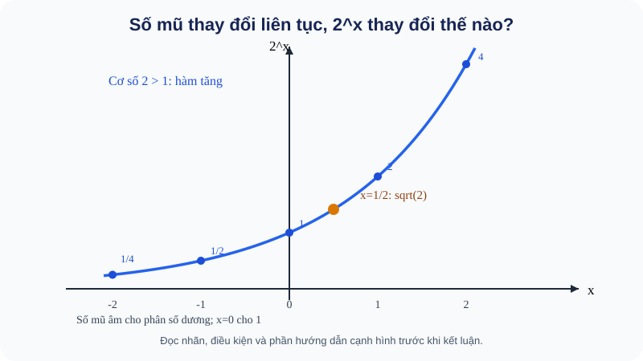

# Bài 18. Lũy thừa với số mũ thực

TOÁN 11 · CHƯƠNG VI · SGK KNTT TẬP 2

Hiểu bản chất → xem hình và ví dụ có suy luận → Tự thử trước Core → Core/Luyện tập/Vận dụng → tự khắc phục. Không ghi Mastery từ hoạt động tự học.
<nav class="thpt-r4-lesson-tabs"><a href="../">Chương VI</a><a href="../luyen-tap/">Core và Luyện tập</a><a href="../tu-kiem-tra-chuong/">Tự kiểm tra tự đối chiếu</a></nav>

=== "Khám phá kiến thức"

    ### Cùng tìm hiểu

    <figure class="thpt-r4-plot thpt-r4-probability-figure"><figcaption>Hình minh họa — quan sát trước khi tính: B18 — trực quan hình thành khái niệm</figcaption></figure>

    **Cách đọc và phát hiện:** Hình B18 giúp em nhìn thấy cùng một quy tắc 2^x từ số mũ âm qua 0 đến số mũ phân số: đọc các điểm trên trục và so sánh chấm màu cam tại x=1/2 (√2). Đừng chỉ chép hình: hãy nêu vì sao 2^(−2)=1/4 vẫn là một số **dương**.

    ### 1.1. Tại sao phải mở rộng số mũ?

    Em đã biết `2³=2·2·2=8`: số mũ 3 đếm ba thừa số 2. Nhưng nếu hỏi **cạnh hình vuông** có diện tích 2 thì cạnh phải dài bao nhiêu? Ta cần một số dương mà **bình phương bằng 2**, tức `√2`. Có thể viết nó là `2^(1/2)` để bảo toàn cách tính `(2^(1/2))²=2`. Không thể giải thích số mũ `1/2` là “nhân số 2 với nhau nửa lần”; đó là một **định nghĩa mở rộng phù hợp các quy tắc đã có**.

    Lãi kép hay biến đổi liên tục cũng nảy sinh số mũ không nguyên: `P(t)=P₀(1+r)^t` (khi mô hình cho phép thời gian t là số thực). Vì thế toán học cần định nghĩa có nghĩa cho `a^{1/2}, a^{-2}` và `a^{√2}`. Bài này xây dựng các bước mở rộng ấy.

    ### Ví dụ trực quan

    Số mũ nguyên âm và số mũ phân số xuất hiện khi cần diễn tả các phép nhân, chia và căn một cách thống nhất. Nhưng cùng một kí hiệu có thể đổi nghĩa nếu quên miền xác định.

    **Quan sát bằng số liệu:** Với số dương 4, 4^(1/2)=2 vì 2²=4. Trong số thực không có (−4)^(1/2). Trước khi dùng luật lũy thừa phải kiểm cơ số và mẫu số mũ.

    ### Thuật ngữ và kiến thức, kỹ năng

    **Thuật ngữ:** lũy thừa thực, căn bậc n, số mũ âm/phân số, điều kiện cơ số.

    **Sau bài học, em cần:** mở rộng quy tắc từ phép nhân quen thuộc và thử điều kiện trước biến đổi.

=== "Kiến thức SGK"

    ### 1.2. Từ số mũ nguyên dương đến 0 và âm

    Với n nguyên dương, `a^n` là tích n thừa số a. Nhìn `2³=8, 2²=4, 2¹=2`: giảm số mũ một đơn vị thì chia 2; để giữ quy luật đó, `2⁰=1` và `2^{-1}=1/2`. Tổng quát, **khi a≠0**: `a⁰=1`, `a^{-n}=1/a^n`.

    **Vì sao cấm a=0 khi số mũ âm/0?** `0^{-1}=1/0` không xác định. `0⁰` không được định nghĩa trong khuôn khổ này. Với n nguyên dương, `0^n=0` vẫn có nghĩa. **Sai thường gặp:** `a^{-2}` là `1/a²`, không phải `−a²`.

    ### 1.3. Căn bậc n: vì sao phải phân biệt n chẵn và n lẻ?

    **Căn bậc n của số a** là số b thỏa `b^n=a`. Khi `n` lẻ, mỗi số thực a có đúng một căn bậc n thực (ví dụ `∛(−8)=−2` vì `(−2)^3=−8`). Khi `n` chẵn, số dương a có hai căn bậc n thực đối nhau, nhưng ký hiệu `ⁿ√a` **chỉ căn không âm**; `√9=3`, còn phương trình `x²=9` có **hai nghiệm** `x=±3`. Số âm không có căn bậc chẵn thực. Với a=0, căn bậc n là 0.

    **Tự thử trước khi chuyển sang số mũ phân số:** `∛(−27)` bằng bao nhiêu? `√(−9)` có là số thực không? `√(x²)` có luôn bằng `x` không?

    

Đã thử phần căn bậc n? Mở đối chiếu

<strong>Đối chiếu:</strong> −3; không; <code>√(x²)=|x|</code> (bằng <code>x</code> khi x≥0). Đừng suy từ việc <code>∛(−27)</code> có nghĩa sang <code>(−27)^t</code> có nghĩa cho mọi t thực.

    ### 1.4. Số mũ phân số và số mũ vô tỉ

    Với `a>0`, `n≥2` nguyên dương và `m` nguyên, định nghĩa `a^{m/n}=ⁿ√(a^m)`. Đây là số dương có lũy thừa bậc n bằng `a^m`; ví dụ `8^{2/3}=(³√8)²=4`. **Tại sao cơ số phải dương trong quy tắc chung?** Căn bậc chẵn của số âm không là số thực; khi số mũ thay đổi liên tục, định nghĩa thống nhất cho mọi số thực đòi a>0. Một vài biểu thức với cơ số âm và số mũ hữu tỉ cụ thể có nghĩa, nhưng **không** suy ra `a^x` cho mọi x thực khi a<0.

    Muốn tính `2^{√2}`, trước hết xấp xỉ `√2` bằng các số hữu tỉ `1,4; 1,41; 1,414;...`. Các giá trị `2^{1,4};2^{1,41};...` tiến tới một số dương xác định; ta gọi đó là `2^{√2}`. Định nghĩa chính xác dựa vào giới hạn của dãy số hữu tỉ tiến tới số mũ vô tỉ; giới hạn **không phụ thuộc** cách xấp xỉ. Đây là chỗ liên hệ thật với giới hạn Chương V, nhưng học sinh không cần chứng minh giải tích ngoài phạm vi SGK.

    ### 1.5. Các quy tắc và điều kiện

    Với `a,b>0`, `x,y∈ℝ`:
    - `a^x a^y = a^{x+y}`: cùng cơ số, phép nhân gộp số mũ.
    - `a^x/a^y=a^{x−y}` (mẫu luôn dương).
    - `(a^x)^y=a^{xy}`, `(ab)^x=a^x b^x`, `(a/b)^x=a^x/b^x`.

    **Không có quy tắc** `a^x+a^y=a^{x+y}`! Kiểm nhanh `2²+2³=12`, khác `2⁵=32`. Với số mũ thực bất kỳ, **kiểm tra cơ số dương trước khi biến đổi**.

    ### Vận dụng — tự giải trước khi đối chiếu

    1. Vì sao `4^{-1}` là `1/4`, không phải `−4`?
    2. `27^{2/3}` bằng bao nhiêu, tại sao?
    3. Trong `P(t)=500(1,06)^t`, yếu tố `1,06` có ý nghĩa gì? Nếu số tiền được cập nhật hằng năm, t nên là số nguyên hay số thực?

    

Đã tự thử? Mở đối chiếu

<strong>Tự đối chiếu sau khi thử:</strong> (1) giảm số mũ một đơn vị tương ứng chia cho 4; (2) <code>(³√27)²=9</code>; (3) hệ số tăng 6% mỗi năm, với cập nhật mỗi năm dùng t nguyên không âm; dùng t thực cần mô hình phù hợp.

=== "Ví dụ"

    ### Ví dụ mẫu có giải thích

    **EX-G11-B18-01 (ý nghĩa số mũ âm).** Tính `(3/2)^{-2}`. **Chọn quy tắc nào?** Số mũ âm nghĩa là lấy nghịch đảo: `(2/3)²=4/9`; dấu trừ không được giữ thành hệ số `−`.

    **EX-G11-B18-02 (vì sao phân số liên quan căn).** `16^{3/4}=(⁴√16)^3=2³=8`. **Vì sao được đổi?** `a^{m/n}` là căn bậc n của `a^m` khi a>0; không tách một cơ số âm thành lũy thừa thực tùy ý.

    **EX-G11-B18-03 (rút gọn bằng luật, không đoán).** Với a>0, `a^{5/3}·a^{-2/3}/a^{1/2}=a^{5/3−2/3−1/2}=a^{1/2}=√a`. **Điều kiện** a>0 bảo đảm tất cả số mũ thực có nghĩa.

    **EX-G11-B18-04 (tăng trưởng).** Vốn `100` triệu đồng tăng 5% mỗi năm, lãi gộp cuối năm: `P(n)=100·1,05^n` triệu. Sau 2 năm `P(2)=110,25` triệu. **Vì sao nhân thay vì cộng?** Năm thứ hai lấy 5% của **số tiền sau năm đầu**, không phải 5% của vốn ban đầu. Mô hình giả sử lãi suất cố định, không có phí/thuế.

    **EX-G11-B18-05 (căn lẻ của cơ số âm, không suy rộng tùy tiện).** Giải phương trình `x³=−125` trong tập thực. Do hàm `x³` tăng trên ℝ và `(−5)^3=−125`, nghiệm duy nhất là `x=−5`, viết `∛(−125)=−5`. **Giới hạn của kết luận:** điều này không cho phép định nghĩa `(−125)^{√2}` như lũy thừa số mũ thực với cơ số âm.

    **EX-G11-B18-06 (kí hiệu khoa học và ý nghĩa số mũ âm).** Một độ dài `0,0000042` mét được viết `4,2×10^{-6}` mét. **Tại sao?** Đưa dấu phẩy sang phải 6 vị trí để được `4,2` thì phải nhân ngược `10^{-6}` để giá trị không đổi. **Điều kiện của kí hiệu khoa học:** phần hệ số có trị tuyệt đối thuộc `[1,10)`, số mũ nguyên. Khi dùng máy tính cầm tay để tính `2^{1,3}`, cần nhập đủ dấu ngoặc/số mũ và đánh dấu kết quả là **gần đúng**, không tráo với giá trị chính xác.

=== "Lỗi thường gặp"

    

Nhầm số mũ âm thành kết quả âm.
<ol><li><strong>Chẩn đoán lỗi:</strong> Nhầm số mũ âm thành kết quả âm.</li><li><strong>Nhắc bản chất &amp; điều kiện:</strong> a^(−n)=1/a^n khi a≠0; dấu trừ nói về nghịch đảo.</li><li><strong>Tìm lại lý do:</strong> Hãy phát biểu bằng lời vì sao quy tắc hợp lệ, đọc lại D1 tương ứng trước khi thay số hoặc biến đổi.</li><li><strong>Tự thử có dẫn dắt:</strong> Tính (2/3)^(−1) trước rồi so với −(2/3). <strong>Đối chiếu sau khi thử:</strong> 3/2, khác −2/3.</li><li><strong>Quay về bài canonical:</strong> THPT-G11-CHVI-B18-C01; tự giải lại và nêu lý do từng bước, không chỉ ghi đáp số.</li></ol>
<a href="../luyen-tap/?item=THPT-G11-CHVI-B18-C01">Quay lại câu THPT-G11-CHVI-B18-C01</a>

    

Không hiểu tại sao phân số số mũ liên quan căn.
<ol><li><strong>Chẩn đoán lỗi:</strong> Không hiểu tại sao phân số số mũ liên quan căn.</li><li><strong>Nhắc bản chất &amp; điều kiện:</strong> Với a&gt;0, a^(m/n)=ⁿ√(a^m); trước tiên căn rồi nâng m.</li><li><strong>Tìm lại lý do:</strong> Hãy phát biểu bằng lời vì sao quy tắc hợp lệ, đọc lại D1 tương ứng trước khi thay số hoặc biến đổi.</li><li><strong>Tự thử có dẫn dắt:</strong> Tính 27^(2/3) theo căn bậc ba. <strong>Đối chiếu sau khi thử:</strong> (³√27)²=3²=9.</li><li><strong>Quay về bài canonical:</strong> THPT-G11-CHVI-B18-C02; tự giải lại và nêu lý do từng bước, không chỉ ghi đáp số.</li></ol>
<a href="../luyen-tap/?item=THPT-G11-CHVI-B18-C02">Quay lại câu THPT-G11-CHVI-B18-C02</a>

    ### Học tiếp

    [Core và Luyện tập Bài 18](luyen-tap.md) · [Tự luận Chương VI](../../../thu-vien/tu-luan-g11-chuong-vi.md) · [Tự kiểm tra cuối chương](tu-kiem-tra-chuong.md)
