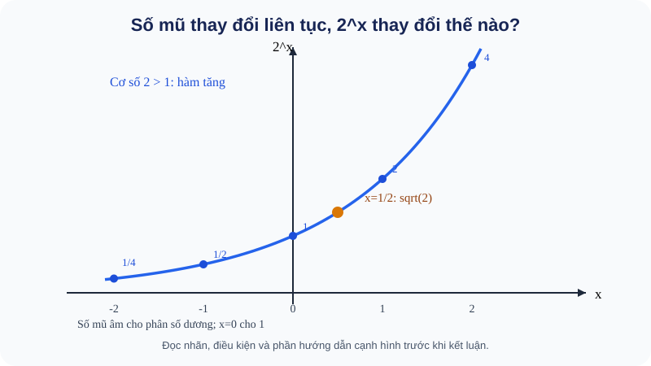

# Bài 18. Lũy thừa với số mũ thực

TOÁN 11 · CHƯƠNG VI · SGK KNTT TẬP 2

Từ phép nhân lặp đến căn bậc n và số mũ thực: hiểu điều kiện cơ số, dùng đúng quy tắc, tính tăng trưởng.
<nav class="thpt-r4-lesson-tabs"><a href="../">Chương VI</a><a href="../luyen-tap/">Core và Luyện tập</a><a href="../tu-kiem-tra-chuong/">Tự kiểm tra cuối chương</a></nav>

=== "Khám phá kiến thức"

    Nếu gửi tiết kiệm theo lãi kép, số dư mỗi kỳ là số dư kỳ trước nhân với cùng một hệ số. Lũy thừa giúp ghi ngắn phép nhân lặp. Nhưng số mũ có thể âm, phân số, thậm chí vô tỉ: khi đó cần mở rộng định nghĩa mà vẫn giữ được quy tắc tính. Nhớ kiến thức tiền đề: lũy thừa nguyên dương, nghịch đảo, căn bậc hai, giới hạn dãy số.

    <figure class="thpt-r4-plot"><figcaption>Đọc hình: trên cùng hệ trục, \(2^{-2}=1/4\), \(2^0=1\); điểm có hoành độ \(1/2\) biểu diễn \(\sqrt2\). Số mũ âm không làm cơ số dương cho giá trị âm; số mũ phân số không phải “nhân nửa lần”.</figcaption></figure>

    ### 1.1. Từ số mũ dương đến số mũ 0 và âm

    Với cơ số khác 0, giảm số mũ một đơn vị ứng với chia cho cơ số. Ví dụ \(5^2,5^1,5^0,5^{-1}\) lần lượt là \(25,5,1,1/5\). Số mũ âm nói về nghịch đảo, không đặt dấu trừ trước kết quả.

    **Vận dụng — Tự thử trước Core.** Tính \((3/7)^{-2}\). Vì sao không được định nghĩa \(0^{-3}\) bằng quy tắc ấy?

    

    ??? question "Đối chiếu"

        **Lời giải:** \((3/7)^{-2}=(7/3)^2=49/9\). \(0^{-3}\) sẽ đòi chia cho \(0^3=0\), không có nghĩa.

    

    ??? tip "Kiểm lỗi"

        **Dấu hiệu:** Đổi dấu giá trị thay vì lấy nghịch đảo.

        **Tự sửa:** Viết lũy thừa âm thành phân thức trước khi tính. [Làm lại câu B18-C01](../luyen-tap/?item=THPT-G11-CHVI-B18-C01).

    ### 1.2. Căn bậc n và dấu của số dưới căn

    Một phương trình \(b^n=a\) có thể có một, hai hoặc không có nghiệm thực tùy tính chẵn/lẻ của \(n\). Ký hiệu căn bậc chẵn chỉ chọn nghiệm không âm.

    **Vận dụng — Tự thử trước Core.** Tính \(\sqrt[5]{-243}\), \(\sqrt[4]{81}\) và liệt kê các nghiệm thực của \(z^4=81\).

    

    ??? question "Đối chiếu"

        **Lời giải:** \((-3)^5=-243\) nên căn bậc năm bằng \(-3\). \(\sqrt[4]{81}=3\), còn phương trình \(z^4=81\) có hai nghiệm \(-3,3\).

    

    ??? tip "Kiểm lỗi"

        **Dấu hiệu:** Viết căn bậc chẵn có hai giá trị.

        **Tự sửa:** Tách yêu cầu tính căn số học và giải phương trình; kiểm số mũ chẵn/lẻ. [Làm lại câu B18-C05](../luyen-tap/?item=THPT-G11-CHVI-B18-C05).

    ### 1.3. Số mũ hữu tỉ là phép lấy căn rồi nâng lũy thừa

    Để giữ \((a^{1/n})^n=a\) khi \(a\gt 0\), ta chọn căn bậc \(n\) dương. Số mũ \(m/n\) kết hợp căn bậc \(n\) với mũ \(m\), kể cả khi \(m\) âm.

    **Vận dụng — Tự thử trước Core.** Tính \(125^{-2/3}\) bằng cách lấy căn trước.

    

    ??? question "Đối chiếu"

        **Lời giải:** \(\sqrt[3]{125}=5\), do đó \(125^{-2/3}=5^{-2}=1/25\). Điều kiện cơ số dương thỏa mãn.

    

    ??? tip "Kiểm lỗi"

        **Dấu hiệu:** Đảo tử mẫu của số mũ hoặc coi mũ âm là giá trị âm.

        **Tự sửa:** Đọc mẫu số của số mũ là bậc căn rồi xử lý mũ nguyên ở tử. [Làm lại câu B18-P02](../luyen-tap/?item=THPT-G11-CHVI-B18-P02).

    ### 1.4. Số mũ vô tỉ được hình thành thế nào?

    Chương V đã cho phép nói về giới hạn. Với cơ số dương, nếu các số hữu tỉ \(r_n\) tiến đến một số vô tỉ \(\alpha\), các giá trị \(a^{r_n}\) tiến đến một giá trị dương xác định, không phụ thuộc cách chọn dãy hữu tỉ. Đó là định nghĩa \(a^\alpha\); không cần hiểu \(\alpha\) là số lần nhân.

    **Vận dụng — Tự thử trước Core.** Vì \(2\lt \sqrt5\lt 3\), hãy kẹp \(3^{\sqrt5}\) giữa hai lũy thừa nguyên của 3; có thể thay cơ số 3 bằng \(-3\) trong cách định nghĩa chung không?

    

    ??? question "Đối chiếu"

        **Lời giải:** Cơ số \(3\gt 1\) nên \(9=3^2\lt 3^{\sqrt5}\lt 3^3=27\). Không thể dùng định nghĩa lũy thừa số mũ thực chung với cơ số âm, vì nhiều số mũ hữu tỉ không cho giá trị thực.

    

    ??? tip "Kiểm lỗi"

        **Dấu hiệu:** Nghĩ chỉ số mũ nguyên mới có nghĩa, hoặc bỏ điều kiện a>0.

        **Tự sửa:** Ôn định nghĩa số mũ hữu tỉ và giới hạn ở mục 2.3; kiểm cơ số trước. [Làm lại câu B18-C04](../luyen-tap/?item=THPT-G11-CHVI-B18-C04).

    ### 1.5. Cùng cơ số thì cộng số mũ khi nhân, không phải khi cộng

    Từ \(a^2a^3=a^5\) vì ghép các thừa số, luật nhân mở rộng sang số mũ thực với cơ số dương. Cộng hai giá trị không phải ghép các thừa số, nên không có luật tương tự cho phép cộng.

    **Vận dụng — Tự thử trước Core.** Với \(t\gt 0\), rút gọn \(\dfrac{t^{3/4}t^{5/4}}{t^{1/3}}\).

    

    ??? question "Đối chiếu"

        **Lời giải:** Cùng cơ số \(t\gt 0\): số mũ \(3/4+5/4-1/3=5/3\), vậy biểu thức bằng \(t^{5/3}\). Mẫu khác 0 vì \(t\gt 0\).

    

    ??? tip "Kiểm lỗi"

        **Dấu hiệu:** Cộng số mũ tùy ý hoặc bỏ điều kiện cơ số.

        **Tự sửa:** Viết riêng phép nhân, chia, lũy thừa của lũy thừa; đối chiếu điều kiện. [Làm lại câu B18-P01](../luyen-tap/?item=THPT-G11-CHVI-B18-P01).

    ### 1.6. Lãi kép: nhân theo từng kỳ, không cộng mãi cùng số tiền

    Với vốn \(P\), lãi suất mỗi kỳ \(r\) không đổi và nhập lãi vào vốn, mỗi kỳ nhân \(1+r\); sau \(n\) kỳ số dư là \(P(1+r)^n\). Nếu cập nhật cuối kỳ, \(n\) là số nguyên không âm.

    **Vận dụng — Tự thử trước Core.** Gửi 200 triệu đồng, lãi kép 4%/năm, không phí và không rút. Sau 3 năm số dư là bao nhiêu?

    

    ??? question "Đối chiếu"

        **Lời giải:** \(200(1{,}04)^3=224{,}9728\) triệu đồng, xấp xỉ \(224{,}97\) triệu đồng. Hệ số \(1{,}04\) được nhân ba lần; tiền lãi năm sau tính trên số dư mới.

    

    ??? tip "Kiểm lỗi"

        **Dấu hiệu:** Tính lãi đơn 200+3·8 rồi gọi là lãi kép.

        **Tự sửa:** Lập lần lượt số dư năm 0,1,2,3; nêu giả định mô hình. [Làm lại câu B18-P05](../luyen-tap/?item=THPT-G11-CHVI-B18-P05).

=== "Kiến thức SGK"

    ### 2.1. Lũy thừa với số mũ nguyên

    
<strong>Định nghĩa.</strong> Với \(n\) nguyên dương, \(a^n\) là tích \(n\) thừa số \(a\). Nếu \(a\ne0\), \(a^0=1,\ a^{-n}=1/a^n\). Trong \(a^m\), \(a\) là cơ số, \(m\) là số mũ.

    
    \(0^n=0\) với \(n\gt 0\); \(0^0\) và \(0^{-n}\) không được định nghĩa ở đây.
    
    
<strong>Tính chất.</strong> Với \(a,b\ne0\), \(m,n\in\mathbb Z\):
    \[
    a^ma^n=a^{m+n},\quad \frac{a^m}{a^n}=a^{m-n},\quad (a^m)^n=a^{mn},
    \]
    \[
    (ab)^m=a^mb^m,\quad \left(\frac ab\right)^m=\frac{a^m}{b^m}.
    \]
    

    
    Khi \(a\gt 1\), so sánh số mũ giữ chiều; khi \(0\lt a\lt 1\), so sánh số mũ đảo chiều. Không suy \(a^m+a^n=a^{m+n}\). Kí hiệu khoa học của số dương có dạng \(c\cdot10^k\), \(1\le c\lt 10,\ k\in\mathbb Z\).

    ### 2.2. Lũy thừa với số mũ hữu tỉ

    
<strong>Căn bậc n.</strong> \(b\) là căn bậc \(n\) của \(a\) nếu \(b^n=a\), \(n\ge1\) nguyên. Khi \(n\) lẻ, mọi \(a\in\mathbb R\) có đúng một căn; khi \(n\) chẵn, \(a\gt 0\) có hai căn đối nhau, \(\sqrt[n]a\) chỉ căn dương; \(a=0\) có căn 0; \(a\lt 0\) không có căn thực bậc chẵn.

    
    
<strong>Tính chất căn.</strong> Với các biểu thức đều có nghĩa (mẫu khác 0), \(n,k\) nguyên dương, \(m\) nguyên:
    \[
    \sqrt[n]a\sqrt[n]b=\sqrt[n]{ab},\quad
    \frac{\sqrt[n]a}{\sqrt[n]b}=\sqrt[n]{a/b},
    \]
    \[
    (\sqrt[n]a)^m=\sqrt[n]{a^m},\quad
    \sqrt[n]{\sqrt[k]a}=\sqrt[nk]a.
    \]
    Đặc biệt \(\sqrt[n]{a^n}=a\) nếu \(n\) lẻ, bằng \(|a|\) nếu \(n\) chẵn.

    
    
<strong>Định nghĩa số mũ hữu tỉ.</strong> Với \(a\gt 0,\ m\in\mathbb Z,\ n\ge1\) nguyên,
    \[
    a^{m/n}=\sqrt[n]{a^m}=(\sqrt[n]a)^m.
    \]
    

    
    Cơ số dương giúp định nghĩa nhất quán, không phụ thuộc cách biểu diễn phân số. Căn bậc lẻ của số âm có nghĩa không có nghĩa lũy thừa số mũ thực chung với cơ số âm luôn xác định.

    ### 2.3. Lũy thừa với số mũ thực

    
<strong>Định nghĩa.</strong> Cho \(a\gt 0\), \(\alpha\) vô tỉ. Nếu \(r_n\) hữu tỉ và \(r_n\to\alpha\), giới hạn \(a^{r_n}\) tồn tại, dương và không phụ thuộc dãy đã chọn. Đặt \(a^\alpha=\lim_{n\to\infty}a^{r_n}\).

    
    Với \(a,b\gt 0\) và số mũ thực, các luật nhân, chia, lũy thừa của lũy thừa và tích/thương ở mục 2.1 vẫn đúng. Nếu \(a\gt 1\) thì \(a^u\gt a^v\) tương đương \(u\gt v\); với \(0\lt a\lt 1\), tương đương \(u\lt v\). Trường hợp \(a=1\) luôn cho 1.
    
    **Máy tính:** nhập cơ số trong ngoặc nếu là phân thức, nhập số mũ đầy đủ (kể cả dấu ngoặc của phân số) rồi đọc kết quả. Ví dụ \(2^{1{,}3}\approx2{,}4623\) (làm tròn bốn chữ số thập phân). Không thay dấu bằng chính xác bằng dấu xấp xỉ.
    
    **Ứng dụng lãi kép:** \(A=P(1+r)^N\) với \(P\gt 0,\ 1+r\gt 0\), \(N\) số kỳ nhập lãi; mô hình thực tế phải nói rõ kỳ hạn và lãi suất.

=== "Ví dụ"

    ### 3.1. Số mũ âm

    

<strong>Đề bài:</strong> Tính \((4/9)^{-2}\).

<strong>Phân tích:</strong> Chuyển mũ âm về nghịch đảo của cơ số khác 0.

<strong>Lời giải:</strong> \((4/9)^{-2}=(9/4)^2=81/16\).

<strong>Kiểm lại:</strong> Kết quả dương và lớn hơn 1 vì cơ số ban đầu thuộc (0,1).

    ### 3.2. Căn và điều kiện

    

<strong>Đề bài:</strong> Tính \(\sqrt[3]{-216}\) và \(\sqrt{(-11)^2}\).

<strong>Phân tích:</strong> Căn lẻ giữ dấu; căn chẵn của bình phương cho trị tuyệt đối.

<strong>Lời giải:</strong> \(\sqrt[3]{-216}=-6\), còn \(\sqrt{(-11)^2}=|-11|=11\).

<strong>Kiểm lại:</strong> Nâng -6 lên lũy thừa 3 được -216; căn bậc hai không âm.

    ### 3.3. Nhân hai căn cùng bậc lẻ

    

<strong>Đề bài:</strong> Tính \(\sqrt[3]{-16}\sqrt[3]4\).

<strong>Phân tích:</strong> Hai căn bậc ba có nghĩa trên toàn bộ số thực, nên gộp tích.

<strong>Lời giải:</strong> \(\sqrt[3]{-16\cdot4}=\sqrt[3]{-64}=-4\).

<strong>Kiểm lại:</strong> Lập phương -4 bằng -64; không dùng máy móc cách gộp căn bậc chẵn của số âm.

    ### 3.4. Số mũ hữu tỉ và điều kiện cơ số

    

<strong>Đề bài:</strong> Tính \(32^{3/5}\) và \((1/81)^{-3/4}\).

<strong>Phân tích:</strong> Hai cơ số dương. Lấy căn theo mẫu số rồi nâng lên mũ nguyên ở tử; với mũ âm dùng nghịch đảo.

<strong>Lời giải:</strong> \(32^{3/5}=(\sqrt[5]{32})^3=2^3=8\). Tương tự, \((1/81)^{-3/4}=(1/3)^{-3}=27\).

<strong>Kiểm lại:</strong> \(8^5=32^3\); căn bậc bốn của \(1/81\) là \(1/3\) và nghịch đảo mũ ba cho 27. Không áp dụng định nghĩa chung nếu cơ số không dương.

    ### 3.5. Rút gọn số mũ thực

    

<strong>Đề bài:</strong> Với \(a\gt 0\), rút gọn \(a^{\sqrt3+2}a^{1-\sqrt3}/(a^{1/2})^4\).

<strong>Phân tích:</strong> Gộp số mũ ở tử; nhân số mũ ở mẫu.

<strong>Lời giải:</strong> Tử \(a^3\), mẫu \(a^2\), nên bằng \(a\).

<strong>Kiểm lại:</strong> Điều kiện a>0 đảm bảo các lũy thừa đều xác định.

    ### 3.6. So sánh cùng cơ số nhỏ hơn 1

    

<strong>Đề bài:</strong> So sánh \((1/4)^{\sqrt2}\) và \((1/4)^2\).

<strong>Phân tích:</strong> Cơ số nằm giữa 0 và 1 nên thứ tự số mũ đảo khi chuyển thành giá trị.

<strong>Lời giải:</strong> Vì \(\sqrt2\lt 2\), suy ra \((1/4)^{\sqrt2}\gt (1/4)^2=1/16\).

<strong>Kiểm lại:</strong> Số mũ lớn hơn làm giá trị nhỏ hơn khi cơ số dưới 1.

    ### 3.7. Kí hiệu khoa học

    

<strong>Đề bài:</strong> Viết \(0{,}00000036\) m dưới dạng kí hiệu khoa học.

<strong>Phân tích:</strong> Dịch dấu phẩy bảy vị trí sang phải được 3,6, rồi nhân ngược với \(10^{-7}\).

<strong>Lời giải:</strong> \(0{,}00000036=3{,}6\cdot10^{-7}\) m.

<strong>Kiểm lại:</strong> Hệ số nằm trong [1,10); dịch dấu phẩy ngược bảy vị trí khôi phục giá trị ban đầu.

    ### 3.8. Tăng trưởng sau các kỳ nhập lãi

    

<strong>Đề bài:</strong> Một mô hình có lượng ban đầu 80 đơn vị tăng 3% mỗi kỳ, tính lượng sau 4 kỳ.

<strong>Phân tích:</strong> Sau mỗi kỳ nhân 1,03 với lượng hiện tại; tăng 3% không có nghĩa cộng mãi cùng một lượng.

<strong>Lời giải:</strong> \(80(1{,}03)^4=90{,}0407048\), xấp xỉ 90,04 đơn vị.

<strong>Kiểm lại:</strong> Giá trị lớn hơn 80, phép làm tròn được ghi rõ. Mô hình giả định hệ số tăng không đổi.

=== "Lỗi thường gặp"

    

    ??? tip "4.1. Nhầm số mũ âm thành số âm"

        **Vì sao sai:** Dấu trừ của số mũ làm lấy nghịch đảo.

        **Tự sửa:** Tính lại bằng 1/a^n, ôn 2.1. [Làm lại câu B18-C01](../luyen-tap/?item=THPT-G11-CHVI-B18-C01).

    

    ??? tip "4.2. Không phân biệt căn chẵn và căn lẻ"

        **Vì sao sai:** Căn chẵn chọn giá trị không âm; định nghĩa căn hữu tỉ cần cơ số dương.

        **Tự sửa:** Ôn 2.2 và ví dụ 3.2. [Làm lại câu B18-C02](../luyen-tap/?item=THPT-G11-CHVI-B18-C02).

    

    ??? tip "4.3. Coi luật nhân cũng là luật cộng"

        **Vì sao sai:** Phép cộng không gộp số mũ.

        **Tự sửa:** Thử 3²+3³=36 khác 3⁵=243; ôn 2.1. [Làm lại câu B18-P06](../luyen-tap/?item=THPT-G11-CHVI-B18-P06).

    

    ??? tip "4.4. Nhầm lãi kép với lãi đơn"

        **Vì sao sai:** Lãi mỗi kỳ tính trên số dư đã nhập lãi.

        **Tự sửa:** Lập bảng số dư sau từng kỳ trước khi dùng công thức. [Làm lại câu B18-P05](../luyen-tap/?item=THPT-G11-CHVI-B18-P05).

    **Học tiếp:** [Core và Luyện tập](../luyen-tap/) · [Tự kiểm tra cuối chương](../tu-kiem-tra-chuong/) · [Tự luận Chương VI](../../../../thu-vien/tu-luan-g11-chuong-vi/).

    
Nguồn tham khảo: SGK Toán 11 – Kết nối tri thức với cuộc sống, tập hai, Bài 18 (trang in 4–9).

