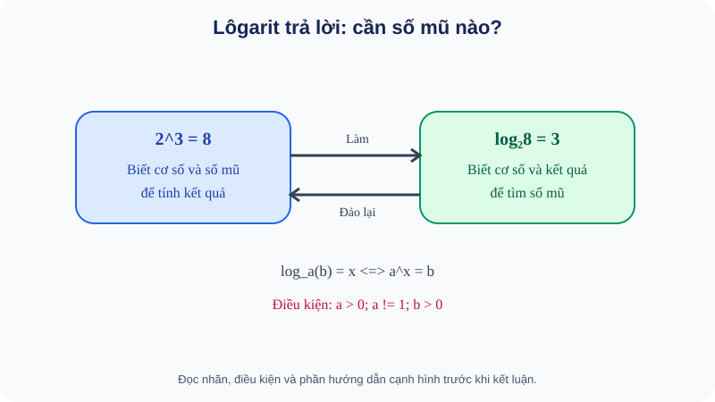

# Bài 19. Lôgarit

TOÁN 11 · CHƯƠNG VI · SGK KNTT TẬP 2

Hiểu bản chất → xem hình và ví dụ có suy luận → Tự thử trước Core → Core/Luyện tập/Vận dụng → tự khắc phục. Không ghi Mastery từ hoạt động tự học.
<nav class="thpt-r4-lesson-tabs"><a href="../">Chương VI</a><a href="../luyen-tap/">Core và Luyện tập</a><a href="../tu-kiem-tra-chuong/">Tự kiểm tra tự đối chiếu</a></nav>

=== "Khám phá kiến thức"

    ### Cùng tìm hiểu

    <figure class="thpt-r4-plot thpt-r4-probability-figure"><figcaption>Hình minh họa — quan sát trước khi tính: B19 — trực quan hình thành khái niệm</figcaption></figure>

    **Cách đọc và phát hiện:** Hình B19 không phải bảng công thức: hãy đọc từ trái qua phải để tính 2³=8, rồi đọc ngược để thấy log₂8=3 trả lời câu hỏi “số mũ nào?”. Kiểm điều kiện cơ số, đối số ngay dưới sơ đồ.

    ### 1.1. Vấn đề dẫn đến lôgarit: ta muốn tìm **số mũ**

    Nhân 2 liên tiếp: `2¹=2, 2²=4, 2³=8`. Nếu đã biết kết quả 8, hỏi **cần bao nhiêu lần nhân đôi để được 8?**, câu trả lời là 3. Với 10 hoặc 7, câu hỏi khó hơn: `2^x=10` thì x bằng bao nhiêu? Không thể chỉ thử số nguyên. Để trả lời loại câu hỏi “số mũ nào tạo ra số này?”, ta đặt ra **lôgarit**.

    ### Ví dụ trực quan

    Khi biết cơ số và kết quả phép lũy thừa nhưng chưa biết số mũ, lôgarit là công cụ hỏi ngược xem phải nhân bao nhiêu lần.

    **Quan sát bằng số liệu:** Vì 2³=8 nên log₂8=3. Cả cơ số 2>0, khác 1 và số được lấy log 8>0 đều là điều kiện cần thiết, không phải phụ chú.

    ### Thuật ngữ và kiến thức, kỹ năng

    **Thuật ngữ:** lôgarit, cơ số, đối số, đổi cơ số.

    **Sau bài học, em cần:** đổi về phương trình mũ để kiểm kết quả, đối chiếu miền xác định trước dùng tính chất log.

=== "Kiến thức SGK"

    ### 1.2. Lôgarit là gì, trước khi học quy tắc

    Với `a>0, a≠1, b>0`, **`log_a b` là số thực x duy nhất sao cho `a^x=b`**. Viết tương đương `log_a b=x ⇔ a^x=b`. `a` là **cơ số**, `b` là **đối số**; chúng giữ vai trò khác nhau. Ví dụ `log₂8=3` vì `2³=8`; `log₃(1/9)=−2` vì `3^{-2}=1/9`. Logarit **không phải** phép chia b/a.

    **Vì sao những điều kiện?** `a=1` cho `1^x=1` với mọi x nên không thể tìm số mũ duy nhất; `a≤0` không tạo ra một hàm lũy thừa thực xác định tốt với mọi x; `a^x` với a>0 luôn dương, nên không thể có `b≤0`.

    ### 1.3. Hình thành quy tắc từ ý nghĩa “số mũ”

    `log_a 1=0` do `a⁰=1`; `log_a a=1`; `a^{log_a b}=b` (b>0); `log_a(a^x)=x`.

    Đặt `u=log_a M`, `v=log_a N` với M,N>0. Vì `a^u=M` và `a^v=N`, `MN=a^{u+v}`, suy ra **`log_a(MN)=log_a M+log_a N`**. Tương tự `log_a(M/N)=log_a M−log_a N` (N>0), `log_a(M^r)=r·log_a M` (M>0, r thực). **Không** có quy tắc `log_a(M+N)=log_a M+log_a N` (phản ví dụ M=N=1: trái `log_a2`, phải 0).

    ### 1.4. Đổi cơ số và máy tính

    Đặt `x=log_a b` nên `a^x=b`. Lấy `log_c` hai vế với `c>0,c≠1`: `x log_c a=log_c b`, suy ra `log_a b=log_c b/log_c a`. Điều kiện `a≠1` làm mẫu khác 0. `lg x=log₁₀x`, `ln x=log_e x` (e là hằng số dương đặc biệt, xấp xỉ 2,71828). Máy tính có thể cho giá trị gần đúng, **không thay thế điều kiện đối số dương**.

    ### Vận dụng — tự giải trước khi đối chiếu

    Nếu `log₅125=3`, em phát biểu lại một đẳng thức lũy thừa. Giải thích vì sao `log₄0` vô nghĩa và vì sao `log₂(4+4)` không bằng `log₂4+log₂4` (kiểm `log₂8=3`, vế sau 4).

    

Đã tự thử? Mở cách tự kiểm tra

Đối chiếu lập luận của em với kiến thức và ví dụ D2 dưới đây. Hoạt động này không ghi Skill Mastery.

=== "Ví dụ"

    ### Ví dụ mẫu có giải thích

    **EX-G11-B19-01 (đọc đúng ý nghĩa).** `log₄(1/16)=−2` vì `4^{-2}=1/16`. **Không lấy** `1/16÷4`.

    **EX-G11-B19-02 (điều kiện trước khi rút gọn).** `log₃((x−1)(x+2))` xác định khi `(x−1)(x+2)>0`, tức `x<−2` hoặc `x>1`. **Không tách thành `log₃(x−1)+log₃(x+2)` trên toàn miền này**, vì khi x<−2 hai thừa số đều âm và log riêng không xác định. Quy tắc tách tích đòi **mỗi thừa số dương**; đây là bẫy học thuật quan trọng.

    **EX-G11-B19-03 (quy tắc có giải thích).** `log₂(32/4)=log₂32−log₂4=5−2=3`; điều kiện hai đối số 32,4 dương. Có thể đối chiếu `log₂8=3`.

    **EX-G11-B19-04 (đổi cơ số).** `log₃7=(ln7)/(ln3)`, kiểm `3>0,3≠1,7>0`, cho xấp xỉ 1,771; **không** phải `ln(7/3)`.

=== "Lỗi thường gặp"

    

Nhầm logarit với phép chia hoặc căn.
<ol><li><strong>Chẩn đoán lỗi:</strong> Nhầm logarit với phép chia hoặc căn.</li><li><strong>Nhắc bản chất &amp; điều kiện:</strong> log_a b là số mũ x cần nâng a lên để được b, không phải phép chia.</li><li><strong>Tìm lại lý do:</strong> Hãy phát biểu bằng lời vì sao quy tắc hợp lệ, đọc lại D1 tương ứng trước khi thay số hoặc biến đổi.</li><li><strong>Tự thử có dẫn dắt:</strong> Số mũ m nào thoả 3^m=81?. <strong>Đối chiếu sau khi thử:</strong> m=4 ⇒ log₃81=4.</li><li><strong>Quay về bài canonical:</strong> THPT-G11-CHVI-B19-C01; tự giải lại và nêu lý do từng bước, không chỉ ghi đáp số.</li></ol>
<a href="../luyen-tap/?item=THPT-G11-CHVI-B19-C01">Quay lại câu THPT-G11-CHVI-B19-C01</a>

    

Tách log của tích hai số âm thành hai log riêng.
<ol><li><strong>Chẩn đoán lỗi:</strong> Tách log của tích hai số âm thành hai log riêng.</li><li><strong>Nhắc bản chất &amp; điều kiện:</strong> log_a(MN) có nghĩa khi MN&gt;0; công thức tách cần M&gt;0 và N&gt;0 riêng.</li><li><strong>Tìm lại lý do:</strong> Hãy phát biểu bằng lời vì sao quy tắc hợp lệ, đọc lại D1 tương ứng trước khi thay số hoặc biến đổi.</li><li><strong>Tự thử có dẫn dắt:</strong> Có thể tách log₂((-3)(-4)) không?. <strong>Đối chiếu sau khi thử:</strong> Không: log₂12 xác định, nhưng log₂(−3), log₂(−4) không xác định.</li><li><strong>Quay về bài canonical:</strong> THPT-G11-CHVI-B19-P04; tự giải lại và nêu lý do từng bước, không chỉ ghi đáp số.</li></ol>
<a href="../luyen-tap/?item=THPT-G11-CHVI-B19-P04">Quay lại câu THPT-G11-CHVI-B19-P04</a>

    ### Học tiếp

    [Core và Luyện tập Bài 19](luyen-tap.md) · [Tự luận Chương VI](../../../thu-vien/tu-luan-g11-chuong-vi.md) · [Tự kiểm tra cuối chương](tu-kiem-tra-chuong.md)
