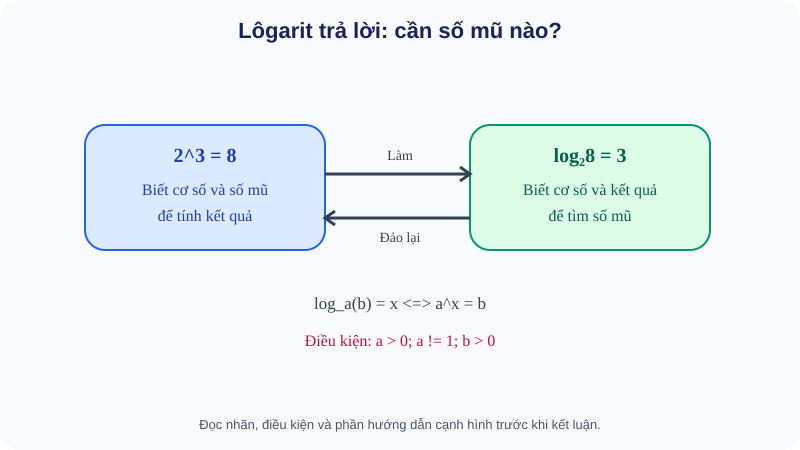

# Bài 19. Lôgarit

TOÁN 11 · CHƯƠNG VI · KẾT NỐI TRI THỨC · TẬP HAI

Lôgarit trả lời câu hỏi “cần số mũ nào?”. Từ định nghĩa và điều kiện, hình thành quy tắc nhân–chia–lũy thừa, đổi cơ số, log thập phân và ln tự nhiên.

<nav class="thpt-r4-lesson-tabs"><a href="../">Chương VI</a><a href="../luyen-tap/">Core và Luyện tập</a><a href="../tu-kiem-tra-chuong/">Tự kiểm tra cuối chương</a></nav>

=== "Khám phá kiến thức"

    Bài 18 giúp em tính \(2^3=8\), tức là biết cơ số 2 và số mũ 3 thì tìm được kết quả. Nếu đảo câu hỏi thành **\(2^x=8\), tìm \(x\)**, ta đã biết kết quả là 8 nhưng chưa biết số mũ. Lôgarit chính là cách gọi tên **số mũ cần tìm**. Đây cũng là lí do nó giúp giải bài toán lãi kép: biết số vốn và số tiền mục tiêu, muốn tìm **bao nhiêu năm** phải tăng trưởng để đạt mức ấy.

    ### 1.1. Khái niệm lôgarit

    Hãy thử ba bài toán: \(2^x=8\) cho \(x=3\); \(2^x=\frac14\) cho \(x=-2\); \(2^x=\sqrt2\) cho \(x=\frac12\). Mỗi lần, ta không tính “đầu ra của lũy thừa” mà đi ngược tìm **số mũ**. Kí hiệu \(\log_2 8=3\), \(\log_2\frac14=-2\), \(\log_2\sqrt2=\frac12\) ghi lại đúng việc đó.

    <figure class="thpt-r4-plot"><figcaption><strong>Hướng dẫn đọc:</strong> ô trái cho \(2^3=8\): biết cơ số 2 và mũ 3, tính được 8. Đi theo mũi tên ngược về ô phải để đọc \(\log_2 8=3\): biết cơ số 2 và kết quả 8, tìm lại số mũ 3. Bên dưới hình ghi rõ điều kiện \(a>0,\ a\ne1,\ b>0\).</figcaption></figure>

    **Định nghĩa có điều kiện:** Với \(a>0,\ a\ne1\) và \(M>0\), \(\log_a M\) là **số thực duy nhất \(\alpha\)** sao cho \(a^\alpha=M\). Hàm \(a^x\) với cơ số hợp lệ nhận mọi giá trị dương và đơn điệu nghiêm ngặt (sẽ khảo sát ở Bài 20), nên với mỗi \(M>0\) có đúng một số mũ như vậy. Nếu \(a=1\), \(1^\alpha=1\) với **mọi \(\alpha\)** khi \(M=1\), còn khi \(M\ne1\) thì không có số mũ nào thỏa mãn; còn cơ số không dương không có phép lũy thừa với mọi mũ thực như đã học. Đối số phải dương vì \(a^\alpha>0\) nếu \(a>0\).

    Lấy \(M=1\) thì số mũ bằng 0, nên \(\log_a1=0\). Lấy \(M=a\) thì số mũ bằng 1, nên \(\log_a a=1\). Hai phép tính “đi rồi quay lại” cũng đúng: \(a^{\log_a M}=M\) nếu \(M>0\), và \(\log_a(a^t)=t\) nếu \(t\in\mathbb R\). Các công thức ấy chỉ hợp lệ khi **cơ số lôgarit hợp lệ**.

    **Vận dụng.** Không dùng máy tính, tìm \(\log_3 81\), \(\log_{\frac12}8\) và xét \(\log_2(-4)\) có nghĩa thực không.

    ??? question "Đối chiếu"

        **Lời giải:** Vì \(3^4=81\), \(\log_3 81=4\). Vì \((\frac12)^{-3}=8\), \(\log_{\frac12}8=-3\). \(\log_2(-4)\) **không có nghĩa thực** vì đối số âm, trong khi \(2^\alpha>0\) với mọi \(\alpha\in\mathbb R\).

    ??? tip "Kiểm lỗi"

        Nếu \(\log_{\frac12}8\) bị ghi là \(3\), hãy thử nâng \((\frac12)^3=\frac18\), không bằng 8. Đừng nhầm **đối số** với **cơ số**, hoặc bỏ điều kiện đối số dương.

    ### 1.2. Tính chất của lôgarit

    **Vì sao lôgarit của tích lại thành tổng?** Giả sử \(M=a^u\), \(N=a^v\), với \(a>0,\ a\ne1\). Vì \(MN=a^{u+v}\) theo Bài 18, nên “số mũ cần tạo ra \(MN\)” bằng \(u+v\). Viết bằng lôgarit:
    \[
    \log_a(MN)=\log_aM+\log_aN.
    \]
    Đây là suy luận **từ phép nhân lũy thừa**, không phải một quy tắc được nhớ theo dáng chữ.

    Tương tự, \(M/N=a^{u-v}\) nên \(\log_a(M/N)=\log_aM-\log_aN\), và \(M^t=a^{ut}\) nên \(\log_a(M^t)=t\log_aM\). Công thức tích và thương cần **\(M,N>0\)**; công thức lũy thừa chỉ cần \(M>0,\ t\in\mathbb R\). Cả ba đều cần cơ số \(a>0,\ a\ne1\). Nếu trong một bài toán biểu thức như \(x-1\) có thể âm, em phải xét miền xác định **trước** khi tách lôgarit, không được biến đổi tùy ý.

    **Đổi cơ số có mục đích gì?** Máy tính thường có phím \(\log\) cơ số 10 và \(\ln\) cơ số \(e\), nhưng SGK có thể hỏi \(\log_4 8\). Đặt \(u=\log_a M\), nghĩa là \(M=a^u\). Lấy lôgarit cơ số \(b>0,b\ne1\) hai vế: \(\log_bM=u\log_ba\), nên
    \[
    \log_a M=\frac{\log_b M}{\log_b a}.
    \]
    Mẫu \(\log_ba\ne0\) vì \(a\ne1\). Như vậy đổi cơ số là cách **chuyển một câu hỏi số mũ sang cơ số có thể tính được**, không phải đổi bừa khi chưa kiểm cơ số.

    **Dấu và thứ tự:** Nếu \(a>1\), \(a^x\) tăng nên \(\log_a M\) cũng tăng theo \(M>0\). Nếu \(0<a<1\), điều ngược lại xảy ra: đối số lớn hơn có **lôgarit nhỏ hơn**. Chẳng hạn \(\log_{\frac12}4=-2\), \(\log_{\frac12}8=-3\), nên dù \(4<8\) thì \(-2>-3\). Không dùng quy tắc so sánh của cơ số lớn hơn 1 cho mọi cơ số hợp lệ.

    **Vận dụng.** Với \(x>1\), rút gọn \(A=\log_2(x^2-1)-\log_2(x-1)\). Sau đó tính \(\log_4 8\) bằng đổi cơ số.

    ??? question "Đối chiếu"

        **Lời giải:** Vì \(x>1\), \(x^2-1>0\) và \(x-1>0\), nên được trừ hai lôgarit: \(A=\log_2\frac{x^2-1}{x-1}=\log_2(x+1)\). Đổi cơ số 2: \(\log_4 8=\frac{\log_2 8}{\log_2 4}=\frac32\).

    ??? tip "Kiểm lỗi"

        Không thể thay \(\log_2(x^2-1)-\log_2(x-1)\) bằng \(\log_2(x^2-x)\). Quy tắc hiệu lôgarit tương ứng **phép chia** hai đối số, không phải phép trừ đối số.

    ### 1.3. Lôgarit thập phân và lôgarit tự nhiên

    Khi ghi dân số, khối lượng rất lớn hoặc nồng độ rất nhỏ, cơ số **10** đặc biệt thuận tiện vì trùng hệ thập phân. Lôgarit cơ số 10 được gọi là **lôgarit thập phân**, viết \(\log M\) hoặc \(\lg M\). Chẳng hạn \(\log1000=3\) vì \(10^3=1000\), \(\log0{,}001=-3\) vì \(10^{-3}=0{,}001\). Hai cách viết \(\log M\) và \(\log_{10}M\) là cùng một giá trị trong SGK.

    Trong mô hình lãi kép chia năm thành các kì càng ngắn, một số đặc biệt xuất hiện:
    \[
    e=\lim_{t\to+\infty}\left(1+\frac1t\right)^t\approx2{,}71828.
    \]
    Số \(e\) là số dương lớn hơn 1, nên hoàn toàn có thể làm **cơ số lôgarit**. Ta gọi \(\log_e M\) là **lôgarit tự nhiên**, viết \(\ln M\). Từ đó \(\ln e=1\), \(\ln1=0\), \(\ln(e^2)=2\). Những kết quả này đều theo định nghĩa lôgarit, không phải do phím bấm máy tính đặt ra.

    **Vì sao dùng ln cho lãi liên tục?** Gửi vốn \(P\), lãi suất năm \(r\) viết dưới dạng số thập phân (chẳng hạn \(5\%=0{,}05\)), lãi ghép \(m\) kì/năm, \(m\) nguyên dương, trong \(t\ge0\) năm cho mô hình \(P(1+r/m)^{mt}\). Khi tăng số kì ghép không giới hạn, giới hạn dẫn tới \(A=Pe^{rt}\). Muốn biết thời gian \(t\) để số tiền **gấp đôi**, giải \(2P=Pe^{rt}\) thành \(e^{rt}=2\), rồi lấy \(\ln\) hai vế: \(rt=\ln2\), nên \(t=\frac{\ln2}{r}\) (với \(r>0\)). Lôgarit lúc này chính là phép đảo **tìm thời gian trong số mũ**.

    **Về máy tính:** Phím \(\log\) và \(\ln\) cho kết quả **gần đúng** khi giá trị không biểu diễn bằng số thập phân hữu hạn; lôgarit cơ số khác tính qua \(\log_aM=\ln M/\ln a\). Ví dụ \(\log_4 8=\frac32\) là chính xác, còn \(\ln2\approx0{,}6931\) là làm tròn. Dù bấm máy, vẫn phải kiểm đối số dương và cơ số hợp lệ.

    **Một ứng dụng hóa học:** Trong mô hình pH, với nồng độ \([\mathrm H^+]>0\) (mol/lít), \(\mathrm{pH}=-\log[\mathrm H^+]\). Nếu nồng độ là \(10^{-3}\) mol/lít, pH bằng 3. Đây là ví dụ vì sao lôgarit hữu ích với các thang đo trải dài nhiều bậc 10; không cần học thêm hóa học để áp dụng quy tắc số mũ.

    **Vận dụng.** Một khoản tiền tăng liên tục theo mô hình \(A=Pe^{0{,}06t}\) (với \(t\) là số năm). Tìm thời gian để tăng gấp đôi, làm tròn đến một chữ số thập phân. Đồng thời tính pH nếu \([\mathrm H^+]=10^{-4}\) mol/lít.

    ??? question "Đối chiếu"

        **Lời giải:** \(2P=Pe^{0{,}06t}\), với \(P>0\), nên \(e^{0{,}06t}=2\). Lấy \(\ln\): \(0{,}06t=\ln2\); \(t=\frac{\ln2}{0{,}06}\approx11{,}6\) năm. Với \([\mathrm H^+]=10^{-4}\), \(\mathrm{pH}=-\log10^{-4}=-(-4)=4\).

    ??? tip "Kiểm lỗi"

        Nếu thấy \(\ln2/0{,}06\) là 11,55... thì phải **làm tròn 11,6** theo yêu cầu, không ghi bằng dấu \(=\). Công thức pH dùng **log cơ số 10** và đối số nồng độ phải dương.

=== "Kiến thức SGK"

    ### 2.1. Khái niệm lôgarit

    
<strong>Định nghĩa — Lôgarit cơ số \(a\) của \(M\)</strong>
Cho <strong>\(a>0,\ a\ne1,\ M>0\)</strong>. Số thực \(\alpha\) duy nhất thỏa \(a^\alpha=M\) được gọi là <strong>lôgarit cơ số \(a\) của \(M\)</strong>, kí hiệu \(\log_a M\). Khi đó \(\alpha=\log_a M\Leftrightarrow a^\alpha=M\). Không có lôgarit thực của 0 hay số âm; cơ số không được bằng 1.

    
<strong>Tính chất — Hệ quả trực tiếp từ định nghĩa</strong>
Với \(a>0,\ a\ne1,\ M>0,\ t\in\mathbb R\): \(\log_a1=0\), \(\log_aa=1\), \(a^{\log_aM}=M\), và \(\log_a(a^t)=t\). Số mũ cần tìm có thể âm, 0, phân số hoặc vô tỉ; điều kiện cơ số/đối số vẫn phải giữ.

    <figure class="thpt-r4-plot"><figcaption><strong>Tra hình:</strong> \(2^3=8\Longleftrightarrow\log_2 8=3\). Hai mũi tên là hai cách đọc **cùng một đẳng thức**; xem hàng điều kiện \(a>0,\ a\ne1,\ b>0\), không thay đối số 8 bằng số âm.</figcaption></figure>

    **Tự tra điều kiện:** Trong \(\log_{x-1}(x+2)\), phải đồng thời có \(x-1>0\), \(x-1\ne1\) và \(x+2>0\), tức \(x>1,\ x\ne2\). Không chỉ xét đối số.

    ### 2.2. Tính chất của lôgarit

    
<strong>Quy tắc — Tích, thương và lũy thừa</strong>
Với \(a>0,\ a\ne1,\ M,N>0,\ t\in\mathbb R\): \(\log_a(MN)=\log_aM+\log_aN\); \(\log_a(M/N)=\log_aM-\log_aN\); \(\log_a(M^t)=t\log_aM\). Mọi lôgarit trong phép biến đổi đều phải có đối số dương.

    
<strong>Công thức — Đổi cơ số</strong>
Nếu \(a,b>0,\ a\ne1,\ b\ne1,\ M>0\), thì \(\displaystyle\log_aM=\frac{\log_bM}{\log_ba}\). Mẫu \(\log_ba\ne0\) nhờ \(a\ne1\). Có thể dùng \(\log\) hoặc \(\ln\) trên máy tính làm cơ số trung gian.

    **Các hệ quả của đổi cơ số:** Nếu \(a,b>0\), \(a,b\ne1\), thì \(\log_ab=\frac1{\log_ba}\). Với \(t\ne0\), cơ số \(a^t>0,\ a^t\ne1\), nên \(\log_{a^t}M=\frac1t\log_aM\) với \(M>0\).

    **So sánh:** Cơ số \(a>1\) thì \(M>N>0\Rightarrow\log_aM>\log_aN\). Cơ số \(0<a<1\) thì bất đẳng thức **đảo chiều**; đây là điều cần nhớ khi suy từ các lũy thừa ở Bài 18.

    **Phương pháp:** Kiểm miền xác định → nếu gặp tích/thương/lũy thừa của các đối số dương thì dùng quy tắc phù hợp → nếu hai cơ số khác nhau, dùng đổi cơ số → kiểm lại các giá trị và dấu.

    ### 2.3. Lôgarit thập phân và lôgarit tự nhiên

    
<strong>Định nghĩa — Lôgarit thập phân</strong>
Với <strong>\(M>0\)</strong>, \(\log M=\log_{10}M\), còn viết \(\lg M\), là <strong>lôgarit thập phân</strong> của \(M\). Ví dụ \(\log100=2\), \(\log0{,}01=-2\).

    
<strong>Khái niệm — Số \(e\) và lôgarit tự nhiên</strong>
Số \(e=\lim_{x\to+\infty}(1+1/x)^x\approx2{,}71828\) là cơ số dương khác 1. Với <strong>\(M>0\)</strong>, <strong>lôgarit tự nhiên</strong> của \(M\) là \(\ln M=\log_eM\). Do đó \(\ln1=0\), \(\ln e=1\), \(\ln(e^t)=t\).

    
<strong>Công thức ứng dụng — Lãi kép liên tục</strong>
Trong mô hình lãi kép liên tục với vốn đầu \(P>0\), lãi suất năm không đổi \(r\) và thời gian \(t\), số tiền là \(A=Pe^{rt}\). Nếu \(r>0\) và cần thời gian tăng gấp đôi, \(t=\ln2/r\). Đây là mô hình tính lãi lý tưởng, không phải quy tắc mọi ngân hàng luôn áp dụng.

    | Dạng lôgarit | Cơ số | Ví dụ |
    | :-- | :-- | :-- |
    | \(\log M\) hoặc \(\lg M\) | \(10\) | \(\log1000=3\) |
    | \(\ln M\) | \(e\approx2{,}71828\) | \(\ln e^2=2\) |
    | \(\log_a M\) | \(a>0,\ a\ne1\) | \(\log_4 8=\frac32\) |

    **Máy tính:** Với \(a>0,\ a\ne1,\ M>0\), tính \(\log_a M\) bằng \(\ln M/\ln a\) hoặc \(\log M/\log a\); ghi \(\approx\) khi làm tròn. Dùng \(\log\) trong công thức pH, \(\ln\) trong công thức giải số mũ có cơ số \(e\). Kí hiệu gần đúng không thay thế một kết quả chính xác khi rút gọn được.

    **Ứng dụng có điều kiện:** \(\mathrm{pH}=-\log[\mathrm H^+]\) với \([\mathrm H^+]>0\) tính theo mol/lít trong mô hình SGK. Không đưa nồng độ âm hoặc 0 vào log.

=== "Ví dụ"

    ### 3.1. Tìm số mũ từ định nghĩa lôgarit

    **Đề bài.** Tính \(\log_2\frac18\) và \(\log_{\sqrt3}9\). Nói rõ cách tự kiểm.

    **Phân tích:** Đọc mỗi lôgarit thành câu hỏi “nâng **cơ số** lên số mũ nào để ra **đối số**?”. Không cần máy tính vì đối số có thể đưa về lũy thừa của cơ số.

    

<strong>Lời giải.</strong> \(\frac18=2^{-3}\), nên \(\log_2\frac18=-3\). Vì \((\sqrt3)^4=3^2=9\), nên \(\log_{\sqrt3}9=4\). Hai cơ số \(2,\sqrt3\) đều dương và khác 1, hai đối số đều dương.

    **Kiểm lại:** Nâng \(2\) lên \(-3\) được \(1/8\); nâng \(\sqrt3\) lên \(4\) được \(9\).

    ### 3.2. Cơ số nhỏ hơn 1 và số mũ âm

    **Đề bài.** Tính \(A=\log_{\frac12}32\), \(B=\log_3(3\sqrt3)\). Vì sao \(A\) âm còn \(B\) dương?

    **Phân tích:** \((\frac12)^x\) giảm khi \(x\) tăng và lớn hơn 1 nếu \(x<0\). Ngược lại \(3\sqrt3=3^{3/2}\) nên tìm số mũ dương.

    

<strong>Lời giải.</strong> Vì \((\frac12)^{-5}=2^5=32\), nên \(A=-5\). Vì \(3\sqrt3=3^1\cdot3^{1/2}=3^{3/2}\), nên \(B=3/2\).

    **Kiểm lại:** Cơ số \(1/2\) hợp lệ dù nhỏ hơn 1; \((1/2)^{-5}=32\). Lôgarit không phải lúc nào cũng dương.

    ### 3.3. Gộp tổng và hiệu các lôgarit

    **Đề bài.** Tính \(A=\log_4 2+\log_4 32\) và \(B=\log_2 80-\log_2 5\).

    **Phân tích:** Tổng lôgarit **cùng cơ số** là log của **tích đối số**; hiệu lôgarit cùng cơ số là log của **thương đối số**. Các số 2, 32, 80, 5 đều dương.

    

<strong>Lời giải.</strong> \(A=\log_4(2\cdot32)=\log_4 64=3\), vì \(4^3=64\). \(B=\log_2(80/5)=\log_2 16=4\), vì \(2^4=16\).

    **Kiểm lại:** Nếu nhầm thành \(\log_4(2+32)\) thì được \(\log_4 34\ne3\). Phải xác định **phép toán ngoài log** trước.

    ### 3.4. Rút gọn nhưng không bỏ miền xác định

    **Đề bài.** Rút gọn \(T=\log_2(x^2-1)-\log_2(x-1)\) trên tập số thực và xác định miền của biểu thức ban đầu.

    **Phân tích:** Cả hai **đối số ban đầu** phải dương. Giải điều kiện rồi mới áp dụng quy tắc hiệu thành log của thương.

    

<strong>Lời giải.</strong> Điều kiện \(x^2-1>0\) và \(x-1>0\) tương đương \(x>1\). Trên miền ấy, \(T=\log_2\left(\frac{(x-1)(x+1)}{x-1}\right)=\log_2(x+1)\). Kết quả chỉ tương đương biểu thức gốc khi **\(x>1\)**.

    **Kiểm lại:** Nếu chỉ viết \(\log_2(x+1)\), em có thể cho phép \(x=0\), nhưng ở đó \(\log_2(x^2-1)\) gốc không có nghĩa. Phải giữ điều kiện sau khi rút gọn.

    ### 3.5. Đổi cơ số bằng lôgarit quen thuộc

    **Đề bài.** Tính \(\log_4 8\) và \(\log_9\frac1{27}\) không dùng máy tính.

    **Phân tích:** Cơ số 4, 8, 9, 27 đều là lũy thừa của 2 hoặc 3. Chọn **cơ số chung** phù hợp trong công thức đổi cơ số.

    

<strong>Lời giải.</strong> \(\log_4 8=\frac{\log_2 8}{\log_2 4}=\frac32\). Tương tự \(\log_9\frac1{27}=\frac{\log_3(3^{-3})}{\log_3(3^2)}=\frac{-3}{2}\).

    **Kiểm lại:** \(4^{3/2}=8\) và \(9^{-3/2}=1/27\). Trong phép đổi cơ số, mẫu \(\log_2 4=2\), \(\log_3 9=2\), đều khác 0.

    ### 3.6. Lôgarit thập phân trong mô hình pH

    **Đề bài.** Trong mô hình \(\mathrm{pH}=-\log[\mathrm H^+]\) với nồng độ dương tính theo mol/lít, tìm pH khi \([\mathrm H^+]=10^{-4}\). Nếu pH bằng \(7{,}4\), biểu diễn nồng độ bằng lũy thừa của 10.

    **Phân tích:** \(\log\) không ghi cơ số là **cơ số 10**, không phải \(\ln\). Đưa dấu âm của công thức pH qua phép chuyển vế trước khi lấy lũy thừa.

    

<strong>Lời giải.</strong> Nếu \([\mathrm H^+]=10^{-4}\), \(\mathrm{pH}=-\log10^{-4}=-(-4)=4\). Nếu \(\mathrm{pH}=7{,}4\), \(\log[\mathrm H^+]=-7{,}4\), nên \([\mathrm H^+]=10^{-7{,}4}\) mol/lít.

    **Kiểm lại:** Đối số nồng độ luôn dương. Giá trị \(10^{-7{,}4}\) là dạng chính xác theo mô hình, có thể bấm máy để lấy gần đúng nếu được yêu cầu.

    ### 3.7. Lôgarit tự nhiên và thời gian nhân đôi

    **Đề bài.** Với mô hình lãi kép liên tục \(A=Pe^{0{,}06t}\), \(P>0\), tìm \(t\) để tiền tăng gấp đôi, làm tròn đến một chữ số thập phân.

    **Phân tích:** Chia hai vế cho \(P>0\), sau đó lấy \(\ln\) vì cơ số là \(e\). Đây là bài toán **tìm số mũ \(t\)**, không phải tính \(A\) khi đã cho \(t\).

    

<strong>Lời giải.</strong> \(2P=Pe^{0{,}06t}\Leftrightarrow e^{0{,}06t}=2\). Lấy \(\ln\): \(0{,}06t=\ln2\), nên \(t=\frac{\ln2}{0{,}06}\approx11{,}6\) năm.

    **Kiểm lại:** Thế \(t\approx11{,}6\) vào mô hình được số tiền gần \(2P\). Dấu \(\approx\) chỉ làm tròn thời gian; công thức \(t=\ln2/0{,}06\) là chính xác trong mô hình.

    ### 3.8. Số năm nguyên đầu tiên đạt mục tiêu lãi kép

    **Đề bài.** Gửi 100 triệu đồng với lãi ghép cuối mỗi năm, lãi suất cố định \(6\%\) một năm. Hỏi **ít nhất bao nhiêu năm trọn vẹn** để tổng số tiền không dưới 150 triệu đồng?

    **Phân tích:** Sau \(n\) năm trọn vẹn, \(A=100(1{,}06)^n\). Giải bất đẳng thức theo \(n\) bằng lôgarit, rồi chọn **số nguyên nhỏ nhất đủ điều kiện**, không làm tròn số năm về gần nhất.

    

<strong>Lời giải.</strong> \(100(1{,}06)^n\ge150\Leftrightarrow(1{,}06)^n\ge1{,}5\). Vì \(1{,}06>1\), \(n\ge\log_{1{,}06}1{,}5=\frac{\ln1{,}5}{\ln1{,}06}\approx6{,}96\). Với \(n\in\mathbb N\), giá trị nhỏ nhất là \(n=7\) năm.

    **Kiểm lại:** \(100(1{,}06)^6\approx141{,}85<150\), trong khi \(100(1{,}06)^7\approx150{,}36\ge150\). Đây là kì hạn theo năm, không phải mô hình ghép lãi liên tục.

=== "Lỗi thường gặp"

    ### 4.1. Không kiểm cơ số và đối số lôgarit

    **Dấu hiệu:** Tính \(\log_1 8\) hoặc \(\log_2(-4)\) như số thực.

    **Vì sao sai:** Lôgarit cơ số \(a\) chỉ định nghĩa với \(a>0,\ a\ne1\) và **đối số \(M>0\)**. Cơ số 1 không cho số mũ duy nhất, lũy thừa cơ số dương không nhận giá trị âm.

    **Cách sửa:** Viết điều kiện đủ **ba phần** trước: cơ số dương, cơ số khác 1, đối số dương; với biến phải giải điều kiện đồng thời.

    ### 4.2. Nhầm lôgarit trả về kết quả lũy thừa

    **Dấu hiệu:** Đọc \(\log_2 8\) thành 8 hoặc 16, thay vì số mũ 3.

    **Vì sao sai:** \(\log_aM\) là **số mũ cần tìm** để \(a^\alpha=M\), không phải phép nhân/chia các số \(a,M\).

    **Cách sửa:** Chuyển về \(a^\alpha=M\) rồi kiểm lại. Nếu \(\alpha=3\) thì \(2^3=8\), nên \(\log_2 8=3\).

    ### 4.3. Biến log của tổng thành tổng các log

    **Dấu hiệu:** Viết \(\log_a(M+N)=\log_aM+\log_aN\).

    **Vì sao sai:** Quy tắc cộng lôgarit đến từ **phép nhân các lũy thừa**, nên vế tương ứng là \(\log_a(MN)\), không phải \(\log_a(M+N)\).

    **Cách sửa:** Chọn phản ví dụ có kết quả thật sự khác nhau: với \(a=2,M=2,N=4\), \(\log_2(M+N)=\log_2 6\ne3\), trong khi \(\log_2M+\log_2N=1+2=3\). Hãy nhớ quy tắc đúng là \(\log_a(MN)=\log_aM+\log_aN\).

    ### 4.4. Rút gọn log rồi quên miền xác định ban đầu

    **Dấu hiệu:** Từ \(\log_2(x^2-1)-\log_2(x-1)\) biến thành \(\log_2(x+1)\) và cho mọi \(x>-1\).

    **Vì sao sai:** Biểu thức gốc đòi cả \(x^2-1>0\) và \(x-1>0\), tức **\(x>1\)**. Rút gọn không mở rộng miền xác định của bài toán.

    **Cách sửa:** Ghi các điều kiện của **mọi đối số gốc** trước; sau biến đổi, luôn mang theo miền \(x>1\).

    ### 4.5. Đảo sai công thức đổi cơ số hoặc quên mẫu khác 0

    **Dấu hiệu:** Tính \(\log_4 8=\frac{\log_2 4}{\log_2 8}=\frac23\).

    **Vì sao sai:** Công thức là \(\log_aM=\frac{\log_bM}{\log_ba}\): đối số ở **tử**, cơ số gốc ở **mẫu**. Mẫu \(\log_ba\) chỉ khác 0 nếu \(a\ne1\).

    **Cách sửa:** Tự đọc \(\log_4 8\) là số mũ cho \(4^x=8\), nên \(x=3/2\) và dùng giá trị ấy để kiểm đổi cơ số.

    ### 4.6. Nhầm log thập phân với ln hoặc làm tròn số năm sai

    **Dấu hiệu:** Dùng \(\ln\) thay \(\log\) trong công thức pH; hoặc giải \(\log_{1{,}06}1{,}5\approx6{,}96\) rồi cho chỉ cần 6 năm trọn vẹn.

    **Vì sao sai:** \(\log\) không ghi cơ số là **cơ số 10** trong SGK, còn \(\ln\) là cơ số \(e\). Mục tiêu “không dưới 150 triệu” yêu cầu **số năm nguyên đầu tiên thỏa bất đẳng thức**, nên phải lấy trần, không làm tròn thông thường.

    **Cách sửa:** Kiểm ký hiệu log/ln và đơn vị; thử lại \(n=6\) và \(n=7\) bằng công thức gốc trước khi kết luận.

    **Học tiếp:** [Core và Luyện tập Bài 19](luyen-tap.md) · [Tự luận Chương VI](../../../thu-vien/tu-luan-g11-chuong-vi.md) · [Tự kiểm tra cuối chương](tu-kiem-tra-chuong.md).

    
Nguồn đối chiếu văn bản: SGK Toán 11 Kết nối tri thức với cuộc sống, tập hai, Bài 19 “Lôgarit”, trang in 10–15. Ba mục SGK chính: Khái niệm lôgarit; Tính chất của lôgarit; Lôgarit thập phân và lôgarit tự nhiên. Văn bản PDF số hóa đã đối chiếu, chưa có ảnh render từng trang PDF để xác nhận offset trang in. SVG hiện hữu minh họa \(2^3=8\) và \(\log_2 8=3\) được dùng lại đúng nguồn ở hai tab có hình, không vẽ mới; bảng log/lg/ln đặt tại mục cần tra cứu. Không sửa Core/Luyện tập, Tự kiểm tra hoặc ngân hàng đánh giá.

