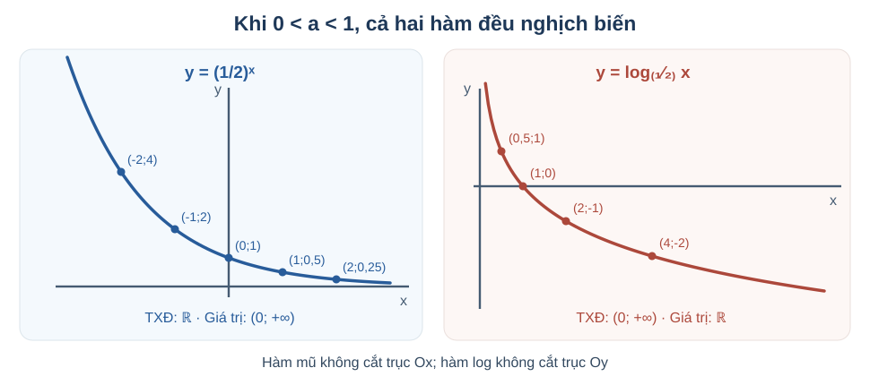

# Bài 20. Hàm số mũ và hàm số lôgarit

TOÁN 11 · CHƯƠNG VI · KẾT NỐI TRI THỨC · TẬP HAI

Hàm mũ nhận số mũ làm đầu vào; hàm lôgarit đi ngược để tìm số mũ. Học cách đọc miền xác định, giá trị, biến thiên, tiệm cận và các cặp điểm của hai đồ thị.

<nav class="thpt-r4-lesson-tabs"><a href="../">Chương VI</a><a href="../luyen-tap/">Core và Luyện tập</a><a href="../tu-kiem-tra-chuong/">Tự kiểm tra cuối chương</a></nav>

=== "Khám phá kiến thức"

    Ở Bài 18, ta tính \(2^3=8\). Ở Bài 19, ta tìm \(x\) khi \(2^x=8\) bằng \(\log_2 8=3\). Nhưng nếu **\(x\) thay đổi liên tục** thì các giá trị \(2^x\) thay đổi theo quy luật nào? Khi biết kết quả \(y\), cách tìm \(x\) có tạo thành một hàm số không? Hai câu hỏi này đưa ta đến **hàm số mũ** và **hàm số lôgarit**. Ta cần cả đồ thị để thấy chiều tăng/giảm, điểm thuộc đồ thị và điều không thể suy ra chỉ bằng một phép tính.

    ### 1.1. Hàm số mũ

    Hàm số \(y=a^x\) với **\(a>0,\ a\ne1\)** được gọi là hàm số mũ cơ số \(a\): biến \(x\) nằm ở **số mũ**. Khác với \(y=x^2\) (biến là cơ số), mọi \(x\in\mathbb R\) đều thay được vào \(a^x\), và kết quả **luôn dương**. Vì vậy **tập xác định** là \(\mathbb R\), còn **tập giá trị** là \((0,+\infty)\): có thể gần 0 tùy ý nhưng không bằng 0 hay âm.

    Hãy tính bảng sau rồi quan sát nhịp thay đổi:

    | \(x\) | \(-2\) | \(-1\) | \(0\) | \(1\) | \(2\) |
    | :-- | --: | --: | --: | --: | --: |
    | \(2^x\) | \(\frac14\) | \(\frac12\) | \(1\) | \(2\) | \(4\) |
    | \((\frac12)^x\) | \(4\) | \(2\) | \(1\) | \(\frac12\) | \(\frac14\) |

    Hai hàng đều đi qua điểm \((0,1)\), nhưng với \(2>1\) thì sang phải giá trị **tăng**, còn với \(0<\frac12<1\) thì sang phải giá trị **giảm**. Đây là quy luật tổng quát: \(a>1\) thì hàm đồng biến trên \(\mathbb R\); \(0<a<1\) thì nghịch biến trên \(\mathbb R\). Tại \(x=1\), giá trị bằng cơ số \(a\), nên đồ thị luôn qua **\((1,a)\)**. Hai hàm đều liên tục trên \(\mathbb R\).

    <figure class="thpt-r4-plot"><figcaption><strong>Hướng dẫn đọc phần hàm mũ:</strong> nhìn **đường màu xanh** \(y=2^x\); nó đi qua \((0,1)\), \((1,2)\), luôn phía trên trục hoành và tăng khi \(x\) tăng. Đường xanh lục là hàm lôgarit, sẽ đọc ở mục 1.2. Nét đứt \(y=x\) dùng để nhận ra hai hàm ngược nhau, không phải đường tiệm cận.</figcaption></figure>

    Với \(a>1\), khi \(x\to-\infty\), \(a^x\to0^+\); vì thế đồ thị tiến sát **trục hoành \(y=0\)** nhưng không chạm. Khi \(x\to+\infty\), giá trị tăng không bị chặn. Với \(0<a<1\), chiều tiến sát trục hoành **đổi lại phía bên phải**. Một đồ thị không cắt trục hoành không có nghĩa nó không đi gần trục.

    **Nhận dạng biểu thức:** \(y=3^x\) là hàm mũ; \(y=2^{-x}=(\frac12)^x\) cũng là hàm mũ sau đổi cơ số; \(y=8^{x/3}=2^x\) cũng vậy. Còn \(y=x^{-2}\) không phải hàm mũ theo dạng SGK vì \(x\) ở **cơ số**. Khi biến đổi, phải kiểm cơ số dương và khác 1.

    **Vận dụng.** Cho \(f(x)=(\frac13)^x\). Tìm tập xác định, tập giá trị, tính đơn điệu, hai điểm chắc chắn trên đồ thị và giới hạn khi \(x\to+\infty\).

    ??? question "Đối chiếu"

        **Lời giải:** \(0<\frac13<1\), nên \(f\) xác định trên \(\mathbb R\), nhận giá trị \((0,+\infty)\), **nghịch biến**, qua \((0,1)\), \((1,\frac13)\). Khi \(x\to+\infty\), \((\frac13)^x\to0^+\); trục hoành là tiệm cận ngang về phía phải.

    ??? tip "Kiểm lỗi"

        Nếu khẳng định mọi hàm mũ đều tăng thì đã quên trường hợp \(0<a<1\). Đừng nhầm tập giá trị \((0,+\infty)\) với tập xác định \(\mathbb R\).

    ### 1.2. Hàm số lôgarit

    Bây giờ đổi vai trò đầu vào và đầu ra. Với \(a>0,\ a\ne1\), hàm \(y=\log_a x\) trả lời: **nâng \(a\) lên số mũ nào để bằng \(x\)?** Vì \(a^y>0\) nên **\(x\) bắt buộc dương**. Do đó tập xác định là \((0,+\infty)\). Mọi số thực \(y\) đều đạt được khi chọn \(x=a^y>0\), nên tập giá trị là **\(\mathbb R\)**. Đồ thị qua \((1,0)\), vì \(\log_a1=0\), và qua \((a,1)\), vì \(\log_aa=1\).

    Cùng cơ số \(a>1\) với hàm mũ đang tăng, hàm lôgarit cũng **tăng** trên \((0,+\infty)\). Khi cơ số \(0<a<1\), cả hai đều **giảm**. Riêng hàm lôgarit, khi \(x\to0^+\), đồ thị tiến gần trục tung \(x=0\) mà không chạm, vì \(x=0\) **nằm ngoài tập xác định**. Đó là tiệm cận **đứng** của đồ thị log, khác với tiệm cận **ngang** \(y=0\) của hàm mũ.

    Để nhìn trường hợp dễ nhầm \(0<a<1\), ta sử dụng hình bổ sung dưới đây. Hình trái vẽ \((\frac12)^x\); hình phải vẽ \(\log_{\frac12}x\). Chúng đều **nghịch biến**, nhưng miền xác định khác nhau.

    <figure class="thpt-r4-plot"><figcaption><strong>Hướng dẫn đọc:</strong> trái: \((0,1)\), \((1,\frac12)\), \((-1,2)\) thuộc đồ thị \((\frac12)^x\) và đường luôn trên trục hoành. Phải: \((1,0)\), \((\frac12,1)\), \((2,-1)\) thuộc đồ thị \(\log_{\frac12}x\) và chỉ có điểm bên phải trục tung. Khi \(x\) tăng, cả hai đường đi xuống nhưng **không có cùng tập xác định**.</figcaption></figure>

    **Vì sao hai hàm là “đi và quay lại”?** Nếu \(y=a^x\), thì \(x=\log_a y\). Ví dụ điểm \((2,4)\) của \(y=2^x\) tương ứng với điểm \((4,2)\) của \(y=\log_2 x\). Hoán đổi hoành độ/tung độ làm hai đồ thị đối xứng qua **đường \(y=x\)**. Hình cũ ở mục 1.1 đã biểu diễn cả hai đường trên cùng trục; em có thể quay lại nhìn **đường xanh lục** để kiểm cặp điểm \((1,0)\), \((2,1)\). Không suy rằng hai đồ thị luôn nằm ở hai nửa mặt phẳng khác nhau.

    **Mô hình thực tế:** Dân số theo công thức giả định của SGK \(A=Pe^{rt}\) tăng theo **hàm mũ** khi \(r>0\), với \(t\) là thời gian. Khi biết dân số đạt mức \(A\) và muốn tìm thời gian \(t\), ta phải **lấy lôgarit**: \(t=\frac{\ln(A/P)}r\). Công thức cần \(P,A>0\) và \(r\ne0\). Đây chỉ là mô hình với tốc độ tăng không đổi, không phải dự báo dân số chắc chắn.

    **Vận dụng.** Cho \(g(x)=\log_{\frac12}x\). Tìm tập xác định, tập giá trị, tính đơn điệu, hai điểm thuộc đồ thị và giới hạn khi \(x\to0^+\).

    ??? question "Đối chiếu"

        **Lời giải:** Vì cơ số \(\frac12\) dương, khác 1 và nhỏ hơn 1, \(g\) xác định khi \(x>0\), có tập giá trị \(\mathbb R\) và **nghịch biến**. Hai điểm thuộc đồ thị: \((1,0)\), \((\frac12,1)\). Khi \(x\to0^+\), \(g(x)\to+\infty\); trục tung \(x=0\) là tiệm cận đứng.

    ??? tip "Kiểm lỗi"

        Không ghi “\(x\in\mathbb R\)” cho hàm log, vì \(\log_{\frac12}0\) và \(\log_{\frac12}(-1)\) không có nghĩa. Đồ thị log nằm **bên phải trục tung** chứ không phải luôn bên trên trục hoành.

=== "Kiến thức SGK"

    ### 2.1. Hàm số mũ

    
<strong>Định nghĩa — Hàm số mũ</strong>
Cho số thực <strong>\(a>0,\ a\ne1\)</strong>. Hàm \(y=a^x\) là <strong>hàm số mũ</strong> cơ số \(a\). Biến \(x\) nằm ở số mũ; điều kiện cơ số dương, khác 1 là bắt buộc trong định nghĩa SGK.

    
<strong>Tính chất — Hàm số mũ \(y=a^x\)</strong>
<strong>Tập xác định:</strong> \(\mathbb R\). <strong>Tập giá trị:</strong> \((0,+\infty)\). <strong>Liên tục:</strong> trên \(\mathbb R\). <strong>Biến thiên:</strong> đồng biến trên \(\mathbb R\) nếu \(a>1\), nghịch biến nếu \(0<a<1\). <strong>Điểm đặc biệt:</strong> \((0,1)\), \((1,a)\). Đồ thị luôn ở phía trên trục hoành và có tiệm cận ngang \(y=0\) về một phía.

    | Cơ số | Khi \(x\to-\infty\) | Khi \(x\to+\infty\) | Chiều biến thiên |
    | :-- | :-- | :-- | :-- |
    | \(a>1\) | \(a^x\to0^+\) | \(a^x\to+\infty\) | Đồng biến |
    | \(0<a<1\) | \(a^x\to+\infty\) | \(a^x\to0^+\) | Nghịch biến |

    <figure class="thpt-r4-plot"><figcaption><strong>Tra hình mũ:</strong> nhìn đường màu xanh \(2^x\), qua \((0,1)\), \((1,2)\), luôn dương và tăng. Đường lôgarit xanh lục cùng hình sẽ dùng ở mục 2.2. Nét đứt \(y=x\) là đường đối xứng **hai đồ thị ngược**, không phải tiệm cận của đồ thị mũ.</figcaption></figure>

    **Nhận dạng:** \(2^{-x}=(\frac12)^x\) và \(8^{x/3}=2^x\) đều có dạng hàm số mũ sau biến đổi. \(x^3\), \(x^{-2}\) không phải hàm mũ dạng \(a^x\) vì biến là cơ số. Nếu \(a=1\), hàm hằng \(1^x=1\) không thuộc định nghĩa hàm mũ cơ số \(a\ne1\) trong SGK.

    ### 2.2. Hàm số lôgarit

    
<strong>Định nghĩa — Hàm số lôgarit</strong>
Với <strong>\(a>0,\ a\ne1\)</strong>, hàm \(y=\log_a x\) là <strong>hàm số lôgarit</strong> cơ số \(a\). Biến \(x\) là <strong>đối số</strong>, nên bắt buộc \(x>0\). Không nhầm hàm này với \(\log_x a\) có cơ số biến thiên.

    
<strong>Tính chất — Hàm số lôgarit \(y=\log_a x\)</strong>
<strong>Tập xác định:</strong> \((0,+\infty)\). <strong>Tập giá trị:</strong> \(\mathbb R\). <strong>Liên tục:</strong> trên \((0,+\infty)\). <strong>Biến thiên:</strong> đồng biến khi \(a>1\), nghịch biến khi \(0<a<1\). <strong>Điểm đặc biệt:</strong> \((1,0)\), \((a,1)\). Đồ thị chỉ nằm bên phải trục tung, có tiệm cận đứng \(x=0\).

    | Cơ số | Khi \(x\to0^+\) | Khi \(x\to+\infty\) | Chiều biến thiên |
    | :-- | :-- | :-- | :-- |
    | \(a>1\) | \(\log_a x\to-\infty\) | \(\log_a x\to+\infty\) | Đồng biến |
    | \(0<a<1\) | \(\log_a x\to+\infty\) | \(\log_a x\to-\infty\) | Nghịch biến |

    <figure class="thpt-r4-plot"><figcaption><strong>Tra hình lôgarit:</strong> nhìn **khung phải** \(y=\log_{\frac12}x\): qua \((1,0)\), \((\frac12,1)\), nghịch biến, không có điểm khi \(x\le0\). Khung trái \(y=(\frac12)^x\) có tập xác định \(\mathbb R\) và chỉ nhận giá trị dương. Cả hai hình dùng để phân biệt **đầu vào** và **đầu ra**.</figcaption></figure>

    **Quan hệ với hàm mũ:** Hai hàm \(y=a^x\), \(y=\log_a x\) (cùng \(a>0,a\ne1\)) là hai hàm ngược; đổi chỗ tọa độ \((u,v)\leftrightarrow(v,u)\) làm hai đồ thị đối xứng qua đường \(y=x\). Hãy xét dấu, miền và điểm đặc biệt trước khi so sánh hai đồ thị.

    **Ứng dụng:** Mô hình dân số \(A(t)=Pe^{rt}\) với \(P>0\), \(t\ge0\) là ví dụ hàm mũ theo thời gian; với \(r>0\), hàm tăng. Khi giải ngược thời gian từ mức dân số \(A>0\), dùng \(t=\ln(A/P)/r\), đúng trong điều kiện mô hình và \(r\ne0\).
