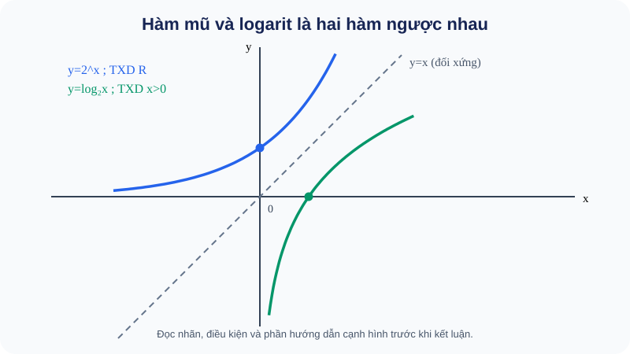

# Bài 20. Hàm số mũ và hàm số lôgarit

TOÁN 11 · CHƯƠNG VI · KẾT NỐI TRI THỨC · TẬP HAI

Hàm mũ nhận số mũ làm đầu vào; hàm lôgarit đi ngược để tìm số mũ. Học cách đọc miền xác định, giá trị, biến thiên, tiệm cận và các cặp điểm của hai đồ thị.

<nav class="thpt-r4-lesson-tabs"><a href="../">Chương VI</a><a href="../luyen-tap/">Core và Luyện tập</a><a href="../tu-kiem-tra-chuong/">Tự kiểm tra cuối chương</a></nav>

=== "Khám phá kiến thức"

    Ở Bài 18, ta tính \(2^3=8\). Ở Bài 19, ta tìm \(x\) khi \(2^x=8\) bằng \(\log_2 8=3\). Nhưng nếu **\(x\) thay đổi liên tục** thì các giá trị \(2^x\) thay đổi theo quy luật nào? Khi biết kết quả \(y\), cách tìm \(x\) có tạo thành một hàm số không? Hai câu hỏi này đưa ta đến **hàm số mũ** và **hàm số lôgarit**. Ta cần cả đồ thị để thấy chiều tăng/giảm, điểm thuộc đồ thị và điều không thể suy ra chỉ bằng một phép tính.

    ### 1.1. Hàm số mũ

    Hàm số \(y=a^x\) với **\(a>0,\ a\ne1\)** được gọi là hàm số mũ cơ số \(a\): biến \(x\) nằm ở **số mũ**. Khác với \(y=x^2\) (biến là cơ số), mọi \(x\in\mathbb R\) đều thay được vào \(a^x\), và kết quả **luôn dương**. Vì vậy **tập xác định** là \(\mathbb R\), còn **tập giá trị** là \((0,+\infty)\): mọi \(y>0\) đều đạt được tại \(x=\log_a y\) theo Bài 19; không có giá trị bằng 0 hoặc âm.

    Hãy tính bảng sau rồi quan sát nhịp thay đổi:

    | \(x\) | \(-2\) | \(-1\) | \(0\) | \(1\) | \(2\) |
    | :-- | --: | --: | --: | --: | --: |
    | \(2^x\) | \(\frac14\) | \(\frac12\) | \(1\) | \(2\) | \(4\) |
    | \((\frac12)^x\) | \(4\) | \(2\) | \(1\) | \(\frac12\) | \(\frac14\) |

    Hai đồ thị tương ứng đều đi qua điểm \((0,1)\), nhưng với \(2>1\) thì sang phải giá trị **tăng**, còn với \(0<\frac12<1\) thì sang phải giá trị **giảm**. Đây là quy luật tổng quát: \(a>1\) thì hàm đồng biến trên \(\mathbb R\); \(0<a<1\) thì nghịch biến trên \(\mathbb R\). Khi dựng đồ thị, chấm các cặp \((x,a^x)\) trong bảng rồi phác đường cong liên tục theo chiều biến thiên. Tại \(x=1\), giá trị bằng cơ số \(a\), nên đồ thị luôn qua **\((1,a)\)**. Hai hàm đều liên tục trên \(\mathbb R\).

    <figure class="thpt-r4-plot"><figcaption><strong>Hướng dẫn đọc phần hàm mũ:</strong> nhìn **đường màu xanh** \(y=2^x\); nó đi qua \((0,1)\), \((1,2)\), luôn phía trên trục hoành và tăng khi \(x\) tăng. Đường xanh lục là hàm lôgarit, sẽ đọc ở mục 1.2. Nét đứt \(y=x\) dùng để nhận ra hai hàm ngược nhau, không phải đường tiệm cận.</figcaption></figure>

    Với \(a>1\), khi \(x\to-\infty\), \(a^x\to0^+\); vì thế đồ thị tiến sát **trục hoành \(y=0\)** nhưng không chạm. Khi \(x\to+\infty\), giá trị tăng không bị chặn. Với \(0<a<1\), chiều tiến sát trục hoành **đổi lại phía bên phải**. Một đồ thị không cắt trục hoành không có nghĩa nó không đi gần trục.

    **Nhận dạng biểu thức:** \(y=3^x\) là hàm mũ; \(y=2^{-x}=(\frac12)^x\) cũng là hàm mũ sau đổi cơ số; \(y=8^{x/3}=2^x\) cũng vậy. Còn \(y=x^{-2}\) không phải hàm mũ theo dạng SGK vì \(x\) ở **cơ số**. Khi biến đổi, phải kiểm cơ số dương và khác 1.

    **Vận dụng.** Cho \(f(x)=(\frac13)^x\). Tìm tập xác định, tập giá trị, tính đơn điệu, hai điểm chắc chắn trên đồ thị và giới hạn khi \(x\to+\infty\).

    ??? question "Đối chiếu"

        **Lời giải:** \(0<\frac13<1\), nên \(f\) xác định trên \(\mathbb R\), nhận giá trị \((0,+\infty)\), **nghịch biến**, qua \((0,1)\), \((1,\frac13)\). Khi \(x\to+\infty\), \((\frac13)^x\to0^+\); trục hoành là tiệm cận ngang về phía phải.

    ??? tip "Kiểm lỗi"

        Nếu khẳng định mọi hàm mũ đều tăng thì đã quên trường hợp \(0<a<1\). Đừng nhầm tập giá trị \((0,+\infty)\) với tập xác định \(\mathbb R\).

    ### 1.2. Hàm số lôgarit

    Bây giờ đổi vai trò đầu vào và đầu ra. Với \(a>0,\ a\ne1\), hàm \(y=\log_a x\) trả lời: **nâng \(a\) lên số mũ nào để bằng \(x\)?** Vì \(a^y>0\) nên **\(x\) bắt buộc dương**. Do đó tập xác định là \((0,+\infty)\). Mọi số thực \(y\) đều đạt được khi chọn \(x=a^y>0\), nên tập giá trị là **\(\mathbb R\)**. Chẳng hạn, để tìm tập xác định của \(y=\log_2(4-x^2)\), giải \(4-x^2>0\), được \(-2<x<2\). Để dựng đồ thị lôgarit cơ bản, có thể đổi chỗ từng cặp tọa độ của bảng hàm mũ cùng cơ số. Đồ thị qua \((1,0)\), vì \(\log_a1=0\), và qua \((a,1)\), vì \(\log_aa=1\).

    Cùng cơ số \(a>1\) với hàm mũ đang tăng, hàm lôgarit cũng **tăng** trên \((0,+\infty)\). Khi cơ số \(0<a<1\), cả hai đều **giảm**. Riêng hàm lôgarit, khi \(x\to0^+\), đồ thị tiến gần trục tung \(x=0\) mà không chạm, vì \(x=0\) **nằm ngoài tập xác định**. Đó là tiệm cận **đứng** của đồ thị log, khác với tiệm cận **ngang** \(y=0\) của hàm mũ.

    Để nhìn trường hợp dễ nhầm \(0<a<1\), ta sử dụng hình bổ sung dưới đây. Hình trái vẽ \((\frac12)^x\); hình phải vẽ \(\log_{\frac12}x\). Chúng đều **nghịch biến**, nhưng miền xác định khác nhau.

    <figure class="thpt-r4-plot"><figcaption><strong>Hướng dẫn đọc:</strong> trái: \((0,1)\), \((1,\frac12)\), \((-1,2)\) thuộc đồ thị \((\frac12)^x\) và đường luôn trên trục hoành. Phải: \((1,0)\), \((\frac12,1)\), \((2,-1)\) thuộc đồ thị \(\log_{\frac12}x\) và chỉ có điểm bên phải trục tung. Khi \(x\) tăng, cả hai đường đi xuống nhưng **không có cùng tập xác định**.</figcaption></figure>

    **Vì sao hai hàm là “đi và quay lại”?** Nếu \(y=a^x\), thì \(x=\log_a y\). Ví dụ điểm \((2,4)\) của \(y=2^x\) tương ứng với điểm \((4,2)\) của \(y=\log_2 x\). Hoán đổi hoành độ/tung độ làm hai đồ thị đối xứng qua **đường \(y=x\)**. Hình cũ ở mục 1.1 đã biểu diễn cả hai đường trên cùng trục; em có thể quay lại nhìn **đường xanh lục** để kiểm cặp điểm \((1,0)\), \((2,1)\). Không suy rằng hai đồ thị luôn nằm ở hai nửa mặt phẳng khác nhau.

    **Mô hình thực tế:** Dân số theo công thức giả định của SGK \(A=Pe^{rt}\) tăng theo **hàm mũ** khi \(r>0\), với \(t\) là thời gian. Khi biết dân số đạt mức \(A\) và muốn tìm thời gian \(t\), ta phải **lấy lôgarit**: \(t=\frac{\ln(A/P)}r\). Công thức cần \(P,A>0\) và \(r\ne0\); nếu tính thời gian kể từ mốc ban đầu, còn phải kiểm \(t\ge0\). Với \(r>0\), điều này tương đương \(A\ge P\). Đây chỉ là mô hình với tốc độ tăng không đổi, không phải dự báo dân số chắc chắn.

    **Vận dụng.** Cho \(g(x)=\log_{\frac12}x\). Tìm tập xác định, tập giá trị, tính đơn điệu, hai điểm thuộc đồ thị và giới hạn khi \(x\to0^+\).

    ??? question "Đối chiếu"

        **Lời giải:** Vì cơ số \(\frac12\) dương, khác 1 và nhỏ hơn 1, \(g\) xác định khi \(x>0\), có tập giá trị \(\mathbb R\) và **nghịch biến**. Hai điểm thuộc đồ thị: \((1,0)\), \((\frac12,1)\). Khi \(x\to0^+\), \(g(x)\to+\infty\); trục tung \(x=0\) là tiệm cận đứng.

    ??? tip "Kiểm lỗi"

        Không ghi “\(x\in\mathbb R\)” cho hàm log, vì \(\log_{\frac12}0\) và \(\log_{\frac12}(-1)\) không có nghĩa. Đồ thị log nằm **bên phải trục tung** chứ không phải luôn bên trên trục hoành.

=== "Kiến thức SGK"

    ### 2.1. Hàm số mũ

    
<strong>Định nghĩa — Hàm số mũ</strong>
Cho số thực <strong>\(a>0,\ a\ne1\)</strong>. Hàm \(y=a^x\) là <strong>hàm số mũ</strong> cơ số \(a\). Biến \(x\) nằm ở số mũ; điều kiện cơ số dương, khác 1 là bắt buộc trong định nghĩa SGK.

    
<strong>Tính chất — Hàm số mũ \(y=a^x\)</strong>
<strong>Tập xác định:</strong> \(\mathbb R\). <strong>Tập giá trị:</strong> \((0,+\infty)\). <strong>Liên tục:</strong> trên \(\mathbb R\). <strong>Biến thiên:</strong> đồng biến trên \(\mathbb R\) nếu \(a>1\), nghịch biến nếu \(0<a<1\). <strong>Điểm đặc biệt:</strong> \((0,1)\), \((1,a)\). Đồ thị luôn ở phía trên trục hoành và có tiệm cận ngang \(y=0\) về một phía.

    | Cơ số | Khi \(x\to-\infty\) | Khi \(x\to+\infty\) | Chiều biến thiên |
    | :-- | :-- | :-- | :-- |
    | \(a>1\) | \(a^x\to0^+\) | \(a^x\to+\infty\) | Đồng biến |
    | \(0<a<1\) | \(a^x\to+\infty\) | \(a^x\to0^+\) | Nghịch biến |

    <figure class="thpt-r4-plot"><figcaption><strong>Tra hình mũ:</strong> nhìn đường màu xanh \(2^x\), qua \((0,1)\), \((1,2)\), luôn dương và tăng. Đường lôgarit xanh lục cùng hình sẽ dùng ở mục 2.2. Nét đứt \(y=x\) là đường đối xứng **hai đồ thị ngược**, không phải tiệm cận của đồ thị mũ.</figcaption></figure>

    **Nhận dạng:** \(2^{-x}=(\frac12)^x\) và \(8^{x/3}=2^x\) đều có dạng hàm số mũ sau biến đổi. \(x^3\), \(x^{-2}\) không phải hàm mũ dạng \(a^x\) vì biến là cơ số. Nếu \(a=1\), hàm hằng \(1^x=1\) không thuộc định nghĩa hàm mũ cơ số \(a\ne1\) trong SGK.

    ### 2.2. Hàm số lôgarit

    
<strong>Định nghĩa — Hàm số lôgarit</strong>
Với <strong>\(a>0,\ a\ne1\)</strong>, hàm \(y=\log_a x\) là <strong>hàm số lôgarit</strong> cơ số \(a\). Biến \(x\) là <strong>đối số</strong>, nên bắt buộc \(x>0\). Không nhầm hàm này với \(\log_x a\) có cơ số biến thiên.

    
<strong>Tính chất — Hàm số lôgarit \(y=\log_a x\)</strong>
<strong>Tập xác định:</strong> \((0,+\infty)\). <strong>Tập giá trị:</strong> \(\mathbb R\). <strong>Liên tục:</strong> trên \((0,+\infty)\). <strong>Biến thiên:</strong> đồng biến khi \(a>1\), nghịch biến khi \(0<a<1\). <strong>Điểm đặc biệt:</strong> \((1,0)\), \((a,1)\). Đồ thị chỉ nằm bên phải trục tung, có tiệm cận đứng \(x=0\).

    | Cơ số | Khi \(x\to0^+\) | Khi \(x\to+\infty\) | Chiều biến thiên |
    | :-- | :-- | :-- | :-- |
    | \(a>1\) | \(\log_a x\to-\infty\) | \(\log_a x\to+\infty\) | Đồng biến |
    | \(0<a<1\) | \(\log_a x\to+\infty\) | \(\log_a x\to-\infty\) | Nghịch biến |

    <figure class="thpt-r4-plot"><figcaption><strong>Tra hình lôgarit:</strong> nhìn **khung phải** \(y=\log_{\frac12}x\): qua \((1,0)\), \((\frac12,1)\), nghịch biến, không có điểm khi \(x\le0\). Khung trái \(y=(\frac12)^x\) có tập xác định \(\mathbb R\) và chỉ nhận giá trị dương. Cả hai hình dùng để phân biệt **đầu vào** và **đầu ra**.</figcaption></figure>

    **Quan hệ với hàm mũ:** Hai hàm \(y=a^x\), \(y=\log_a x\) (cùng \(a>0,a\ne1\)) là hai hàm ngược; đổi chỗ tọa độ \((u,v)\leftrightarrow(v,u)\) làm hai đồ thị đối xứng qua đường \(y=x\). Hãy xét dấu, miền và điểm đặc biệt trước khi so sánh hai đồ thị.

    **Ứng dụng:** Mô hình dân số \(A(t)=Pe^{rt}\) với \(P>0\), \(t\ge0\) là ví dụ hàm mũ theo thời gian; với \(r>0\), hàm tăng. Khi giải ngược thời gian từ mức dân số \(A>0\), dùng \(t=\ln(A/P)/r\), đúng trong điều kiện mô hình và \(r\ne0\).

=== "Ví dụ"

    ### 3.1. Nhận dạng hàm số mũ

    **Đề bài.** Trong \(f(x)=3^x\), \(g(x)=8^{x/3}\), \(h(x)=x^3\), hàm nào là hàm số mũ theo SGK? Xác định cơ số sau khi viết lại.

    **Phân tích:** Hàm mũ có biến nằm trong **số mũ** của một **cơ số dương khác 1**. Một biểu thức chưa ở dạng \(a^x\) có thể biến đổi về dạng ấy.

    

<strong>Lời giải.</strong> \(f(x)=3^x\) là hàm mũ cơ số 3. \(g(x)=8^{x/3}=(8^{1/3})^x=2^x\), nên là hàm mũ cơ số 2. \(h(x)=x^3\) không phải hàm mũ dạng \(a^x\) vì biến ở cơ số, không phải số mũ.

    **Kiểm lại:** Cả hai cơ số 3 và 2 đều dương, khác 1; \(h\) có tập xác định \(\mathbb R\) nhưng có thể nhận giá trị âm, khác hàm mũ.

    ### 3.2. Lập bảng và đọc đồ thị hàm mũ tăng

    **Đề bài.** Lập bảng giá trị của \(f(x)=2^x\) tại \(x=-2,-1,0,1,2\). Cho biết hai điểm đặc biệt của đồ thị \(y=2^x\) và chiều biến thiên.

    **Phân tích:** Sử dụng quy tắc số mũ âm và 0 ở Bài 18; cơ số \(2>1\) đảm bảo đồng biến.

    

<strong>Lời giải.</strong> Tương ứng năm giá trị \(x\), ta được \(f(x)=\frac14,\frac12,1,2,4\). Đồ thị qua \((0,1)\), \((1,2)\), và tăng trên toàn \(\mathbb R\). Hàm không có giá trị 0 vì \(2^x>0\) với mọi \(x\).

    **Kiểm lại:** Khi \(x\) tăng từng đơn vị, giá trị nhân 2. Trục hoành là tiệm cận chứ không là một tập điểm của đồ thị.

    ### 3.3. Hàm mũ cơ số nhỏ hơn 1 là nghịch biến

    **Đề bài.** Với \(g(x)=(\frac12)^x\), tính \(g(-2),g(0),g(2)\), tìm tập xác định/tập giá trị và xác định chiều biến thiên.

    **Phân tích:** Cơ số \(1/2\) dương nhưng **nhỏ hơn 1**, nên không áp quy tắc tăng của \(2^x\).

    

<strong>Lời giải.</strong> \(g(-2)=4\), \(g(0)=1\), \(g(2)=\frac14\). Hàm xác định trên \(\mathbb R\), nhận giá trị \((0,+\infty)\), nghịch biến trên \(\mathbb R\) và tiến về \(0^+\) khi \(x\to+\infty\).

    **Kiểm lại:** Ba giá trị đã tính giảm dần khi hoành độ tăng. Điểm \((0,1)\) vẫn thuộc đồ thị dù hàm nghịch biến.

    ### 3.4. So sánh giá trị hàm mũ bằng chiều biến thiên

    **Đề bài.** Không dùng máy tính, so sánh \(2^{\sqrt2}\) và \(2^{3/2}\); so sánh \((\frac12)^{\sqrt2}\) và \((\frac12)^{3/2}\).

    **Phân tích:** Ta có \(\sqrt2<\frac32\) vì \(2<9/4\); dấu bất đẳng thức của giá trị hàm tùy cơ số lớn hơn hay nhỏ hơn 1.

    

<strong>Lời giải.</strong> Do \(2>1\), hàm \(2^x\) tăng, suy ra \(2^{\sqrt2}<2^{3/2}\). Do \(0<\frac12<1\), hàm \((\frac12)^x\) giảm, suy ra \((\frac12)^{\sqrt2}>(\frac12)^{3/2}\).

    **Kiểm lại:** Cùng hai số mũ có thứ tự như nhau, nhưng kết quả đảo dấu khi đổi từ cơ số lớn hơn 1 sang cơ số nhỏ hơn 1.

    ### 3.5. Miền xác định của hàm lôgarit

    **Đề bài.** Tìm tập xác định của \(f(x)=\log_2(x-3)\) và xác định xem \(f(4)\) bằng bao nhiêu.

    **Phân tích:** Khi đối số là \(x-3\), không chỉ kiểm cơ số 2 mà còn phải giải bất đẳng thức **đối số dương**.

    

<strong>Lời giải.</strong> Vì cơ số \(2>0,\ 2\ne1\), điều kiện để log có nghĩa là \(x-3>0\), tức \(x>3\). Tập xác định là \((3,+\infty)\). Khi \(x=4\), \(f(4)=\log_2(1)=0\).

    **Kiểm lại:** \(x=3\) bị loại, vì \(\log_2 0\) không có nghĩa; không cho rằng mọi hàm có chữ “log” đều xác định trên đúng \((0,+\infty)\) khi **đối số là biểu thức**.

    ### 3.6. Lập bảng cho hàm lôgarit cơ số nhỏ hơn 1

    **Đề bài.** Tính \(g(x)=\log_{\frac12}x\) tại \(x=\frac14,\frac12,1,2,4\). Xác định chiều biến thiên và điểm cắt trục hoành.

    **Phân tích:** Đọc log như số mũ của \(1/2\); do cơ số \(1/2\) nhỏ hơn 1 nên hàm giảm trên \((0,+\infty)\).

    

<strong>Lời giải.</strong> Ta có \(g(\frac14)=2\), \(g(\frac12)=1\), \(g(1)=0\), \(g(2)=-1\), \(g(4)=-2\). Khi \(x\) tăng theo dãy đã cho, \(g(x)\) giảm. Đồ thị cắt trục hoành tại \((1,0)\), vì \(\log_{\frac12}1=0\).

    **Kiểm lại:** Không lấy \(\log_{\frac12}2=+1\); \((\frac12)^{-1}=2\), nên kết quả phải bằng \(-1\).

    ### 3.7. Hai đồ thị của hai hàm ngược

    **Đề bài.** Biết \((2,4)\) thuộc đồ thị \(y=2^x\). Tìm điểm tương ứng trên \(y=\log_2 x\), giải thích tại sao hoán đổi tọa độ và nêu hai tập xác định.

    **Phân tích:** Từ \(2^2=4\) suy \(\log_2 4=2\). Điều đó hoán đổi “đầu vào–đầu ra” của hai hàm.

    

<strong>Lời giải.</strong> Vì \(2^2=4\), \(\log_2 4=2\), nên điểm tương ứng là \((4,2)\). Hai điểm là ảnh của nhau khi đối xứng qua \(y=x\). Hàm \(2^x\) có TXĐ \(\mathbb R\), còn hàm \(\log_2 x\) có TXĐ \((0,+\infty)\).

    **Kiểm lại:** Đối xứng qua \(y=x\) là **đổi chỗ tọa độ**, không phải đổi dấu; \((2,4)\) biến thành \((4,2)\), không phải \((-2,-4)\).

    ### 3.8. Mô hình dân số bằng hàm mũ

    **Đề bài.** Trong mô hình tăng trưởng giả định theo số liệu mở đầu SGK, dân số năm 2020 là \(97{,}34\) triệu người, tốc độ tăng không đổi \(0{,}91\%\)/năm và \(A(t)=Pe^{rt}\). Ước lượng dân số năm 2050, làm tròn đến \(0{,}01\) triệu người.

    **Phân tích:** Từ 2020 tới 2050 có \(t=30\) năm. Phải đổi \(0{,}91\%=0{,}0091\) trước khi thay vào hàm mũ; kết quả là **theo mô hình giả định**, không phải dân số thực được xác nhận năm 2050.

    

<strong>Lời giải.</strong> \(A(30)=97{,}34e^{0{,}0091\cdot30}=97{,}34e^{0{,}273}\approx127{,}89505\) (triệu người). Làm tròn đến \(0{,}01\) triệu người được khoảng **\(127{,}90\) triệu người** trong mô hình.

    **Kiểm lại:** \(r=0{,}0091>0\) nên dân số mô hình tăng; \(A(30)>P=97{,}34\) là hợp lí. Không lấy \(r=0{,}91\) vì sẽ phóng đại số mũ lên 100 lần.

=== "Lỗi thường gặp"

    ### 4.1. Nhầm hàm mũ với hàm lũy thừa

    **Dấu hiệu:** Gọi \(y=x^3\) hoặc \(y=x^{-2}\) là hàm số mũ vì đều có dấu mũ.

    **Vì sao sai:** Hàm mũ SGK có dạng \(y=a^x\) với cơ số cố định dương khác 1, biến nằm ở **số mũ**. \(x^3\) có biến ở cơ số nên không mang các tính chất như tập giá trị dương.

    **Cách sửa:** Viết lại theo dạng \(a^x\) khi có thể, rồi kiểm \(a>0,\ a\ne1\). Nếu biến là cơ số, không chuyển nguyên tính chất của hàm mũ sang.

    ### 4.2. Đảo tập xác định và tập giá trị của hai hàm

    **Dấu hiệu:** Ghi hàm \(a^x\) chỉ xác định khi \(x>0\), còn \(\log_a x\) xác định trên \(\mathbb R\).

    **Vì sao sai:** Hàm mũ nhận **mọi số mũ thực** và có đầu ra dương; hàm log nhận **đầu vào dương** và trả về mọi số mũ thực.

    **Cách sửa:** Nhớ cặp ngược: mũ \(D=\mathbb R\), giá trị \((0,+\infty)\); log \(D=(0,+\infty)\), giá trị \(\mathbb R\).

    ### 4.3. Cho rằng mọi hàm mũ và lôgarit đều đồng biến

    **Dấu hiệu:** Từ đồ thị \(2^x\) tăng, suy \((\frac12)^x\) và \(\log_{\frac12}x\) cũng tăng.

    **Vì sao sai:** Tính đơn điệu phụ thuộc **cơ số**. Khi \(0<a<1\), cả hai hàm đều nghịch biến trên tập xác định riêng.

    **Cách sửa:** Kiểm \(a>1\) hay \(0<a<1\), rồi đối chiếu hai điểm cụ thể hoặc bảng biến thiên trước khi kết luận.

    ### 4.4. Đọc nhầm trục tiệm cận hoặc điểm đặc biệt

    **Dấu hiệu:** Vẽ \(2^x\) cắt trục hoành tại 0 hoặc vẽ \(\log_2 x\) cắt trục tung tại 0.

    **Vì sao sai:** \(a^x>0\) với mọi x nên đồ thị mũ **không cắt trục hoành**. Log chỉ có nghĩa khi \(x>0\), không có điểm nào trên trục tung \(x=0\).

    **Cách sửa:** Hàm mũ qua \((0,1)\), tiệm cận **ngang** \(y=0\); hàm log qua \((1,0)\), tiệm cận **đứng** \(x=0\).

    ### 4.5. Nhầm hai hàm ngược nhau với hai giá trị nghịch đảo

    **Dấu hiệu:** Cho hàm ngược của \(2^x\) là \(2^{-x}=1/2^x\) thay vì \(\log_2 x\).

    **Vì sao sai:** Hàm ngược hoán đổi **đầu vào–đầu ra**: từ \(y=2^x\) suy \(x=\log_2 y\). Hàm \(2^{-x}\) chỉ là hàm mũ với cơ số \(1/2\), không phải hàm ngược.

    **Cách sửa:** Dùng cặp điểm \((2,4)\leftrightarrow(4,2)\). Nếu “đổi ngược” mà vẫn ra một hàm mũ xác định mọi số thực, cần kiểm lại.

    ### 4.6. Chuyển mô hình thực tiễn thành con số chắc chắn

    **Dấu hiệu:** Lấy mô hình \(A=Pe^{rt}\) với \(r=0{,}91\%\) rồi dùng \(r=0{,}91\), hoặc cho số tính ra là dự báo dân số chắc chắn.

    **Vì sao sai:** Phần trăm phải đổi thành số thập phân \(0{,}0091\); mô hình còn giả thiết **tốc độ tăng không đổi**, điều kiện thực tế có thể không duy trì.

    **Cách sửa:** Viết rõ đơn vị, biến \(t\), đổi phần trăm chính xác, làm tròn theo yêu cầu và ghi kết quả **trong mô hình giả định**.

    **Học tiếp:** [Core và Luyện tập Bài 20](luyen-tap.md) · [Tự luận Chương VI](../../../thu-vien/tu-luan-g11-chuong-vi.md) · [Tự kiểm tra cuối chương](tu-kiem-tra-chuong.md).

    
Nguồn đối chiếu: SGK Toán 11 Kết nối tri thức với cuộc sống, tập hai, Bài 20 “Hàm số mũ và hàm số lôgarit”, trang in 16–19. Hai mục chính: Hàm số mũ; Hàm số lôgarit. Đối chiếu văn bản SGK số hóa, chưa có screenshot ảnh đủ trang PDF in/offset. Tái dùng SVG canonical cặp hàm ngược \(2^x,\log_2 x\) từ main, bổ sung đúng một SVG minh họa hai trường hợp **nghịch biến** với cơ số \(1/2\) còn thiếu; đặt cạnh đoạn giải thích, hướng dẫn đọc, cùng nguồn hình dùng lại theo mục đích hai tab. Không đổi Core/Luyện tập, Tự kiểm tra hoặc đánh giá.

