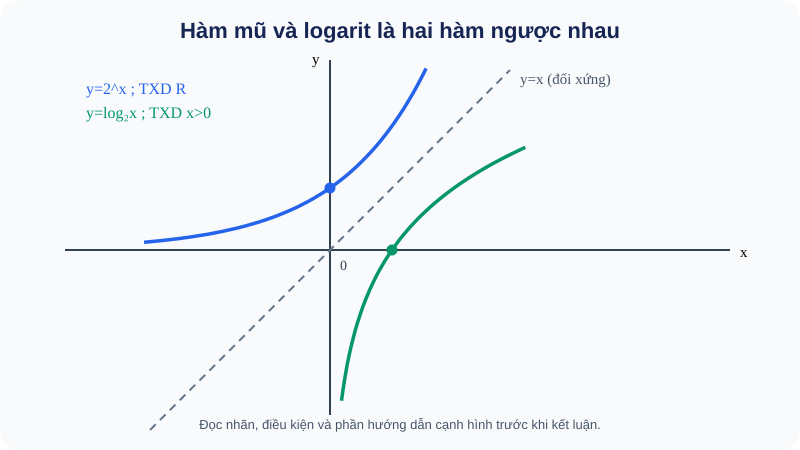

# Bài 20. Hàm số mũ và hàm số lôgarit

TOÁN 11 · CHƯƠNG VI · SGK KNTT TẬP 2

Hiểu bản chất → xem hình và ví dụ có suy luận → Tự thử trước Core → Core/Luyện tập/Vận dụng → tự khắc phục. Không ghi Mastery từ hoạt động tự học.
<nav class="thpt-r4-lesson-tabs"><a href="../">Chương VI</a><a href="../luyen-tap/">Core và Luyện tập</a><a href="../tu-kiem-tra-chuong/">Tự kiểm tra tự đối chiếu</a></nav>

=== "Khám phá kiến thức"

    ### Cùng tìm hiểu

    <figure class="thpt-r4-plot thpt-r4-probability-figure"><figcaption>Hình minh họa — quan sát trước khi tính: B20 — trực quan hình thành khái niệm</figcaption></figure>

    **Cách đọc và phát hiện:** Hình B20 đặt hai hàm trên **cùng hệ trục và cùng tỉ lệ**, để thấy điểm (0,1) của y=2^x tương ứng (1,0) của y=log₂x. Hãy tìm thêm cặp (1,2) ↔ (2,1); đường nét đứt y=x biểu diễn trục đối xứng, không phải một hàm cần giải.

    ### 1.1. Tại sao phải học đồ thị và hàm chứ không chỉ một giá trị?

    Lũy thừa `2³` trả lời cho một mốc; nhưng lượng vi khuẩn sau **mọi** khoảng thời gian t cần một quy tắc `N(t)=N₀·2^t`. Khi t thay đổi, kết quả thay đổi ra sao? Ta xét **hàm số mũ**. Nếu biết số lượng vi khuẩn và muốn suy thời gian, ta cần đi ngược lại bằng lôgarit — **hàm số lôgarit**.

    ### Ví dụ trực quan

    Hàm mũ mô tả sự tăng theo số lần nhân; hàm lôgarit giải bài toán ngược từ kết quả ra số lần tăng. Đồ thị hai hàm cho thấy vì sao chúng là hàm ngược trên miền phù hợp.

    **Quan sát bằng số liệu:** Hàm y=2^x nhận giá trị 1 tại x=0, còn y=log₂x chỉ nhận x>0 và bằng 0 tại x=1. Không tráo miền của hai hàm.

    ### Thuật ngữ và kiến thức, kỹ năng

    **Thuật ngữ:** hàm mũ, hàm lôgarit, đồ thị, đơn điệu, hàm ngược.

    **Sau bài học, em cần:** đọc trục và tiệm cận, phân biệt cơ số lớn hơn 1 hay nằm giữa 0 và 1.

=== "Kiến thức SGK"

    ### 1.2. Hàm số mũ là gì, đồ thị nói điều gì

    Với `a>0, a≠1`, hàm `f(x)=a^x` là hàm số mũ: **biến x nằm ở số mũ**, không giống `x²` với biến ở cơ số. Mọi x thực đều được nhận (**TXĐ `ℝ`**), `f(x)>0` (**tập giá trị `(0,+∞)`**), đồ thị qua `(0,1)` và `(1,a)`.

    Quan sát `2^{-2}=1/4;2^{-1}=1/2;2⁰=1;2¹=2;2²=4`. Đi sang phải một đơn vị thì gấp đôi; hàm tăng **khi a>1**. Với `a=1/2`, mỗi bước sang phải chia đôi → **giảm**. Cả hai đường không cắt trục hoành vì `a^x>0`, và tiến sát trục `y=0` ở phía x→−∞ nếu a>1 (hoặc x→+∞ nếu 0<a<1). Đó là **tiệm cận ngang y=0** — một đường đồ thị tiến sát, không nhất thiết chạm.

    ### 1.3. Hàm logarit là gì, vì sao điều kiện x>0?

    `g(x)=log_a x`, với a>0,a≠1. Vì `a^y=x>0`, **TXĐ g: (0,+∞)**; mọi số thực y có thể là logarit của một x dương, nên **tập giá trị ℝ**. Đồ thị qua `(1,0)` và `(a,1)`. Nếu a>1 nó tăng; nếu 0<a<1 nó giảm. Khi x→0⁺, đồ thị tiến sát đường thẳng `x=0` (**tiệm cận đứng**), nhưng không chạm do x>0.

    ### 1.4. Hai hàm là “làm” và “làm ngược”

    Nếu `y=2^x` thì `x=log₂y`. Trên đồ thị, mỗi điểm `(x,y)` của hàm mũ ứng với `(y,x)` của logarit; hai đồ thị đối xứng qua đường `y=x`. **Vì sao quan trọng?** Khi bài toán cho thời gian, dùng hàm mũ; khi cho mức đã đạt và cần tìm thời gian, dùng logarit.

    ### Vận dụng — tự giải trước khi đối chiếu

    Vì sao `y=3^x` không thể bằng −5? Nếu `log₂8=3`, hãy tìm hai điểm tương ứng trên hai đồ thị. Vì sao `log_{1/2}x` nghịch biến?

    

Đã tự thử? Mở cách tự kiểm tra

Đối chiếu lập luận của em với kiến thức và ví dụ D2 dưới đây. Hoạt động này không ghi Skill Mastery.

=== "Ví dụ"

    ### Ví dụ mẫu có giải thích

    **EX-G11-B20-01 (phân biệt hai loại hàm).** `f(x)=3^x` có TXĐ ℝ, tập giá trị (0,+∞), qua (0,1),(1,3) và tăng. `h(x)=x³` **không** là hàm mũ vì biến ở cơ số; không áp dụng máy móc tập giá trị (0,+∞) cho `x³`.

    **EX-G11-B20-02 (đồ thị ngược).** Nếu `y=2^x` qua (2,4), thì `y=log₂x` qua (4,2). Đó là đổi vai trò đầu vào/đầu ra, không phải phép đảo dấu một tọa độ.

    **EX-G11-B20-03 (giải thích cơ số <1).** `g(x)=(1/3)^x`: từ x=0 đến x=1 giá trị giảm 1→1/3. Vì `0<1/3<1`, g giảm trên ℝ. `log_{1/3}x` cũng giảm trên (0,+∞).

    **EX-G11-B20-04 (mô hình gấp đôi).** `N(t)=50·2^t`, t tính bằng kỳ. `N(0)=50`, `N(3)=400`. **Tại sao** giá trị tăng x8? Qua 3 kỳ mỗi kỳ nhân đôi nên nhân `2³`. Nếu hỏi N=400 xảy ra ở kỳ nào, cần `t=log₂(400/50)=3`.

=== "Lỗi thường gặp"

    

Nói mọi hàm mũ đều tăng.
<ol><li><strong>Chẩn đoán lỗi:</strong> Nói mọi hàm mũ đều tăng.</li><li><strong>Nhắc bản chất &amp; điều kiện:</strong> a^x tăng khi a&gt;1, giảm khi 0&lt;a&lt;1; tại x=0 luôn bằng 1.</li><li><strong>Tìm lại lý do:</strong> Hãy phát biểu bằng lời vì sao quy tắc hợp lệ, đọc lại D1 tương ứng trước khi thay số hoặc biến đổi.</li><li><strong>Tự thử có dẫn dắt:</strong> So sánh (1/2)^1 và (1/2)^2. <strong>Đối chiếu sau khi thử:</strong> 1/2&gt;1/4, nên giảm khi x tăng.</li><li><strong>Quay về bài canonical:</strong> THPT-G11-CHVI-B20-C02; tự giải lại và nêu lý do từng bước, không chỉ ghi đáp số.</li></ol>
<a href="../luyen-tap/?item=THPT-G11-CHVI-B20-C02">Quay lại câu THPT-G11-CHVI-B20-C02</a>

    

Đọc đồ thị hàm ngược như đổi dấu.
<ol><li><strong>Chẩn đoán lỗi:</strong> Đọc đồ thị hàm ngược như đổi dấu.</li><li><strong>Nhắc bản chất &amp; điều kiện:</strong> Hàm ngược hoán đổi đầu vào và đầu ra: (u,v) ↔ (v,u).</li><li><strong>Tìm lại lý do:</strong> Hãy phát biểu bằng lời vì sao quy tắc hợp lệ, đọc lại D1 tương ứng trước khi thay số hoặc biến đổi.</li><li><strong>Tự thử có dẫn dắt:</strong> Nếu 2³=8, điểm nào nằm trên y=log₂x?. <strong>Đối chiếu sau khi thử:</strong> (8,3), không phải (−3,−8).</li><li><strong>Quay về bài canonical:</strong> THPT-G11-CHVI-B20-C04; tự giải lại và nêu lý do từng bước, không chỉ ghi đáp số.</li></ol>
<a href="../luyen-tap/?item=THPT-G11-CHVI-B20-C04">Quay lại câu THPT-G11-CHVI-B20-C04</a>

    ### Học tiếp

    [Core và Luyện tập Bài 20](luyen-tap.md) · [Tự luận Chương VI](../../../thu-vien/tu-luan-g11-chuong-vi.md) · [Tự kiểm tra cuối chương](tu-kiem-tra-chuong.md)
