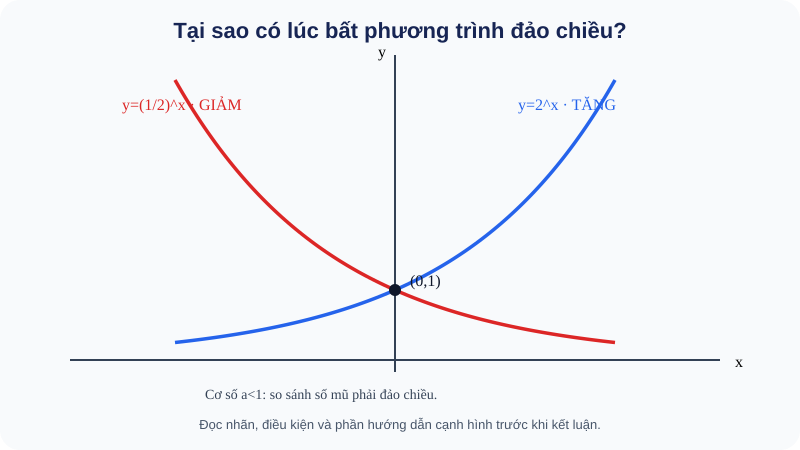

# Bài 21. Phương trình, bất phương trình mũ và lôgarit

TOÁN 11 · CHƯƠNG VI · SGK KNTT TẬP 2

Hiểu bản chất → xem hình và ví dụ có suy luận → Tự thử trước Core → Core/Luyện tập/Vận dụng → tự khắc phục. Không ghi Mastery từ hoạt động tự học.
<nav class="thpt-r4-lesson-tabs"><a href="../">Chương VI</a><a href="../luyen-tap/">Core và Luyện tập</a><a href="../tu-kiem-tra-chuong/">Tự kiểm tra tự đối chiếu</a></nav>

=== "Khám phá kiến thức"

    ### Cùng tìm hiểu

    <figure class="thpt-r4-plot thpt-r4-probability-figure"><figcaption>Hình minh họa — quan sát trước khi tính: B21 — trực quan hình thành khái niệm</figcaption></figure>

    **Cách đọc và phát hiện:** Hình B21 giải thích bản chất “đảo chiều”: cùng tăng x, đường y=2^x đi lên nhưng y=(1/2)^x đi xuống. Hãy dùng điều này để tự nói vì sao (1/2)^u>(1/2)^v thì u<v, trước khi học quy trình giải bất phương trình.

    ### 1.1. Vì sao phải giải loại phương trình này?

    Các phương trình `x²=9` tìm **cơ số** x. Nhưng `2^x=16` lại tìm **số mũ** x; đây là dạng khác, cần hiểu hàm mũ đơn ánh và logarit là phép ngược. Bất phương trình như `2^x>10` hỏi phải tăng qua bao nhiêu kỳ để vượt một ngưỡng. Trước khi viết công thức, ta cần biết hàm **tăng hay giảm**, vì đó là lý do dấu bất đẳng thức được giữ hay đảo.

    ### Ví dụ trực quan

    Bài toán tăng trưởng cho biết một kết quả và yêu cầu thời điểm đạt tới. Phương trình mũ/log giải câu hỏi ấy; bất phương trình thêm yêu cầu so sánh theo chiều biến thiên.

    **Quan sát bằng số liệu:** 2^x=8 có x=3. Với log₂(x−1), điều kiện đầu tiên là x>1; giải phương trình mà quên điều kiện có thể nhận nghiệm ngoại lai.

    ### Thuật ngữ và kiến thức, kỹ năng

    **Thuật ngữ:** phương trình mũ, phương trình logarit, bất phương trình, tính đơn điệu.

    **Sau bài học, em cần:** kiểm cơ số và đối số, chuyển đổi đúng chiều bất đẳng thức và thử lại nghiệm.

=== "Kiến thức SGK"

    ### 1.2. Phương trình mũ cơ bản

    Với `a>0,a≠1`: `a^{u(x)}=a^{v(x)} ⇔ u(x)=v(x)` vì hàm mũ đơn ánh (hai số mũ khác nhau không thể cho cùng một giá trị). `a^{u(x)}=b`: nếu b>0 thì `u(x)=log_a b`; nếu b≤0 thì vô nghiệm thực vì `a^{u(x)}>0`. Đừng “lấy log” của số âm.

    ### 1.3. Phương trình logarit cơ bản và điều kiện

    `log_a f(x)=c` tương đương `f(x)=a^c`, **với** `f(x)>0`. `log_a f(x)=log_a g(x)` ⇔ `f(x)=g(x)` **và** `f(x)>0,g(x)>0`. **Lý do:** logarit chỉ nhận đối số dương; bỏ điều kiện có thể tạo nghiệm ngoại lai.

    ### 1.4. Bất phương trình: quan sát chiều biến thiên trước

    - Nếu `a>1`: `a^{u(x)}>a^{v(x)} ⇔ u(x)>v(x)`; `log_a f(x)>log_a g(x) ⇔ f(x)>g(x)>0`.
    - Nếu `0<a<1`: `a^{u(x)}>a^{v(x)} ⇔ u(x)<v(x)`; `log_a f(x)>log_a g(x) ⇔ 0<f(x)<g(x)`.
    - Với dấu `≥,≤`, áp dụng tương tự nhưng luôn đảm bảo điều kiện logarit. **Không đổi chiều vì “có log”**; đổi chiều vì **hàm theo cơ số 0<a<1 nghịch biến**.

    ### 1.5. Quy trình và giới hạn phương pháp

    Bước 1: xác định cơ số, miền đầu vào và điều kiện xác định của mọi logarit. Bước 2: nhận biết hàm tăng/giảm. Bước 3: biến đổi tương đương sang phương trình/bất phương trình quen thuộc. Bước 4: đối chiếu nghiệm với điều kiện và bài toán thực tế. **Chỉ dùng các dạng cơ bản theo SGK**; bài nâng cao đa thức lôgarit/mẹo đặt ẩn phụ tùy S1 phạm vi, không tự đẩy Core.

    ### Vận dụng — tự giải trước khi đối chiếu

    Giải thích vì sao `(1/2)^x> (1/2)^3` cho `x<3`, không phải x>3. Nếu `log₂(x−1)=3`, vì sao trước tiên cần x>1?

    

Đã tự thử? Mở cách tự kiểm tra

Đối chiếu lập luận của em với kiến thức và ví dụ D2 dưới đây. Hoạt động này không ghi Skill Mastery.

=== "Ví dụ"

    ### Ví dụ mẫu có giải thích

    **EX-G11-B21-01 (mũ, dùng đơn ánh).** `3^{2x−1}=27=3³` ⇒ `2x−1=3` ⇒ x=2. Lý do: hàm `3^t` tăng và mỗi đầu ra dương chỉ có một số mũ.

    **EX-G11-B21-02 (log, điều kiện bắt buộc).** `log₂(x−1)=3`. Trước hết `x−1>0` tức x>1. Đổi sang `x−1=2³=8`, x=9 thỏa. Không ghi nghiệm chưa kiểm điều kiện.

    **EX-G11-B21-03 (cơ số 1/2 làm đổi chiều).** `(1/2)^{x+1}≥(1/2)^3`. Hàm giảm vì cơ số 0,5<1, nên `x+1≤3`, tức x≤2. **Sai thường gặp:** x≥2.

    **EX-G11-B21-04 (log giảm và miền).** `log_{1/3}(x−1)<log_{1/3}4`. Điều kiện x>1. Vì log cơ số 1/3 giảm, bất phương trình tương đương `x−1>4` ⇒ x>5; kiểm tự động thỏa x>1.

    **EX-G11-B21-05 (mô hình ngưỡng).** `P(n)=100(1,1)^n` triệu, n nguyên không âm, khi nào **vượt** 133,1 triệu? `(1,1)^n>1,331=(1,1)^3` ⇒ n>3 ⇒ kỳ đầu vượt là **n=4**. **Bẫy:** tại n=3 chỉ **bằng** 133,1; điều kiện “vượt” là dấu >, và n phải nguyên trong cập nhật cuối kỳ.

=== "Lỗi thường gặp"

    

Giải đại số xong mới quên điều kiện log.
<ol><li><strong>Chẩn đoán lỗi:</strong> Giải đại số xong mới quên điều kiện log.</li><li><strong>Nhắc bản chất &amp; điều kiện:</strong> Phải bảo đảm từng đối số logarit dương trước biến đổi, kể cả khi log hai vế bằng nhau.</li><li><strong>Tìm lại lý do:</strong> Hãy phát biểu bằng lời vì sao quy tắc hợp lệ, đọc lại D1 tương ứng trước khi thay số hoặc biến đổi.</li><li><strong>Tự thử có dẫn dắt:</strong> Xét điều kiện log₂(x−5)=log₂(1−x). <strong>Đối chiếu sau khi thử:</strong> Không có x đồng thời &gt;5 và &lt;1, nên vô nghiệm.</li><li><strong>Quay về bài canonical:</strong> THPT-G11-CHVI-B21-P05; tự giải lại và nêu lý do từng bước, không chỉ ghi đáp số.</li></ol>
<a href="../luyen-tap/?item=THPT-G11-CHVI-B21-P05">Quay lại câu THPT-G11-CHVI-B21-P05</a>

    

Quên đảo dấu khi cơ số trong (0,1).
<ol><li><strong>Chẩn đoán lỗi:</strong> Quên đảo dấu khi cơ số trong (0,1).</li><li><strong>Nhắc bản chất &amp; điều kiện:</strong> log_a x nghịch biến khi 0&lt;a&lt;1; vẫn giữ miền x&gt;0.</li><li><strong>Tìm lại lý do:</strong> Hãy phát biểu bằng lời vì sao quy tắc hợp lệ, đọc lại D1 tương ứng trước khi thay số hoặc biến đổi.</li><li><strong>Tự thử có dẫn dắt:</strong> Giải log_(1/2)x ≥ log_(1/2)8. <strong>Đối chiếu sau khi thử:</strong> 0&lt;x≤8.</li><li><strong>Quay về bài canonical:</strong> THPT-G11-CHVI-B21-P04; tự giải lại và nêu lý do từng bước, không chỉ ghi đáp số.</li></ol>
<a href="../luyen-tap/?item=THPT-G11-CHVI-B21-P04">Quay lại câu THPT-G11-CHVI-B21-P04</a>

    ### Học tiếp

    [Core và Luyện tập Bài 21](luyen-tap.md) · [Tự luận Chương VI](../../../thu-vien/tu-luan-g11-chuong-vi.md) · [Tự kiểm tra cuối chương](tu-kiem-tra-chuong.md)
