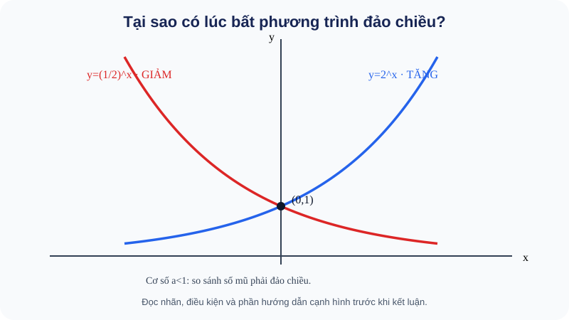
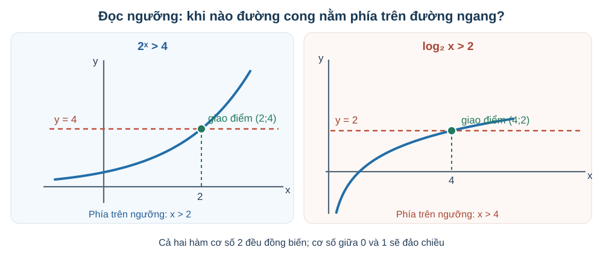

# Bài 21. Phương trình, bất phương trình mũ và lôgarit

TOÁN 11 · CHƯƠNG VI · KẾT NỐI TRI THỨC · TẬP HAI

Bốn dạng: phương trình mũ, phương trình lôgarit, bất phương trình mũ, bất phương trình lôgarit. Hiểu cơ số, dấu, miền xác định trước khi giải.

<nav class="thpt-r4-lesson-tabs"><a href="../">Chương VI</a><a href="../luyen-tap/">Core và Luyện tập</a><a href="../tu-kiem-tra-chuong/">Tự kiểm tra cuối chương</a></nav>

=== "Khám phá kiến thức"

    Em đã biết \(2^3=8\), \(\log_2 8=3\), và hai hàm mũ–lôgarit có thể tăng hoặc giảm theo cơ số. Khi câu hỏi đổi thành “\(2^x\) bằng bao nhiêu?” hoặc “\(2^x\) lớn hơn mức nào?”, ta phải tìm **nghiệm** của phương trình hay **tập nghiệm** của bất phương trình. Điểm cốt lõi: hàm mũ chỉ cho giá trị dương; lôgarit chỉ nhận đối số dương; bất đẳng thức đảo chiều chỉ vì **cơ số làm hàm nghịch biến**.

    ### 1.1. Phương trình mũ

    Xét \(2^{x+1}=\frac14\). Ta có \(\frac14=2^{-2}\), nên hai vế cùng cơ số 2 và \(x+1=-2\), vậy \(x=-3\). **Vì sao được so số mũ?** Với cơ số \(a>0,a\ne1\), hàm \(a^t\) đơn điệu nghiêm ngặt nên hai số mũ khác nhau không thể cho một kết quả giống nhau. Quy tắc này hoạt động cả khi \(0<a<1\), vì hàm tuy giảm nhưng vẫn nhận mỗi giá trị dương đúng một lần.

    Phương trình \(a^x=b\) chỉ có nghiệm thực nếu **\(b>0\)**, vì \(a^x\) luôn dương. Khi \(b>0\), nghiệm duy nhất \(x=\log_a b\). Chẳng hạn \(10^{x-1}=2022\) không cần tìm cách viết 2022 thành lũy thừa nguyên của 10: lấy log được \(x=1+\log2022\), là biểu thức chính xác; số thập phân bấm máy chỉ gần đúng.

    **Vận dụng.** Giải \(3^{2x-1}=27\); giải thích vì sao \(2^x=-5\) không có nghiệm thực.

    ??? question "Đối chiếu"

        **Lời giải:** \(27=3^3\), nên \(2x-1=3\), suy \(x=2\). Còn \(2^x>0\) với mọi số thực \(x\), không thể bằng \(-5\). Không được viết \(\log_2(-5)\) trong số thực.

    ??? tip "Kiểm lỗi"

        Trước khi lấy log của vế phải, phải kiểm nó dương. Nếu hai vế cùng cơ số, hãy so **số mũ** chứ không chia cơ số như các số hạng bình thường.

    ### 1.2. Phương trình lôgarit

    Giải \(2\log_2 x=-3\): trước hết \(x>0\); chia hai vế cho 2 thì \(\log_2x=-\frac32\), nên \(x=2^{-3/2}>0\). Chính điều kiện đối số **dương** cho phép phép biến đổi sang mũ thực. Nếu bài có nhiều lôgarit, luôn kiểm tất cả các đối số của biểu thức ban đầu, không chỉ biểu thức sau khi rút gọn.

    Ví dụ \(\log_3(x+1)=\log_3(x^2-1)\). Điều kiện \(x+1>0,\ x^2-1>0\) cho **\(x>1\)**. So sánh hai đối số được \(x+1=x^2-1\); nghiệm đại số \(-1\) và \(2\), nhưng chỉ \(2\) thỏa điều kiện. Nghiệm \(-1\) là **ngoại lai**, dù thỏa phương trình sau khi bỏ log.

    Bản chất của \(\log_a f(x)=b\) là “cơ số \(a\) phải nâng lên mũ \(b\) để tạo \(f(x)\)”, nên \(f(x)=a^b\). Giá trị \(a^b>0\) làm điều kiện đối số tự được thỏa nếu phép tương đương giữ nguyên các biểu thức; việc ghi điều kiện vẫn đặc biệt cần khi có phép rút gọn hoặc hai log ở hai vế.

    **Vận dụng.** Giải \(4+\log_2(x-1)=6\). Có thể bỏ qua điều kiện \(x>1\) không?

    ??? question "Đối chiếu"

        **Lời giải:** Điều kiện \(x-1>0\), tức \(x>1\). Chuyển vế \(\log_2(x-1)=2\), nên \(x-1=4\), \(x=5>1\). Thử \(4+\log_2 4=6\).

    ??? tip "Kiểm lỗi"

        Không tự mở rộng miền xác định sau biến đổi. Với hai log, bắt buộc **cả hai đối số dương** trước khi dùng tính đơn ánh.

    ### 1.3. Bất phương trình mũ

    So sánh \(2^u\) và \(2^v\) khác so sánh \((1/2)^u\) và \((1/2)^v\). Vì \(2^x\) **tăng**, \(2^u>2^v\) khi và chỉ khi \(u>v\). Vì \((1/2)^x\) **giảm**, \((1/2)^u>(1/2)^v\) khi và chỉ khi \(u<v\). Điều đó giải thích **chiều của dấu**, thay vì học thuộc quy tắc đảo dấu một cách máy móc.

    <figure class="thpt-r4-plot"><figcaption><strong>Hướng dẫn đọc:</strong> đường xanh \(2^x\) đi lên từ trái sang phải; đường đỏ \((1/2)^x\) đi xuống; cả hai qua \((0,1)\). Nếu muốn giá trị lũy thừa lớn hơn, với đường xanh phải đi **sang phải**, với đường đỏ phải đi **sang trái**.</figcaption></figure>

    Bất phương trình \(a^x>b\) có cơ số \(a>0,a\ne1\). Nếu **\(b\le0\)** thì mọi \(x\) đều thỏa vì \(a^x>0\). Khi \(b>0\), ta so \(a^x\) và \(a^{\log_a b}\): với \(a>1\), \(x>\log_ab\); với \(0<a<1\), \(x<\log_ab\). Các dấu \(\ge,<,\le\) xử lí tương tự theo dấu của \(b\).

    SGK minh họa \(2^x>4\) bằng đường ngang \(y=4\): đồ thị \(2^x\) cắt đường ngang tại \((2,4)\), và nằm phía trên nó khi **\(x>2\)**. Hình dưới thêm cách nhìn tương tự cho lôgarit ở mục kế tiếp.

    <figure class="thpt-r4-plot"><figcaption><strong>Hướng dẫn đọc khung trái:</strong> đường cong \(y=2^x\) giao với ngưỡng \(y=4\) tại \(x=2\). Nghiệm \(2^x>4\) là **\(x>2\)**, chỉ gồm phần đường cong ở phía trên đường ngưỡng; khung phải dùng cho bài lôgarit.</figcaption></figure>

    **Ứng dụng ô tô:** Với mô hình trong SGK \(V(t)=780(0{,}905)^t\) triệu đồng, hỏi khi nào giá trị không quá 300 triệu. Ta giải \((0{,}905)^t\le5/13\); vì cơ số **nhỏ hơn 1**, suy \(t\ge\log_{0{,}905}(5/13)\approx9{,}6\). Nếu chỉ ghi **năm trọn vẹn**, mốc đầu tiên là **10 năm**, không phải 9 năm.

    **Vận dụng.** Giải \((1/2)^{2x-1}\ge(1/2)^3\) và \(3^x>-2\).

    ??? question "Đối chiếu"

        **Lời giải:** Cơ số \(1/2\) nhỏ hơn 1, nên \(2x-1\le3\Rightarrow x\le2\). Còn \(3^x>0>-2\) với mọi \(x\), nên bất phương trình thứ hai có tập nghiệm \(\mathbb R\).

    ??? tip "Kiểm lỗi"

        Đừng lấy \(\log_3(-2)\), vì số âm không phải đối số log hợp lệ. Với hai vế cùng cơ số, chọn đúng chiều tăng/giảm trước khi so mũ.

    ### 1.4. Bất phương trình lôgarit

    Với \(\log_a x>b\), điều kiện đầu tiên là **\(x>0\)**. Nếu \(a>1\), lôgarit tăng và \(\log_a x>b\) tương đương \(x>a^b\); nếu \(0<a<1\), lôgarit giảm và nghiệm là **\(0<x<a^b\)**. Không thể bỏ \(x>0\) dù kết quả đại số đã được biến đổi.

    Đọc **khung phải** của hình ngưỡng dưới đây. Đường \(y=\log_2x\) cắt đường ngang \(y=2\) tại \((4,2)\). Bên phải \(x=4\), đường cong cao hơn ngưỡng; nên \(\log_2x>2\) có nghiệm **\(x>4\)**. Đừng nhầm với bất phương trình mũ \(2^x>4\), có nghiệm \(x>2\).

    <figure class="thpt-r4-plot"><figcaption><strong>Hướng dẫn đọc khung phải:</strong> giao điểm \((4,2)\) xác định ngưỡng \(x=4\); phần đường cong \(y=\log_2x\) nằm cao hơn \(y=2\) khi \(x>4\). Hình không có điểm đồ thị log ở \(x\le0\).</figcaption></figure>

    Với cơ số nhỏ hơn 1, thử bất phương trình \(\log_{0{,}3}(x+1)\le\log_{0{,}3}(2x-1)\). Điều kiện \(x+1>0,\ 2x-1>0\) cho \(x>\frac12\). Vì hàm log cơ số \(0{,}3\) **giảm**, bất phương trình đổi thành \(x+1\ge2x-1\), hay \(x\le2\). Kết hợp được \(\frac12<x\le2\). Đây là minh họa điển hình cần **cả đảo chiều lẫn giữ miền gốc**.

    **Ứng dụng áp suất:** Trong SGK, \(\ln(p/100)=-h/7\), với \(p>0\) (kPa), \(h\) (km). Tương đương \(p=100e^{-h/7}\); độ cao tăng thì áp suất giảm. Với một câu hỏi ngưỡng, cần giải phương trình/bất phương trình bằng \(\ln\) hoặc hàm mũ, vẫn kiểm \(p>0\).

    **Vận dụng.** Giải \(\log_{1/3}(x-1)<\log_{1/3}4\). Vì sao không được quên \(x>1\)?

    ??? question "Đối chiếu"

        **Lời giải:** Điều kiện \(x-1>0\), tức \(x>1\). Cơ số \(1/3\) nằm giữa 0 và 1, nên log giảm: \(x-1>4\), suy \(x>5\). Tập nghiệm \(x>5\) thỏa điều kiện.

    ??? tip "Kiểm lỗi"

        Nếu được \(x<5\), em đã không đảo chiều. Đừng chỉ lấy giao điểm đồ thị mà bỏ miền xác định của log.

=== "Kiến thức SGK"

    ### 2.1. Phương trình mũ

    
<strong>Khái niệm — Phương trình mũ cơ bản</strong>
Phương trình mũ cơ bản có dạng \(a^x=b\) với \(a>0,\ a\ne1\), trong đó ẩn nằm ở số mũ. Với cơ số hợp lệ, \(a^x\) luôn dương và hàm mũ đơn điệu nghiêm ngặt.

    
<strong>Quy tắc — Nghiệm của phương trình mũ</strong>
Với \(a>0,\ a\ne1\): nếu \(b>0\) thì \(a^x=b\) có <strong>nghiệm duy nhất</strong> \(x=\log_ab\). Nếu \(b\le0\), phương trình <strong>vô nghiệm thực</strong>. Khi biểu thức được xác định, \(a^{u(x)}=a^{v(x)}\Leftrightarrow u(x)=v(x)\).

    **Chọn phương pháp:** Nhận thấy cùng cơ số thì so mũ; nếu vế phải dương nhưng khó viết bằng lũy thừa cùng cơ số, dùng lôgarit để tìm số mũ. Ví dụ \(10^{x-1}=2022\) cho \(x=1+\log2022\).

    ### 2.2. Phương trình lôgarit

    
<strong>Khái niệm — Phương trình lôgarit cơ bản</strong>
Phương trình \(\log_ax=b\) với \(a>0,\ a\ne1,\ x>0\), \(b\in\mathbb R\), là phương trình lôgarit cơ bản. Đối số \(x\) phải dương để lôgarit có nghĩa thực.

    
<strong>Quy tắc — Nghiệm của phương trình lôgarit</strong>
Với cơ số hợp lệ, \(\log_ax=b\) có nghiệm duy nhất \(x=a^b>0\). Với \(\log_af(x)=\log_ag(x)\), chỉ khi <strong>\(f(x)>0,\ g(x)>0\)</strong> mới được chuyển thành \(f(x)=g(x)\). Phải lọc nghiệm với điều kiện ban đầu.

    **Ví dụ điều kiện:** \(\log_3(x+1)=\log_3(x^2-1)\) đòi \(x>1\). Phương trình đại số cho \(-1,2\); nghiệm log chỉ là **\(x=2\)**.

    ### 2.3. Bất phương trình mũ

    
<strong>Khái niệm — Bất phương trình mũ cơ bản</strong>
Bất phương trình \(a^x>b\) hoặc với các dấu \(\ge,<,\le\), trong đó \(a>0,\ a\ne1\), gọi là bất phương trình mũ cơ bản. Hàm \(a^x>0\) với mọi \(x\in\mathbb R\).

    
<strong>Quy tắc — Giải dạng \(a^x>b\)</strong>
Nếu \(b\le0\), tập nghiệm là toàn \(\mathbb R\). Nếu \(b>0\), với \(a>1\) tập nghiệm \(x>\log_ab\); với \(0<a<1\) tập nghiệm <strong>\(x<\log_ab\)</strong>. Với dấu khác phải xét dấu của \(b\) và tính đơn điệu tương tự.

    
<strong>Tính chất — So sánh hai lũy thừa cùng cơ số</strong>
Nếu \(a>1\), \(a^u>a^v\Leftrightarrow u>v\). Nếu \(0<a<1\), \(a^u>a^v\Leftrightarrow u<v\). Dấu thay đổi theo tính đồng biến hoặc nghịch biến, không phải vì biểu thức có chữ mũ.

    <figure class="thpt-r4-plot"><figcaption><strong>Tra hình biến thiên:</strong> \(2^x\) tăng, \((1/2)^x\) giảm; cả hai đi qua \((0,1)\). Đây là chứng cứ trực quan của việc giữ/đảo chiều khi so số mũ.</figcaption></figure>

    <figure class="thpt-r4-plot"><figcaption><strong>Tra hình ngưỡng mũ:</strong> dùng khung trái: \(2^x=4\) tại \(x=2\), \(2^x>4\) khi \(x>2\). Phần khung phải dành để đọc bất phương trình log.</figcaption></figure>

    ### 2.4. Bất phương trình lôgarit

    
<strong>Khái niệm — Bất phương trình lôgarit cơ bản</strong>
Với \(a>0,\ a\ne1\), dạng cơ bản \(\log_ax>b\) hoặc \(\ge,<,\le\) có điều kiện <strong>\(x>0\)</strong>. Với đối số \(f(x)\), phải giải <strong>\(f(x)>0\)</strong> trước khi biến đổi.

    
<strong>Quy tắc — Giải dạng \(\log_ax>b\)</strong>
Với \(a>1\), nghiệm \(x>a^b\). Với \(0<a<1\), nghiệm <strong>\(0<x<a^b\)</strong>. Không bỏ điều kiện \(x>0\) khi đổi chiều theo hàm nghịch biến.

    
<strong>Tính chất — So sánh hai lôgarit cùng cơ số</strong>
Với \(a>1\), \(\log_au>\log_av\Leftrightarrow u>v>0\); với \(0<a<1\), \(\log_au>\log_av\Leftrightarrow0<u<v\). Các đối số phải <strong>đều dương</strong> trước khi so sánh.

    <figure class="thpt-r4-plot"><figcaption><strong>Tra hình ngưỡng log:</strong> khung phải, \(\log_2x\) cắt \(y=2\) tại \((4,2)\); phần trên đường ngưỡng tương ứng \(x>4\), vẫn thuộc miền \(x>0\).</figcaption></figure>

    | Dạng | \(a>1\) | \(0<a<1\) |
    | :-- | :-- | :-- |
    | \(a^x>b,\ b>0\) | \(x>\log_ab\) | \(x<\log_ab\) |
    | \(\log_ax>b\) | \(x>a^b\) | \(0<x<a^b\) |

    **Hạn chế và khắc phục:** Với mũ, \(b\le0\) cần xử lí riêng vì \(a^x>0\). Với log, đối số phải dương trước khi dùng bảng. Khi mô hình có thời gian/năm nguyên, chỉ nhận giá trị thuộc tập thời gian cho phép, không làm tròn thông thường nếu bài hỏi mốc đầu tiên thỏa ngưỡng.
