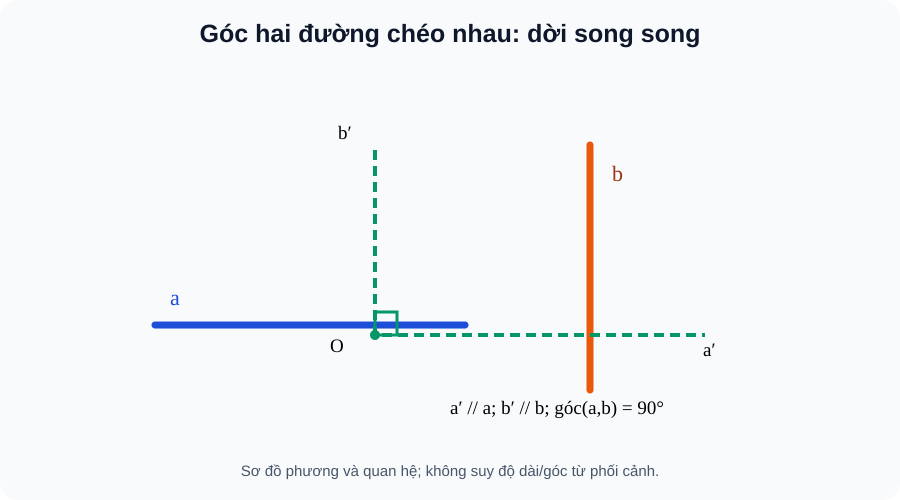

# Bài 22. Hai đường thẳng vuông góc

TOÁN 11 · CHƯƠNG VII · SGK KNTT TẬP 2

Hiểu lý do cần học → khái niệm và lý do → hình minh họa có hướng dẫn đọc → Tự thử trước Core → ví dụ suy luận → tự thực hành và khắc phục. Không ghi Skill Mastery.
<nav class="thpt-r4-lesson-tabs"><a href="../">Chương VII</a><a href="../luyen-tap/">Core/Luyện tập</a><a href="../tu-kiem-tra-chuong/">Tự kiểm tra tự đối chiếu</a></nav>

=== "Khám phá kiến thức"

    ### Cùng tìm hiểu

    ### 1.1. Vì sao cần học
    Trong căn nhà có nhiều thanh không giao nhau. Muốn biết phương của hai thanh có vuông góc không, không thể đo một góc ngay tại giao điểm không tồn tại. Ta cần cách chuyển phương song song về chung một điểm.

    ### Ví dụ trực quan

    Hai đường thẳng trong không gian có thể vuông góc theo hướng ngay cả khi hình vẽ làm chúng trông không gặp nhau. Muốn tính góc, phải đưa chúng về hai hướng cùng điểm.

    **Quan sát bằng số liệu:** Hai cạnh theo hai hướng vuông góc của hình hộp chữ nhật tạo góc 90°. Chuyển song song một đường để hai đường gặp nhau không đổi góc giữa các phương.

    ### Thuật ngữ và kiến thức, kỹ năng

    **Thuật ngữ:** góc giữa hai đường thẳng, vuông góc, đường chéo không gian.

    **Sau bài học, em cần:** chọn đúng đường cùng phương và kiểm góc nhọn quy ước giữa hai đường.

=== "Kiến thức SGK"

    ### 1.2. Khái niệm thực chất
    Qua O bất kì dựng a′//a và b′//b; góc giữa a,b là góc nhỏ giữa hai đường a′,b′, thuộc [0°,90°]. Nếu bằng 90°, gọi a⊥b; hai đường có thể chéo nhau.

    ### 1.3. Hình thành và lập luận
    Phép tịnh tiến giữ phương; góc không đổi khi chọn O khác. Hai đường giao nhau là trường hợp đặc biệt. Nếu a//a₁ thì (a,b)=(a₁,b), nên có thể thay bằng cạnh song song trong hình hộp.

    ### 1.4. Điều kiện, giới hạn, lỗi thường gặp
    Không lấy góc tù 120° làm góc giữa **đường thẳng**: lấy 60°. Hai đường song song có góc 0°, chéo nhau có thể vuông góc. Hai đường cùng vuông góc với đường thứ ba không nhất thiết song song trong không gian.

    ### 1.5. Làm rõ các định lí, điều kiện và cấu trúc SGK
    **Cách dựng thực sự:** Nếu a và b chéo nhau, lấy O bất kì, vẽ đường a₀ đi qua O song song với a và b₀ đi qua O song song với b. Trong bốn góc do hai đường a₀,b₀ tạo nên, hai góc nhọn bằng nhau và hai góc tù bù với chúng. Góc giữa a,b được chọn là góc nhọn hoặc vuông, không phụ thuộc O. **Trường hợp hai đường trùng phương hoặc song song:** góc 0°. **Trường hợp hai đường cắt nhau:** dùng trực tiếp góc nhỏ tại giao điểm.

    **Một chứng minh mẫu về phương:** Trong hình hộp chữ nhật, các cạnh đứng AA′,BB′,CC′,DD′ cùng vuông góc mặt đáy và song song nhau. Nếu AB nằm trong đáy, AB⊥AA′, từ CC′//AA′ suy AB⊥CC′ dù chúng không cắt. Phép suy luận này là tính chất *góc giữa hai đường thẳng* chứ không phải một tuyên bố sai rằng chúng giao nhau.

    **Điểm tự chẩn đoán:** Nếu không dựng được đường song song qua O hoặc đang lấy góc >90°, hãy quay lại định nghĩa trước khi giải. **Sai lầm ngược:** a⊥c, b⊥c **không suy a//b** trong không gian; có vô số hướng nằm trong mặt phẳng vuông góc một phương c.

    ### 1.6. Hình minh họa và cách đọc

    <figure class="thpt-r4-plot thpt-r4-probability-figure"><figcaption>Hình B22: Hai đường chéo nhau vẫn có thể vuông góc theo phương; tịnh tiến một đường tới chung điểm O.</figcaption></figure>

    **Hướng dẫn đọc hình:** Hai đường chéo nhau vẫn có thể vuông góc theo phương; tịnh tiến một đường tới chung điểm O. Hình là sơ đồ giải thích phương pháp, **không được suy góc hay độ dài từ nét vẽ phối cảnh**. Điều kiện vuông góc phải có chứng minh.

    ### Vận dụng — tự giải trước khi đối chiếu
    Hình hộp chữ nhật có cạnh AB theo phương ngang và CC′ theo phương thẳng đứng. Chúng không cắt nhau; vì CC′//AA′ và AB⊥AA′, suy ra (AB,CC′)=90°. Vì sao không cần AB gặp CC′?

    

Đã tự thử? Mở hướng dẫn tự đối chiếu

Đối chiếu lập luận của em với phần ví dụ được giải thích dưới đây. Đây là hoạt động luyện tập, không ghi Skill Mastery.

=== "Ví dụ"

    ### Các bài giải có hướng dẫn

    #### EX-G11-CHVII-B22-01 — Góc hai đường trong hình hộp

    **Nhiệm vụ:** Hộp chữ nhật ABCD.A′B′C′D′: AB⊥CC′ mặc dù không cắt nhau.

    **Lập luận để tự đối chiếu sau khi thử:** CC′//AA′, AB⊥AA′ (cạnh đứng vuông góc đáy) nên góc giữa AB và CC′ là 90°. Đưa về chung điểm theo song song, không đo theo nét vẽ.

    #### EX-G11-CHVII-B22-02 — Góc nhọn giữa hai phương

    **Nhiệm vụ:** Hai đường trong hai mặt phẳng khác nhau có phương tạo góc 120° theo hai tia đã chọn. Góc giữa hai đường là bao nhiêu?

    **Lập luận để tự đối chiếu sau khi thử:** 60° vì góc giữa đường lấy góc không tù, min(120°,180°−120°)=60°.

    #### EX-G11-CHVII-B22-03 — Đường chéo hình vuông và cạnh đáy

    **Nhiệm vụ:** Hình hộp có đáy ABCD là hình vuông; tính góc giữa AC và AB.

    **Lập luận để tự đối chiếu sau khi thử:** 45° do tam giác ABC vuông cân tại B/đường chéo hình vuông phân giác góc tại A.

    #### EX-G11-CHVII-B22-04 — Không suy vuông góc dây thứ ba

    **Nhiệm vụ:** Hai đường a,b cùng vuông góc c trong không gian. Có suy a//b?

    **Lập luận để tự đối chiếu sau khi thử:** Không. Chẳng hạn hai trục Ox,Oy cùng vuông góc Oz nhưng Ox⊥Oy. Cần thêm điều kiện cùng nằm trong mặt phẳng vuông góc c hoặc định hướng phù hợp.

=== "Lỗi thường gặp"

    

<strong>Nhận diện lỗ hổng:</strong> Tưởng hai đường vuông góc phải cắt nhau.
<ol><li><strong>Nhận diện lỗ hổng:</strong> Tưởng hai đường vuông góc phải cắt nhau.</li><li><strong>Nhắc đúng bản chất:</strong> Hãy dựng hai đường qua một điểm song song hai phương ban đầu.</li><li><strong>Nhìn lại kiến thức và hình:</strong> Đọc lại phần vì sao cần học, khái niệm và cách lập luận của B22, tự phát biểu điều kiện bằng lời và kiểm tra đúng hình SVG của bài, không suy luận từ phối cảnh.</li><li><strong>Tự luyện có hướng dẫn:</strong> Hộp chữ nhật: một đường nằm ngang và cạnh bên đứng ở đỉnh khác có góc bao nhiêu? <strong>Sau khi tự làm mới đối chiếu:</strong> 90°, dù chúng không cắt nhau.</li><li><strong>Quay về câu gốc:</strong> <code>THPT-G11-CHVII-B22-C02</code>; giải lại và giải thích mỗi bước. HELP chỉ hiện sau nộp câu *luyện tập*, tuyệt đối không hiện trong RD1 trước Final Submit.</li></ol>
<a href="../luyen-tap/?item=THPT-G11-CHVII-B22-C02">Quay lại câu canonical THPT-G11-CHVII-B22-C02</a>

    

<strong>Nhận diện lỗ hổng:</strong> Lấy góc tù giữa hai tia thay cho góc giữa hai đường.
<ol><li><strong>Nhận diện lỗ hổng:</strong> Lấy góc tù giữa hai tia thay cho góc giữa hai đường.</li><li><strong>Nhắc đúng bản chất:</strong> Góc hai đường trong [0°,90°], góc bù có thể là cách đọc khác của tia.</li><li><strong>Nhìn lại kiến thức và hình:</strong> Đọc lại phần vì sao cần học, khái niệm và cách lập luận của B22, tự phát biểu điều kiện bằng lời và kiểm tra đúng hình SVG của bài, không suy luận từ phối cảnh.</li><li><strong>Tự luyện có hướng dẫn:</strong> Góc tia 154° thì góc đường là? <strong>Sau khi tự làm mới đối chiếu:</strong> 26°.</li><li><strong>Quay về câu gốc:</strong> <code>THPT-G11-CHVII-B22-C01</code>; giải lại và giải thích mỗi bước. HELP chỉ hiện sau nộp câu *luyện tập*, tuyệt đối không hiện trong RD1 trước Final Submit.</li></ol>
<a href="../luyen-tap/?item=THPT-G11-CHVII-B22-C01">Quay lại câu canonical THPT-G11-CHVII-B22-C01</a>

    ### Học tiếp

    [Core và Luyện tập Bài 22](luyen-tap.md) · [Tự luận Chương VII](../../../thu-vien/tu-luan-g11-chuong-vii.md) · [Tự kiểm tra cuối chương](tu-kiem-tra-chuong.md)
