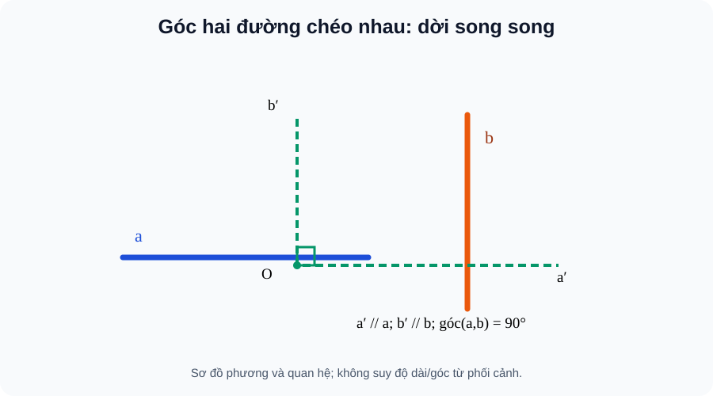
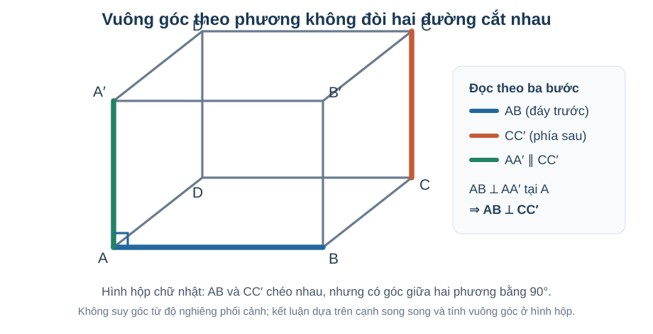
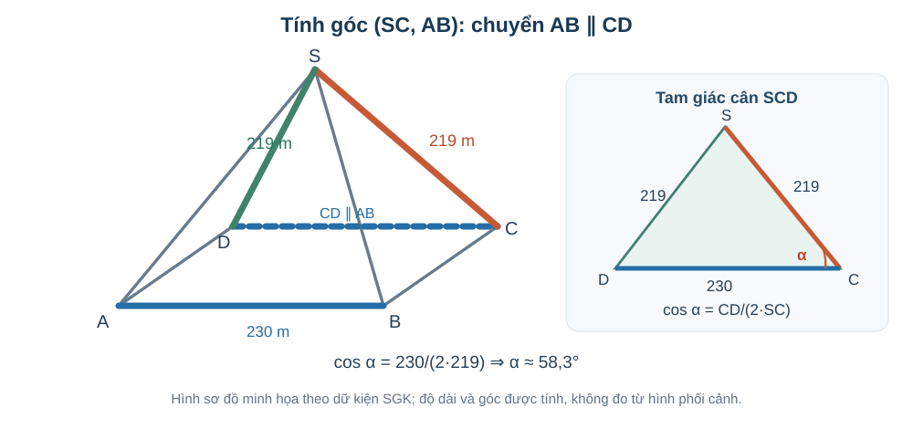

# Bài 22. Hai đường thẳng vuông góc

TOÁN 11 · CHƯƠNG VII · SGK KẾT NỐI TRI THỨC · TẬP HAI

Từ nút giao khác mức đến hình hộp: chuyển các phương chéo nhau về cùng một điểm để đo góc, rồi chứng minh vuông góc bằng quan hệ song song thay vì nhìn phối cảnh.

<nav class="thpt-r4-lesson-tabs"><a href="../">Chương VII</a><a href="../luyen-tap/">Core/Luyện tập</a><a href="../tu-kiem-tra-chuong/">Tự kiểm tra cuối chương</a></nav>

=== "Khám phá kiến thức"

    **Vì sao học?** Hai nhánh đường ở hai tầng cầu vượt có thể không cắt nhau. Ta không thể đặt thước đo góc tại giao điểm không tồn tại, nhưng vẫn so sánh được **hướng** của chúng. Ở Chương IV, em đã biết các đường thẳng song song có cùng phương. Bài này dùng điều đó để đo góc giữa hai đường, kể cả khi chúng chéo nhau trong không gian.

    ### 1.1. Góc giữa hai đường thẳng

    **Hình thành bản chất theo HĐ1 SGK:** Hai đường \(m,n\) chéo nhau. Lấy điểm \(O\), dựng \(a\parallel m\), \(b\parallel n\) qua \(O\), rồi đo góc không tù giữa \(a,b\). Nếu thay \(O\) bằng \(O'\), vẫn dựng các đường theo **hai phương cũ**, kết quả góc không đổi. SGK minh họa việc đó qua các hình bình hành và định lí côsin: dời một phương song song không làm thay đổi góc. Vì vậy, **góc giữa hai đường thẳng** là góc của **hai phương**, không phụ thuộc vị trí đường trong không gian.

    <figure class="thpt-r4-plot"><figcaption><strong>Hướng dẫn đọc hình:</strong> \(a,b\) là các phương ban đầu; \(a',b'\) nét đứt được dựng qua \(O\), song song tương ứng. Dấu góc vuông được đọc tại \(O\). Đây chỉ là sơ đồ **các phương**, không phải chứng minh rằng \(a,b\) trong hình thực tế chắc chắn chéo nhau; không đo độ dài/góc từ nét vẽ.</figcaption></figure>

    **Góc nào được chọn?** Hai đường không có hướng ưu tiên. Nếu hai **tia** tạo góc \(120^\circ\), góc giữa hai **đường thẳng chứa các tia** được lấy là \(60^\circ\), vì hai góc kề bù là \(120^\circ\) và \(60^\circ\). Nói chung \(0^\circ\le(m,n)\le90^\circ\). Với hai đường song song hoặc trùng nhau, góc bằng \(0^\circ\).

    **Cách chọn phương pháp:** Khi hai đường không gặp nhau, chọn một đường \(b'\parallel b\) đi qua điểm \(O\) thuộc đường \(a\) nếu thuận lợi. Sau đó tìm một **tam giác cụ thể** chứa hai phương đã đưa về một điểm; dùng góc đặc biệt, định lí côsin hoặc quan hệ vuông góc có chứng minh. Không được tự coi góc do hai nét vẽ cắt nhau trên giấy là góc thật trong không gian.

    **Tình huống hình hộp chữ nhật:** \(AB\) là cạnh đáy trước, \(CC'\) là cạnh đứng phía sau; chúng chéo nhau. Vì \(CC'\parallel AA'\) và \(AB\perp AA'\), nên \((AB,CC')=(AB,AA')=90^\circ\). Hình dưới cho thấy rõ cần **đưa phương đứng về cạnh \(AA'\)**, chứ không nối nhầm \(AB\) tới \(CC'\).

    <figure class="thpt-r4-plot"><figcaption><strong>Hướng dẫn đọc:</strong> đường xanh \(AB\) và đường cam \(CC'\) không cắt nhau, không song song; đường lục \(AA'\parallel CC'\). Dấu vuông tại \(A\) cho \(AB\perp AA'\), suy \(AB\perp CC'\). Không đo từ phối cảnh.</figcaption></figure>

    **Ví dụ ứng dụng SGK — Kim tự tháp Kheops:** Đáy \(ABCD\) là hình vuông cạnh khoảng \(230\) m, các cạnh bên \(SA,SB,SC,SD\) dài khoảng \(219\) m. Muốn tính góc giữa \(SC\) và \(AB\), thay **\(AB\parallel CD\)** để có \((SC,AB)=(SC,CD)=\angle SCD\). Trong tam giác cân \(SCD\), định lí côsin cho
    \[
    \cos\angle SCD=\frac{SC^2+CD^2-SD^2}{2SC\cdot CD}
    =\frac{230}{2\cdot219}.
    \]
    Vậy góc cần tìm xấp xỉ **\(58{,}3^\circ\)** theo dữ kiện, không phải đo bằng thước trên ảnh.

    <figure class="thpt-r4-plot"><figcaption><strong>Hướng dẫn đọc:</strong> đường \(AB\) và \(CD\) tô xanh song song; xét tam giác \(SCD\) có \(SC=SD=219\) m, \(CD=230\) m. Góc tại \(C\) là góc không tù giữa \(SC,CD\), bằng góc cần tìm giữa \(SC,AB\).</figcaption></figure>

    **Vận dụng.** Trong lăng trụ \(ABC.A'B'C'\) có đáy \(ABC\) là tam giác đều, tính \((AB,B'C')\). Vì sao được thay \(B'C'\) bằng \(BC\)?

    ??? question "Đối chiếu"

        **Lời giải:** Các cạnh tương ứng của hai đáy lăng trụ song song, nên \(B'C'\parallel BC\). Do đó \((AB,B'C')=(AB,BC)=\angle ABC=60^\circ\), vì \(ABC\) đều. Hai đoạn ban đầu không cần gặp nhau.

    ??? tip "Kiểm lỗi"

        Đừng dùng góc \(120^\circ\) của các tia định hướng làm góc giữa hai **đường thẳng**; góc giữa đường luôn trong \([0^\circ,90^\circ]\).

    ### 1.2. Hai đường thẳng vuông góc

    **Điều bất ngờ của hình học không gian:** Vuông góc không bắt buộc đồng nghĩa “cắt nhau tại một điểm”. SGK định nghĩa hai đường \(a,b\) vuông góc khi **góc giữa hai phương bằng \(90^\circ\)**, kí hiệu \(a\perp b\). Nếu hai đường chéo nhau mà có phương vuông góc, chúng vẫn **vuông góc**. Cặp \(AB,CC'\) của hình hộp ở trên là một ví dụ cụ thể.

    **Tại sao thay đường song song được?** Vì góc giữa hai đường được định nghĩa bằng **phương**, nếu \(a\perp b\) và \(b'\parallel b\), thì \((a,b')=(a,b)=90^\circ\). Nhưng **không được đảo ngược suy luận** rằng nếu \(a\perp c\) và \(b\perp c\) thì \(a\parallel b\). Chẳng hạn hai trục \(Ox\) và \(Oy\) đều vuông góc \(Oz\), nhưng lại vuông góc nhau, không song song.

    **Ví dụ SGK — Hình hộp và hình thoi:** Cho hình hộp \(ABCD.A'B'C'D'\) có đáy \(ABCD\) là hình bình hành. Vì \(B'D'\parallel BD\), \((AC,B'D')=(AC,BD)\). Hai đường \(AC,B'D'\) chéo nhau, và **vuông góc khi và chỉ khi** \(AC\perp BD\). Trong hình bình hành, hai đường chéo vuông góc **khi và chỉ khi** hình đó là hình thoi. Vậy đây là điều kiện chính xác để \(AC\perp B'D'\); không suy từ giả thiết “hình bình hành” không thôi.

    **Vận dụng.** Một hình hộp có đáy là hình vuông. Hai đường \(AC\) và \(B'D'\) có giao nhau không? Chúng có vuông góc không?

    ??? question "Đối chiếu"

        **Lời giải:** Hai đường nằm ở hai mặt phẳng đáy và mặt trên song song, không có điểm chung. \(B'D'\parallel BD\), còn \(AC\) không song song \(BD\), nên chúng chéo nhau. Vì hai đường chéo của hình vuông \(AC\perp BD\), suy \(AC\perp B'D'\).

    ??? tip "Kiểm lỗi"

        Không kết luận “không cắt thì không vuông góc”. Đáy chỉ là hình bình hành chưa đủ: phải có hai đường chéo vuông góc, tương đương đáy là hình thoi.

=== "Kiến thức SGK"

    ### 2.1. Góc giữa hai đường thẳng

    
<strong>Định nghĩa — Góc giữa hai đường thẳng</strong>
Trong không gian, góc giữa hai đường thẳng \(m,n\), kí hiệu \((m,n)\), là góc không tù giữa hai đường \(a,b\) cùng đi qua một điểm \(O\) và tương ứng song song (cùng phương) với \(m,n\). Kết quả không phụ thuộc vị trí \(O\). Với hai đường bất kì, \(0^\circ\le(m,n)\le90^\circ\). Hai đường song song hoặc trùng nhau có góc \(0^\circ\).

    **Cách xác định có lí do:** Chọn \(O\) trên một đường nếu tiện và kẻ đường qua \(O\) song song đường còn lại. Dùng góc không tù tại \(O\), hoặc góc bù của góc tù. Nếu không nhận ra góc đặc biệt, tìm tam giác chứa hai phương và dùng định lí côsin từ các độ dài đã biết. Tránh đo trực tiếp từ hình vẽ phối cảnh.

    <figure class="thpt-r4-plot"><figcaption><strong>Tra sơ đồ:</strong> nét đứt xanh lục qua \(O\) thể hiện phương đã dời song song. Góc ở \(O\) là góc giữa hai phương; đây không phải hình không gian đầy đủ chứng minh hai đường \(a,b\) chéo nhau.</figcaption></figure>

    **Ví dụ SGK — Các góc trong hình lập phương:** Với \(ABCD.A'B'C'D'\) có tất cả mặt là hình vuông, \((AA',CD)=(AA',AB)=90^\circ\) vì \(CD\parallel AB\); \((A'C',BD)=(AC,BD)=90^\circ\) vì \(A'C'\parallel AC\); \((AC,DC')=(AC,AB')=60^\circ\) vì \(DC'\parallel AB'\) và \(AB'C\) là tam giác đều.

    **Ứng dụng với số đo:** Kim tự tháp đáy vuông cạnh \(230\) m, các cạnh bên \(219\) m: \((SC,AB)=(SC,CD)=\angle SCD\) vì \(AB\parallel CD\). Tam giác cân \(SCD\) cho \(\cos\angle SCD=230/(2\cdot219)\), nên góc gần \(58{,}3^\circ\).

    <figure class="thpt-r4-plot"><figcaption><strong>Tra hình:</strong> chuyển \(AB\) sang cạnh song song \(CD\) ở đáy, rồi tính góc \(SCD\) bằng tam giác cân ở khung phải. Các độ dài và kết quả đều xuất phát từ dữ kiện, không từ tỉ lệ hình chiếu.</figcaption></figure>

    ### 2.2. Hai đường thẳng vuông góc

    
<strong>Định nghĩa — Hai đường thẳng vuông góc</strong>
Hai đường \(a,b\) trong không gian <strong>vuông góc</strong>, kí hiệu \(a\perp b\), khi <strong>\((a,b)=90^\circ\)</strong>. Hai đường vuông góc có thể cắt nhau hoặc chéo nhau; chúng không bắt buộc đồng phẳng.

    **Nhận xét:** Nếu \(a\perp b\), \(b'\parallel b\), thì \(a\perp b'\), vì góc không đổi khi thay một đường bằng đường song song. Ngược lại, cùng vuông góc một đường thứ ba không có nghĩa hai đường song song trong không gian.

    <figure class="thpt-r4-plot"><figcaption><strong>Tra hình:</strong> \(CC'\parallel AA'\), \(AB\perp AA'\) trong hình hộp chữ nhật; do đó \(AB\perp CC'\) dù hai cạnh không cắt nhau.</figcaption></figure>

    **Ví dụ SGK — Phân biệt hình bình hành và hình thoi:** Trong hình hộp \(ABCD.A'B'C'D'\), hai đường \(AC,B'D'\) chéo nhau, với \(B'D'\parallel BD\). Vì thế \(AC\perp B'D'\) **khi và chỉ khi** \(AC\perp BD\) **khi và chỉ khi** đáy \(ABCD\) là hình thoi.

    | Cặp đường | Góc giữa hai đường | Có thể vuông góc? |
    | :-- | :-- | :-- |
    | Song song/trùng | \(0^\circ\) | Không |
    | Cắt nhau | Góc nhỏ tại giao điểm | Có, nếu \(90^\circ\) |
    | Chéo nhau | Góc của hai phương dời qua một điểm | Có, nếu \(90^\circ\) |

    **Quy trình tự kiểm:** Tìm quan hệ song song thật, thay bằng đường qua điểm thuận lợi, tính góc qua tam giác hoặc hình đặc biệt, rồi so với \(90^\circ\). Không khẳng định vuông góc vì trông vuông trên giấy.

=== "Ví dụ"

    ### 3.1. Phân biệt góc của hai tia và hai đường

    **Đề bài.** Hai tia có chung gốc tạo góc \(125^\circ\). Tính góc giữa hai đường thẳng chứa hai tia đó và giải thích tại sao không lấy \(125^\circ\).

    **Phân tích:** Góc giữa các **đường** là góc không tù; một đường không có chiều, nên có thể thay một tia bằng tia đối và lấy góc bù.

    

<strong>Lời giải.</strong> Hai góc kề bù là \(125^\circ\) và \(180^\circ-125^\circ=55^\circ\). Góc giữa hai đường thẳng phải thuộc \([0^\circ,90^\circ]\), vì vậy kết quả là \(55^\circ\).

    **Kiểm lại:** \(55^\circ\) không tù; nếu hai tia tạo góc \(90^\circ\) thì góc hai đường vẫn là \(90^\circ\).

    ### 3.2. Cạnh đứng và cạnh đáy của hình lập phương

    **Đề bài.** Trong hình lập phương \(ABCD.A'B'C'D'\), tính góc \((AA',CD)\).

    **Phân tích:** Hai đường không gặp nhau. Đáy là hình vuông nên \(CD\parallel AB\); cạnh đứng \(AA'\) vuông góc với \(AB\). Đây là đường thay thế hợp lệ qua \(A\).

    

<strong>Lời giải.</strong> Vì \(CD\parallel AB\), \((AA',CD)=(AA',AB)\). Hai cạnh \(AA'\) và \(AB\) của hình lập phương gặp nhau tại \(A\) và vuông góc, nên \((AA',CD)=90^\circ\).

    **Kiểm lại:** Kết luận từ hai **phương song song và cạnh vuông góc**, không phải từ việc hai nét trông vuông trên bản vẽ.

    ### 3.3. Hai đường chéo mặt khác nhau của hình lập phương

    **Đề bài.** Trong hình lập phương \(ABCD.A'B'C'D'\), tính \((A'C',BD)\).

    **Phân tích:** \(A'C'\) là đường chéo mặt trên, song song đường chéo \(AC\) tương ứng của mặt đáy. Đáy hình vuông có hai đường chéo \(AC,BD\) vuông góc.

    

<strong>Lời giải.</strong> Do hai mặt đáy song song và tương ứng, \(A'C'\parallel AC\). Vì \(ABCD\) là hình vuông nên \(AC\perp BD\). Suy ra \((A'C',BD)=(AC,BD)=90^\circ\).

    **Kiểm lại:** \(A'C'\) và \(BD\) thuộc hai mặt phẳng song song nên không cắt nhau; vẫn vuông góc theo góc giữa hai phương.

    ### 3.4. Góc 60 độ trong hình lập phương

    **Đề bài.** Với hình lập phương \(ABCD.A'B'C'D'\) cạnh \(a>0\), tính góc giữa \(AC\) và \(DC'\).

    **Phân tích:** \(DC'\parallel AB'\) vì các đoạn này cùng có hướng theo một cạnh đáy và một cạnh đứng. Do đó bài toán đưa về \((AC,AB')\). Chọn tam giác \(AB'C\) để tính góc tại \(A\).

    

<strong>Lời giải.</strong> Trong hình lập phương, \(DC'\parallel AB'\). Ba cạnh \(AC,AB',B'C\) đều là đường chéo của các hình vuông cạnh \(a\), nên cùng dài \(a\sqrt2\). Tam giác \(AB'C\) đều, vì vậy \(\angle CAB'=60^\circ\). Suy ra \((AC,DC')=(AC,AB')=60^\circ\).

    **Kiểm lại:** Ba đoạn cùng dài \(a\sqrt2\) là **cạnh của tam giác trong không gian**; không phải cứ thấy ba đoạn vẽ tương đương mới được kết luận đều. Dấu góc không vượt \(90^\circ\).

    ### 3.5. Vuông góc nhưng hai đường chéo nhau

    **Đề bài.** Hình hộp chữ nhật \(ABCD.A'B'C'D'\): chứng minh \(AB\perp CC'\), xác định vị trí tương đối của hai đường.

    **Phân tích:** \(AB\) là cạnh nằm trong đáy, \(CC'\) là cạnh đứng khác đỉnh; thay \(CC'\) bằng \(AA'\parallel CC'\) để có hai đường chung điểm \(A\).

    

<strong>Lời giải.</strong> Vì hình hộp chữ nhật, \(AB\perp AA'\) và \(CC'\parallel AA'\). Do đó \((AB,CC')=(AB,AA')=90^\circ\), tức \(AB\perp CC'\). Hai đường \(AB,CC'\) không song song, không cắt nhau, nên <strong>chéo nhau</strong>.

    **Kiểm lại:** Không được nói “hai đường vuông góc nên chúng cắt tại một điểm”: trong không gian, quan hệ vuông góc là quan hệ giữa hai phương.

    ### 3.6. Khi nào hai đường chéo ở hai mặt song song vuông góc?

    **Đề bài.** Cho hình hộp \(ABCD.A'B'C'D'\) có đáy \(ABCD\) là hình bình hành không suy biến. Chứng minh \(AC\perp B'D'\) khi và chỉ khi đáy là hình thoi.

    **Phân tích:** \(B'D'\parallel BD\); do đó cần chứng minh điều kiện vuông góc của hai đường chéo \(AC,BD\) của **hình bình hành**. Với hình bình hành, hai đường chéo cắt nhau tại trung điểm \(O\).

    

<strong>Lời giải.</strong> Vì \(B'D'\parallel BD\), \(AC\perp B'D'\iff AC\perp BD\). Nếu đáy là hình thoi thì hai đường chéo vuông góc. Ngược lại, nếu \(AC\perp BD\), giao điểm \(O\) là trung điểm cả hai đường chéo, nên trong hai tam giác vuông \(AOB,AOD\) ta có \(OA\) chung và \(OB=OD\); do đó \(AB=AD\). Hình bình hành có hai cạnh kề bằng nhau là hình thoi. Vậy điều kiện là cần và đủ.

    **Kiểm lại:** Không nhầm **hình bình hành** với **hình thoi**. Nếu đáy chỉ là hình chữ nhật không vuông, hai đường chéo thường không vuông góc.

    ### 3.7. Hai cạnh tương ứng của lăng trụ tam giác đều

    **Đề bài.** Lăng trụ \(ABC.A'B'C'\) có hai đáy là tam giác đều. Tính \((AB,B'C')\).

    **Phân tích:** Chọn một cạnh tại đáy song song \(B'C'\): theo tính chất lăng trụ, \(B'C'\parallel BC\). Khi đó góc giữa hai đường được tính trên tam giác đều \(ABC\).

    

<strong>Lời giải.</strong> \((AB,B'C')=(AB,BC)\). Vì \(ABC\) là tam giác đều, góc giữa hai **đường thẳng** \(AB,BC\) bằng góc nhọn \(\angle ABC=60^\circ\). Vậy kết quả \(60^\circ\).

    **Kiểm lại:** Nếu xét vectơ \(\overrightarrow{AB}\) và \(\overrightarrow{BC}\) có thể gặp góc \(120^\circ\); góc **hai đường** được lấy \(60^\circ\).

    ### 3.8. Góc cạnh bên kim tự tháp Kheops (SGK)

    **Đề bài.** Mô hình kim tự tháp \(S.ABCD\) có đáy vuông cạnh \(230\) m và các cạnh bên \(219\) m. Tính gần đúng góc giữa đường \(SC\) và đường \(AB\), làm tròn đến \(0{,}1^\circ\).

    **Phân tích:** Hai đường ban đầu không nhất thiết cắt. Thay \(AB\) bằng \(CD\parallel AB\), rồi xét tam giác cân \(SCD\) biết ba cạnh. Sử dụng định lí côsin cho góc ở \(C\).

    

<strong>Lời giải.</strong> \((SC,AB)=(SC,CD)=\angle SCD\). Theo định lí côsin trong tam giác \(SCD\), \(\cos\angle SCD=\dfrac{SC^2+CD^2-SD^2}{2SC\cdot CD}=\dfrac{230}{2\cdot219}=\dfrac{115}{219}\). Do đó \((SC,AB)=\arccos(115/219)\approx58{,}3^\circ\).

    **Kiểm lại:** \(115/219\) nằm trong \((0,1)\), phù hợp góc nhọn. Dùng \(230/219>1\) làm cos sẽ vô lí; luôn kiểm công thức và các cạnh trong định lí côsin.

=== "Lỗi thường gặp"

    ### 4.1. Cứ vuông góc thì phải cắt nhau

    **Dấu hiệu:** Không chấp nhận \(AB\perp CC'\) trong hình hộp vì hai cạnh không gặp nhau.

    **Vì sao sai:** Góc hai đường trong không gian xác định từ **hai phương song song được đưa về một điểm**, nên hai đường vuông góc có thể chéo nhau.

    **Cách sửa:** Thay \(CC'\) bằng \(AA'\parallel CC'\), rồi kiểm \(AB\perp AA'\). Phân biệt “vuông góc” và “cắt nhau”.

    ### 4.2. Lấy góc tù giữa các tia thay cho góc hai đường

    **Dấu hiệu:** Trả \(125^\circ\) là góc giữa hai đường thẳng.

    **Vì sao sai:** Góc giữa đường được quy ước không tù: từ \(0^\circ\) đến \(90^\circ\).

    **Cách sửa:** Nếu góc từ hai tia đã chọn là \(125^\circ\), lấy góc bù \(55^\circ\); kiểm kết quả không vượt \(90^\circ\).

    ### 4.3. Thấy hai đoạn song song trên giấy là đủ để suy góc

    **Dấu hiệu:** Đo đường trên hình phối cảnh, dùng kết quả như góc thật của khối.

    **Vì sao sai:** Hình chiếu làm thay đổi độ dài/góc; chỉ các quan hệ song song/vuông góc có căn cứ hình học mới cho phép chuyển phương.

    **Cách sửa:** Ghi rõ \(CD\parallel AB\), \(CC'\parallel AA'\) hoặc định lí hình hộp, rồi tính trên tam giác có độ dài đã biết.

    ### 4.4. Hai đường cùng vuông góc đường thứ ba thì song song

    **Dấu hiệu:** Từ \(a\perp c,b\perp c\), kết luận \(a\parallel b\) trong không gian.

    **Vì sao sai:** Ví dụ trục \(Ox\perp Oz,Oy\perp Oz\), nhưng \(Ox\perp Oy\). Các đường cùng vuông góc một phương có thể có nhiều hướng.

    **Cách sửa:** Muốn kết luận song song phải có quan hệ riêng đủ chứng minh; không áp máy móc tính chất hình học phẳng khi thiếu giả thiết.

    ### 4.5. Hình bình hành nào cũng có đường chéo vuông góc

    **Dấu hiệu:** Với đáy hình bình hành bất kì, kết luận ngay \(AC\perp B'D'\).

    **Vì sao sai:** \(B'D'\parallel BD\), nên điều kiện cần là \(AC\perp BD\); với hình bình hành, điều này đúng **khi và chỉ khi** đáy là hình thoi.

    **Cách sửa:** Kiểm cạnh kề bằng nhau hoặc chứng minh trực tiếp hai đường chéo đáy vuông góc, rồi mới chuyển qua \(B'D'\).

    ### 4.6. Dùng sai tam giác hoặc mẫu số trong định lí côsin

    **Dấu hiệu:** Tính góc kim tự tháp bằng \(230/219\) như cos góc cạnh bên–cạnh đáy.

    **Vì sao sai:** \(230/219>1\) không thể là cos một góc. Chỉ biết hai cạnh là chưa đủ nếu bỏ cạnh thứ ba và không dựng đúng tam giác \(SCD\).

    **Cách sửa:** Viết \((SC,AB)=(SC,CD)=\angle SCD\), xác định \(SC=SD=219,CD=230\), dùng \(\cos\angle SCD=(SC^2+CD^2-SD^2)/(2SC\cdot CD)=230/438\).

    **Học tiếp:** [Core/Luyện tập Bài 22](luyen-tap.md) · [Tự luận Chương VII](../../../thu-vien/tu-luan-g11-chuong-vii.md) · [Tự kiểm tra cuối chương](tu-kiem-tra-chuong.md).

    
Nguồn S1: SGK Toán 11 Kết nối tri thức với cuộc sống, tập hai, Bài 22 “Hai đường thẳng vuông góc”, trang in 27–30, đúng hai mục chính: “Góc giữa hai đường thẳng” và “Hai đường thẳng vuông góc”; bản PDF số hóa có văn bản về HĐ1/HĐ2, Ví dụ 1–2, vận dụng Kheops. Đã đọc SGK số hóa, nhưng kiểm screenshot ảnh trang PDF và offset trang in↔chỉ số PDF vẫn SOURCE_VISUAL_HOLD. Hình dời phương cũ đã được tái sử dụng nguyên vẹn; bổ sung hình hộp và mô hình kim tự tháp khi thiếu minh họa cụ thể, đặt sát hướng dẫn đọc hình ở hai tab đầu. Không sửa Core/Luyện tập, Tự kiểm tra hoặc dữ liệu đánh giá.

