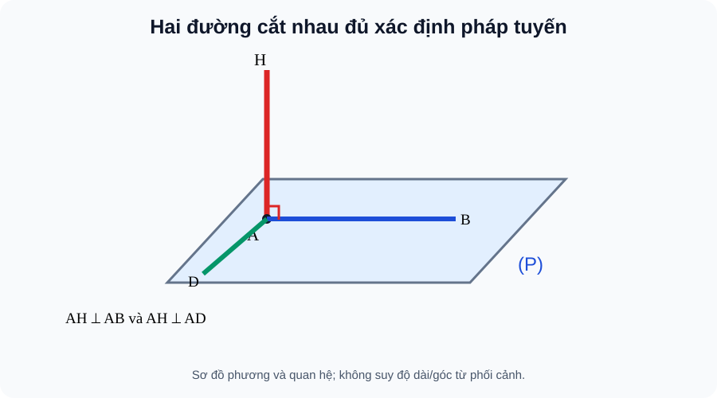

# Bài 23. Đường thẳng vuông góc với mặt phẳng

TOÁN 11 · CHƯƠNG VII · SGK KNTT TẬP 2

Hiểu lý do cần học → khái niệm và lý do → hình minh họa có hướng dẫn đọc → Tự thử trước Core → ví dụ suy luận → tự thực hành và khắc phục. Không ghi Skill Mastery.
<nav class="thpt-r4-lesson-tabs"><a href="../">Chương VII</a><a href="../luyen-tap/">Core/Luyện tập</a><a href="../tu-kiem-tra-chuong/">Tự kiểm tra tự đối chiếu</a></nav>

=== "Khám phá kiến thức"

    ### Cùng tìm hiểu

    ### 1.1. Vì sao cần học
    Một cột dựng đứng phải vuông góc cả nền nhà chứ không chỉ vuông góc với một vạch sơn trên nền. Một phương duy nhất chưa xác định được tư thế của cả mặt phẳng.

    ### Ví dụ trực quan

    Một cột dựng thẳng đứng phải vuông góc với mọi hướng trên sàn, nhưng kiểm từng hướng là không khả thi. Định lí giúp thay bằng hai hướng cắt nhau trên sàn.

    **Quan sát bằng số liệu:** Nếu đường d vuông góc với hai đường a,b cắt nhau và cùng nằm trong mặt phẳng P, thì d vuông góc P. Bỏ điều kiện a và b cắt nhau có thể làm lập luận sai.

    ### Thuật ngữ và kiến thức, kỹ năng

    **Thuật ngữ:** đường thẳng vuông góc mặt phẳng, hai đường cắt nhau, hình chiếu.

    **Sau bài học, em cần:** kiểm đủ hai hướng độc lập trong mặt phẳng trước kết luận vuông góc.

=== "Kiến thức SGK"

    ### 1.2. Khái niệm thực chất
    d⊥(P) khi d vuông góc **mọi đường thẳng** trong (P). Đường d cắt (P) tại chân H.

    ### 1.3. Hình thành và lập luận
    Nếu d⊥a và d⊥b với a,b cắt nhau thuộc (P), thì d⊥(P). Vì hai phương cắt nhau sinh mọi phương trong mặt phẳng, phép kiểm hai phương đủ. Từ d⊥(P), mọi đường d′//d cũng ⊥(P); qua một điểm có đúng một đường vuông góc (P).

    ### 1.4. Điều kiện, giới hạn, lỗi thường gặp
    Hai đường a,b phải **cắt nhau** trong (P); hai đường song song không đủ. Một đường thuộc (P) không thể đồng thời là đường vuông góc (P). Nếu (Q)//(P), d⊥(P) ⇒ d⊥(Q).

    ### 1.5. Làm rõ các định lí, điều kiện và cấu trúc SGK
    **Định nghĩa so với dấu hiệu kiểm tra:** Việc d⊥mọi đường trong (P) là *định nghĩa*, nhưng rất khó kiểm vô số đường. Dấu hiệu **đủ** chỉ cần d vuông góc hai đường a,b *cắt nhau* của (P). Vì a và b cung cấp hai phương khác nhau trong mặt phẳng, một phương vuông góc với cả hai là pháp tuyến của mặt. Đừng bỏ chữ “cắt nhau”: nếu a//b, hai phép kiểm thực chất chỉ kiểm một phương.

    **Chứng minh có trình tự:** Bước 1 gọi mặt phẳng cần chứng minh và chỉ ra chính xác hai đường a,b nằm trong đó. Bước 2 chứng minh a∩b là một điểm. Bước 3 chứng minh d⊥a và d⊥b từ dữ kiện, ví dụ các tam giác vuông. Bước 4 kết luận d⊥(P). Bước 5, chỉ *sau* khi có d⊥(P), mới được kết luận d vuông góc mọi đường khác trong (P).

    **Tính chất:** Qua một điểm cho trước có đúng một đường thẳng vuông góc mặt phẳng. Hai đường cùng vuông góc một mặt phẳng thì song song (hoặc trùng nếu cùng điểm). Nếu đường d⊥(P) và d′//d, thì d′⊥(P); nếu (Q)//(P), d⊥(Q). Các kết quả về song song ở đây có điều kiện; “d⊥một đường thuộc (P)” không tự động cho “d⊥(P)”.

    **Quan sát vật thật:** Chân cột gắn hai thanh chéo nhau nhưng không nằm trên cùng nền cũng không đủ để kiểm hai đường cắt nhau trong một mặt phẳng. Chọn hai vạch thật sự cùng thuộc nền và giao nhau.

    ### 1.6. Hình minh họa và cách đọc

    <figure class="thpt-r4-plot thpt-r4-probability-figure"><figcaption>Hình B23: Cột AH được xác nhận vuông góc mặt nền bởi AH⊥AB và AH⊥AD, AB,AD cắt nhau tại A.</figcaption></figure>

    **Hướng dẫn đọc hình:** Cột AH được xác nhận vuông góc mặt nền bởi AH⊥AB và AH⊥AD, AB,AD cắt nhau tại A. Hình là sơ đồ giải thích phương pháp, **không được suy góc hay độ dài từ nét vẽ phối cảnh**. Điều kiện vuông góc phải có chứng minh.

    ### Vận dụng — tự giải trước khi đối chiếu
    Biết cột k vuông góc hai vạch sàn song song: đã đủ nói k⊥sàn chưa? Chưa; cần hai vạch có phương không song song và cắt nhau.

    

Đã tự thử? Mở hướng dẫn tự đối chiếu

Đối chiếu lập luận của em với phần ví dụ được giải thích dưới đây. Đây là hoạt động luyện tập, không ghi Skill Mastery.

=== "Ví dụ"

    ### Các bài giải có hướng dẫn

    #### EX-G11-CHVII-B23-01 — Hai phương sàn đủ để dựng cột

    **Nhiệm vụ:** Nếu d⊥AB, d⊥AD với AB và AD cắt nhau tại A trong (ABCD), suy ra?

    **Lập luận để tự đối chiếu sau khi thử:** d⊥(ABCD). Hai phương cắt nhau đủ xác định mặt; không đòi kiểm vô hạn đường.

    #### EX-G11-CHVII-B23-02 — Kiểm giả thiết cắt nhau

    **Nhiệm vụ:** d⊥a và d⊥b nhưng a//b trong (P). Có được d⊥(P)?

    **Lập luận để tự đối chiếu sau khi thử:** Không được kết luận. Thiếu hai phương độc lập cắt nhau. Có thể d vuông góc phương a nhưng nằm nghiêng trong phương khác của P.

    #### EX-G11-CHVII-B23-03 — Cạnh SA dựng đứng

    **Nhiệm vụ:** Hình chóp S.ABC, SA⊥AB, SA⊥AC. Chứng minh SA⊥BC.

    **Lập luận để tự đối chiếu sau khi thử:** AB, AC cắt nhau tại A và thuộc (ABC), suy SA⊥(ABC), rồi SA⊥BC.

    #### EX-G11-CHVII-B23-04 — Tính chuyển song song

    **Nhiệm vụ:** Nếu k⊥(P), k′//k và (Q)//(P), thì quan hệ của k′ và (Q)?

    **Lập luận để tự đối chiếu sau khi thử:** k′⊥(Q), vì k′ giữ cùng phương pháp tuyến và hai mặt song song có cùng các phương mặt.

=== "Lỗi thường gặp"

    

<strong>Nhận diện lỗ hổng:</strong> Dùng hai đường song song để kết luận d⊥mặt.
<ol><li><strong>Nhận diện lỗ hổng:</strong> Dùng hai đường song song để kết luận d⊥mặt.</li><li><strong>Nhắc đúng bản chất:</strong> Hai đường kiểm phải cắt nhau cùng nằm trong mặt.</li><li><strong>Nhìn lại kiến thức và hình:</strong> Đọc lại phần vì sao cần học, khái niệm và cách lập luận của B23, tự phát biểu điều kiện bằng lời và kiểm tra đúng hình SVG của bài, không suy luận từ phối cảnh.</li><li><strong>Tự luyện có hướng dẫn:</strong> d⊥hai vạch cùng phương đủ chưa? <strong>Sau khi tự làm mới đối chiếu:</strong> Chưa; chọn hai vạch cắt nhau.</li><li><strong>Quay về câu gốc:</strong> <code>THPT-G11-CHVII-B23-C02</code>; giải lại và giải thích mỗi bước. HELP chỉ hiện sau nộp câu *luyện tập*, tuyệt đối không hiện trong RD1 trước Final Submit.</li></ol>
<a href="../luyen-tap/?item=THPT-G11-CHVII-B23-C02">Quay lại câu canonical THPT-G11-CHVII-B23-C02</a>

    

<strong>Nhận diện lỗ hổng:</strong> Tưởng d⊥mặt chỉ cần d⊥một đường.
<ol><li><strong>Nhận diện lỗ hổng:</strong> Tưởng d⊥mặt chỉ cần d⊥một đường.</li><li><strong>Nhắc đúng bản chất:</strong> Định nghĩa là d vuông góc mọi đường trong mặt.</li><li><strong>Nhìn lại kiến thức và hình:</strong> Đọc lại phần vì sao cần học, khái niệm và cách lập luận của B23, tự phát biểu điều kiện bằng lời và kiểm tra đúng hình SVG của bài, không suy luận từ phối cảnh.</li><li><strong>Tự luyện có hướng dẫn:</strong> Có thể d⊥một phương nhưng nghiêng theo phương khác của mặt? <strong>Sau khi tự làm mới đối chiếu:</strong> Có.</li><li><strong>Quay về câu gốc:</strong> <code>THPT-G11-CHVII-B23-C01</code>; giải lại và giải thích mỗi bước. HELP chỉ hiện sau nộp câu *luyện tập*, tuyệt đối không hiện trong RD1 trước Final Submit.</li></ol>
<a href="../luyen-tap/?item=THPT-G11-CHVII-B23-C01">Quay lại câu canonical THPT-G11-CHVII-B23-C01</a>

    ### Học tiếp

    [Core và Luyện tập Bài 23](luyen-tap.md) · [Tự luận Chương VII](../../../thu-vien/tu-luan-g11-chuong-vii.md) · [Tự kiểm tra cuối chương](tu-kiem-tra-chuong.md)
