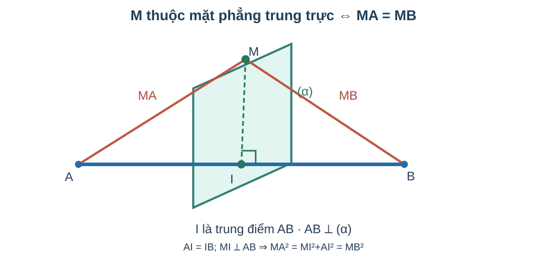

# Bài 23. Đường thẳng vuông góc với mặt phẳng

TOÁN 11 · CHƯƠNG VII · KẾT NỐI TRI THỨC · TẬP HAI

Từ cột dựng trên sàn đến pháp tuyến: hiểu đường thẳng vuông góc cả mặt phẳng, vì sao kiểm hai đường cắt nhau là đủ, tính chất mặt phẳng trung trực và liên hệ với các quan hệ song song.

<nav class="thpt-r4-lesson-tabs"><a href="../">Chương VII</a><a href="../luyen-tap/">Core và Luyện tập</a><a href="../tu-kiem-tra-chuong/">Tự kiểm tra cuối chương</a></nav>

=== "Khám phá kiến thức"

    **Vì sao cần học?** Một cột treo đồ phải **đứng vuông góc với mặt sàn**, không chỉ vuông góc với một vạch kẻ trên sàn. Ở Bài 22, em đã biết hai đường thẳng vuông góc nếu phương chúng tạo góc \(90^\circ\); hai đường có thể chéo nhau. Nhưng một mặt phẳng chứa vô số đường, nên phát biểu “đường vuông góc với cả mặt phẳng” cần ý nghĩa rõ ràng và một cách kiểm thực hiện được. Bài này tiến từ định nghĩa đến tính chất, rồi tới quan hệ song song.

    ### 1.1. Đường thẳng vuông góc với mặt phẳng

    **Hình thành theo hoạt động cánh cửa của SGK:** Cạnh bản lề đứng của cánh cửa vuông góc với sàn theo mọi hướng nằm ngang, không chỉ với mép dưới cửa. Ta gọi một đường \(\Delta\) **vuông góc với mặt phẳng \((P)\)** khi \(\Delta\) vuông góc với **mọi đường** nằm trong \((P)\). Đường \(\Delta\) cắt mặt phẳng tại một điểm gọi là **chân đường vuông góc**. Bằng cách diễn đạt từ **mọi đường**, ta tránh nhầm “vuông góc với một đường trong mặt phẳng” thành “vuông góc với cả mặt phẳng”.

    **Tại sao không phải kiểm vô số đường?** Trong một mặt phẳng, nếu biết hai **phương cắt nhau**, ta xác định được các hướng của mặt phẳng đó. Một đường vuông góc với **cả hai đường cắt nhau** nằm trong \((P)\) thì vuông góc với **toàn bộ mặt phẳng \((P)\)**. Đây là tiêu chuẩn chứng minh quan trọng của SGK. Hai đường dùng để kiểm phải **cắt nhau**, không được chỉ song song: hai đường song song chỉ cho **một hướng**.

    <figure class="thpt-r4-plot"><figcaption><strong>Hướng dẫn đọc:</strong> \(AB\) màu xanh và \(AD\) màu lục thuộc \((P)\), **cắt nhau tại \(A\)**. Cạnh đỏ \(AH\) vuông góc cả hai nên \(AH\perp(P)\). Hình là sơ đồ quan hệ; dấu góc vuông phải có căn cứ từ giả thiết, không đo bằng mắt từ phối cảnh.</figcaption></figure>

    **Ví dụ SGK:** Hình chóp \(S.ABC\) có tam giác đáy \(ABC\) vuông tại \(B\) và \(SA\perp AB,\,SA\perp AC\). Vì \(AB,AC\) cắt tại \(A\) và thuộc \((ABC)\), suy \(SA\perp(ABC)\); do đó \(SA\perp BC\). Lại có \(BC\perp BA\) vì tam giác đáy vuông tại \(B\). Hai đường \(SA,BA\) cắt nhau tại \(A\) và cùng nằm trong \((SAB)\), vậy **\(BC\perp(SAB)\)**. Lập luận này có **hai lần dùng tiêu chuẩn hai đường cắt nhau**, chứ không phải vuông góc với một đường là đủ.

    **Vận dụng.** Trên một mặt sàn \((P)\), hai thanh gỗ \(a,b\) cắt nhau tại \(O\). Một cột \(d\) vuông góc cả \(a,b\). Có thể kết luận gì? Nếu \(a\parallel b\) thì kết luận đó còn được bảo đảm không?

    ??? question "Đối chiếu"

        **Lời giải:** Nếu \(a,b\) **cắt nhau trong \((P)\)** và \(d\perp a,d\perp b\), tiêu chuẩn hai đường cắt nhau cho \(d\perp(P)\). Nếu chỉ \(a\parallel b\), hai điều kiện trên mới kiểm **một phương**, nên **chưa đủ** kết luận \(d\perp(P)\).

    ??? tip "Kiểm lỗi"

        Không đổi điều kiện “hai đường cắt nhau trong cùng mặt phẳng” thành “hai đường bất kì cùng mặt phẳng”. Song song không tạo ra hai phương độc lập để kiểm toàn mặt phẳng.

    ### 1.2. Tính chất

    **Từ một đường pháp tuyến đến cả một mặt phẳng:** SGK cho biết qua mỗi điểm \(O\) có duy nhất **một mặt phẳng** vuông góc một đường \(\Delta\) cho trước; và qua mỗi điểm \(A\) có duy nhất **một đường thẳng** vuông góc một mặt phẳng \((P)\) cho trước. Hai phát biểu khác nhau ở **đối tượng được xác định**. Phải đọc rõ “qua một điểm, có duy nhất cái gì?” trước khi vận dụng.

    **Mặt phẳng trung trực của đoạn \(AB\):** Gọi \(I\) là trung điểm \(AB\). Mặt phẳng \((\alpha)\) đi qua \(I\), vuông góc \(AB\), được gọi là mặt phẳng trung trực của đoạn \(AB\). Một điểm \(M\) thuộc mặt phẳng này khi và chỉ khi **\(MA=MB\)**. Vì sao? Nếu \(M\in(\alpha)\), đường \(MI\) nằm trong \((\alpha)\) nên \(MI\perp AB\). Hai tam giác vuông \(MIA,MIB\) có \(MI\) chung và \(IA=IB\), nên \(MA=MB\). Ngược lại, nếu \(MA=MB\), trong tam giác cân \(MAB\), đường nối đỉnh \(M\) tới trung điểm \(I\) vuông góc \(AB\), nên \(M\) thuộc mặt phẳng qua \(I\) vuông góc \(AB\) (trường hợp \(M=I\) cũng đúng).

    <figure class="thpt-r4-plot"><figcaption><strong>Hướng dẫn đọc:</strong> điểm \(I\) ở giữa \(A,B\); mặt phẳng \((\alpha)\) dựng vuông góc với đường \(AB\) tại \(I\). Điểm \(M\) nằm trên \((\alpha)\), hai đoạn \(MA,MB\) bằng nhau. Đọc \(AI=IB\) và \(MI\perp AB\) trước khi áp định lí Pythagore; không kết luận từ độ dài nét vẽ.</figcaption></figure>

    **Chân đường vuông góc cũng là duy nhất.** Cho \(A\) nằm ngoài \((P)\), có duy nhất đường qua \(A\) vuông góc \((P)\); giao điểm của đường với \((P)\) là điểm \(H\). Nếu có \(H'\ne H\) cũng làm \(AH'\perp(P)\), ta có **hai** đường qua \(A\) cùng vuông góc \((P)\), trái với tính duy nhất. Vì vậy hình chiếu vuông góc của một điểm lên mặt phẳng là xác định duy nhất.

    **Vận dụng.** Cho \(AB=10\) cm, \(I\) là trung điểm. Điểm \(M\) thuộc mặt phẳng trung trực \((\alpha)\) của \(AB\) và \(MI=12\) cm. Tính \(MA,MB\).

    ??? question "Đối chiếu"

        **Lời giải:** \(AI=BI=5\) cm; \(MI\perp AB\) vì \(MI\) thuộc mặt phẳng vuông góc \(AB\). Theo Pythagore: \(MA^2=MI^2+IA^2=12^2+5^2=169\), nên **\(MA=MB=13\) cm**.

    ??? tip "Kiểm lỗi"

        Mặt phẳng trung trực không phải chỉ có **một điểm \(I\)**; nó là tập hợp vô số điểm cách đều \(A,B\). Không tự lấy \(MA=12\) vì 12 là độ dài \(MI\).

    ### 1.3. Liên hệ giữa quan hệ song song và quan hệ vuông góc của đường thẳng và mặt phẳng

    **Cầu nối từ Bài 22:** Nếu \(a\perp(P)\) và \(b\parallel a\), thì \(b\perp(P)\), bởi với mọi đường \(m\subset(P)\), \((b,m)=(a,m)=90^\circ\). Do đó, hai đường **phân biệt** cùng vuông góc với **một mặt phẳng** thì **song song với nhau**. Chú ý sự khác biệt: **hai đường cùng vuông góc một đường thứ ba** trong không gian thì *không nhất thiết song song* (Bài 22), nhưng cùng vuông góc **cả một mặt phẳng** thì có cùng phương pháp tuyến.

    **Hai mặt phẳng song song:** Nếu \((P)\parallel(Q)\) và \(\Delta\perp(P)\), thì \(\Delta\perp(Q)\). Có thể lấy một đường \(b\) bất kì trong \((Q)\), chọn \(a\subset(P)\) song song với \(b\); do \(\Delta\perp a\), ta có \(\Delta\perp b\), nên vuông góc cả \((Q)\). Đảo lại, nếu hai mặt phẳng **phân biệt** cùng vuông góc với một đường \(\Delta\), chúng **song song nhau**.

    <figure class="thpt-r4-plot"><figcaption><strong>Hướng dẫn đọc:</strong> hai tấm phẳng \((P)\), \((Q)\) ở hai độ cao **song song**; đường đỏ \(\Delta\) là phương vuông góc \((P)\), nên cũng vuông góc \((Q)\). Hình không chứng minh từ nét vẽ rằng hai mặt phẳng song song: điều đó phải thuộc giả thiết hoặc được suy từ định lí.</figcaption></figure>

    **Hai quan hệ với đường song song mặt phẳng:** Nếu \(\Delta\perp(P)\) và \(a\parallel(P)\), thì \(\Delta\perp a\). Ngược lại, nếu cả **đường \(a\)** lẫn **mặt phẳng \((P)\)** đều vuông góc cùng một đường \(\Delta\), thì \(a\) **nằm trong \((P)\) hoặc song song \((P)\)**; không thể khẳng định chỉ song song, vì \(a\) có thể thuộc \((P)\).

    **Ví dụ SGK — Tứ diện và trọng tâm:** Trong tứ diện \(OABC\) có \(OA,OB,OC\) đôi một vuông góc, \(OA\perp(OBC)\). Gọi \(M,N\) lần lượt là trọng tâm tam giác \(ABC\), \(OBC\). Vì hai trọng tâm chia các trung tuyến tương ứng theo tỉ số \(2:1\), đường \(MN\parallel OA\). Suy ra \(MN\perp(OBC)\) theo tính chất thay đường song song. Ta phải chứng minh **đúng \(MN\parallel OA\)** trước khi kết luận, không đo hình.

    **Vận dụng.** Hai mặt phẳng \((P)\ne(Q)\) đều vuông góc cùng đường \(\Delta\). Hỏi quan hệ của \((P),(Q)\)? Nếu \(a\) là đường cũng vuông góc \(\Delta\), có thể kết luận \(a\parallel(P)\) không?

    ??? question "Đối chiếu"

        **Lời giải:** Hai mặt phẳng **phân biệt** cùng vuông góc một đường nên **\((P)\parallel(Q)\)**. Nếu chỉ \(a\perp\Delta\), trong khi \((P)\perp\Delta\), thì \(a\) có phương nằm trong \((P)\), nhưng \(a\) có thể **nằm trong \((P)\)** hoặc **song song \((P)\)**. Không kết luận chỉ song song.

    ??? tip "Kiểm lỗi"

        Phải phân biệt **đường vuông góc đường**, **đường vuông góc mặt phẳng** và **mặt phẳng vuông góc đường**; mỗi quy tắc có điều kiện khác nhau.

=== "Kiến thức SGK"

    ### 2.1. Đường thẳng vuông góc với mặt phẳng

    
<strong>Định nghĩa — Đường thẳng vuông góc với mặt phẳng</strong>
Đường \(\Delta\) được gọi là <strong>vuông góc với mặt phẳng \((P)\)</strong>, kí hiệu \(\Delta\perp(P)\), nếu \(\Delta\) vuông góc với <strong>mọi đường thẳng</strong> nằm trong \((P)\). Khi đó \(\Delta\) cắt \((P)\) tại một điểm gọi là chân đường vuông góc.

    
<strong>Định lí — Tiêu chuẩn hai đường thẳng cắt nhau</strong>
Nếu \(\Delta\perp a\), \(\Delta\perp b\), trong đó \(a,b\) là <strong>hai đường cắt nhau và cùng nằm trong mặt phẳng \((P)\)</strong>, thì \(\Delta\perp(P)\). Hai đường chỉ song song với nhau không đủ để dùng tiêu chuẩn này.

    **Cách chứng minh:** (1) chỉ rõ \(a,b\subset(P)\); (2) chứng minh \(a\cap b\) có một điểm; (3) chứng minh \(\Delta\perp a\) và \(\Delta\perp b\); (4) kết luận. Không suy \(d\perp(P)\) từ duy nhất một góc vuông.

    <figure class="thpt-r4-plot"><figcaption><strong>Tra hình:</strong> \(AB,AD\) nằm trong \((P)\) và **cắt nhau ở \(A\)**; \(AH\perp AB\), \(AH\perp AD\), vì thế \(AH\perp(P)\). Không được thay \(AD\) bằng một đường song song \(AB\) rồi vẫn áp tiêu chuẩn.</figcaption></figure>

    **Ví dụ SGK:** Cho \(S.ABC\) đáy \(ABC\) vuông tại \(B\), \(SA\perp AB\), \(SA\perp AC\). Vì \(AB,AC\) cắt nhau trong \((ABC)\), suy \(SA\perp(ABC)\), nên \(SA\perp BC\). Mặt khác \(BA\perp BC\), với \(SA,BA\) cắt tại \(A\) thuộc \((SAB)\), suy \(BC\perp(SAB)\).

    ### 2.2. Tính chất

    
<strong>Tính chất — Tính duy nhất</strong>
Qua một điểm cho trước có duy nhất <strong>một mặt phẳng</strong> vuông góc với một đường thẳng cho trước. Qua một điểm cho trước cũng có duy nhất <strong>một đường thẳng</strong> vuông góc với một mặt phẳng cho trước. Hai tính duy nhất này có đối tượng khác nhau.

    
<strong>Khái niệm — Mặt phẳng trung trực của đoạn thẳng</strong>
Cho đoạn \(AB\) với trung điểm \(I\). Mặt phẳng \((\alpha)\) đi qua \(I\) và vuông góc đường \(AB\) là <strong>mặt phẳng trung trực</strong> của đoạn \(AB\). Nó chính là <strong>tập hợp các điểm \(M\)</strong> thỏa \(MA=MB\). Hình chiếu vuông góc từ một điểm xuống một mặt phẳng cũng duy nhất.

    <figure class="thpt-r4-plot"><figcaption><strong>Tra hình:</strong> \(I\) là trung điểm \(AB\); \(MI\) nằm trong mặt phẳng vuông góc \(AB\). Các tam giác vuông \(MIA\) và \(MIB\) có hai cạnh góc vuông tương ứng bằng nhau, nên \(MA=MB\). Chiều ngược cũng đúng.</figcaption></figure>

    **Cách tìm chân \(H\):** Từ \(A\) dựng đường duy nhất vuông góc \((P)\); giao điểm với \((P)\) là \(H\). Không có chân vuông góc thứ hai vì đường vuông góc qua \(A\) là duy nhất.

    ### 2.3. Liên hệ giữa quan hệ song song và quan hệ vuông góc của đường thẳng và mặt phẳng

    
<strong>Tính chất — Hai đường thẳng và một mặt phẳng</strong>
Nếu \(a\perp(P)\) và \(b\parallel a\), thì \(b\perp(P)\). Hai đường thẳng <strong>phân biệt</strong> cùng vuông góc một mặt phẳng thì <strong>song song</strong> với nhau.

    
<strong>Tính chất — Hai mặt phẳng và một đường thẳng</strong>
Nếu \((P)\parallel(Q)\) và \(\Delta\perp(P)\), thì \(\Delta\perp(Q)\). Hai mặt phẳng <strong>phân biệt</strong> cùng vuông góc với một đường \(\Delta\) thì <strong>song song</strong> với nhau.

    <figure class="thpt-r4-plot"><figcaption><strong>Tra hình:</strong> nếu hai mặt phẳng song song, một pháp tuyến \(\Delta\) của \((P)\) cũng là pháp tuyến của \((Q)\). Hình chỉ minh họa quan hệ từ giả thiết, không thay chứng minh.</figcaption></figure>

    **Các quan hệ bổ sung trong SGK:** Nếu \(\Delta\perp(P)\), thì \(\Delta\) vuông góc mọi đường \(a\parallel(P)\). Nếu cả đường \(a\) và mặt phẳng \((P)\) đều vuông góc một đường \(\Delta\), thì **\(a\subset(P)\) hoặc \(a\parallel(P)\)**. Hai trường hợp này không được bỏ đi một cách tùy ý.

    **Ví dụ:** Tứ diện \(OABC\) có \(OA,OB,OC\) đôi một vuông góc, \(M,N\) lần lượt là trọng tâm tam giác \(ABC,OBC\). \(OA\perp(OBC)\); từ tính chất trọng tâm có \(MN\parallel OA\), do đó \(MN\perp(OBC)\).

    | Giả thiết | Kết luận hợp lệ |
    | :-- | :-- |
    | \(a\perp(P)\), \(b\parallel a\) | \(b\perp(P)\) |
    | \(a\ne b\), \(a\perp(P)\), \(b\perp(P)\) | \(a\parallel b\) |
    | \((P)\parallel(Q)\), \(\Delta\perp(P)\) | \(\Delta\perp(Q)\) |
    | \((P)\ne(Q)\), cả hai vuông góc \(\Delta\) | \((P)\parallel(Q)\) |
    | \(a\perp\Delta\), \((P)\perp\Delta\) | \(a\subset(P)\) **hoặc** \(a\parallel(P)\) |

=== "Ví dụ"

    ### 3.1. Hai lần áp dụng tiêu chuẩn hai đường cắt nhau

    **Đề bài.** Hình chóp \(S.ABC\) có đáy \(ABC\) vuông tại \(B\), \(SA\perp AB\) và \(SA\perp AC\). Chứng minh \(BC\perp(SAB)\).

    **Phân tích:** Không thể suy ngay \(BC\perp(SAB)\) từ \(BC\perp BA\). Đầu tiên chứng minh \(SA\perp(ABC)\) bằng **hai đường \(AB,AC\) cắt tại \(A\)**; từ đó mới có vuông góc thứ hai cần thiết.

    

<strong>Lời giải.</strong> Vì \(SA\perp AB\), \(SA\perp AC\) và \(AB,AC\subset(ABC)\) cắt tại \(A\), nên \(SA\perp(ABC)\). Suy ra \(SA\perp BC\). Tam giác \(ABC\) vuông tại \(B\), nên \(BC\perp BA\). Vì \(SA,BA\subset(SAB)\) cắt tại \(A\), ta có \(BC\perp(SAB)\).

    **Kiểm lại:** Hai lần áp tiêu chuẩn đều nêu rõ **hai đường trong mặt phẳng và giao điểm**; không đổi “cắt nhau” thành “song song”.

    ### 3.2. Cột treo đồ có chân đế chữ thập

    **Đề bài.** Hai thanh chân đế \(a,b\) cắt nhau tại \(O\) và nằm trong mặt sàn \((P)\). Một cột \(d\) thỏa \(d\perp a\), \(d\perp b\). Chứng minh cột vuông góc sàn và nêu giả thiết thiết yếu.

    **Phân tích:** Một cột thẳng đứng không được xác định bằng việc vuông góc duy nhất một thanh. Cần **hai phương khác nhau** của mặt sàn.

    

<strong>Lời giải.</strong> Vì \(a,b\) cùng nằm trong \((P)\) và cắt nhau tại \(O\), đồng thời \(d\perp a\), \(d\perp b\), theo tiêu chuẩn hai đường cắt nhau, \(d\perp(P)\). Điều kiện thiết yếu là \(a,b\) cắt nhau, không chỉ song song.

    **Kiểm lại:** Nếu \(a\parallel b\), một đường có thể vuông góc cả hai nhưng **không** vuông góc với mọi phương khác trên sàn.

    ### 3.3. Khoảng cách bằng nhau và mặt phẳng trung trực

    **Đề bài.** Cho \(AB=10\) cm, \(I\) trung điểm. Điểm \(M\) thuộc mặt phẳng trung trực của \(AB\), \(MI=12\) cm. Tính \(MA,MB\) và giải thích tính bằng nhau.

    **Phân tích:** \(AB\perp(\alpha)\) tại \(I\) nên \(MI\perp AB\). Sử dụng Pythagore trong hai tam giác vuông \(MIA,MIB\) có \(IA=IB=5\).

    

<strong>Lời giải.</strong> \(IA=IB=5\) cm. Vì \(M,I\in(\alpha)\) và \(AB\perp(\alpha)\), \(MI\perp AB\). Suy ra \(MA^2=MI^2+IA^2=12^2+5^2=169\), \(MB^2=MI^2+IB^2=169\). Do đó \(MA=MB=13\) cm.

    **Kiểm lại:** \(MI=12>0\) nên \(M\ne I\), tam giác Pythagore ở đây không suy biến. Mặt phẳng trung trực có **vô số điểm** như \(M\), không chỉ điểm giữa \(I\).

    ### 3.4. Vì sao chân vuông góc xuống mặt phẳng là duy nhất?

    **Đề bài.** Cho điểm \(A\notin(P)\). Chứng minh không thể tồn tại hai điểm \(H,K\) khác nhau trong \((P)\) sao cho \(AH\perp(P)\) và \(AK\perp(P)\).

    **Phân tích:** SGK có tính duy nhất đường vuông góc với mặt phẳng qua một điểm. Nếu có hai chân, hai đường cùng qua \(A\) đều là pháp tuyến của \((P)\).

    

<strong>Lời giải.</strong> Giả sử \(H\ne K\) thỏa điều kiện. Khi đó \(AH,AK\) là hai đường phân biệt cùng đi qua \(A\), và đều vuông góc \((P)\), trái với tính duy nhất đường vuông góc \((P)\) qua \(A\). Do đó chỉ có một điểm \(H\) như vậy, là giao điểm của đường duy nhất qua \(A\) vuông góc \((P)\) với mặt phẳng.

    **Kiểm lại:** Sự tồn tại của chân là nhờ có duy nhất pháp tuyến qua \(A\) **và pháp tuyến cắt \((P)\)**; không phải suy chỉ từ “ít nhất một điểm ở gần nhất”.

    ### 3.5. Chứng minh đường nối hai trọng tâm vuông góc mặt phẳng

    **Đề bài.** Tứ diện \(OABC\) có \(OA,OB,OC\) đôi một vuông góc. \(M,N\) là trọng tâm của tam giác \(ABC\), \(OBC\). Chứng minh \(MN\perp(OBC)\).

    **Phân tích:** \(OA\perp OB\), \(OA\perp OC\); hai đường \(OB,OC\) cắt tại \(O\) thuộc \((OBC)\), nên \(OA\perp(OBC)\). Cần chứng minh **\(MN\parallel OA\)** bằng tính chất trọng tâm trước khi thay pháp tuyến.

    

<strong>Lời giải.</strong> Lấy \(D\) là trung điểm \(BC\). Hai trọng tâm \(M\in AD\), \(N\in OD\) thỏa \(DM/DA=DN/DO=1/3\). Trong tam giác \(DAO\), theo định lí Ta-lét đảo, \(MN\parallel AO\). Vì \(OA\perp OB\), \(OA\perp OC\) và \(OB,OC\) cắt trong \((OBC)\), \(OA\perp(OBC)\). Do \(MN\parallel OA\), suy \(MN\perp(OBC)\).

    **Kiểm lại:** Tỉ lệ trọng tâm tính từ **điểm \(D\)** là \(1/3\), không phải \(2/3\); nếu lấy từ đỉnh \(A,O\) mới là \(2/3\).

    ### 3.6. Pháp tuyến của hai mặt phẳng song song

    **Đề bài.** Cho \((P)\parallel(Q)\) và \(\Delta\perp(P)\). Chứng minh \(\Delta\perp(Q)\). Nêu kết luận ngược khi hai mặt phẳng phân biệt cùng vuông góc \(\Delta\).

    **Phân tích:** Mọi phương trong \((Q)\) đều song song với một phương tương ứng trong \((P)\). Góc giữa đường và mặt phẳng có thể kiểm qua **mọi đường trong mặt phẳng**, không đo từ hai hình bình hành vẽ trên giấy.

    

<strong>Lời giải.</strong> Lấy \(b\subset(Q)\) bất kì. Vì \((P)\parallel(Q)\), tồn tại \(a\subset(P)\) với \(a\parallel b\). Từ \(\Delta\perp(P)\) suy \(\Delta\perp a\); vì \(a\parallel b\), \(\Delta\perp b\). Do \(b\) tùy ý, \(\Delta\perp(Q)\). Ngược lại, hai mặt phẳng **phân biệt** cùng vuông góc một đường thì song song.

    **Kiểm lại:** Điều kiện \((P)\ne(Q)\) cần khi phát biểu kết luận hai mặt phẳng song song theo nghĩa phân biệt; không coi một mặt phẳng song song với chính nó trong phát biểu SGK.

    ### 3.7. Đường thẳng và mặt phẳng cùng vuông góc đường thứ ba

    **Đề bài.** Cho \(\Delta\perp(P)\) và đường \(a\perp\Delta\). Chứng minh \(a\) không nhất thiết song song với \((P)\), đồng thời cho biết đầy đủ các trường hợp có thể.

    **Phân tích:** \(a\) có phương song song với các phương thuộc \((P)\), nhưng vị trí của \(a\) có thể ngay **trong mặt phẳng** hoặc ở ngoài mặt phẳng.

    

<strong>Lời giải.</strong> Vì \(a\perp\Delta\) và \((P)\perp\Delta\), đường \(a\) có phương nằm trong \((P)\). Nếu \(a\) có một điểm thuộc \((P)\), toàn bộ \(a\subset(P)\). Nếu \(a\) không có điểm chung với \((P)\), \(a\parallel(P)\). Do đó kết luận đúng là \(a\subset(P)\) **hoặc** \(a\parallel(P)\), không chỉ một vế.

    **Kiểm lại:** Một đường trong mặt phẳng cũng vuông góc với pháp tuyến của mặt phẳng, nên là phản ví dụ cho khẳng định chỉ “song song”.

    ### 3.8. Bài toán SGK: trung điểm trong hình chóp đáy vuông

    **Đề bài.** Cho hình chóp \(S.ABCD\) có đáy là hình vuông, \(SA\perp(ABCD)\). Gọi \(M\) trung điểm \(SB\), \(N\) trung điểm \(BC\). Chứng minh \(BD\perp MN\).

    **Phân tích:** Vì \(M,N\) là trung điểm hai cạnh của tam giác \(SBC\), \(MN\parallel SC\). Để chứng minh \(BD\perp SC\), tìm mặt phẳng chứa \(SC\) mà \(BD\) vuông góc.

    

<strong>Lời giải.</strong> Từ \(SA\perp(ABCD)\) suy \(SA\perp BD\). Đáy hình vuông có hai đường chéo \(AC\perp BD\), với \(SA,AC\subset(SAC)\) cắt tại \(A\). Vì vậy \(BD\perp(SAC)\), nên \(BD\perp SC\). Trong tam giác \(SBC\), \(M,N\) là trung điểm \(SB,BC\), suy \(MN\parallel SC\). Do đó \(BD\perp MN\).

    **Kiểm lại:** \(BD\) không nằm trong \((SAC)\) nhưng vuông góc với **hai đường cắt nhau** \(SA,AC\) của mặt phẳng ấy; kết luận được phép dùng. \(MN\parallel SC\) do đường trung bình, không phải vì nét vẽ.

=== "Lỗi thường gặp"

    ### 4.1. Vuông góc một đường trên mặt phẳng là vuông góc cả mặt phẳng

    **Dấu hiệu:** Chỉ từ \(d\perp a\) với \(a\subset(P)\), kết luận \(d\perp(P)\).

    **Vì sao sai:** Mặt phẳng có nhiều phương; một điều kiện vuông góc chỉ kiểm một phương, chưa đủ định hướng pháp tuyến.

    **Cách sửa:** Cần thêm \(d\perp b\) với **\(a,b\) cắt nhau và cùng nằm trong \((P)\)**, hoặc một căn cứ tương đương mạnh hơn.

    ### 4.2. Kiểm hai đường song song rồi áp tiêu chuẩn

    **Dấu hiệu:** Có \(d\perp a\), \(d\perp b\), nhưng \(a\parallel b\) trong \((P)\), vẫn kết luận \(d\perp(P)\).

    **Vì sao sai:** Hai đường song song chỉ biểu thị một phương của mặt phẳng, không thỏa giả thiết **hai đường cắt nhau**.

    **Cách sửa:** Dựng thêm một đường thứ hai thuộc \((P)\) cắt đường thứ nhất, rồi chứng minh vuông góc đường ấy.

    ### 4.3. Nhầm vuông góc cùng đường và cùng mặt phẳng

    **Dấu hiệu:** Nghĩ hai đường cùng vuông góc một **đường thứ ba** thì chắc chắn song song, như hai đường cùng vuông góc một **mặt phẳng**.

    **Vì sao sai:** Trong không gian, \(Ox,Oy\) đều vuông góc \(Oz\) nhưng không song song; còn các pháp tuyến cùng một mặt phẳng phải cùng phương.

    **Cách sửa:** Đọc đúng đối tượng: \(a\perp(P),b\perp(P)\Rightarrow a\parallel b\) nếu \(a\ne b\); \(a\perp c,b\perp c\) không đủ để suy song song.

    ### 4.4. Mặt phẳng trung trực chỉ gồm trung điểm

    **Dấu hiệu:** Cho rằng chỉ điểm \(I\) cách đều hai đầu \(A,B\) nên “mặt phẳng trung trực” là điểm \(I\).

    **Vì sao sai:** Mọi điểm trên mặt phẳng qua \(I\) vuông góc \(AB\) đều có cùng khoảng cách tới \(A,B\).

    **Cách sửa:** Dùng \(AI=BI\), \(MI\perp AB\) để thấy \(MA^2=MI^2+AI^2=MI^2+BI^2=MB^2\) khi \(M\ne I\); \(M=I\) trực tiếp thỏa.

    ### 4.5. Quên chữ duy nhất hoặc đổi đối tượng của định lí

    **Dấu hiệu:** Nói qua một điểm có nhiều đường vuông góc cùng một mặt phẳng, hoặc lẫn với “qua một điểm có một mặt phẳng vuông góc một đường”.

    **Vì sao sai:** Cả hai là kết quả duy nhất nhưng **đối tượng được dựng khác nhau** (đường hoặc mặt phẳng).

    **Cách sửa:** Viết đầy đủ “điểm O + mặt phẳng P → duy nhất đường d⊥P” và “điểm O + đường Δ → duy nhất mặt phẳng α⊥Δ”.

    ### 4.6. Bỏ một trường hợp khi đường và mặt phẳng cùng vuông góc một đường

    **Dấu hiệu:** Từ \(a\perp\Delta\), \((P)\perp\Delta\) chỉ kết luận \(a\parallel(P)\).

    **Vì sao sai:** \(a\) cũng có thể **nằm trong \((P)\)**; cả hai cùng có phương vuông góc với pháp tuyến \(\Delta\).

    **Cách sửa:** Ghi đầy đủ **\(a\subset(P)\) hoặc \(a\parallel(P)\)**. Khi muốn chọn một kết luận, cần thêm điều kiện \(a\) có/không có điểm chung với \((P)\).

    **Học tiếp:** [Core/Luyện tập Bài 23](luyen-tap.md) · [Tự luận Chương VII](../../../thu-vien/tu-luan-g11-chuong-vii.md) · [Tự kiểm tra cuối chương](tu-kiem-tra-chuong.md).

    
Nguồn S1: SGK Toán 11 Kết nối tri thức, tập hai, Bài 23 “Đường thẳng vuông góc với mặt phẳng”, trang in 31–37. Ba mục SGK: “Đường thẳng vuông góc với mặt phẳng”; “Tính chất”; “Liên hệ giữa quan hệ song song và quan hệ vuông góc của đường thẳng và mặt phẳng”. Đối chiếu nội dung văn bản PDF số hóa về HĐ1–HĐ10, ví dụ và tính chất, nhưng PDF screenshot trang in↔index chưa kiểm được (SOURCE_VISUAL_HOLD). Hình kiểm hai đường cắt nhau dùng lại từ thư viện gốc; bổ sung hình mặt phẳng trung trực và hai mặt phẳng song song với cùng pháp tuyến tại đúng đoạn giảng thiếu hình. Không sửa Core/Luyện tập, Tự kiểm tra hoặc ngân hàng đánh giá.

