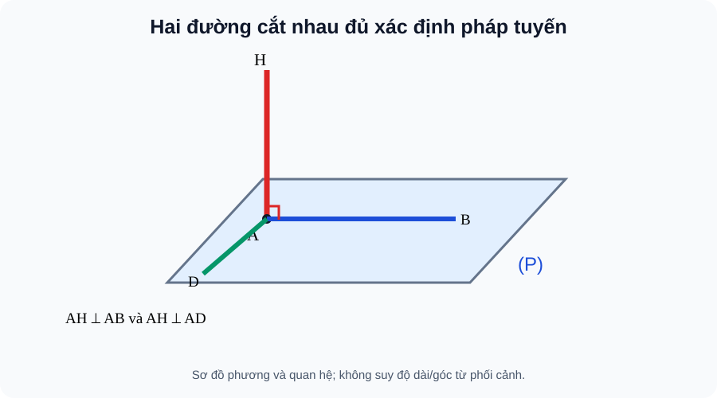
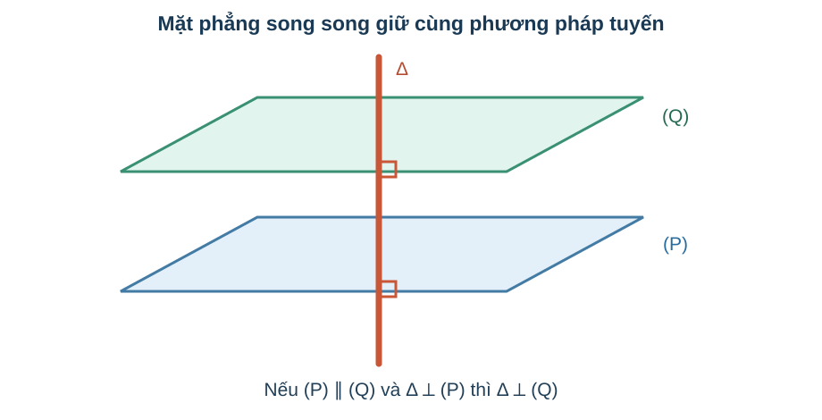

# Bài 23. Đường thẳng vuông góc với mặt phẳng

TOÁN 11 · CHƯƠNG VII · KẾT NỐI TRI THỨC · TẬP HAI

Từ cột dựng trên sàn đến pháp tuyến: hiểu đường thẳng vuông góc cả mặt phẳng, vì sao kiểm hai đường cắt nhau là đủ, tính chất mặt phẳng trung trực và liên hệ với các quan hệ song song.

<nav class="thpt-r4-lesson-tabs"><a href="../">Chương VII</a><a href="../luyen-tap/">Core và Luyện tập</a><a href="../tu-kiem-tra-chuong/">Tự kiểm tra cuối chương</a></nav>

=== "Khám phá kiến thức"

    **Vì sao cần học?** Một cột treo đồ phải **đứng vuông góc với mặt sàn**, không chỉ vuông góc với một vạch kẻ trên sàn. Ở Bài 22, em đã biết hai đường thẳng vuông góc nếu phương chúng tạo góc \(90^\circ\); hai đường có thể chéo nhau. Nhưng một mặt phẳng chứa vô số đường, nên phát biểu “đường vuông góc với cả mặt phẳng” cần ý nghĩa rõ ràng và một cách kiểm thực hiện được. Bài này tiến từ định nghĩa đến tính chất, rồi tới quan hệ song song.

    ### 1.1. Đường thẳng vuông góc với mặt phẳng

    **Hình thành theo hoạt động cánh cửa của SGK:** Cạnh bản lề đứng của cánh cửa vuông góc với sàn theo mọi hướng nằm ngang, không chỉ với mép dưới cửa. Ta gọi một đường \(\Delta\) **vuông góc với mặt phẳng \((P)\)** khi \(\Delta\) vuông góc với **mọi đường** nằm trong \((P)\). Đường \(\Delta\) cắt mặt phẳng tại một điểm gọi là **chân đường vuông góc**. Bằng cách diễn đạt từ **mọi đường**, ta tránh nhầm “vuông góc với một đường trong mặt phẳng” thành “vuông góc với cả mặt phẳng”.

    **Tại sao không phải kiểm vô số đường?** Trong một mặt phẳng, nếu biết hai **phương cắt nhau**, ta xác định được các hướng của mặt phẳng đó. Một đường vuông góc với **cả hai đường cắt nhau** nằm trong \((P)\) thì vuông góc với **toàn bộ mặt phẳng \((P)\)**. Đây là tiêu chuẩn chứng minh quan trọng của SGK. Hai đường dùng để kiểm phải **cắt nhau**, không được chỉ song song: hai đường song song chỉ cho **một hướng**.

    <figure class="thpt-r4-plot"><figcaption><strong>Hướng dẫn đọc:</strong> \(AB\) màu xanh và \(AD\) màu lục thuộc \((P)\), **cắt nhau tại \(A\)**. Cạnh đỏ \(AH\) vuông góc cả hai nên \(AH\perp(P)\). Hình là sơ đồ quan hệ; dấu góc vuông phải có căn cứ từ giả thiết, không đo bằng mắt từ phối cảnh.</figcaption></figure>

    **Ví dụ SGK:** Hình chóp \(S.ABC\) có tam giác đáy \(ABC\) vuông tại \(B\) và \(SA\perp AB,\,SA\perp AC\). Vì \(AB,AC\) cắt tại \(A\) và thuộc \((ABC)\), suy \(SA\perp(ABC)\); do đó \(SA\perp BC\). Lại có \(BC\perp BA\) vì tam giác đáy vuông tại \(B\). Hai đường \(SA,BA\) cắt nhau tại \(A\) và cùng nằm trong \((SAB)\), vậy **\(BC\perp(SAB)\)**. Lập luận này có **hai lần dùng tiêu chuẩn hai đường cắt nhau**, chứ không phải vuông góc với một đường là đủ.

    **Vận dụng.** Trên một mặt sàn \((P)\), hai thanh gỗ \(a,b\) cắt nhau tại \(O\). Một cột \(d\) vuông góc cả \(a,b\). Có thể kết luận gì? Nếu \(a\parallel b\) thì kết luận đó còn được bảo đảm không?

    ??? question "Đối chiếu"

        **Lời giải:** Nếu \(a,b\) **cắt nhau trong \((P)\)** và \(d\perp a,d\perp b\), tiêu chuẩn hai đường cắt nhau cho \(d\perp(P)\). Nếu chỉ \(a\parallel b\), hai điều kiện trên mới kiểm **một phương**, nên **chưa đủ** kết luận \(d\perp(P)\).

    ??? tip "Kiểm lỗi"

        Không đổi điều kiện “hai đường cắt nhau trong cùng mặt phẳng” thành “hai đường bất kì cùng mặt phẳng”. Song song không tạo ra hai phương độc lập để kiểm toàn mặt phẳng.

    ### 1.2. Tính chất

    **Từ một đường pháp tuyến đến cả một mặt phẳng:** SGK cho biết qua mỗi điểm \(O\) có duy nhất **một mặt phẳng** vuông góc một đường \(\Delta\) cho trước; và qua mỗi điểm \(A\) có duy nhất **một đường thẳng** vuông góc một mặt phẳng \((P)\) cho trước. Hai phát biểu khác nhau ở **đối tượng được xác định**. Phải đọc rõ “qua một điểm, có duy nhất cái gì?” trước khi vận dụng.

    **Mặt phẳng trung trực của đoạn \(AB\):** Gọi \(I\) là trung điểm \(AB\). Mặt phẳng \((\alpha)\) đi qua \(I\), vuông góc \(AB\), được gọi là mặt phẳng trung trực của đoạn \(AB\). Một điểm \(M\) thuộc mặt phẳng này khi và chỉ khi **\(MA=MB\)**. Vì sao? Nếu \(M\in(\alpha)\), đường \(MI\) nằm trong \((\alpha)\) nên \(MI\perp AB\). Hai tam giác vuông \(MIA,MIB\) có \(MI\) chung và \(IA=IB\), nên \(MA=MB\). Ngược lại, nếu \(MA=MB\), trong tam giác cân \(MAB\), đường nối đỉnh \(M\) tới trung điểm \(I\) vuông góc \(AB\), nên \(M\) thuộc mặt phẳng qua \(I\) vuông góc \(AB\) (trường hợp \(M=I\) cũng đúng).

    <figure class="thpt-r4-plot"><figcaption><strong>Hướng dẫn đọc:</strong> điểm \(I\) ở giữa \(A,B\); mặt phẳng \((\alpha)\) dựng vuông góc với đường \(AB\) tại \(I\). Điểm \(M\) nằm trên \((\alpha)\), hai đoạn \(MA,MB\) bằng nhau. Đọc \(AI=IB\) và \(MI\perp AB\) trước khi áp định lí Pythagore; không kết luận từ độ dài nét vẽ.</figcaption></figure>

    **Chân đường vuông góc cũng là duy nhất.** Cho \(A\) nằm ngoài \((P)\), có duy nhất đường qua \(A\) vuông góc \((P)\); giao điểm của đường với \((P)\) là điểm \(H\). Nếu có \(H'\ne H\) cũng làm \(AH'\perp(P)\), ta có **hai** đường qua \(A\) cùng vuông góc \((P)\), trái với tính duy nhất. Vì vậy hình chiếu vuông góc của một điểm lên mặt phẳng là xác định duy nhất.

    **Vận dụng.** Cho \(AB=10\) cm, \(I\) là trung điểm. Điểm \(M\) thuộc mặt phẳng trung trực \((\alpha)\) của \(AB\) và \(MI=12\) cm. Tính \(MA,MB\).

    ??? question "Đối chiếu"

        **Lời giải:** \(AI=BI=5\) cm; \(MI\perp AB\) vì \(MI\) thuộc mặt phẳng vuông góc \(AB\). Theo Pythagore: \(MA^2=MI^2+IA^2=12^2+5^2=169\), nên **\(MA=MB=13\) cm**.

    ??? tip "Kiểm lỗi"

        Mặt phẳng trung trực không phải chỉ có **một điểm \(I\)**; nó là tập hợp vô số điểm cách đều \(A,B\). Không tự lấy \(MA=12\) vì 12 là độ dài \(MI\).

    ### 1.3. Liên hệ giữa quan hệ song song và quan hệ vuông góc của đường thẳng và mặt phẳng

    **Cầu nối từ Bài 22:** Nếu \(a\perp(P)\) và \(b\parallel a\), thì \(b\perp(P)\), bởi với mọi đường \(m\subset(P)\), \((b,m)=(a,m)=90^\circ\). Do đó, hai đường **phân biệt** cùng vuông góc với **một mặt phẳng** thì **song song với nhau**. Chú ý sự khác biệt: **hai đường cùng vuông góc một đường thứ ba** trong không gian thì *không nhất thiết song song* (Bài 22), nhưng cùng vuông góc **cả một mặt phẳng** thì có cùng phương pháp tuyến.

    **Hai mặt phẳng song song:** Nếu \((P)\parallel(Q)\) và \(\Delta\perp(P)\), thì \(\Delta\perp(Q)\). Có thể lấy một đường \(b\) bất kì trong \((Q)\), chọn \(a\subset(P)\) song song với \(b\); do \(\Delta\perp a\), ta có \(\Delta\perp b\), nên vuông góc cả \((Q)\). Đảo lại, nếu hai mặt phẳng **phân biệt** cùng vuông góc với một đường \(\Delta\), chúng **song song nhau**.

    <figure class="thpt-r4-plot"><figcaption><strong>Hướng dẫn đọc:</strong> hai tấm phẳng \((P)\), \((Q)\) ở hai độ cao **song song**; đường đỏ \(\Delta\) là phương vuông góc \((P)\), nên cũng vuông góc \((Q)\). Hình không chứng minh từ nét vẽ rằng hai mặt phẳng song song: điều đó phải thuộc giả thiết hoặc được suy từ định lí.</figcaption></figure>

    **Hai quan hệ với đường song song mặt phẳng:** Nếu \(\Delta\perp(P)\) và \(a\parallel(P)\), thì \(\Delta\perp a\). Ngược lại, nếu cả **đường \(a\)** lẫn **mặt phẳng \((P)\)** đều vuông góc cùng một đường \(\Delta\), thì \(a\) **nằm trong \((P)\) hoặc song song \((P)\)**; không thể khẳng định chỉ song song, vì \(a\) có thể thuộc \((P)\).

    **Ví dụ SGK — Tứ diện và trọng tâm:** Trong tứ diện \(OABC\) có \(OA,OB,OC\) đôi một vuông góc, \(OA\perp(OBC)\). Gọi \(M,N\) lần lượt là trọng tâm tam giác \(ABC\), \(OBC\). Vì hai trọng tâm chia các trung tuyến tương ứng theo tỉ số \(2:1\), đường \(MN\parallel OA\). Suy ra \(MN\perp(OBC)\) theo tính chất thay đường song song. Ta phải chứng minh **đúng \(MN\parallel OA\)** trước khi kết luận, không đo hình.

    **Vận dụng.** Hai mặt phẳng \((P)\ne(Q)\) đều vuông góc cùng đường \(\Delta\). Hỏi quan hệ của \((P),(Q)\)? Nếu \(a\) là đường cũng vuông góc \(\Delta\), có thể kết luận \(a\parallel(P)\) không?

    ??? question "Đối chiếu"

        **Lời giải:** Hai mặt phẳng **phân biệt** cùng vuông góc một đường nên **\((P)\parallel(Q)\)**. Nếu chỉ \(a\perp\Delta\), trong khi \((P)\perp\Delta\), thì \(a\) có phương nằm trong \((P)\), nhưng \(a\) có thể **nằm trong \((P)\)** hoặc **song song \((P)\)**. Không kết luận chỉ song song.

    ??? tip "Kiểm lỗi"

        Phải phân biệt **đường vuông góc đường**, **đường vuông góc mặt phẳng** và **mặt phẳng vuông góc đường**; mỗi quy tắc có điều kiện khác nhau.

=== "Kiến thức SGK"

    ### 2.1. Đường thẳng vuông góc với mặt phẳng

    
<strong>Định nghĩa — Đường thẳng vuông góc với mặt phẳng</strong>
Đường \(\Delta\) được gọi là <strong>vuông góc với mặt phẳng \((P)\)</strong>, kí hiệu \(\Delta\perp(P)\), nếu \(\Delta\) vuông góc với <strong>mọi đường thẳng</strong> nằm trong \((P)\). Khi đó \(\Delta\) cắt \((P)\) tại một điểm gọi là chân đường vuông góc.

    
<strong>Định lí — Tiêu chuẩn hai đường thẳng cắt nhau</strong>
Nếu \(\Delta\perp a\), \(\Delta\perp b\), trong đó \(a,b\) là <strong>hai đường cắt nhau và cùng nằm trong mặt phẳng \((P)\)</strong>, thì \(\Delta\perp(P)\). Hai đường chỉ song song với nhau không đủ để dùng tiêu chuẩn này.

    **Cách chứng minh:** (1) chỉ rõ \(a,b\subset(P)\); (2) chứng minh \(a\cap b\) có một điểm; (3) chứng minh \(\Delta\perp a\) và \(\Delta\perp b\); (4) kết luận. Không suy \(d\perp(P)\) từ duy nhất một góc vuông.

    <figure class="thpt-r4-plot"><figcaption><strong>Tra hình:</strong> \(AB,AD\) nằm trong \((P)\) và **cắt nhau ở \(A\)**; \(AH\perp AB\), \(AH\perp AD\), vì thế \(AH\perp(P)\). Không được thay \(AD\) bằng một đường song song \(AB\) rồi vẫn áp tiêu chuẩn.</figcaption></figure>

    **Ví dụ SGK:** Cho \(S.ABC\) đáy \(ABC\) vuông tại \(B\), \(SA\perp AB\), \(SA\perp AC\). Vì \(AB,AC\) cắt nhau trong \((ABC)\), suy \(SA\perp(ABC)\), nên \(SA\perp BC\). Mặt khác \(BA\perp BC\), với \(SA,BA\) cắt tại \(A\) thuộc \((SAB)\), suy \(BC\perp(SAB)\).

    ### 2.2. Tính chất

    
<strong>Tính chất — Tính duy nhất</strong>
Qua một điểm cho trước có duy nhất <strong>một mặt phẳng</strong> vuông góc với một đường thẳng cho trước. Qua một điểm cho trước cũng có duy nhất <strong>một đường thẳng</strong> vuông góc với một mặt phẳng cho trước. Hai tính duy nhất này có đối tượng khác nhau.

    
<strong>Khái niệm — Mặt phẳng trung trực của đoạn thẳng</strong>
Cho đoạn \(AB\) với trung điểm \(I\). Mặt phẳng \((\alpha)\) đi qua \(I\) và vuông góc đường \(AB\) là <strong>mặt phẳng trung trực</strong> của đoạn \(AB\). Nó chính là <strong>tập hợp các điểm \(M\)</strong> thỏa \(MA=MB\). Hình chiếu vuông góc từ một điểm xuống một mặt phẳng cũng duy nhất.

    <figure class="thpt-r4-plot"><figcaption><strong>Tra hình:</strong> \(I\) là trung điểm \(AB\); \(MI\) nằm trong mặt phẳng vuông góc \(AB\). Các tam giác vuông \(MIA\) và \(MIB\) có hai cạnh góc vuông tương ứng bằng nhau, nên \(MA=MB\). Chiều ngược cũng đúng.</figcaption></figure>

    **Cách tìm chân \(H\):** Từ \(A\) dựng đường duy nhất vuông góc \((P)\); giao điểm với \((P)\) là \(H\). Không có chân vuông góc thứ hai vì đường vuông góc qua \(A\) là duy nhất.

    ### 2.3. Liên hệ giữa quan hệ song song và quan hệ vuông góc của đường thẳng và mặt phẳng

    
<strong>Tính chất — Hai đường thẳng và một mặt phẳng</strong>
Nếu \(a\perp(P)\) và \(b\parallel a\), thì \(b\perp(P)\). Hai đường thẳng <strong>phân biệt</strong> cùng vuông góc một mặt phẳng thì <strong>song song</strong> với nhau.

    
<strong>Tính chất — Hai mặt phẳng và một đường thẳng</strong>
Nếu \((P)\parallel(Q)\) và \(\Delta\perp(P)\), thì \(\Delta\perp(Q)\). Hai mặt phẳng <strong>phân biệt</strong> cùng vuông góc với một đường \(\Delta\) thì <strong>song song</strong> với nhau.

    <figure class="thpt-r4-plot"><figcaption><strong>Tra hình:</strong> nếu hai mặt phẳng song song, một pháp tuyến \(\Delta\) của \((P)\) cũng là pháp tuyến của \((Q)\). Hình chỉ minh họa quan hệ từ giả thiết, không thay chứng minh.</figcaption></figure>

    **Các quan hệ bổ sung trong SGK:** Nếu \(\Delta\perp(P)\), thì \(\Delta\) vuông góc mọi đường \(a\parallel(P)\). Nếu cả đường \(a\) và mặt phẳng \((P)\) đều vuông góc một đường \(\Delta\), thì **\(a\subset(P)\) hoặc \(a\parallel(P)\)**. Hai trường hợp này không được bỏ đi một cách tùy ý.

    **Ví dụ:** Tứ diện \(OABC\) có \(OA,OB,OC\) đôi một vuông góc, \(M,N\) lần lượt là trọng tâm tam giác \(ABC,OBC\). \(OA\perp(OBC)\); từ tính chất trọng tâm có \(MN\parallel OA\), do đó \(MN\perp(OBC)\).

    | Giả thiết | Kết luận hợp lệ |
    | :-- | :-- |
    | \(a\perp(P)\), \(b\parallel a\) | \(b\perp(P)\) |
    | \(a\ne b\), \(a\perp(P)\), \(b\perp(P)\) | \(a\parallel b\) |
    | \((P)\parallel(Q)\), \(\Delta\perp(P)\) | \(\Delta\perp(Q)\) |
    | \((P)\ne(Q)\), cả hai vuông góc \(\Delta\) | \((P)\parallel(Q)\) |
    | \(a\perp\Delta\), \((P)\perp\Delta\) | \(a\subset(P)\) **hoặc** \(a\parallel(P)\) |
