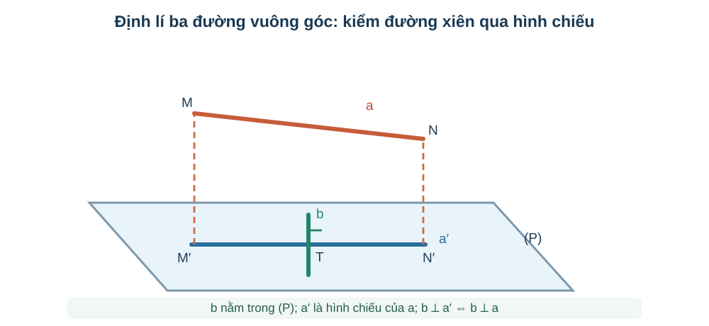

# Bài 24. Phép chiếu vuông góc. Góc giữa đường thẳng và mặt phẳng

TOÁN 11 · CHƯƠNG VII · SGK KẾT NỐI TRI THỨC · TẬP HAI

Tách độ dài xiên, hình chiếu trên nền và độ cao; đọc đúng định lí ba đường vuông góc và góc giữa đường với mặt phẳng.

<nav class="thpt-r4-lesson-tabs"><a href="../">Chương VII</a><a href="../luyen-tap/">Core và Luyện tập</a><a href="../tu-kiem-tra-chuong/">Tự kiểm tra cuối chương</a></nav>

=== "Khám phá kiến thức"

    **Vì sao cần học?** Quãng đường máy bay vừa bay không phải độ cao so với mặt đất. Một đoạn dốc cũng có ba đại lượng khác nhau: độ dài xiên, phần chiếu trên nền và chiều cao. Bài 23 đã cho em đường vuông góc duy nhất từ một điểm tới mặt phẳng; bài này dùng nó để xác định **hình chiếu** và **góc nghiêng** thay vì đo từ hình phối cảnh.

    ### 1.1. Phép chiếu vuông góc

    **Khởi động đúng theo HĐ1 SGK:** Bóng cột thẳng đứng dưới tia nắng xiên là phép chiếu **song song theo phương tia sáng**. Chưa chắc đó là phép chiếu **vuông góc**. Khi phương chiếu \(\Delta\) vuông góc với mặt sân \((P)\), phép chiếu song song theo \(\Delta\) mới gọi là phép chiếu vuông góc. Bản thân cột vuông góc sân khi chiếu vuông góc xuống sân chỉ còn **một điểm chân cột**, không phải một đoạn dài.

    **Từ điểm đến đường:** Nếu \(A\notin(P)\), kẻ \(AH\perp(P)\), thì \(H\in(P)\) là hình chiếu vuông góc của \(A\). Nếu \(A\in(P)\), hình chiếu là chính \(A\). Với đường \(a\not\perp(P)\), chọn hai điểm phân biệt \(M,N\in a\), chiếu chúng thành \(M',N'\in(P)\); khi ấy \(M'N'\) là hình chiếu của \(a\). Nếu \(a\perp(P)\), mọi điểm thuộc \(a\) chiếu về cùng một chân, nên hình chiếu là **một điểm**. Chiếu tam giác bằng cách chiếu từng đỉnh, sau đó nối các đỉnh ảnh; kết quả có thể suy biến thành đoạn khi mặt phẳng chứa tam giác chứa phương chiếu; khi ấy ba ảnh thẳng hàng, kể cả trường hợp hai đỉnh có cùng ảnh.

    <figure class="thpt-r4-plot"><figcaption><strong>Hướng dẫn đọc hình:</strong> \(A\) ngoài mặt phẳng, \(H\) là chân \(AH\perp(P)\), \(M\in(P)\). \(AM\) là đoạn xiên, \(HM\) là đoạn chiếu (khi \(H\ne M\)), \(AH\) là độ cao. Trong tam giác \(AHM\), góc vuông ở \(H\); không đo độ dài từ phối cảnh.</figcaption></figure>

    **Định lí ba đường vuông góc — vì sao đúng?** Với đường xiên \(a\) **không vuông góc \((P)\)**, \(a'\subset(P)\) là hình chiếu của \(a\), và \(b\subset(P)\), ta có

    \[
    b\perp a\quad\Longleftrightarrow\quad b\perp a'.
    \]

    Đây là vuông góc giữa **đường thẳng** theo Bài 22; hai đường đang xét có thể chéo nhau. Nếu \(a\) song song hoặc nằm trong \((P)\), hai đường \(a,a'\) cùng phương, nên kết luận trực tiếp. Nếu \(a\) cắt xiên \((P)\) tại \(O\), chọn \(M\in a\) ngoài \((P)\), gọi \(M'\) là hình chiếu vuông góc của \(M\). Hai đường \(a,a'\) cùng nằm trong mặt phẳng \((OMM')\). Vì \(MM'\perp(P)\), ta có \(b\perp MM'\). Nếu \(b\perp a'\), nó vuông góc hai đường cắt nhau \(a',MM'\) trong mặt phẳng phụ, nên \(b\perp a\). Ngược lại, nếu \(b\perp a\), nó vuông góc hai đường cắt nhau \(a,MM'\), nên \(b\perp a'\). Không dùng định lí theo dạng ấy nếu \(a\perp(P)\), vì hình chiếu \(a'\) lúc đó không phải đường.

    <figure class="thpt-r4-plot"><figcaption><strong>Hướng dẫn đọc định lí:</strong> đường cam \(a\) có hai điểm \(M,N\), đường chiếu xanh \(a'\) đi qua \(M',N'\), còn đường lục \(b\) nằm trong \((P)\). **Nếu chứng minh được** \(b\perp a'\), được kết luận \(b\perp a\), và ngược lại. Nét vuông tại \(T\) minh họa giả thiết chứ không thay chứng minh.</figcaption></figure>

    **Ví dụ 1 SGK — Bốn cột đứng trên sân:** Gọi chân của các cột \(AM,BN,CP,DQ\) lần lượt là \(A,B,C,D\), bốn đỉnh ở trên là \(M,N,P,Q\). Vì cột vuông góc mặt sân, hình chiếu của **dây \(MP\)** là **\(AC\)**, của \(NQ\) là \(BD\). Nếu \(BD\perp AC\) thì \(BD\perp MP\) theo định lí ba đường vuông góc. Nếu \(ABCD\) là hình bình hành, \(AC,BD\) có chung trung điểm \(O\); vì phép chiếu song song bảo toàn trung điểm, trung điểm \(E\) của \(MP\) và trung điểm \(F\) của \(NQ\) có cùng hình chiếu \(O\).

    **Hình chiếu của tam giác cũng có thể suy biến:** Trong hình chóp \(S.ABC\), giả sử \(SA\perp(ABC)\). Khi chiếu xuống \((ABC)\): \(S\mapsto A\), còn \(A,B,C\) giữ nguyên. Vì vậy \(SBC\mapsto ABC\), nhưng \(SAB\mapsto\) **đoạn \(AB\)**; không được gọi kết quả là tam giác có diện tích dương.

    **Vận dụng.** Cho hình chóp \(S.ABC\) với \(SA\perp(ABC)\). Hãy nêu hình chiếu của \(SC\), tam giác \(SBC\) và tam giác \(SAB\) lên đáy. Nếu \(AC\perp BC\), có suy được \(SC\perp BC\) không?

    ??? question "Đối chiếu"

        **Lời giải:** Hình chiếu \(S=A\), \(A=A\), \(B=B\), \(C=C\). Do đó \(SC\mapsto AC\), tam giác \(SBC\mapsto ABC\), tam giác \(SAB\mapsto AB\) (đoạn). Vì \(BC\subset(ABC)\), \(BC\perp AC\) và \(AC\) là hình chiếu đường \(SC\), định lí ba đường vuông góc cho \(BC\perp SC\).

    ??? tip "Kiểm lỗi"

        Không coi hình chiếu \(SAB\) là tam giác không suy biến; hai đỉnh \(S,A\) cùng chiếu về \(A\). Khi áp định lí ba đường phải chỉ rõ **mặt phẳng**, **đường xiên**, **hình chiếu**, **đường trong mặt**.

    ### 1.2. Góc giữa đường thẳng và mặt phẳng

    **Câu hỏi HĐ3 SGK:** Máy bay bay thẳng với tốc độ \(240\) km/h trong một phút thì quãng đường bay là \(4\) km. Thông tin ấy **không đủ** tìm độ cao vì chưa biết hướng bay hay góc cất cánh so với mặt đất. Để tìm độ cao, cần phân tích độ dài xiên thành phần vuông góc với mặt phẳng.

    **Định nghĩa:** Nếu \(a\not\perp(P)\), góc giữa \(a\) và \((P)\) là góc giữa \(a\) và **hình chiếu \(a'\)** của nó lên \((P)\). Nếu \(a\perp(P)\), góc đường–mặt được quy ước **\(90^\circ\)** vì hình chiếu chỉ là một điểm. Nếu \(a\subset(P)\) hoặc \(a\parallel(P)\), góc bằng \(0^\circ\). Mọi góc đường–mặt thuộc \([0^\circ,90^\circ]\).

    **Nhìn đúng tam giác vuông:** Với \(A\notin(P)\), chân \(H\), điểm \(M\in(P)\) và \(M\ne H\), góc giữa \(AM\) và mặt là **góc \(\angle AMH\)** tại \(M\). Trong tam giác vuông \(AHM\),

    \[
    \sin\alpha=\frac{AH}{AM},\qquad
    \cos\alpha=\frac{HM}{AM},\qquad
    \tan\alpha=\frac{AH}{HM}.
    \]

    Tỉ số \(\tan\alpha\) cần \(HM>0\). Góc giữa đường xiên và phương đứng \(AH\) là **góc phụ** với góc đường–mặt, không phải chính góc đó.

    <figure class="thpt-r4-plot"><figcaption><strong>Hướng dẫn đọc góc:</strong> góc cần tính ở **\(M\)** giữa đoạn xanh \(MA\) và đoạn chiếu lục \(MH\), không phải góc ở \(A\) giữa đường xiên và đường đứng đỏ \(AH\). Tại \(M\), \(AH\) là cạnh đối, \(HM\) là cạnh kề và \(AM\) là cạnh huyền.</figcaption></figure>

    **Ví dụ 2 SGK — thay đúng mặt phẳng chiếu:** Cho chóp \(S.ABC\), \(SA\perp(ABC)\), \(SA=a\), \(CA=CB=a\sqrt7\), \(AB=2a\), với \(a>0\). Góc giữa \(SB\) và đáy là \(\angle SBA\), nên \(\tan\angle SBA=SA/AB=1/2\). Nhưng muốn tìm góc giữa \(SC\) với **mặt phẳng \((SAB)\)** phải tìm hình chiếu của \(C\) lên chính mặt ấy. Gọi \(M\) là trung điểm \(AB\). Vì \(CA=CB\), có \(CM\perp AB\); mặt khác \(SA\perp(ABC)\) nên \(CM\perp SA\). Hai đường \(AB,SA\) cắt nhau tại \(A\) trong \((SAB)\), suy \(CM\perp(SAB)\). Vì vậy **\(SC\) chiếu lên \((SAB)\) thành \(SM\)**. Vì \(AM=a\), theo Pythagore trong hai tam giác vuông \(SAM,SAC\), \(SM=\sqrt{SA^2+AM^2}=a\sqrt2\), \(SC=\sqrt{SA^2+AC^2}=a\sqrt8\). Từ đó

    \[
    \cos\angle CSM=\frac{SM}{SC}=\frac12,
    \]

    nên \(\angle CSM=60^\circ\). Không được lấy \(AC\) làm hình chiếu khi đề hỏi mặt \((SAB)\), vì \(AC\) nằm trong **mặt đáy khác**.

    <figure class="thpt-r4-plot"><figcaption><strong>Hướng dẫn đọc hình SGK:</strong> \(M\) là trung điểm \(AB\); \(CM\perp AB\) do \(CA=CB\), và \(CM\perp SA\) do \(SA\perp(ABC)\). Suy \(CM\perp(SAB)\) nên \(SM\) là hình chiếu của \(SC\). Khung phải có tam giác \(SMC\) vuông tại \(M\): \(\cos\angle CSM=SM/SC=1/2\), suy góc \(60^\circ\).</figcaption></figure>

    **Phân biệt tỉ số:** \(\sin\alpha\) = cao/xiên, \(\tan\alpha\) = cao/ngang. “Độ dốc 1:12” nghĩa là \(\tan\alpha=1/12\), **không** có nghĩa \(\alpha=1/12^\circ\). Trong bài toán thực tế, cần giữ đơn vị và điều kiện mô hình.

    **Vận dụng.** Máy bay cất cánh từ mặt đất và bay thẳng trong phút đầu với tốc độ \(240\) km/h và góc cất cánh không đổi \(30^\circ\) so với mặt đất phẳng. Tìm độ cao sau một phút. Nếu chỉ biết tốc độ có xác định được độ cao không?

    ??? question "Đối chiếu"

        **Lời giải:** Quãng đường bay thẳng trong một phút \(s=240/60=4\) km. Độ cao \(h=s\sin30^\circ=4/2=2\) km. Nếu không biết góc cất cánh hoặc dữ kiện hình học tương đương, không xác định được độ cao duy nhất.

    ??? tip "Kiểm lỗi"

        \(4\) km là **quãng đường xiên**, không phải độ cao. \(\tan30^\circ\) nhân với quãng **ngang**, không nhân với quãng xiên.

=== "Kiến thức SGK"

    ### 2.1. Phép chiếu vuông góc

    
<strong>Định nghĩa — Phép chiếu vuông góc</strong>
Phép chiếu song song lên mặt phẳng \((P)\) theo phương \(\Delta\perp(P)\) được gọi là <strong>phép chiếu vuông góc</strong> lên \((P)\). Với điểm \(A\notin(P)\), hình chiếu \(H\in(P)\) là chân của đường \(AH\perp(P)\); với \(A\in(P)\), hình chiếu là chính \(A\). Đây là trường hợp đặc biệt của phép chiếu song song.

    **Cách dựng và điều kiện:** Chiếu từng điểm theo phương vuông góc. Hình chiếu của đường \(a\not\perp(P)\) là đường qua hai hình chiếu phân biệt của điểm trên \(a\); hình chiếu của đường \(a\perp(P)\) **chỉ là một điểm**. Đoạn thẳng chiếu thành đoạn nối ảnh hai đầu mút, tam giác chiếu các đỉnh và **có thể suy biến**.

    <figure class="thpt-r4-plot"><figcaption><strong>Tra hình chiếu:</strong> \(AH\perp(P)\) nên \(H\) là hình chiếu của \(A\). Với \(M\in(P),M\ne H\), đoạn \(AM\) chiếu thành \(HM\), còn đoạn \(AH\) chiếu thành **một điểm \(H\)**.</figcaption></figure>

    
<strong>Định lí — Ba đường vuông góc</strong>
Cho đường \(a\) <strong>không vuông góc</strong> với mặt phẳng \((P)\), gọi \(a'\) là hình chiếu vuông góc của \(a\) lên \((P)\). Với đường \(b\subset(P)\), ta có <strong>\(b\perp a\Longleftrightarrow b\perp a'\)</strong>. Vuông góc được hiểu là góc giữa các đường thẳng, kể cả hai đường có thể chéo nhau.

    <figure class="thpt-r4-plot"><figcaption><strong>Tra định lí:</strong> \(a\) cam, \(a'\) xanh qua hai chân \(M',N'\), \(b\) lục thuộc \((P)\). Kiểm \(b\perp a'\) trước, rồi suy \(b\perp a\), hoặc đi chiều ngược. Khi \(a\perp(P)\), hình chiếu chỉ là một điểm nên không sử dụng công thức này.</figcaption></figure>

    **Ví dụ SGK:** Bốn cột \(AM,BN,CP,DQ\) vuông góc sân nên hình chiếu hai dây \(MP,NQ\) lần lượt là \(AC,BD\). Với \(BD\perp AC\), suy \(BD\perp MP\). Nếu \(ABCD\) là hình bình hành, hai trung điểm của \(MP,NQ\) cùng chiếu về giao điểm hai đường chéo đáy.

    **Chiếu tam giác:** Nếu \(SA\perp(ABC)\), hình chiếu của tam giác \(SBC\) là tam giác \(ABC\), còn hình chiếu của tam giác \(SAB\) là đoạn \(AB\). Phải xét ảnh của **mỗi đỉnh**, không mặc định hình không suy biến.

    ### 2.2. Góc giữa đường thẳng và mặt phẳng

    
<strong>Định nghĩa — Góc giữa đường thẳng và mặt phẳng</strong>
Nếu \(a\perp(P)\), góc đường–mặt bằng <strong>\(90^\circ\)</strong>. Nếu \(a\not\perp(P)\), góc là góc giữa \(a\) và <strong>hình chiếu \(a'\)</strong> của \(a\) lên \((P)\). Luôn \(0^\circ\le\alpha\le90^\circ\); với \(a\subset(P)\) hoặc \(a\parallel(P)\), góc bằng \(0^\circ\).

    **Tỉ số trong tam giác vuông:** Với \(AH\perp(P)\), \(M\in(P)\), \(M\ne H\), góc \(\alpha=\angle AMH\). Khi đó \(\sin\alpha=AH/AM\), \(\cos\alpha=HM/AM\), \(\tan\alpha=AH/HM\), với \(HM>0\). Đường vuông góc \((P)\) dùng quy ước góc \(90^\circ\), không tính \(\tan90^\circ\).

    <figure class="thpt-r4-plot"><figcaption><strong>Tra góc:</strong> chọn **\(\angle AMH\) tại \(M\)** giữa \(MA\) và \(MH\), không phải góc tại \(A\) giữa \(AM\) và phương đứng \(AH\). Hai góc nhọn của tam giác vuông **phụ nhau**, có tổng \(90^\circ\).</figcaption></figure>

    **Nhận dạng mặt phẳng chiếu:** Khi đề hỏi góc của đường \(SC\) với \((SAB)\), hãy tìm chân vuông góc của \(C\) lên \((SAB)\), không mặc định chiếu xuống đáy \((ABC)\).

    <figure class="thpt-r4-plot"><figcaption><strong>Tra Ví dụ 2 SGK:</strong> \(M\) là trung điểm \(AB\); vì \(CA=CB\) nên \(CM\perp AB\); vì \(SA\perp(ABC)\) nên \(CM\perp SA\). Vậy \(CM\perp(SAB)\), hình chiếu của \(SC\) là \(SM\). Khung phải: \(SM=a\sqrt2\), \(SC=a\sqrt8\), \(\cos\angle CSM=1/2\), suy góc \(60^\circ\).</figcaption></figure>

    **Ví dụ 2 SGK — Hai mặt phẳng chiếu khác nhau:** Trong chóp \(S.ABC\), \(SA\perp(ABC)\), \(SA=a\), \(CA=CB=a\sqrt7\), \(AB=2a\) (\(a>0\)), góc giữa \(SB\) và đáy có \(\tan\angle SBA=1/2\). Mặt khác \(CM\perp(SAB)\), nên góc giữa \(SC\) và \((SAB)\) là \(\angle CSM=60^\circ\), không phải góc giữa \(SC\) và đáy.

    | Vị trí của đường \(a\) | Hình chiếu vuông góc lên \((P)\) | Góc đường–mặt |
    | :-- | :-- | :-- |
    | \(a\subset(P)\) | \(a\) | \(0^\circ\) |
    | \(a\parallel(P)\) | Một đường trong \((P)\) cùng phương \(a\) | \(0^\circ\) |
    | \(a\) cắt xiên \((P)\) | Một đường \(a'\subset(P)\) | \(0^\circ<\alpha<90^\circ\) |
    | \(a\perp(P)\) | Một điểm | \(90^\circ\) |

    **Áp dụng đúng giới hạn:** Nếu máy bay bay thẳng, tốc độ không đổi, quãng bay xiên \(s\) và góc cất cánh \(\alpha\) không đổi so với mặt đất phẳng, độ tăng độ cao là \(h=s\sin\alpha\); đây cũng là độ cao so với mặt đất nếu máy bay xuất phát từ mặt đất. Nếu thiếu góc (hoặc một dữ kiện tương đương), biết tốc độ không đủ để tính độ cao.

=== "Ví dụ"

    ### 3.1. Chiếu điểm và đường vuông góc mặt phẳng

    **Đề bài.** Điểm \(A\notin(P)\), \(H\) là chân đường vuông góc từ \(A\) xuống \((P)\), \(M\in(P)\) và \(M\ne H\). Xác định hình chiếu của điểm \(A\), đoạn \(AH\) và đoạn \(AM\) lên \((P)\).

    **Phân tích:** Hình chiếu của **một điểm** là chân pháp tuyến; hình chiếu **đoạn** có hai đầu mút là hai điểm ảnh, nhưng có thể **co thành một điểm** khi hai đầu mút trùng ảnh.

    

<strong>Lời giải.</strong> Vì \(AH\perp(P)\), hình chiếu của \(A\) là \(H\). Điểm \(H\in(P)\) tự chiếu thành \(H\), nên hình chiếu đoạn \(AH\) chỉ là điểm \(H\). Điểm \(M\in(P)\) tự chiếu thành \(M\), nên đoạn \(AM\) chiếu thành đoạn \(HM\).

    **Kiểm lại:** Không gọi điểm \(H\) là **một đường thẳng**. Điều kiện \(M\ne H\) làm đoạn chiếu \(HM\) không suy biến.

    ### 3.2. Bóng nắng và phép chiếu vuông góc

    **Đề bài.** Một cột đứng \(AH\perp(P)\) trên sân. Bóng của cột dưới các tia sáng xiên được tạo bởi phép chiếu song song theo phương tia sáng. Có thể gọi đó là phép chiếu vuông góc không? Nếu nắng chiếu theo phương vuông góc sân thì bóng hình học của cột có dạng gì?

    **Phân tích:** Phép chiếu vuông góc là **phép chiếu song song có phương chiếu vuông góc mặt sân**. Hướng các tia sáng, không phải sự đứng thẳng của cột, quyết định tên phép chiếu.

    

<strong>Lời giải.</strong> Khi tia sáng xiên, phương chiếu không vuông góc \((P)\), nên bóng cột là hình chiếu song song **không phải hình chiếu vuông góc**. Nếu các tia sáng vuông góc sân, cột \(AH\) cũng song song phương chiếu và toàn bộ cột chiếu về chân \(H\); bóng hình học chỉ còn **một điểm \(H\)**.

    **Kiểm lại:** Không suy “cột vuông góc sân thì mọi cái bóng đều là hình chiếu vuông góc”. Phải kiểm **phương chiếu**.

    ### 3.3. Dùng định lí ba đường vuông góc

    **Đề bài.** Trên mặt sân \((P)\), bốn cột \(AM,BN,CP,DQ\) vuông góc sân tại \(A,B,C,D\). Chứng minh nếu \(BD\perp AC\) thì \(BD\perp MP\), với \(M,P\) là đỉnh của hai cột tại \(A,C\).

    **Phân tích:** Xác định **hình chiếu của đường xiên \(MP\)**: hai đầu mút \(M,P\) chiếu về \(A,C\), nên hình chiếu là \(AC\) (với \(A\ne C\)). Sau đó dùng một đường **nằm trong sân** là \(BD\).

    

<strong>Lời giải.</strong> Vì các cột \(AM,CP\) vuông góc \((P)\), \(M\mapsto A\), \(P\mapsto C\); do đó hình chiếu của \(MP\) lên \((P)\) là \(AC\). Đường \(BD\subset(P)\) và \(BD\perp AC\). Theo định lí ba đường vuông góc, \(BD\perp MP\).

    **Kiểm lại:** Nếu \(MP\perp(P)\) thì hình chiếu sẽ là **một điểm**; ở đây \(A\ne C\) nên hình chiếu đúng là đường \(AC\). Không nhầm \(BD\perp MP\) với “BD cắt MP”.

    ### 3.4. Hình chiếu tam giác có thể suy biến

    **Đề bài.** Trong chóp \(S.ABC\), \(SA\perp(ABC)\). Xác định hình chiếu của các tam giác \(SBC,SCA,SAB\) lên mặt đáy.

    **Phân tích:** Chiếu **từng đỉnh** rồi nối các điểm ảnh; vì \(S\mapsto A\), một số hình ban đầu có hai đỉnh trùng nhau sau chiếu.

    

<strong>Lời giải.</strong> Trên \((ABC)\), các điểm \(A,B,C\) tự chiếu thành chính chúng và \(S\mapsto A\). Do đó \(SBC\mapsto ABC\) (tam giác), \(SCA\mapsto AC\) (đoạn thẳng), \(SAB\mapsto AB\) (đoạn thẳng).

    **Kiểm lại:** Hình \(SCA\) không thành một tam giác khác, vì \(S\) và \(A\) có **cùng hình chiếu \(A\)**. Sự suy biến này đúng với phép chiếu song song nói chung.

    ### 3.5. Đọc góc đường–mặt từ tam giác 6–8–10

    **Đề bài.** Một đoạn dốc dài 10 m, cao hơn nền 6 m. Tính độ dài hình chiếu trên nền và \(\sin\alpha,\tan\alpha\), với \(\alpha\) là góc giữa đoạn dốc và mặt nền.

    **Phân tích:** Độ dài 10 là **cạnh huyền**, 6 là **độ cao vuông góc**; hình chiếu là cạnh ngang chưa biết. Dùng Pythagore trước, tỉ số lượng giác sau.

    

<strong>Lời giải.</strong> Đoạn chiếu \(d=\sqrt{10^2-6^2}=8\) m. Vì góc đường–mặt là góc ở đầu đoạn dốc trên nền, \(\sin\alpha=6/10=3/5\), \(\tan\alpha=6/8=3/4\). Góc \(\alpha=\arcsin(3/5)\approx36{,}9^\circ\).

    **Kiểm lại:** \(\tan\alpha=3/4\), **không** phải \(6/10\); vì mẫu số của tang là đoạn **chiếu ngang** 8 m.

    ### 3.6. Ví dụ 2 SGK — Hai góc với hai mặt phẳng khác nhau

    **Đề bài.** Cho chóp \(S.ABC\) với \(SA\perp(ABC)\), \(SA=a\), \(CA=CB=a\sqrt7\), \(AB=2a\) (\(a>0\)). a) Tính tang góc giữa \(SB\) và \((ABC)\). b) Tính góc giữa \(SC\) và \((SAB)\).

    **Phân tích:** Phần a, hình chiếu \(SB\) xuống đáy là \(AB\). Phần b, mặt phẳng yêu cầu **đổi thành \((SAB)\)**, nên phải tìm hình chiếu của \(C\) lên mặt này. Lấy trung điểm \(M\) của \(AB\) để chứng minh \(CM\perp(SAB)\).

    <figure class="thpt-r4-plot"><figcaption><strong>Đọc hình trước lời giải:</strong> \(SA\) vuông góc **đáy** tại \(A\). Với phần b phải tìm hình chiếu lên mặt \((SAB)\): đường \(CM\) vuông góc **hai đường cắt nhau** \(AB,SA\) trong mặt ấy; kết luận \(SM\) là hình chiếu \(SC\) trên \((SAB)\). Góc cuối cùng nằm ở \(S\) trong tam giác vuông \(SMC\).</figcaption></figure>

    

<strong>Lời giải.</strong> a) \(SB\) chiếu xuống \((ABC)\) thành \(AB\); góc cần tìm là \(\angle SBA\). Vì tam giác \(SAB\) vuông tại \(A\), \(\tan\angle SBA=SA/AB=a/(2a)=1/2\). b) Lấy \(M\) là trung điểm \(AB\). Tam giác \(ABC\) cân tại \(C\) nên \(CM\perp AB\); vì \(SA\perp(ABC)\), \(CM\perp SA\). Hai đường \(AB,SA\subset(SAB)\) cắt nhau, nên \(CM\perp(SAB)\). Hình chiếu \(SC\) lên \((SAB)\) là \(SM\). \(SM=\sqrt{SA^2+AM^2}=a\sqrt2\); \(SC=\sqrt{SA^2+AC^2}=a\sqrt8\), nên \(\cos\angle CSM=SM/SC=1/2\); góc cần tìm bằng \(60^\circ\).

    **Kiểm lại:** \(a>0\) nên được rút gọn \(a\) trong tỉ số. Hai phần xét **hai mặt phẳng khác nhau**; không dùng \(\angle SBA\) cho phần b.

    ### 3.7. Máy bay: quãng đường bay và độ cao

    **Đề bài.** Máy bay bay thẳng với tốc độ không đổi \(240\) km/h, góc cất cánh \(30^\circ\) so với nền ngang. Tính quãng đường và độ cao sau đúng một phút.

    **Phân tích:** Đổi \(1\) phút \(=1/60\) giờ. Quãng bay là cạnh xiên; độ cao là cạnh đối của góc cất cánh, nên phải nhân với \(\sin30^\circ\).

    

<strong>Lời giải.</strong> Quãng bay thẳng \(s=240\cdot1/60=4\) km. Theo mô hình tam giác vuông, độ cao \(h=s\sin30^\circ=4\cdot1/2=2\) km. Quãng chiếu trên mặt đất bằng \(4\cos30^\circ=2\sqrt3\) km.

    **Kiểm lại:** Nếu không có góc \(30^\circ\), dữ kiện tốc độ chỉ đủ tính **4 km quãng đường**, chưa đủ tính độ cao. Mô hình không tính giai đoạn thay đổi góc/tốc độ.

    ### 3.8. Góc đường chéo của hình lập phương với mặt đáy

    **Đề bài.** Cho hình lập phương \(ABCD.A'B'C'D'\) cạnh \(a>0\). Xác định góc giữa \(A'C\) và đáy \((ABCD)\); tính \(\tan\alpha\) và số đo gần đúng của góc.

    **Phân tích:** \(A'\) chiếu xuống mặt đáy tại \(A\), \(C\) nằm trong đáy. Vậy hình chiếu \(A'C\) là đường \(AC\); góc cần tìm ở **\(C\)** giữa \(CA'\) và \(CA\).

    

<strong>Lời giải.</strong> Tam giác \(A'AC\) vuông tại \(A\). Vì \(A'A=a\), \(AC=a\sqrt2\), \(\tan\alpha=A'A/AC=1/\sqrt2=\sqrt2/2\). Do đó \(\alpha=\arctan(1/\sqrt2)\approx35{,}3^\circ\).

    **Kiểm lại:** Góc giữa đường với đáy không phải \(90^\circ\): \(A'C\) là đường **xiên**, không vuông góc đáy. Độ dài \(AC=a\sqrt2\) là đường chéo đáy, không phải cạnh \(a\).

=== "Lỗi thường gặp"

    ### 4.1. Gọi mọi cái bóng là phép chiếu vuông góc

    **Dấu hiệu:** Cột vuông góc sân nên cho rằng bóng dưới tia nắng xiên là hình chiếu vuông góc.

    **Vì sao sai:** Tên phép chiếu phụ thuộc **phương chiếu**, không phụ thuộc riêng phương của vật. Tia nắng xiên cho phép chiếu song song nhưng không theo pháp tuyến sân.

    **Cách sửa:** Kiểm \(\Delta\perp(P)\). Chỉ khi phương chiếu vuông góc mặt phẳng mới gọi là phép chiếu vuông góc.

    ### 4.2. Chiếu đường vuông góc thành một đường

    **Dấu hiệu:** Với \(a\perp(P)\), vẽ hình chiếu \(a'\) như một đường trên \((P)\).

    **Vì sao sai:** Mọi điểm trên \(a\) nằm cùng một phương chiếu và cùng cho **một chân** trên \((P)\).

    **Cách sửa:** Hình chiếu của \(a\perp(P)\) chỉ là **một điểm**; không áp định lí ba đường vuông góc với hình chiếu suy biến.

    ### 4.3. Đổi vai của ba đường trong định lí

    **Dấu hiệu:** Có \(b\subset(P)\), đường xiên \(a\), nhưng lấy hình chiếu của \(b\) rồi suy vuông góc tùy ý.

    **Vì sao sai:** Định lí yêu cầu đường xiên \(a\not\perp(P)\) và **hình chiếu của chính nó** là \(a'\), còn \(b\) nằm sẵn trong mặt.

    **Cách sửa:** Xác định đúng bốn vai: mặt \((P)\), đường xiên \(a\), đường chiếu \(a'\), đường \(b\subset(P)\). Dùng \(b\perp a\iff b\perp a'\).

    ### 4.4. Chiếu xuống sai mặt phẳng rồi lấy nhầm góc

    **Dấu hiệu:** Bài hỏi góc \(SC\) với \((SAB)\), nhưng dùng \(AC\) là hình chiếu trên \((ABC)\).

    **Vì sao sai:** Một đường có thể có **hình chiếu khác nhau lên các mặt phẳng khác nhau**. \(AC\) chỉ là hình chiếu \(SC\) lên đáy khi \(SA\perp(ABC)\).

    **Cách sửa:** Chứng minh \(CM\perp(SAB)\) trong Ví dụ 3.6, xác định \(SM\) là hình chiếu cần dùng và đọc góc \(\angle CSM\).

    ### 4.5. Đánh tráo sin, cos, tan hoặc góc với phương đứng

    **Dấu hiệu:** Dốc 10 m và cao 6 m mà cho \(\tan\alpha=6/10\), hoặc lấy góc tại đỉnh trên của dây.

    **Vì sao sai:** Tang dùng **cao/ngang**, sin dùng **cao/xiên**. Góc giữa đường xiên và phương đứng là góc **phụ** với góc đường–mặt.

    **Cách sửa:** Vẽ tam giác vuông, đánh dấu góc ở đầu đường xiên thuộc nền, tìm đoạn chiếu bằng Pythagore rồi mới chọn tỉ số.

    ### 4.6. Lấy quãng bay làm độ cao, quên điều kiện mô hình

    **Dấu hiệu:** Bay \(240\) km/h trong một phút nên kết luận độ cao bằng 4 km hoặc tính \(\tan30^\circ\) nhân quãng bay xiên.

    **Vì sao sai:** Quãng bay xiên \(s=4\) km, độ cao \(h=s\sin\alpha\) chỉ xác định khi đã biết góc và mô hình bay thẳng thích hợp.

    **Cách sửa:** Đổi phút sang giờ, xác định đúng cạnh xiên và cạnh cao; lấy \(h=4\sin30^\circ=2\) km. Nếu đề thiếu góc, nói rõ **không đủ dữ kiện**.

    **Học tiếp:** [Core và Luyện tập Bài 24](luyen-tap.md) · [Tự luận Chương VII](../../../thu-vien/tu-luan-g11-chuong-vii.md) · [Tự kiểm tra cuối chương](tu-kiem-tra-chuong.md).

    
Nguồn S1: SGK Toán 11 Kết nối tri thức với cuộc sống, tập hai, Bài 24 trang in 38–43. Hai mục SGK: “Phép chiếu vuông góc”; “Góc giữa đường thẳng và mặt phẳng”. HĐ1, HĐ2, HĐ3, Ví dụ 1–2 và các trường hợp suy biến đã được đối chiếu với văn bản bản số hóa của SGK. Trang PDF screenshot và offset trang in↔chỉ số PDF chưa xác minh được do lỗi truy xuất ảnh, giữ SOURCE_VISUAL_OFFSET_HOLD. SVG tam giác dốc gốc được tái dùng nguyên file; bổ sung hai SVG cho định lí ba đường vuông góc và ví dụ hình chóp với mặt phẳng chiếu đổi. Mọi hình có ALT và hướng dẫn đọc tại chỗ. Chỉ sửa trang Kiến thức; Core/Luyện tập, Tự kiểm tra, ngân hàng và đánh giá giữ nguyên.

