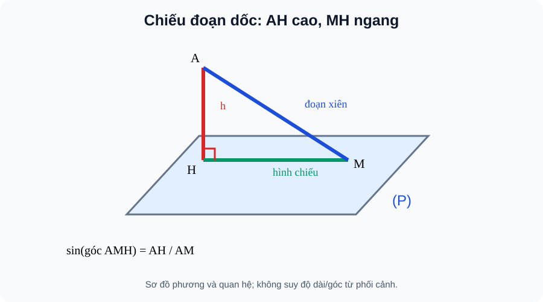
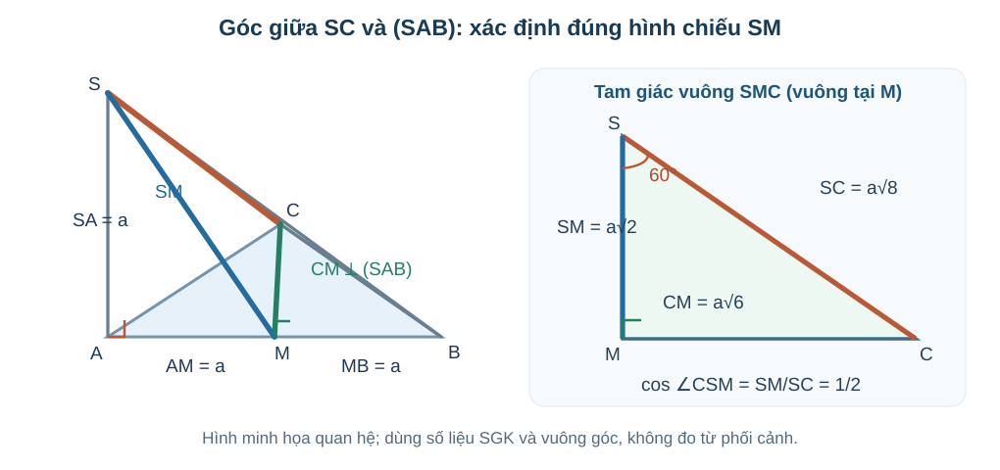

# Bài 24. Phép chiếu vuông góc. Góc giữa đường thẳng và mặt phẳng

TOÁN 11 · CHƯƠNG VII · SGK KẾT NỐI TRI THỨC · TẬP HAI

Tách độ dài xiên, hình chiếu trên nền và độ cao; đọc đúng định lí ba đường vuông góc và góc giữa đường với mặt phẳng.

<nav class="thpt-r4-lesson-tabs"><a href="../">Chương VII</a><a href="../luyen-tap/">Core và Luyện tập</a><a href="../tu-kiem-tra-chuong/">Tự kiểm tra cuối chương</a></nav>

=== "Khám phá kiến thức"

    **Vì sao cần học?** Quãng đường máy bay vừa bay không phải độ cao so với mặt đất. Một đoạn dốc cũng có ba đại lượng khác nhau: độ dài xiên, phần chiếu trên nền và chiều cao. Bài 23 đã cho em đường vuông góc duy nhất từ một điểm tới mặt phẳng; bài này dùng nó để xác định **hình chiếu** và **góc nghiêng** thay vì đo từ hình phối cảnh.

    ### 1.1. Phép chiếu vuông góc

    **Khởi động đúng theo HĐ1 SGK:** Bóng cột thẳng đứng dưới tia nắng xiên là phép chiếu **song song theo phương tia sáng**. Chưa chắc đó là phép chiếu **vuông góc**. Khi phương chiếu \(\Delta\) vuông góc với mặt sân \((P)\), phép chiếu song song theo \(\Delta\) mới gọi là phép chiếu vuông góc. Bản thân cột vuông góc sân khi chiếu vuông góc xuống sân chỉ còn **một điểm chân cột**, không phải một đoạn dài.

    **Từ điểm đến đường:** Nếu \(A\notin(P)\), kẻ \(AH\perp(P)\), thì \(H\in(P)\) là hình chiếu vuông góc của \(A\). Với đường \(a\not\perp(P)\), chọn hai điểm phân biệt \(M,N\in a\), chiếu chúng thành \(M',N'\in(P)\); khi ấy \(M'N'\) là hình chiếu của \(a\). Nếu \(a\perp(P)\), mọi điểm thuộc \(a\) chiếu về cùng một chân, nên hình chiếu là **một điểm**. Chiếu tam giác bằng cách chiếu từng đỉnh, sau đó nối các đỉnh ảnh; kết quả có thể suy biến thành đoạn khi hai đỉnh cùng chiếu về một điểm.

    <figure class="thpt-r4-plot"><figcaption><strong>Hướng dẫn đọc hình:</strong> \(A\) ngoài mặt phẳng, \(H\) là chân \(AH\perp(P)\), \(M\in(P)\). \(AM\) là đoạn xiên, \(HM\) là đoạn chiếu (khi \(H\ne M\)), \(AH\) là độ cao. Trong tam giác \(AHM\), góc vuông ở \(H\); không đo độ dài từ phối cảnh.</figcaption></figure>

    **Định lí ba đường vuông góc — vì sao đúng?** Với đường xiên \(a\) **không vuông góc \((P)\)**, \(a'\subset(P)\) là hình chiếu của \(a\), và \(b\subset(P)\), ta có
    \[
    b\perp a\quad\Longleftrightarrow\quad b\perp a'.
    \]
    Đây là vuông góc giữa **đường thẳng** theo Bài 22; hai đường đang xét có thể chéo nhau. Vì \(b\) nằm trong \((P)\), nó đã vuông góc với mọi thành phần theo phương pháp tuyến. Do đó việc \(b\) vuông góc đường xiên chỉ phụ thuộc thành phần chiếu theo \(a'\). Không dùng định lí theo dạng ấy nếu \(a\perp(P)\), vì hình chiếu \(a'\) lúc đó không phải đường.

    <figure class="thpt-r4-plot"><figcaption><strong>Hướng dẫn đọc định lí:</strong> đường cam \(a\) có hai điểm \(M,N\), đường chiếu xanh \(a'\) đi qua \(M',N'\), còn đường lục \(b\) nằm trong \((P)\). **Nếu chứng minh được** \(b\perp a'\), được kết luận \(b\perp a\), và ngược lại. Nét vuông tại \(T\) minh họa giả thiết chứ không thay chứng minh.</figcaption></figure>

    **Ví dụ 1 SGK — Bốn cột đứng trên sân:** Gọi chân của các cột \(AM,BN,CP,DQ\) lần lượt là \(A,B,C,D\), bốn đỉnh ở trên là \(M,N,P,Q\). Vì cột vuông góc mặt sân, hình chiếu của **dây \(MP\)** là **\(AC\)**, của \(NQ\) là \(BD\). Nếu \(BD\perp AC\) thì \(BD\perp MP\) theo định lí ba đường vuông góc. Nếu \(ABCD\) là hình bình hành, \(AC,BD\) có chung trung điểm \(O\); vì phép chiếu song song bảo toàn trung điểm, trung điểm \(E\) của \(MP\) và trung điểm \(F\) của \(NQ\) có cùng hình chiếu \(O\).

    **Hình chiếu của tam giác cũng có thể suy biến:** Trong hình chóp \(S.ABC\), giả sử \(SA\perp(ABC)\). Khi chiếu xuống \((ABC)\): \(S\mapsto A\), còn \(A,B,C\) giữ nguyên. Vì vậy \(SBC\mapsto ABC\), nhưng \(SAB\mapsto\) **đoạn \(AB\)**; không được gọi kết quả là tam giác có diện tích dương.

    **Vận dụng.** Cho hình chóp \(S.ABC\) với \(SA\perp(ABC)\). Hãy nêu hình chiếu của \(SC\), tam giác \(SBC\) và tam giác \(SAB\) lên đáy. Nếu \(AC\perp BC\), có suy được \(SC\perp BC\) không?

    ??? question "Đối chiếu"

        **Lời giải:** Hình chiếu \(S=A\), \(A=A\), \(B=B\), \(C=C\). Do đó \(SC\mapsto AC\), tam giác \(SBC\mapsto ABC\), tam giác \(SAB\mapsto AB\) (đoạn). Vì \(BC\subset(ABC)\), \(BC\perp AC\) và \(AC\) là hình chiếu đường \(SC\), định lí ba đường vuông góc cho \(BC\perp SC\).

    ??? tip "Kiểm lỗi"

        Không coi hình chiếu \(SAB\) là tam giác không suy biến; hai đỉnh \(S,A\) cùng chiếu về \(A\). Khi áp định lí ba đường phải chỉ rõ **mặt phẳng**, **đường xiên**, **hình chiếu**, **đường trong mặt**.

    ### 1.2. Góc giữa đường thẳng và mặt phẳng

    **Câu hỏi HĐ3 SGK:** Máy bay bay thẳng với tốc độ \(240\) km/h trong một phút thì quãng đường bay là \(4\) km. Thông tin ấy **không đủ** tìm độ cao vì chưa biết hướng bay hay góc cất cánh so với mặt đất. Để tìm độ cao, cần phân tích độ dài xiên thành phần vuông góc với mặt phẳng.

    **Định nghĩa:** Nếu \(a\not\perp(P)\), góc giữa \(a\) và \((P)\) là góc giữa \(a\) và **hình chiếu \(a'\)** của nó lên \((P)\). Nếu \(a\perp(P)\), góc đường–mặt được quy ước **\(90^\circ\)** vì hình chiếu chỉ là một điểm. Nếu \(a\subset(P)\) hoặc \(a\parallel(P)\), góc bằng \(0^\circ\). Mọi góc đường–mặt thuộc \([0^\circ,90^\circ]\).

    **Nhìn đúng tam giác vuông:** Với \(A\notin(P)\), chân \(H\), điểm \(M\in(P)\) và \(M\ne H\), góc giữa \(AM\) và mặt là **góc \(\angle AMH\)** tại \(M\). Trong tam giác vuông \(AHM\),
    \[
    \sin\alpha=\frac{AH}{AM},\qquad
    \cos\alpha=\frac{HM}{AM},\qquad
    \tan\alpha=\frac{AH}{HM}.
    \]
    Tỉ số \(\tan\alpha\) cần \(HM>0\). Góc giữa đường xiên và phương đứng \(AH\) là **góc phụ** với góc đường–mặt, không phải chính góc đó.

    <figure class="thpt-r4-plot"><figcaption><strong>Hướng dẫn đọc góc:</strong> góc cần tính ở **\(M\)** giữa đoạn xanh \(MA\) và đoạn chiếu lục \(MH\), không phải góc ở \(A\) giữa đường xiên và đường đứng đỏ \(AH\). Tại \(M\), \(AH\) là cạnh đối, \(HM\) là cạnh kề và \(AM\) là cạnh huyền.</figcaption></figure>

    **Ví dụ 2 SGK — thay đúng mặt phẳng chiếu:** Cho chóp \(S.ABC\), \(SA\perp(ABC)\), \(SA=a\), \(CA=CB=a\sqrt7\), \(AB=2a\), với \(a>0\). Góc giữa \(SB\) và đáy là \(\angle SBA\), nên \(\tan\angle SBA=SA/AB=1/2\). Nhưng muốn tìm góc giữa \(SC\) với **mặt phẳng \((SAB)\)** phải tìm hình chiếu của \(C\) lên chính mặt ấy. Gọi \(M\) là trung điểm \(AB\). Vì \(CA=CB\), có \(CM\perp AB\); mặt khác \(SA\perp(ABC)\) nên \(CM\perp SA\). Hai đường \(AB,SA\) cắt nhau tại \(A\) trong \((SAB)\), suy \(CM\perp(SAB)\). Vì vậy **\(SC\) chiếu lên \((SAB)\) thành \(SM\)**. Từ \(SM=a\sqrt2\), \(SC=a\sqrt8\),
    \[
    \cos\angle CSM=\frac{SM}{SC}=\frac12,
    \]
    nên \(\angle CSM=60^\circ\). Không được lấy \(AC\) làm hình chiếu khi đề hỏi mặt \((SAB)\), vì \(AC\) nằm trong **mặt đáy khác**.

    <figure class="thpt-r4-plot"><figcaption><strong>Hướng dẫn đọc hình SGK:</strong> \(M\) là trung điểm \(AB\); \(CM\perp AB\) do \(CA=CB\), và \(CM\perp SA\) do \(SA\perp(ABC)\). Suy \(CM\perp(SAB)\) nên \(SM\) là hình chiếu của \(SC\). Khung phải có tam giác \(SMC\) vuông tại \(M\): \(\cos\angle CSM=SM/SC=1/2\), suy góc \(60^\circ\).</figcaption></figure>

    **Phân biệt tỉ số:** \(\sin\alpha\) = cao/xiên, \(\tan\alpha\) = cao/ngang. “Độ dốc 1:12” nghĩa là \(\tan\alpha=1/12\), **không** có nghĩa \(\alpha=1/12^\circ\). Trong bài toán thực tế, cần giữ đơn vị và điều kiện mô hình.

    **Vận dụng.** Máy bay bay thẳng trong phút đầu với tốc độ \(240\) km/h và góc cất cánh không đổi \(30^\circ\) so với mặt đất phẳng. Tìm độ cao sau một phút. Nếu chỉ biết tốc độ có xác định được độ cao không?

    ??? question "Đối chiếu"

        **Lời giải:** Quãng đường bay thẳng trong một phút \(s=240/60=4\) km. Độ cao \(h=s\sin30^\circ=4/2=2\) km. Nếu không biết góc cất cánh hoặc dữ kiện hình học tương đương, không xác định được độ cao duy nhất.

    ??? tip "Kiểm lỗi"

        \(4\) km là **quãng đường xiên**, không phải độ cao. \(\tan30^\circ\) nhân với quãng **ngang**, không nhân với quãng xiên.

=== "Kiến thức SGK"

    ### 2.1. Phép chiếu vuông góc

    
<strong>Định nghĩa — Phép chiếu vuông góc</strong>
Phép chiếu song song lên mặt phẳng \((P)\) theo phương \(\Delta\perp(P)\) được gọi là <strong>phép chiếu vuông góc</strong> lên \((P)\). Với điểm \(A\), hình chiếu \(H\in(P)\) là chân của đường \(AH\perp(P)\); với \(A\in(P)\), hình chiếu là chính \(A\). Đây là trường hợp đặc biệt của phép chiếu song song.

    **Cách dựng và điều kiện:** Chiếu từng điểm theo phương vuông góc. Hình chiếu của đường \(a\not\perp(P)\) là đường qua hai hình chiếu phân biệt của điểm trên \(a\); hình chiếu của đường \(a\perp(P)\) **chỉ là một điểm**. Đoạn thẳng chiếu thành đoạn nối ảnh hai đầu mút, tam giác chiếu các đỉnh và **có thể suy biến**.

    <figure class="thpt-r4-plot"><figcaption><strong>Tra hình chiếu:</strong> \(AH\perp(P)\) nên \(H\) là hình chiếu của \(A\). Với \(M\in(P),M\ne H\), đoạn \(AM\) chiếu thành \(HM\), còn đoạn \(AH\) chiếu thành **một điểm \(H\)**.</figcaption></figure>

    
<strong>Định lí — Ba đường vuông góc</strong>
Cho đường \(a\) <strong>không vuông góc</strong> với mặt phẳng \((P)\), gọi \(a'\) là hình chiếu vuông góc của \(a\) lên \((P)\). Với đường \(b\subset(P)\), ta có <strong>\(b\perp a\Longleftrightarrow b\perp a'\)</strong>. Vuông góc được hiểu là góc giữa các đường thẳng, kể cả hai đường có thể chéo nhau.

    <figure class="thpt-r4-plot"><figcaption><strong>Tra định lí:</strong> \(a\) cam, \(a'\) xanh qua hai chân \(M',N'\), \(b\) lục thuộc \((P)\). Kiểm \(b\perp a'\) trước, rồi suy \(b\perp a\), hoặc đi chiều ngược. Khi \(a\perp(P)\), hình chiếu chỉ là một điểm nên không sử dụng công thức này.</figcaption></figure>

    **Ví dụ SGK:** Bốn cột \(AM,BN,CP,DQ\) vuông góc sân nên hình chiếu hai dây \(MP,NQ\) lần lượt là \(AC,BD\). Với \(BD\perp AC\), suy \(BD\perp MP\). Nếu \(ABCD\) là hình bình hành, hai trung điểm của \(MP,NQ\) cùng chiếu về giao điểm hai đường chéo đáy.

    **Chiếu tam giác:** Nếu \(SA\perp(ABC)\), hình chiếu của tam giác \(SBC\) là tam giác \(ABC\), còn hình chiếu của tam giác \(SAB\) là đoạn \(AB\). Phải xét ảnh của **mỗi đỉnh**, không mặc định hình không suy biến.

    ### 2.2. Góc giữa đường thẳng và mặt phẳng

    
<strong>Định nghĩa — Góc giữa đường thẳng và mặt phẳng</strong>
Nếu \(a\perp(P)\), góc đường–mặt bằng <strong>\(90^\circ\)</strong>. Nếu \(a\not\perp(P)\), góc là góc giữa \(a\) và <strong>hình chiếu \(a'\)</strong> của \(a\) lên \((P)\). Luôn \(0^\circ\le\alpha\le90^\circ\); với \(a\subset(P)\) hoặc \(a\parallel(P)\), góc bằng \(0^\circ\).

    **Tỉ số trong tam giác vuông:** Với \(AH\perp(P)\), \(M\in(P)\), \(M\ne H\), góc \(\alpha=\angle AMH\). Khi đó \(\sin\alpha=AH/AM\), \(\cos\alpha=HM/AM\), \(\tan\alpha=AH/HM\), với \(HM>0\). Đường vuông góc \((P)\) dùng quy ước góc \(90^\circ\), không tính \(\tan90^\circ\).

    <figure class="thpt-r4-plot"><figcaption><strong>Tra góc:</strong> chọn **\(\angle AMH\) tại \(M\)** giữa \(MA\) và \(MH\), không phải góc tại \(A\) giữa \(AM\) và phương đứng \(AH\). Hai góc nhọn của tam giác vuông **phụ nhau**, có tổng \(90^\circ\).</figcaption></figure>

    **Nhận dạng mặt phẳng chiếu:** Khi đề hỏi góc của đường \(SC\) với \((SAB)\), hãy tìm chân vuông góc của \(C\) lên \((SAB)\), không mặc định chiếu xuống đáy \((ABC)\).

    <figure class="thpt-r4-plot"><figcaption><strong>Tra Ví dụ 2 SGK:</strong> \(M\) là trung điểm \(AB\); vì \(CA=CB\) nên \(CM\perp AB\); vì \(SA\perp(ABC)\) nên \(CM\perp SA\). Vậy \(CM\perp(SAB)\), hình chiếu của \(SC\) là \(SM\). Khung phải: \(SM=a\sqrt2\), \(SC=a\sqrt8\), \(\cos\angle CSM=1/2\), suy góc \(60^\circ\).</figcaption></figure>

    **Ví dụ 2 SGK — Hai mặt phẳng chiếu khác nhau:** Trong chóp \(S.ABC\), \(SA\perp(ABC)\), \(SA=a\), \(CA=CB=a\sqrt7\), \(AB=2a\) (\(a>0\)), góc giữa \(SB\) và đáy có \(\tan\angle SBA=1/2\). Mặt khác \(CM\perp(SAB)\), nên góc giữa \(SC\) và \((SAB)\) là \(\angle CSM=60^\circ\), không phải góc giữa \(SC\) và đáy.

    | Vị trí của đường \(a\) | Hình chiếu vuông góc lên \((P)\) | Góc đường–mặt |
    | :-- | :-- | :-- |
    | \(a\subset(P)\) | \(a\) | \(0^\circ\) |
    | \(a\parallel(P)\) | Một đường trong \((P)\) cùng phương \(a\) | \(0^\circ\) |
    | \(a\) cắt xiên \((P)\) | Một đường \(a'\subset(P)\) | \(0^\circ<\alpha<90^\circ\) |
    | \(a\perp(P)\) | Một điểm | \(90^\circ\) |

    **Áp dụng đúng giới hạn:** Nếu máy bay bay thẳng, tốc độ không đổi, quãng bay xiên \(s\) và góc cất cánh \(\alpha\) không đổi so với mặt đất phẳng, độ cao mô hình là \(h=s\sin\alpha\). Nếu thiếu góc (hoặc một dữ kiện tương đương), biết tốc độ không đủ để tính độ cao.
