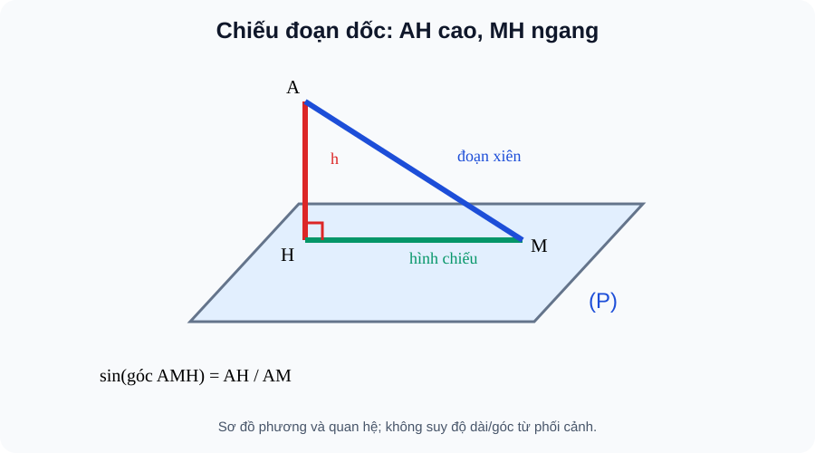

# Bài 24. Phép chiếu vuông góc. Góc giữa đường thẳng và mặt phẳng

TOÁN 11 · CHƯƠNG VII · SGK KNTT TẬP 2

Hiểu lý do cần học → khái niệm và lý do → hình minh họa có hướng dẫn đọc → Tự thử trước Core → ví dụ suy luận → tự thực hành và khắc phục. Không ghi Skill Mastery.
<nav class="thpt-r4-lesson-tabs"><a href="../">Chương VII</a><a href="../luyen-tap/">Core/Luyện tập</a><a href="../tu-kiem-tra-chuong/">Tự kiểm tra tự đối chiếu</a></nav>

=== "Khám phá kiến thức"

    ### Cùng tìm hiểu

    ### 1.1. Vì sao cần học
    Khi đi trên đoạn dốc, chiều dài đường đi lớn hơn chiều dài nhìn từ trên mặt đất. Để tách đoạn dốc thành phần nằm ngang và độ cao, ta cần hình chiếu vuông góc.

    ### Ví dụ trực quan

    Độ dốc một con đường không phải góc nhìn tùy ý trong hình phối cảnh, mà là góc giữa con đường và hình chiếu của nó trên mặt phẳng ngang.

    **Quan sát bằng số liệu:** Nếu quãng nâng cao bằng quãng ngang, góc dốc là 45° vì tan của góc đó bằng 1. Phải dùng đúng đoạn chiếu vuông góc xuống mặt phẳng ngang.

    ### Thuật ngữ và kiến thức, kỹ năng

    **Thuật ngữ:** góc giữa đường và mặt phẳng, hình chiếu vuông góc, định lí ba đường vuông góc.

    **Sau bài học, em cần:** dựng chân chiếu và tam giác vuông trước khi dùng tỉ số lượng giác.

=== "Kiến thức SGK"

    ### 1.2. Khái niệm thực chất
    H là hình chiếu vuông góc của A lên (P) khi AH⊥(P). Hình chiếu của một đường không vuông góc (P) là đường qua hình chiếu của hai điểm phân biệt; đường ⊥(P) có hình chiếu chỉ là một điểm.

    ### 1.3. Hình thành và lập luận
    Nếu đường a cắt (P) tại M và A∈a, H là hình chiếu A thì góc giữa a và (P) là góc nhọn giữa MA và MH: ∠AMH∈[0°,90°]; đường ⊥(P) tạo góc 90° theo quy ước. Trong tam giác vuông AMH: sinθ=AH/AM; tanθ=AH/MH (MH>0). Định lí ba đường vuông góc: nếu a nằm trong (P), b không vuông góc (P), b′ là hình chiếu của b thì a⊥b ⇔ a⊥b′, khi a và b′ cắt nhau đúng tại điểm đang xét / xét theo phương.

    ### 1.4. Điều kiện, giới hạn, lỗi thường gặp
    Không lấy góc giữa đường xiên và đường vuông góc làm góc với mặt phẳng; đó là góc phụ. Không đánh đồng độ dài đoạn dốc với chiều cao vuông góc. Muốn dùng ba đường vuông góc phải xác định đúng hình chiếu.

    ### 1.5. Làm rõ các định lí, điều kiện và cấu trúc SGK
    **Hình chiếu của điểm và hình chiếu của đường khác nhau:** Để chiếu điểm A, kẻ đường AH⊥(P) rồi lấy giao H. Để chiếu đường a, chiếu hai điểm A,B thuộc a. Nếu H_A và H_B phân biệt thì đường H_A H_B là hình chiếu của a; nếu a⊥(P) thì mọi hình chiếu điểm trên a trùng tại một chân, hình chiếu là **một điểm**, không phải đường thẳng.

    **Định lí ba đường vuông góc — dùng đúng vai:** Gọi b đường xiên, b′ hình chiếu của b lên (P), a một đường nằm trong (P). Ta có a⊥b khi và chỉ khi a⊥b′ (góc giữa các phương). Lý do: thành phần của b theo hướng vuông góc (P) đã tự vuông góc với mọi đường trong mặt; phần duy nhất có thể tạo góc với a là b′. Không nhầm a với đường cao hay b′ với b.

    **Góc đường–mặt:** Nếu a không vuông góc (P), góc giữa a và hình chiếu a′ trên (P) là góc của a với (P). Khi a//(P), góc 0°. Khi a⊥(P), góc 90° (định nghĩa riêng vì hình chiếu chỉ là điểm). Trong tam giác AHM, H là hình chiếu A, M∈(P), sinθ=AH/AM, tanθ=AH/HM nếu HM>0. Đây là hai tỉ số của **một tam giác vuông**; dùng góc với phương thẳng đứng sẽ cho góc phụ.

    **Ví dụ thực tiễn:** Độ dốc của đường hay cầu thang là tanθ = độ tăng cao / khoảng dịch chuyển ngang. Giá trị “độ dốc 1/12” không phải là góc 1/12 độ; muốn tìm góc phải dùng arctan(1/12) (≈4,76°).

    ### 1.6. Hình minh họa và cách đọc

    <figure class="thpt-r4-plot thpt-r4-probability-figure"><figcaption>Hình B24: Tam giác AMH vuông tại H: AM là đoạn dốc, MH hình chiếu, AH độ cao.</figcaption></figure>

    **Hướng dẫn đọc hình:** Tam giác AMH vuông tại H: AM là đoạn dốc, MH hình chiếu, AH độ cao. Hình là sơ đồ giải thích phương pháp, **không được suy góc hay độ dài từ nét vẽ phối cảnh**. Điều kiện vuông góc phải có chứng minh.

    ### Vận dụng — tự giải trước khi đối chiếu
    Đường dốc dài 10m, hình chiếu trên nền dài 8m, chênh cao =√(10²−8²)=6m; sin góc dốc bằng 6/10, không phải 8/10.

    

Đã tự thử? Mở hướng dẫn tự đối chiếu

Đối chiếu lập luận của em với phần ví dụ được giải thích dưới đây. Đây là hoạt động luyện tập, không ghi Skill Mastery.

=== "Ví dụ"

    ### Các bài giải có hướng dẫn

    #### EX-G11-CHVII-B24-01 — Hình chiếu đoạn dốc

    **Nhiệm vụ:** A cao 6m trên (P), H là chân vuông góc, B∈(P), HB=8m; tính AB và sin∠ABH.

    **Lập luận để tự đối chiếu sau khi thử:** AB=10m (Pythagore), sin∠ABH=AH/AB=3/5. ∠ABH là góc AB với (P), vì HB là hình chiếu AB.

    #### EX-G11-CHVII-B24-02 — Đường vuông góc mặt

    **Nhiệm vụ:** Nếu đường d⊥(P), hình chiếu của cả d lên (P) là gì?

    **Lập luận để tự đối chiếu sau khi thử:** Một điểm duy nhất (chân đường); góc đường với mặt bằng 90°, không dùng công thức góc với một hình chiếu là đường.

    #### EX-G11-CHVII-B24-03 — Ba đường vuông góc

    **Nhiệm vụ:** Cho đường xiên b có hình chiếu b′ lên (P). Với đường a⊂(P) vuông góc b′, kết luận gì?

    **Lập luận để tự đối chiếu sau khi thử:** a⊥b theo định lí ba đường vuông góc; giải thích bằng phân tích thành phần b′ trong mặt và thành phần vuông góc mặt.

    #### EX-G11-CHVII-B24-04 — Độ dốc đo bằng tang

    **Nhiệm vụ:** Đường dốc lên 1,5m sau quãng nằm ngang 6m; tính tan góc dốc.

    **Lập luận để tự đối chiếu sau khi thử:** tanθ=1,5/6=1/4; θ≈14,04°. Chiều dài đường dốc không được dùng thay quãng nằm ngang 6m.

=== "Lỗi thường gặp"

    

<strong>Nhận diện lỗ hổng:</strong> Nhầm góc nghiêng với góc so phương đứng.
<ol><li><strong>Nhận diện lỗ hổng:</strong> Nhầm góc nghiêng với góc so phương đứng.</li><li><strong>Nhắc đúng bản chất:</strong> Góc giữa d và mặt là góc d với hình chiếu lên mặt.</li><li><strong>Nhìn lại kiến thức và hình:</strong> Đọc lại phần vì sao cần học, khái niệm và cách lập luận của B24, tự phát biểu điều kiện bằng lời và kiểm tra đúng hình SVG của bài, không suy luận từ phối cảnh.</li><li><strong>Tự luyện có hướng dẫn:</strong> Cáp dài 5, cao 3, sin góc với nền? <strong>Sau khi tự làm mới đối chiếu:</strong> 3/5.</li><li><strong>Quay về câu gốc:</strong> <code>THPT-G11-CHVII-B24-C04</code>; giải lại và giải thích mỗi bước. HELP chỉ hiện sau nộp câu *luyện tập*, tuyệt đối không hiện trong RD1 trước Final Submit.</li></ol>
<a href="../luyen-tap/?item=THPT-G11-CHVII-B24-C04">Quay lại câu canonical THPT-G11-CHVII-B24-C04</a>

    

<strong>Nhận diện lỗ hổng:</strong> Không dựng hình chiếu mà đo đường xiên trực tiếp.
<ol><li><strong>Nhận diện lỗ hổng:</strong> Không dựng hình chiếu mà đo đường xiên trực tiếp.</li><li><strong>Nhắc đúng bản chất:</strong> Đường trong mặt vuông góc hình chiếu của đường xiên thì cũng vuông góc đường xiên.</li><li><strong>Nhìn lại kiến thức và hình:</strong> Đọc lại phần vì sao cần học, khái niệm và cách lập luận của B24, tự phát biểu điều kiện bằng lời và kiểm tra đúng hình SVG của bài, không suy luận từ phối cảnh.</li><li><strong>Tự luyện có hướng dẫn:</strong> Đường g trong mặt ⊥hình chiếu b, suy gì? <strong>Sau khi tự làm mới đối chiếu:</strong> g⊥b.</li><li><strong>Quay về câu gốc:</strong> <code>THPT-G11-CHVII-B24-C03</code>; giải lại và giải thích mỗi bước. HELP chỉ hiện sau nộp câu *luyện tập*, tuyệt đối không hiện trong RD1 trước Final Submit.</li></ol>
<a href="../luyen-tap/?item=THPT-G11-CHVII-B24-C03">Quay lại câu canonical THPT-G11-CHVII-B24-C03</a>

    ### Học tiếp

    [Core và Luyện tập Bài 24](luyen-tap.md) · [Tự luận Chương VII](../../../thu-vien/tu-luan-g11-chuong-vii.md) · [Tự kiểm tra cuối chương](tu-kiem-tra-chuong.md)
