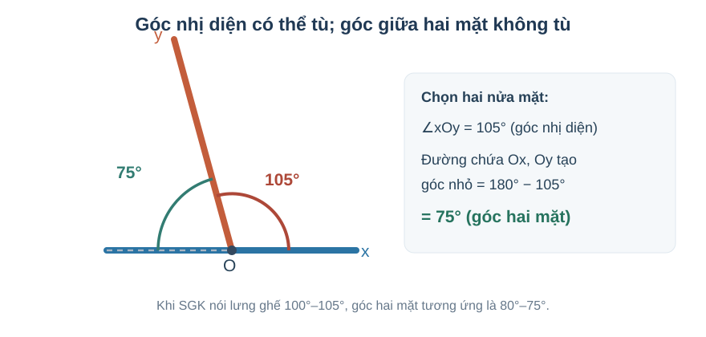
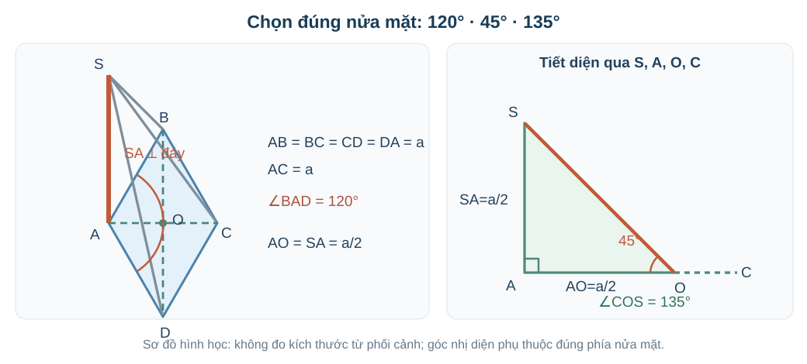
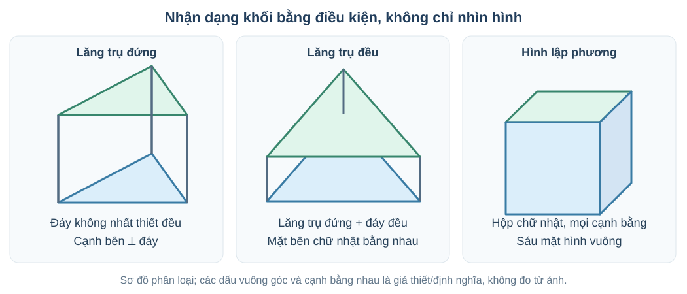
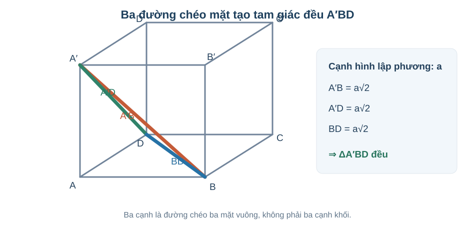
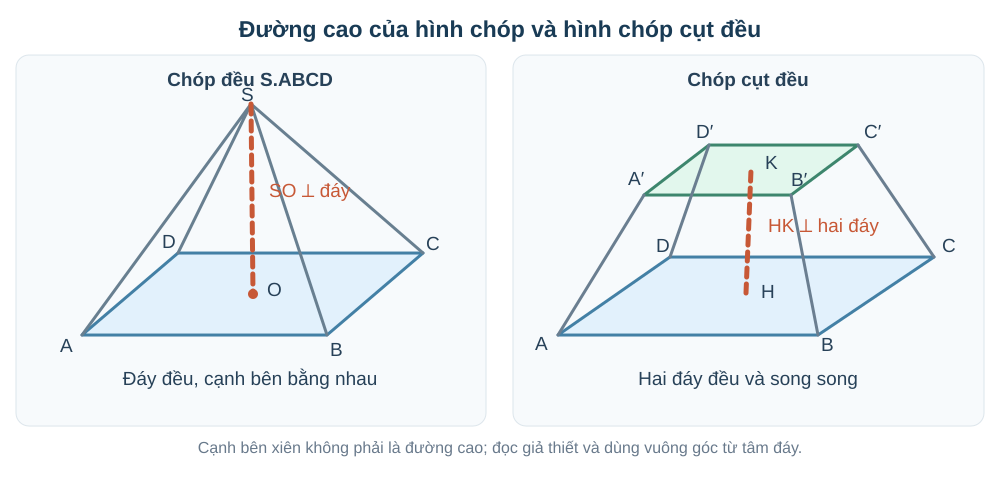

# Bài 25. Hai mặt phẳng vuông góc

TOÁN 11 · CHƯƠNG VII · KẾT NỐI TRI THỨC · TẬP HAI

Hiểu góc giữa hai mặt phẳng, góc nhị diện, điều kiện vuông góc, rồi nhận dạng đúng các lăng trụ, chóp đều và chóp cụt đều.

<nav class="thpt-r4-lesson-tabs"><a href="../">Chương VII</a><a href="../luyen-tap/">Core và Luyện tập</a><a href="../tu-kiem-tra-chuong/">Tự kiểm tra cuối chương</a></nav>

=== "Khám phá kiến thức"

    **Vì sao học?** Mặt ghế và lưng ghế, hai mái nhà hoặc cánh cửa và sàn đều tạo thành các góc trong không gian. Đo một góc nhìn thấy trên ảnh chưa đủ: cần biết góc của **hai mặt phẳng không định hướng** hay của **hai nửa mặt phẳng đã chọn**. Dùng kiến thức Bài 22–24 về góc hai đường, pháp tuyến và hình chiếu, ta sẽ hiểu các định nghĩa trước rồi mới tính toán.

    ### 1.1. Góc giữa hai mặt phẳng, hai mặt phẳng vuông góc

    **Bắt đầu từ phương pháp tuyến.** Với hai mặt \((P),(Q)\), chọn các đường \(a\perp(P)\) và \(b\perp(Q)\). Góc **không tù** giữa \(a,b\) gọi là góc giữa hai mặt. Vì mọi đường vuông góc với cùng một mặt đều cùng phương, việc thay vị trí \(a,b\) không làm thay đổi góc. Giá trị nằm trong \([0^\circ,90^\circ]\): hai mặt song song hoặc trùng nhau có góc \(0^\circ\), hai mặt được gọi là **vuông góc** nếu góc bằng \(90^\circ\).

    **Đo bằng giao tuyến:** Khi hai mặt cắt nhau theo \(\Delta\), chọn \(O\in\Delta\); trong \((P)\) lấy đường \(m\) qua \(O\) vuông góc \(\Delta\), trong \((Q)\) lấy đường \(n\) qua \(O\) vuông góc \(\Delta\). Góc giữa hai mặt là góc **không tù** giữa \(m,n\). Hai điều kiện \(m\perp\Delta,n\perp\Delta\) rất quan trọng: lấy tùy tiện hai đường thuộc hai mặt sẽ đo sai góc.

    <figure class="thpt-r4-plot"><figcaption><strong>Hướng dẫn đọc:</strong> đường đậm \(\Delta\) là giao tuyến; \(OU,OV\) cùng xuất phát ở \(O\) và nằm theo hai hướng vuông góc \(\Delta\). Hình giải thích **tiết diện vuông góc giao tuyến**. Góc nhị diện giữ hai tia đã chọn, còn góc giữa hai mặt phải chọn **góc không tù giữa các đường chứa chúng**.</figcaption></figure>

    **Luyện tập 1 SGK — điều kiện đáy là hình vuông:** Chóp \(S.ABCD\) có đáy **hình chữ nhật**, hai đường chéo cắt tại \(O\), \(SO\perp(ABCD)\). Hai mặt \((SAC),(SBD)\) gặp nhau theo \(SO\). Vì \(AC,BD\) đều nằm trong đáy nên cùng vuông góc \(SO\); do đó góc giữa hai mặt bằng \((AC,BD)\). Trong hình chữ nhật, hai đường chéo vuông góc **khi và chỉ khi** hình chữ nhật là hình vuông. Không suy vuông góc từ hình chữ nhật nói chung.

    **Vận dụng.** Hai đường \(m,n\) thuộc hai mặt phẳng cắt theo \(d\), cùng qua \(O\in d\) và vuông góc \(d\). Hai tia được chọn trên \(m,n\) tạo góc \(125^\circ\). Tính góc giữa hai mặt.

    ??? question "Đối chiếu"

        **Lời giải:** Hai đường \(m,n\) có góc không tù \(180^\circ-125^\circ=55^\circ\). Vì đều vuông góc giao tuyến tại \(O\), góc giữa hai mặt cũng bằng \(55^\circ\).

    ??? tip "Kiểm lỗi"

        Không trả \(125^\circ\) cho góc **hai mặt**. Phải kiểm hai phương đều vuông góc giao tuyến và chọn góc không tù.

    ### 1.2. Điều kiện để hai mặt phẳng vuông góc

    **Chứng minh không cần đo góc:** Nếu mặt \((P)\) chứa một đường \(a\) vuông góc với mặt \((Q)\), suy ngay \((P)\perp(Q)\). Điều kiện mạnh ở đây là **\(a\perp(Q)\)**, nghĩa là \(a\) vuông góc **mọi đường trong \((Q)\)**, không chỉ một đường \(b\subset(Q)\). Khi chưa biết \(a\perp(Q)\), có thể chứng minh bằng **hai đường cắt nhau trong \((Q)\)** theo Bài 23.

    **Ví dụ 2 SGK:** Tứ diện \(OABC\) có \(OA\perp OB\) và \(OA\perp OC\). Do \(OB,OC\subset(OBC)\) cắt tại \(O\), suy \(OA\perp(OBC)\). Cả \((OAB)\) lẫn \((OAC)\) đều chứa \(OA\); vậy \((OAB)\perp(OBC)\) và \((OAC)\perp(OBC)\). Không tự kết luận \((OAB)\perp(OAC)\): góc giữa chúng còn phụ thuộc \(\angle BOC\).

    **Cánh cửa và sàn:** Trục bản lề của cánh cửa vuông góc mặt sàn. Mặt phẳng cánh cửa ở mọi vị trí đóng–mở đều chứa trục bản lề, nên **luôn vuông góc với sàn**, cho dù góc giữa cánh cửa và mặt tường thay đổi.

    <figure class="thpt-r4-plot"><figcaption><strong>Hướng dẫn đọc khung trái:</strong> hai mặt \((P),(Q)\) có giao tuyến \(\Delta\), đường \(a\subset(P)\) vuông góc \(\Delta\). **Khi đã có** \((P)\perp(Q)\), suy \(a\perp(Q)\); chiều chứng minh ngược lại phải chứng minh \(a\perp(Q)\) trước. Khung phải minh họa một tính chất ở mục 1.3, không dùng góc phối cảnh để kết luận.</figcaption></figure>

    **Vận dụng.** Cho \(SA\perp(ABCD)\) trong hình chóp \(S.ABCD\). Chứng minh \((SAB)\perp(ABCD)\). Có suy được mọi mặt bên đều vuông góc đáy không?

    ??? question "Đối chiếu"

        **Lời giải:** Vì \(SA\subset(SAB)\), \(SA\perp(ABCD)\) nên \((SAB)\perp(ABCD)\). Không có căn cứ để suy mọi mặt bên, chẳng hạn \((SBC)\), đều chứa đường vuông góc đáy.

    ??? tip "Kiểm lỗi"

        Không chuyển kết luận đúng cho mặt \((SAB)\) thành kết luận cho **mọi** mặt bên. Đường dùng để chứng minh phải **nằm trong chính mặt đang xét**.

    ### 1.3. Tính chất của hai mặt phẳng vuông góc

    **Vì sao phải kiểm giao tuyến?** Nếu \((P)\perp(Q)\) và giao tuyến là \(\Delta\), một đường \(a\subset(P)\) **vuông góc \(\Delta\)** sẽ vuông góc **toàn mặt \((Q)\)**. Thật vậy, chọn \(O=a\cap\Delta\), lấy trong \((Q)\) đường \(b\) qua \(O\) vuông góc \(\Delta\). Do hai mặt vuông góc, \(a\perp b\); mà \(a\perp\Delta\). Hai đường \(b,\Delta\) cắt nhau trong \((Q)\), suy \(a\perp(Q)\). Điều kiện \(a\perp\Delta\) không thể bỏ: chính \(\Delta\subset(P)\) vẫn nằm trong \((Q)\), nên không vuông góc \((Q)\).

    **Tính chất của hai mặt cùng vuông góc một mặt thứ ba:** Nếu hai mặt \((P),(Q)\) **cắt nhau** theo \(d\) và đều vuông góc với \((R)\), thì \(d\perp(R)\). Vì qua mỗi điểm \(O\in d\) chỉ có một đường vuông góc \((R)\), mà đường ấy phải thuộc từng mặt \((P),(Q)\), nên nó trùng giao tuyến \(d\). Nếu hai mặt **song song**, chúng không có giao tuyến; không áp kết luận về \(d\).

    <figure class="thpt-r4-plot"><figcaption><strong>Hướng dẫn đọc:</strong> khung trái, với **giả thiết** hai mặt vuông góc, đường \(a\subset(P)\) vuông góc giao tuyến \(\Delta\) sẽ vuông góc \((Q)\). Khung phải, hai mặt đứng \((P),(Q)\) **cắt nhau theo \(d\)** và cùng vuông góc nền \((R)\), vì thế \(d\perp(R)\). Các dấu vuông góc là quan hệ được chứng minh, không suy từ nét nghiêng trên hình.</figcaption></figure>

    **Ví dụ 3 SGK — Hai lần dùng định lí:** Cho hình chóp \(S.ABCD\) đáy là hình chữ nhật, \(SA\perp(ABCD)\); gọi \(B',C',D'\) lần lượt là hình chiếu của \(A\) trên \(SB,SC,SD\). Do \(BC\perp AB\) và \(BC\perp SA\), suy \(BC\perp(SAB)\), mà \(BC\subset(SBC)\), vậy \((SBC)\perp(SAB)\). Đường \(AB'\subset(SAB)\) và \(AB'\perp SB\), với \(SB\) là giao tuyến \((SBC)\cap(SAB)\), nên theo tính chất vừa học \(AB'\perp(SBC)\). Suy \(AB'\perp SC\); tương tự \(AD'\perp SC\), còn \(AC'\perp SC\) do định nghĩa hình chiếu. Vậy \(B',C',D'\) cùng nằm trên mặt phẳng qua \(A\) vuông góc \(SC\). Điểm cốt lõi là **không** kết luận từ một góc vuông đơn lẻ.

    **Vận dụng.** Hai mặt phẳng \((P),(Q)\) khác nhau, cắt theo \(d\), cùng vuông góc nền \((R)\). Kết luận quan hệ \(d\) với \((R)\), và giải thích vì sao không làm vậy nếu \((P)\parallel(Q)\).

    ??? question "Đối chiếu"

        **Lời giải:** Theo tính chất, \(d\perp(R)\). Nếu \((P)\parallel(Q)\) thì **không tồn tại giao tuyến \(d\)** để kết luận; yêu cầu hai mặt cắt nhau là thiết yếu.

    ??? tip "Kiểm lỗi"

        Đừng viết “hai mặt cùng vuông góc mặt thứ ba thì giao tuyến vuông góc” khi chưa xác nhận chúng **cắt nhau**.

    ### 1.4. Góc nhị diện

    **Một góc \(105^\circ\) của lưng ghế có mâu thuẫn với góc hai mặt luôn không tù?** Không. Đối tượng đang đo khác nhau. Hai **nửa mặt phẳng** có chung bờ \(\Delta\) xác định một **góc nhị diện** \([P,\Delta,Q]\). Qua một điểm \(O\) trên \(\Delta\), dựng hai tia \(Ox,Oy\) lần lượt thuộc **hai nửa mặt đã chọn** và đều vuông góc \(\Delta\); góc \(\angle xOy\) gọi là **góc phẳng nhị diện**. Số đo của nó từ \(0^\circ\) đến \(180^\circ\), có thể nhọn, vuông hoặc tù. Ngược lại, góc giữa **hai mặt phẳng không định hướng** luôn chọn góc không tù giữa hai đường chứa các tia.

    <figure class="thpt-r4-plot"><figcaption><strong>Hướng dẫn đọc:</strong> \(\Delta\) là cạnh chung của hai nửa mặt, \(O\) là điểm dựng tiết diện; \(OU,OV\) vuông góc \(\Delta\) và hướng **vào đúng hai nửa mặt đề cho**. Giữ \(\angle UOV\) khi hỏi góc nhị diện; khi hỏi góc hai mặt, xét góc không tù giữa hai đường chứa các tia.</figcaption></figure>

    **HĐ5 SGK — Mặt ghế và lưng ghế:** Một hướng dẫn thiết kế cho góc phẳng nhị diện khoảng \(100^\circ\) đến \(105^\circ\) về phía người ngồi. Khi đó góc giữa các **mặt phẳng chứa ghế và lưng ghế** bằng \(180^\circ-\theta\), tức trong khoảng \(75^\circ\) đến \(80^\circ\). Đây là ví dụ cần đọc **hai nửa mặt đã chọn** chứ không lấy một góc bất kì ở bản lề.

    <figure class="thpt-r4-plot"><figcaption><strong>Hướng dẫn đọc:</strong> tia \(Ox\) theo mặt ghế và \(Oy\) theo lưng ghế làm góc **\(105^\circ\)** ở phía người ngồi; đó là **góc nhị diện**. Góc nhỏ giữa **hai đường** chứa các tia bằng \(75^\circ\), là góc giữa **hai mặt phẳng**. Đây là sơ đồ giải thích, không phải phép đo một chiếc ghế cụ thể.</figcaption></figure>

    **Ví dụ 4 SGK — Chọn đúng nửa mặt:** Cho chóp \(S.ABCD\), \(SA\perp(ABCD)\), đáy hình thoi cạnh \(a\) có \(AC=a\) và \(SA=a/2\). Hai tam giác \(ABC,ACD\) đều nên \(\angle BAD=120^\circ\); đó là góc nhị diện \([B,SA,D]\). Gọi \(O\) là giao hai đường chéo; \(AO=a/2=SA\), \(SOA\) vuông tại \(A\), nên \([S,BD,A]\) có góc phẳng \(45^\circ\), còn \([S,BD,C]\) có góc phẳng \(135^\circ\). Cả hai nhị diện cùng chung giao tuyến \(BD\) nhưng có **hai nửa đáy khác phía**, không được cho cùng số đo.

    <figure class="thpt-r4-plot"><figcaption><strong>Hướng dẫn đọc:</strong> Trái: đáy \(ABCD\) có \(AC=a\), nên \(\angle BAD=120^\circ\). Phải: \(SA=AO=a/2\), tam giác \(SAO\) vuông tại \(A\), nên \(\angle AOS=45^\circ\), và hai tia \(OA,OC\) đối nhau cho \(\angle COS=135^\circ\).</figcaption></figure>

    **Vận dụng.** Tiết diện vuông góc bản lề ghế có góc giữa hai tia mặt ghế và lưng ghế (phía người ngồi) bằng \(102^\circ\). Tính góc nhị diện và góc giữa hai mặt phẳng chứa hai phần ghế.

    ??? question "Đối chiếu"

        **Lời giải:** Góc nhị diện của **hai nửa mặt đã chọn** bằng \(102^\circ\); góc không tù giữa **hai mặt phẳng** bằng \(180^\circ-102^\circ=78^\circ\).

    ??? tip "Kiểm lỗi"

        Không thay ngay \(102^\circ\) bằng \(78^\circ\) khi đề hỏi **góc nhị diện**. Ngược lại, không lấy góc tù làm **góc giữa hai mặt**.

    ### 1.5. Một số hình lăng trụ đặc biệt

    **Thứ tự nhận biết phải rõ:** Hình **lăng trụ đứng** là lăng trụ có **các cạnh bên vuông góc với mặt đáy**. Do đó các mặt bên là **hình chữ nhật** và các cạnh bên đúng bằng **chiều cao**. Hình **lăng trụ đều** là lăng trụ đứng có **đáy là đa giác đều**. Vì mọi cạnh của đa giác đều bằng nhau, các mặt bên của lăng trụ đều là các hình chữ nhật **cùng kích thước**. Một lăng trụ đứng đáy tam giác \(3,4,5\) **không** phải lăng trụ đều.

    **Trong họ hình hộp:** Hình hộp đứng có đáy là **hình bình hành** và cạnh bên vuông góc mặt đáy. Khi đáy thành hình chữ nhật, đó là **hình hộp chữ nhật**, có sáu mặt chữ nhật. Nếu mọi cạnh hình hộp chữ nhật **bằng nhau**, ta được **hình lập phương** với sáu mặt vuông. Hình hộp đứng có thể có đáy hình bình hành không vuông, nên không phải toàn bộ sáu mặt đều chữ nhật.

    <figure class="thpt-r4-plot"><figcaption><strong>Hướng dẫn đọc trái sang phải:</strong> khối thứ nhất chỉ cần **cạnh bên vuông góc đáy**; khối thứ hai còn có **đáy đa giác đều**; khối thứ ba là **hộp chữ nhật mọi cạnh bằng nhau**. Hình dùng minh họa kiểu khối, không cho phép kết luận các đoạn bằng nhau chỉ bằng tỉ lệ ảnh.</figcaption></figure>

    **Đọc theo HĐ6–HĐ10 SGK:** Lăng trụ đứng có mặt bên chữ nhật và vuông góc đáy vì chứa cạnh bên vuông góc đáy. Lăng trụ đều có các mặt bên chữ nhật bằng nhau. Hình hộp đứng có **ít nhất bốn mặt bên** là chữ nhật; hình hộp chữ nhật có cả sáu mặt chữ nhật, hình lập phương có sáu mặt vuông. Đối với hình hộp chữ nhật, bốn đường chéo không gian bằng nhau và gặp nhau ở trung điểm chung. Không nhầm **đường chéo mặt** với **đường chéo không gian**.

    **Ví dụ 6 SGK:** Trong hình lập phương cạnh \(a>0\), tam giác \(A'BD\) có ba cạnh \(A'B,A'D,BD\) đều là đường chéo của các hình vuông cạnh \(a\), nên đều bằng \(a\sqrt2\). Do đó **tam giác \(A'BD\) đều**. Điều này cần chứng minh bằng độ dài, không dựa vào hình khối có vẻ đối xứng.

    <figure class="thpt-r4-plot"><figcaption><strong>Hướng dẫn đọc:</strong> Ba đường tô màu \(A'B,A'D,BD\) là đường chéo của các mặt vuông cạnh \(a\), nên mỗi đoạn dài \(a\sqrt2\). Tam giác \(A'BD\) đều vì ba cạnh bằng nhau.</figcaption></figure>

    **Vận dụng.** Một lăng trụ có các cạnh bên vuông góc đáy, dài \(6\) cm, đáy là tam giác có cạnh \(3,4,5\) cm. Đây có phải lăng trụ đều không? Tính diện tích mặt bên dựa trên cạnh đáy dài \(3\) cm.

    ??? question "Đối chiếu"

        **Lời giải:** Đây là **lăng trụ đứng** nhưng không phải lăng trụ đều vì tam giác đáy \(3,4,5\) không đều. Mặt bên ứng với cạnh đáy \(3\) cm là hình chữ nhật cao \(6\) cm, diện tích \(3\cdot6=18\) cm².

    ??? tip "Kiểm lỗi"

        Không dùng từ “đều” chỉ vì lăng trụ **đứng**; cần thêm điều kiện đáy là **đa giác đều**.

    ### 1.6. Hình chóp đều và hình chóp cụt đều

    **Từ tháp kính Louvre đến định nghĩa:** Hình chóp đều là hình chóp có **đáy là đa giác đều** và **các cạnh bên bằng nhau**. Gọi \(O\) là chân đường vuông góc từ đỉnh \(S\) xuống đáy. Khi các cạnh bên bằng nhau, với \(SO\) chung, những tam giác vuông \(SOA_i\) cho \(OA_1=\dots=OA_n\), nên \(O\) là **tâm đa giác đáy đều**. Ngược lại, nếu đáy đều và \(O\) là tâm đáy thì các cạnh bên \(SA_i\) bằng nhau theo Pythagore. Vì vậy SGK có tiêu chuẩn tương đương: **đáy đều và chân đường cao ở tâm đáy**.

    <figure class="thpt-r4-plot"><figcaption><strong>Hướng dẫn đọc hình trái:</strong> \(ABCD\) là hình vuông, \(O\) là tâm đáy; đoạn đỏ nét đứt \(SO\perp(ABCD)\) là **đường cao**, còn cạnh nghiêng \(SA\) là **cạnh bên**, không phải chiều cao. Hình phải là phần chóp cụt được giải thích ngay dưới đây.</figcaption></figure>

    **Tính ví dụ thực tế theo dữ kiện SGK:** Tháp kính Louvre được mô tả bằng chóp đáy vuông cạnh \(34\) m, cạnh bên khoảng \(32{,}3\) m. Tâm \(O\) đáy cách mỗi đỉnh \(A\) một đoạn \(OA=17\sqrt2\) m. Trong tam giác vuông \(SOA\), chiều cao mô hình \(SO=\sqrt{32{,}3^2-(17\sqrt2)^2}\approx21{,}57\) m. Đây là tính theo mô hình hình chóp đều với số liệu **xấp xỉ**, không phải khẳng định chiều cao đo thực tế chính xác.

    **Cắt chóp đều bằng mặt song song với đáy:** Mặt cắt không qua đỉnh tạo chóp đều nhỏ hơn, đồng dạng với chóp ban đầu. Phần nằm **giữa hai mặt đáy** gọi là **hình chóp cụt đều**, có hai đáy là đa giác đều song song, đồng dạng; các mặt bên là hình **thang cân**. Đường thẳng qua **hai tâm đáy** vuông góc với mỗi đáy; đoạn nối hai tâm \(HK\) là **đường cao** và độ dài \(HK\) là **chiều cao**. Cạnh bên nghiêng dài hơn đường cao nếu hai đáy khác cỡ.

    <figure class="thpt-r4-plot"><figcaption><strong>Hướng dẫn đọc khung phải:</strong> đáy dưới \(ABCD\) lớn, đáy trên \(A'B'C'D'\) nhỏ, cả hai song song và có tâm \(H,K\). Đoạn đỏ nét đứt \(HK\) vuông góc cả hai đáy là **đường cao**; đoạn \(AA'\) là **cạnh bên xiên**, không thay được chiều cao.</figcaption></figure>

    **Ví dụ 8 SGK — cạnh bên chóp cụt tam giác đều:** Hai đáy tam giác đều có cạnh \(a>a'>0\), khoảng cách hai mặt đáy \(h>0\). Khoảng cách từ tâm đáy đến đỉnh tương ứng của hai tam giác lần lượt là \(a/\sqrt3\), \(a'/\sqrt3\). Độ lệch theo mặt đáy của hai đỉnh tương ứng là \((a-a')/\sqrt3\). Bởi vậy độ dài **cạnh bên** bằng
    \[
    \ell=\sqrt{h^2+\frac{(a-a')^2}{3}}.
    \]
    Lỗi thường gặp là dùng \(a-a'\) thay trực tiếp cho độ lệch ngang, quên rằng bán kính ngoại tiếp **tam giác đều** bằng cạnh chia \(\sqrt3\).

    **Vận dụng.** Chóp tứ giác đều \(S.ABCD\) có cạnh đáy \(6\) cm, đường cao \(SO=4\) cm. Tính cạnh bên \(SA\); nếu cắt chóp theo một mặt phẳng song song đáy, đâu là đường cao của phần chóp cụt?

    ??? question "Đối chiếu"

        **Lời giải:** Tâm hình vuông có \(OA=6\sqrt2/2=3\sqrt2\) cm. Tam giác \(SOA\) vuông tại \(O\), suy \(SA=\sqrt{SO^2+OA^2}=\sqrt{16+18}=\sqrt{34}\) cm. Với chóp cụt đều, đường cao là đoạn nối **hai tâm đáy**, vuông góc hai mặt đáy, không phải cạnh bên xiên.

    ??? tip "Kiểm lỗi"

        Không trả \(SA=SO=4\) cm; cạnh bên là **cạnh huyền** của tam giác \(SOA\). Cũng đừng định nghĩa chóp đều là hình chóp mà “mọi cạnh bên vuông góc đáy”.

=== "Kiến thức SGK"

    ### 2.1. Góc giữa hai mặt phẳng, hai mặt phẳng vuông góc

    
<strong>Định nghĩa — Góc giữa hai mặt phẳng</strong>
Cho hai mặt phẳng \((P),(Q)\). Lấy các đường \(a\perp(P)\), \(b\perp(Q)\); <strong>góc giữa hai mặt phẳng</strong> được định nghĩa là góc không tù giữa \(a,b\), không phụ thuộc cách chọn hai pháp tuyến. Góc \(\varphi\) thỏa \(0^\circ\le\varphi\le90^\circ\). Hai mặt gọi là <strong>vuông góc</strong> khi \(\varphi=90^\circ\).

    **Đo bằng tiết diện qua giao tuyến:** Nếu \((P)\cap(Q)=d\), lấy \(O\in d\), các đường \(m\subset(P)\), \(n\subset(Q)\) cùng qua \(O\), \(m\perp d,n\perp d\), thì \(((P),(Q))=(m,n)\), lấy góc không tù. Không áp công thức cho hai đường bất kì trên hai mặt.

    <figure class="thpt-r4-plot"><figcaption><strong>Tra hình:</strong> từ giao tuyến \(\Delta\) và điểm \(O\), dựng hai phương đều vuông góc \(\Delta\). Hình cho **góc phẳng của hai nửa mặt đã chọn**; khi tìm góc **hai mặt phẳng**, lấy góc không tù giữa hai đường chứa \(OU,OV\).</figcaption></figure>

    **Ví dụ SGK:** Với chóp \(S.ABCD\), đáy hình chữ nhật, \(SO\perp(ABCD)\) tại giao điểm đường chéo \(O\): \(((SAC),(SBD))=(AC,BD)\). Hai mặt vuông góc khi và chỉ khi đáy hình chữ nhật là hình vuông.

    ### 2.2. Điều kiện để hai mặt phẳng vuông góc

    
<strong>Định lí — Tiêu chuẩn mặt phẳng vuông góc</strong>
Nếu mặt phẳng \((P)\) <strong>chứa một đường \(a\)</strong> vuông góc mặt phẳng \((Q)\), thì <strong>\((P)\perp(Q)\)</strong>. Muốn chứng minh \(a\perp(Q)\), có thể chứng minh \(a\perp b\) và \(a\perp c\) với \(b,c\) là <strong>hai đường cắt nhau nằm trong \((Q)\)</strong>.

    **Chọn đúng đối tượng:** Không đủ để chứng minh \(a\subset(P),b\subset(Q)\) và chỉ có \(a\perp b\); điều đó mới là vuông góc của **hai đường**, chưa xác định góc hai mặt.

    <figure class="thpt-r4-plot"><figcaption><strong>Tra khung trái:</strong> phải có **đường \(a\subset(P)\) vuông góc cả \((Q)\)** để kết luận \((P)\perp(Q)\). Dấu \(\Delta\) giúp xác định giao tuyến; không kết luận chỉ từ nét vẽ \(a\perp\Delta\) khi chưa có giả thiết hai mặt vuông góc.</figcaption></figure>

    **Ví dụ 2 SGK:** \(OA\perp OB\), \(OA\perp OC\), \(OB\cap OC=\{O\}\) nên \(OA\perp(OBC)\). Mỗi mặt \((OAB),(OAC)\) chứa \(OA\) và vì vậy đều vuông góc \((OBC)\).

    ### 2.3. Tính chất của hai mặt phẳng vuông góc

    
<strong>Tính chất — Đường nằm trong một mặt vuông góc</strong>
Nếu \((P)\perp(Q)\) và \(d=(P)\cap(Q)\), mọi đường \(a\subset(P)\) <strong>vuông góc \(d\)</strong> đều <strong>vuông góc \((Q)\)</strong>. Phải có đủ hai điều kiện \(a\subset(P)\) và \(a\perp d\).

    
<strong>Tính chất — Giao tuyến của hai mặt cùng vuông góc mặt thứ ba</strong>
Nếu hai mặt phẳng <strong>cắt nhau</strong> theo \(d\) và cùng vuông góc \((R)\), thì <strong>\(d\perp(R)\)</strong>. Nếu hai mặt song song thì không tồn tại giao tuyến \(d\), nên không dùng được kết luận này.

    <figure class="thpt-r4-plot"><figcaption><strong>Tra hai khung:</strong> trái, đường \(a\) nằm trong mặt này và vuông góc **giao tuyến** khi hai mặt đã vuông góc; phải, \((P),(Q)\) **cắt nhau** cùng vuông góc \((R)\), suy đường đỏ \(d\perp(R)\). Không bỏ giả thiết cắt nhau.</figcaption></figure>

    **Ví dụ 3 SGK:** Nếu đáy \(ABCD\) hình chữ nhật và \(SA\perp(ABCD)\), thì \(BC\perp(SAB)\) vì \(BC\perp AB,BC\perp SA\); từ \(BC\subset(SBC)\) suy \((SBC)\perp(SAB)\). Với \(B'\) chân từ \(A\) trên \(SB\), \(AB'\perp SB\) và \(AB'\subset(SAB)\), nên \(AB'\perp(SBC)\), từ đó \(AB'\perp SC\). Không quên kiểm vị trí đường \(AB'\) và giao tuyến \(SB\).

    ### 2.4. Góc nhị diện

    
<strong>Khái niệm — Góc nhị diện</strong>
Hai <strong>nửa mặt phẳng có chung bờ \(d\)</strong> tạo một góc nhị diện, kí hiệu \([P,d,Q]\); \(d\) là cạnh nhị diện. Qua \(O\in d\), lấy hai tia \(Ox,Oy\) thuộc hai nửa mặt tương ứng và <strong>cùng vuông góc \(d\)</strong>. Khi đó \(\angle xOy\) là một <strong>góc phẳng nhị diện</strong>; số đo nhị diện thuộc \([0^\circ,180^\circ]\) và không phụ thuộc chọn \(O\).

    **Khác biệt không thể bỏ:** Góc nhị diện giữ đúng **hai phía được chỉ định** nên có thể tù. Góc hai mặt phẳng lấy góc **không tù** giữa các đường và không vượt \(90^\circ\). Hai mặt phẳng cắt nhau tạo bốn góc nhị diện; góc đối đỉnh bằng nhau, góc kề bù nhau.

    <figure class="thpt-r4-plot"><figcaption><strong>Tra hình nhị diện:</strong> để đo, chọn \(O\) trên cạnh \(\Delta\), kẻ hai tia nằm **trong nửa mặt đề cho**, cùng vuông góc \(\Delta\), rồi đo \(\angle UOV\). Không thay tia bằng tia đối khi đề hỏi nhị diện cụ thể.</figcaption></figure>

    <figure class="thpt-r4-plot"><figcaption><strong>Tra HĐ5 SGK:</strong> \(\angle xOy=105^\circ\) của hai nửa mặt đã chọn là góc **nhị diện**, còn góc không tù giữa hai mặt chứa chúng bằng \(75^\circ\). Với khoảng \(100^\circ\)–\(105^\circ\), góc hai mặt tương ứng \(80^\circ\)–\(75^\circ\).</figcaption></figure>

    **Ví dụ 4 SGK:** Trong chóp có đáy hình thoi cạnh \(a\), \(AC=a\), \(SA=a/2\perp(ABCD)\), các nhị diện \([B,SA,D]\), \([S,BD,A]\), \([S,BD,C]\) lần lượt bằng \(120^\circ,45^\circ,135^\circ\). Các góc được tính qua những tia **vuông góc với cạnh nhị diện** ở đúng hai nửa mặt tương ứng.

    <figure class="thpt-r4-plot"><figcaption><strong>Hướng dẫn đọc:</strong> Trái: đáy \(ABCD\) có \(AC=a\), nên \(\angle BAD=120^\circ\). Phải: \(SA=AO=a/2\), tam giác \(SAO\) vuông tại \(A\), nên \(\angle AOS=45^\circ\), và hai tia \(OA,OC\) đối nhau cho \(\angle COS=135^\circ\).</figcaption></figure>

    ### 2.5. Một số hình lăng trụ đặc biệt

    
<strong>Định nghĩa — Lăng trụ đứng và lăng trụ đều</strong>
<strong>Lăng trụ đứng:</strong> các cạnh bên vuông góc với mặt đáy; mặt bên là hình chữ nhật và cạnh bên bằng chiều cao. <strong>Lăng trụ đều:</strong> lăng trụ đứng có đáy là đa giác đều; các mặt bên là những hình chữ nhật cùng kích thước.

    
<strong>Định nghĩa — Họ hình hộp</strong>
<strong>Hình hộp đứng:</strong> lăng trụ đứng có đáy hình bình hành. <strong>Hình hộp chữ nhật:</strong> hình hộp đứng đáy chữ nhật, cả sáu mặt là chữ nhật. <strong>Hình lập phương:</strong> hình hộp chữ nhật có tất cả cạnh bằng nhau, cả sáu mặt là hình vuông.

    <figure class="thpt-r4-plot"><figcaption><strong>Tra hình:</strong> trái chỉ có điều kiện cạnh bên vuông góc đáy; giữa thêm điều kiện đáy đa giác đều; phải là hộp chữ nhật có tất cả cạnh bằng nhau. Hình không thay cho kiểm giả thiết cạnh và góc.</figcaption></figure>

    | Khối | Điều kiện nhận dạng | Điều cần nhớ |
    | :-- | :-- | :-- |
    | Lăng trụ đứng | Cạnh bên \(\perp\) đáy | Mặt bên hình chữ nhật |
    | Lăng trụ đều | Lăng trụ đứng, đáy đa giác đều | Mặt bên hình chữ nhật bằng nhau |
    | Hình hộp đứng | Lăng trụ đứng, đáy hình bình hành | Ít nhất 4 mặt bên chữ nhật |
    | Hình hộp chữ nhật | Hộp đứng, đáy hình chữ nhật | 6 mặt chữ nhật |
    | Hình lập phương | Hộp chữ nhật, mọi cạnh bằng | 6 mặt vuông |

    **Ví dụ 6 SGK:** Trong hình lập phương cạnh \(a\), tam giác \(A'BD\) đều vì \(A'B=A'D=BD=a\sqrt2\); ba cạnh này lần lượt là các đường chéo của những mặt vuông.

    <figure class="thpt-r4-plot"><figcaption><strong>Hướng dẫn đọc:</strong> Ba đường tô màu \(A'B,A'D,BD\) là đường chéo của các mặt vuông cạnh \(a\), nên mỗi đoạn dài \(a\sqrt2\). Tam giác \(A'BD\) đều vì ba cạnh bằng nhau.</figcaption></figure>

    ### 2.6. Hình chóp đều và hình chóp cụt đều

    
<strong>Định nghĩa — Hình chóp đều</strong>
Hình chóp có <strong>đáy là đa giác đều</strong> và <strong>các cạnh bên bằng nhau</strong> gọi là hình chóp đều. Tương đương: đáy là đa giác đều và <strong>hình chiếu vuông góc của đỉnh nằm đúng tại tâm đáy</strong>. Đường nối đỉnh với tâm đáy là đường cao, không phải cạnh bên nghiêng.

    
<strong>Định nghĩa — Hình chóp cụt đều</strong>
Cắt hình chóp đều bằng một mặt phẳng <strong>song song đáy, không qua đỉnh</strong>, phần nằm giữa hai mặt phẳng đáy là hình chóp cụt đều. Hai đáy là đa giác đều song song, đồng dạng; các mặt bên là <strong>hình thang cân</strong>. Đường cao là đoạn <strong>nối hai tâm đáy</strong> vuông góc hai đáy.

    <figure class="thpt-r4-plot"><figcaption><strong>Tra hình:</strong> trái \(SO\perp(ABCD)\) tại tâm \(O\), còn \(SA\) là cạnh bên xiên; phải \(HK\) nối tâm hai đáy song song và là chiều cao chóp cụt, còn \(AA'\) là cạnh bên. Không dùng cạnh bên thay chiều cao.</figcaption></figure>

    **Ứng dụng SGK:** Tháp Louvre là mô hình chóp tứ giác đều; chân đường cao là tâm hình vuông đáy. Với chóp cụt tam giác đều, chiều cao \(h\), cạnh đáy \(a>a'\), độ dài các cạnh bên bằng
    \[
    \sqrt{h^2+\frac{(a-a')^2}{3}}.
    \]
    Công thức này đến từ tam giác vuông với độ lệch ngang \((a-a')/\sqrt3\), không phải lấy chênh hai cạnh đáy làm độ lệch trực tiếp.

=== "Ví dụ"

    ### 3.1. Khi hai tia tạo góc tù, góc hai mặt bằng bao nhiêu?

    **Đề bài.** Hai mặt \((P),(Q)\) cắt nhau theo \(d\). Qua \(O\in d\), các đường \(m\subset(P)\), \(n\subset(Q)\) cùng vuông góc \(d\). Hai tia đã chọn trên \(m,n\) tạo góc \(125^\circ\). Tính góc giữa hai mặt.

    **Phân tích:** Chúng ta đã có **tiết diện đúng phương**, nên không cần dựng pháp tuyến. Nhưng hai mặt không có phía chọn, góc cần lấy là góc **không tù giữa hai đường**.

    

<strong>Lời giải.</strong> Vì \(m,n\) cùng qua \(O\) và vuông góc giao tuyến \(d\), góc giữa \((P),(Q)\) bằng góc không tù giữa \(m,n\). Hai tia đã cho tạo \(125^\circ\), nên góc hai đường là \(180^\circ-125^\circ=55^\circ\). Vậy góc hai mặt bằng \(55^\circ\).

    **Kiểm lại:** \(55^\circ\in[0^\circ,90^\circ]\), đúng phạm vi góc hai mặt; \(125^\circ\) có thể là góc phẳng nhị diện nhưng không phải góc hai mặt.

    ### 3.2. Hai mặt của hình chóp vuông góc khi nào?

    **Đề bài.** Cho chóp \(S.ABCD\) có đáy hình chữ nhật \(ABCD\), tâm \(O\) và \(SO\perp(ABCD)\). Chứng minh \((SAC)\perp(SBD)\) khi và chỉ khi hình chữ nhật \(ABCD\) là hình vuông.

    **Phân tích:** Hai mặt \((SAC),(SBD)\) cùng chứa \(S,O\), nên giao tuyến là \(SO\). Cả hai đường chéo đáy \(AC,BD\) đều vuông góc \(SO\), vì thế có thể dùng chúng để tính góc hai mặt.

    

<strong>Lời giải.</strong> Vì \(AC\subset(SAC)\), \(BD\subset(SBD)\) cùng đi qua \(O\) và \(SO\perp(ABCD)\), ta có \(((SAC),(SBD))=(AC,BD)\). Do đó \((SAC)\perp(SBD)\iff AC\perp BD\). Với hình chữ nhật, hai đường chéo vuông góc khi và chỉ khi nó cũng là hình thoi, tức khi và chỉ khi <strong>nó là hình vuông</strong>.

    **Kiểm lại:** Hình chữ nhật bất kì không nhất thiết có hai đường chéo vuông góc; điều kiện “hình vuông” không được bỏ.

    ### 3.3. Một đường vuông góc một mặt chứng minh hai mặt vuông góc

    **Đề bài.** Trong tứ diện \(OABC\), \(OA\perp OB\), \(OA\perp OC\). Chứng minh \((OAB)\perp(OBC)\), \((OAC)\perp(OBC)\). Có suy ngay \((OAB)\perp(OAC)\) không?

    **Phân tích:** Cần chứng minh \(OA\perp(OBC)\) bằng **hai đường cắt nhau** rồi dùng mặt chứa đường \(OA\).

    

<strong>Lời giải.</strong> \(OB,OC\subset(OBC)\) cắt tại \(O\); vì \(OA\perp OB\), \(OA\perp OC\), theo tiêu chuẩn suy \(OA\perp(OBC)\). Cả \((OAB)\), \((OAC)\) chứa \(OA\), nên đều vuông góc \((OBC)\). <strong>Không đủ</strong> để suy \((OAB)\perp(OAC)\): góc giữa hai mặt này phụ thuộc vào góc giữa \(OB,OC\).

    **Kiểm lại:** Hai mặt cùng vuông góc **một mặt thứ ba** không nhất thiết vuông góc với nhau; khác với mệnh đề giao tuyến của hai mặt cắt nhau cùng vuông góc mặt thứ ba.

    ### 3.4. Vì sao cửa quay mà vẫn vuông góc sàn?

    **Đề bài.** Trục bản lề \(d\) của một cánh cửa luôn vuông góc sàn \((P)\). Khi cửa mở một góc bất kì, hãy giải thích vì sao mặt phẳng cánh cửa \((Q)\) vẫn vuông góc \((P)\).

    **Phân tích:** Không phải xét góc giữa **cánh cửa và tường**, vì góc đó đổi theo quá trình quay. Tính chất duy nhất cần là mặt cánh cửa luôn **chứa trục bản lề**.

    

<strong>Lời giải.</strong> Mỗi vị trí mặt cánh cửa \((Q)\) đều chứa \(d\), còn \(d\perp(P)\) không đổi. Áp tiêu chuẩn “một mặt chứa đường vuông góc mặt kia” suy \((Q)\perp(P)\) ở mọi vị trí của cánh cửa.

    **Kiểm lại:** Kết luận không phụ thuộc cửa đang mở bao nhiêu độ so với tường; mặt sàn là đối tượng phải giữ cố định.

    ### 3.5. Từ hai mặt vuông góc sang đường vuông góc mặt

    **Đề bài.** Hai mặt \((P)\perp(Q)\) cắt nhau theo \(\Delta\). Một đường \(a\subset(P)\) qua \(O\in\Delta\) và \(a\perp\Delta\). Chứng minh \(a\perp(Q)\).

    **Phân tích:** Chỉ biết \(a\perp\Delta\) chưa đủ cho \(a\perp(Q)\); điều kiện then chốt là \((P)\perp(Q)\). Dựng thêm một đường \(b\subset(Q)\) qua \(O\), \(b\perp\Delta\).

    <figure class="thpt-r4-plot"><figcaption><strong>Đọc khung trái trước lời giải:</strong> \(\Delta\) là giao tuyến, \(a\subset(P)\) vuông góc \(\Delta\) tại \(O\). Vì **đã biết** hai mặt vuông góc, đường \(a\) là pháp tuyến của \((Q)\), chứ không chỉ vuông góc một đường trên \((Q)\).</figcaption></figure>

    

<strong>Lời giải.</strong> Trong \((Q)\), kẻ \(b\) qua \(O\) với \(b\perp\Delta\). Vì \((P)\perp(Q)\), góc giữa \(a,b\) bằng \(90^\circ\), nên \(a\perp b\). Ta cũng có \(a\perp\Delta\); hai đường \(b,\Delta\) cắt nhau trong \((Q)\), do đó \(a\perp(Q)\).

    **Kiểm lại:** Đã nêu đủ hai đường \(b,\Delta\subset(Q)\) cắt nhau. Không tráo giả thiết “hai mặt vuông góc” thành điều chỉ thấy trên hình.

    ### 3.6. Giao tuyến của hai mặt cùng vuông góc mặt nền

    **Đề bài.** Hai mặt phẳng \((P),(Q)\) khác nhau, cắt nhau theo \(d\), và cả hai đều vuông góc \((R)\). Chứng minh \(d\perp(R)\). Nếu \((P)\parallel(Q)\), điều gì thay đổi?

    **Phân tích:** Ta cần tính chất SGK về **hai mặt cắt nhau**. Với hai mặt song song, không có \(d\), nên đừng phát biểu một kết luận về đường không tồn tại.

    

<strong>Lời giải.</strong> Theo định lí, hai mặt phẳng cắt nhau và cùng vuông góc với mặt phẳng thứ ba thì giao tuyến của chúng vuông góc với mặt đó. Vậy \(d\perp(R)\). Nếu \((P)\parallel(Q)\), hai mặt không cắt nhau nên **không tồn tại giao tuyến \(d\)** để áp dụng.

    **Kiểm lại:** Không được bỏ từ “cắt nhau”; tính chất không xác định giao tuyến của hai mặt song song.

    ### 3.7. Lưng ghế: góc nhị diện khác góc hai mặt

    **Đề bài.** Hai nửa mặt chứa mặt ghế và lưng ghế tạo góc phẳng nhị diện \(105^\circ\) về phía người ngồi. Tính góc giữa hai mặt phẳng chứa hai phần ghế.

    **Phân tích:** Cần phân biệt **hai phía đã chọn** của góc nhị diện và **hai mặt không định hướng**. Góc nhị diện có thể tù, góc hai mặt bắt buộc không tù.

    <figure class="thpt-r4-plot"><figcaption><strong>Hướng dẫn đọc:</strong> Tia theo mặt ghế và tia theo lưng ghế tạo \(105^\circ\) ở phía được chọn; góc nhỏ giữa hai đường chứa các tia là \(75^\circ\).</figcaption></figure>

    

<strong>Lời giải.</strong> Theo đề, góc phẳng nhị diện là \(105^\circ\). Hai đường chứa hai tia tạo thêm góc kề bù \(180^\circ-105^\circ=75^\circ\); đây là góc không tù. Vì thế góc giữa hai mặt phẳng bằng \(75^\circ\).

    **Kiểm lại:** \(105^\circ\) đúng cho **góc nhị diện**, \(75^\circ\) đúng cho **góc hai mặt**; hai câu hỏi không có cùng đáp số.

    ### 3.8. Ví dụ 4 SGK — Ba góc nhị diện của chóp đáy thoi

    **Đề bài.** Cho hình chóp \(S.ABCD\) có \(SA\perp(ABCD)\), đáy \(ABCD\) là hình thoi cạnh \(a>0\), \(AC=a\), \(SA=a/2\). Gọi \(O\) là giao điểm hai đường chéo. Tìm các góc nhị diện \([B,SA,D]\), \([S,BD,A]\), \([S,BD,C]\).

    **Phân tích:** Phải chọn **góc phẳng nhị diện theo hai nửa mặt được nêu trong kí hiệu**. Với cạnh \(SA\), lấy các tia \(AB,AD\perp SA\). Với cạnh \(BD\), vì \(BD\perp(SAC)\), chọn các tia \(OS,OA,OC\) trong mặt \((SAC)\), cùng vuông góc \(BD\).

    <figure class="thpt-r4-plot"><figcaption><strong>Đọc trước lời giải:</strong> khung trái \(ABCD\) là hình thoi có \(AC=a\), các tam giác \(ABC,ACD\) đều; góc ở \(A\) giữa \(AB,AD\) là \(120^\circ\). Khung phải \(SA\perp AO\), \(SA=AO=a/2\), nên \(\angle AOS=45^\circ\). Hai tia \(OA,OC\) đối nhau, do đó \(\angle COS=135^\circ\).</figcaption></figure>

    

<strong>Lời giải.</strong> Vì đáy là hình thoi cạnh \(a\) và \(AC=a\), các tam giác \(ABC,ACD\) đều, nên \(\angle BAD=120^\circ\). Do \(SA\perp(ABCD)\), hai tia \(AB,AD\) cùng vuông góc \(SA\); vậy \([B,SA,D]=120^\circ\). Hai đường chéo hình thoi vuông góc và \(SA\perp BD\), suy \(BD\perp(SAC)\). Vì \(AO=AC/2=a/2=SA\), tam giác \(SAO\) vuông cân tại \(A\), nên \(\angle AOS=45^\circ\). Do \(OA,OC\) là hai tia đối, \(\angle COS=135^\circ\). Vậy \([S,BD,A]=45^\circ\) và \([S,BD,C]=135^\circ\).

    **Kiểm lại:** \(45^\circ+135^\circ=180^\circ\), đúng hai nhị diện kề nhau có chung cạnh \(BD\) nhưng chọn hai phía đáy khác nhau. Không thay cả hai bằng góc \(45^\circ\) chỉ vì góc hai mặt không tù.

    ### 3.9. Nhận diện lăng trụ đứng nhưng không đều

    **Đề bài.** Lăng trụ \(ABC.A'B'C'\) có cạnh bên vuông góc mặt đáy, cao \(6\) cm; đáy \(ABC\) có độ dài ba cạnh \(3,4,5\) cm. Phân loại khối và tính diện tích mặt bên dựa trên cạnh đáy dài \(3\) cm.

    **Phân tích:** Đứng/đều là hai yêu cầu **khác nhau**. Chỉ khi đáy là đa giác đều mới được nói lăng trụ đều.

    <figure class="thpt-r4-plot"><figcaption><strong>Hướng dẫn đọc:</strong> Khung trái cho thấy lăng trụ **đứng** không yêu cầu đáy đều; khung giữa cần thêm đa giác đáy đều, khung phải là hình lập phương.</figcaption></figure>

    

<strong>Lời giải.</strong> Cạnh bên vuông góc đáy nên đây là <strong>lăng trụ đứng</strong>. Tam giác đáy có các cạnh \(3,4,5\) không bằng nhau nên <strong>không phải lăng trụ đều</strong>. Mặt bên tương ứng với cạnh đáy \(3\) cm là hình chữ nhật có chiều cao \(6\) cm, diện tích \(3\cdot6=18\text{ cm}^2\).

    **Kiểm lại:** Lăng trụ đứng có mặt bên chữ nhật; lăng trụ đều cần thêm đa giác đáy đều, không suy bằng quan sát bề ngoài.

    ### 3.10. Tam giác đều ẩn trong hình lập phương

    **Đề bài.** Trong hình lập phương \(ABCD.A'B'C'D'\) cạnh \(a>0\), chứng minh tam giác \(A'BD\) đều.

    **Phân tích:** Ba đoạn \(A'B,A'D,BD\) không phải là **cạnh của khối**, mà là **đường chéo của ba mặt vuông**; cần tính ba độ dài bằng Pythagore trước khi kết luận tam giác đều.

    <figure class="thpt-r4-plot"><figcaption><strong>Hướng dẫn đọc:</strong> Ba đoạn \(A'B,A'D,BD\) là đường chéo của **ba mặt vuông**, đều dài \(a\sqrt2\), tạo tam giác đều.</figcaption></figure>

    

<strong>Lời giải.</strong> Mỗi mặt hình lập phương là hình vuông cạnh \(a\). Trong các tam giác vuông \(A'AB,A'AD,ABD\), ta được \(A'B=\sqrt{AA'^2+AB^2}=a\sqrt2\), \(A'D=a\sqrt2\), \(BD=\sqrt{AB^2+AD^2}=a\sqrt2\). Ba cạnh tam giác \(A'BD\) bằng nhau nên tam giác <strong>đều</strong>.

    **Kiểm lại:** \(A'B, A'D, BD\) cùng dài \(a\sqrt2\), không phải dài \(a\). Suy luận dựa trên ba mặt vuông của hình lập phương, không dựa vào ba nét trông bằng nhau.

    ### 3.11. Hình chóp đều và chiều cao của mô hình tháp Louvre

    **Đề bài.** Mô hình chóp tứ giác đều có cạnh đáy \(34\) m, cạnh bên \(32{,}3\) m. Tính gần đúng chiều cao từ đỉnh \(S\) tới tâm \(O\) đáy.

    **Phân tích:** Vì là chóp đều, chân đường cao ở **tâm hình vuông**. Bán kính từ tâm đến đỉnh đáy là **nửa đường chéo**, không phải nửa cạnh đáy.

    <figure class="thpt-r4-plot"><figcaption><strong>Hướng dẫn đọc:</strong> Khung trái: \(O\) là tâm đáy vuông, \(SO\perp(ABCD)\); tam giác \(SOA\) vuông tại \(O\), có cạnh huyền \(SA=32{,}3\) m và \(OA=17\sqrt2\) m.</figcaption></figure>

    

<strong>Lời giải.</strong> Với cạnh đáy \(34\) m, đường chéo hình vuông \(34\sqrt2\), suy \(OA=17\sqrt2\) m. Tam giác \(SOA\) vuông tại \(O\), nên \(SO=\sqrt{SA^2-OA^2}=\sqrt{32{,}3^2-(17\sqrt2)^2}=\sqrt{465{,}29}\approx21{,}57\) m. Đây là chiều cao <strong>theo mô hình và số liệu gần đúng</strong>.

    **Kiểm lại:** \(SO<SA=32{,}3\) m vì \(SA\) là cạnh huyền. Không dùng \(OA=17\) m vì đó là nửa **cạnh** chứ không phải nửa **đường chéo** đáy.

    ### 3.12. Độ dài cạnh bên chóp cụt tam giác đều

    **Đề bài.** Một chóp cụt tam giác đều có chiều cao \(h=4\) cm, cạnh đáy lớn \(a=6\) cm và đáy nhỏ \(a'=3\) cm. Tính độ dài mỗi cạnh bên.

    **Phân tích:** Hai đáy đều là tam giác đều, tâm hai đáy nối bởi đường **vuông góc chung**. Độ lệch ngang của hai đỉnh tương ứng là hiệu bán kính ngoại tiếp, bằng \((a-a')/\sqrt3\), không bằng \(a-a'\).

    <figure class="thpt-r4-plot"><figcaption><strong>Hướng dẫn đọc:</strong> Khung phải: \(HK=h\) là đường cao nối tâm hai đáy; với **hai đáy tam giác đều**, độ lệch ngang đỉnh tương ứng bằng \((a-a')/\sqrt3\), không phải \(a-a'\).</figcaption></figure>

    

<strong>Lời giải.</strong> Bán kính ngoại tiếp hai đáy là \(6/\sqrt3\) và \(3/\sqrt3\); độ lệch ngang bằng \(3/\sqrt3=\sqrt3\) cm. Áp Pythagore cho một cạnh bên: \(\ell=\sqrt{h^2+(\sqrt3)^2}=\sqrt{16+3}=\sqrt{19}\approx4{,}36\) cm. Các cạnh bên bằng nhau vì đây là chóp cụt đều.

    **Kiểm lại:** Cạnh bên \(\ell>h=4\) cm là hợp lí vì xiên. Dùng \(\sqrt{16+9}=5\) cm sẽ sai do đã lấy chênh **cạnh đáy** thay cho độ lệch ngang.

=== "Lỗi thường gặp"

    ### 4.1. Dùng góc nhị diện để trả lời góc giữa hai mặt

    **Dấu hiệu:** Hai tia ở hai nửa mặt tạo \(105^\circ\), em kết luận góc giữa hai **mặt phẳng** bằng \(105^\circ\).

    **Vì sao sai:** Góc giữa hai mặt phẳng là góc **không tù** của hai phương pháp tuyến; góc nhị diện có hai nửa mặt xác định nên có thể tù.

    **Cách sửa:** Phân biệt đề hỏi **góc nhị diện** hay **góc hai mặt**. Ví dụ góc nhị diện \(105^\circ\) ứng với góc hai mặt \(75^\circ\), không thay thế đáp số của hai câu hỏi cho nhau.

    ### 4.2. Đo hai đường bất kì trên hai mặt thay vì dựng tiết diện chuẩn

    **Dấu hiệu:** Chọn hai cạnh bất kì có vẻ cắt nhau trên giấy rồi coi góc ấy là góc hai mặt.

    **Vì sao sai:** Góc giữa hai mặt cắt nhau phải đo qua hai phương **cùng vuông góc giao tuyến** tại một điểm, hoặc qua hai pháp tuyến của hai mặt.

    **Cách sửa:** Xác định giao tuyến \(d\), chọn \(O\in d\), dựng \(m\subset(P)\), \(n\subset(Q)\) cùng qua \(O\), \(m\perp d,n\perp d\), rồi chọn góc không tù.

    ### 4.3. Từ một cặp đường vuông góc kết luận hai mặt vuông góc

    **Dấu hiệu:** Có \(a\subset(P)\), \(b\subset(Q)\), \(a\perp b\) nên ghi ngay \((P)\perp(Q)\).

    **Vì sao sai:** Vuông góc của **hai đường** không chứng minh rằng một đường là pháp tuyến của **cả mặt** bên kia.

    **Cách sửa:** Chứng minh tồn tại \(a\subset(P)\) với \(a\perp(Q)\), thường bằng tiêu chuẩn vuông góc **hai đường cắt nhau** trong \((Q)\), rồi mới suy \((P)\perp(Q)\).

    ### 4.4. Bỏ điều kiện vuông góc giao tuyến trong tính chất hai mặt

    **Dấu hiệu:** Từ \((P)\perp(Q)\), cho rằng mọi đường \(a\subset(P)\) đều vuông góc \((Q)\).

    **Vì sao sai:** Giao tuyến \(d=(P)\cap(Q)\) nằm trong cả hai mặt, nhưng không phải đường vuông góc \((Q)\). Tính chất chỉ áp dụng với \(a\perp d\).

    **Cách sửa:** Ghi đủ \((P)\perp(Q)\), \(a\subset(P)\), **\(a\perp d\)** trước khi kết luận \(a\perp(Q)\).

    ### 4.5. Suy giao tuyến khi hai mặt không cắt nhau

    **Dấu hiệu:** Hai mặt đều vuông góc mặt nền \((R)\), chưa xác định vị trí của chúng đã nói “giao tuyến của chúng vuông góc \((R)\)”.

    **Vì sao sai:** Hai mặt cùng vuông góc \((R)\) có thể **song song**; trong trường hợp đó không có giao tuyến.

    **Cách sửa:** Chỉ áp định lí nếu \((P)\) và \((Q)\) **cắt nhau** theo đường \(d\); lúc đó mới kết luận \(d\perp(R)\).

    ### 4.6. Đồng nhất lăng trụ đứng với lăng trụ đều

    **Dấu hiệu:** Gọi một lăng trụ đứng đáy tam giác \(3,4,5\) là lăng trụ đều.

    **Vì sao sai:** Lăng trụ đều là lăng trụ **đứng và có đáy là đa giác đều**. Chỉ có cạnh bên vuông góc đáy chưa chứng minh đáy đều.

    **Cách sửa:** Kiểm **hai điều kiện** theo thứ tự: cạnh bên vuông góc đáy và đáy là đa giác đều. Phân biệt thêm hình hộp đứng, hộp chữ nhật và lập phương.

    ### 4.7. Lấy cạnh bên làm chiều cao của chóp đều

    **Dấu hiệu:** Chóp đều có \(SO=4\) cm, \(SA=\sqrt{34}\) cm mà ghi chiều cao bằng \(\sqrt{34}\) cm.

    **Vì sao sai:** Đường cao của chóp đều là đoạn **từ đỉnh vuông góc đáy tại tâm**, không phải cạnh bên xiên.

    **Cách sửa:** Xác định đúng tâm đáy \(O\) và kiểm \(SO\perp\) đáy; dùng tam giác vuông \(SOA\) để tính cạnh bên nếu cần, không đổi vai hai đoạn.

    ### 4.8. Dùng chênh cạnh đáy làm độ lệch ngang của chóp cụt

    **Dấu hiệu:** Chóp cụt tam giác đều có \(a=6,a'=3,h=4\) mà tính cạnh bên \(\sqrt{4^2+(6-3)^2}=5\).

    **Vì sao sai:** Độ lệch ngang giữa hai đỉnh tương ứng là hiệu **bán kính ngoại tiếp** hai tam giác đều: \((a-a')/\sqrt3\), không phải \(a-a'\).

    **Cách sửa:** Với chóp cụt tam giác đều, dùng \(\ell=\sqrt{h^2+(a-a')^2/3}\). Với dữ kiện trên, \(\ell=\sqrt{19}\approx4{,}36\), không phải 5.

    **Học tiếp:** [Core và Luyện tập Bài 25](luyen-tap.md) · [Tự luận Chương VII](../../../thu-vien/tu-luan-g11-chuong-vii.md) · [Tự kiểm tra cuối chương](tu-kiem-tra-chuong.md).

    
Nguồn S1: SGK Toán 11 Kết nối tri thức với cuộc sống, tập hai, Bài 25 “Hai mặt phẳng vuông góc”, trang in 44–53. Sáu mục SGK: 1. Góc giữa hai mặt phẳng, hai mặt phẳng vuông góc; 2. Điều kiện để hai mặt phẳng vuông góc; 3. Tính chất của hai mặt phẳng vuông góc; 4. Góc nhị diện; 5. Một số hình lăng trụ đặc biệt; 6. Hình chóp đều và hình chóp cụt đều. Đã đối chiếu văn bản SGK số hóa, thuật ngữ, HĐ1–HĐ13 và các ví dụ liên quan, chưa xác minh trực quan ảnh trang in và offset PDF nên SOURCE_VISUAL_OFFSET_HOLD. Hình nhị diện canonical dùng lại nguyên file; các hình mới chỉ phục vụ nội dung cần minh họa và đặt cạnh lời giảng/đọc hình. Core/Luyện tập, Tự kiểm tra và đánh giá không thay đổi.

