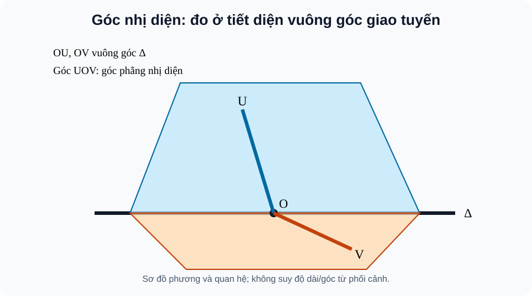

# Bài 25. Hai mặt phẳng vuông góc

TOÁN 11 · CHƯƠNG VII · SGK KNTT TẬP 2

Hiểu lý do cần học → khái niệm và lý do → hình minh họa có hướng dẫn đọc → Tự thử trước Core → ví dụ suy luận → tự thực hành và khắc phục. Không ghi Skill Mastery.
<nav class="thpt-r4-lesson-tabs"><a href="../">Chương VII</a><a href="../luyen-tap/">Core/Luyện tập</a><a href="../tu-kiem-tra-chuong/">Tự kiểm tra tự đối chiếu</a></nav>

=== "Khám phá kiến thức"

    ### Cùng tìm hiểu

    ### 1.1. Vì sao cần học
    Cánh cửa với tường, hai mái nhà và mặt đáy của chóp tạo ra góc giữa **hai mặt**, không thể đo bằng cách lấy tùy tiện hai cạnh trên mặt.

    ### Ví dụ trực quan

    Khi hai mặt phẳng gặp nhau theo một cạnh, góc nhìn bằng mắt trên hình không cho góc chính xác. Cần cắt bởi mặt phẳng vuông góc giao tuyến để đo.

    **Quan sát bằng số liệu:** Hai tờ bìa gập theo một đường chung tạo góc nhị diện. Chọn đúng mặt cắt vuông góc với đường gấp mới cho góc phẳng dùng để tính.

    ### Thuật ngữ và kiến thức, kỹ năng

    **Thuật ngữ:** góc nhị diện, góc giữa hai mặt phẳng, lăng trụ/chóp đều.

    **Sau bài học, em cần:** dựng góc phẳng đúng tiết diện và kiểm cách chọn góc quy ước.

=== "Kiến thức SGK"

    ### 1.2. Khái niệm thực chất
    Góc giữa hai mặt phẳng là góc nhọn/vuông giữa hai đường pháp tuyến, thuộc [0°,90°]. Hai mặt phẳng vuông góc nếu góc bằng 90°. Góc nhị diện đo theo hai nửa mặt phẳng, có thể là góc tù; góc phẳng nhị diện tạo bởi hai tia cùng vuông góc giao tuyến tại một điểm.

    ### 1.3. Hình thành và lập luận
    Để đo góc phẳng nhị diện, cắt bởi một mặt phẳng vuông góc với giao tuyến, thu được hai tia thuộc hai nửa mặt. Nếu (P) chứa đường a vuông góc (Q), thì (P)⊥(Q). Nếu (P)⊥(Q) theo giao tuyến Δ và a∈(P) vuông góc Δ, thì a⊥(Q).

    ### 1.4. Điều kiện, giới hạn, lỗi thường gặp
    Không suy hai mặt phẳng vuông góc chỉ từ hai đường bất kì vuông góc, mỗi đường thuộc một mặt. Với hình chóp đều: đáy là đa giác đều, chân đường cao ở tâm đáy; lăng trụ đứng: cạnh bên vuông góc đáy; lăng trụ đều = lăng trụ đứng có đáy đa giác đều; chóp cụt đều có hai đáy đa giác đều song song, đồng dạng và mặt bên là hình thang cân.

    ### 1.5. Làm rõ các định lí, điều kiện và cấu trúc SGK
    **Hai đối tượng góc cần tách bạch:** Hai *mặt phẳng* không có phía được chọn nên góc giữa chúng nằm trong [0°,90°], xác định bằng góc không tù giữa hai đường vuông góc tương ứng với hai mặt. Một *góc nhị diện* là hình tạo bởi **hai nửa mặt phẳng** cùng bờ Δ; chúng xác định một phần không gian nên **góc phẳng** đo được có thể lớn hơn 90°. Để dựng góc phẳng, chọn O∈Δ, trong mỗi nửa mặt lấy tia Ox, Oy cùng vuông góc Δ và đi ra phía đã chọn; ∠xOy chính là góc phẳng nhị diện. Nếu góc này tù 115°, thì góc giữa hai mặt phẳng chứa chúng là 65°.

    **Điều kiện chứng minh mặt vuông góc:** Nếu đường a nằm trong (P) và a⊥(Q), suy (P)⊥(Q). Khi (P)⊥(Q) cắt nhau theo Δ, nếu a⊂(P) và a⊥Δ thì a⊥(Q). Đừng thay a bởi đường bất kì thuộc (P) chưa chứng minh vuông góc giao tuyến; không phải *mọi* đường của một mặt đều vuông góc mặt kia.

    **Các hình đứng/đều — học từng định nghĩa:** Lăng trụ đứng là lăng trụ có **cạnh bên vuông góc mặt đáy**; chiều cao bằng độ dài cạnh bên. Lăng trụ đều là lăng trụ đứng có đáy là **đa giác đều**. Hình hộp đứng có cạnh bên vuông góc đáy là hình bình hành; hộp chữ nhật là trường hợp đáy hình chữ nhật; lập phương là hộp chữ nhật có mọi cạnh bằng nhau. Hình chóp đều có đáy đa giác đều và **chân đường cao tại tâm đáy**, kéo theo các cạnh bên bằng nhau; chiều cao không phải cạnh bên. Cắt hình chóp đều bởi mặt phẳng song song đáy được hình chóp cụt đều: hai đáy đồng dạng, song song; các mặt bên hình thang cân và có khoảng cách vuông góc hai đáy xác định.

    **Đường suy luận khi giải bài:** Nhận diện hình nào, xác định tâm đáy/đường cao, dùng tam giác vuông để tìm cạnh hoặc góc; không gắn nhãn “đều” chỉ vì hình vẽ trông cân đối. Với lăng trụ đứng có đáy không đều, nó **không phải** lăng trụ đều.

    ### 1.6. Hình minh họa và cách đọc

    <figure class="thpt-r4-plot thpt-r4-probability-figure"><figcaption>Hình B25: Góc giữa hai mặt phải đo trong một tiết diện vuông góc giao tuyến; đánh dấu 90° của hai mặt bằng điều kiện vuông góc đường–mặt.</figcaption></figure>

    **Hướng dẫn đọc hình:** Góc giữa hai mặt phải đo trong một tiết diện vuông góc giao tuyến; đánh dấu 90° của hai mặt bằng điều kiện vuông góc đường–mặt. Hình là sơ đồ giải thích phương pháp, **không được suy góc hay độ dài từ nét vẽ phối cảnh**. Điều kiện vuông góc phải có chứng minh.

    ### Vận dụng — tự giải trước khi đối chiếu
    Hình chóp S.ABCD có SA⊥(ABCD). Vì SA⊂(SAB), hai mặt (SAB) và (ABCD) vuông góc. Nhưng không suy mọi mặt bên của hình chóp đều đều vuông góc đáy.

    

Đã tự thử? Mở hướng dẫn tự đối chiếu

Đối chiếu lập luận của em với phần ví dụ được giải thích dưới đây. Đây là hoạt động luyện tập, không ghi Skill Mastery.

=== "Ví dụ"

    ### Các bài giải có hướng dẫn

    #### EX-G11-CHVII-B25-01 — Tiết diện đo góc hai mặt

    **Nhiệm vụ:** Hai mặt (P),(Q) cắt nhau theo Δ. Một tiết diện vuông góc Δ tạo các tia m⊂(P), n⊂(Q) cùng gốc; góc giữa hai mặt lấy thế nào?

    **Lập luận để tự đối chiếu sau khi thử:** Lấy góc nhỏ giữa hai đường m,n, thuộc [0°,90°]. Với hai nửa mặt định hướng, góc nhị diện có thể là góc lớn hơn 90°.

    #### EX-G11-CHVII-B25-02 — Một đường vuông góc mặt đủ

    **Nhiệm vụ:** a⊂(P), a⊥(Q). Kết luận (P) và (Q)?

    **Lập luận để tự đối chiếu sau khi thử:** (P)⊥(Q). Đây là tiêu chí đường nằm trong một mặt và vuông góc mặt kia.

    #### EX-G11-CHVII-B25-03 — Góc nhị diện khác góc hai mặt

    **Nhiệm vụ:** Hai nửa mặt phẳng tạo góc phẳng nhị diện 120°. Góc giữa hai mặt phẳng chứa chúng là bao nhiêu?

    **Lập luận để tự đối chiếu sau khi thử:** 60°. Góc không định hướng giữa mặt lấy góc nhọn/ vuông của hai mặt, min(120°,60°).

    #### EX-G11-CHVII-B25-04 — Hình lăng trụ đều

    **Nhiệm vụ:** Một lăng trụ đứng có đáy tam giác đều cạnh 4 và chiều cao 6. Diện tích đáy?

    **Lập luận để tự đối chiếu sau khi thử:** S=4²√3/4=4√3. Nó là lăng trụ đều vì đứng và đáy đều; cạnh bên là chiều cao 6.

    #### EX-G11-CHVII-B25-05 — Đỉnh chóp đều và chân cao

    **Nhiệm vụ:** Hình chóp đều S.ABCD đáy hình vuông tâm O, cạnh đáy 6; đường cao SO=4. Tính cạnh bên SA.

    **Lập luận để tự đối chiếu sau khi thử:** OA=3√2, SA=√(SO²+OA²)=√34. Vì chân chiều cao của chóp đều là tâm O, tam giác SOA vuông tại O.

=== "Lỗi thường gặp"

    

<strong>Nhận diện lỗ hổng:</strong> Nhầm góc nhị diện với góc hai mặt.
<ol><li><strong>Nhận diện lỗ hổng:</strong> Nhầm góc nhị diện với góc hai mặt.</li><li><strong>Nhắc đúng bản chất:</strong> Góc nhị diện có thể tù, góc không định hướng giữa hai mặt ≤90°.</li><li><strong>Nhìn lại kiến thức và hình:</strong> Đọc lại phần vì sao cần học, khái niệm và cách lập luận của B25, tự phát biểu điều kiện bằng lời và kiểm tra đúng hình SVG của bài, không suy luận từ phối cảnh.</li><li><strong>Tự luyện có hướng dẫn:</strong> Góc phẳng nhị diện 116°, góc giữa hai mặt? <strong>Sau khi tự làm mới đối chiếu:</strong> 64°.</li><li><strong>Quay về câu gốc:</strong> <code>THPT-G11-CHVII-B25-C02</code>; giải lại và giải thích mỗi bước. HELP chỉ hiện sau nộp câu *luyện tập*, tuyệt đối không hiện trong RD1 trước Final Submit.</li></ol>
<a href="../luyen-tap/?item=THPT-G11-CHVII-B25-C02">Quay lại câu canonical THPT-G11-CHVII-B25-C02</a>

    

<strong>Nhận diện lỗ hổng:</strong> Dùng cạnh bên làm đường cao chóp đều.
<ol><li><strong>Nhận diện lỗ hổng:</strong> Dùng cạnh bên làm đường cao chóp đều.</li><li><strong>Nhắc đúng bản chất:</strong> Chân đường cao ở tâm đa giác đáy.</li><li><strong>Nhìn lại kiến thức và hình:</strong> Đọc lại phần vì sao cần học, khái niệm và cách lập luận của B25, tự phát biểu điều kiện bằng lời và kiểm tra đúng hình SVG của bài, không suy luận từ phối cảnh.</li><li><strong>Tự luyện có hướng dẫn:</strong> Chóp đều đáy vuông: đường cao hạ từ S đến đâu? <strong>Sau khi tự làm mới đối chiếu:</strong> Tâm O đáy.</li><li><strong>Quay về câu gốc:</strong> <code>THPT-G11-CHVII-B25-C06</code>; giải lại và giải thích mỗi bước. HELP chỉ hiện sau nộp câu *luyện tập*, tuyệt đối không hiện trong RD1 trước Final Submit.</li></ol>
<a href="../luyen-tap/?item=THPT-G11-CHVII-B25-C06">Quay lại câu canonical THPT-G11-CHVII-B25-C06</a>

    ### Học tiếp

    [Core và Luyện tập Bài 25](luyen-tap.md) · [Tự luận Chương VII](../../../thu-vien/tu-luan-g11-chuong-vii.md) · [Tự kiểm tra cuối chương](tu-kiem-tra-chuong.md)
