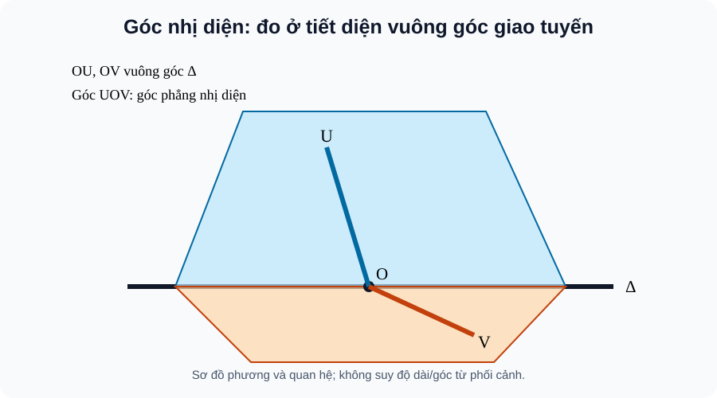
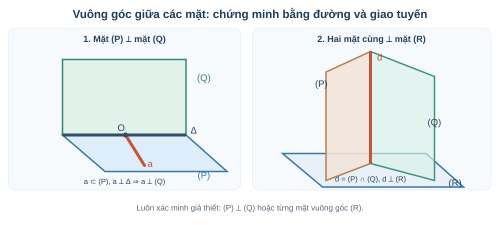

# Bài 25. Hai mặt phẳng vuông góc

TOÁN 11 · CHƯƠNG VII · KẾT NỐI TRI THỨC · TẬP HAI

Hiểu góc giữa hai mặt phẳng, góc nhị diện, điều kiện vuông góc, rồi nhận dạng đúng các lăng trụ, chóp đều và chóp cụt đều.

<nav class="thpt-r4-lesson-tabs"><a href="../">Chương VII</a><a href="../luyen-tap/">Core và Luyện tập</a><a href="../tu-kiem-tra-chuong/">Tự kiểm tra cuối chương</a></nav>

=== "Khám phá kiến thức"

    **Vì sao học?** Mặt ghế và lưng ghế, hai mái nhà hoặc cánh cửa và sàn đều tạo thành các góc trong không gian. Đo một góc nhìn thấy trên ảnh chưa đủ: cần biết góc của **hai mặt phẳng không định hướng** hay của **hai nửa mặt phẳng đã chọn**. Dùng kiến thức Bài 22–24 về góc hai đường, pháp tuyến và hình chiếu, ta sẽ hiểu các định nghĩa trước rồi mới tính toán.

    ### 1.1. Góc giữa hai mặt phẳng, hai mặt phẳng vuông góc

    **Bắt đầu từ phương pháp tuyến.** Với hai mặt \((P),(Q)\), chọn các đường \(a\perp(P)\) và \(b\perp(Q)\). Góc **không tù** giữa \(a,b\) gọi là góc giữa hai mặt. Vì mọi đường vuông góc với cùng một mặt đều cùng phương, việc thay vị trí \(a,b\) không làm thay đổi góc. Giá trị nằm trong \([0^\circ,90^\circ]\): hai mặt song song hoặc trùng nhau có góc \(0^\circ\), hai mặt được gọi là **vuông góc** nếu góc bằng \(90^\circ\).

    **Đo bằng giao tuyến:** Khi hai mặt cắt nhau theo \(\Delta\), chọn \(O\in\Delta\); trong \((P)\) lấy đường \(m\) qua \(O\) vuông góc \(\Delta\), trong \((Q)\) lấy đường \(n\) qua \(O\) vuông góc \(\Delta\). Góc giữa hai mặt là góc **không tù** giữa \(m,n\). Hai điều kiện \(m\perp\Delta,n\perp\Delta\) rất quan trọng: lấy tùy tiện hai đường thuộc hai mặt sẽ đo sai góc.

    <figure class="thpt-r4-plot"><figcaption><strong>Hướng dẫn đọc:</strong> đường đậm \(\Delta\) là giao tuyến; \(OU,OV\) cùng xuất phát ở \(O\) và nằm theo hai hướng vuông góc \(\Delta\). Hình giải thích **tiết diện vuông góc giao tuyến**. Góc nhị diện giữ hai tia đã chọn, còn góc giữa hai mặt phải chọn **góc không tù giữa các đường chứa chúng**.</figcaption></figure>

    **Luyện tập 1 SGK — điều kiện đáy là hình vuông:** Chóp \(S.ABCD\) có đáy **hình chữ nhật**, hai đường chéo cắt tại \(O\), \(SO\perp(ABCD)\). Hai mặt \((SAC),(SBD)\) gặp nhau theo \(SO\). Vì \(AC,BD\) đều nằm trong đáy nên cùng vuông góc \(SO\); do đó góc giữa hai mặt bằng \((AC,BD)\). Trong hình chữ nhật, hai đường chéo vuông góc **khi và chỉ khi** hình chữ nhật là hình vuông. Không suy vuông góc từ hình chữ nhật nói chung.

    **Vận dụng.** Hai đường \(m,n\) thuộc hai mặt phẳng cắt theo \(d\), cùng qua \(O\in d\) và vuông góc \(d\). Hai tia được chọn trên \(m,n\) tạo góc \(125^\circ\). Tính góc giữa hai mặt.

    ??? question "Đối chiếu"

        **Lời giải:** Hai đường \(m,n\) có góc không tù \(180^\circ-125^\circ=55^\circ\). Vì đều vuông góc giao tuyến tại \(O\), góc giữa hai mặt cũng bằng \(55^\circ\).

    ??? tip "Kiểm lỗi"

        Không trả \(125^\circ\) cho góc **hai mặt**. Phải kiểm hai phương đều vuông góc giao tuyến và chọn góc không tù.

    ### 1.2. Điều kiện để hai mặt phẳng vuông góc

    **Chứng minh không cần đo góc:** Nếu mặt \((P)\) chứa một đường \(a\) vuông góc với mặt \((Q)\), suy ngay \((P)\perp(Q)\). Điều kiện mạnh ở đây là **\(a\perp(Q)\)**, nghĩa là \(a\) vuông góc **mọi đường trong \((Q)\)**, không chỉ một đường \(b\subset(Q)\). Khi chưa biết \(a\perp(Q)\), có thể chứng minh bằng **hai đường cắt nhau trong \((Q)\)** theo Bài 23.

    **Ví dụ 2 SGK:** Tứ diện \(OABC\) có \(OA\perp OB\) và \(OA\perp OC\). Do \(OB,OC\subset(OBC)\) cắt tại \(O\), suy \(OA\perp(OBC)\). Cả \((OAB)\) lẫn \((OAC)\) đều chứa \(OA\); vậy \((OAB)\perp(OBC)\) và \((OAC)\perp(OBC)\). Không tự kết luận \((OAB)\perp(OAC)\): góc giữa chúng còn phụ thuộc \(\angle BOC\).

    **Cánh cửa và sàn:** Trục bản lề của cánh cửa vuông góc mặt sàn. Mặt phẳng cánh cửa ở mọi vị trí đóng–mở đều chứa trục bản lề, nên **luôn vuông góc với sàn**, cho dù góc giữa cánh cửa và mặt tường thay đổi.

    <figure class="thpt-r4-plot"><figcaption><strong>Hướng dẫn đọc khung trái:</strong> hai mặt \((P),(Q)\) có giao tuyến \(\Delta\), đường \(a\subset(P)\) vuông góc \(\Delta\). **Khi đã có** \((P)\perp(Q)\), suy \(a\perp(Q)\); chiều chứng minh ngược lại phải chứng minh \(a\perp(Q)\) trước. Khung phải minh họa một tính chất ở mục 1.3, không dùng góc phối cảnh để kết luận.</figcaption></figure>

    **Vận dụng.** Cho \(SA\perp(ABCD)\) trong hình chóp \(S.ABCD\). Chứng minh \((SAB)\perp(ABCD)\). Có suy được mọi mặt bên đều vuông góc đáy không?

    ??? question "Đối chiếu"

        **Lời giải:** Vì \(SA\subset(SAB)\), \(SA\perp(ABCD)\) nên \((SAB)\perp(ABCD)\). Không có căn cứ để suy mọi mặt bên, chẳng hạn \((SBC)\), đều chứa đường vuông góc đáy.

    ??? tip "Kiểm lỗi"

        Không chuyển kết luận đúng cho mặt \((SAB)\) thành kết luận cho **mọi** mặt bên. Đường dùng để chứng minh phải **nằm trong chính mặt đang xét**.

    ### 1.3. Tính chất của hai mặt phẳng vuông góc

    **Vì sao phải kiểm giao tuyến?** Nếu \((P)\perp(Q)\) và giao tuyến là \(\Delta\), một đường \(a\subset(P)\) **vuông góc \(\Delta\)** sẽ vuông góc **toàn mặt \((Q)\)**. Thật vậy, chọn \(O=a\cap\Delta\), lấy trong \((Q)\) đường \(b\) qua \(O\) vuông góc \(\Delta\). Do hai mặt vuông góc, \(a\perp b\); mà \(a\perp\Delta\). Hai đường \(b,\Delta\) cắt nhau trong \((Q)\), suy \(a\perp(Q)\). Điều kiện \(a\perp\Delta\) không thể bỏ: chính \(\Delta\subset(P)\) vẫn nằm trong \((Q)\), nên không vuông góc \((Q)\).

    **Tính chất của hai mặt cùng vuông góc một mặt thứ ba:** Nếu hai mặt \((P),(Q)\) **cắt nhau** theo \(d\) và đều vuông góc với \((R)\), thì \(d\perp(R)\). Vì qua mỗi điểm \(O\in d\) chỉ có một đường vuông góc \((R)\), mà đường ấy phải thuộc từng mặt \((P),(Q)\), nên nó trùng giao tuyến \(d\). Nếu hai mặt **song song**, chúng không có giao tuyến; không áp kết luận về \(d\).

    <figure class="thpt-r4-plot"><figcaption><strong>Hướng dẫn đọc:</strong> khung trái, với **giả thiết** hai mặt vuông góc, đường \(a\subset(P)\) vuông góc giao tuyến \(\Delta\) sẽ vuông góc \((Q)\). Khung phải, hai mặt đứng \((P),(Q)\) **cắt nhau theo \(d\)** và cùng vuông góc nền \((R)\), vì thế \(d\perp(R)\). Các dấu vuông góc là quan hệ được chứng minh, không suy từ nét nghiêng trên hình.</figcaption></figure>

    **Ví dụ 3 SGK — Hai lần dùng định lí:** Cho hình chóp \(S.ABCD\) đáy là hình chữ nhật, \(SA\perp(ABCD)\); gọi \(B',C',D'\) lần lượt là hình chiếu của \(A\) trên \(SB,SC,SD\). Do \(BC\perp AB\) và \(BC\perp SA\), suy \(BC\perp(SAB)\), mà \(BC\subset(SBC)\), vậy \((SBC)\perp(SAB)\). Đường \(AB'\subset(SAB)\) và \(AB'\perp SB\), với \(SB\) là giao tuyến \((SBC)\cap(SAB)\), nên theo tính chất vừa học \(AB'\perp(SBC)\). Suy \(AB'\perp SC\); tương tự \(AD'\perp SC\), còn \(AC'\perp SC\) do định nghĩa hình chiếu. Vậy \(B',C',D'\) cùng nằm trên mặt phẳng qua \(A\) vuông góc \(SC\). Điểm cốt lõi là **không** kết luận từ một góc vuông đơn lẻ.

    **Vận dụng.** Hai mặt phẳng \((P),(Q)\) khác nhau, cắt theo \(d\), cùng vuông góc nền \((R)\). Kết luận quan hệ \(d\) với \((R)\), và giải thích vì sao không làm vậy nếu \((P)\parallel(Q)\).

    ??? question "Đối chiếu"

        **Lời giải:** Theo tính chất, \(d\perp(R)\). Nếu \((P)\parallel(Q)\) thì **không tồn tại giao tuyến \(d\)** để kết luận; yêu cầu hai mặt cắt nhau là thiết yếu.

    ??? tip "Kiểm lỗi"

        Đừng viết “hai mặt cùng vuông góc mặt thứ ba thì giao tuyến vuông góc” khi chưa xác nhận chúng **cắt nhau**.

    ### 1.4. Góc nhị diện

    **Một góc \(105^\circ\) của lưng ghế có mâu thuẫn với góc hai mặt luôn không tù?** Không. Đối tượng đang đo khác nhau. Hai **nửa mặt phẳng** có chung bờ \(\Delta\) xác định một **góc nhị diện** \([P,\Delta,Q]\). Qua một điểm \(O\) trên \(\Delta\), dựng hai tia \(Ox,Oy\) lần lượt thuộc **hai nửa mặt đã chọn** và đều vuông góc \(\Delta\); góc \(\angle xOy\) gọi là **góc phẳng nhị diện**. Số đo của nó từ \(0^\circ\) đến \(180^\circ\), có thể nhọn, vuông hoặc tù. Ngược lại, góc giữa **hai mặt phẳng không định hướng** luôn chọn góc không tù giữa hai đường chứa các tia.

    <figure class="thpt-r4-plot"><figcaption><strong>Hướng dẫn đọc:</strong> \(\Delta\) là cạnh chung của hai nửa mặt, \(O\) là điểm dựng tiết diện; \(OU,OV\) vuông góc \(\Delta\) và hướng **vào đúng hai nửa mặt đề cho**. Giữ \(\angle UOV\) khi hỏi góc nhị diện; khi hỏi góc hai mặt, xét góc không tù giữa hai đường chứa các tia.</figcaption></figure>

    **HĐ5 SGK — Mặt ghế và lưng ghế:** Một hướng dẫn thiết kế cho góc phẳng nhị diện khoảng \(100^\circ\) đến \(105^\circ\) về phía người ngồi. Khi đó góc giữa các **mặt phẳng chứa ghế và lưng ghế** bằng \(180^\circ-\theta\), tức trong khoảng \(75^\circ\) đến \(80^\circ\). Đây là ví dụ cần đọc **hai nửa mặt đã chọn** chứ không lấy một góc bất kì ở bản lề.

    <figure class="thpt-r4-plot"><figcaption><strong>Hướng dẫn đọc:</strong> tia \(Ox\) theo mặt ghế và \(Oy\) theo lưng ghế làm góc **\(105^\circ\)** ở phía người ngồi; đó là **góc nhị diện**. Góc nhỏ giữa **hai đường** chứa các tia bằng \(75^\circ\), là góc giữa **hai mặt phẳng**. Đây là sơ đồ giải thích, không phải phép đo một chiếc ghế cụ thể.</figcaption></figure>

    **Ví dụ 4 SGK — Chọn đúng nửa mặt:** Cho chóp \(S.ABCD\), \(SA\perp(ABCD)\), đáy hình thoi cạnh \(a\) có \(AC=a\) và \(SA=a/2\). Hai tam giác \(ABC,ACD\) đều nên \(\angle BAD=120^\circ\); đó là góc nhị diện \([B,SA,D]\). Gọi \(O\) là giao hai đường chéo; \(AO=a/2=SA\), \(SOA\) vuông tại \(A\), nên \([S,BD,A]\) có góc phẳng \(45^\circ\), còn \([S,BD,C]\) có góc phẳng \(135^\circ\). Cả hai nhị diện cùng chung giao tuyến \(BD\) nhưng có **hai nửa đáy khác phía**, không được cho cùng số đo.

    **Vận dụng.** Tiết diện vuông góc bản lề ghế có góc giữa hai tia mặt ghế và lưng ghế (phía người ngồi) bằng \(102^\circ\). Tính góc nhị diện và góc giữa hai mặt phẳng chứa hai phần ghế.

    ??? question "Đối chiếu"

        **Lời giải:** Góc nhị diện của **hai nửa mặt đã chọn** bằng \(102^\circ\); góc không tù giữa **hai mặt phẳng** bằng \(180^\circ-102^\circ=78^\circ\).

    ??? tip "Kiểm lỗi"

        Không thay ngay \(102^\circ\) bằng \(78^\circ\) khi đề hỏi **góc nhị diện**. Ngược lại, không lấy góc tù làm **góc giữa hai mặt**.
