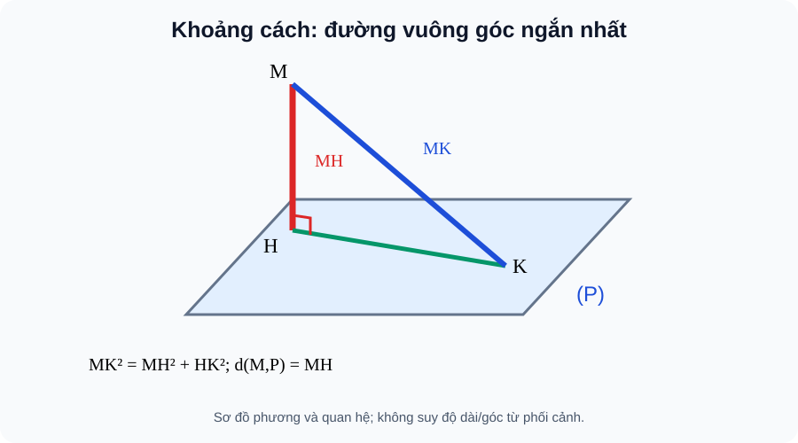

# Bài 26. Khoảng cách

TOÁN 11 · CHƯƠNG VII · SGK KNTT TẬP 2

Hiểu lý do cần học → khái niệm và lý do → hình minh họa có hướng dẫn đọc → Tự thử trước Core → ví dụ suy luận → tự thực hành và khắc phục. Không ghi Skill Mastery.
<nav class="thpt-r4-lesson-tabs"><a href="../">Chương VII</a><a href="../luyen-tap/">Core/Luyện tập</a><a href="../tu-kiem-tra-chuong/">Tự kiểm tra tự đối chiếu</a></nav>

=== "Khám phá kiến thức"

    ### Cùng tìm hiểu

    ### 1.1. Vì sao cần học
    Đo khoảng cách từ đèn treo tới sàn phải đo theo phương ngắn nhất, không đo theo dây xiên. Giữa hai thanh chéo nhau, phải tìm đoạn nối vừa chạm hai đường vừa vuông góc cả hai.

    ### Ví dụ trực quan

    Khoảng cách từ một điểm đến mặt phẳng là độ dài đoạn vuông góc ngắn nhất, chứ không phải chiều dài một đoạn xiên bất kỳ trên hình.

    **Quan sát bằng số liệu:** Điểm cách mặt phẳng sàn theo phương thẳng đứng 5 m thì khoảng cách tới sàn là 5 m; mọi đoạn xiên nối tới điểm khác trên sàn đều dài hơn hoặc bằng 5 m.

    ### Thuật ngữ và kiến thức, kỹ năng

    **Thuật ngữ:** khoảng cách điểm–mặt, đường–mặt, hai mặt và hai đường chéo nhau.

    **Sau bài học, em cần:** dựng đúng đoạn vuông góc chung trước khi tính độ dài và không nhầm với đoạn xiên.

=== "Kiến thức SGK"

    ### 1.2. Khái niệm thực chất
    d(M,a)=MH với H là hình chiếu M lên a; d(M,(P))=MH với MH⊥(P). Nếu a//(P) thì d(a,(P))=d(M,(P)) với M∈a. Nếu hai mặt song song, dùng khoảng cách từ một điểm mặt này đến mặt kia. Với hai đường chéo nhau, khoảng cách là độ dài đoạn vuông góc chung.

    ### 1.3. Hình thành và lập luận
    Trong tam giác vuông MHK với H là chân đường vuông góc và K nằm trên đường/mặt: MK²=MH²+HK²≥MH². Đó là lý do “ngắn nhất”. Muốn tìm đoạn vuông góc chung phải kiểm cả hai đầu thuộc đúng hai đường và vuông góc **cả hai**, không phải chỉ một.

    ### 1.4. Điều kiện, giới hạn, lỗi thường gặp
    Nếu điểm đã thuộc mặt thì khoảng cách bằng 0. Nếu hai đường song song, dùng đoạn nối vuông góc giữa chúng; khái niệm chéo nhau yêu cầu không đồng phẳng và không cắt nhau. Chiều cao hình chóp là khoảng cách đỉnh–mặt đáy, không phải cạnh bên.

    ### 1.5. Làm rõ các định lí, điều kiện và cấu trúc SGK
    **Vì sao khoảng cách là ngắn nhất:** Với M ngoài mặt (P), H là chân MH⊥(P), mọi K∈(P) tạo tam giác MHK vuông tại H. Do đó MK²=MH²+HK²≥MH², suy MK≥MH, đẳng thức chỉ khi K=H. Với đường a, lập luận tương tự với K∈a và chân H trên a. Khoảng cách là **độ dài**, không thể âm; bằng 0 khi M nằm trên đường hoặc mặt.

    **Các cặp đối tượng — xác định đúng:** Nếu a//(P), d(a,(P)) lấy từ **bất kì** điểm A∈a xuống (P). Nếu (P)//(Q), d((P),(Q)) là khoảng cách từ một điểm A∈(P) tới (Q); nó không đổi theo A. Nếu hai đường a,b *chéo nhau*, một đoạn AB có A∈a, B∈b và AB⊥a, AB⊥b được gọi là đoạn **vuông góc chung**; d(a,b)=AB. Chỉ tìm đoạn vuông góc một đường chưa đủ. Nếu hai đường cắt nhau, khoảng cách bằng 0; không nhầm trường hợp này với chéo nhau.

    **Quy trình xây dựng:** (1) Gọi đối tượng cần đo và xác định điểm/cặp đường. (2) Nêu điều kiện vuông góc của đoạn cần tìm. (3) Dựng chân bằng quan hệ vuông góc đã học B23–B25. (4) Dùng tam giác vuông, hình chiếu hoặc quan hệ song song tính độ dài. (5) Đối chiếu đơn vị. Độ dài SA của một cạnh bên hình chóp **không phải** chiều cao nếu S chiếu lên H khác A.

    ### 1.6. Hình minh họa và cách đọc

    <figure class="thpt-r4-plot thpt-r4-probability-figure"><figcaption>Hình B26: Dựng MH⊥(P) và đoạn MK xiên: so sánh chiều dài; đoạn vuông góc chung giữa hai đường chéo nhau.</figcaption></figure>

    **Hướng dẫn đọc hình:** Dựng MH⊥(P) và đoạn MK xiên: so sánh chiều dài; đoạn vuông góc chung giữa hai đường chéo nhau. Hình là sơ đồ giải thích phương pháp, **không được suy góc hay độ dài từ nét vẽ phối cảnh**. Điều kiện vuông góc phải có chứng minh.

    ### Vận dụng — tự giải trước khi đối chiếu
    Chóp có SA=5, hình chiếu S trên đáy là H, AH=4: SH=3. Tại sao chiều cao là 3 chứ không phải 5?

    

Đã tự thử? Mở hướng dẫn tự đối chiếu

Đối chiếu lập luận của em với phần ví dụ được giải thích dưới đây. Đây là hoạt động luyện tập, không ghi Skill Mastery.

=== "Ví dụ"

    ### Các bài giải có hướng dẫn

    #### EX-G11-CHVII-B26-01 — Đường vuông góc là đường ngắn nhất

    **Nhiệm vụ:** Từ M tới mặt (P) có MH=3 là đoạn vuông góc; điểm K∈(P) có HK=4. Tính MK và xác định d(M,(P)).

    **Lập luận để tự đối chiếu sau khi thử:** MK=5, d(M,(P))=3. Pythagore cho MK²=MH²+HK² nên MK≥MH.

    #### EX-G11-CHVII-B26-02 — Chóp và chiều cao

    **Nhiệm vụ:** SA=13, H là hình chiếu S lên đáy, AH=12. Tính chiều cao SH.

    **Lập luận để tự đối chiếu sau khi thử:** SH=√(13²−12²)=5. Cạnh bên 13 không phải chiều cao.

    #### EX-G11-CHVII-B26-03 — Khoảng cách đường song song mặt

    **Nhiệm vụ:** Đường a//(P). Hai điểm M,N∈a có d(M,(P))=4. Tính d(N,(P)) và d(a,(P)).

    **Lập luận để tự đối chiếu sau khi thử:** Cả hai bằng 4 do khoảng cách từ mọi điểm của đường song song tới mặt đều như nhau.

    #### EX-G11-CHVII-B26-04 — Hai đường chéo nhau

    **Nhiệm vụ:** Trong hệ trục minh họa, a={(t,0,0)}, b={(2,s,3)}. Nêu đoạn vuông góc chung và khoảng cách giữa a,b.

    **Lập luận để tự đối chiếu sau khi thử:** Đoạn từ A=(2,0,0)∈a đến B=(2,0,3)∈b có phương Oz vuông góc phương Ox và Oy, dài 3; d(a,b)=3.

    #### EX-G11-CHVII-B26-05 — Hai mặt phẳng song song

    **Nhiệm vụ:** Hai sàn phẳng song song (P),(Q) cách nhau 2,7m; điểm M bất kì trên (P). Tính d(M,(Q)).

    **Lập luận để tự đối chiếu sau khi thử:** 2,7m vì đoạn vuông góc nối hai mặt song song có độ dài không phụ thuộc vị trí M.

=== "Lỗi thường gặp"

    

<strong>Nhận diện lỗ hổng:</strong> Nhầm độ dài cạnh xiên với chiều cao ngắn nhất.
<ol><li><strong>Nhận diện lỗ hổng:</strong> Nhầm độ dài cạnh xiên với chiều cao ngắn nhất.</li><li><strong>Nhắc đúng bản chất:</strong> Chiều cao chóp là đoạn từ đỉnh vuông góc mặt đáy.</li><li><strong>Nhìn lại kiến thức và hình:</strong> Đọc lại phần vì sao cần học, khái niệm và cách lập luận của B26, tự phát biểu điều kiện bằng lời và kiểm tra đúng hình SVG của bài, không suy luận từ phối cảnh.</li><li><strong>Tự luyện có hướng dẫn:</strong> Cạnh bên 5, hình chiếu dài 4, chiều cao? <strong>Sau khi tự làm mới đối chiếu:</strong> 3.</li><li><strong>Quay về câu gốc:</strong> <code>THPT-G11-CHVII-B26-C06</code>; giải lại và giải thích mỗi bước. HELP chỉ hiện sau nộp câu *luyện tập*, tuyệt đối không hiện trong RD1 trước Final Submit.</li></ol>
<a href="../luyen-tap/?item=THPT-G11-CHVII-B26-C06">Quay lại câu canonical THPT-G11-CHVII-B26-C06</a>

    ### Học tiếp

    [Core và Luyện tập Bài 26](luyen-tap.md) · [Tự luận Chương VII](../../../thu-vien/tu-luan-g11-chuong-vii.md) · [Tự kiểm tra cuối chương](tu-kiem-tra-chuong.md)
