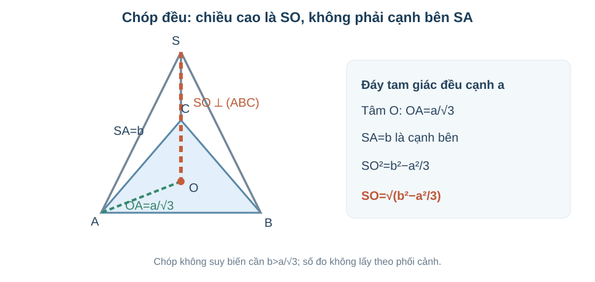
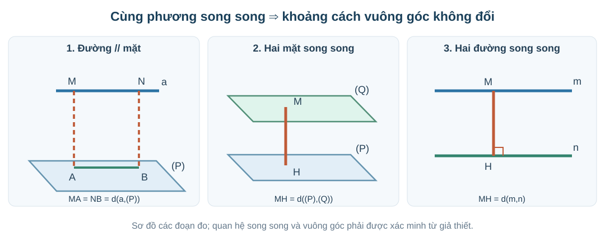
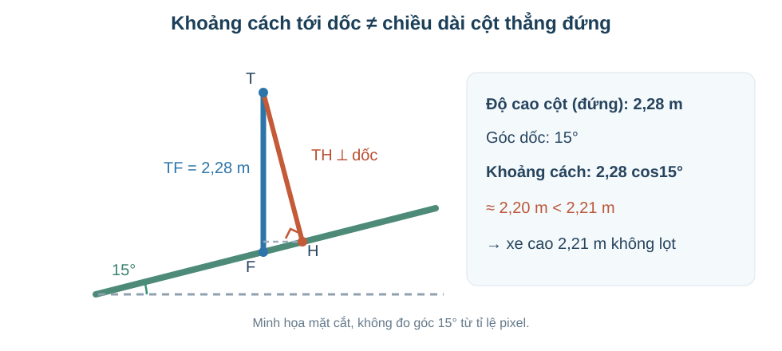
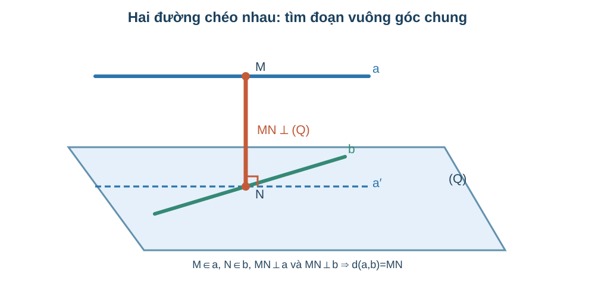
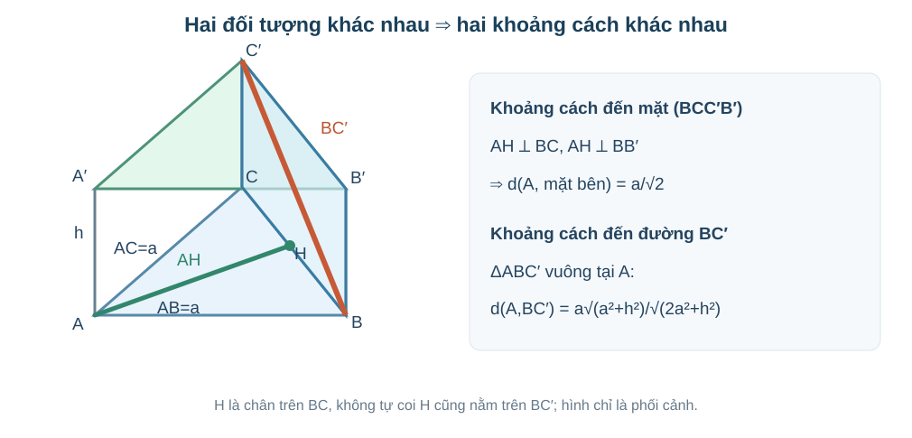
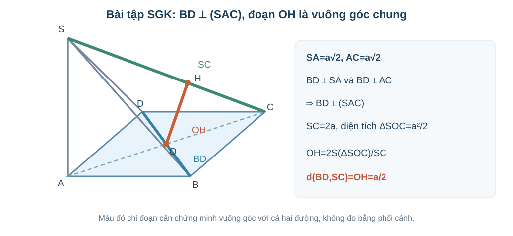

# Bài 26. Khoảng cách

TOÁN 11 · CHƯƠNG VII · SGK KẾT NỐI TRI THỨC · TẬP HAI

Khoảng cách là độ dài ngắn nhất: biết khi nào hạ chân vuông góc, khi nào đo giữa các đối tượng song song, và khi nào phải dựng đường vuông góc chung giữa hai đường chéo nhau.

<nav class="thpt-r4-lesson-tabs"><a href="../">Chương VII</a><a href="../luyen-tap/">Core và Luyện tập</a><a href="../tu-kiem-tra-chuong/">Tự kiểm tra cuối chương</a></nav>

=== "Khám phá kiến thức"

    **Vì sao cần học?** Đầu phun chữa cháy phải đặt cách trần một khoảng an toàn, chiều cao xe phải đủ thấp để đi qua khung trên dốc, và các thanh kết cấu không gian có thể chéo nhau dù trên hình nhìn như cắt. Khoảng cách không phải một đoạn nối tùy ý: ta muốn **độ dài ngắn nhất** giữa các đối tượng. Trước khi học, em cần biết hình chiếu vuông góc (Bài 24), đường vuông góc mặt phẳng (Bài 23) và quan hệ đường chéo nhau (Bài 22).

    ### 1.1. Khoảng cách từ một điểm đến một đường thẳng, đến một mặt phẳng

    **Khám phá HĐ1 — vì sao chân vuông góc ngắn nhất?** Cho điểm \(M\) ngoài đường thẳng \(a\), gọi \(H\) là hình chiếu vuông góc của \(M\) lên \(a\). Với mọi \(K\in a\) khác \(H\), tam giác \(MHK\) vuông tại \(H\), nên

    \[
    MK^2=MH^2+HK^2>MH^2\quad\Rightarrow\quad MK>MH.
    \]

    Tương tự, nếu \(M\notin(P)\) và \(H\) là chân vuông góc của \(M\) xuống mặt \((P)\), thì \(MH\perp HK\) với mọi \(K\in(P)\), \(K\ne H\). Nếu \(M\in(P)\), khoảng cách bằng 0. Bởi vậy đoạn \(MH\) là **đoạn ngắn nhất** từ \(M\) tới đường hoặc mặt. Khi \(K=H\), độ dài bằng đúng \(MH\).

    **Định nghĩa theo hình chiếu:** Khoảng cách \(d(M,a)=MH\) với \(H\) là hình chiếu vuông góc của \(M\) trên \(a\); tương tự \(d(M,(P))=MH\) với \(H\) là hình chiếu vuông góc của \(M\) trên \((P)\). Khi \(M\) thuộc đối tượng thì \(H=M\); nếu không, đường \(MH\) vuông góc với đối tượng. Khoảng cách **không âm** và bằng \(0\) khi \(M\) đã nằm trên đối tượng. Ta không gọi một đoạn xiên dài hơn là “khoảng cách”. Nếu đề cho nhiều đường trong mặt phẳng mà chưa chứng minh pháp tuyến, phải dùng tiêu chuẩn **hai đường cắt nhau** của Bài 23.

    <figure class="thpt-r4-plot"><figcaption><strong>Hướng dẫn đọc:</strong> từ \(M\), đoạn đỏ \(MH\) tới chân \(H\) vuông góc **cả mặt \((P)\)**; đoạn xanh \(MK\) tới điểm \(K\) khác \(H\) là đoạn xiên. So sánh bằng \(MK^2=MH^2+HK^2\), không đo từ hình vẽ phối cảnh. Với đường \(a\), thay \((P)\) bằng \(a\) và giữ lập luận tương tự.</figcaption></figure>

    **Một phép thử cụ thể cho khoảng cách điểm–đường:** Trong mặt tọa độ, chọn \(M(0;0)\) và \(a:2x+y-6=0\). Chân \(H\) trên \(a\) là \((12/5;6/5)\), vì \(2(12/5)+6/5-6=0\) và \(\overrightarrow{MH}=(12/5;6/5)\) cùng phương với pháp tuyến \((2;1)\) của đường. Vậy \(d(M,a)=MH=\sqrt{(12/5)^2+(6/5)^2}=6/\sqrt5\). Đây là cách kiểm được **chân H**, chứ không cần ước lượng bằng mắt.

    <figure class="thpt-r4-plot"><figcaption><strong>Hướng dẫn đọc hình Toán 10 dùng lại:</strong> đường \(2x+y=6\) cắt hai trục, \(M(0,0)\) nằm ngoài đường và \(H(12/5,6/5)\) nằm trên đường. Đoạn \(MH\) vuông góc \(a\) do cùng phương vectơ pháp tuyến; đây là **minh họa có tọa độ cụ thể**, không phải công thức chung cần học thuộc ở Bài 26.</figcaption></figure>

    **Chiều cao hình chóp từ khái niệm khoảng cách:** Hình chóp có đỉnh \(S\), đáy thuộc \((P)\). Chiều cao là \(d(S,(P))\), tức chiều dài đường \(SH\perp(P)\). Cạnh bên \(SA\) thường là đường **xiên**, dài hơn đường cao. Với hình chóp đều \(S.ABC\), đáy tam giác đều cạnh \(a>0\), cạnh bên \(b>0\), chân cao \(O\) là tâm đáy và \(AO=a/\sqrt3\) (bán kính ngoại tiếp tam giác đều, đã giải thích ở Bài 25). Suy ra

    \[
    SO=\sqrt{b^2-\frac{a^2}{3}},\qquad b>\frac{a}{\sqrt3}
    \]

    đối với chóp không suy biến. Điều kiện dưới căn phản ánh chiều cao phải thực và dương.

    <figure class="thpt-r4-plot"><figcaption><strong>Hướng dẫn đọc Ví dụ 1 SGK:</strong> \(O\) là tâm **tam giác đều** \(ABC\), không phải một đỉnh đáy; \(SO\) đỏ nét đứt là đường cao, \(SA=b\) là cạnh huyền của tam giác vuông \(SOA\), \(OA=a/\sqrt3\). Chỉ dùng Pythagore khi đã xác minh \(SO\perp(ABC)\).</figcaption></figure>

    **Vận dụng.** Chóp tam giác đều có cạnh đáy \(a=6\) cm và cạnh bên \(b=5\) cm. Tính chiều cao. Vì sao không lấy \(5\) cm làm chiều cao?

    ??? question "Đối chiếu"

        **Lời giải:** Tâm đáy có \(AO=a/\sqrt3=2\sqrt3\) cm. \(SO=\sqrt{SA^2-AO^2}=\sqrt{25-12}=\sqrt{13}\) cm. Cạnh \(SA=5\) cm là **cạnh bên xiên** (cạnh huyền), không phải đoạn vuông góc xuống đáy.

    ??? tip "Kiểm lỗi"

        Chỉ lấy cạnh bên làm chiều cao nếu chính nó vuông góc mặt đáy. Trong chóp đều, chân đường cao nằm ở **tâm** đáy, không tự đồng nhất với đỉnh \(A\).

    ### 1.2. Khoảng cách giữa các đường thẳng và mặt phẳng song song, giữa hai mặt phẳng song song

    **Một ý chung cho các trường hợp song song:** Nếu đường \(a\parallel(P)\), lấy hai điểm \(M,N\in a\), hình chiếu \(A,B\) xuống \((P)\). Vì \(MA\parallel NB\), \(MN\parallel AB\) và các đoạn chiếu vuông góc mặt phẳng, \(ABNM\) là hình chữ nhật; do đó \(MA=NB\). Điều này chứng minh **khoảng cách từ mọi điểm của \(a\) đến \((P)\) bằng nhau**. Vì thế được phép chọn **một điểm thuận lợi** trên \(a\), không phải tìm một điểm “đặc biệt” rồi giả định khoảng cách luôn bằng nhau.

    **Ba loại khoảng cách:** Nếu \(a\parallel(P)\), \(d(a,(P))=d(M,(P))\) với bất kì \(M\in a\). Với \((P)\parallel(Q)\), \(d((P),(Q))=d(M,(Q))\) với bất kì \(M\in(P)\). Với hai đường \(m\parallel n\), \(d(m,n)=d(M,n)\) với \(M\in m\). Cả ba dùng đoạn **vuông góc**. Nếu đường nằm **ngay trên** mặt, hoặc hai mặt **trùng nhau**, khoảng cách bằng \(0\); không áp máy móc trường hợp “song song phân biệt” có khoảng cách dương.

    <figure class="thpt-r4-plot"><figcaption><strong>Hướng dẫn đọc từ trái sang phải:</strong> hai chân \(A,B\) từ \(M,N\in a\) tạo các đoạn vuông góc **bằng nhau**; hai mặt song song được đo bởi đoạn vuông góc nối hai mặt; hai đường song song đo theo đoạn vuông góc giữa chúng. Không dùng đoạn chéo dù trông ngắn trên hình.</figcaption></figure>

    **Ví dụ 2 SGK — Hình hộp đứng đáy thoi:** Cho \(ABCD.A'B'C'D'\) là hình hộp đứng, đáy hình thoi cạnh \(a\), \(\angle BAD=120^\circ\), cạnh đứng \(AA'=h\). Muốn tính \(d(A'C',(ABCD))\), vì \(A'C'\) nằm trong mặt trên song song đáy, chỉ cần đo \(AA'=h\). Với \(d(AA',(BDD'B'))\), ta cần một đoạn vuông góc mặt \((BDD'B')\). Gọi \(O\) là giao hai đường chéo của hình thoi: \(AO\perp BD\), đồng thời \(AO\perp BB'\) vì \(BB'\perp(ABCD)\). Hai đường \(BD,BB'\) cắt nhau trong mặt \((BDD'B')\), nên \(AO\perp(BDD'B')\). Từ hình thoi có góc \(A=120^\circ\), \(AO=a/2\). Kết quả là **\(h\)** và **\(a/2\)** tương ứng, không được đánh tráo hai khoảng cách.

    <figure class="thpt-r4-plot"><figcaption><strong>Hướng dẫn đọc:</strong> khối có cạnh đứng \(AA'=h\perp\) đáy, nên cho khoảng cách của **đường \(A'C'\) tới đáy**. Đoạn \(AO\) màu đỏ từ đỉnh \(A\) tới tâm hình thoi \(O\) vuông góc cả \(BD\) và \(BB'\), nên đo khoảng cách từ **đường \(AA'\)** tới mặt phẳng chéo \((BDD'B')\). Góc \(120^\circ\) là giả thiết, không đo từ phối cảnh.</figcaption></figure>

    **Chiều cao lăng trụ:** Hai mặt đáy lăng trụ song song; khoảng cách giữa chúng là **chiều cao**. Chỉ với lăng trụ **đứng** mới được lấy độ dài cạnh bên làm chiều cao. Lăng trụ xiên có cạnh bên khác chiều cao vì cạnh bên không vuông góc đáy.

    **Vận dụng SGK – Khung khống chế chiều cao trên đường dốc:** Hai cột thẳng đứng cao \(2{,}28\) m giữ thanh ngang; mặt đường nghiêng \(15^\circ\) so với mặt nằm ngang. Ta cần độ dài **pháp tuyến từ thanh ngang đến mặt đường**, không lấy \(2{,}28\) m là khoảng cách tới mặt đường. Trong tiết diện dọc dốc, góc giữa phương đứng và pháp tuyến mặt đường là \(15^\circ\), nên

    \[
    d(\text{thanh ngang},\text{mặt dốc})=2{,}28\cos15^\circ\approx2{,}20\text{ m}.
    \]

    Vì \(2{,}21>2{,}20\), mô hình không cho phép xe cao \(2{,}21\) m qua khung. Cần nhớ đây là tính trong **mô hình hình học**, chưa xét các sai số lắp đặt và biên an toàn thực tế.

    <figure class="thpt-r4-plot"><figcaption><strong>Hướng dẫn đọc ứng dụng:</strong> \(TF\) là chiều dài cột **thẳng đứng** \(2{,}28\) m; \(TH\) màu đỏ là khoảng cách **vuông góc dốc**. Góc giữa pháp tuyến dốc và phương đứng bằng góc dốc \(15^\circ\), nên \(TH=TF\cos15^\circ\). Không lấy \(2{,}28\) để so với \(2{,}21\) mà bỏ độ nghiêng.</figcaption></figure>

    **Vận dụng.** Trong hình hộp đứng đáy thoi cạnh \(a=8\) cm, \(\angle BAD=120^\circ\), chiều cao \(h=6\) cm, tính \(d(A'C',(ABCD))\) và \(d(AA',(BDD'B'))\).

    ??? question "Đối chiếu"

        **Lời giải:** Vì hai đáy song song và \(AA'\perp(ABCD)\), \(d(A'C',(ABCD))=h=6\) cm. Gọi \(O\) là tâm hình thoi. Từ \(AO\perp BD\) và \(AO\perp BB'\) suy \(AO\perp(BDD'B')\). Vì \(AA'\parallel BB'\subset(BDD'B')\) và \(A\notin(BDD'B')\) (giao với đáy là \(BD\)), nên \(AA'\parallel(BDD'B')\); do đó \(d(AA',(BDD'B'))=AO=a/2=4\) cm.

    ??? tip "Kiểm lỗi"

        Không lấy \(h\) cho khoảng cách từ \(AA'\) đến mặt phẳng chéo \((BDD'B')\). Đường \(AA'\) nằm **song song** mặt phẳng này, khoảng cách được đo theo **\(AO\)** trong mặt đáy.

    ### 1.3. Khoảng cách giữa hai đường thẳng chéo nhau

    **Khó khăn mới:** Hai đường chéo nhau không song song cũng không gặp nhau, nên không thể lấy tùy tiện một đầu trên mỗi đường rồi gọi đoạn nối là “khoảng cách”. Đường \(\Delta\) được gọi là **đường vuông góc chung** của \(a,b\) nếu \(\Delta\) **cắt cả hai** và **vuông góc với cả hai**. Nếu \(\Delta\cap a=\{M\}\), \(\Delta\cap b=\{N\}\), thì \(d(a,b)=MN\). Phải kiểm đủ **bốn điều kiện**: \(M\in a\), \(N\in b\), \(MN\perp a\), \(MN\perp b\).

    **Vì sao HĐ4 SGK dùng mặt phẳng song song?** Qua một điểm \(N_0\in b\), dựng đường \(c\parallel a\). Hai đường \(b,c\) cắt nhau và khác phương nên xác định mặt phẳng \((Q)\). Vì \(a,b\) chéo nhau, \(a\) không nằm trong \((Q)\); do \(a\parallel c\subset(Q)\), suy ra \(a\parallel(Q)\). Chiếu vuông góc \(a\) xuống \((Q)\) được \(a'\parallel a\), khác phương với \(b\), nên \(a',b\) cắt nhau tại duy nhất \(N\). Đường qua \(N\) vuông góc \((Q)\) gặp \(a\) tại điểm \(M\) có hình chiếu là \(N\). Vì \(a\parallel(Q)\), đường \(MN\) vuông góc \((Q)\), nên đồng thời vuông góc \(b\subset(Q)\) và \(a\parallel a'\subset(Q)\). Do đó \(MN\) là đoạn vuông góc chung. Phương pháp này chuyển **bài toán hai đường chéo nhau** về **khoảng cách đường–mặt song song**:

    \[
    d(a,b)=d(a,(Q))=MN.
    \]

    Cũng có thể chọn hai mặt **song song tương ứng chứa** \(a,b\), rồi tính khoảng cách giữa hai mặt.

    <figure class="thpt-r4-plot"><figcaption><strong>Hướng dẫn đọc HĐ4:</strong> đường xanh trên \(a\) được chiếu xuống đường nét đứt \(a'\) trong \((Q)\), cắt đường lục \(b\) tại **\(N\)**. Đi theo đường đỏ \(MN\) **vuông góc mặt \((Q)\)** từ \(N\) đến **\(M\in a\)**. Vì \(a,b\) cùng có phương nằm trong \((Q)\), đoạn đỏ vuông góc cả hai. Phải xác minh \(a\parallel(Q)\) trước khi dùng.</figcaption></figure>

    **Ví dụ 3 SGK — Chóp có cạnh đứng:** Trong chóp \(S.ABC\), \(SA\perp(ABC)\), \(AB=a\) và \(\angle ABC=60^\circ\). Dựng \(H\) là chân vuông góc từ \(A\) xuống \(BC\). Khi đó \(AH\perp BC\), lại \(AH\subset(ABC)\) nên \(AH\perp SA\). Vì \(A\in SA\), \(H\in BC\), đoạn \(AH\) chính là **đoạn vuông góc chung**, và

    \[
    d(SA,BC)=AH=AB\sin60^\circ=\frac{a\sqrt3}{2}.
    \]

    Điểm mạnh của cách dựng này là không cần tạo mặt phẳng phụ khi đã có **một đường vuông góc mặt đáy**.

    <figure class="thpt-r4-plot"><figcaption><strong>Hướng dẫn đọc Ví dụ 3:</strong> \(A\) thuộc đường \(SA\), \(H\) thuộc \(BC\); \(AH\) đỏ **vuông góc \(BC\)** do dựng chân, đồng thời vuông góc **\(SA\)** vì \(SA\perp(ABC)\). Lúc ấy mới tính \(AH\) bằng tam giác \(ABH\) vuông tại \(H\) với góc \(60^\circ\) ở \(B\).</figcaption></figure>

    **Vì sao là khoảng cách nhỏ nhất?** Với mọi \(X\in a\), \(Y\in b\), gọi \(X'\) là hình chiếu vuông góc của \(X\) lên \((Q)\). Vì \(a\parallel(Q)\), \(XX'=MN\). Nếu \(Y\ne X'\), tam giác \(XX'Y\) vuông tại \(X'\), nên \(XY^2=XX'^2+X'Y^2>MN^2\). Nếu \(Y=X'\), ta có \(XY=MN\). Đẳng thức chỉ xảy ra khi \(X'=Y=N\), tức \(X=M\). Mặt khác, bất cứ đường vuông góc chung nào cũng vuông góc với hai phương không song song của \(a,b\), nên vuông góc với \((Q)\). Hai đầu mút của nó phải chiếu về giao điểm duy nhất \(N\) của \(a'\) và \(b\), do đó chính là \(M,N\). Vậy đoạn vuông góc chung tồn tại duy nhất và là đoạn ngắn nhất. Trong phạm vi những đối tượng SGK đang xét, khoảng cách chính là độ dài ngắn nhất giữa hai điểm thuộc hai hình.

    **Vận dụng.** Với chóp \(S.ABC\), \(SA\perp(ABC)\), \(AB=8\) cm và \(\angle ABC=60^\circ\). Dựng \(H\) là chân từ \(A\) xuống \(BC\). Tính \(d(SA,BC)\) và nêu đủ điều kiện của đoạn vuông góc chung.

    ??? question "Đối chiếu"

        **Lời giải:** \(A\in SA\), \(H\in BC\); \(AH\perp BC\) theo cách dựng, \(AH\perp SA\) vì \(AH\subset(ABC)\) và \(SA\perp(ABC)\). Vậy \(AH\) là đoạn vuông góc chung, \(d(SA,BC)=AH=8\sin60^\circ=4\sqrt3\) cm.

    ??? tip "Kiểm lỗi"

        Không chọn \(SB\) hay \(SC\) làm khoảng cách giữa \(SA\) và \(BC\): chúng không phải đoạn vuông góc **đồng thời** với cả hai đường. Kiểm rõ hai đầu và hai góc vuông trước khi tính.

=== "Kiến thức SGK"

    ### 2.1. Khoảng cách từ một điểm đến một đường thẳng, đến một mặt phẳng

    
<strong>Định nghĩa — Khoảng cách từ điểm đến đường thẳng</strong>
Với điểm \(M\) và đường \(a\), gọi \(H\) là hình chiếu vuông góc của \(M\) trên \(a\). <strong>\(d(M,a)=MH\)</strong>. Nếu \(M\in a\) thì \(H=M\) và \(d(M,a)=0\).

    
<strong>Định nghĩa — Khoảng cách từ điểm đến mặt phẳng</strong>
Với điểm \(M\) và mặt phẳng \((P)\), gọi \(H\) là hình chiếu vuông góc của \(M\) lên \((P)\); nếu \(M\in(P)\) thì \(H=M\). <strong>\(d(M,(P))=MH\)</strong>. Khoảng cách bằng \(0\) khi và chỉ khi \(M\in(P)\).

    **Vì sao là đoạn ngắn nhất?** Nếu \(M\) nằm ngoài đường hoặc mặt và \(K\ne H\) thuộc đối tượng tương ứng, tam giác \(MHK\) vuông tại \(H\), nên \(MK^2=MH^2+HK^2>MH^2\). Với \(K=H\) có đẳng thức. Nếu \(M\) thuộc đối tượng, khoảng cách bằng 0 tại \(H=M\). Không lấy chiều dài đoạn xiên tùy ý.

    <figure class="thpt-r4-plot"><figcaption><strong>Tra hình:</strong> \(H\) là chân của \(M\) trên mặt \((P)\), \(K\) là một điểm khác trong \((P)\). \(MH\perp HK\) nên \(MK\ge MH\). Tương tự nếu \((P)\) được thay bởi một đường \(a\), với \(H,K\in a\).</figcaption></figure>

    **Chiều cao chóp:** Nếu đỉnh \(S\) của chóp không thuộc mặt đáy \((P)\), chiều cao là \(d(S,(P))\), không mặc định bằng một cạnh bên. Với chóp đều đáy tam giác đều cạnh \(a\), cạnh bên \(b\), \(O\) là tâm đáy, \(AO=a/\sqrt3\), vì vậy \(SO=\sqrt{b^2-a^2/3}\); điều kiện hình chóp không suy biến là \(b>a/\sqrt3\).

    <figure class="thpt-r4-plot"><figcaption><strong>Tra Ví dụ 1:</strong> đỉnh \(S\) chiếu xuống **tâm \(O\)** của tam giác đều đáy. Độ cao \(SO\) là cạnh góc vuông của tam giác \(SOA\), còn \(SA=b\) là cạnh huyền, nên trừ \(AO^2=a^2/3\) khi tính.</figcaption></figure>

    ### 2.2. Khoảng cách giữa các đường thẳng và mặt phẳng song song, giữa hai mặt phẳng song song

    
<strong>Định nghĩa — Các khoảng cách giữa đối tượng song song</strong>
Nếu đường \(a\) song song với mặt \((P)\), khoảng cách \(d(a,(P))=d(M,(P))\) với một điểm <strong>bất kì</strong> \(M\in a\). Nếu \((P)\parallel(Q)\), khoảng cách \(d((P),(Q))=d(M,(Q))\) với \(M\in(P)\). Nếu \(m\parallel n\), khoảng cách \(d(m,n)=d(M,n)\) với \(M\in m\). Các khoảng cách không phụ thuộc lựa chọn điểm trên đối tượng thứ nhất.

    **Lý do điểm nào cũng được:** Với đường \(a\parallel(P)\), hai chân vuông góc \(A,B\) của \(M,N\in a\) tạo hình chữ nhật \(ABNM\); vì vậy \(MA=NB\). Hai mặt phẳng song song có cùng phương pháp tuyến nên các đoạn vuông góc nối hai mặt dài bằng nhau. Hai đường song song cũng có chiều rộng vuông góc không đổi.

    <figure class="thpt-r4-plot"><figcaption><strong>Tra ba khung:</strong> **trái** đo các đoạn \(MA=NB\) từ đường \(a\) xuống \((P)\); **giữa** đo đoạn vuông góc giữa hai mặt \((P),(Q)\); **phải** đo đoạn vuông góc giữa hai đường \(m,n\). Không dùng độ dài của một đường nối xiên.</figcaption></figure>

    **Chiều cao lăng trụ:** Khoảng cách giữa hai mặt phẳng đáy song song là chiều cao lăng trụ. Nếu lăng trụ đứng, chiều cao bằng cạnh bên; với lăng trụ xiên, hai độ dài này khác nhau.

    **Ví dụ 2 SGK:** Hình hộp đứng đáy thoi cạnh \(a\), \(\angle BAD=120^\circ\), cạnh bên \(h\). Đường \(A'C'\parallel(ABCD)\), suy \(d(A'C',(ABCD))=AA'=h\). Đường \(AA'\parallel BB'\), với \(BB'\subset(BDD'B')\); \(A\notin(BDD'B')\) vì giao của mặt này với đáy là \(BD\). Do đó \(AA'\parallel(BDD'B')\). Gọi \(O=AC\cap BD\): \(AO\perp BD\) do đáy là hình thoi, \(AO\perp BB'\) vì \(BB'\perp(ABCD)\); vậy \(AO\perp(BDD'B')\). Tam giác \(ABO\) vuông tại \(O\) có \(\angle ABO=30^\circ\), suy \(AO=a/2\). Vì thế \(d(AA',(BDD'B'))=a/2\).

    <figure class="thpt-r4-plot"><figcaption><strong>Tra ví dụ:</strong> cạnh đứng \(AA'=h\) đo từ mặt trên xuống đáy; đoạn \(AO\) nằm trong đáy, vuông góc **hai đường cắt nhau \(BD,BB'\)** của mặt phẳng chéo và có độ dài \(a/2\). Không dùng \(AA'\) để đo khoảng cách **đường–mặt phẳng chéo**.</figcaption></figure>

    **Ứng dụng SGK — Dốc nghiêng:** Thanh ngang đặt trên cột đứng cao \(2{,}28\) m, mặt dốc nghiêng \(15^\circ\). Khoảng cách vuông góc tới mặt dốc là \(2{,}28\cos15^\circ\approx2{,}20\) m (làm tròn hai chữ số). Vì \(2{,}21>2{,}20\), trong mô hình bài toán xe cao \(2{,}21\) m không được qua.

    <figure class="thpt-r4-plot"><figcaption><strong>Tra mặt cắt:</strong> đoạn đứng \(TF=2{,}28\) m không phải khoảng cách tới dốc, đoạn đỏ \(TH\perp\) mặt dốc mới là khoảng cách cần đo. Góc giữa chúng bằng \(15^\circ\) trong tiết diện, nên dùng **cos**, không dùng sin.</figcaption></figure>

    ### 2.3. Khoảng cách giữa hai đường thẳng chéo nhau

    
<strong>Định nghĩa — Đường vuông góc chung và khoảng cách</strong>
Cho hai đường thẳng \(a,b\) <strong>chéo nhau</strong>. Một đường \(\Delta\) <strong>cắt cả \(a,b\) và vuông góc với cả hai</strong> gọi là đường vuông góc chung. Nếu \(\Delta\cap a=\{M\}\), \(\Delta\cap b=\{N\}\), thì <strong>\(d(a,b)=MN\)</strong>. Phải kiểm \(M\in a\), \(N\in b\), \(MN\perp a\) và \(MN\perp b\). Hai đường chéo nhau có duy nhất một đường vuông góc chung. Độ dài \(MN\) là nhỏ nhất trong mọi độ dài đoạn nối một điểm trên \(a\) với một điểm trên \(b\).

    
<strong>Nhận xét — Chuyển về khoảng cách song song</strong>
Với hai đường \(a,b\) chéo nhau, chọn \((Q)\) <strong>chứa \(b\) và song song \(a\)</strong>. Khi đó <strong>\(d(a,b)=d(a,(Q))\)</strong>. Cũng có thể chọn hai mặt phẳng song song lần lượt chứa \(a\) và \(b\), rồi đo khoảng cách giữa hai mặt ấy.

    <figure class="thpt-r4-plot"><figcaption><strong>Tra HĐ4 SGK:</strong> \((Q)\) chứa \(b\) và song song \(a\); \(a'\) nét đứt là ảnh vuông góc của \(a\) xuống \((Q)\). Chọn \(N=a'\cap b\); dựng đường pháp tuyến qua \(N\) gặp \(a\) tại \(M\). \(MN\) đỏ cắt đúng hai đường và vuông góc cả hai, nên là khoảng cách.</figcaption></figure>

    **Trường hợp dựng nhanh khi một đường vuông góc mặt phẳng:** Nếu \(a\perp(P)\) tại \(O\), còn \(b\subset(P)\) và \(O\notin b\), thì hạ \(OH\perp b\) trong \((P)\). Vì \(OH\subset(P)\), \(OH\perp a\), đồng thời \(OH\perp b\), nên \(d(a,b)=OH=d(O,b)\). Không cần dựng mặt phẳng phụ.

    **Ví dụ 3 SGK:** Trong chóp \(S.ABC\), \(SA\perp(ABC)\), \(AB=a\), \(\angle ABC=60^\circ\). Lấy \(H\) là chân từ \(A\) xuống \(BC\). Vì \(AH\perp BC\) và \(AH\subset(ABC)\) nên \(AH\perp SA\); vậy \(AH\) là đoạn vuông góc chung. \(d(SA,BC)=AH=AB\sin60^\circ=a\sqrt3/2\).

    <figure class="thpt-r4-plot"><figcaption><strong>Tra Ví dụ 3:</strong> kiểm \(A\in SA\), \(H\in BC\); \(AH\perp BC\) do chân chiếu và \(AH\perp SA\) do \(SA\perp\) đáy. Tam giác vuông \(ABH\) với góc \(B=60^\circ\) cho \(AH=a\sqrt3/2\).</figcaption></figure>

    | Tình huống | Đoạn cần tìm | Điều kiện quyết định |
    | :-- | :-- | :-- |
    | Điểm – đường/mặt | Đoạn từ điểm đến chân chiếu | Vuông góc đường/mặt |
    | Hai đối tượng song song | Đoạn vuông góc giữa hai đối tượng | Xác minh **song song** |
    | Hai đường chéo nhau | Đoạn vuông góc chung | Hai đầu thuộc đúng đường, vuông góc cả hai |

=== "Ví dụ"

    ### 3.1. Chứng minh đoạn vuông góc là đoạn ngắn nhất

    **Đề bài.** Cho \(M\notin(P)\), \(MH\perp(P)\), \(MH=3\) cm. Một điểm \(K\in(P)\) thỏa \(HK=4\) cm. Tính \(MK\); chứng minh mọi đoạn nối \(M\) với \((P)\) đều dài ít nhất \(3\) cm.

    **Phân tích:** Muốn so sánh mọi đoạn, dùng hình chiếu \(H\) và Pythagore trong tam giác \(MHK\); điều kiện \(MH\perp(P)\) mạnh hơn chỉ vuông góc một đường vẽ trong mặt.

    

<strong>Lời giải.</strong> Vì \(MH\perp(P)\) và \(HK\subset(P)\), \(MH\perp HK\), nên \(MK=\sqrt{3^2+4^2}=5\) cm. Với điểm \(X\in(P)\) bất kì, \(MX^2=MH^2+HX^2\ge MH^2=9\). Do các độ dài không âm, \(MX\ge3\) cm; đẳng thức khi \(X=H\). Vậy \(d(M,(P))=MH=3\) cm.

    **Kiểm lại:** \(5\ge3\) đúng; 3 cm là **cực tiểu**, không phải chiều dài của mọi đoạn xiên.

    ### 3.2. Từ điểm đến đường thẳng — xác định được cả chân

    **Đề bài.** Trong mặt phẳng tọa độ, với \(M(0;0)\) và đường \(a:2x+y-6=0\), chứng minh \(H(12/5;6/5)\) là hình chiếu của \(M\) lên \(a\), rồi tính \(d(M,a)\).

    **Phân tích:** Muốn được dùng \(MH\) làm khoảng cách, phải kiểm **\(H\in a\)** và **\(MH\perp a\)**, chứ không chỉ thay số vào một công thức thuộc lòng.

    <figure class="thpt-r4-plot"><figcaption><strong>Đọc hình trước lời giải:</strong> \(M\) là gốc tọa độ, \(H(12/5;6/5)\) ở trên đường xanh \(2x+y=6\). Đoạn \(MH\) cùng phương pháp tuyến \((2;1)\), nên vuông góc đường; khoảng cách chính là độ dài \(MH\).</figcaption></figure>

    

<strong>Lời giải.</strong> Thế tọa độ \(H\) vào \(a\): \(2(12/5)+6/5-6=0\), nên \(H\in a\). Vectơ \(\overrightarrow{MH}=(12/5;6/5)=(6/5)(2;1)\) cùng phương vectơ pháp tuyến của \(a\), suy \(MH\perp a\). Do đó \(d(M,a)=MH=\sqrt{(12/5)^2+(6/5)^2}=\sqrt{180}/5=6/\sqrt5\).

    **Kiểm lại:** \(d(M,a)>0\) vì \(M\notin a\). Kết quả cũng bằng \(|2\cdot0+0-6|/\sqrt{2^2+1^2}=6/\sqrt5\), nhưng kiểm chân mới làm rõ bản chất.

    ### 3.3. Ví dụ 1 SGK — Chiều cao hình chóp đều tam giác

    **Đề bài.** Chóp tam giác đều \(S.ABC\) có cạnh đáy \(a>0\), cạnh bên \(b\), với \(b>a/\sqrt3\). Tính chiều cao. Áp dụng khi \(a=6\) cm, \(b=5\) cm.

    **Phân tích:** Chóp đều có chân cao \(O\) ở **tâm tam giác đều**. Đáy cạnh \(a\) cho \(AO=a/\sqrt3\), nên tam giác \(SAO\) vuông tại \(O\) là đủ; không nhầm \(SA=b\) với chiều cao.

    <figure class="thpt-r4-plot"><figcaption><strong>Đọc trước lời giải:</strong> \(O\) là tâm đáy đều và là chân \(SO\perp(ABC)\); \(SO\) đỏ là đoạn ngắn nhất từ \(S\) đến đáy, còn \(SA=b\) là cạnh huyền tam giác vuông \(SOA\). Từ \(AO=a/\sqrt3\) mới dùng Pythagore.</figcaption></figure>

    

<strong>Lời giải.</strong> Vì \(O\) là tâm tam giác đều \(ABC\), \(AO=a/\sqrt3\). Trong tam giác vuông \(SOA\), \(SO^2=SA^2-OA^2=b^2-a^2/3\), nên \(SO=\sqrt{b^2-a^2/3}\). Với \(a=6,b=5\): \(SO=\sqrt{25-12}=\sqrt{13}\) cm.

    **Kiểm lại:** Điều kiện \(b>a/\sqrt3\) bảo đảm căn có giá trị dương và chóp không suy biến. Với số đã cho, \(\sqrt{13}<5=b\), phù hợp chiều cao ngắn hơn cạnh bên.

    ### 3.4. Luyện tập 1 SGK — Hai khoảng cách khác nhau trong lăng trụ đứng

    **Đề bài.** Lăng trụ đứng \(ABC.A'B'C'\) có tam giác \(ABC\) vuông cân tại \(A\), \(AB=AC=a>0\), cạnh bên \(AA'=h>0\). a) Tính \(d(A,(BCC'B'))\). b) Chứng minh \(ABC'\) vuông ở \(A\) và tính \(d(A,BC')\).

    **Phân tích:** **Khoảng cách điểm–mặt** cần hạ \(AH\) vuông góc mặt bên. **Khoảng cách điểm–đường \(BC'\)** cần đường cao của **tam giác \(ABC'\)**. Hai chân chiếu này không nhất thiết trùng; nhầm chúng sẽ cho hai kết quả sai giống nhau.

    <figure class="thpt-r4-plot"><figcaption><strong>Đọc hình trước khi tính:</strong> mặt xanh \((BCC'B')\) chứa đường \(BC\) và cạnh đứng \(BB'\); chân \(H\) từ \(A\) xuống \(BC\) làm \(AH\perp\) mặt bên. Đường đỏ \(BC'\) là **một đường nằm trong mặt**, nhưng \(H\) không nằm trên \(BC'\); muốn đo tới \(BC'\) phải dựng chân khác trong tam giác \(ABC'\).</figcaption></figure>

    

<strong>Lời giải.</strong> a) Gọi \(H\) là chân từ \(A\) xuống \(BC\). Vì \(ABC\) vuông cân tại \(A\), \(BC=a\sqrt2\) và đường cao \(AH=AB\cdot AC/BC=a/\sqrt2\). Lại \(AH\subset(ABC)\) và \(BB'\perp(ABC)\), nên \(AH\perp BB'\). Vì \(AH\perp BC\) và \(BC,BB'\) cắt nhau trong \((BCC'B')\), \(AH\perp(BCC'B')\), do đó \(d(A,(BCC'B'))=a/\sqrt2\). b) Do \(AB\perp AC\) và \(AB\perp AA'\), suy \(AB\perp(ACC'A')\), nên \(AB\perp AC'\): tam giác \(ABC'\) vuông tại \(A\). \(AC'=\sqrt{a^2+h^2}\), \(BC'=\sqrt{2a^2+h^2}\), vì vậy độ dài đường cao từ \(A\) xuống \(BC'\) là \(AB\cdot AC'/BC'=a\sqrt{a^2+h^2}/\sqrt{2a^2+h^2}\).

    **Kiểm lại:** Khoảng cách đến **đường \(BC'\)** không nhỏ hơn khoảng cách đến **mặt chứa đường ấy**: \(a\sqrt{a^2+h^2}/\sqrt{2a^2+h^2}\ge a/\sqrt2\) vì \(2(a^2+h^2)\ge2a^2+h^2\). Với \(h>0\), bất đẳng thức nghiêm.

    ### 3.5. Ví dụ 2 SGK — Hình hộp đứng đáy thoi

    **Đề bài.** Hình hộp đứng \(ABCD.A'B'C'D'\) có đáy hình thoi cạnh \(a>0\), \(\angle BAD=120^\circ\), \(AA'=h>0\). Tính \(d(A'C',(ABCD))\) và \(d(AA',(BDD'B'))\).

    **Phân tích:** Câu thứ nhất dùng **hai đáy song song** và đoạn đứng. Câu thứ hai cần **một đoạn trong đáy vuông góc mặt bên**, nên chọn \(O\) là giao hai đường chéo hình thoi.

    <figure class="thpt-r4-plot"><figcaption><strong>Đọc hình trước lời giải:</strong> đường \(A'C'\) ở mặt trên song song mặt đáy nên khoảng cách bằng cạnh đứng \(h\). Đường \(AA'\) song song mặt bên \((BDD'B')\); đoạn \(AO\) màu đỏ vuông góc với \(BD\) và cạnh đứng \(BB'\), là pháp tuyến mặt ấy.</figcaption></figure>

    

<strong>Lời giải.</strong> Vì \(A'C'\subset(A'B'C'D')\parallel(ABCD)\) và \(AA'\perp(ABCD)\), \(d(A'C',(ABCD))=AA'=h\). Gọi \(O\) là giao hai đường chéo đáy. Hình thoi cho \(AO\perp BD\); hình hộp đứng cho \(AO\perp BB'\). Do \(BD,BB'\) cắt nhau trong \((BDD'B')\), \(AO\perp(BDD'B')\). Vì \(AA'\parallel BB'\subset(BDD'B')\) và \(A\notin(BDD'B')\) (giao với đáy là \(BD\)), suy \(AA'\parallel(BDD'B')\), nên \(d(AA',(BDD'B'))=AO\). Tam giác \(BAD\) cân tại \(A\), có \(\angle BAD=120^\circ\) nên \(\angle ABO=30^\circ\); tam giác \(ABO\) vuông tại \(O\) cho \(AO=AB\sin30^\circ=a/2\).

    **Kiểm lại:** Hai khoảng cách \(h\) và \(a/2\) đo theo hai **phương khác nhau**; không mặc định chúng bằng nhau. Đã kiểm \(AO\perp\) cả hai đường cắt nhau của mặt bên.

    ### 3.6. Đường nằm trong một trong hai mặt phẳng song song

    **Đề bài.** Hai mặt phẳng \((P),(Q)\) song song và cách nhau \(6\) cm. Đường \(a\subset(P)\) song song với \((Q)\). Tính \(d(a,(Q))\) và giải thích vì sao kết quả không phụ thuộc điểm chọn trên \(a\).

    **Phân tích:** Không cần xác định chân đặc biệt trên \(a\). Đường \(a\) nằm trong mặt \((P)\) song song với \((Q)\), nên mọi điểm của \((P)\) có cùng khoảng cách tới \((Q)\).

    

<strong>Lời giải.</strong> Lấy \(M\in a\subset(P)\). Vì \((P)\parallel(Q)\), \(d(M,(Q))=d((P),(Q))=6\) cm; do \(a\parallel(Q)\), \(d(a,(Q))=d(M,(Q))=6\) cm. Với mọi \(N\in a\), \(d(N,(Q))\) cũng bằng khoảng cách hai mặt song song nên không đổi.

    **Kiểm lại:** Cần \((P)\parallel(Q)\) **và** \(a\subset(P)\); không áp kết luận cho hai mặt cắt nhau.

    ### 3.7. Vận dụng SGK — Khung hạn chế chiều cao trên dốc

    **Đề bài.** Một khung có hai cột đứng dài \(2{,}28\) m và thanh ngang nối đỉnh cột. Mặt đường nghiêng \(15^\circ\) so với phương ngang, phương thanh ngang song song mặt dốc. Tính khoảng cách từ thanh ngang đến mặt đường, làm tròn \(0{,}01\) m. Xe cao \(2{,}21\) m có đi qua được theo mô hình này không?

    **Phân tích:** Khoảng cách tới mặt nghiêng phải đo theo **pháp tuyến của mặt dốc**, không theo chiều thẳng đứng của cột. Trong mặt cắt dọc dốc, phương đứng và pháp tuyến tạo góc \(15^\circ\), nên hình chiếu của đoạn đứng lên pháp tuyến là **cạnh kề** \(2{,}28\cos15^\circ\).

    <figure class="thpt-r4-plot"><figcaption><strong>Đọc mặt cắt:</strong> \(TF\) xanh là cột **đứng** \(2{,}28\) m, \(TH\) đỏ là đoạn **vuông góc đường dốc**. Góc dốc \(15^\circ\) bằng góc giữa cột đứng và pháp tuyến dốc; dùng \(TH=TF\cos15^\circ\), không thay bằng \(TF\).</figcaption></figure>

    

<strong>Lời giải.</strong> Trong tiết diện vuông góc thanh ngang, gọi \(d\) là khoảng cách từ thanh tới mặt dốc. Theo hình chiếu lên pháp tuyến \(d=2{,}28\cos15^\circ\approx2{,}2023\) m, làm tròn \(d\approx2{,}20\) m. Vì \(2{,}21>2{,}2023\), trong mô hình hình học xe cao \(2{,}21\) m <strong>không</strong> lọt khoảng không tại khung.

    **Kiểm lại:** \(d<2{,}28\) m đúng vì khoảng cách pháp tuyến ngắn hơn đoạn đứng. Bài không xét khoảng dự phòng, hệ thống treo xe, sai số đo hoặc các yếu tố giao thông thực tế.

    ### 3.8. Ví dụ 3 SGK — Dựng đoạn vuông góc chung SA và BC

    **Đề bài.** Hình chóp \(S.ABC\) có \(SA\perp(ABC)\), \(AB=a>0\), \(\angle ABC=60^\circ\). Dựng đoạn vuông góc chung của \(SA\) và \(BC\), rồi tính khoảng cách.

    **Phân tích:** Vì \(SA\perp(ABC)\) tại \(A\), mọi đường trong đáy qua \(A\) đều vuông góc \(SA\). Chỉ cần dựng thêm đường qua \(A\) vuông góc \(BC\) để được **đoạn vuông góc chung**.

    <figure class="thpt-r4-plot"><figcaption><strong>Đọc hình trước lời giải:</strong> kiểm đủ \(A\in SA\), \(H\in BC\), \(AH\perp BC\) từ cách dựng và \(AH\perp SA\) vì \(SA\perp(ABC)\). Chỉ khi đủ bốn điều kiện mới gọi \(AH\) là đoạn vuông góc chung.</figcaption></figure>

    

<strong>Lời giải.</strong> Gọi \(H\) là hình chiếu của \(A\) trên đường \(BC\). Khi đó \(H\in BC\), \(AH\perp BC\). Mặt khác \(AH\subset(ABC)\) nên \(AH\perp SA\). Vì \(A\in SA\), đoạn \(AH\) cắt đúng hai đường và vuông góc cả hai, nên \(d(SA,BC)=AH\). Trong tam giác \(ABH\) vuông tại \(H\), \(\angle ABH=\angle ABC=60^\circ\), do đó \(AH=AB\sin60^\circ=a\sqrt3/2\).

    **Kiểm lại:** \(AH<a=AB\), hợp lí. Kết quả dùng góc ở \(B\) và độ dài \(AB\), không cần biết \(SA\); nếu chọn đoạn \(SB\), không đủ hai vuông góc.

    ### 3.9. Luyện tập 3 SGK — Khoảng cách BD đến SC trong chóp đáy vuông

    **Đề bài.** Hình chóp \(S.ABCD\) có đáy hình vuông cạnh \(a>0\), \(SA\perp(ABCD)\), \(SA=a\sqrt2\). a) Tính \(d(A,SC)\). b) Chứng minh \(BD\perp(SAC)\). c) Tính \(d(BD,SC)\) và dựng đoạn vuông góc chung.

    **Phân tích:** a) Trong tam giác \(SAC\), \(SA\perp AC\), nên \(d(A,SC)\) là đường cao từ góc vuông xuống cạnh huyền. b) Dùng **hai đường cắt nhau \(SA,AC\)** để chứng minh vuông góc mặt. c) Giao \(O=BD\cap AC\) nằm trong mặt \((SAC)\), dựng chân \(H\) từ \(O\) xuống \(SC\); khi đó \(OH\perp BD\) nhờ \(BD\perp(SAC)\).

    <figure class="thpt-r4-plot"><figcaption><strong>Đọc hình trước lời giải:</strong> \(O\) là giao \(BD,AC\); đường \(BD\) xanh vuông góc cả \(SA,AC\), nên vuông góc mặt \((SAC)\). Đoạn đỏ \(OH\) nằm trong \((SAC)\), đi từ \(O\in BD\) tới \(H\in SC\) và được dựng vuông góc \(SC\). Vì \(BD\perp(SAC)\), \(OH\perp BD\) nữa.</figcaption></figure>

    

<strong>Lời giải.</strong> a) Vì \(SA\perp(ABCD)\), \(SA\perp AC\). Đáy hình vuông cho \(AC=a\sqrt2\), nên tam giác \(SAC\) vuông cân tại \(A\), \(SC=\sqrt{SA^2+AC^2}=2a\). Đường cao từ \(A\) xuống \(SC\) có độ dài \(SA\cdot AC/SC=a\), vậy \(d(A,SC)=a\). b) Hình vuông có \(BD\perp AC\); đồng thời \(BD\perp SA\) vì \(SA\perp(ABCD)\). Hai đường \(SA,AC\) cắt tại \(A\) trong \((SAC)\), suy \(BD\perp(SAC)\). c) Gọi \(O=AC\cap BD\), \(H\) là chân từ \(O\) xuống \(SC\). Khi đó \(OH\perp SC\), và \(OH\subset(SAC)\) nên \(OH\perp BD\). Vậy \(OH\) là đoạn vuông góc chung. Diện tích tam giác \(SOC\) theo đáy \(OC=AC/2=a/\sqrt2\) và đường cao \(SA=a\sqrt2\) bằng \(a^2/2\). Mặt khác \(S_{SOC}=SC\cdot OH/2\), nên \(OH=a^2/(2a)=a/2\). Do đó \(d(BD,SC)=a/2\).

    **Kiểm lại:** \(d(BD,SC)=a/2\le d(A,SC)=a\) vì \(O\) là trung điểm \(AC\). Nếu \(K\) là hình chiếu của \(A\) lên \(SC\), thì \(OH\parallel AK\), nên \(OH=AK/2\) theo định lí đường trung bình. Đã kiểm \(OH\) có **cả hai đầu thuộc đúng đường**, và vuông góc cả hai đường.

    ### 3.10. Dựng khoảng cách hai đường chéo nhau qua mặt phẳng phụ

    **Đề bài.** Hai đường \(a,b\) chéo nhau. Dựng mặt \((Q)\) chứa \(b\), song song \(a\); gọi \(a'\) là hình chiếu vuông góc của \(a\) trên \((Q)\). Giả sử \(N=a'\cap b\), \(M\) là điểm thuộc \(a\) chiếu xuống \(N\). Chứng minh đoạn \(MN\) là đoạn vuông góc chung và \(d(a,b)=d(a,(Q))\).

    **Phân tích:** Mục tiêu là chuyển khoảng cách **hai đường** về đoạn vuông góc **đường–mặt**. Mặt phẳng phụ phải chứa đúng \(b\), song song đúng \(a\); điểm \(N\) phải nằm trên cả \(a'\) và \(b\).

    <figure class="thpt-r4-plot"><figcaption><strong>Đọc trước lời giải:</strong> đường \(a'\) nét đứt là hình chiếu của \(a\) trên \((Q)\), giao \(b\) tại \(N\). Đường đỏ qua \(N\) **vuông góc mặt \((Q)\)** gặp \(a\) tại \(M\). Đây là cách dựng thỏa đồng thời hai điều kiện vuông góc, không phải đoạn nối ngẫu nhiên.</figcaption></figure>

    

<strong>Lời giải.</strong> Theo cách dựng, \(N\in b\subset(Q)\), \(M\in a\), và \(MN\perp(Q)\). Do \(b\subset(Q)\), \(MN\perp b\). Vì \(a\parallel(Q)\), phương của \(a\) song song một phương thuộc \((Q)\), nên \(MN\perp a\). Vì vậy đường \(MN\) cắt cả \(a,b\) tại \(M,N\) và vuông góc cả hai: đó là đường vuông góc chung. Độ dài \(MN\) chính là khoảng cách \(a\) tới \((Q)\) và là \(d(a,b)\).

    **Kiểm lại:** Nếu mặt \((Q)\) không chứa \(b\) hoặc không song song \(a\), phép chuyển chưa hợp lệ. Nếu hai đường không chéo nhau thì phải xét trường hợp song song/cắt nhau riêng.

=== "Lỗi thường gặp"

    ### 4.1. Lấy một đoạn xiên làm khoảng cách

    **Dấu hiệu:** Từ \(M\) tới \((P)\), chọn điểm \(K\in(P)\) tùy ý rồi nói \(d(M,(P))=MK\).

    **Vì sao sai:** Khoảng cách là **đoạn ngắn nhất**, đi theo đường vuông góc tại chân \(H\), còn \(MK^2=MH^2+HK^2\ge MH^2\).

    **Cách sửa:** Dựng và chứng minh \(MH\perp(P)\), sau đó viết \(d(M,(P))=MH\); nếu \(M\in(P)\), khoảng cách bằng \(0\).

    ### 4.2. Chứng minh vuông góc một đường nhưng kết luận vuông góc cả mặt

    **Dấu hiệu:** Muốn dùng \(AH=d(A,(Q))\), em chỉ có \(AH\perp b\) với \(b\subset(Q)\), chưa kiểm phương còn lại.

    **Vì sao sai:** Vuông góc **một đường** trong mặt không đủ để vuông góc **toàn mặt**; đây là thiếu giả thiết của định lí ở Bài 23.

    **Cách sửa:** Chỉ rõ hai đường \(b,c\subset(Q)\) **cắt nhau**, cùng vuông góc với \(AH\). Trong hình hộp đáy thoi, cần kiểm \(AO\perp BD\) **và** \(AO\perp BB'\).

    ### 4.3. Dùng cạnh bên làm chiều cao hình chóp

    **Dấu hiệu:** Chóp đều có \(SA=b\) thì ghi luôn chiều cao bằng \(b\).

    **Vì sao sai:** Chóp đều có chân cao tại **tâm \(O\)** đáy. Cạnh bên \(SA\) là cạnh **xiên** và thường dài hơn \(SO\).

    **Cách sửa:** Dùng tam giác \(SOA\) vuông tại \(O\): \(SO=\sqrt{b^2-a^2/3}\) nếu đáy tam giác đều cạnh \(a\). Kiểm điều kiện \(b>a/\sqrt3\).

    ### 4.4. Áp công thức khoảng cách song song khi chưa chứng minh song song

    **Dấu hiệu:** Từ hai đối tượng bất kì trong không gian, lấy một điểm của đối tượng thứ nhất và giả định khoảng cách đến đối tượng kia không đổi.

    **Vì sao sai:** Tính độc lập với điểm chọn đúng khi **hai đường song song**, **hai mặt song song**, hoặc **đường song song mặt**. Với đường xiên cắt mặt, khoảng cách tại các điểm có thể khác nhau.

    **Cách sửa:** Trước khi dùng \(d(a,(P))=d(M,(P))\), phải xác minh \(a\parallel(P)\); trước khi lấy khoảng cách từ một mặt đến mặt kia, xác minh hai mặt song song.

    ### 4.5. Đồng nhất khoảng cách tới mặt với khoảng cách tới một đường trong mặt

    **Dấu hiệu:** Trong lăng trụ \(ABC.A'B'C'\), lấy chân \(H\) từ \(A\) xuống \(BC\), rồi dùng ngay \(AH\) làm \(d(A,BC')\).

    **Vì sao sai:** \(H\) thuộc \(BC\) và mặt bên \((BCC'B')\), nhưng không nhất thiết thuộc **đường \(BC'\)**. Khoảng cách tới mặt \(\le\) khoảng cách tới một đường nằm trong mặt.

    **Cách sửa:** Dùng \(AH\) khi đo tới **mặt** nếu đã chứng minh vuông góc mặt; khi đo tới **đường \(BC'\)**, dựng đường cao từ \(A\) của tam giác \(ABC'\).

    ### 4.6. Đánh tráo khoảng cách h và a/2 trong hình hộp đáy thoi

    **Dấu hiệu:** Trong Ví dụ 2 SGK, trả \(d(AA',(BDD'B'))=h\) vì \(AA'\) là cạnh đứng.

    **Vì sao sai:** \(AA'\) song song mặt bên \((BDD'B')\); đoạn đứng **không** vuông góc mặt ấy. Khoảng cách đúng là đoạn \(AO\) trong đáy và bằng \(a/2\).

    **Cách sửa:** Vẽ \(O=AC\cap BD\), chứng minh \(AO\perp BD\) và \(AO\perp BB'\), rồi suy \(AO\perp(BDD'B')\). Cạnh \(AA'=h\) chỉ đo khoảng cách từ **đường ở mặt trên xuống đáy**.

    ### 4.7. Chọn một đoạn nối hai đường chéo nhau nhưng thiếu vuông góc

    **Dấu hiệu:** Chọn đoạn \(XY\) với \(X\in a,Y\in b\) và nói \(d(a,b)=XY\) dù chỉ biết \(XY\perp a\), không biết \(XY\perp b\).

    **Vì sao sai:** Đường vuông góc chung phải **cắt cả hai đường** và **vuông góc cả hai**. Một đoạn nối xiên vẫn có thể dài hơn khoảng cách.

    **Cách sửa:** Kiểm lần lượt \(X\in a\), \(Y\in b\), \(XY\perp a\), \(XY\perp b\). Trong chóp \(SA\perp(ABC)\), lấy \(AH\perp BC\) với \(H\in BC\) để chứng minh \(AH\) là đoạn chung của \(SA,BC\).

    ### 4.8. Lấy chiều dài cột đứng làm khoảng cách vuông góc tới mặt dốc

    **Dấu hiệu:** Cột cao \(2{,}28\) m, dốc nghiêng \(15^\circ\), em so trực tiếp \(2{,}28\) với chiều cao xe \(2{,}21\) và kết luận xe qua được.

    **Vì sao sai:** Khoảng cách tới **mặt dốc** đo theo pháp tuyến của mặt, không phải phương đứng. Khi dốc nghiêng, đoạn pháp tuyến ngắn hơn đoạn đứng.

    **Cách sửa:** Chiếu độ dài cột lên pháp tuyến: \(d=2{,}28\cos15^\circ\approx2{,}20\) m. So đúng \(2{,}20<2{,}21\), xe không đủ khoảng trống trong mô hình bài toán.

    **Học tiếp:** [Core và Luyện tập Bài 26](luyen-tap.md) · [Tự luận Chương VII](../../../thu-vien/tu-luan-g11-chuong-vii.md) · [Tự kiểm tra cuối chương](tu-kiem-tra-chuong.md).

    
Nguồn S1: SGK Toán 11 Kết nối tri thức với cuộc sống, tập hai, Bài 26 “Khoảng cách”, trang in 54–58; gồm ba mục “Khoảng cách từ một điểm đến một đường thẳng, đến một mặt phẳng”, “Khoảng cách giữa các đường thẳng và mặt phẳng song song, giữa hai mặt phẳng song song”, “Khoảng cách giữa hai đường thẳng chéo nhau”. Đã đối chiếu văn bản S1 số hóa về HĐ1–4, Ví dụ 1–3, Luyện tập 1–3 và Vận dụng về khung khống chế chiều cao; ảnh trang PDF gốc và offset trang in↔chỉ số PDF chưa xác minh được (SOURCE_VISUAL_OFFSET_HOLD). Tái sử dụng nguyên SVG điểm–mặt của B26 và SVG điểm–đường Toán 10; bổ sung các hình đúng chỗ còn thiếu. Không sửa Core/Luyện tập, Tự kiểm tra, ngân hàng câu hỏi và hệ thống đánh giá.

