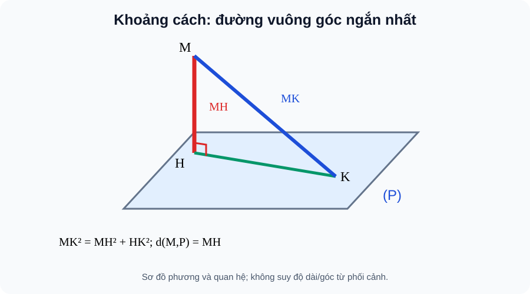
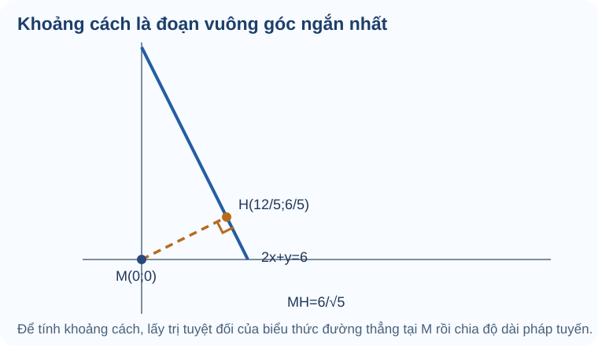
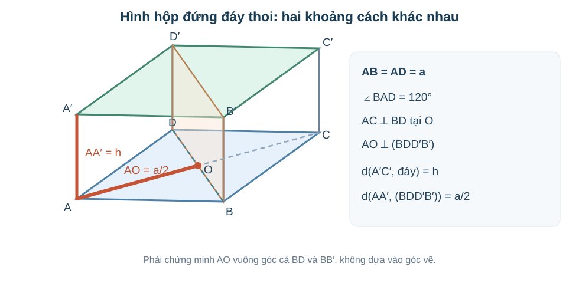
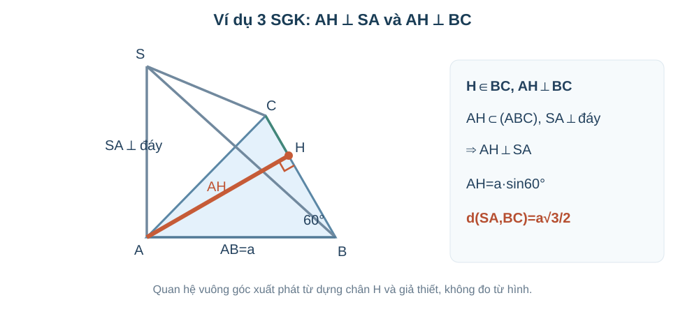

# Bài 26. Khoảng cách

TOÁN 11 · CHƯƠNG VII · SGK KẾT NỐI TRI THỨC · TẬP HAI

Khoảng cách là độ dài ngắn nhất: biết khi nào hạ chân vuông góc, khi nào đo giữa các đối tượng song song, và khi nào phải dựng đường vuông góc chung giữa hai đường chéo nhau.

<nav class="thpt-r4-lesson-tabs"><a href="../">Chương VII</a><a href="../luyen-tap/">Core và Luyện tập</a><a href="../tu-kiem-tra-chuong/">Tự kiểm tra cuối chương</a></nav>

=== "Khám phá kiến thức"

    **Vì sao cần học?** Đầu phun chữa cháy phải đặt cách trần một khoảng an toàn, chiều cao xe phải đủ thấp để đi qua khung trên dốc, và các thanh kết cấu không gian có thể chéo nhau dù trên hình nhìn như cắt. Khoảng cách không phải một đoạn nối tùy ý: ta muốn **độ dài ngắn nhất** giữa các đối tượng. Trước khi học, em cần biết hình chiếu vuông góc (Bài 24), đường vuông góc mặt phẳng (Bài 23) và quan hệ đường chéo nhau (Bài 22).

    ### 1.1. Khoảng cách từ một điểm đến một đường thẳng, đến một mặt phẳng

    **Khám phá HĐ1 — vì sao chân vuông góc ngắn nhất?** Cho điểm \(M\) ngoài đường thẳng \(a\), gọi \(H\) là hình chiếu vuông góc của \(M\) lên \(a\). Với mọi \(K\in a\) khác \(H\), tam giác \(MHK\) vuông tại \(H\), nên
    \[
    MK^2=MH^2+HK^2>MH^2\quad\Rightarrow\quad MK>MH.
    \]
    Tương tự, nếu \(H\) là chân vuông góc của \(M\) xuống mặt \((P)\), thì \(MH\perp HK\) với mọi \(K\in(P)\). Bởi vậy đoạn \(MH\) là **đoạn ngắn nhất** từ \(M\) tới đường hoặc mặt. Khi \(K=H\), độ dài bằng đúng \(MH\).

    **Định nghĩa theo hình chiếu:** Khoảng cách \(d(M,a)=MH\) khi \(H\in a\), \(MH\perp a\); khoảng cách \(d(M,(P))=MH\) khi \(H\in(P)\), \(MH\perp(P)\). Khoảng cách **không âm** và bằng \(0\) khi \(M\) đã nằm trên đối tượng. Ta không gọi một đoạn xiên dài hơn là “khoảng cách”. Nếu đề cho nhiều đường trong mặt phẳng mà chưa chứng minh pháp tuyến, phải dùng tiêu chuẩn **hai đường cắt nhau** của Bài 23.

    <figure class="thpt-r4-plot"><figcaption><strong>Hướng dẫn đọc:</strong> từ \(M\), đoạn đỏ \(MH\) tới chân \(H\) vuông góc **cả mặt \((P)\)**; đoạn xanh \(MK\) tới điểm \(K\) khác \(H\) là đoạn xiên. So sánh bằng \(MK^2=MH^2+HK^2\), không đo từ hình vẽ phối cảnh. Với đường \(a\), thay \((P)\) bằng \(a\) và giữ lập luận tương tự.</figcaption></figure>

    **Một phép thử cụ thể cho khoảng cách điểm–đường:** Trong mặt tọa độ, chọn \(M(0;0)\) và \(a:2x+y-6=0\). Chân \(H\) trên \(a\) là \((12/5;6/5)\), vì \(2(12/5)+6/5-6=0\) và \(\overrightarrow{MH}=(12/5;6/5)\) cùng phương với pháp tuyến \((2;1)\) của đường. Vậy \(d(M,a)=MH=\sqrt{(12/5)^2+(6/5)^2}=6/\sqrt5\). Đây là cách kiểm được **chân H**, chứ không cần ước lượng bằng mắt.

    <figure class="thpt-r4-plot"><figcaption><strong>Hướng dẫn đọc hình Toán 10 dùng lại:</strong> đường \(2x+y=6\) cắt hai trục, \(M(0,0)\) nằm ngoài đường và \(H(12/5,6/5)\) nằm trên đường. Đoạn \(MH\) vuông góc \(a\) do cùng phương vectơ pháp tuyến; đây là **minh họa có tọa độ cụ thể**, không phải công thức chung cần học thuộc ở Bài 26.</figcaption></figure>

    **Chiều cao hình chóp từ khái niệm khoảng cách:** Hình chóp có đỉnh \(S\), đáy thuộc \((P)\). Chiều cao là \(d(S,(P))\), tức chiều dài đường \(SH\perp(P)\). Cạnh bên \(SA\) thường là đường **xiên**, dài hơn đường cao. Với hình chóp đều \(S.ABC\), đáy tam giác đều cạnh \(a>0\), cạnh bên \(b>0\), chân cao \(O\) là tâm đáy và \(AO=a/\sqrt3\). Suy ra
    \[
    SO=\sqrt{b^2-\frac{a^2}{3}},\qquad b>\frac{a}{\sqrt3}
    \]
    đối với chóp không suy biến. Điều kiện dưới căn phản ánh chiều cao phải thực và dương.

    <figure class="thpt-r4-plot"><figcaption><strong>Hướng dẫn đọc Ví dụ 1 SGK:</strong> \(O\) là tâm **tam giác đều** \(ABC\), không phải một đỉnh đáy; \(SO\) đỏ nét đứt là đường cao, \(SA=b\) là cạnh huyền của tam giác vuông \(SOA\), \(OA=a/\sqrt3\). Chỉ dùng Pythagore khi đã xác minh \(SO\perp(ABC)\).</figcaption></figure>

    **Vận dụng.** Chóp tam giác đều có cạnh đáy \(a=6\) cm và cạnh bên \(b=5\) cm. Tính chiều cao. Vì sao không lấy \(5\) cm làm chiều cao?

    ??? question "Đối chiếu"

        **Lời giải:** Tâm đáy có \(AO=a/\sqrt3=2\sqrt3\) cm. \(SO=\sqrt{SA^2-AO^2}=\sqrt{25-12}=\sqrt{13}\) cm. Cạnh \(SA=5\) cm là **cạnh bên xiên** (cạnh huyền), không phải đoạn vuông góc xuống đáy.

    ??? tip "Kiểm lỗi"

        Chỉ lấy cạnh bên làm chiều cao nếu chính nó vuông góc mặt đáy. Trong chóp đều, chân đường cao nằm ở **tâm** đáy, không tự đồng nhất với đỉnh \(A\).

    ### 1.2. Khoảng cách giữa các đường thẳng và mặt phẳng song song, giữa hai mặt phẳng song song

    **Một ý chung cho các trường hợp song song:** Nếu đường \(a\parallel(P)\), lấy hai điểm \(M,N\in a\), hình chiếu \(A,B\) xuống \((P)\). Vì \(MA\parallel NB\), \(MN\parallel AB\) và các đoạn chiếu vuông góc mặt phẳng, \(ABNM\) là hình chữ nhật; do đó \(MA=NB\). Điều này chứng minh **khoảng cách từ mọi điểm của \(a\) đến \((P)\) bằng nhau**. Vì thế được phép chọn **một điểm thuận lợi** trên \(a\), không phải tìm một điểm “đặc biệt” rồi giả định khoảng cách luôn bằng nhau.

    **Ba loại khoảng cách:** Nếu \(a\parallel(P)\), \(d(a,(P))=d(M,(P))\) với bất kì \(M\in a\). Với \((P)\parallel(Q)\), \(d((P),(Q))=d(M,(Q))\) với bất kì \(M\in(P)\). Với hai đường \(m\parallel n\), \(d(m,n)=d(M,n)\) với \(M\in m\). Cả ba dùng đoạn **vuông góc**. Nếu đường nằm **ngay trên** mặt, hoặc hai mặt **trùng nhau**, khoảng cách bằng \(0\); không áp máy móc trường hợp “song song phân biệt” có khoảng cách dương.

    <figure class="thpt-r4-plot"><figcaption><strong>Hướng dẫn đọc từ trái sang phải:</strong> hai chân \(A,B\) từ \(M,N\in a\) tạo các đoạn vuông góc **bằng nhau**; hai mặt song song được đo bởi đoạn vuông góc nối hai mặt; hai đường song song đo theo đoạn vuông góc giữa chúng. Không dùng đoạn chéo dù trông ngắn trên hình.</figcaption></figure>

    **Ví dụ 2 SGK — Hình hộp đứng đáy thoi:** Cho \(ABCD.A'B'C'D'\) là hình hộp đứng, đáy hình thoi cạnh \(a\), \(\angle BAD=120^\circ\), cạnh đứng \(AA'=h\). Muốn tính \(d(A'C',(ABCD))\), vì \(A'C'\) nằm trong mặt trên song song đáy, chỉ cần đo \(AA'=h\). Với \(d(AA',(BDD'B'))\), ta cần một đoạn vuông góc mặt \((BDD'B')\). Gọi \(O\) là giao hai đường chéo của hình thoi: \(AO\perp BD\), đồng thời \(AO\perp BB'\) vì \(BB'\perp(ABCD)\). Hai đường \(BD,BB'\) cắt nhau trong mặt \((BDD'B')\), nên \(AO\perp(BDD'B')\). Từ hình thoi có góc \(A=120^\circ\), \(AO=a/2\). Kết quả là **\(h\)** và **\(a/2\)** tương ứng, không được đánh tráo hai khoảng cách.

    <figure class="thpt-r4-plot"><figcaption><strong>Hướng dẫn đọc:</strong> khối có cạnh đứng \(AA'=h\perp\) đáy, nên cho khoảng cách của **đường \(A'C'\) tới đáy**. Đoạn \(AO\) màu đỏ từ đỉnh \(A\) tới tâm hình thoi \(O\) vuông góc cả \(BD\) và \(BB'\), nên đo khoảng cách từ **đường \(AA'\)** tới mặt bên \((BDD'B')\). Góc \(120^\circ\) là giả thiết, không đo từ phối cảnh.</figcaption></figure>

    **Chiều cao lăng trụ:** Hai mặt đáy lăng trụ song song; khoảng cách giữa chúng là **chiều cao**. Chỉ với lăng trụ **đứng** mới được lấy độ dài cạnh bên làm chiều cao. Lăng trụ xiên có cạnh bên khác chiều cao vì cạnh bên không vuông góc đáy.

    **Vận dụng SGK – Khung khống chế chiều cao trên đường dốc:** Hai cột thẳng đứng cao \(2{,}28\) m giữ thanh ngang; mặt đường nghiêng \(15^\circ\) so với mặt nằm ngang. Ta cần độ dài **pháp tuyến từ thanh ngang đến mặt đường**, không lấy \(2{,}28\) m là khoảng cách tới mặt đường. Trong tiết diện dọc dốc, góc giữa phương đứng và pháp tuyến mặt đường là \(15^\circ\), nên
    \[
    d(\text{thanh ngang},\text{mặt dốc})=2{,}28\cos15^\circ\approx2{,}20\text{ m}.
    \]
    Vì \(2{,}21>2{,}20\), mô hình không cho phép xe cao \(2{,}21\) m qua khung. Cần nhớ đây là tính trong **mô hình hình học**, chưa xét các sai số lắp đặt và biên an toàn thực tế.

    <figure class="thpt-r4-plot"><figcaption><strong>Hướng dẫn đọc ứng dụng:</strong> \(TF\) là chiều dài cột **thẳng đứng** \(2{,}28\) m; \(TH\) màu đỏ là khoảng cách **vuông góc dốc**. Góc giữa pháp tuyến dốc và phương đứng bằng góc dốc \(15^\circ\), nên \(TH=TF\cos15^\circ\). Không lấy \(2{,}28\) để so với \(2{,}21\) mà bỏ độ nghiêng.</figcaption></figure>

    **Vận dụng.** Trong hình hộp đứng đáy thoi cạnh \(a=8\) cm, \(\angle BAD=120^\circ\), chiều cao \(h=6\) cm, tính \(d(A'C',(ABCD))\) và \(d(AA',(BDD'B'))\).

    ??? question "Đối chiếu"

        **Lời giải:** Vì hai đáy song song và \(AA'\perp(ABCD)\), \(d(A'C',(ABCD))=h=6\) cm. Gọi \(O\) là tâm hình thoi. Từ \(AO\perp BD\) và \(AO\perp BB'\) suy \(AO\perp(BDD'B')\); do đó \(d(AA',(BDD'B'))=AO=a/2=4\) cm.

    ??? tip "Kiểm lỗi"

        Không lấy \(h\) cho khoảng cách từ \(AA'\) đến mặt bên. Đường \(AA'\) nằm **song song** mặt bên, khoảng cách được đo theo **\(AO\)** trong mặt đáy.

    ### 1.3. Khoảng cách giữa hai đường thẳng chéo nhau

    **Khó khăn mới:** Hai đường chéo nhau không song song cũng không gặp nhau, nên không thể lấy tùy tiện một đầu trên mỗi đường rồi gọi đoạn nối là “khoảng cách”. Đường \(\Delta\) được gọi là **đường vuông góc chung** của \(a,b\) nếu \(\Delta\) **cắt cả hai** và **vuông góc với cả hai**. Nếu \(\Delta\cap a=\{M\}\), \(\Delta\cap b=\{N\}\), thì \(d(a,b)=MN\). Phải kiểm đủ **bốn điều kiện**: \(M\in a\), \(N\in b\), \(MN\perp a\), \(MN\perp b\).

    **Vì sao HĐ4 SGK dùng mặt phẳng song song?** Chọn \((Q)\) chứa \(b\) và **song song đường \(a\)**. Chiếu vuông góc \(a\) xuống \((Q)\) thành đường \(a'\), rồi tìm \(N=a'\cap b\). Dựng đoạn pháp tuyến từ \(N\) lên \(a\), được \(M\). Vì \(a\parallel(Q)\), đường \(MN\) vuông góc \((Q)\), nên đồng thời vuông góc \(b\subset(Q)\) và \(a\parallel a'\subset(Q)\). Do đó \(MN\) là đoạn vuông góc chung. Phương pháp này chuyển **bài toán hai đường chéo nhau** về **khoảng cách đường–mặt song song**:
    \[
    d(a,b)=d(a,(Q))=MN.
    \]
    Cũng có thể chọn hai mặt **song song tương ứng chứa** \(a,b\), rồi tính khoảng cách giữa hai mặt.

    <figure class="thpt-r4-plot"><figcaption><strong>Hướng dẫn đọc HĐ4:</strong> đường xanh trên \(a\) được chiếu xuống đường nét đứt \(a'\) trong \((Q)\), cắt đường lục \(b\) tại **\(N\)**. Đi theo đường đỏ \(MN\) **vuông góc mặt \((Q)\)** từ \(N\) đến **\(M\in a\)**. Vì \(a,b\) cùng có phương nằm trong \((Q)\), đoạn đỏ vuông góc cả hai. Phải xác minh \(a\parallel(Q)\) trước khi dùng.</figcaption></figure>

    **Ví dụ 3 SGK — Chóp có cạnh đứng:** Trong chóp \(S.ABC\), \(SA\perp(ABC)\), \(AB=a\) và \(\angle ABC=60^\circ\). Dựng \(H\) là chân vuông góc từ \(A\) xuống \(BC\). Khi đó \(AH\perp BC\), lại \(AH\subset(ABC)\) nên \(AH\perp SA\). Vì \(A\in SA\), \(H\in BC\), đoạn \(AH\) chính là **đoạn vuông góc chung**, và
    \[
    d(SA,BC)=AH=AB\sin60^\circ=\frac{a\sqrt3}{2}.
    \]
    Điểm mạnh của cách dựng này là không cần tạo mặt phẳng phụ khi đã có **một đường vuông góc mặt đáy**.

    <figure class="thpt-r4-plot"><figcaption><strong>Hướng dẫn đọc Ví dụ 3:</strong> \(A\) thuộc đường \(SA\), \(H\) thuộc \(BC\); \(AH\) đỏ **vuông góc \(BC\)** do dựng chân, đồng thời vuông góc **\(SA\)** vì \(SA\perp(ABC)\). Lúc ấy mới tính \(AH\) bằng tam giác \(ABH\) vuông tại \(H\) với góc \(60^\circ\) ở \(B\).</figcaption></figure>

    **Vì sao là khoảng cách nhỏ nhất?** Với mọi \(X\in a\), \(Y\in b\), phép dời các điểm dọc theo hai đường không thể làm đoạn nối ngắn hơn **đoạn vuông góc chung**; phần độ dài nằm theo các phương \(a,b\) sẽ làm tăng bình phương độ dài theo định lí Pythagore trong hệ phương thích hợp. Trong phạm vi những đối tượng SGK đang xét, khoảng cách chính là độ dài ngắn nhất giữa hai điểm thuộc hai hình.

    **Vận dụng.** Với chóp \(S.ABC\), \(SA\perp(ABC)\), \(AB=8\) cm và \(\angle ABC=60^\circ\). Dựng \(H\) là chân từ \(A\) xuống \(BC\). Tính \(d(SA,BC)\) và nêu đủ điều kiện của đoạn vuông góc chung.

    ??? question "Đối chiếu"

        **Lời giải:** \(A\in SA\), \(H\in BC\); \(AH\perp BC\) theo cách dựng, \(AH\perp SA\) vì \(AH\subset(ABC)\) và \(SA\perp(ABC)\). Vậy \(AH\) là đoạn vuông góc chung, \(d(SA,BC)=AH=8\sin60^\circ=4\sqrt3\) cm.

    ??? tip "Kiểm lỗi"

        Không chọn \(SB\) hay \(SC\) làm khoảng cách giữa \(SA\) và \(BC\): chúng không phải đoạn vuông góc **đồng thời** với cả hai đường. Kiểm rõ hai đầu và hai góc vuông trước khi tính.
