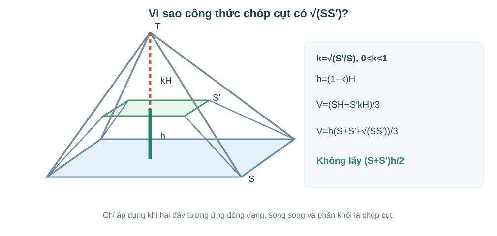
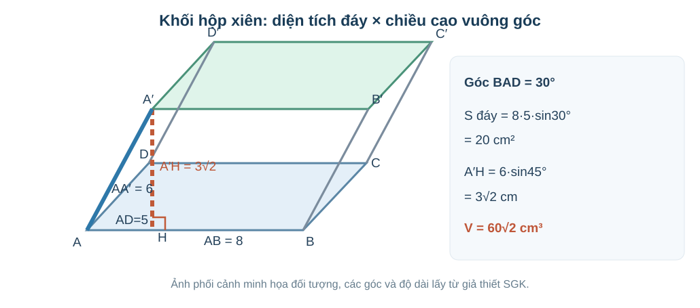

# Bài 27. Thể tích

TOÁN 11 · CHƯƠNG VII · KẾT NỐI TRI THỨC · TẬP HAI

Vì sao cùng diện tích đáy và chiều cao mà thể tích chóp khác lăng trụ? Cách tìm chiều cao thực, công thức chóp cụt và chọn đúng dữ kiện trong các mô hình thực tế.

<nav class="thpt-r4-lesson-tabs"><a href="../">Chương VII</a><a href="../luyen-tap/">Core và Luyện tập</a><a href="../tu-kiem-tra-chuong/">Tự kiểm tra cuối chương</a></nav>

=== "Khám phá kiến thức"

    **Vì sao cần học?** Không thể chọn máy điều hòa chỉ bằng diện tích sàn: phòng có trần cao hơn chứa nhiều không khí hơn. Tương tự, đáy chóp và đáy lăng trụ có thể giống nhau nhưng thể tích lại khác. Bài học cần kiến thức tiền đề từ Bài 23 về đường vuông góc mặt phẳng, Bài 25 về chóp đều/chóp cụt đều và Bài 26 về **chiều cao là khoảng cách vuông góc**. SGK Bài 27 **không chia thành các mục chính đánh số**; dưới đây là **ba nhóm học tập do tác giả sắp xếp** theo các công thức và hoạt động SGK, không phải tên mục chính thức trong sách.

    ### 1.1. Khối hình, thể tích khối chóp và vai trò của chiều cao

    **HĐ1 SGK — Chọn công suất điều hòa:** Phòng hình hộp chữ nhật rộng \(4\) m, dài \(5\) m, cao \(3\) m có thể tích \(4\cdot5\cdot3=60\text{ m}^3\). Giả sử mỗi mét khối cần khoảng **200 BTU** theo hướng dẫn của bài toán, tổng công suất ước tính \(60\cdot200=12\,000\) BTU. Đây là bài toán **mô hình**; lựa chọn thiết bị thực tế còn phụ thuộc nhiệt độ, diện tích kính, cách nhiệt, số người và nhiều yếu tố. SGK dùng tình huống để cho thấy thể tích đo **phần không gian chiếm chỗ**, không phải chỉ diện tích bề mặt.

    **Nhận dạng phần không gian cần tính:** Hình chóp, hình lăng trụ, hình hộp là các **hình bao bởi mặt và cạnh**. Phần không gian được chúng giới hạn lần lượt gọi là **khối chóp, khối lăng trụ, khối hộp**. Với đáy diện tích \(S>0\) và chiều cao vuông góc \(h>0\), lăng trụ có thể tích \(Sh\), nhưng chóp cùng đáy và cùng chiều cao có thể tích **\(Sh/3\)**. Tại sao xuất hiện một phần ba? Các thiết diện song song đáy của chóp **thu nhỏ về đỉnh**, khác với lăng trụ có các thiết diện song song đáy bằng nhau. Có thể chia/ghép những chóp phù hợp thành một lăng trụ hoặc dùng nguyên lí chia lát để chứng minh tỉ số \(1/3\); đây là hệ số hình học, không phải chọn tùy ý.

    <figure class="thpt-r4-plot"><figcaption><strong>Hướng dẫn đọc:</strong> hình trái lăng trụ có hai đáy bằng nhau, nên \(V=Sh\); hình giữa chóp thu về **một đỉnh**, nên \(V=Sh/3\); hình phải chóp cụt có **hai đáy khác diện tích**, công thức riêng. Các đoạn cao phải vuông góc đáy; không so thể tích bằng bề rộng biểu kiến trên hình.</figcaption></figure>

    **Ví dụ 1 SGK — Tứ diện vuông tại O:** Nếu \(OA=a\), \(OB=b\), \(OC=c\) đôi một vuông góc (\(a,b,c>0\)), lấy **tam giác \(OBC\)** làm đáy: \(S_{OBC}=bc/2\); đường \(OA\) vuông góc **cả \(OB\) và \(OC\)** nên vuông góc mặt \((OBC)\). Do đó
    \[
    V_{OABC}=\frac13\cdot\frac{bc}{2}\cdot a=\frac{abc}{6}.
    \]
    Không dùng \(abc/3\), vì còn phải tính **nửa tích hai cạnh** cho diện tích tam giác đáy.

    <figure class="thpt-r4-plot"><figcaption><strong>Hướng dẫn đọc:</strong> chọn vùng xanh tam giác \(OBC\), hai cạnh \(OB,OC\) vuông góc cho diện tích \(bc/2\); đoạn đỏ \(OA\) vuông góc **mặt \((OBC)\)**, dùng làm chiều cao. Hệ số thể tích chóp \(1/3\) đi sau việc tính diện tích đáy.</figcaption></figure>

    **Luyện tập 1 SGK — Chóp tứ giác đều:** Chóp \(S.ABCD\) có đáy vuông cạnh \(a>0\), cạnh bên \(b>a/\sqrt2\). Chân chiều cao là tâm \(O\), \(AO=a/\sqrt2\). Trong tam giác vuông \(SOA\), \(SO=\sqrt{b^2-a^2/2}\); vì \(S_{ABCD}=a^2\), thể tích
    \[
    V=\frac{a^2}{3}\sqrt{b^2-\frac{a^2}{2}}.
    \]
    Điều kiện \(b>a/\sqrt2\) bảo đảm hình chóp không suy biến. Không dùng \(b\) trực tiếp thay cho chiều cao.

    **Vận dụng.** Hai khối có cùng diện tích đáy \(S=24\text{ cm}^2\), chiều cao \(h=9\text{ cm}\): một lăng trụ, một chóp. Tính thể tích và giải thích vì sao khác nhau.

    ??? question "Đối chiếu"

        **Lời giải:** Lăng trụ: \(V_1=24\cdot9=216\text{ cm}^3\). Chóp: \(V_2=\frac13\cdot24\cdot9=72\text{ cm}^3\). Các tiết diện lăng trụ song song đáy có diện tích không đổi, còn chóp thu dần về đỉnh; nên dù cùng \(S,h\), chóp chỉ bằng một phần ba thể tích lăng trụ.

    ??? tip "Kiểm lỗi"

        Đừng dùng \(V=Sh\) cho mọi khối; phải **nhận dạng hình** trước, rồi xác minh \(h\) là đoạn vuông góc đáy.

    ### 1.2. Khối chóp cụt đều: vì sao có căn của tích diện tích hai đáy?

    **Khám phá nguồn gốc công thức:** Chóp cụt đều được tạo khi cắt một chóp đều bởi mặt phẳng **song song đáy**, bỏ phần chóp nhỏ phía đỉnh. Gọi diện tích đáy lớn \(S>0\), đáy nhỏ \(0<S'<S\), chiều cao của phần cụt \(h>0\). Nếu chóp ban đầu cao \(H\), chóp nhỏ phía đỉnh cao \(kH\), hai đáy đồng dạng với **tỉ số độ dài \(k\)**, nên tỉ số diện tích \(S'/S=k^2\). Vì vậy \(k=\sqrt{S'/S}\) và \(h=(1-k)H\).

    **Trừ hai thể tích chóp:** 
    \[
    V=\frac{SH-S'(kH)}{3}
    =\frac{SH(1-k^3)}{3}
    =\frac{hS(1+k+k^2)}3
    =\frac h3\left(S+S'+\sqrt{SS'}\right).
    \]
    Hệ số \(\sqrt{SS'}\) là do **đồng dạng bình phương diện tích**; không phải “lấy trung bình diện tích” như hình thang phẳng. Hai biên kiểm lý thuyết: nếu \(S'\to0\) công thức về chóp \(Sh/3\); nếu \(S'\to S\) (giới hạn) công thức về lăng trụ \(Sh\). Các phép giới hạn này giải thích công thức nhưng **không thay định nghĩa chóp cụt đều** cần hai đáy phân biệt.

    <figure class="thpt-r4-plot"><figcaption><strong>Hướng dẫn đọc:</strong> đỉnh \(T\) phía trên phần chóp nhỏ; cắt theo mặt **song song đáy** được đáy nhỏ \(S'\) và đáy lớn \(S\). Đường cao tổng \(H\) gồm \(kH\) của chóp trên và \(h\) của chóp cụt. Từ \(S'/S=k^2\), trừ hai thể tích để xuất hiện \(\sqrt{SS'}\).</figcaption></figure>

    **Luyện tập 2 SGK — Hai đáy tam giác đều \(2a,a\):** Với \(a,h>0\), đáy lớn diện tích \(S=\frac{\sqrt3}{4}(2a)^2=\sqrt3a^2\), đáy nhỏ \(S'=\frac{\sqrt3}{4}a^2\), nên
    \[
    V_{\text{cụt}}=\frac h3\left(\sqrt3a^2+\frac{\sqrt3a^2}{4}+\frac{\sqrt3a^2}{2}\right)
    =\frac{7\sqrt3}{12}a^2h.
    \]
    Gọi \(B_1,C_1\) là trung điểm \(AB,AC\); ba đoạn \(AA'\), \(B_1B'\), \(C_1C'\) song song và bằng nhau vì mặt cắt tạo bởi phép vị tự từ đỉnh chóp lớn. Do đó \(AB_1C_1.A'B'C'\) là lăng trụ có đáy tam giác đều cạnh \(a\), cao \(h\), thể tích \(V_{\text{lăng trụ}}=\frac{\sqrt3}{4}a^2h\). Tỉ số hai thể tích bằng \(7/3\), khác hẳn một hình chóp thường.

    **Vận dụng.** Chóp cụt đều có \(S=36\text{ cm}^2\), \(S'=9\text{ cm}^2\) và \(h=4\text{ cm}\). Tính \(V\), so với phép tính sai lấy trung bình hai diện tích đáy rồi nhân chiều cao.

    ??? question "Đối chiếu"

        **Lời giải:** \(V=\frac43(36+9+\sqrt{36\cdot9})=\frac43(36+9+18)=84\text{ cm}^3\). Lấy trung bình hai diện tích cho \(V_{\text{sai}}=4(36+9)/2=90\text{ cm}^3\) là sai vì chóp cụt là khối **ba chiều** có tiết diện biến thiên theo bình phương tỉ lệ độ dài.

    ??? tip "Kiểm lỗi"

        Không áp công thức chóp cụt cho hai đáy tùy ý không đồng dạng/sóng song; cũng không bỏ \(\sqrt{SS'}\) khi đã đủ điều kiện của chóp cụt đều.

    ### 1.3. Khối lăng trụ, khối hộp: diện tích đáy nhân chiều cao thật

    **Hình thành thể tích khối lăng trụ:** Các thiết diện song song đáy của lăng trụ bằng nhau, nên sau khi tịnh tiến/cắt ghép giữ diện tích và chiều cao, thể tích bằng
    \[
    V_{\text{lăng trụ}}=S_{\text{đáy}}h.
    \]
    Với hình hộp chữ nhật có ba kích thước vuông góc \(x,y,z>0\), \(V=xyz\). Nhưng **hình hộp xiên** chỉ có \(V=S_{\text{đáy}}h\); không mặc định cạnh bên là \(h\). Hình bình hành đáy cạnh \(u,v\), góc xen giữa \(\theta\in(0^\circ,180^\circ)\) có \(S_{\text{đáy}}=uv\sin\theta\).

    **Ví dụ 2 SGK — Lăng trụ không mặc định đứng:** Lăng trụ \(ABC.A'B'C'\) có đáy tam giác đều cạnh \(a\), mặt \((ACC'A')\perp(ABC)\), và tam giác \(A'AC\) cân tại \(A'\), \(AA'=A'C=b\), \(a<2b\). Gọi \(H\) là trung điểm \(AC\). Vì tam giác cân \(A'AC\), \(A'H\perp AC\); kết hợp hai mặt **vuông góc** theo Bài 25 và \(A'H\subset(ACC'A')\) cho \(A'H\perp(ABC)\). Đây mới là **chiều cao thật**:
    \[
    A'H=\sqrt{b^2-\frac{a^2}{4}},\qquad
    V=\frac{a^2\sqrt3}{4}\sqrt{b^2-\frac{a^2}{4}}
    =\frac{a^2\sqrt{3(4b^2-a^2)}}8.
    \]
    Nếu lấy \(AA'=b\) làm chiều cao sẽ sai, trừ trường hợp riêng cạnh bên vốn vuông góc đáy.

    <figure class="thpt-r4-plot"><figcaption><strong>Hướng dẫn đọc Hình 7.95:</strong> mặt bên màu tím chứa tam giác \(A'AC\). Điểm \(H\) là trung điểm **\(AC\)**, nên \(A'H\perp AC\). Vì hai mặt \((ACC'A')\) và đáy vuông góc, \(A'H\perp\) đáy; đoạn đỏ là chiều cao, không phải \(AA'=b\) xiên.</figcaption></figure>

    **Ví dụ 3 SGK — Hình hộp đáy bình hành xiên:** \(AB=8\) cm, \(AD=5\) cm, \(AA'=6\) cm, \(\angle BAD=30^\circ\), cạnh \(AA'\) tạo góc \(45^\circ\) với đáy. Đáy có diện tích \(S=8\cdot5\sin30^\circ=20\text{ cm}^2\). Chiều cao là hình chiếu **vuông góc** của \(AA'\) theo pháp tuyến đáy, \(h=6\sin45^\circ=3\sqrt2\) cm. Vậy \(V=20\cdot3\sqrt2=60\sqrt2\text{ cm}^3\). Chọn sin chứ không dùng cos vì góc \(45^\circ\) là góc **đường–mặt**.

    <figure class="thpt-r4-plot"><figcaption><strong>Hướng dẫn đọc Hình 7.97:</strong> diện tích đáy dùng **góc giữa hai cạnh đáy \(30^\circ\)**, còn đường cao \(A'H\) đỏ nét đứt dùng **góc cạnh bên với mặt đáy \(45^\circ\)**. Hai góc khác vai trò; chỉ nhân \(S\cdot A'H\), không nhân \(S\cdot AA'\).</figcaption></figure>

    **Vận dụng SGK — Sọt chóp cụt đều:** Sọt có miệng vuông cạnh \(60\) cm, đáy vuông cạnh \(30\) cm, cạnh bên \(50\) cm. Bán kính tâm–đỉnh hai hình vuông lần lượt \(30\sqrt2\) và \(15\sqrt2\) cm, nên độ lệch ngang hai đỉnh tương ứng \(15\sqrt2\) cm. Tam giác vuông chứa cạnh bên cho
    \[
    h=\sqrt{50^2-(15\sqrt2)^2}=\sqrt{2050}\text{ cm}.
    \]
    \(S=3600\text{ cm}^2\), \(S'=900\text{ cm}^2\), nên \(V=\frac{\sqrt{2050}}3(3600+900+1800)=2100\sqrt{2050}\text{ cm}^3\). Vì \(1000\text{ cm}^3=1\) lít, \(V\approx95{,}1\) lít (mô hình không tính độ dày thành sọt và phần trống). Đây là ví dụ **phải tìm chiều cao trước công thức**, không dùng \(50\) cm là \(h\).

    <figure class="thpt-r4-plot"><figcaption><strong>Hướng dẫn đọc Hình 7.98:</strong> miệng xanh lục là hình vuông cạnh **60 cm**, đáy dưới xanh nhạt cạnh **30 cm**; cạnh bên màu xanh đậm dài 50 cm là **cạnh xiên**. Đường cao \(h\) nối tâm hai đáy, vuông góc cả hai. Độ lệch ngang của hai đỉnh cùng phía là **\(15\sqrt2\)**, không phải \(60-30\).</figcaption></figure>

    **Vận dụng.** Một bể hình hộp chữ nhật dài \(1{,}2\) m, rộng \(0{,}8\) m và cao \(0{,}5\) m. Tính thể tích tính theo mét khối và lít; giải thích điều kiện để coi đó là lượng nước tối đa.

    ??? question "Đối chiếu"

        **Lời giải:** \(V=1{,}2\cdot0{,}8\cdot0{,}5=0{,}48\text{ m}^3=480\) lít. Kết quả là **dung tích hình học bên trong** nếu ba số là kích thước lòng bể, chưa trừ vật bên trong và giả định bể chứa tới độ cao \(0{,}5\) m.

    ??? tip "Kiểm lỗi"

        Không đổi \(0{,}48\text{ m}^3\) thành \(48\) lít; \(1\text{ m}^3=1000\) lít. Nếu là kích thước ngoài, còn phải trừ độ dày thành bể trước khi gọi là dung tích.

=== "Kiến thức SGK"

    **Lưu ý cấu trúc S1:** Bài 27 trên trang in 61–63 trình bày **khái niệm khối hình, ba công thức thể tích và các ví dụ liền mạch**, không đánh số ba mục lớn. Ba tiểu mục 2.1–2.3 dưới đây là **nhóm học tập tương ứng 1.1–1.3**, không phải tiêu đề tự nhận là nguyên văn SGK.

    ### 2.1. Khối hình, thể tích khối chóp và vai trò của chiều cao

    
<strong>Khối đa diện và thể tích</strong>
Phần không gian giới hạn bởi hình chóp, chóp cụt đều, lăng trụ, hộp gọi tương ứng là <strong>khối chóp, khối chóp cụt đều, khối lăng trụ, khối hộp</strong>. Thể tích đo phần không gian, đơn vị có số mũ <strong>3</strong>; chiều cao là <strong>đoạn vuông góc</strong> từ đỉnh tới mặt đáy hoặc khoảng cách giữa hai đáy song song.

    
<strong>Công thức SGK — Khối chóp</strong>
Với diện tích đáy \(S>0\) và chiều cao \(h>0\), <strong>\(V_{\text{chóp}}=\frac13 Sh\)</strong>. Tứ diện là trường hợp hình chóp có đáy tam giác; chọn bất cứ mặt làm đáy đều được, nhưng chiều cao phải ứng với <strong>đúng mặt đáy ấy</strong>.

    **Vì sao không dùng \(Sh\)?** Khối chóp có những tiết diện song song đáy **thu nhỏ về đỉnh**, nên bằng một phần ba khối lăng trụ cùng diện tích đáy và cùng chiều cao. Khi đổi \(S\) nhưng giữ \(h\), thể tích thay đổi cùng tỉ lệ \(S\); khi đổi \(h\) nhưng giữ \(S\), thể tích thay đổi cùng tỉ lệ \(h\).

    <figure class="thpt-r4-plot"><figcaption><strong>Tra hình 7.93:</strong> giữa là khối chóp thu về đỉnh, trái là lăng trụ có hai đáy bằng nhau. Mẫu số 3 chỉ áp cho **chóp**; \(h\) luôn là khoảng cách vuông góc, không phải cạnh bên xiên.</figcaption></figure>

    **Ví dụ 1 SGK:** Tứ diện \(OABC\) có \(OA=a,OB=b,OC=c\) đôi một vuông góc. Chọn \(OBC\) làm đáy, \(S_{OBC}=bc/2\), \(OA\perp(OBC)\) nên \(V_{OABC}=\frac13\cdot\frac{bc}2\cdot a=abc/6\).

    <figure class="thpt-r4-plot"><figcaption><strong>Tra Ví dụ 1:</strong> hai đường \(OB,OC\) cắt tại \(O\), cùng vuông góc \(OA\), nên \(OA\perp(OBC)\). Đáy tam giác vuông có diện tích \(bc/2\), rồi mới nhân **\(a/3\)**.</figcaption></figure>

    **Luyện tập 1 SGK:** Chóp tứ giác đều đáy vuông cạnh \(a\), cạnh bên \(b>a/\sqrt2\) có chân cao tại tâm đáy, đường cao \(\sqrt{b^2-a^2/2}\), do đó \(V=\frac{a^2}3\sqrt{b^2-a^2/2}\). Nếu chưa tìm được đường cao thì chưa thể thay \(b\) vào chỗ \(h\).

    **HĐ1 SGK:** Phòng hộp chữ nhật \(4\) m × \(5\) m × \(3\) m có \(60\text{ m}^3\). Với **hệ số giả định trong đề** \(200\) BTU/\(\text{m}^3\), công suất tương ứng \(12\,000\) BTU. Không coi đây là định mức chọn thiết bị ngoài thực tế.

    ### 2.2. Khối chóp cụt đều: vì sao có căn của tích diện tích hai đáy?

    
<strong>Công thức SGK — Khối chóp cụt đều</strong>
Với diện tích đáy lớn \(S\), đáy nhỏ \(S'\) và chiều cao \(h\), thể tích là <strong>\(V_{\text{cụt}}=\frac h3\left(S+S'+\sqrt{SS'}\right)\)</strong>. Hai đáy phải là các đa giác đều <strong>song song, đồng dạng</strong> của một hình chóp cụt đều; <strong>không</strong> áp cho hai đáy tùy ý cùng có diện tích \(S,S'\).

    **Nguồn gốc công thức:** Cắt chóp đều lớn bằng mặt song song đáy; gọi \(k=\sqrt{S'/S}\in(0,1)\) là tỉ số đồng dạng độ dài, \(H\) là chiều cao chóp lớn. Chóp nhỏ cao \(kH\), chóp cụt cao \(h=(1-k)H\). Trừ thể tích chóp nhỏ khỏi chóp lớn:
    \[
    V=\frac{S H-S' kH}{3}
     =\frac{hS(1-k^3)}{3(1-k)}
     =\frac h3(S+\sqrt{SS'}+S').
    \]
    Với số liệu \(S=36,S'=9,h=4\), \(V=84\), không phải \((36+9)h/2=90\). Khi đổi đơn vị, nhớ \(S\) theo \(\text{cm}^2\) và \(h\) theo cm thì \(V\) theo \(\text{cm}^3\).

    <figure class="thpt-r4-plot"><figcaption><strong>Tra hình:</strong> đáy lớn \(S\) dưới, đáy nhỏ \(S'\) nằm ở mặt cắt song song. Mũi hình chóp nhỏ có chiều cao \(kH\), phần còn lại cao \(h=H-kH\). Phân biệt diện tích \(k^2\), thể tích \(k^3\), độ dài \(k\).</figcaption></figure>

    **Luyện tập 2 SGK:** Chóp cụt tam giác đều có cạnh đáy lớn \(2a\), đáy nhỏ \(a\), cao \(h\). Diện tích hai đáy \(\sqrt3a^2\) và \(\sqrt3a^2/4\) cho \(V_{\text{cụt}}=7\sqrt3a^2h/12\). Lăng trụ \(AB_1C_1.A'B'C'\) (với \(B_1,C_1\) là trung điểm \(AB,AC\)) có diện tích đáy \(\sqrt3a^2/4\), cao \(h\), nên \(V_{\text{lăng trụ}}=\sqrt3a^2h/4\). Muốn kết luận là lăng trụ phải chứng minh \(AA'\parallel B_1B'\parallel C_1C'\) và hai đáy song song, bằng nhau, không chỉ từ hình vẽ.

    **Vận dụng SGK — sọt đựng đồ:** Đáy vuông cạnh \(30\) cm, miệng vuông cạnh \(60\) cm, cạnh bên \(50\) cm. Độ lệch ngang giữa các đỉnh tương ứng là \((60-30)\sqrt2/2=15\sqrt2\) cm. Do đó \(h=\sqrt{50^2-(15\sqrt2)^2}=\sqrt{2050}\) cm. \(S=3600,S'=900\), \(\sqrt{SS'}=1800\), nên \(V=2100\sqrt{2050}\text{ cm}^3\approx95{,}1\) lít. Không mặc định cạnh bên nghiêng là \(h\).

    <figure class="thpt-r4-plot"><figcaption><strong>Tra Vận dụng:</strong> hình trên là **miệng rộng** 60 cm, hình dưới **đáy nhỏ** 30 cm, chiều cao là đoạn vuông góc nối tâm hai hình vuông. Cạnh bên 50 cm là cạnh huyền của tam giác cần dựng, không được thay cho \(h\).</figcaption></figure>

    ### 2.3. Khối lăng trụ, khối hộp: diện tích đáy nhân chiều cao thật

    
<strong>Công thức SGK — Lăng trụ và hình hộp</strong>
Khối lăng trụ và khối hộp có diện tích đáy \(S\), chiều cao <strong>vuông góc</strong> \(h\), nên <strong>\(V=Sh\)</strong>. Hộp chữ nhật ba kích thước vuông góc \(x,y,z\) có \(V=xyz\). Lăng trụ/hộp <strong>xiên</strong> không được dùng độ dài cạnh bên thay cho \(h\).

    **Cách tìm đáy và cao theo Bài 24–26:** Với tam giác đều cạnh \(a\), \(S=a^2\sqrt3/4\); với hình bình hành cạnh \(u,v\) góc kẹp \(\theta\), \(S=uv\sin\theta\). Chiều cao của khối là khoảng cách **hai mặt đáy song song**, có thể tìm bằng hình chiếu vuông góc. Góc cạnh bên–mặt đáy \(\alpha\) cho \(h=\ell\sin\alpha\), với \(\ell\) là độ dài cạnh bên xiên. Không dùng \(\ell\cos\alpha\) trong tình huống này.

    **Ví dụ 2 SGK — mặt bên vuông góc đáy:** Trong lăng trụ đáy tam giác đều cạnh \(a\), mặt \((ACC'A')\perp(ABC)\), tam giác \(A'AC\) cân tại \(A'\) và \(AA'=A'C=b\) (\(a<2b\)), lấy \(H\) trung điểm \(AC\). \(A'H\perp AC\), và \(A'H\subset(ACC'A')\), nên định lí hai mặt vuông góc cho \(A'H\perp(ABC)\). Thể tích \(V=\frac{a^2\sqrt3}{4}\sqrt{b^2-a^2/4}=\frac{a^2\sqrt{3(4b^2-a^2)}}{8}\).

    <figure class="thpt-r4-plot"><figcaption><strong>Tra Hình 7.95:</strong> \(A'H\perp AC\) trong mặt bên vuông góc đáy, nên \(A'H\perp\) đáy. Cạnh bên \(AA'=b\) **không phải chiều cao**. Điều kiện \(a<2b\) bảo đảm tam giác cân tồn tại với chiều cao dương.</figcaption></figure>

    **Ví dụ 3 SGK — hộp xiên:** Hình hộp có \(AB=8\), \(AD=5\), \(\angle BAD=30^\circ\), \(AA'=6\) cm và góc \(AA'\) với đáy \(45^\circ\). \(S_{\text{đáy}}=8\cdot5\sin30^\circ=20\text{ cm}^2\), \(h=6\sin45^\circ=3\sqrt2\) cm, nên \(V=60\sqrt2\text{ cm}^3\).

    <figure class="thpt-r4-plot"><figcaption><strong>Tra Hình 7.97:</strong> đáy hình bình hành có góc \(BAD=30^\circ\) nên dùng **sin30°** để tính diện tích. Cạnh bên \(AA'\) tạo góc \(45^\circ\) với mặt, nên đường cao \(A'H=AA'\sin45^\circ\). Hai phép dùng sin giải quyết **hai bước khác nhau**.</figcaption></figure>

    | Loại khối | Thể tích | Cần tìm trước |
    | :-- | :-- | :-- |
    | Chóp hoặc tứ diện | \(Sh/3\) | Đáy và đường cao đỉnh–mặt |
    | Chóp cụt đều | \(h(S+S'+\sqrt{SS'})/3\) | Hai đáy đồng dạng song song và đường cao |
    | Lăng trụ, hộp | \(Sh\) | Diện tích đáy và khoảng cách hai đáy |
    | Hộp chữ nhật | \(xyz\) | Ba kích thước vuông góc |

    **Đơn vị và mô hình thực tế:** Nếu \(S\) tính theo \(\text{cm}^2\), \(h\) theo cm thì \(V\) theo \(\text{cm}^3\). \(1\text{ dm}^3=1\) lít, \(1000\text{ cm}^3=1\) lít, \(1\text{ m}^3=1000\) lít. Khi đề cho kích thước **ngoài** của bình, không được tự coi đó là dung tích bên trong nếu có độ dày thành.
