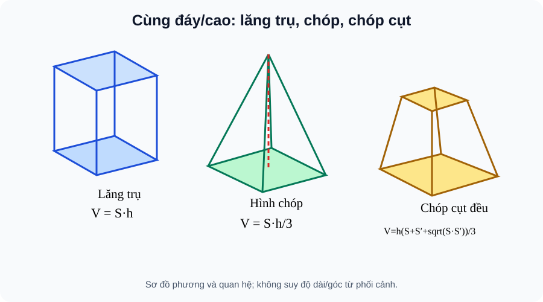
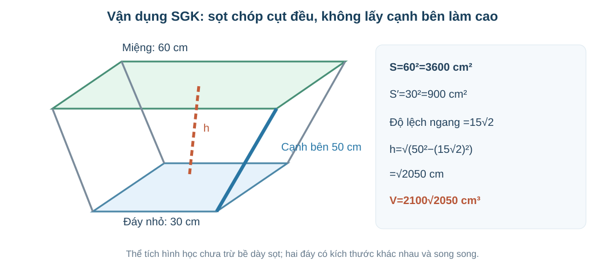

# Bài 27. Thể tích

TOÁN 11 · CHƯƠNG VII · KẾT NỐI TRI THỨC · TẬP HAI

Vì sao cùng diện tích đáy và chiều cao mà thể tích chóp khác lăng trụ? Cách tìm chiều cao thực, công thức chóp cụt và chọn đúng dữ kiện trong các mô hình thực tế.

<nav class="thpt-r4-lesson-tabs"><a href="../">Chương VII</a><a href="../luyen-tap/">Core và Luyện tập</a><a href="../tu-kiem-tra-chuong/">Tự kiểm tra cuối chương</a></nav>

=== "Khám phá kiến thức"

    **Vì sao cần học?** Không thể chọn máy điều hòa chỉ bằng diện tích sàn: phòng có trần cao hơn chứa nhiều không khí hơn. Tương tự, đáy chóp và đáy lăng trụ có thể giống nhau nhưng thể tích lại khác. Bài học cần kiến thức tiền đề từ Bài 23 về đường vuông góc mặt phẳng, Bài 25 về chóp đều/chóp cụt đều và Bài 26 về **chiều cao là khoảng cách vuông góc**. Bài này sẽ lần lượt tìm hiểu **khối chóp, khối chóp cụt đều, khối lăng trụ và khối hộp**. Trong từng trường hợp, em cần nhận ra **diện tích đáy** và **chiều cao vuông góc** trước khi tính thể tích.

    ### 1.1. Khối hình, thể tích khối chóp và vai trò của chiều cao

    **HĐ1 SGK — Chọn công suất điều hòa:** Phòng hình hộp chữ nhật rộng \(4\) m, dài \(5\) m, cao \(3\) m có thể tích \(4\cdot5\cdot3=60\text{ m}^3\). Giả sử mỗi mét khối cần khoảng **200 BTU** theo hướng dẫn của bài toán, tổng công suất ước tính \(60\cdot200=12\,000\) BTU. Đây là bài toán **mô hình**; lựa chọn thiết bị thực tế còn phụ thuộc nhiệt độ, diện tích kính, cách nhiệt, số người và nhiều yếu tố. SGK dùng tình huống để cho thấy thể tích đo **phần không gian chiếm chỗ**, không phải chỉ diện tích bề mặt.

    **Nhận dạng phần không gian cần tính:** Hình chóp, hình lăng trụ, hình hộp là các **hình bao bởi mặt và cạnh**. Phần không gian được chúng giới hạn lần lượt gọi là **khối chóp, khối lăng trụ, khối hộp**. Với đáy diện tích \(S>0\) và chiều cao vuông góc \(h>0\), lăng trụ có thể tích \(Sh\), nhưng chóp cùng đáy và cùng chiều cao có thể tích **\(Sh/3\)**. Tại sao xuất hiện một phần ba? Các thiết diện song song đáy của chóp **thu nhỏ về đỉnh**, khác với lăng trụ có các thiết diện song song đáy bằng nhau. Có thể chia/ghép những chóp phù hợp thành một lăng trụ hoặc dùng nguyên lí chia lát để chứng minh tỉ số \(1/3\); đây là hệ số hình học, không phải chọn tùy ý.

    <figure class="thpt-r4-plot"><figcaption><strong>Hướng dẫn đọc:</strong> hình trái lăng trụ có hai đáy bằng nhau, nên \(V=Sh\); hình giữa chóp thu về **một đỉnh**, nên \(V=Sh/3\); hình phải chóp cụt có **hai đáy khác diện tích**, công thức riêng. Các đoạn cao phải vuông góc đáy; không so thể tích bằng bề rộng biểu kiến trên hình.</figcaption></figure>

    **Ví dụ 1 SGK — Tứ diện vuông tại O:** Nếu \(OA=a\), \(OB=b\), \(OC=c\) đôi một vuông góc (\(a,b,c>0\)), lấy **tam giác \(OBC\)** làm đáy: \(S_{OBC}=bc/2\); đường \(OA\) vuông góc **cả \(OB\) và \(OC\)** nên vuông góc mặt \((OBC)\). Do đó

    \[
    V_{OABC}=\frac13\cdot\frac{bc}{2}\cdot a=\frac{abc}{6}.
    \]

    Không dùng \(abc/3\), vì còn phải tính **nửa tích hai cạnh** cho diện tích tam giác đáy.

    <figure class="thpt-r4-plot"><figcaption><strong>Hướng dẫn đọc:</strong> chọn vùng xanh tam giác \(OBC\), hai cạnh \(OB,OC\) vuông góc cho diện tích \(bc/2\); đoạn đỏ \(OA\) vuông góc **mặt \((OBC)\)**, dùng làm chiều cao. Hệ số thể tích chóp \(1/3\) đi sau việc tính diện tích đáy.</figcaption></figure>

    **Luyện tập 1 SGK — Chóp tứ giác đều:** Chóp \(S.ABCD\) có đáy vuông cạnh \(a>0\), cạnh bên \(b>a/\sqrt2\). Chân chiều cao là tâm \(O\), \(AO=a/\sqrt2\). Trong tam giác vuông \(SOA\), \(SO=\sqrt{b^2-a^2/2}\); vì \(S_{ABCD}=a^2\), thể tích

    \[
    V=\frac{a^2}{3}\sqrt{b^2-\frac{a^2}{2}}.
    \]

    Điều kiện \(b>a/\sqrt2\) bảo đảm hình chóp không suy biến. Không dùng \(b\) trực tiếp thay cho chiều cao.

    **Vận dụng.** Hai khối có cùng diện tích đáy \(S=24\text{ cm}^2\), chiều cao \(h=9\text{ cm}\): một lăng trụ, một chóp. Tính thể tích và giải thích vì sao khác nhau.

    ??? question "Đối chiếu"

        **Lời giải:** Lăng trụ: \(V_1=24\cdot9=216\text{ cm}^3\). Chóp: \(V_2=\frac13\cdot24\cdot9=72\text{ cm}^3\). Các tiết diện lăng trụ song song đáy có diện tích không đổi, còn chóp thu dần về đỉnh. Điều đó giúp hình dung vì sao chóp có thể tích nhỏ hơn; tỉ số chính xác \(1/3\) là kết quả của công thức thể tích khối chóp.

    ??? tip "Kiểm lỗi"

        Đừng dùng \(V=Sh\) cho mọi khối; phải **nhận dạng hình** trước, rồi xác minh \(h\) là đoạn vuông góc đáy.

    ### 1.2. Khối chóp cụt đều: vì sao có căn của tích diện tích hai đáy?

    **Khám phá nguồn gốc công thức:** Chóp cụt đều được tạo khi cắt một chóp đều bởi mặt phẳng **song song đáy**, bỏ phần chóp nhỏ phía đỉnh. Gọi diện tích đáy lớn \(S>0\), đáy nhỏ \(0<S'<S\), chiều cao của phần cụt \(h>0\). Nếu chóp ban đầu cao \(H\), chóp nhỏ phía đỉnh cao \(kH\), hai đáy đồng dạng với **tỉ số độ dài \(k\)**, nên tỉ số diện tích \(S'/S=k^2\). Vì vậy \(k=\sqrt{S'/S}\) và \(h=(1-k)H\).

    **Trừ hai thể tích chóp:** 

    \[
    V=\frac{SH-S'(kH)}{3}
    =\frac{SH(1-k^3)}{3}
    =\frac{hS(1+k+k^2)}3
    =\frac h3\left(S+S'+\sqrt{SS'}\right).
    \]

    Các bước biến đổi dùng \(1-k^3=(1-k)(1+k+k^2)\), \(H=h/(1-k)\), \(Sk^2=S'\) và \(Sk=\sqrt{SS'}\) (vì \(k>0\)). Hệ số \(\sqrt{SS'}\) là do **đồng dạng bình phương diện tích**; không phải “lấy trung bình diện tích” như hình thang phẳng. Hai biên kiểm lý thuyết: nếu \(S'\to0\) công thức về chóp \(Sh/3\); nếu \(S'\to S\) (giới hạn) công thức về lăng trụ \(Sh\). Các phép giới hạn này giải thích công thức nhưng **không thay định nghĩa chóp cụt đều** cần hai đáy phân biệt.

    <figure class="thpt-r4-plot"><figcaption><strong>Hướng dẫn đọc:</strong> đỉnh \(T\) phía trên phần chóp nhỏ; cắt theo mặt **song song đáy** được đáy nhỏ \(S'\) và đáy lớn \(S\). Đường cao tổng \(H\) gồm \(kH\) của chóp trên và \(h\) của chóp cụt. Từ \(S'/S=k^2\), trừ hai thể tích để xuất hiện \(\sqrt{SS'}\).</figcaption></figure>

    **Luyện tập 2 SGK — Hai đáy tam giác đều \(2a,a\):** Với \(a,h>0\), đáy lớn diện tích \(S=\frac{\sqrt3}{4}(2a)^2=\sqrt3a^2\), đáy nhỏ \(S'=\frac{\sqrt3}{4}a^2\), nên

    \[
    V_{\text{cụt}}=\frac h3\left(\sqrt3a^2+\frac{\sqrt3a^2}{4}+\frac{\sqrt3a^2}{2}\right)
    =\frac{7\sqrt3}{12}a^2h.
    \]

    Gọi \(B_1,C_1\) là trung điểm \(AB,AC\); gọi \(T\) là đỉnh của chóp lớn. Vì tỉ số hai cạnh đáy là \(1/2\), các điểm \(A',B',C'\) lần lượt là trung điểm \(TA,TB,TC\). Trong tam giác \(TAB\), đường trung bình \(B_1B'\) song song \(TA\) và dài \(TA/2\); tương tự \(C_1C'\parallel TA\) và dài \(TA/2\). Đoạn \(AA'\) cũng dài \(TA/2\). Hai tam giác \(AB_1C_1\) và \(A'B'C'\) đều có cạnh \(a\) và nằm trên hai mặt phẳng song song. Do đó \(AB_1C_1.A'B'C'\) là lăng trụ có đáy tam giác đều cạnh \(a\), cao \(h\), thể tích \(V_{\text{lăng trụ}}=\frac{\sqrt3}{4}a^2h\). Tỉ số hai thể tích bằng \(7/3\), khác hẳn một hình chóp thường.

    **Vận dụng.** Chóp cụt đều có \(S=36\text{ cm}^2\), \(S'=9\text{ cm}^2\) và \(h=4\text{ cm}\). Tính \(V\), so với phép tính sai lấy trung bình hai diện tích đáy rồi nhân chiều cao.

    ??? question "Đối chiếu"

        **Lời giải:** \(V=\frac43(36+9+\sqrt{36\cdot9})=\frac43(36+9+18)=84\text{ cm}^3\). Lấy trung bình hai diện tích cho \(V_{\text{sai}}=4(36+9)/2=90\text{ cm}^3\) là sai vì chóp cụt là khối **ba chiều** có tiết diện biến thiên theo bình phương tỉ lệ độ dài.

    ??? tip "Kiểm lỗi"

        Không áp công thức chóp cụt cho hai đáy tùy ý không đồng dạng/song song; cũng không bỏ \(\sqrt{SS'}\) khi đã đủ điều kiện của chóp cụt đều.

    ### 1.3. Khối lăng trụ, khối hộp: diện tích đáy nhân chiều cao thật

    **Hình thành thể tích khối lăng trụ:** Các thiết diện song song đáy của lăng trụ bằng nhau, nên sau khi tịnh tiến/cắt ghép giữ diện tích và chiều cao, thể tích bằng

    \[
    V_{\text{lăng trụ}}=S_{\text{đáy}}h.
    \]

    Với hình hộp chữ nhật có ba kích thước vuông góc \(x,y,z>0\), \(V=xyz\). Nhưng **hình hộp xiên** chỉ có \(V=S_{\text{đáy}}h\); không mặc định cạnh bên là \(h\). Hình bình hành đáy cạnh \(u,v\), góc xen giữa \(\theta\in(0^\circ,180^\circ)\) có \(S_{\text{đáy}}=uv\sin\theta\).

    **Ví dụ 2 SGK — Lăng trụ không mặc định đứng:** Lăng trụ \(ABC.A'B'C'\) có đáy tam giác đều cạnh \(a\), mặt \((ACC'A')\perp(ABC)\), và tam giác \(A'AC\) cân tại \(A'\), \(AA'=A'C=b\), \(a<2b\). Gọi \(H\) là trung điểm \(AC\). Vì tam giác cân \(A'AC\), \(A'H\perp AC\); kết hợp hai mặt **vuông góc** theo Bài 25 và \(A'H\subset(ACC'A')\) cho \(A'H\perp(ABC)\). Đây mới là **chiều cao thật**:

    \[
    A'H=\sqrt{b^2-\frac{a^2}{4}},\qquad
    V=\frac{a^2\sqrt3}{4}\sqrt{b^2-\frac{a^2}{4}}
    =\frac{a^2\sqrt{3(4b^2-a^2)}}8.
    \]

    Nếu lấy \(AA'=b\) làm chiều cao sẽ sai, trừ trường hợp riêng cạnh bên vốn vuông góc đáy.

    <figure class="thpt-r4-plot"><figcaption><strong>Hướng dẫn đọc Hình 7.95:</strong> mặt bên màu tím chứa tam giác \(A'AC\). Điểm \(H\) là trung điểm **\(AC\)**, nên \(A'H\perp AC\). Vì hai mặt \((ACC'A')\) và đáy vuông góc, \(A'H\perp\) đáy; đoạn đỏ là chiều cao, không phải \(AA'=b\) xiên.</figcaption></figure>

    **Ví dụ 3 SGK — Hình hộp đáy bình hành xiên:** \(AB=8\) cm, \(AD=5\) cm, \(AA'=6\) cm, \(\angle BAD=30^\circ\), cạnh \(AA'\) tạo góc \(45^\circ\) với đáy. Đáy có diện tích \(S=8\cdot5\sin30^\circ=20\text{ cm}^2\). Chiều cao là độ dài đoạn vuông góc từ \(A'\) xuống mặt đáy, \(h=6\sin45^\circ=3\sqrt2\) cm. Vậy \(V=20\cdot3\sqrt2=60\sqrt2\text{ cm}^3\). Chọn sin chứ không dùng cos vì góc \(45^\circ\) là góc **đường–mặt**.

    <figure class="thpt-r4-plot"><figcaption><strong>Hướng dẫn đọc Hình 7.97:</strong> diện tích đáy dùng **góc giữa hai cạnh đáy \(30^\circ\)**, còn đường cao \(A'H\) đỏ nét đứt dùng **góc cạnh bên với mặt đáy \(45^\circ\)**. Hai góc khác vai trò; chỉ nhân \(S\cdot A'H\), không nhân \(S\cdot AA'\).</figcaption></figure>

    **Vận dụng SGK — Sọt chóp cụt đều:** Sọt có miệng vuông cạnh \(60\) cm, đáy vuông cạnh \(30\) cm, cạnh bên \(50\) cm. Bán kính tâm–đỉnh hai hình vuông lần lượt \(30\sqrt2\) và \(15\sqrt2\) cm, nên độ lệch ngang hai đỉnh tương ứng \(15\sqrt2\) cm. Tam giác vuông chứa cạnh bên cho

    \[
    h=\sqrt{50^2-(15\sqrt2)^2}=\sqrt{2050}\text{ cm}.
    \]

    \(S=3600\text{ cm}^2\), \(S'=900\text{ cm}^2\), nên \(V=\frac{\sqrt{2050}}3(3600+900+1800)=2100\sqrt{2050}\text{ cm}^3\). Vì \(1000\text{ cm}^3=1\) lít, \(V\approx95{,}1\) lít (mô hình không tính độ dày thành sọt và phần trống). Đây là ví dụ **phải tìm chiều cao trước công thức**, không dùng \(50\) cm là \(h\).

    <figure class="thpt-r4-plot"><figcaption><strong>Hướng dẫn đọc Hình 7.98:</strong> miệng xanh lục là hình vuông cạnh **60 cm**, đáy dưới xanh nhạt cạnh **30 cm**; cạnh bên màu xanh đậm dài 50 cm là **cạnh xiên**. Đường cao \(h\) nối tâm hai đáy, vuông góc cả hai. Độ lệch ngang của hai đỉnh cùng phía là **\(15\sqrt2\)**, không phải \(60-30\).</figcaption></figure>

    **Vận dụng.** Một bể hình hộp chữ nhật dài \(1{,}2\) m, rộng \(0{,}8\) m và cao \(0{,}5\) m. Tính thể tích tính theo mét khối và lít; giải thích điều kiện để coi đó là lượng nước tối đa.

    ??? question "Đối chiếu"

        **Lời giải:** \(V=1{,}2\cdot0{,}8\cdot0{,}5=0{,}48\text{ m}^3=480\) lít. Kết quả là **dung tích hình học bên trong** nếu ba số là kích thước lòng bể, chưa trừ vật bên trong và giả định bể chứa tới độ cao \(0{,}5\) m.

    ??? tip "Kiểm lỗi"

        Không đổi \(0{,}48\text{ m}^3\) thành \(48\) lít; \(1\text{ m}^3=1000\) lít. Nếu là kích thước ngoài, còn phải trừ độ dày thành bể trước khi gọi là dung tích.

=== "Kiến thức SGK"

    Để tra cứu nhanh, em hãy phân biệt **khối chóp**, **khối chóp cụt đều** và **khối lăng trụ/khối hộp**; với mỗi loại, xác định đúng **đáy** và **chiều cao vuông góc** trước khi sử dụng công thức.

    ### 2.1. Khối hình, thể tích khối chóp và vai trò của chiều cao

    
<strong>Khối đa diện và thể tích</strong>
Phần không gian giới hạn bởi hình chóp, chóp cụt đều, lăng trụ, hộp gọi tương ứng là <strong>khối chóp, khối chóp cụt đều, khối lăng trụ, khối hộp</strong>. Thể tích đo phần không gian, đơn vị có số mũ <strong>3</strong>; chiều cao là <strong>độ dài đoạn vuông góc</strong> từ đỉnh tới mặt đáy hoặc khoảng cách giữa hai đáy song song.

    
<strong>Công thức SGK — Khối chóp</strong>
Với diện tích đáy \(S>0\) và chiều cao \(h>0\), <strong>\(V_{\text{chóp}}=\frac13 Sh\)</strong>. Tứ diện là trường hợp hình chóp có đáy tam giác; chọn bất cứ mặt làm đáy đều được, nhưng chiều cao phải ứng với <strong>đúng mặt đáy ấy</strong>.

    **Vì sao không dùng \(Sh\)?** Khối chóp có những tiết diện song song đáy **thu nhỏ về đỉnh**, giúp hình dung thể tích nhỏ hơn lăng trụ cùng diện tích đáy và chiều cao. Theo công thức thể tích khối chóp, tỉ số chính xác là \(1/3\); chỉ từ việc tiết diện nhỏ dần chưa thể suy ra tỉ số này. Khi đổi \(S\) nhưng giữ \(h\), thể tích thay đổi cùng tỉ lệ \(S\); khi đổi \(h\) nhưng giữ \(S\), thể tích thay đổi cùng tỉ lệ \(h\).

    <figure class="thpt-r4-plot"><figcaption><strong>Tra hình 7.93:</strong> giữa là khối chóp thu về đỉnh, trái là lăng trụ có hai đáy bằng nhau. Mẫu số 3 chỉ áp cho **chóp**; \(h\) luôn là khoảng cách vuông góc, không phải cạnh bên xiên.</figcaption></figure>

    **Ví dụ 1 SGK:** Tứ diện \(OABC\) có \(OA=a,OB=b,OC=c\) đôi một vuông góc. Chọn \(OBC\) làm đáy, \(S_{OBC}=bc/2\), \(OA\perp(OBC)\) nên \(V_{OABC}=\frac13\cdot\frac{bc}2\cdot a=abc/6\).

    <figure class="thpt-r4-plot"><figcaption><strong>Tra Ví dụ 1:</strong> hai đường \(OB,OC\) cắt tại \(O\), cùng vuông góc \(OA\), nên \(OA\perp(OBC)\). Đáy tam giác vuông có diện tích \(bc/2\), rồi mới nhân **\(a/3\)**.</figcaption></figure>

    **Luyện tập 1 SGK:** Chóp tứ giác đều đáy vuông cạnh \(a\), cạnh bên \(b>a/\sqrt2\) có chân cao tại tâm đáy, đường cao \(\sqrt{b^2-a^2/2}\), do đó \(V=\frac{a^2}3\sqrt{b^2-a^2/2}\). Nếu chưa tìm được đường cao thì chưa thể thay \(b\) vào chỗ \(h\).

    **HĐ1 SGK:** Phòng hộp chữ nhật \(4\) m × \(5\) m × \(3\) m có \(60\text{ m}^3\). Với **hệ số giả định trong đề** \(200\) BTU/\(\text{m}^3\), công suất tương ứng \(12\,000\) BTU. Không coi đây là định mức chọn thiết bị ngoài thực tế.

    ### 2.2. Khối chóp cụt đều: vì sao có căn của tích diện tích hai đáy?

    
<strong>Công thức SGK — Khối chóp cụt đều</strong>
Với diện tích đáy lớn \(S\), đáy nhỏ \(S'\) và chiều cao \(h\), thể tích là <strong>\(V_{\text{cụt}}=\frac h3\left(S+S'+\sqrt{SS'}\right)\)</strong>. Hai đáy phải là các đa giác đều <strong>song song, đồng dạng</strong> của một hình chóp cụt đều; <strong>không</strong> áp cho hai đáy tùy ý cùng có diện tích \(S,S'\).

    **Nguồn gốc công thức:** Cắt chóp đều lớn bằng mặt song song đáy; gọi \(k=\sqrt{S'/S}\in(0,1)\) là tỉ số đồng dạng độ dài, \(H\) là chiều cao chóp lớn. Chóp nhỏ cao \(kH\), chóp cụt cao \(h=(1-k)H\). Trừ thể tích chóp nhỏ khỏi chóp lớn:

    \[
    V=\frac{S H-S' kH}{3}
     =\frac{hS(1-k^3)}{3(1-k)}
     =\frac h3(S+\sqrt{SS'}+S').
    \]

    Với số liệu \(S=36,S'=9,h=4\), \(V=84\), không phải \((36+9)h/2=90\). Khi đổi đơn vị, nhớ \(S\) theo \(\text{cm}^2\) và \(h\) theo cm thì \(V\) theo \(\text{cm}^3\).

    <figure class="thpt-r4-plot"><figcaption><strong>Tra hình:</strong> đáy lớn \(S\) dưới, đáy nhỏ \(S'\) nằm ở mặt cắt song song. Mũi hình chóp nhỏ có chiều cao \(kH\), phần còn lại cao \(h=H-kH\). Phân biệt diện tích \(k^2\), thể tích \(k^3\), độ dài \(k\).</figcaption></figure>

    **Luyện tập 2 SGK:** Chóp cụt tam giác đều có cạnh đáy lớn \(2a\), đáy nhỏ \(a\), cao \(h\). Diện tích hai đáy \(\sqrt3a^2\) và \(\sqrt3a^2/4\) cho \(V_{\text{cụt}}=7\sqrt3a^2h/12\). Lăng trụ \(AB_1C_1.A'B'C'\) (với \(B_1,C_1\) là trung điểm \(AB,AC\)) có diện tích đáy \(\sqrt3a^2/4\), cao \(h\), nên \(V_{\text{lăng trụ}}=\sqrt3a^2h/4\). Gọi \(T\) là đỉnh chóp lớn. Vì tỉ số cạnh đáy bằng \(1/2\), \(A',B',C'\) là trung điểm các cạnh \(TA,TB,TC\). Theo tính chất đường trung bình của tam giác \(TAB\) và \(TAC\), \(B_1B'\parallel TA,\ C_1C'\parallel TA\), cả hai dài \(TA/2=AA'\). Hai tam giác đáy đều cạnh \(a\), nằm trên hai mặt song song. Như vậy hình đã cho là lăng trụ.

    **Vận dụng SGK — sọt đựng đồ:** Đáy vuông cạnh \(30\) cm, miệng vuông cạnh \(60\) cm, cạnh bên \(50\) cm. Độ lệch ngang giữa các đỉnh tương ứng là \((60-30)\sqrt2/2=15\sqrt2\) cm. Do đó \(h=\sqrt{50^2-(15\sqrt2)^2}=\sqrt{2050}\) cm. \(S=3600,S'=900\), \(\sqrt{SS'}=1800\), nên \(V=2100\sqrt{2050}\text{ cm}^3\approx95{,}1\) lít. Không mặc định cạnh bên nghiêng là \(h\).

    <figure class="thpt-r4-plot"><figcaption><strong>Tra Vận dụng:</strong> hình trên là **miệng rộng** 60 cm, hình dưới **đáy nhỏ** 30 cm, chiều cao là đoạn vuông góc nối tâm hai hình vuông. Cạnh bên 50 cm là cạnh huyền của tam giác cần dựng, không được thay cho \(h\).</figcaption></figure>

    ### 2.3. Khối lăng trụ, khối hộp: diện tích đáy nhân chiều cao thật

    
<strong>Công thức SGK — Lăng trụ và hình hộp</strong>
Khối lăng trụ và khối hộp có diện tích đáy \(S\), chiều cao <strong>vuông góc</strong> \(h\), nên <strong>\(V=Sh\)</strong>. Hộp chữ nhật ba kích thước vuông góc \(x,y,z\) có \(V=xyz\). Lăng trụ/hộp <strong>xiên</strong> không được dùng độ dài cạnh bên thay cho \(h\).

    **Cách tìm đáy và cao theo Bài 24–26:** Với tam giác đều cạnh \(a\), \(S=a^2\sqrt3/4\); với hình bình hành cạnh \(u,v\) góc kẹp \(\theta\), \(S=uv\sin\theta\). Chiều cao của khối là khoảng cách **hai mặt đáy song song**, có thể tìm bằng hình chiếu vuông góc. Góc cạnh bên–mặt đáy \(\alpha\) cho \(h=\ell\sin\alpha\), với \(\ell\) là độ dài cạnh bên xiên. Không dùng \(\ell\cos\alpha\) trong tình huống này.

    **Ví dụ 2 SGK — mặt bên vuông góc đáy:** Trong lăng trụ đáy tam giác đều cạnh \(a\), mặt \((ACC'A')\perp(ABC)\), tam giác \(A'AC\) cân tại \(A'\) và \(AA'=A'C=b\) (\(a<2b\)), lấy \(H\) trung điểm \(AC\). \(A'H\perp AC\), và \(A'H\subset(ACC'A')\), nên định lí hai mặt vuông góc cho \(A'H\perp(ABC)\). Thể tích \(V=\frac{a^2\sqrt3}{4}\sqrt{b^2-a^2/4}=\frac{a^2\sqrt{3(4b^2-a^2)}}{8}\).

    <figure class="thpt-r4-plot"><figcaption><strong>Tra Hình 7.95:</strong> \(A'H\perp AC\) trong mặt bên vuông góc đáy, nên \(A'H\perp\) đáy. Cạnh bên \(AA'=b\) **không phải chiều cao**. Điều kiện \(a<2b\) bảo đảm tam giác cân tồn tại với chiều cao dương.</figcaption></figure>

    **Ví dụ 3 SGK — hộp xiên:** Hình hộp có \(AB=8\), \(AD=5\), \(\angle BAD=30^\circ\), \(AA'=6\) cm và góc \(AA'\) với đáy \(45^\circ\). \(S_{\text{đáy}}=8\cdot5\sin30^\circ=20\text{ cm}^2\), \(h=6\sin45^\circ=3\sqrt2\) cm, nên \(V=60\sqrt2\text{ cm}^3\).

    <figure class="thpt-r4-plot"><figcaption><strong>Tra Hình 7.97:</strong> đáy hình bình hành có góc \(BAD=30^\circ\) nên dùng **sin30°** để tính diện tích. Cạnh bên \(AA'\) tạo góc \(45^\circ\) với mặt, nên đường cao \(A'H=AA'\sin45^\circ\). Hai phép dùng sin giải quyết **hai bước khác nhau**.</figcaption></figure>

    | Loại khối | Thể tích | Cần tìm trước |
    | :-- | :-- | :-- |
    | Chóp hoặc tứ diện | \(Sh/3\) | Đáy và đường cao đỉnh–mặt |
    | Chóp cụt đều | \(h(S+S'+\sqrt{SS'})/3\) | Hai đáy đồng dạng song song và đường cao |
    | Lăng trụ, hộp | \(Sh\) | Diện tích đáy và khoảng cách hai đáy |
    | Hộp chữ nhật | \(xyz\) | Ba kích thước vuông góc |

    **Đơn vị và mô hình thực tế:** Nếu \(S\) tính theo \(\text{cm}^2\), \(h\) theo cm thì \(V\) theo \(\text{cm}^3\). \(1\text{ dm}^3=1\) lít, \(1000\text{ cm}^3=1\) lít, \(1\text{ m}^3=1000\) lít. Khi đề cho kích thước **ngoài** của bình, không được tự coi đó là dung tích bên trong nếu có độ dày thành.

=== "Ví dụ"

    ### 3.1. HĐ1 SGK — Công suất điều hòa từ thể tích phòng

    **Đề bài.** Phòng hình hộp chữ nhật dài \(5\) m, rộng \(4\) m, cao \(3\) m. Trong mô hình đề bài, mỗi \(1\text{ m}^3\) cần công suất \(200\) BTU. Tính công suất dự kiến.

    **Phân tích:** Muốn tính theo BTU cho một **mét khối**, phải tính **thể tích phòng** trước, không dùng diện tích sàn \(5\cdot4\) m².

    

<strong>Lời giải.</strong> Thể tích phòng \(V=5\cdot4\cdot3=60\text{ m}^3\). Theo hệ số trong đề, công suất \(P=60\cdot200=12\,000\) BTU.

    **Kiểm lại:** Phép tính đúng **mô hình của SGK**; không coi 200 BTU/m³ là định mức tư vấn máy điều hòa thật vì còn nhiều điều kiện thực tế.

    ### 3.2. Chóp và lăng trụ cùng đáy, cùng cao

    **Đề bài.** Hai khối có diện tích đáy \(24\text{ cm}^2\) và chiều cao \(9\text{ cm}\), một khối lăng trụ, một khối chóp. Tính mỗi thể tích và tỉ số.

    **Phân tích:** Cần **nhận dạng khối** trước: lăng trụ giữ diện tích lát cắt, chóp thu dần về đỉnh; cùng \(S,h\) không có nghĩa cùng thể tích.

    <figure class="thpt-r4-plot"><figcaption><strong>Đọc trước khi tính:</strong> lăng trụ bên trái có \(V=Sh\), chóp ở giữa có \(V=Sh/3\). Chiều cao phải đo vuông góc mặt đáy ở cả hai hình, không lấy nét xiên.</figcaption></figure>

    

<strong>Lời giải.</strong> Lăng trụ: \(V_1=24\cdot9=216\text{ cm}^3\). Chóp: \(V_2=\frac13\cdot24\cdot9=72\text{ cm}^3\). Tỉ số \(V_2/V_1=1/3\).

    **Kiểm lại:** Đơn vị **cm³** vì \(S\) cm² và \(h\) cm. Chóp nhỏ hơn lăng trụ đúng hệ số 3, không phải chỉ “nhỏ hơn vì hình trông nhỏ”.

    ### 3.3. Ví dụ 1 SGK — Tứ diện có ba cạnh vuông góc đôi một

    **Đề bài.** Tứ diện \(OABC\) có \(OA=a\), \(OB=b\), \(OC=c\) đôi một vuông góc (\(a,b,c>0\)). Tính thể tích.

    **Phân tích:** Chọn mặt \(OBC\) làm đáy có \(OB\perp OC\); chứng minh \(OA\perp(OBC)\) nhờ **hai đường cắt nhau \(OB,OC\)**, không chỉ một.

    <figure class="thpt-r4-plot"><figcaption><strong>Đọc hình:</strong> tam giác đáy \(OBC\) có diện tích \(bc/2\); cạnh đỏ \(OA\) vuông góc cả \(OB,OC\), nên chính là chiều cao từ \(A\) tới mặt \(OBC\). Tính diện tích đáy trước khi lấy một phần ba.</figcaption></figure>

    

<strong>Lời giải.</strong> \(S_{OBC}=\frac12OB\cdot OC=bc/2\). Vì \(OA\perp OB\), \(OA\perp OC\) và hai đường \(OB,OC\) cắt nhau tại \(O\) trong \((OBC)\), suy \(OA\perp(OBC)\). Vậy \(V=\frac13S_{OBC}\cdot OA=\frac13\cdot\frac{bc}{2}\cdot a=\frac{abc}{6}\).

    **Kiểm lại:** Nếu \(a=3,b=4,c=5\), \(V=3\cdot4\cdot5/6=10\) đơn vị³. Không quên hệ số **1/2 diện tích tam giác** lẫn **1/3 thể tích chóp**.

    ### 3.4. Luyện tập 1 SGK — Chóp tứ giác đều cho cạnh bên

    **Đề bài.** Chóp tứ giác đều \(S.ABCD\) có đáy vuông cạnh \(a>0\), cạnh bên \(b>a/\sqrt2\). Tính thể tích. Áp dụng \(a=6\) cm, \(b=5\) cm.

    **Phân tích:** Chân đường cao là **tâm \(O\) đáy vuông**, \(OA=a/\sqrt2\). Phải tính \(SO\) bằng Pythagore rồi mới dùng công thức chóp \(Sh/3\).

    

<strong>Lời giải.</strong> Vì \(O\) là tâm hình vuông cạnh \(a\), \(OA=a\sqrt2/2=a/\sqrt2\). Tam giác \(SOA\) vuông tại \(O\) có \(SA=b\), nên \(SO=\sqrt{b^2-a^2/2}\). Thể tích \(V=\frac13a^2\sqrt{b^2-a^2/2}\). Với \(a=6,b=5\), \(SO=\sqrt{25-18}=\sqrt7\) cm, \(V=36\sqrt7/3=12\sqrt7\text{ cm}^3\).

    **Kiểm lại:** \(b>a/\sqrt2\) bảo đảm chiều cao dương. Không lấy \(b\) là chiều cao; mặt đáy là **hình vuông**, diện tích \(a^2\).

    ### 3.5. Chóp cụt đều không dùng trung bình diện tích hai đáy

    **Đề bài.** Chóp cụt đều có \(S=36\text{ cm}^2\), \(S'=9\text{ cm}^2\), chiều cao \(h=4\) cm. Tính thể tích, đối chiếu cách lấy trung bình hai diện tích đáy nhân cao.

    **Phân tích:** Vì hai đáy đồng dạng song song của một chóp cụt đều, chọn công thức \(h(S+S'+\sqrt{SS'})/3\), không dùng công thức diện tích **hình thang phẳng**.

    <figure class="thpt-r4-plot"><figcaption><strong>Đọc trước lời giải:</strong> chóp nhỏ và chóp lớn có các đáy đồng dạng, tỉ số diện tích \(S'/S\) bằng bình phương tỉ số độ dài. Từ đó chóp cụt có hạng \(\sqrt{SS'}\), không chỉ \(S+S'\).</figcaption></figure>

    

<strong>Lời giải.</strong> \(\sqrt{SS'}=\sqrt{36\cdot9}=18\). Vì vậy \(V=\frac43(36+9+18)=84\text{ cm}^3\). Nếu lấy trung bình diện tích đáy, được \(4(36+9)/2=90\text{ cm}^3\), không đúng.

    **Kiểm lại:** \(V\) nằm giữa thể tích chóp \(\frac13Sh=48\) và lăng trụ \(Sh=144\) với cùng \(S,h\), hợp lí. Chênh \(90-84=6\text{ cm}^3\) minh họa lỗi phương pháp.

    ### 3.6. Luyện tập 2 SGK — Chóp cụt tam giác đều và lăng trụ bên trong

    **Đề bài.** Chóp cụt đều \(ABC.A'B'C'\) có cạnh đáy lớn \(2a\), đáy nhỏ \(a\), đường cao \(h\) (\(a,h>0\)). a) Tính \(V_{\text{cụt}}\). b) Gọi \(B_1,C_1\) là trung điểm \(AB,AC\); chứng minh \(AB_1C_1.A'B'C'\) là lăng trụ và tính thể tích.

    **Phân tích:** a) Dùng diện tích tam giác đều của hai đáy. b) Vì chóp cụt xuất phát từ chóp lớn bằng phép vị tự tâm đỉnh, các đoạn nối **đỉnh tương ứng** từ tam giác \(AB_1C_1\) đến \(A'B'C'\) song song, bằng nhau. Không chỉ nhìn ảnh mà kết luận là lăng trụ.

    

<strong>Lời giải.</strong> a) Hai diện tích \(S=\sqrt3a^2\), \(S'=\sqrt3a^2/4\), \(\sqrt{SS'}=\sqrt3a^2/2\). Do đó \(V_{\text{cụt}}=\frac h3\bigl(\sqrt3a^2+\sqrt3a^2/4+\sqrt3a^2/2\bigr)=7\sqrt3a^2h/12\). b) Gọi \(T\) là đỉnh chóp lớn. Vì tỉ số cạnh đáy là \(1/2\), \(A',B',C'\) là trung điểm \(TA,TB,TC\). Theo định lí đường trung bình trong tam giác \(TAB\), \(B_1B'\parallel AT\) và \(B_1B'=AT/2\); tương tự trong tam giác \(TAC\), \(C_1C'\parallel AT\) và \(C_1C'=AT/2\). Đoạn \(AA'\) cũng bằng \(AT/2\), nên ba cạnh bên song song và bằng nhau. Hai tam giác \(AB_1C_1\) và \(A'B'C'\) bằng nhau và song song; do đó đó là lăng trụ cao \(h\) với đáy đều cạnh \(a\), thể tích \(V_{\text{lăng trụ}}=a^2\sqrt3h/4\).

    **Kiểm lại:** \(V_{\text{cụt}}/V_{\text{lăng trụ}}=(7/12)/(1/4)=7/3\). Đáy \(AB_1C_1\) có cạnh **\(a\)**, không phải \(2a\). Các đoạn nối đỉnh tương ứng song song **và bằng nhau** mới đủ nhận dạng lăng trụ.

    ### 3.7. Ví dụ 2 SGK — Lăng trụ xiên có mặt bên vuông góc đáy

    **Đề bài.** Lăng trụ \(ABC.A'B'C'\) có đáy tam giác đều cạnh \(a>0\), mặt \((ACC'A')\perp(ABC)\), tam giác \(A'AC\) cân tại \(A'\) với \(AA'=A'C=b\) và \(a<2b\). Tính thể tích.

    **Phân tích:** Không có giả thiết lăng trụ đứng; phải **dựng đường cao**. Tam giác cân có đường cao \(A'H\) tới trung điểm \(H\) của \(AC\); tính chất hai mặt vuông góc sẽ biến \(A'H\) thành đường vuông góc mặt đáy.

    <figure class="thpt-r4-plot"><figcaption><strong>Đọc hình trước lời giải:</strong> mặt bên \((ACC'A')\) được cho vuông góc đáy, \(A'H\perp AC\) từ tam giác cân; vì \(H\in AC\), tính chất hai mặt vuông góc cho \(A'H\perp(ABC)\). Đây là chiều cao, **không** phải cạnh \(AA'=b\).</figcaption></figure>

    

<strong>Lời giải.</strong> \(H\) là trung điểm \(AC\), \(AH=a/2\). Tam giác \(A'AC\) cân tại \(A'\), nên \(A'H\perp AC\). Vì \(A'H\subset(ACC'A')\) và \((ACC'A')\perp(ABC)\) theo giao tuyến \(AC\), suy \(A'H\perp(ABC)\). Từ tam giác vuông \(A'HA\), \(A'H=\sqrt{b^2-a^2/4}\). Diện tích đáy \(S_{ABC}=a^2\sqrt3/4\). Do đó \(V=\frac{a^2\sqrt3}{4}\sqrt{b^2-a^2/4}=\frac{a^2\sqrt{3(4b^2-a^2)}}8\).

    **Kiểm lại:** Điều kiện \(a<2b\) tương đương \(b>a/2\), bảo đảm chiều cao thực và dương. Không gọi **lăng trụ đứng** khi SGK chỉ cho **mặt bên vuông góc đáy**.

    ### 3.8. Ví dụ 3 SGK — Khối hộp xiên có hai góc khác vai trò

    **Đề bài.** Hình hộp \(ABCD.A'B'C'D'\) có \(AB=8\) cm, \(AD=5\) cm, \(AA'=6\) cm, \(\angle BAD=30^\circ\), góc cạnh \(AA'\) với đáy \((ABCD)\) là \(45^\circ\). Tính thể tích.

    **Phân tích:** Đáy **hình bình hành** nên \(S=AB\cdot AD\sin30^\circ\). Cạnh \(AA'\) **xiên với đáy** nên đường cao là \(AA'\sin45^\circ\). Không lấy \(8\cdot5\cdot6\) như hình hộp chữ nhật.

    <figure class="thpt-r4-plot"><figcaption><strong>Đọc trước lời giải:</strong> \(30^\circ\) ở **đáy** dùng để tìm diện tích hình bình hành; \(45^\circ\) giữa **cạnh bên với đáy** dùng để tìm hình chiếu vuông góc \(A'H\). Phải làm hai phép chiếu khác nhau.</figcaption></figure>

    

<strong>Lời giải.</strong> \(S_{ABCD}=AB\cdot AD\sin30^\circ=8\cdot5\cdot(1/2)=20\text{ cm}^2\). Gọi \(H\) là chân hình chiếu \(A'\) lên đáy, \(AA'\) tạo góc \(45^\circ\) với đáy nên \(A'H=AA'\sin45^\circ=6\cdot\sqrt2/2=3\sqrt2\) cm. Vậy \(V=S_{ABCD}\cdot A'H=20\cdot3\sqrt2=60\sqrt2\text{ cm}^3\).

    **Kiểm lại:** \(60\sqrt2\approx84{,}85\text{ cm}^3\), nhỏ hơn \(20\cdot6=120\text{ cm}^3\) vì cạnh bên nghiêng. Không dùng \(30^\circ\) để tính cao hoặc \(45^\circ\) để tính diện tích đáy.

    ### 3.9. Vận dụng SGK — Sọt vuông cụt đều có cạnh bên 50 cm

    **Đề bài.** Một sọt có dạng chóp cụt đều, đáy vuông cạnh \(30\) cm, miệng vuông cạnh \(60\) cm, cạnh bên dài \(50\) cm. Tính gần đúng thể tích chứa hình học theo lít.

    **Phân tích:** Chưa có \(h\); lấy **hiệu bán kính tâm–đỉnh** hai hình vuông để tìm độ lệch ngang \((60-30)/\sqrt2=15\sqrt2\) cm, dùng cạnh bên 50 làm cạnh huyền, rồi mới áp công thức chóp cụt.

    <figure class="thpt-r4-plot"><figcaption><strong>Đọc hình:</strong> miệng **60 cm** lớn hơn đáy **30 cm**, nên chênh tâm–đỉnh là \(30\sqrt2-15\sqrt2=15\sqrt2\) cm. Hạ đường vuông góc tâm hai đáy để lấy \(h\), không thay trực tiếp 50 cm vào công thức.</figcaption></figure>

    

<strong>Lời giải.</strong> Độ lệch ngang hai đỉnh tương ứng \(d=(60-30)/\sqrt2=15\sqrt2\) cm. Chiều cao \(h=\sqrt{50^2-d^2}=\sqrt{2500-450}=\sqrt{2050}\) cm. Diện tích đáy lớn \(S=60^2=3600\text{ cm}^2\), đáy nhỏ \(S'=30^2=900\text{ cm}^2\). \(\sqrt{SS'}=1800\text{ cm}^2\). Vậy \(V=\frac{\sqrt{2050}}3(3600+900+1800)=2100\sqrt{2050}\text{ cm}^3\approx95\,082\text{ cm}^3\approx95{,}1\) lít.

    **Kiểm lại:** \(h\approx45{,}28\text{ cm}<50\) cm (cạnh huyền). Dung tích là **mô hình rỗng không độ dày thành**; nếu sọt có lớp lót/thành dày, lượng chứa thực tế nhỏ hơn.

    ### 3.10. Bài 7.29 SGK — Lăng trụ đứng với góc đáy 150°

    **Đề bài.** Lăng trụ đứng \(ABC.A'B'C'\) có \(AA'=5\) cm, \(AB=6\) cm, \(BC=2\) cm, \(\angle ABC=150^\circ\). Tính thể tích.

    **Phân tích:** Đáy là tam giác **không vuông** nên diện tích \(S=\frac12AB\cdot BC\sin150^\circ\), không lấy \(6\cdot2/2\) nếu không xét góc. Lăng trụ đứng nên cạnh bên \(AA'\) là chiều cao.

    

<strong>Lời giải.</strong> \(S_{ABC}=\frac12AB\cdot BC\sin150^\circ=\frac12\cdot6\cdot2\cdot\frac12=3\text{ cm}^2\). Vì lăng trụ đứng, \(h=AA'=5\) cm. Vậy \(V=S_{ABC}\cdot h=3\cdot5=15\text{ cm}^3\).

    **Kiểm lại:** \(\sin150^\circ=\sin30^\circ=1/2\), diện tích đáy phải bằng \(3\), không bằng \(6\).

    ### 3.11. Bài 7.28 SGK — Thể tích tứ diện đều cạnh a

    **Đề bài.** Khối tứ diện đều có tất cả cạnh bằng \(a>0\). Tính thể tích theo \(a\) bằng việc tìm chiều cao của chóp tam giác đều.

    **Phân tích:** Đáy là tam giác đều cạnh \(a\), chân từ đỉnh còn lại tại **tâm đáy**, cách mỗi đỉnh đáy \(a/\sqrt3\); cạnh bên cũng bằng \(a\).

    

<strong>Lời giải.</strong> Diện tích tam giác đều đáy \(S=a^2\sqrt3/4\). Tâm đáy \(O\) cách đỉnh đáy \(A\) một đoạn \(AO=a/\sqrt3\). Với đỉnh \(S\) của tứ diện, tam giác \(SAO\) vuông tại \(O\) có \(SA=a\), nên \(SO=\sqrt{a^2-a^2/3}=a\sqrt{2/3}\). Suy \(V=\frac13\cdot(a^2\sqrt3/4)\cdot a\sqrt{2/3}=a^3\sqrt2/12\).

    **Kiểm lại:** Lũy thừa \(a^3\) đúng đơn vị thể tích, hệ số \(\sqrt2/12>0\). Không nhầm chiều cao tứ diện đều với chính cạnh \(a\).

    ### 3.12. Bài 7.30 SGK — Cùng đáy vuông nhưng góc cạnh bên và góc mặt bên khác nhau

    **Đề bài.** Chóp tứ giác đều \(S.ABCD\) có cạnh đáy \(6\) cm. a) Cạnh bên tạo góc \(60^\circ\) với đáy. b) Mặt bên tạo góc \(45^\circ\) với đáy. Tính thể tích mỗi trường hợp.

    **Phân tích:** Hai góc khác nhau nên phải dựng **hai tam giác vuông khác nhau**. a) Dùng \(O\) tâm đáy và \(OA=3\sqrt2\) để tính \(SO=OA\tan60^\circ\). b) Gọi \(M\) trung điểm cạnh đáy \(AB\), \(OM=3\), dựng tiết diện \((SOM)\) vuông góc \(AB\); góc mặt bên–đáy là \(\angle SMO=45^\circ\), nên \(SO=OM\tan45^\circ\).

    

<strong>Lời giải.</strong> Cả hai trường hợp \(S_{\text{đáy}}=6^2=36\text{ cm}^2\), nên \(V=36\,SO/3=12\,SO\). a) \(OA=6\sqrt2/2=3\sqrt2\) cm. Vì cạnh \(SA\) tạo góc \(60^\circ\) với đáy, \(\angle SAO=60^\circ\); \(SO=OA\tan60^\circ=3\sqrt2\cdot\sqrt3=3\sqrt6\). Suy \(V_a=36\sqrt6\text{ cm}^3\). b) Với \(M\) trung điểm \(AB\), \(OM=3\) cm, \(SM\perp AB\) trong mặt bên do tam giác \(SAB\) cân, còn \(OM\perp AB\) trong đáy, nên góc mặt bên–đáy là \(\angle SMO=45^\circ\). \(SO=OM\tan45^\circ=3\) cm; \(V_b=12\cdot3=36\text{ cm}^3\).

    **Kiểm lại:** a) \(V_a=36\sqrt6\) và b) \(V_b=36\) khác nhau vì **góc cạnh bên–đáy** không phải **góc mặt bên–đáy**. Cả hai chiều cao đều dương và vuông góc đáy.

=== "Lỗi thường gặp"

    ### 4.1. Nhầm vật thể chứa không gian với mặt bao ngoài

    **Dấu hiệu:** Tính “thể tích” bằng cách cộng diện tích các mặt bao quanh rồi ghi đơn vị \(\text{cm}^2\).

    **Vì sao sai:** Thể tích đo **không gian ba chiều** của khối, không phải diện tích toàn phần của các mặt. Đại lượng và đơn vị khác nhau.

    **Cách sửa:** Nêu rõ “khối chóp / khối hộp / khối lăng trụ / khối chóp cụt”, chọn công thức thể tích và ghi đơn vị \(\text{cm}^3\), \(\text{m}^3\) hoặc lít sau đổi.

    ### 4.2. Dùng V = Sh cho mọi khối, quên hệ số một phần ba

    **Dấu hiệu:** Chóp cùng diện tích đáy \(24\text{ cm}^2\), cao \(9\) cm mà tính \(216\text{ cm}^3\).

    **Vì sao sai:** \(V=Sh\) dùng cho **lăng trụ/hộp**; chóp thu dần các thiết diện về đỉnh nên chỉ bằng **\(Sh/3\)**.

    **Cách sửa:** Phân loại trước: lăng trụ \(216\text{ cm}^3\), chóp \(\frac13\cdot216=72\text{ cm}^3\).

    ### 4.3. Quên 1/2 diện tích đáy tam giác hoặc dùng cạnh bên làm cao

    **Dấu hiệu:** Tứ diện có \(OA=a,OB=b,OC=c\) vuông góc đôi một mà ghi \(V=abc/3\).

    **Vì sao sai:** Diện tích đáy tam giác vuông \(OBC\) phải là \(bc/2\), còn chiều cao vuông góc mặt \(OBC\) mới là \(OA=a\).

    **Cách sửa:** Viết rõ \(S_{OBC}=bc/2\), \(OA\perp(OBC)\) do vuông góc **hai đường cắt nhau**, rồi \(V=(bc/2)\cdot a/3=abc/6\).

    ### 4.4. Dùng trung bình cộng diện tích hai đáy cho chóp cụt đều

    **Dấu hiệu:** \(S=36,S'=9,h=4\) mà tính \(V=h(S+S')/2=90\).

    **Vì sao sai:** Đây là cách ngoại suy sai từ **hình thang phẳng**; diện tích lát cắt của chóp cụt biến đổi theo **bình phương tỉ số độ dài**.

    **Cách sửa:** Chỉ với chóp cụt đều đủ điều kiện, dùng \(V=h(S+S'+\sqrt{SS'})/3=84\), có hạng \(\sqrt{SS'}=18\).

    ### 4.5. Bỏ điều kiện đồng dạng và song song khi dùng công thức chóp cụt

    **Dấu hiệu:** Hai mặt bất kì có diện tích \(S,S'\) và “khoảng cách \(h\)” là áp ngay \(h(S+S'+\sqrt{SS'})/3\).

    **Vì sao sai:** Công thức được suy từ **hai chóp đồng dạng** do mặt cắt song song đáy; không áp dụng cho hai mặt tùy ý hoặc một khối không phải chóp cụt thích hợp.

    **Cách sửa:** Kiểm khối là **chóp cụt đều**, hai đáy đồng dạng song song, đường cao vuông góc cả hai đáy trước khi dùng công thức.

    ### 4.6. Coi cạnh bên xiên là chiều cao lăng trụ hoặc hình hộp

    **Dấu hiệu:** Lăng trụ SGK có \(AA'=b\) mà thay luôn \(h=b\) dù chỉ biết mặt \((ACC'A')\perp(ABC)\).

    **Vì sao sai:** Điều kiện **một mặt bên vuông góc đáy** chưa có nghĩa **mọi cạnh bên vuông góc đáy**; cần dựng \(A'H\perp AC\) trong mặt ấy để có \(A'H\perp(ABC)\).

    **Cách sửa:** Trong Ví dụ 2 SGK, \(H\) trung điểm \(AC\) và \(A'H=\sqrt{b^2-a^2/4}\) mới là chiều cao. Với hình hộp xiên Ví dụ 3, \(h=AA'\sin45^\circ\), không phải \(AA'\).

    ### 4.7. Đổi nhầm góc khi tính diện tích đáy và đường cao

    **Dấu hiệu:** Với hình hộp xiên SGK, dùng \(30^\circ\) tính chiều cao hoặc lấy \(45^\circ\) làm góc kẹp của hai cạnh đáy.

    **Vì sao sai:** \(\angle BAD=30^\circ\) là góc **trong mặt đáy** để tìm diện tích hình bình hành; góc \(AA'\) với đáy \(45^\circ\) mới dùng để chiếu độ dài cạnh bên lên phương pháp tuyến.

    **Cách sửa:** Tách hai bước: \(S_{\text{đáy}}=8\cdot5\sin30^\circ=20\text{ cm}^2\), \(h=6\sin45^\circ=3\sqrt2\) cm, \(V=60\sqrt2\text{ cm}^3\).

    ### 4.8. Lấy cạnh bên của sọt chóp cụt làm cao hoặc đổi sai lít

    **Dấu hiệu:** Sọt có cạnh bên \(50\) cm, đáy vuông \(30\) cm, miệng vuông \(60\) cm, em tính \(h=50\) cm và dùng kết quả \(\text{cm}^3\) như lít.

    **Vì sao sai:** Đoạn 50 cm là **cạnh xiên**; hai đỉnh tương ứng lệch ngang \(15\sqrt2\) cm. Ngoài ra \(1000\text{ cm}^3=1\) lít, không phải \(1\text{ cm}^3=1\) lít.

    **Cách sửa:** Dùng \(h=\sqrt{50^2-(15\sqrt2)^2}=\sqrt{2050}\) cm, rồi \(V=2100\sqrt{2050}\text{ cm}^3\approx95{,}1\) lít theo mô hình, chưa xét độ dày thành sọt.

    **Học tiếp:** [Core và Luyện tập Bài 27](luyen-tap.md) · [Tự luận Chương VII](../../../thu-vien/tu-luan-g11-chuong-vii.md) · [Tự kiểm tra cuối chương](tu-kiem-tra-chuong.md).

    
Nguồn S1: SGK Toán 11 Kết nối tri thức với cuộc sống, tập hai, Bài 27 “Thể tích”, trang in **61–63**, hoạt động HĐ1 về phòng 4×5×3 m và 200 BTU/m³, khối đa diện, các công thức thể tích, SGK Ví dụ 1–3, Luyện tập 1–2, Vận dụng sọt chóp cụt đều và Bài 7.28–7.32. SGK trình bày liền mạch, không đánh số ba mục lớn: các nhóm 1.1–1.3/2.1–2.3 trong học liệu là phân nhóm sư phạm, không giả làm tiêu đề SGK. Đã đối chiếu nội dung văn bản S1 PDF trực tiếp; chưa xác minh ảnh trang in và offset chỉ số trang PDF vì screenshot nguồn bị cache miss, giữ SOURCE_VISUAL_OFFSET_HOLD. Giữ nguyên canonical FIG-G11-CHVII-B27-01_R00.svg, thêm năm hình giảng giải chuyên biệt. Không thay Core/Luyện tập, Tự kiểm tra cuối chương, item bank/RD1/rubric, Mastery hay runtime chung.

