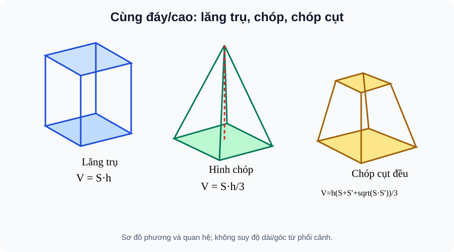

# Bài 27. Thể tích

TOÁN 11 · CHƯƠNG VII · SGK KNTT TẬP 2

Hiểu lý do cần học → khái niệm và lý do → hình minh họa có hướng dẫn đọc → Tự thử trước Core → ví dụ suy luận → tự thực hành và khắc phục. Không ghi Skill Mastery.
<nav class="thpt-r4-lesson-tabs"><a href="../">Chương VII</a><a href="../luyen-tap/">Core/Luyện tập</a><a href="../tu-kiem-tra-chuong/">Tự kiểm tra tự đối chiếu</a></nav>

=== "Khám phá kiến thức"

    ### Cùng tìm hiểu

    ### 1.1. Vì sao cần học
    Hai thùng có cùng diện tích đáy và cùng độ cao nhưng hình dạng khác nhau có thể chứa lượng khác nhau. Thể tích cần phân biệt lăng trụ và chóp, và dùng đúng chiều cao vuông góc.

    ### Ví dụ trực quan

    Thể tích mô tả lượng không gian chiếm chỗ. Chóp có cùng đáy và chiều cao với lăng trụ nhưng thể tích chỉ bằng một phần ba.

    **Quan sát bằng số liệu:** Với chóp có diện tích đáy 12 cm², chiều cao 6 cm, thể tích là 12×6/3=24 cm³; nếu nhầm công thức lăng trụ sẽ được 72 cm³, lớn gấp ba.

    ### Thuật ngữ và kiến thức, kỹ năng

    **Thuật ngữ:** thể tích lăng trụ, hình chóp, chóp cụt, đơn vị khối.

    **Sau bài học, em cần:** tìm đúng chiều cao vuông góc, phân biệt các hình và kiểm đơn vị bậc ba.

=== "Kiến thức SGK"

    ### 1.2. Khái niệm thực chất
    V lăng trụ = S_đáy·h; V hộp chữ nhật = dài·rộng·cao; V chóp = S_đáy·h/3. Chóp cụt đều với diện tích hai đáy S, S′ và chiều cao h: V=h(S+S′+√(SS′))/3.

    ### 1.3. Hình thành và lập luận
    Lăng trụ có các thiết diện song song đáy cùng diện tích nên thể tích là diện tích đáy nhân chiều cao. Chóp cùng S,h chỉ chiếm 1/3 thể tích lăng trụ tương ứng (ghép/cắt); chóp cụt là hiệu hai chóp đồng dạng, từ đó xuất hiện căn √(SS′). Nếu S′=0, công thức về chóp; nếu S′=S, về lăng trụ.

    ### 1.4. Điều kiện, giới hạn, lỗi thường gặp
    Chiều cao **vuông góc** hai đáy, không tự dùng cạnh xiên. Đơn vị thể tích m³, cm³; 1m³=1000L. Chóp cụt đều đòi hai mặt đáy đồng dạng song song trong một hình chóp đều, không áp cho hai hình tùy ý.

    ### 1.5. Làm rõ các định lí, điều kiện và cấu trúc SGK
    **Chiều cao và đơn vị:** Khi nói S_đáy và h, h phải là **khoảng cách vuông góc giữa các mặt đáy** của lăng trụ hoặc từ đỉnh chóp tới mặt đáy. Không thay bằng cạnh bên xiên hay chu vi. Nếu tính S theo cm² và h theo cm thì V theo cm³; đổi sang lít phải thông qua 1m³=1000L hoặc 1000cm³=1L.

    **Vì sao có hệ số một phần ba:** Một chóp và lăng trụ có cùng diện tích đáy S và cùng chiều cao h không có cùng thể tích. Có thể ghép các chóp tam giác phù hợp để suy thể tích chóp bằng 1/3 lăng trụ có cùng S,h; vì thế V_chóp=S h/3. Đây là đặc trưng của chóp, không phải chiết khấu hay quy tắc chọn tùy ý.

    **Chóp cụt đều từ hai chóp đồng dạng:** Đặt đáy lớn diện tích S, đáy nhỏ S′, h là khoảng cách hai đáy; tỉ số đồng dạng của các đáy k=√(S′/S) khi 0<k<1. Chóp lớn cao H, chóp nhỏ phía trên cao kH, nên h=(1−k)H. Trừ thể tích hai chóp: V=(S H−S′ kH)/3 = h(S+√(SS′)+S′)/3. Đây là lý do có **căn của tích diện tích hai đáy**, không phải trung bình cộng hai diện tích. Nếu đáy bé co về 0, công thức trở về chóp; nếu S′=S thì về lăng trụ (trường hợp giới hạn). Chỉ áp dụng cho chóp cụt đều (hoặc hình chóp cụt đồng dạng thích hợp), không cho mọi khối có hai mặt diện tích tùy ý.

    **Cách tự kiểm:** Với diện tích đáy 36cm² và 9cm², cao 4cm, V=4(36+9+18)/3=84cm³. Nếu em tính (36+9)/2×4=90cm³, em đã dùng công thức hình thang phẳng cho thể tích không gian — sai bản chất.

    ### 1.6. Hình minh họa và cách đọc

    <figure class="thpt-r4-plot thpt-r4-probability-figure"><figcaption>Hình B27: Ba khối có cùng diện tích đáy và chiều cao; phân biệt hình chóp, lăng trụ và chóp cụt đều.</figcaption></figure>

    **Hướng dẫn đọc hình:** Ba khối có cùng diện tích đáy và chiều cao; phân biệt hình chóp, lăng trụ và chóp cụt đều. Hình là sơ đồ giải thích phương pháp, **không được suy góc hay độ dài từ nét vẽ phối cảnh**. Điều kiện vuông góc phải có chứng minh.

    ### Vận dụng — tự giải trước khi đối chiếu
    Đáy 18cm², cao 5cm: lăng trụ V=90cm³, chóp V=30cm³. Chóp cụt đáy 16cm² và 4cm², cao 3cm: V=28cm³.

    

Đã tự thử? Mở hướng dẫn tự đối chiếu

Đối chiếu lập luận của em với phần ví dụ được giải thích dưới đây. Đây là hoạt động luyện tập, không ghi Skill Mastery.

=== "Ví dụ"

    ### Các bài giải có hướng dẫn

    #### EX-G11-CHVII-B27-01 — Cùng đáy cùng cao khác thể tích

    **Nhiệm vụ:** Hai khối cùng S=24 cm², h=9 cm, một là lăng trụ, một là chóp. Tính mỗi thể tích.

    **Lập luận để tự đối chiếu sau khi thử:** V_lăng trụ=216cm³; V_chóp=72cm³. Hệ số 1/3 do chóp thu nhỏ tiết diện về đỉnh.

    #### EX-G11-CHVII-B27-02 — Tứ diện vuông ba cạnh

    **Nhiệm vụ:** Tứ diện OABC có OA=3,OB=4,OC=5 đôi một vuông góc. Tính V.

    **Lập luận để tự đối chiếu sau khi thử:** V=(3·4·5)/6=10 đơn vị³: đáy OBC có diện tích 4·5/2, chiều cao OA=3.

    #### EX-G11-CHVII-B27-03 — Chóp cụt đều

    **Nhiệm vụ:** Chóp cụt đều có diện tích đáy lớn 36cm², đáy bé 9cm², h=4cm. Tính V.

    **Lập luận để tự đối chiếu sau khi thử:** V=4(36+9+√324)/3=4(45+18)/3=84cm³. Không lấy trung bình cộng diện tích hai đáy rồi nhân h.

    #### EX-G11-CHVII-B27-04 — Đổi đơn vị

    **Nhiệm vụ:** Bồn dạng hộp chữ nhật 1,2m × 0,8m × 0,5m. Tính lít nước tối đa nếu không có phần rỗng khác.

    **Lập luận để tự đối chiếu sau khi thử:** V=0,48m³=480L. Ghi rõ giả thiết hộp kín đáy và không trừ thành bồn.

    #### EX-G11-CHVII-B27-05 — Hộp đáy vuông

    **Nhiệm vụ:** Hộp đáy vuông cạnh 5cm cao 8cm. Tính thể tích và so với chóp cùng đáy, cùng chiều cao.

    **Lập luận để tự đối chiếu sau khi thử:** V_hộp=25·8=200cm³; V_chóp=200/3cm³, không phải 200cm³.

=== "Lỗi thường gặp"

    

<strong>Nhận diện lỗ hổng:</strong> Lấy trung bình cộng diện tích đáy rồi nhân h cho chóp cụt.
<ol><li><strong>Nhận diện lỗ hổng:</strong> Lấy trung bình cộng diện tích đáy rồi nhân h cho chóp cụt.</li><li><strong>Nhắc đúng bản chất:</strong> Phải có thêm √SS′ trong công thức chóp cụt đều.</li><li><strong>Nhìn lại kiến thức và hình:</strong> Đọc lại phần vì sao cần học, khái niệm và cách lập luận của B27, tự phát biểu điều kiện bằng lời và kiểm tra đúng hình SVG của bài, không suy luận từ phối cảnh.</li><li><strong>Tự luyện có hướng dẫn:</strong> S=16,S′=4,h=3, V? <strong>Sau khi tự làm mới đối chiếu:</strong> 28.</li><li><strong>Quay về câu gốc:</strong> <code>THPT-G11-CHVII-B27-C04</code>; giải lại và giải thích mỗi bước. HELP chỉ hiện sau nộp câu *luyện tập*, tuyệt đối không hiện trong RD1 trước Final Submit.</li></ol>
<a href="../luyen-tap/?item=THPT-G11-CHVII-B27-C04">Quay lại câu canonical THPT-G11-CHVII-B27-C04</a>

    ### Học tiếp

    [Core và Luyện tập Bài 27](luyen-tap.md) · [Tự luận Chương VII](../../../thu-vien/tu-luan-g11-chuong-vii.md) · [Tự kiểm tra cuối chương](tu-kiem-tra-chuong.md)
