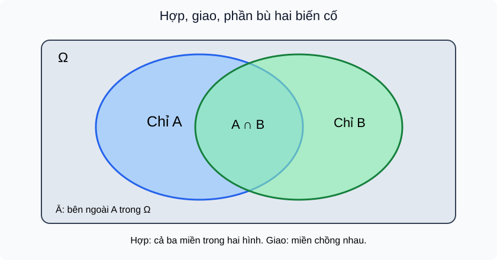

# Bài 28. Biến cố hợp, biến cố giao, biến cố độc lập

TOÁN 11 · CHƯƠNG VIII · SGK KNTT TẬP 2

Hiểu lý do → điều kiện → đọc hình D5 → Tự thử trước Core → xem D2 giải có suy luận → Core, Luyện tập, Tự khắc phục D6. Không ghi Mastery từ hoạt động tự học.
<nav class="thpt-r4-lesson-tabs"><a href="../">Chương VIII</a><a href="../luyen-tap/">Core/Luyện tập</a><a href="../tu-kiem-tra-chuong/">Tự kiểm tra tự đối chiếu</a></nav>

=== "Khám phá kiến thức"

    ### Cùng tìm hiểu

    ### 1.1. Tại sao một biến cố đơn lẻ chưa đủ?
    Ở lớp trước em biết xác suất để lấy được thẻ màu đỏ. Nhưng một câu hỏi như “rút được thẻ đỏ **hoặc** thẻ mang số chẵn”, hay “vừa đỏ **vừa** chẵn” đòi phối hợp **hai biến cố**. Nếu chỉ cộng số trường hợp ta có thể đếm trùng một thẻ vừa đỏ vừa chẵn. Chương này học ngôn ngữ biến cố trước, sau đó mới tính xác suất; học sinh không phải học thuộc công thức khi chưa hiểu vùng kết quả.

    ### Ví dụ trực quan

    Trong cùng một phép thử, câu hỏi 'A hoặc B' và 'A đồng thời B' chỉ hai nhóm kết quả khác nhau. Viết biến cố dưới dạng tập hợp giúp nhìn thấy phần chung.

    **Quan sát bằng số liệu:** Khi tung xúc xắc, A={2,4,6}, B={4,5,6}. A∩B={4,6}, còn A∪B={2,4,5,6}; không được cộng cả hai tập mà đếm 4 và 6 hai lần.

    ### Thuật ngữ và kiến thức, kỹ năng

    **Thuật ngữ:** phép thử, biến cố, hợp, giao, bù, xung khắc, độc lập.

    **Sau bài học, em cần:** vẽ vùng giao/hợp trước khi đếm và phân biệt hai biến cố không giao với độc lập.

=== "Kiến thức SGK"

    ### 1.2. Phép thử, không gian mẫu, biến cố (nhắc nền tảng)
    **Phép thử ngẫu nhiên** là thao tác với kết quả chưa biết trước (chẳng hạn lấy ngẫu nhiên một thẻ). **Không gian mẫu** Ω là tập *mọi kết quả có thể xảy ra* của phép thử; **biến cố** A là tập con Ω. Với Ω={1,2,3,4,5,6} khi chọn số từ sáu thẻ đánh số, A="số chẵn"={2,4,6}; B="số lớn hơn 3"={4,5,6}. Trong mô hình sáu kết quả **đồng khả năng**, P(A)=3/6. Nếu cách chọn khiến các kết quả không đồng khả năng, tuyệt đối không dùng số phần tử/6 mà phải có xác suất của từng kết quả.

    ### 1.3. "Hoặc" và "đồng thời" là hai tập khác nhau
    **Hợp** A∪B có kết quả thuộc A **hoặc** B, kể cả khi cả hai xảy ra. Ví dụ A∪B={2,4,5,6}. **Giao** A∩B có kết quả thuộc **cả A lẫn B**, ở ví dụ là {4,6}. **Phần bù** Ā=Ω\\A={1,3,5}, nghĩa là A không xảy ra. **Xung khắc** nếu A∩B=∅, không thể xảy ra đồng thời. Hai biến cố có phần giao không rỗng là **không xung khắc**. Xem FIG-G11-CHVIII-B28-01; vùng giao ở giữa được tính **một lần** trong hợp.

    ### 1.4. Độc lập không phải xung khắc
    Hai biến cố **độc lập** khi việc một biến cố xảy ra **không làm thay đổi xác suất** của biến cố kia. Một phép kiểm trong mô hình có số liệu xác suất là **P(A∩B)=P(A)P(B)**; trong bài này nêu ý nghĩa, bài 30 dùng công thức nhân để tính. Ví dụ gieo **hai đồng xu công bằng độc lập**, A="xu thứ nhất ngửa", B="xu thứ hai ngửa": mỗi biến cố xác suất 1/2 và cả hai cùng ngửa là 1/4. Ngược lại, trong *một* lần gieo xúc xắc, A="ra 2", B="ra 5" xung khắc nhưng **không độc lập**, do biết A xảy ra thì B chắc chắn không thể xảy ra. **Không được** chỉ vì hai câu chuyện nghe không liên quan mà kết luận độc lập; cần giả thiết hoặc xác minh mô hình.

    ### 1.5. Đọc hình, suy luận và lỗi dễ mắc
    <figure class="thpt-r4-plot thpt-r4-probability-figure"><figcaption>Hình D5 — FIG-G11-CHVIII-B28-01. Đọc hình cùng các chỉ dẫn trong bài trước khi dùng quy tắc.</figcaption></figure>
    **D5:** Hãy đặt một kết quả vào vùng chỉ A, chỉ B, cả hai hoặc ngoài cả hai. Vùng A∪B gồm ba vùng trong hai hình tròn, còn A∩B chỉ vùng chồng nhau. Việc A và B *không cùng xảy ra* là xung khắc, không phải bằng chứng độc lập.

    ### Vận dụng — tự giải trước khi đối chiếu
    Với Ω={1,2,3,4,5,6}, A={2,4,6}, B={4,5,6}, em hãy viết A∪B, A∩B và Ā; hỏi hai biến cố này xung khắc không và giải thích. 

    

Em đã tự thử? Mở lời giải đối chiếu

<strong>Tự đối chiếu sau khi làm:</strong> {2,4,5,6}; {4,6}; {1,3,5}; không xung khắc vì giao khác rỗng.

=== "Ví dụ"

    #### EX-G11-CHVIII-B28-01: Đọc biến cố từ tập số

    **Nhiệm vụ:** Chọn đều một thẻ từ {1,2,3,4,5,6}; A="số chẵn", B="từ 4 trở lên". Tìm A∩B, A∪B.

    **Đáp án và lời giải:** A={2,4,6}, B={4,5,6}; A∩B={4,6}, A∪B={2,4,5,6}.

    **Tại sao cách làm đúng:** Giao là chữ "và"; hợp là chữ "hoặc" gồm cả trường hợp đồng thời. Không nhân xác suất khi đề chỉ yêu cầu tập hợp.

    #### EX-G11-CHVIII-B28-02: Đếm bù đúng

    **Nhiệm vụ:** Có Ω={a,b,c,d,e}, A={a,d}. Hỏi "không thuộc A" là tập nào?

    **Đáp án và lời giải:** Ā={b,c,e}.

    **Tại sao cách làm đúng:** Bù luôn xét tương đối với Ω; không tự lấy phần bù trong một tập không nêu.

    #### EX-G11-CHVIII-B28-03: Hai biến cố xung khắc trong cùng phép thử

    **Nhiệm vụ:** Gieo một xúc xắc: A="ra 2", B="ra 5". Xung khắc hay độc lập?

    **Đáp án và lời giải:** A∩B=∅, P(A)=P(B)=1/6>0, P(A∩B)=0≠1/36. Xung khắc, không độc lập.

    **Tại sao cách làm đúng:** Chỉ một kết quả được rút nên không thể vừa ra 2 vừa ra 5. Hai biến cố xác suất dương và xung khắc thì không độc lập.

    #### EX-G11-CHVIII-B28-04: Cùng ngửa nhưng hai phép thử

    **Nhiệm vụ:** Hai đồng xu độc lập cân bằng: A="xu đầu ngửa", B="xu sau ngửa".

    **Đáp án và lời giải:** Ω={NN,NS,SN,SS}; P(A)=P(B)=1/2, P(A∩B)=1/4=(1/2)^2.

    **Tại sao cách làm đúng:** Cần giả thiết hai lần thử công bằng, độc lập. Cả hai cùng xảy ra vẫn có thể độc lập.

    #### EX-G11-CHVIII-B28-05: Phân biệt hai tầng mô hình

    **Nhiệm vụ:** Bốc số 1–4 đều, A="số lớn hơn 2", B="số lẻ".

    **Đáp án và lời giải:** A={3,4}, B={1,3}; A∩B={3}, A∪B={1,3,4}.

    **Tại sao cách làm đúng:** Kết quả đơn lẻ số 3 nằm cả hai biến cố; không được chỉ dùng chữ "hoặc" như loại trừ.

=== "Lỗi thường gặp"

    

<strong>Chẩn đoán lỗi:</strong> Nhầm hoặc với loại trừ.
<ol><li><strong>Chẩn đoán lỗi:</strong> Nhầm hoặc với loại trừ.</li><li><strong>Nhắc khái niệm/điều kiện:</strong> A∪B bao gồm cả giao, một kết quả viết một lần.</li><li><strong>Giải thích vì sao:</strong> Đọc lại phần D1 của B28, vẽ tập hợp/nhánh xác suất tương ứng, rồi nói lại bằng lời trước khi thay số.</li><li><strong>Tự thử có dẫn:</strong> A={a,c},B={b,c}; hợp chứa c không? <strong>Đối chiếu sau thử:</strong> Có; {a,b,c}.</li><li><strong>Quay về câu nguồn:</strong> Tự làm lại <code>THPT-G11-CHVIII-B28-C03</code> từ đầu, ghi lý do chọn công thức. Không tính lời giải đã xem là bằng chứng Mastery.</li></ol>
<a href="../luyen-tap/?item=THPT-G11-CHVIII-B28-C03">Quay lại câu gốc THPT-G11-CHVIII-B28-C03</a>

    

<strong>Chẩn đoán lỗi:</strong> Viết giao bằng tất cả phần tử xuất hiện.
<ol><li><strong>Chẩn đoán lỗi:</strong> Viết giao bằng tất cả phần tử xuất hiện.</li><li><strong>Nhắc khái niệm/điều kiện:</strong> Giao chỉ chứa phần tử thuộc hai biến cố đồng thời.</li><li><strong>Giải thích vì sao:</strong> Đọc lại phần D1 của B28, vẽ tập hợp/nhánh xác suất tương ứng, rồi nói lại bằng lời trước khi thay số.</li><li><strong>Tự thử có dẫn:</strong> A={1,3},B={2,3}; giao là? <strong>Đối chiếu sau thử:</strong> {3}.</li><li><strong>Quay về câu nguồn:</strong> Tự làm lại <code>THPT-G11-CHVIII-B28-C04</code> từ đầu, ghi lý do chọn công thức. Không tính lời giải đã xem là bằng chứng Mastery.</li></ol>
<a href="../luyen-tap/?item=THPT-G11-CHVIII-B28-C04">Quay lại câu gốc THPT-G11-CHVIII-B28-C04</a>

    

<strong>Chẩn đoán lỗi:</strong> Đánh đồng xung khắc và độc lập.
<ol><li><strong>Chẩn đoán lỗi:</strong> Đánh đồng xung khắc và độc lập.</li><li><strong>Nhắc khái niệm/điều kiện:</strong> Nếu P(A),P(B)&gt;0 và A,B xung khắc thì không độc lập.</li><li><strong>Giải thích vì sao:</strong> Đọc lại phần D1 của B28, vẽ tập hợp/nhánh xác suất tương ứng, rồi nói lại bằng lời trước khi thay số.</li><li><strong>Tự thử có dẫn:</strong> Với P(A)=1/2,P(B)=1/4 và giao rỗng, tích là? <strong>Đối chiếu sau thử:</strong> 1/8&gt;0, khác giao 0.</li><li><strong>Quay về câu nguồn:</strong> Tự làm lại <code>THPT-G11-CHVIII-B28-P04</code> từ đầu, ghi lý do chọn công thức. Không tính lời giải đã xem là bằng chứng Mastery.</li></ol>
<a href="../luyen-tap/?item=THPT-G11-CHVIII-B28-P04">Quay lại câu gốc THPT-G11-CHVIII-B28-P04</a>

    ### Học tiếp

    [Core/Luyện tập Bài 28](luyen-tap.md) · [Tự luận Chương VIII](../../../thu-vien/tu-luan-g11-chuong-viii.md) · [Tự kiểm tra cuối chương](tu-kiem-tra-chuong.md)
