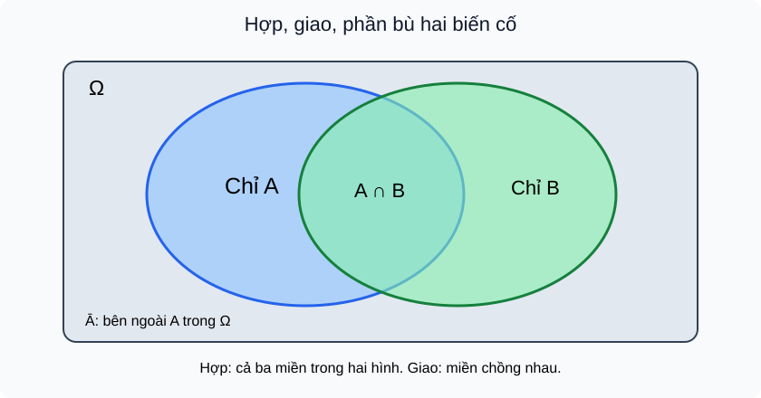

# Bài 28. Biến cố hợp, biến cố giao, biến cố độc lập

TOÁN 11 · CHƯƠNG VIII · SGK KNTT TẬP 2

Diễn đạt các biến cố bằng tập hợp, phân biệt hợp, giao, đối, xung khắc và độc lập.
<nav class="thpt-r4-lesson-tabs"><a href="../">Chương VIII</a><a href="../luyen-tap/">Core và Luyện tập</a><a href="../tu-kiem-tra-chuong/">Tự kiểm tra cuối chương</a></nav>

=== "Khám phá kiến thức"

    Khi chọn một học sinh để khảo sát, có thể bạn ấy biết bơi, biết đạp xe, biết cả hai hoặc không biết môn nào. Ta cần ngôn ngữ để mô tả từng tình huống trước khi tính cơ hội xảy ra. Một biến cố là tập hợp các kết quả thỏa điều kiện, không phải bản thân một lần thử.

    <figure class="thpt-r4-plot thpt-r4-probability-figure"><figcaption>Đọc hình: Bốn miền của sơ đồ Venn: chỉ A, giao A và B, chỉ B và ngoài cả hai; một kết quả nằm đúng một miền. Diện tích hình chỉ minh họa miền, không biểu thị tỉ lệ xác suất.</figcaption></figure>

    ### 1.1. Không gian mẫu
    
    Liệt kê mọi kết quả riêng biệt của đúng phép thử. Chẳng hạn chọn một thẻ thì một kết quả là một thẻ, không phải hai thẻ.
    
    **Vận dụng.** Chọn một thẻ trong năm thẻ đánh số 2,4,6,8,10. Viết không gian mẫu.
    
    
    
    ??? question "Đối chiếu"
    
        **Lời giải:** Ω={2,4,6,8,10}.
    
    
    
    ??? tip "Kiểm lỗi"
    
        **Vì sao dễ sai:** Đếm các cặp là đổi phép thử một lần rút thành hai lần rút; không gian mẫu phải mô tả đúng một kết quả của thí nghiệm.

        **Tự sửa:** Không thêm các cặp vì chỉ chọn một thẻ. <a href="../luyen-tap/?item=THPT-G11-CHVIII-B28-C01">Luyện lại câu B28-C01</a>

    ### 1.2. Mô tả biến cố
    
    Từ mô tả bằng lời, giữ lại đúng các kết quả thỏa điều kiện; nếu chọn đều mới đếm số kết quả chia tổng.
    
    **Vận dụng.** Chọn đều thẻ từ 1 đến 8. A là biến cố chọn số nguyên tố. Viết A và tính P(A).
    
    
    
    ??? question "Đối chiếu"
    
        **Lời giải:** A={2,3,5,7}; P(A)=4/8=1/2.
    
    
    
    ??? tip "Kiểm lỗi"
    
        **Vì sao dễ sai:** Tập biến cố phải lọc kết quả đúng điều kiện; quy tắc chia số lượng chỉ hợp lệ khi các kết quả đồng khả năng.

        **Tự sửa:** Số 1 không nguyên tố; kiểm điều kiện đồng khả năng. <a href="../luyen-tap/?item=THPT-G11-CHVIII-B28-C02">Luyện lại câu B28-C02</a>

    ### 1.3. Hoặc: kể cả hai
    
    Một kết quả thỏa ít nhất một điều kiện thì thuộc hợp, kể cả kết quả thỏa cả hai; không viết lặp.
    
    **Vận dụng.** Cho A={1,3,7}, B={2,3,8}. Tìm hợp.
    
    
    
    ??? question "Đối chiếu"
    
        **Lời giải:** A∪B={1,2,3,7,8}.
    
    
    
    ??? tip "Kiểm lỗi"
    
        **Vì sao dễ sai:** Trong xác suất, 'A hoặc B' là hoặc bao hàm; vùng chung nằm trong hợp đúng một lần.

        **Tự sửa:** Nếu bỏ 3, em đang hiểu hoặc theo nghĩa loại trừ. <a href="../luyen-tap/?item=THPT-G11-CHVIII-B28-C03">Luyện lại câu B28-C03</a>

    ### 1.4. Và: đồng thời
    
    Chỉ giữ kết quả trong cả hai tập; khi một điều kiện không thể cùng xảy ra với điều kiện kia thì giao rỗng.
    
    **Vận dụng.** Chọn một số từ 1 đến 12. A là bội của 2, B là bội của 3. Tìm AB.
    
    
    
    ??? question "Đối chiếu"
    
        **Lời giải:** AB=A∩B={6,12}.
    
    
    
    ??? tip "Kiểm lỗi"
    
        **Vì sao dễ sai:** Giao đòi đồng thời cả hai điều kiện; bội chung của 2 và 3 phải là bội của 6.

        **Tự sửa:** Kiểm từng số phải chia hết cho cả 2 và 3. <a href="../luyen-tap/?item=THPT-G11-CHVIII-B28-C04">Luyện lại câu B28-C04</a>

    ### 1.5. Chỉ một và không có cái nào
    
    Chia Ω thành bốn miền: chỉ A, chỉ B, cả hai, ngoài cả hai. Hai cách nói 'chỉ một' và 'không cái nào' khác nhau.
    
    **Vận dụng.** Ω={1,2,3,4,5,6}, A={1,2,3}, B={3,4}. Liệt kê các kết quả chỉ thuộc một biến cố và không thuộc biến cố nào.
    
    
    
    ??? question "Đối chiếu"
    
        **Lời giải:** Chỉ một: {1,2,4}; không thuộc biến cố nào: {5,6}.
    
    
    
    ??? tip "Kiểm lỗi"
    
        **Vì sao dễ sai:** Biến cố đối ̅A là mọi kết quả không thuộc A; 'chỉ một' là hai miền riêng, khác với ngoài cả hai.

        **Tự sửa:** Tránh hiểu 'không có cả hai' mơ hồ; viết rõ không A và không B. <a href="../luyen-tap/?item=THPT-G11-CHVIII-B28-C05">Luyện lại câu B28-C05</a>

    ### 1.6. Xung khắc không phải độc lập
    
    Xung khắc nói về khả năng cùng xảy ra. Độc lập nói về việc thông tin xảy ra của biến cố này có thay đổi cơ hội biến cố kia hay không.
    
    **Vận dụng.** Gieo một xúc xắc đều. A là ra 1 hoặc 2, B là ra 5. Xung khắc không? Độc lập không?
    
    
    
    ??? question "Đối chiếu"
    
        **Lời giải:** Có xung khắc vì giao rỗng. Không độc lập vì khi A xảy ra, B chắc chắn không xảy ra, khác cơ hội trước đó 1/6.
    
    
    
    ??? tip "Kiểm lỗi"
    
        **Vì sao dễ sai:** Xung khắc là giao rỗng; khi cả hai xác suất dương thì tích riêng dương, nên không thể độc lập.

        **Tự sửa:** Hai biến cố xung khắc có xác suất dương không độc lập. <a href="../luyen-tap/?item=THPT-G11-CHVIII-B28-C06">Luyện lại câu B28-C06</a>

    ### 1.7. Hoàn lại hay không hoàn lại
    
    Hộp có 2 bi đỏ, 3 bi xanh, mỗi bi được chọn đều. Nếu trả bi đầu lại, cơ hội đỏ ở lượt sau vẫn 2/5. Nếu không trả, thành phần hộp phụ thuộc màu lượt đầu.
    
    **Vận dụng.** Cùng hộp trên, không hoàn lại: so sánh cơ hội đỏ lượt hai khi lượt đầu đỏ và khi lượt đầu xanh.
    
    
    
    ??? question "Đối chiếu"
    
        **Lời giải:** Nếu đầu đỏ: 1/4; nếu đầu xanh: 2/4. Khác nhau nên hai biến cố đỏ ở từng lượt không độc lập.
    
    
    
    ??? tip "Kiểm lỗi"
    
        **Vì sao dễ sai:** Không hoàn lại làm thành phần hộp thay đổi theo lượt trước, nên không dùng cơ hội cố định ở lượt sau.

        **Tự sửa:** Phải xét lại số bi còn trong hộp, không giữ mẫu số 5. <a href="../luyen-tap/?item=THPT-G11-CHVIII-B28-C07">Luyện lại câu B28-C07</a>

=== "Kiến thức SGK"

    ### 2.1. Biến cố hợp
    
    
<strong>Biến cố hợp.</strong>
    
    Cho A, B cùng thuộc không gian mẫu Ω. Biến cố hợp là A hoặc B xảy ra, kí hiệu \(A\cup B\). Một kết quả thuộc hợp nếu nó thuộc A, B hoặc cả hai. Nhắc: Ω gồm mọi kết quả có thể; biến cố là tập con Ω. Với các kết quả đồng khả năng, \(P(A)=n(A)/n(\Omega)\). Không được dùng phép đếm đơn thuần nếu các kết quả không đồng khả năng.
    
    

    ### 2.2. Biến cố giao
    
    
<strong>Biến cố giao.</strong>
    
    Biến cố giao, kí hiệu \(AB=A\cap B\), xảy ra khi cả A và B xảy ra. Biến cố đối \(\overline A=\Omega\setminus A\) xảy ra khi A không xảy ra. Chỉ A: \(A\overline B\); chỉ B: \(\overline A B\); đúng một: \((A\overline B)\cup(\overline A B)\); không biến cố nào: \(\overline A\,\overline B=\overline{A\cup B}\). Xung khắc nghĩa là \(AB=\varnothing\).
    
    

    ### 2.3. Biến cố độc lập
    
    
<strong>Biến cố độc lập.</strong>
    
    A và B độc lập nếu việc xảy ra hay không xảy ra của biến cố này không ảnh hưởng đến xác suất của biến cố kia. Ví dụ hai lần gieo xúc xắc độc lập; hai lần rút không hoàn lại có thể phụ thuộc. Khi A và B độc lập, các cặp \(A,\overline B\), \(\overline A,B\), \(\overline A,\overline B\) cũng độc lập: nếu tỉ lệ B không đổi thì tỉ lệ không B cũng không đổi; khi biết A không xảy ra, giả thiết độc lập vẫn giữ nguyên tỉ lệ. Bài 30 sẽ dùng phép kiểm \(P(AB)=P(A)P(B)\), bao gồm cả trường hợp xác suất 0. Không kết luận chỉ từ tên biến cố.
    
    

=== "Ví dụ"

    ### 3.1. Hợp và giao từ điều kiện
    
    

<strong>Đề bài:</strong> Chọn đều một số từ 1 đến 10. A là số chẵn, B là bội của 3. Tìm hợp và giao.

<strong>Phân tích:</strong> Liệt kê từng tập rồi so sánh.

<strong>Lời giải:</strong> A={2,4,6,8,10}; B={3,6,9}; hợp {2,3,4,6,8,9,10}; giao {6}.

<strong>Kiểm lại:</strong> 6 thuộc cả hai nhưng chỉ ghi một lần trong hợp.

    ### 3.2. Biến cố đối và đúng một
    
    

<strong>Đề bài:</strong> Ω={a,b,c,d,e,f}, A={a,c,d}, B={b,d,e}. Tìm biến cố đối A, đúng một và không cái nào.

<strong>Phân tích:</strong> Tách bốn miền rời nhau.

<strong>Lời giải:</strong> Đối A={b,e,f}; chỉ A={a,c}; chỉ B={b,e}; đúng một={a,b,c,e}; không cái nào={f}.

<strong>Kiểm lại:</strong> Bốn miền có 2+2+1+1=6 kết quả.

    ### 3.3. Xung khắc và độc lập
    
    

<strong>Đề bài:</strong> Một lần gieo xúc xắc đều. A ra 2, B ra 5. Nhận xét quan hệ.

<strong>Phân tích:</strong> Phân biệt giao rỗng với sự thay đổi khả năng.

<strong>Lời giải:</strong> A∩B=∅. Nếu A xảy ra, B có xác suất 0 thay vì 1/6. Xung khắc nhưng không độc lập.

<strong>Kiểm lại:</strong> Cả A và B đều có xác suất dương.

    ### 3.4. Độc lập qua bảng kết quả
    
    

<strong>Đề bài:</strong> Hai đồng xu cân bằng được gieo độc lập. A là xu đầu ngửa, B là xu sau sấp. Xét B khi A xảy ra và khi A không xảy ra.

<strong>Phân tích:</strong> Bốn kết quả NN, NS, SN, SS đồng khả năng.

<strong>Lời giải:</strong> Trong NN, NS có một kết quả B; trong SN, SS cũng có một kết quả B. Hai tỉ lệ đều 1/2; A và B độc lập.

<strong>Kiểm lại:</strong> Nếu thay B bằng biến cố xu sau ngửa, tỉ lệ vẫn 1/2.

    ### 3.5. Đọc bốn miền
    
    

<strong>Đề bài:</strong> Trong nhóm 24 học sinh, 8 biết bơi, 10 biết đạp xe, 3 biết cả hai. Hỏi bao nhiêu bạn chỉ biết một môn và không biết môn nào trong hai môn.

<strong>Phân tích:</strong> Bỏ 3 khỏi từng nhóm để tìm hai miền riêng.

<strong>Lời giải:</strong> Chỉ bơi=5; chỉ đạp xe=7; đúng một=12; ngoài cả hai=24−(5+7+3)=9.

<strong>Kiểm lại:</strong> 5+7+3+9=24.

    ### 3.6. So sánh hai cách rút
    
    

<strong>Đề bài:</strong> Hộp 4 bi đỏ, 2 bi xanh đồng kích thước. A là lần đầu đỏ, B là lần sau xanh. So sánh lấy có hoàn lại và không hoàn lại.

<strong>Phân tích:</strong> So màu còn trong hộp dựa theo lượt đầu.

<strong>Lời giải:</strong> Hoàn lại: dù lượt đầu đỏ hay xanh, cơ hội xanh lượt hai đều 2/6=1/3; độc lập. Không hoàn lại: đầu đỏ ⇒ 2/5, đầu xanh ⇒ 1/5; phụ thuộc.

<strong>Kiểm lại:</strong> Kết luận dựa vào sự thay đổi thành phần, không dựa vào việc hai lượt có tên khác nhau.

=== "Lỗi thường gặp"

    
    
    ??? tip "4.1. Hiểu hoặc là chỉ một"
    
        Hợp vẫn gồm miền giao; xem mục 2.1. <a href="../luyen-tap/?item=THPT-G11-CHVIII-B28-C03">Luyện lại câu B28-C03</a>

    
    
    ??? tip "4.2. Nhầm giao với hợp"
    
        Giao đòi thỏa cả hai điều kiện; xem mục 2.2. <a href="../luyen-tap/?item=THPT-G11-CHVIII-B28-C04">Luyện lại câu B28-C04</a>

    
    
    ??? tip "4.3. Nhầm xung khắc với độc lập"
    
        Giao rỗng và xác suất hai biến cố dương làm thay đổi cơ hội; xem mục 2.3. <a href="../luyen-tap/?item=THPT-G11-CHVIII-B28-P04">Luyện lại câu B28-P04</a>

    [Core và Luyện tập Bài 28](luyen-tap.md) · <a href="../../../thu-vien/tu-luan-g11-chuong-viii.md">Tự luận Chương VIII</a> · [Tự kiểm tra cuối chương](tu-kiem-tra-chuong.md)

*Nguồn đối chiếu: SGK Toán 11 Kết nối tri thức với cuộc sống, Tập hai, Bài 28, trang in 66–71.*

    
Nguồn tham khảo: SGK Toán 11 – Kết nối tri thức với cuộc sống, tập hai, Bài 28 (trang in 66–71); đối chiếu SBT cùng bộ (tài liệu tham khảo luyện tập).

