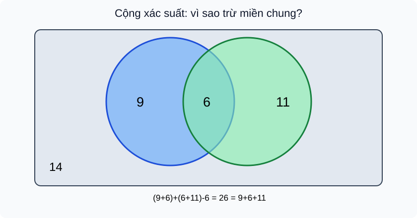

# Bài 29. Công thức cộng xác suất

TOÁN 11 · CHƯƠNG VIII · SGK KNTT TẬP 2

Hiểu lý do → điều kiện → đọc hình D5 → Tự thử trước Core → xem D2 giải có suy luận → Core, Luyện tập, Tự khắc phục D6. Không ghi Mastery từ hoạt động tự học.
<nav class="thpt-r4-lesson-tabs"><a href="../">Chương VIII</a><a href="../luyen-tap/">Core/Luyện tập</a><a href="../tu-kiem-tra-chuong/">Tự kiểm tra tự đối chiếu</a></nav>

=== "Khám phá kiến thức"

    ### Cùng tìm hiểu

    ### 1.1. Tại sao cộng hai cơ hội dễ sai?
    Trong một nhóm 40 học sinh, 15 bạn thích vẽ, 17 bạn thích thể thao, có 6 bạn thích **cả hai**. Cộng 15+17=32 đã đếm mỗi bạn thích cả hai **hai lần**. Muốn xác suất “thích vẽ hoặc thể thao”, cần trừ sáu bạn được đếm trùng. Đây không phải mẹo đại số: chính sơ đồ vùng giải thích vì sao.

    ### Ví dụ trực quan

    Khi cộng cơ hội của hai biến cố có phần chung, phần giao bị đếm hai lượt. Quy tắc cộng xác suất khử phần trùng đó.

    **Quan sát bằng số liệu:** Nếu P(A)=0,6; P(B)=0,5 và P(A∩B)=0,2 thì P(A∪B)=0,9, không phải 1,1. Kết quả vượt 1 là tín hiệu phải xét giao.

    ### Thuật ngữ và kiến thức, kỹ năng

    **Thuật ngữ:** quy tắc cộng, phần giao, biến cố xung khắc, biến cố đối.

    **Sau bài học, em cần:** phân tích ba vùng rời nhau và kiểm xác suất kết quả nằm trong [0,1].

=== "Kiến thức SGK"

    ### 1.2. Chứng minh bằng ba miền rời nhau
    Mọi kết quả thuộc A∪B nằm trong đúng một của ba miền **chỉ A**, **A∩B**, **chỉ B**. Vì vậy P(A∪B)=P(chỉ A)+P(A∩B)+P(chỉ B). Nhưng P(A)=P(chỉ A)+P(A∩B), P(B)=P(chỉ B)+P(A∩B), nên

    **P(A∪B)=P(A)+P(B)−P(A∩B).**

    Đẳng thức áp dụng cho **mọi hai biến cố của cùng một phép thử/mô hình xác suất**, không đòi độc lập. Khi **xung khắc** A∩B=∅ và P(A∩B)=0 thì công thức rút còn P(A∪B)=P(A)+P(B). **Cẩn thận:** không được dùng công thức rút gọn chỉ vì hai biến cố được đặt tên khác nhau.

    ### 1.3. Bù và các giới hạn giúp tự phát hiện sai
    Vì A và Ā xung khắc, hợp là toàn bộ Ω, ta có **P(Ā)=1−P(A)**. Mọi xác suất đều nằm trong [0,1], giao nằm trong từng biến cố nên **0≤P(A∩B)≤min(P(A),P(B))**. Nếu tính xác suất hợp lớn hơn 1 hoặc nhỏ hơn P(A), hãy kiểm lại mẫu số và phần giao.

    ### 1.4. Ví dụ dẫn đến phương pháp
    Dùng số người trong §1: chỉ vẽ=15−6=9, chỉ thể thao=17−6=11, cả hai=6, không thích cả hai=40−(9+6+11)=14. P(A∪B)=26/40=13/20. Nếu học sinh dùng (15+17)/40=4/5 thì đã đếm lặp 6/40. **Chưa biết dữ liệu chọn ngẫu nhiên hay không**, xác suất 26/40 chỉ đúng nếu *chọn đều một học sinh trong 40*.

    ### 1.5. Đọc hình
    <figure class="thpt-r4-plot thpt-r4-probability-figure"><figcaption>Hình D5 — FIG-G11-CHVIII-B29-01. Đọc hình cùng các chỉ dẫn trong bài trước khi dùng quy tắc.</figcaption></figure>
    Mỗi số trong một miền biểu thị số người, tổng 9+6+11+14=40. Hợp A∪B gồm 9+6+11, *không* đếm lại số 6. Tập người ở ngoài cả hai có 14 người.

    ### Vận dụng — tự giải trước khi đối chiếu
    Một câu lạc bộ 30 bạn: A có 14 bạn, B có 12 bạn, có 5 bạn thuộc cả A và B. Tính số bạn thuộc ít nhất một câu lạc bộ và số không thuộc cả hai. 

    

Em đã tự thử? Mở lời giải đối chiếu

<strong>Đối chiếu sau thử:</strong> 14+12−5=21 và 30−21=9. Hãy nói vì sao không dùng 14+12 trực tiếp.

=== "Ví dụ"

    #### EX-G11-CHVIII-B29-01: Tổng hai nhóm có phần chung

    **Nhiệm vụ:** Trong 50 vé khảo sát, 23 vé chọn X, 19 vé chọn Y, 8 vé chọn cả hai. Chọn đều 1 vé: P(X∪Y)?

    **Đáp án và lời giải:** (23+19−8)/50=34/50=17/25.

    **Tại sao cách làm đúng:** Trừ vùng giao đã cộng hai lần. Xác suất = số phiếu hợp/50 vì chọn đều.

    #### EX-G11-CHVIII-B29-02: Trường hợp xung khắc

    **Nhiệm vụ:** Gieo xúc xắc đều: A="ra 1", B="ra 6". Tính P(A∪B).

    **Đáp án và lời giải:** 1/6+1/6=1/3.

    **Tại sao cách làm đúng:** A∩B=∅ nên công thức cộng không có phần trừ.

    #### EX-G11-CHVIII-B29-03: Bù hỗ trợ tính nhanh

    **Nhiệm vụ:** Một thử nghiệm có P(A)=7/20. Tính xác suất A không xảy ra.

    **Đáp án và lời giải:** 13/20.

    **Tại sao cách làm đúng:** A và Ā chia toàn bộ Ω không trùng lặp; lấy 1−7/20.

    #### EX-G11-CHVIII-B29-04: Rút phần giao từ hợp

    **Nhiệm vụ:** Biết P(A)=0,6, P(B)=0,5, P(A∪B)=0,8. Tìm P(A∩B).

    **Đáp án và lời giải:** 0,6+0,5−0,8=0,3.

    **Tại sao cách làm đúng:** Biến đổi công thức cộng, không giả định độc lập để nhân.

    #### EX-G11-CHVIII-B29-05: Xét tính hợp lý

    **Nhiệm vụ:** Bạn tính P(A)=0,4, P(B)=0,7, P(A∩B)=0,5. Vì sao dữ kiện vô lí?

    **Đáp án và lời giải:** Vì P(A∩B)≤P(A)=0,4 mà được cho 0,5.

    **Tại sao cách làm đúng:** Giao nằm trong A và B; xác suất không thể tăng khi lấy tập con.

=== "Lỗi thường gặp"

    

<strong>Chẩn đoán lỗi:</strong> Cộng hai biến cố có phần chung thành xác suất lớn.
<ol><li><strong>Chẩn đoán lỗi:</strong> Cộng hai biến cố có phần chung thành xác suất lớn.</li><li><strong>Nhắc khái niệm/điều kiện:</strong> Trừ phần giao vì đã được cộng hai lần.</li><li><strong>Giải thích vì sao:</strong> Đọc lại phần D1 của B29, vẽ tập hợp/nhánh xác suất tương ứng, rồi nói lại bằng lời trước khi thay số.</li><li><strong>Tự thử có dẫn:</strong> A=0,6;B=0,5;giao=0,2: hợp=? <strong>Đối chiếu sau thử:</strong> 0,9.</li><li><strong>Quay về câu nguồn:</strong> Tự làm lại <code>THPT-G11-CHVIII-B29-C01</code> từ đầu, ghi lý do chọn công thức. Không tính lời giải đã xem là bằng chứng Mastery.</li></ol>
<a href="../luyen-tap/?item=THPT-G11-CHVIII-B29-C01">Quay lại câu gốc THPT-G11-CHVIII-B29-C01</a>

    

<strong>Chẩn đoán lỗi:</strong> Nhận số xác suất ngoài [0,1].
<ol><li><strong>Chẩn đoán lỗi:</strong> Nhận số xác suất ngoài [0,1].</li><li><strong>Nhắc khái niệm/điều kiện:</strong> Giao ⊆ A và B; hợp ⊆ Ω nên P(giao)≤min và P(hợp)≤1.</li><li><strong>Giải thích vì sao:</strong> Đọc lại phần D1 của B29, vẽ tập hợp/nhánh xác suất tương ứng, rồi nói lại bằng lời trước khi thay số.</li><li><strong>Tự thử có dẫn:</strong> P(A)=0,3, giao=0,4 có thể? <strong>Đối chiếu sau thử:</strong> Không.</li><li><strong>Quay về câu nguồn:</strong> Tự làm lại <code>THPT-G11-CHVIII-B29-C05</code> từ đầu, ghi lý do chọn công thức. Không tính lời giải đã xem là bằng chứng Mastery.</li></ol>
<a href="../luyen-tap/?item=THPT-G11-CHVIII-B29-C05">Quay lại câu gốc THPT-G11-CHVIII-B29-C05</a>

    ### Học tiếp

    [Core/Luyện tập Bài 29](luyen-tap.md) · [Tự luận Chương VIII](../../../thu-vien/tu-luan-g11-chuong-viii.md) · [Tự kiểm tra cuối chương](tu-kiem-tra-chuong.md)
