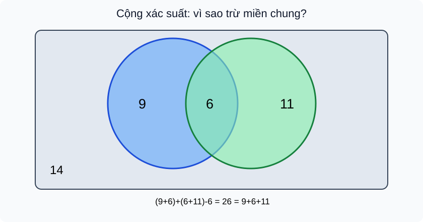

# Bài 29. Công thức cộng xác suất

TOÁN 11 · CHƯƠNG VIII · KẾT NỐI TRI THỨC · TẬP HAI

Tính cơ hội “ít nhất một biến cố xảy ra”: khi nào cộng thẳng hai xác suất, khi nào phải trừ phần bị tính hai lần?

<nav class="thpt-r4-lesson-tabs"><a href="../">Chương VIII</a><a href="../luyen-tap/">Core/Luyện tập</a><a href="../tu-kiem-tra-chuong/">Tự kiểm tra cuối chương</a></nav>

=== "Khám phá kiến thức"

    Ở Bài 28, em đã biết **biến cố hợp** \(A\cup B\) nghĩa là \(A\) **hoặc** \(B\) xảy ra, bao gồm trường hợp cả hai cùng xảy ra. Bây giờ ta muốn biết **xác suất** của biến cố đó. Có khi chỉ cần cộng \(P(A)\) và \(P(B)\); có khi làm vậy sẽ đếm một kết quả hai lần. Điểm quyết định là hai biến cố **có thể cùng xảy ra hay không**.

    ### 1.1. Công thức cộng xác suất cho hai biến cố xung khắc

    Gieo một con xúc xắc cân đối. Gọi \(A\): “ra số \(1\) hoặc \(2\)”, \(B\): “ra số \(5\) hoặc \(6\)”. Mỗi lần gieo chỉ xuất hiện **một** mặt, vì thế không có kết quả nào vừa thuộc \(A\) vừa thuộc \(B\).

    Ta có \(A=\{1;2\}\), \(B=\{5;6\}\). Biến cố “\(A\) hoặc \(B\)” nhận bốn kết quả \(1,2,5,6\) trong sáu kết quả đồng khả năng. Do đó

    \[
    P(A\cup B)=\frac46=\frac26+\frac26=P(A)+P(B).
    \]

    Hai biến cố không thể xảy ra đồng thời như vậy được gọi là **xung khắc**. Khi liệt kê kết quả của \(A\) và \(B\), không có kết quả chung, nên cộng hai xác suất **không bị trùng**. Đây là lí do công thức cộng đơn giản đúng trong trường hợp xung khắc.

    Cần phân biệt “xung khắc” với “độc lập” đã học ở Bài 28. Trong một lần gieo, biết \(A\) xảy ra thì \(B\) chắc chắn không xảy ra; hai biến cố trên **không độc lập**. Xung khắc nói rằng **không cùng xảy ra**, chứ không có nghĩa là chúng “không ảnh hưởng tới nhau”.

    **Vận dụng.** Một hộp có mười thẻ ghi các số từ \(1\) đến \(10\), rút ngẫu nhiên một thẻ, mỗi thẻ có cơ hội như nhau. Gọi \(C\): “rút số nhỏ hơn \(4\)”, \(D\): “rút số lớn hơn \(8\)”. Hai biến cố có xung khắc không? Tính \(P(C\cup D)\) và giải thích vì sao được cộng thẳng.

    ??? question "Đối chiếu"

        **Lời giải.** \(C=\{1;2;3\}\), \(D=\{9;10\}\). Hai tập không có phần tử chung nên \(C,D\) xung khắc. Có năm kết quả thuận lợi trong mười kết quả đồng khả năng:

        \[
        P(C\cup D)=\frac5{10}=\frac3{10}+\frac2{10}=\frac12.
        \]

        **Kiểm lỗi:** Nếu coi \(C,D\) độc lập để nhân \(3/10\) với \(2/10\), em đã đổi câu hỏi “**hoặc**” thành “**cả hai**” và sử dụng sai điều kiện. Hãy liệt kê tập kết quả trước.

    ### 1.2. Công thức cộng xác suất

    Giả sử một lớp có \(40\) học sinh; \(15\) bạn thích vẽ, \(17\) bạn thích thể thao và \(6\) bạn thích **cả hai**. Chọn **đều một học sinh** trong lớp. Ta cần xác suất chọn được người thích vẽ **hoặc** thể thao.

    Nếu cộng ngay \(15+17=32\), sáu bạn thích cả hai đã được đếm **hai lần**. Ta thử phân lớp thành những nhóm **không chồng nhau**:

    | Nhóm | Số học sinh |
    | :-- | --: |
    | Chỉ thích vẽ | \(15-6=9\) |
    | Thích cả hai | \(6\) |
    | Chỉ thích thể thao | \(17-6=11\) |
    | Không thích môn nào trong hai môn | \(40-9-6-11=14\) |

    <figure class="thpt-r4-plot thpt-r4-probability-figure"><figcaption><strong>Đọc hình:</strong> vùng giữa hai hình tròn là \(6\) người thích cả hai. Vùng “ít nhất một môn” gồm \(9+6+11=26\) người; vùng ngoài có \(14\) người. Khi cộng số bạn thích vẽ và thể thao, phần giữa bị tính hai lần.</figcaption></figure>

    Vậy xác suất cần tìm là \(26/40=13/20\), **không phải** \(32/40\). Nếu gọi \(A\): “thích vẽ”, \(B\): “thích thể thao”, ta có

    \[
    P(A\cup B)=\frac{15}{40}+\frac{17}{40}-\frac6{40}
    =\frac{26}{40}=\frac{13}{20}.
    \]

    Tại sao phải **trừ xác suất phần giao**? Bởi \(P(A)+P(B)\) gồm một lần đếm miền **chỉ \(A\)**, một lần đếm miền **chỉ \(B\)** nhưng **hai lần** đếm miền \(A\cap B\). Muốn giữ đúng một lần đếm miền chung, ta trừ đi \(P(A\cap B)\). Từ đó có công thức

    \[
    \boxed{P(A\cup B)=P(A)+P(B)-P(A\cap B).}
    \]

    Công thức này đúng cho **hai biến cố bất kì của cùng một phép thử**, không cần độc lập và cũng không cần xung khắc. Trong SGK, biến cố giao còn được kí hiệu là \(AB\), nên em có thể gặp \(P(AB)\) thay cho \(P(A\cap B)\).

    Khi \(A,B\) **xung khắc**, \(A\cap B=\varnothing\) và \(P(A\cap B)=0\). Công thức tổng quát lúc đó trở về công thức cộng đơn giản của mục 1.1. Vì vậy, **không có hai công thức mâu thuẫn nhau**; một công thức là trường hợp riêng của công thức kia.

    Còn nếu muốn tìm xác suất **không biến cố nào xảy ra**, ta xét biến cố đối của \(A\cup B\). Toàn bộ kết quả hoặc thuộc \(A\cup B\), hoặc không thuộc biến cố đó, nên

    \[
    P\bigl(\overline{A\cup B}\bigr)=1-P(A\cup B).
    \]

    **Vận dụng.** Trong một câu lạc bộ có \(30\) thành viên, \(14\) bạn thích nhạc, \(13\) bạn thích mỹ thuật, \(5\) bạn thích cả hai. Chọn ngẫu nhiên một thành viên, mỗi người có cơ hội như nhau. Tính xác suất bạn đó thích **ít nhất một** môn và xác suất bạn đó **không thích môn nào** trong hai môn.

    ??? question "Đối chiếu"

        **Lời giải.** Gọi \(M,N\) lần lượt là các biến cố “thích nhạc”, “thích mỹ thuật”. Có \(14+13-5=22\) bạn thích ít nhất một môn, nên

        \[
        P(M\cup N)=\frac{22}{30}=\frac{11}{15}.
        \]

        Có \(30-22=8\) bạn không thích môn nào; do đó xác suất tương ứng là \(8/30=4/15\).

        **Kiểm lại:** \(\frac{11}{15}+\frac4{15}=1\). Đây là hai biến cố đối nhau.

        **Kiểm lỗi:** Nếu cộng \(14+13=27\) rồi chia \(30\), em đã đếm lại năm bạn thích **cả hai**. Hãy nhìn miền chung của sơ đồ Venn trước khi tính.

    **Vận dụng.** Biết \(P(A)=0{,}48\), \(P(B)=0{,}37\), \(P(A\cap B)=0{,}20\). Tính xác suất có ít nhất một trong hai biến cố xảy ra và xác suất không biến cố nào xảy ra.

    ??? question "Đối chiếu"

        **Lời giải.**

        \[
        P(A\cup B)=0{,}48+0{,}37-0{,}20=0{,}65.
        \]

        Xác suất không xảy ra biến cố nào là \(1-0{,}65=0{,}35\).

        **Kiểm lại:** \(0{,}65\) không nhỏ hơn \(P(A)=0{,}48\) hay \(P(B)=0{,}37\), và không vượt \(1\).

        **Kiểm lỗi:** Nếu thu được \(0{,}85\), em đã cộng hai xác suất mà **quên trừ miền giao** có xác suất \(0{,}20\).

=== "Kiến thức SGK"

    ### 2.1. Công thức cộng xác suất cho hai biến cố xung khắc

    
<strong>Khái niệm — Hai biến cố xung khắc</strong>
Hai biến cố \(A,B\) gọi là <strong>xung khắc</strong> nếu chúng <strong>không thể đồng thời xảy ra</strong>, tức \(A\cap B=\varnothing\) (hay \(AB=\varnothing\)).

    
<strong>Công thức cộng xác suất cho hai biến cố xung khắc</strong>
Nếu \(A,B\) xung khắc thì \(\displaystyle P(A\cup B)=P(A)+P(B)\).

    **Điều kiện cần kiểm:** Xung khắc nghĩa là **không có kết quả chung**, không phải “hai biến cố khác tên”, “hai lần thử khác nhau” hoặc “hai biến cố độc lập”. Chẳng hạn, trong một lần gieo xúc xắc, “ra \(1\)” và “ra \(6\)” là xung khắc. Với biến cố \(A\) và biến cố đối \(\overline A\), ta cũng có

    \[
    P(A)+P(\overline A)=1,\qquad
    P(\overline A)=1-P(A).
    \]

    **Ví dụ minh họa.** Gieo một xúc xắc cân đối; \(C\): “ra \(1\)”, \(D\): “ra \(6\)”. Vì \(C,D\) xung khắc nên \(P(C\cup D)=1/6+1/6=1/3\).

    ### 2.2. Công thức cộng xác suất

    
<strong>Công thức cộng xác suất</strong>
Với <strong>hai biến cố bất kì</strong> \(A,B\) của cùng một phép thử, \(\displaystyle P(A\cup B)=P(A)+P(B)-P(AB)\), trong đó \(AB=A\cap B\) là biến cố giao.

    **Vì sao đúng?** Hợp gồm ba miền rời nhau: **chỉ \(A\)**, **\(A\cap B\)**, **chỉ \(B\)**. Khi cộng \(P(A)+P(B)\), miền giao được tính hai lần; trừ \(P(AB)\) để kết quả đúng một lần. Không được bỏ số trừ khi **biết chắc** \(A,B\) xung khắc.

    <figure class="thpt-r4-plot thpt-r4-probability-figure"><figcaption><strong>Tra hình:</strong> hai biến cố \(A,B\) lần lượt có \(9+6=15\) và \(6+11=17\) kết quả; giao có \(6\) kết quả. Hợp có \(15+17-6=26\) kết quả trong tổng \(40\). Đây là một ví dụ minh họa, công thức áp dụng cho mọi cặp biến cố.</figcaption></figure>

    **Cách dùng:** Xác định rõ \(A,B\), kiểm sự kiện cần tìm là **hợp** (“ít nhất một”) hay **giao** (“đồng thời”); tìm \(P(A)\), \(P(B)\) và \(P(AB)\) khi cần; sau đó áp dụng công thức thích hợp.

    **Tự kiểm kết quả:** Vì \(A\subseteq A\cup B\) và \(B\subseteq A\cup B\) nên

    \[
    \max\{P(A),P(B)\}\leq P(A\cup B)\leq \min\{1,P(A)+P(B)\}.
    \]

    Đồng thời, vì giao nằm trong mỗi biến cố và xác suất hợp không vượt quá 1, ta có \(\max\{0,P(A)+P(B)-1\}\leq P(AB)\leq\min\{P(A),P(B)\}\). Ví dụ \(P(A)=0{,}8,\ P(B)=0{,}7,\ P(AB)=0{,}1\) là dữ kiện bất khả thi: công thức cộng cho xác suất hợp bằng \(1{,}4>1\). Nếu số cho hoặc đáp số vượt các giới hạn ấy, dữ kiện hay phép tính có sai sót. Đây là kiểm tra tính hợp lí, không thay chứng minh của công thức cộng.

=== "Ví dụ"

    ### 3.1. Cộng xác suất của hai biến cố xung khắc

    **Đề bài.** Gieo một con xúc xắc cân đối. Gọi \(A\): “ra số lẻ nhỏ hơn \(6\)”, \(B\): “ra số chẵn nhỏ hơn \(5\)”. Tính \(P(A\cup B)\).

    **Phân tích:** Trước khi cộng, liệt kê tập kết quả để kiểm hai biến cố có giao nhau không. Cùng một lần gieo chỉ cho ra một mặt.

    

<strong>Lời giải.</strong> \(A=\{1;3;5\}\), \(B=\{2;4\}\), nên \(A\cap B=\varnothing\): hai biến cố xung khắc. Vì xúc xắc cân đối, \(P(A)=3/6\), \(P(B)=2/6\). Theo công thức cộng cho hai biến cố xung khắc, \(P(A\cup B)=3/6+2/6=5/6\).

    **Kiểm lại:** Hợp có năm kết quả \(1,2,3,4,5\), đúng \(5/6\). Số \(6\) là kết quả duy nhất không thuận lợi.

    ### 3.2. Hai biến cố có phần giao

    **Đề bài.** Rút đều một thẻ số từ \(1\) đến \(12\). Gọi \(A\): “số chia hết cho \(3\)”, \(B\): “số chẵn”. Tính xác suất rút được số chia hết cho \(3\) **hoặc** là số chẵn.

    **Phân tích:** Số chia hết cho \(6\) thỏa cả hai điều kiện. Phải tìm phần giao trước khi cộng.

    

<strong>Lời giải.</strong> \(A=\{3;6;9;12\}\) có \(4\) kết quả, \(B=\{2;4;6;8;10;12\}\) có \(6\) kết quả, \(AB=\{6;12\}\) có \(2\) kết quả. Vì các thẻ được rút đều nhau, \(P(A\cup B)=(4+6-2)/12=8/12=2/3\).

    **Kiểm lại:** Hợp trực tiếp là \(\{2;3;4;6;8;9;10;12\}\), gồm đúng \(8\) thẻ.

    ### 3.3. Dữ liệu theo tỉ lệ phần trăm

    **Đề bài.** Trong một khảo sát, \(34\%\) người tham gia thích học nhạc, \(27\%\) thích học vẽ và \(12\%\) thích cả hai. Chọn ngẫu nhiên một người tham gia khảo sát. Tính xác suất người đó thích ít nhất một môn.

    **Phân tích:** Không cộng thành \(61\%\) vì nhóm thích cả hai có mặt trong hai tỉ lệ. Chuyển phần trăm thành xác suất hoặc tính trực tiếp theo phần trăm đều được.

    

<strong>Lời giải.</strong> Gọi \(M\): “thích nhạc”, \(V\): “thích vẽ”. Ta có \(P(M)=0{,}34\), \(P(V)=0{,}27\), \(P(MV)=0{,}12\). Vậy \(P(M\cup V)=0{,}34+0{,}27-0{,}12=0{,}49\), tương đương \(49\%\).

    **Kiểm lại:** \(0{,}49\) lớn hơn từng xác suất \(0{,}34\) và \(0{,}27\), nhỏ hơn \(1\); hợp lí vì hai nhóm có người chung.

    ### 3.4. Tìm xác suất của phần giao

    **Đề bài.** Biết \(P(A)=0{,}62\), \(P(B)=0{,}48\) và \(P(A\cup B)=0{,}79\). Tìm \(P(AB)\).

    **Phân tích:** Các xác suất của hai biến cố riêng và của hợp đã biết. Từ công thức cộng, chuyển vế để tìm phần đã bị tính hai lần.

    

<strong>Lời giải.</strong> \(P(A\cup B)=P(A)+P(B)-P(AB)\), nên \(P(AB)=P(A)+P(B)-P(A\cup B)=0{,}62+0{,}48-0{,}79=0{,}31\).

    **Kiểm lại:** \(0{,}31\) nằm trong \([0;\min(0{,}62;0{,}48)]=[0;0{,}48]\). Thay ngược \(0{,}62+0{,}48-0{,}31=0{,}79\).

    ### 3.5. Tính theo biến cố đối rồi suy ra phần giao

    **Đề bài.** Trong một nhóm \(40\) người, \(24\) người tham gia hoạt động \(A\), \(20\) người tham gia hoạt động \(B\), \(6\) người không tham gia hoạt động nào. Chọn đều một người. Tính xác suất người đó tham gia **ít nhất một** hoạt động và xác suất người đó tham gia **cả hai**.

    **Phân tích:** Dữ kiện “không hoạt động nào” là **biến cố đối** của “ít nhất một”. Tìm hợp từ số bù trước, rồi tìm giao bằng công thức cộng.

    

<strong>Lời giải.</strong> Có \(40-6=34\) người tham gia ít nhất một hoạt động, nên \(P(A\cup B)=34/40=17/20\). Số người tham gia cả hai là \(24+20-34=10\), nên \(P(AB)=10/40=1/4\).

    **Kiểm lại:** Nhóm chỉ \(A\) có \(14\) người, chỉ \(B\) có \(10\) người, cả hai \(10\), không hoạt động nào \(6\); tổng \(14+10+10+6=40\).

    ### 3.6. Phát hiện dữ kiện xác suất vô lí

    **Đề bài.** Một lời giải nêu \(P(A)=0{,}35\), \(P(B)=0{,}60\), \(P(AB)=0{,}45\). Em có thể chấp nhận các dữ kiện này để tính \(P(A\cup B)\) không?

    **Phân tích:** Trước khi thay vào công thức, kiểm phần giao có thể có xác suất **lớn hơn một tập chứa nó** hay không.

    

<strong>Lời giải.</strong> Vì \(AB=A\cap B\subseteq A\), phải có \(P(AB)\leq P(A)\). Nhưng \(0{,}45>0{,}35\), mâu thuẫn. Do đó bộ dữ kiện không thể cùng đúng trong một mô hình xác suất; không nên coi kết quả từ phép thế số là một đáp án hợp lệ.

    **Kiểm lại:** Dù phép tính hình thức cho \(0{,}35+0{,}60-0{,}45=0{,}50\) thuộc \([0;1]\), dữ kiện vẫn **sai**. Kiểm miền giá trị của kết quả chưa đủ; phải kiểm cả quan hệ tập con giữa các biến cố.

=== "Lỗi thường gặp"

    ### 4.1. Cộng thẳng dù hai biến cố có phần chung

    **Sai ở đâu:** Trong khảo sát có \(15\) người thuộc \(A\), \(17\) người thuộc \(B\), \(6\) người thuộc cả hai, lấy \(15+17=32\) làm số người thuộc hợp.

    **Vì sao sai:** Sáu người ở \(AB\) được tính hai lần.

    **Cách sửa:** Xác định giao trước, rồi tính \(15+17-6=26\). Tự đếm lại ba miền “chỉ \(A\)”, “giao”, “chỉ \(B\)” trên sơ đồ.

    ### 4.2. Nhầm xung khắc với độc lập

    **Sai ở đâu:** Cho rằng hai biến cố “xung khắc” nên phải nhân \(P(A)\) với \(P(B)\), hoặc “độc lập” nên cộng thẳng.

    **Vì sao sai:** Xung khắc là **không thể cùng xảy ra**; độc lập là **cơ hội không đổi khi biết biến cố kia xảy ra**. Hai điều kiện khác nhau.

    **Cách sửa:** Khi tính xác suất của **hợp**, trước hết hỏi hai biến cố có phần giao hay không. Công thức nhân cho giao của hai biến cố độc lập thuộc Bài 30, không tự thay vào khi đề chưa cho độc lập.

    ### 4.3. Đọc “hoặc” thành “cả hai”

    **Sai ở đâu:** Đề hỏi xác suất “ít nhất một biến cố xảy ra” nhưng lại chỉ tính \(P(AB)\).

    **Vì sao sai:** Giao \(AB\) chỉ đếm phần **cả hai**; hợp \(A\cup B\) còn gồm phần **chỉ \(A\)** và **chỉ \(B\)**.

    **Cách sửa:** Gạch dưới chữ “hoặc/ít nhất một” để nhận diện hợp. Nếu đề nói “đồng thời/cả hai”, đó mới là giao.

    ### 4.4. Nhầm phần bù với phần giao

    **Sai ở đâu:** Khi biết xác suất ít nhất một biến cố xảy ra, lấy \(1-P(A\cup B)\) để kết luận đó là xác suất cả hai biến cố xảy ra.

    **Vì sao sai:** \(1-P(A\cup B)\) là xác suất **không biến cố nào xảy ra**, không phải xác suất **cả hai**.

    **Cách sửa:** Đọc tên biến cố đối bằng lời trước: “không \(A\) và không \(B\)”. Phần giao \(AB\) phải tính từ các dữ kiện thích hợp hoặc công thức cộng.

    ### 4.5. Nhận đáp số nằm trong khoảng 0–1 mà bỏ qua dữ kiện vô lí

    **Sai ở đâu:** Cho \(P(A)=0{,}35\), \(P(B)=0{,}60\), \(P(AB)=0{,}45\) rồi chấp nhận \(P(A\cup B)=0{,}50\) chỉ vì số này nhỏ hơn \(1\).

    **Vì sao sai:** Giao là tập con của \(A\) và \(B\); không thể có xác suất \(0{,}45\) lớn hơn \(P(A)=0{,}35\).

    **Cách sửa:** Kiểm cả \(0\leq P(AB)\leq\min\{P(A),P(B)\}\) và \(\max\{P(A),P(B)\}\leq P(A\cup B)\leq1\).

    ### 4.6. Lẫn số trường hợp với xác suất

    **Sai ở đâu:** Viết xác suất bằng “số người thích môn học” chia cho “số bạn thích ít nhất một môn” dù đề chọn đều **một người trong toàn lớp**.

    **Vì sao sai:** Mẫu số phải phản ánh **toàn bộ không gian mẫu**; nếu chọn đều trong \(40\) người thì xác suất một nhóm có \(26\) người là \(26/40\), không phải \(26/26\).

    **Cách sửa:** Nêu rõ phép thử và nhóm kết quả đồng khả năng trước khi tính tỉ lệ; nếu đề không cho chọn đều, không tự suy xác suất chỉ từ số lượng.
