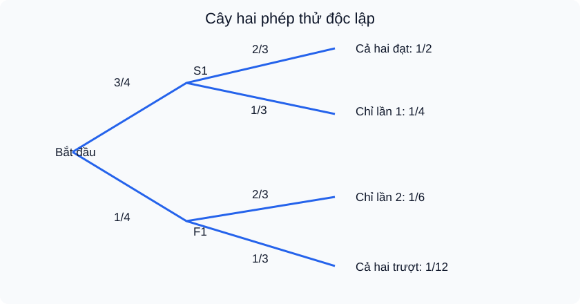

# Bài 30. Công thức nhân xác suất cho hai biến cố độc lập

TOÁN 11 · CHƯƠNG VIII · SGK KNTT TẬP 2

Hiểu lý do → điều kiện → đọc hình D5 → Tự thử trước Core → xem D2 giải có suy luận → Core, Luyện tập, Tự khắc phục D6. Không ghi Mastery từ hoạt động tự học.
<nav class="thpt-r4-lesson-tabs"><a href="../">Chương VIII</a><a href="../luyen-tap/">Core/Luyện tập</a><a href="../tu-kiem-tra-chuong/">Tự kiểm tra tự đối chiếu</a></nav>

=== "Khám phá kiến thức"

    ### Cùng tìm hiểu

    ### 1.1. Cần biết cơ hội "cả hai" thay vì "ít nhất một"
    Hai khâu sản xuất được kiểm tra riêng: nếu xác suất sản phẩm qua khâu 1 là 3/4 và qua khâu 2 là 2/3, em muốn biết **qua cả hai khâu**. Đây là **giao** chứ không phải **hợp**. Trong mô hình hai khâu độc lập, cơ hội thành công cả hai bằng 3/4 × 2/3=1/2. Không thể cộng 3/4+2/3 (>1): con số đó không thể là xác suất.

    ### Ví dụ trực quan

    Muốn biết cả hai sự kiện cùng xảy ra, phép nhân xác suất rất tiện nhưng chỉ dùng trực tiếp khi đã xác nhận độc lập.

    **Quan sát bằng số liệu:** Một đồng xu cân đối và một xúc xắc công bằng tung độc lập: xác suất đồng xu ngửa và xúc xắc ra số chẵn là (1/2)(1/2)=1/4. Nếu phụ thuộc thì không được nhân như vậy.

    ### Thuật ngữ và kiến thức, kỹ năng

    **Thuật ngữ:** quy tắc nhân, độc lập, biến cố đối, cây xác suất.

    **Sau bài học, em cần:** kiểm giả thiết độc lập bằng mô hình trước khi nhân, cân nhắc dùng biến cố bù.

=== "Kiến thức SGK"

    ### 1.2. Vì sao được nhân **khi độc lập**?
    Nếu A và B độc lập, phần B xảy ra trong các trường hợp A xảy ra có **cùng tỉ lệ** P(B) như tổng thể (ý nghĩa không thay đổi khả năng). Vì vậy phần giao có tỉ lệ P(A)×P(B): **P(A∩B)=P(A)P(B)**. Đây chính là công thức nhân cho hai biến cố độc lập. **Không được nhân hai xác suất khi chưa có giả thiết độc lập**. Chẳng hạn nếu rút hai thẻ liên tiếp **không hoàn lại**, xác suất màu của lần hai thay đổi theo lần một; quy tắc đơn giản không áp dụng một cách tự động. Công thức này khác với quy tắc cộng, vốn áp dụng cho mọi cặp biến cố.

    ### 1.3. Kiểm tra độc lập và phân biệt xung khắc
    Nếu đã biết P(A), P(B), P(A∩B), ta kiểm độc lập bằng đẳng thức P(A∩B)=P(A)P(B). Nếu hai biến cố xung khắc và **cả hai có xác suất dương**, thì P(A∩B)=0 còn P(A)P(B)>0, suy ra chúng **không độc lập**. Ngoại lệ P=0 cần tách riêng, vì khi đó có thể vừa xung khắc vừa độc lập. Đừng kết luận "độc lập = không xảy ra cùng lúc" — đó là nhầm khái niệm.

    ### 1.4. "Ít nhất một" dùng bù và nhân
    Với hai biến cố **độc lập** có P(A)=a, P(B)=b, xác suất *không xảy ra cái nào* là (1−a)(1−b). Do đó **P(ít nhất một)=1−(1−a)(1−b)**. Đây là quy tắc bù áp dụng cho giao của hai biến cố đối; chỉ nhân khi giả thiết độc lập hợp lệ. Với hai phép thử độc lập cùng cơ hội thành công p, xác suất hai lần đều thành công là p²; ít nhất một thành công là 1−(1−p)². Không mở rộng tùy tiện thành mô hình các phép thử phụ thuộc.

    ### 1.5. Đọc cây biến cố
    <figure class="thpt-r4-plot thpt-r4-probability-figure"><figcaption>Hình D5 — FIG-G11-CHVIII-B30-01. Đọc hình cùng các chỉ dẫn trong bài trước khi dùng quy tắc.</figcaption></figure>
    Tại mỗi nút, xác suất của hai nhánh cộng bằng 1. Nhánh thành công phép 2 có 2/3 **ở cả hai nhánh của phép 1** vì đã giả thiết độc lập. Xác suất của một lá là tích các xác suất trên đường đi; bốn lá 1/2+1/4+1/6+1/12=1. Đó là phép kiểm tổng xác suất rất hữu ích.

    ### Vận dụng — tự giải trước khi đối chiếu
    Hai cảm biến **hoạt động độc lập**, có xác suất phát hiện lần lượt 4/5 và 3/4. Tính (i) cùng phát hiện, (ii) ít nhất một phát hiện. 

    

Em đã tự thử? Mở lời giải đối chiếu

<strong>Đối chiếu sau thử:</strong> (i) 3/5, (ii) 1−(1/5)(1/4)=19/20. Hãy giải thích vì sao phải dùng tích ở (i), bù ở (ii).

=== "Ví dụ"

    #### EX-G11-CHVIII-B30-01: Nhân hai xác suất độc lập

    **Nhiệm vụ:** Hai thiết bị hoạt động độc lập, tỉ lệ không lỗi lần lượt 4/5 và 7/10. Tính cả hai không lỗi.

    **Đáp án và lời giải:** (4/5)(7/10)=14/25.

    **Tại sao cách làm đúng:** Nhân vì giả thiết độc lập; sự kiện "cả hai" là giao.

    #### EX-G11-CHVIII-B30-02: Độc lập có thể giao khác rỗng

    **Nhiệm vụ:** Biết P(A)=2/5, P(B)=1/2 và P(A∩B)=1/5. Hai biến cố độc lập không?

    **Đáp án và lời giải:** Có, vì 2/5·1/2=1/5.

    **Tại sao cách làm đúng:** Giao dương không ngăn độc lập; phân biệt với xung khắc.

    #### EX-G11-CHVIII-B30-03: Không độc lập dù cùng tỉ lệ biên

    **Nhiệm vụ:** Biết P(A)=1/2, P(B)=1/3 nhưng P(A∩B)=1/12. Độc lập?

    **Đáp án và lời giải:** Không; tích biên phải là 1/6, khác 1/12.

    **Tại sao cách làm đúng:** Độc lập phải chứng minh bằng giả thiết hoặc đẳng thức, không dựa vào tên.

    #### EX-G11-CHVIII-B30-04: Ít nhất một qua bù

    **Nhiệm vụ:** Hai lần kiểm độc lập, mỗi lần tỉ lệ đạt 3/5. Tính xác suất ít nhất một lần đạt.

    **Đáp án và lời giải:** 1−(2/5)^2=21/25.

    **Tại sao cách làm đúng:** Tính bù là hai lần đều trượt: 2/5·2/5.

    #### EX-G11-CHVIII-B30-05: Ba phép thử độc lập

    **Nhiệm vụ:** Ba công đoạn độc lập có xác suất hoàn thành 1/2, 3/4, 4/5. Cả ba hoàn thành?

    **Đáp án và lời giải:** (1/2)(3/4)(4/5)=3/10.

    **Tại sao cách làm đúng:** Nhân theo điều kiện độc lập của cả ba; nói rõ cần độc lập đồng thời, không chỉ từng cặp.

    #### EX-G11-CHVIII-B30-06: Vì sao không dùng phép nhân khi phụ thuộc

    **Nhiệm vụ:** Hộp có 3 thẻ xanh và 2 đỏ; rút hai thẻ không hoàn lại. Hai biến cố "lần đầu xanh" và "lần hai xanh" có độc lập?

    **Đáp án và lời giải:** Không. Nếu lần đầu xanh, P(lần hai xanh)=2/4=1/2; ban đầu P(lần hai xanh)=3/5.

    **Tại sao cách làm đúng:** Lấy đi thẻ làm thay đổi thành phần hộp. Ví dụ đối chứng chỉ yêu cầu nhận biết không độc lập; công thức tổng quát phụ thuộc không thuộc Core B30.

    ---

=== "Lỗi thường gặp"

    

<strong>Chẩn đoán lỗi:</strong> Nhân dù không có giả thiết độc lập.
<ol><li><strong>Chẩn đoán lỗi:</strong> Nhân dù không có giả thiết độc lập.</li><li><strong>Nhắc khái niệm/điều kiện:</strong> Tích P(A)P(B) chỉ khi đã biết độc lập.</li><li><strong>Giải thích vì sao:</strong> Đọc lại phần D1 của B30, vẽ tập hợp/nhánh xác suất tương ứng, rồi nói lại bằng lời trước khi thay số.</li><li><strong>Tự thử có dẫn:</strong> P(A)=1/2,P(B)=1/3 nhưng giao=1/9; độc lập? <strong>Đối chiếu sau thử:</strong> Không, tích đúng phải là 1/6.</li><li><strong>Quay về câu nguồn:</strong> Tự làm lại <code>THPT-G11-CHVIII-B30-C01</code> từ đầu, ghi lý do chọn công thức. Không tính lời giải đã xem là bằng chứng Mastery.</li></ol>
<a href="../luyen-tap/?item=THPT-G11-CHVIII-B30-C01">Quay lại câu gốc THPT-G11-CHVIII-B30-C01</a>

    

<strong>Chẩn đoán lỗi:</strong> Tính ít nhất một bằng tích xác suất thành công.
<ol><li><strong>Chẩn đoán lỗi:</strong> Tính ít nhất một bằng tích xác suất thành công.</li><li><strong>Nhắc khái niệm/điều kiện:</strong> Lấy bù cả hai thất bại; nhân xác suất thất bại khi độc lập.</li><li><strong>Giải thích vì sao:</strong> Đọc lại phần D1 của B30, vẽ tập hợp/nhánh xác suất tương ứng, rồi nói lại bằng lời trước khi thay số.</li><li><strong>Tự thử có dẫn:</strong> Hai máy độc lập cùng tỉ lệ lỗi 1/4: ít nhất một thành công? <strong>Đối chiếu sau thử:</strong> 1−1/16=15/16.</li><li><strong>Quay về câu nguồn:</strong> Tự làm lại <code>THPT-G11-CHVIII-B30-C04</code> từ đầu, ghi lý do chọn công thức. Không tính lời giải đã xem là bằng chứng Mastery.</li></ol>
<a href="../luyen-tap/?item=THPT-G11-CHVIII-B30-C04">Quay lại câu gốc THPT-G11-CHVIII-B30-C04</a>

    

<strong>Chẩn đoán lỗi:</strong> Dựa tên gọi mà đoán độc lập.
<ol><li><strong>Chẩn đoán lỗi:</strong> Dựa tên gọi mà đoán độc lập.</li><li><strong>Nhắc khái niệm/điều kiện:</strong> Đối chiếu đúng P(giao) với tích hai xác suất riêng.</li><li><strong>Giải thích vì sao:</strong> Đọc lại phần D1 của B30, vẽ tập hợp/nhánh xác suất tương ứng, rồi nói lại bằng lời trước khi thay số.</li><li><strong>Tự thử có dẫn:</strong> Nếu 0,5 và 0,4 mà giao 0,2 thì? <strong>Đối chiếu sau thử:</strong> Độc lập vì 0,5·0,4=0,2.</li><li><strong>Quay về câu nguồn:</strong> Tự làm lại <code>THPT-G11-CHVIII-B30-P02</code> từ đầu, ghi lý do chọn công thức. Không tính lời giải đã xem là bằng chứng Mastery.</li></ol>
<a href="../luyen-tap/?item=THPT-G11-CHVIII-B30-P02">Quay lại câu gốc THPT-G11-CHVIII-B30-P02</a>

    ### Học tiếp

    [Core/Luyện tập Bài 30](luyen-tap.md) · [Tự luận Chương VIII](../../../thu-vien/tu-luan-g11-chuong-viii.md) · [Tự kiểm tra cuối chương](tu-kiem-tra-chuong.md)
