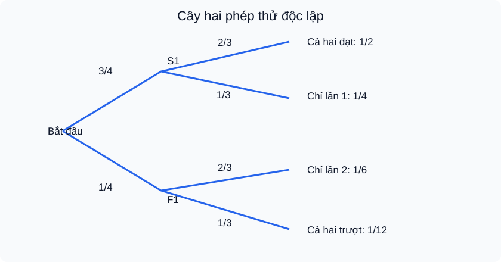

# Bài 30. Công thức nhân xác suất cho hai biến cố độc lập

TOÁN 11 · CHƯƠNG VIII · SGK KNTT TẬP 2

Tính giao khi độc lập, đọc cây xác suất và chọn đúng cách tính ít nhất một.
<nav class="thpt-r4-lesson-tabs"><a href="../">Chương VIII</a><a href="../luyen-tap/">Core và Luyện tập</a><a href="../tu-kiem-tra-chuong/">Tự kiểm tra cuối chương</a></nav>

=== "Khám phá kiến thức"

    Hai cảm biến có thể cùng phát hiện một vật hoặc chỉ một cảm biến phát hiện. Muốn tính cơ hội cả hai cùng thành công, phải biết cơ hội của cảm biến thứ hai có thay đổi khi cảm biến thứ nhất thành công hay không. Khi độc lập, tỉ lệ thành công thứ hai giữ nguyên trong từng nhánh; lúc ấy mới được nhân hai xác suất riêng.

    <figure class="thpt-r4-plot thpt-r4-probability-figure"><figcaption>Đọc hình: Cây hai bước độc lập: nhánh đầu 3/4 và 1/4, mỗi nút bước hai có nhánh 2/3 và 1/3; bốn lá 1/2, 1/4, 1/6, 1/12. Không nhân xác suất biên trên cây phụ thuộc.</figcaption></figure>

    ### 1.1. Nhân cho giao
    
    Nếu A xảy ra ở 3/4 trường hợp, và B có tỉ lệ 2/3 ngay trong nhóm ấy, phần chung là 3/4 của 2/3.
    
    **Vận dụng.** Hai máy độc lập, cơ hội đạt 5/6 và 3/5. Tính cả hai đạt.
    
    
    
    ??? question "Đối chiếu"
    
        **Lời giải:** 5/6·3/5=1/2.
    
    
    
    ??? tip "Kiểm lỗi"
    
        Chỉ nhân vì đã nêu độc lập. [Luyện lại câu B30-C01](../luyen-tap/?item=THPT-G11-CHVIII-B30-C01)

    ### 1.2. Kiểm tra bằng số liệu
    
    So xác suất giao thực tế với tích biên. Nếu khác nhau, không độc lập.
    
    **Vận dụng.** P(A)=0,4, P(B)=0,5, P(AB)=0,25. Độc lập không?
    
    
    
    ??? question "Đối chiếu"
    
        **Lời giải:** Không; tích=0,2 khác 0,25.
    
    
    
    ??? tip "Kiểm lỗi"
    
        Không suy luận từ tên A,B. [Luyện lại câu B30-C02](../luyen-tap/?item=THPT-G11-CHVIII-B30-C02)

    ### 1.3. Cây và các lần thử
    
    Trong cây hai phép thử độc lập, các nhánh bước hai có cùng xác suất dù bước một thế nào.
    
    **Vận dụng.** Hai lần độc lập, mỗi lần thành công 2/3. Tính xác suất cả hai thành công và cả hai thất bại.
    
    
    
    ??? question "Đối chiếu"
    
        **Lời giải:** 4/9 và 1/9; hai trường hợp còn lại mỗi 2/9.
    
    
    
    ??? tip "Kiểm lỗi"
    
        Bốn lá phải cộng bằng 1. [Luyện lại câu B30-C03](../luyen-tap/?item=THPT-G11-CHVIII-B30-C03)

    ### 1.4. Dùng bù
    
    Ít nhất một thành công gồm cả hai thành công và chỉ một. Bù là cả hai thất bại.
    
    **Vận dụng.** Hai thiết bị độc lập, xác suất đạt 3/5 và 4/5. Tính ít nhất một đạt.
    
    
    
    ??? question "Đối chiếu"
    
        **Lời giải:** 1−(2/5)(1/5)=23/25.
    
    
    
    ??? tip "Kiểm lỗi"
    
        Không nhầm với đúng một hay cả hai. [Luyện lại câu B30-C04](../luyen-tap/?item=THPT-G11-CHVIII-B30-C04)

    ### 1.5. Độc lập và xung khắc
    
    Nếu hai biến cố dương mà xung khắc, giao bằng 0 nhưng tích dương.
    
    **Vận dụng.** P(A)=1/4, P(B)=1/3, A,B xung khắc. Chúng độc lập không?
    
    
    
    ??? question "Đối chiếu"
    
        **Lời giải:** Không; P(AB)=0 ≠ 1/12.
    
    
    
    ??? tip "Kiểm lỗi"
    
        Trường hợp xác suất 0 cần xét riêng bằng đẳng thức. [Luyện lại câu B30-C05](../luyen-tap/?item=THPT-G11-CHVIII-B30-C05)

    ### 1.6. Bảng số liệu hai chiều
    
    Chọn đều một người từ bảng. Tính ba tỉ lệ có cùng mẫu số; kiểm giao với tích biên. Không suy ra quan hệ nhân quả.
    
    **Vận dụng.** Trong 100 người, 30 chọn A, 40 chọn B, 12 chọn cả hai. Kiểm tra độc lập trong mô hình chọn người từ bảng.
    
    
    
    ??? question "Đối chiếu"
    
        **Lời giải:** P(A)=0,3; P(B)=0,4; P(AB)=0,12=0,3·0,4; độc lập trong mô hình này.
    
    
    
    ??? tip "Kiểm lỗi"
    
        Không suy rộng ra toàn dân nếu mẫu không đại diện. [Luyện lại câu B30-C06](../luyen-tap/?item=THPT-G11-CHVIII-B30-C06)

=== "Kiến thức SGK"

    ### 2.1. Công thức nhân xác suất cho hai biến cố độc lập
    
    
<strong>Công thức nhân xác suất cho hai biến cố độc lập.</strong>
    
    Nếu A, B độc lập thì tỉ lệ B trong nhóm A không đổi so với toàn thể. Vì vậy phần chung bằng tỉ lệ nhóm A nhân tỉ lệ B.
    \[
    P(AB)=P(A)P(B).
    \]
    Trong mô hình hữu hạn, đẳng thức này cũng là tiêu chí kiểm tra độc lập, kể cả các trường hợp xác suất 0 hoặc 1. Khi \(P(AB)\ne P(A)P(B)\), hai biến cố không độc lập. Với hai biến cố xung khắc có xác suất dương, giao bằng 0 trong khi tích lớn hơn 0. Nếu một xác suất bằng 0, không được dùng kết luận 'xung khắc thì không độc lập'. Không nhân hai xác suất biên chỉ vì đề nói 'và'; rút không hoàn lại có thể làm thay đổi tỉ lệ.
    
    

    ### 2.2. Vận dụng
    
    
<strong>Vận dụng.</strong>
    
    Nhờ tính độc lập của các cặp biến cố đối ở B28, nếu \(P(A)=a,P(B)=b\) và A,B độc lập, ta có \(P(\overline A\,\overline B)=(1-a)(1-b)\). Do đó \(P(A\cup B)=1-(1-a)(1-b)\). Đúng một bằng \(a(1-b)+(1-a)b\); lúc tính hợp cũng có thể dùng a+b−ab. Cây độc lập có hai nhánh tại mỗi nút cộng bằng 1; nhân dọc một đường, cộng các lá rời nhau ứng với câu hỏi. Với nhiều phép thử, nhân toàn bộ chỉ khi độc lập đồng thời, không suy từ độc lập từng cặp. Trong bảng hai chiều, chia tổng hàng, tổng cột và ô giao cho cùng tổng N, so sánh tích biên với giao; kết luận chỉ cho phân bố được mô tả, không khẳng định quan hệ nhân quả.
    
    

=== "Ví dụ"

    ### 3.1. Nhân hai xác suất
    
    

<strong>Đề bài:</strong> Hai máy hoạt động độc lập, xác suất tốt 7/8 và 4/7. Tính cả hai tốt.

<strong>Phân tích:</strong> Giao, có giả thiết độc lập.

<strong>Lời giải:</strong> 7/8·4/7=1/2.

<strong>Kiểm lại:</strong> Không lớn hơn mỗi xác suất riêng.

    ### 3.2. Xác nhận độc lập
    
    

<strong>Đề bài:</strong> P(A)=3/5, P(B)=1/3, P(AB)=1/5. Kiểm tra.

<strong>Phân tích:</strong> So tích biên với giao.

<strong>Lời giải:</strong> 3/5·1/3=1/5, bằng giao nên độc lập.

<strong>Kiểm lại:</strong> Giao dương không mâu thuẫn độc lập.

    ### 3.3. Phát hiện phụ thuộc
    
    

<strong>Đề bài:</strong> P(A)=1/2, P(B)=2/3, P(AB)=1/4. Kiểm tra.

<strong>Phân tích:</strong> Giao phải bằng tích nếu độc lập.

<strong>Lời giải:</strong> Tích=1/3 khác 1/4 nên không độc lập.

<strong>Kiểm lại:</strong> Dữ kiện vẫn hợp lệ: hợp=11/12.

    ### 3.4. Ít nhất một
    
    

<strong>Đề bài:</strong> Hai lần thử độc lập, mỗi lần đạt 3/5. Tính ít nhất một đạt.

<strong>Phân tích:</strong> Lấy bù cả hai trượt.

<strong>Lời giải:</strong> 1−(2/5)^2=21/25.

<strong>Kiểm lại:</strong> Cách khác: 3/5+3/5−9/25=21/25.

    ### 3.5. Ba lần thử độc lập đồng thời
    
    

<strong>Đề bài:</strong> Ba phép thử độc lập đồng thời, xác suất đạt 1/3, 3/4, 4/5. Tính cả ba đạt.

<strong>Phân tích:</strong> Mở rộng tích cho mô hình độc lập đồng thời.

<strong>Lời giải:</strong> 1/3·3/4·4/5=1/5.

<strong>Kiểm lại:</strong> Không dùng kết quả này chỉ từ độc lập từng cặp.

    ### 3.6. Không hoàn lại
    
    

<strong>Đề bài:</strong> Hộp 4 đỏ, 3 xanh. Rút đều 2 bi liên tiếp không hoàn lại. A: đầu xanh, B: sau xanh. Hai biến cố độc lập không?

<strong>Phân tích:</strong> Khi đầu xanh, còn 2 xanh/6; khi đầu đỏ, còn 3 xanh/6.

<strong>Lời giải:</strong> 1/3 khác 1/2 nên phụ thuộc; không nhân (3/7)^2.

<strong>Kiểm lại:</strong> Không cần công thức xác suất có điều kiện tổng quát.

    ### 3.7. Kiểm tra độc lập bằng bảng
    
    

<strong>Đề bài:</strong> Khảo sát 200 người: trong 80 người dùng xe buýt có 24 người mang ô; trong 120 người không dùng xe buýt có 56 người mang ô. Chọn đều một người. Hai biến cố dùng xe buýt và mang ô có độc lập không?

<strong>Phân tích:</strong> Lập bảng hai chiều. Mỗi ô trong thân bảng đếm đúng một nhóm; đọc giao ở ô 24, xác suất biên từ hàng/cột tổng.
<table><thead><tr><th scope="col">Phương tiện</th><th scope="col">Mang ô</th><th scope="col">Không mang ô</th><th scope="col">Tổng</th></tr></thead><tbody><tr><th scope="row">Xe buýt</th><td>24</td><td>56</td><td>80</td></tr><tr><th scope="row">Không đi xe buýt</th><td>56</td><td>64</td><td>120</td></tr><tr><th scope="row">Tổng</th><td>80</td><td>120</td><td>200</td></tr></tbody></table>
<strong>Lời giải:</strong> P(A)=80/200=0,4; P(B)=80/200=0,4; P(AB)=24/200=0,12 ≠ 0,16. Không độc lập trong phân bố khảo sát.

<strong>Kiểm lại:</strong> Hàng tổng 80,120; cột tổng 80,120; tổng 200. Không kết luận xe buýt gây ảnh hưởng đến việc mang ô.

=== "Lỗi thường gặp"

    
    
    ??? tip "4.1. Nhân khi chưa biết độc lập"
    
        Kiểm tiêu chí tích bằng giao hoặc giả thiết, xem 2.1. [Luyện lại câu B30-C01](../luyen-tap/?item=THPT-G11-CHVIII-B30-C01)

    
    
    ??? tip "4.2. Lấy giao thay cho ít nhất một"
    
        Dùng bù cả hai thất bại, xem 2.2. [Luyện lại câu B30-C04](../luyen-tap/?item=THPT-G11-CHVIII-B30-C04)

    
    
    ??? tip "4.3. Suy độc lập từ tên biến cố"
    
        Tính ba xác suất rồi so tích, xem 2.1. [Luyện lại câu B30-P02](../luyen-tap/?item=THPT-G11-CHVIII-B30-P02)

    [Core và Luyện tập Bài 30](luyen-tap.md) · [Tự luận Chương VIII](../../../thu-vien/tu-luan-g11-chuong-viii.md) · [Tự kiểm tra cuối chương](tu-kiem-tra-chuong.md)

*Nguồn đối chiếu: SGK Toán 11 Kết nối tri thức với cuộc sống, Tập hai, Bài 30, trang in 76–78.*
