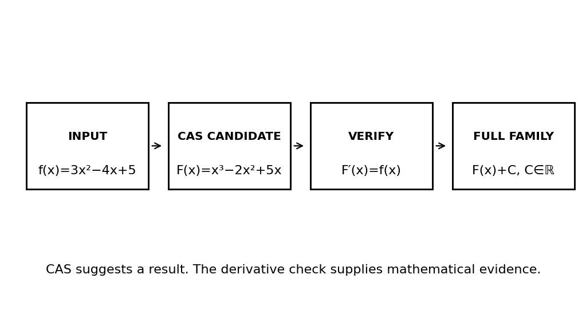
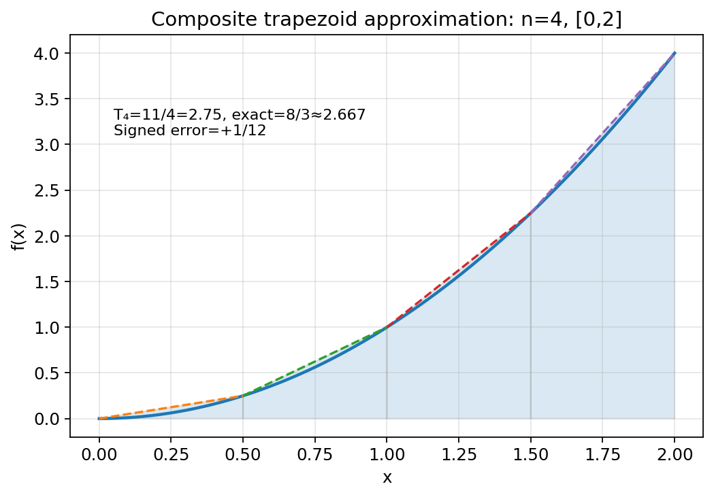
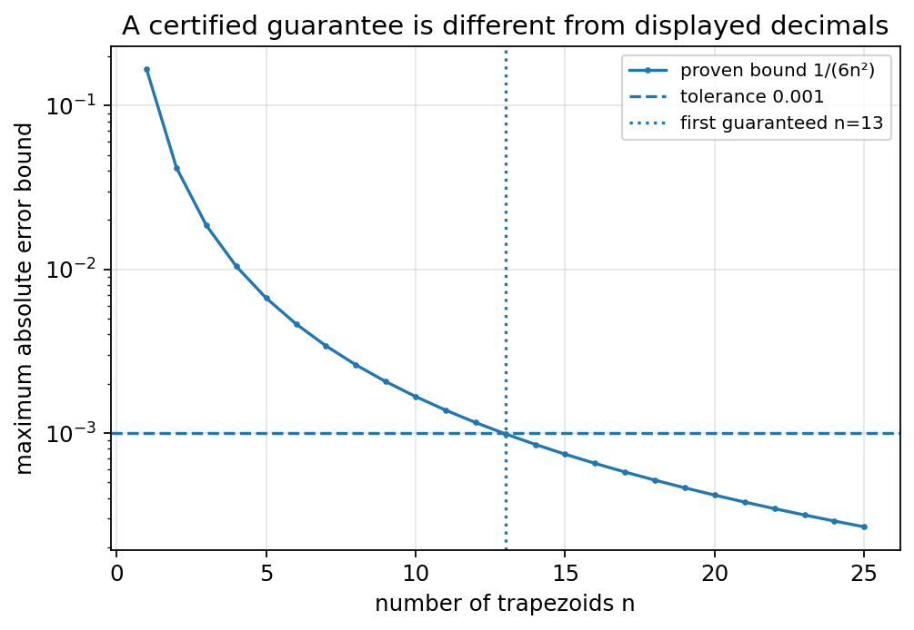

# Toán 12 · Hoạt động 1. CAS GeoGebra và xấp xỉ tích phân bằng hình thang

SGK KẾT NỐI TRI THỨC · TẬP HAI · HOẠT ĐỘNG THỰC HÀNH TRẢI NGHIỆM

Học bản chất trước công thức, đọc hình gốc, thử làm trước rồi chủ động đối chiếu. Có đường tự học không cần cài GeoGebra. Không chấm Mastery.
<nav class="thpt-r4-lesson-tabs g12-xp-nav"><a href="../">Tổng quan</a>← Thực hành trước<a href="../trai-nghiem-2/">Thực hành sau →</a><a href="../luyen-tap-trai-nghiem/">Core và Luyện tập</a><a href="../tu-kiem-tra-trai-nghiem/">Tự kiểm tra</a></nav>

## 1. Vì sao cần học?
Khi một tích phân không có nguyên hàm sơ cấp hoặc dữ liệu chỉ có tại vài thời điểm, ta vẫn cần lượng tích lũy và **sai số đáng tin cậy**. GeoGebra là công cụ tính/toạ độ hỗ trợ suy luận; không thay thế việc hiểu miền xác định, kiểm tra đạo hàm hay chứng nhận sai số. Phương pháp hình thang nối dữ liệu quan sát với mô hình toán.

## 2. Tiền đề
Đạo hàm, nguyên hàm, định lí Newton–Leibniz, đồ thị diện tích, biểu thức tổng, dữ liệu bảng, đơn vị. Nên ôn lại quan hệ `F′=f`, quy tắc cận và đơn vị tích phân trước bài thực hành.

## 3. Bản chất trước công thức
**Nguyên hàm:** CAS dự đoán một F; kiểm tra `F′=f` giúp biết đúng, +C khôi phục mọi nguyên hàm trên miền thích hợp. **Tích phân:** tổng ảnh hưởng (có dấu) trên đoạn; phần mềm cho số, cần hiểu cận và điều kiện. **Hình thang:** thay mỗi cung bằng đoạn thẳng giữa hai nút và cộng diện tích có dấu; nếu đường cong cong nhiều, sai số phụ thuộc độ cong f′′, không phụ thuộc số chữ số hiển thị.

## 4. Đọc hình
- CAS flow: đọc từ **INPUT → CAS CANDIDATE → VERIFY → FULL FAMILY**; kết quả phần mềm là bước giữa, không phải bằng chứng cuối.
- TRAPEZOID: đường cong x² và bốn hình thang trên [0,2]; đường gạch cho thấy cạnh trên tuyến tính; so giá trị T₄ và tích phân chính xác.
- ERROR_BOUND: trục dọc logarit mô tả **cận trên đã chứng minh**, không phải sai số thật; đường n=13 là lựa chọn nhỏ nhất để bảo đảm dưới 0,001 cho đúng ví dụ f=x².

<figure class="thpt-r4-plot g12-xp-original-figure"><figcaption>Hình 1: cách đọc kết quả CAS.</figcaption></figure>

<figure class="thpt-r4-plot g12-xp-original-figure"><figcaption>Hình 2: diện tích hình thang có dấu.</figcaption></figure>

<figure class="thpt-r4-plot g12-xp-original-figure"><figcaption>Hình 3: cận sai số.</figcaption></figure>

## 5. Quy trình công cụ / đường thay thế không cần cài đặt
1. Trong GeoGebra, mở **CAS**. Thử lệnh nguyên hàm biểu tượng theo ví dụ SGK `IntegralSymbolic(f)`; nếu phiên bản/locale khác, tìm cú pháp tương ứng trong trợ giúp phiên bản đang dùng. Giữ lại biểu thức gốc và kiểm lại bằng đạo hàm.
2. Để tính tích phân có cận, dùng `Integral(f,a,b)` trong CAS, nhập chính xác `a,b`; kiểm bằng nguyên hàm Newton–Leibniz khi áp dụng được. Nếu không có phần mềm, thực hiện tay hoàn toàn tương đương.
3. Khi cần xấp xỉ một hàm liên tục, lập bảng `x_i=a+i(b−a)/n`, `f(x_i)` và dùng hình thang. Khi muốn **bảo đảm** sai số, phải có cận hợp lệ `|f′′|≤M` trên toàn đoạn.
4. Báo cáo: ghi miền, đơn vị, số bước n, phép kiểm, kết quả gần đúng và **không tuyên bố sai số bảo đảm** nếu thiếu điều kiện.

## 6. Tự thử trước Core

Hãy tự giải hoặc thao tác trên giấy trước khi mở đáp án.

**Tự thử 1.** Nếu CAS trả F(x)=x² cho f(x)=2x, toàn bộ họ nguyên hàm là gì?

Tự mở đối chiếu sau khi làm

`x²+C` vì đạo hàm của hằng số bằng 0.

**Tự thử 2.** Vì sao `f(x)=x²` trên [0,1] có thể được xấp xỉ bằng 4 hình thang, nhưng từ một số hiển thị `0,333` chưa chắc biết sai số?

Tự mở đối chiếu sau khi làm

cần kiểm chứng f′′ và n hoặc phương án bound khác; số chữ số không bảo đảm độ chính xác.

## 7. Kiến thức theo từng mục tiêu và ví dụ giải có suy luận

### 1. Nguyên hàm qua CAS và chứng nhận đạo hàm

**Vì sao:** Học sinh hiểu phần mềm gợi ý một họ nguyên hàm, không tự thay thế kiểm chứng toán học.

**Tiền đề:** Biết đạo hàm của đa thức và hàm lượng giác; kí hiệu hằng số C.

**Bản chất:** Một hàm có nhiều nguyên hàm khác hằng số; câu trả lời có +C; đạo hàm lại phải bằng hàm dưới dấu tích phân.

**Lý do chọn phương pháp:** Dùng lệnh IntegralSymbolic theo hướng dẫn SGK; nếu giao diện khác, dùng CAS Integral(f) hoặc tích phân thủ công rồi đối chiếu.

**Điều kiện/giới hạn:** Kiểm miền xác định trước khi nói họ nguyên hàm; không coi chỉ một nguyên hàm là tất cả.

**Ví dụ giải mẫu `EX-G12-EXP01-O01` (D2).** Tìm nguyên hàm của 3x²−4x+5, rồi kiểm bằng đạo hàm.

**Lời giải có suy luận:** F(x)=x³−2x²+5x+C; F′(x)=3x²−4x+5.

<a class="g12-xp-return" href="../luyen-tap-trai-nghiem/#exp01-1">Làm Core và Luyện tập cho nội dung này</a>

### 2. Tích phân xác định: miền, giới hạn và đối chiếu số

**Vì sao:** Biết phân biệt nguyên hàm tổng quát với diện tích tích lũy có giới hạn; đầu ra số không phải lời giải.

**Tiền đề:** Nắm định lí cơ bản tích phân cho hàm liên tục và kí hiệu cận.

**Bản chất:** Khi biết F′=f trên [a,b], ∫a^b f=F(b)−F(a); dấu kết quả có thể âm.

**Lý do chọn phương pháp:** Trong CAS nhập Integral(f,a,b), kiểm hàm liên tục trên đoạn; kiểm gần đúng bằng bảng giá trị.

**Điều kiện/giới hạn:** Một biểu thức có cực tại c trong (a,b) không thể áp dụng Newton–Leibniz như tích phân Riemann thông thường.

**Ví dụ giải mẫu `EX-G12-EXP01-O02` (D2).** Tính ∫₀²(x²+1)dx, kiểm bằng phép thế cận và kết quả thập phân.

**Lời giải có suy luận:** [x³/3+x]₀²=8/3+2=14/3≈4,6667.

<a class="g12-xp-return" href="../luyen-tap-trai-nghiem/#exp01-2">Làm Core và Luyện tập cho nội dung này</a>

### 3. Phương pháp hình thang từ tổng diện tích

**Vì sao:** Vì sao có thể thay đường cong bằng các đoạn thẳng và cộng diện tích hình thang?

**Tiền đề:** Hiểu đồ thị, diện tích hình thang và tổng Riemann; kiểm dấu f.

**Bản chất:** Tₙ=h[(f(a)+f(b))/2+Σf(xᵢ)], h=(b−a)/n; là tổng các hình thang nội suy.

**Lý do chọn phương pháp:** Chia đều [a,b], ghi bảng nút và giá trị, tính từng hình thang và tổng.

**Điều kiện/giới hạn:** Nếu f nhận giá trị âm, Tₙ là xấp xỉ tích phân có dấu, không phải diện tích không âm; đồ thị tự nó không bảo đảm sai số.

**Ví dụ giải mẫu `EX-G12-EXP01-O03` (D2).** Xấp xỉ ∫₀² x²dx với n=4 và so với giá trị đúng.

**Lời giải có suy luận:** h=1/2; f(xᵢ)=0,1/4,1,9/4,4; T₄=(1/2)(0+1/4+1+9/4+2)=11/4; giá trị đúng 8/3, lệch +1/12.

<a class="g12-xp-return" href="../luyen-tap-trai-nghiem/#exp01-3">Làm Core và Luyện tập cho nội dung này</a>

### 4. Bảo đảm sai số hình thang bằng đạo hàm bậc hai

**Vì sao:** Cần phân biệt một số gần đúng hợp lí với một chứng nhận đủ nhỏ về sai số.

**Tiền đề:** Đã hiểu hình thang hợp thành và đạo hàm f′′ trên [a,b].

**Bản chất:** Nếu f′′ liên tục và |f′′|≤M thì |I−Tₙ|≤M(b−a)³/(12n²).

**Lý do chọn phương pháp:** Giải bất đẳng thức sai số nghiêm ngặt theo n và sau đó mới tính Tₙ.

**Điều kiện/giới hạn:** Cận M hợp lệ trên toàn đoạn; không sử dụng công thức nếu chưa biết/không chứng minh f′′ bị chặn.

**Ví dụ giải mẫu `EX-G12-EXP01-O04` (D2).** Với f=x² trên [0,1], cần sai số nhỏ hơn 0,001; chọn n và giải thích.

**Lời giải có suy luận:** f′′=2 nên M=2; 1/(6n²)<0,001 ⇒ n≥13; n=13 cho cận ≈0,0009862.

<a class="g12-xp-return" href="../luyen-tap-trai-nghiem/#exp01-4">Làm Core và Luyện tập cho nội dung này</a>

### 5. Ứng dụng bảng dữ liệu và đơn vị tích lũy

**Vì sao:** Khi chỉ có số liệu tại các mốc, quy tắc hình thang đưa dữ liệu rời rạc thành lượng tích lũy xấp xỉ.

**Tiền đề:** Đọc bảng số liệu với đơn vị và biết chiều rộng mỗi khoảng.

**Bản chất:** Khi v tính m/s, ∫v dt có đơn vị mét; khi S(x) diện tích cm², ∫S(x)dx cho thể tích cm³.

**Lý do chọn phương pháp:** Với mẫu cách đều, T=h[(y₀+yₙ)/2+Σyᵢ]; nếu không đều, tính từng khoảng riêng.

**Điều kiện/giới hạn:** Không tuyên bố cận sai số giải tích từ bảng đơn thuần nếu chưa có thông tin về hàm f′′; kiểm đơn vị và độ tin cậy đo.

**Ví dụ giải mẫu `EX-G12-EXP01-O05` (D2).** Một xe có vận tốc đo tại t=0,2,4,6 s: 2,3,5,4 m/s. Tính gần đúng quãng đường.

**Lời giải có suy luận:** h=2s; T=2[(2+4)/2+3+5]=22m.

<a class="g12-xp-return" href="../luyen-tap-trai-nghiem/#exp01-5">Làm Core và Luyện tập cho nội dung này</a>

## 8. Bắt đầu luyện tập

- [Mở Core, Luyện tập, Vận dụng và Tự luận của Hoạt động 1](../luyen-tap-trai-nghiem/#exp01-core)
- [Tự kiểm tra sau khi học cả hai hoạt động](../tu-kiem-tra-trai-nghiem/)
