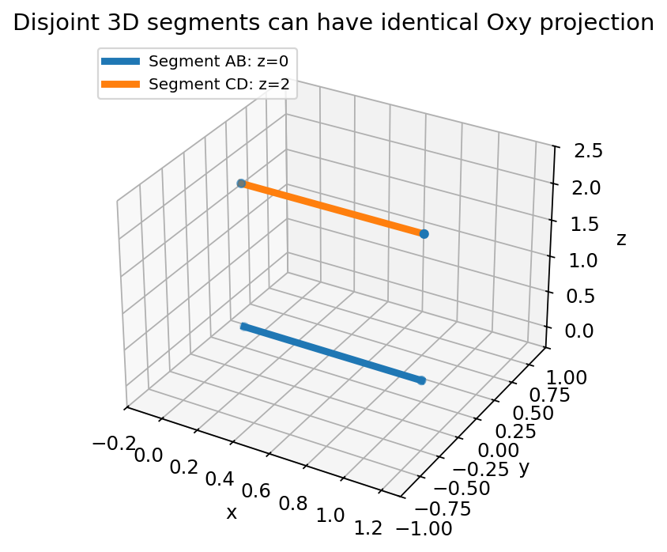
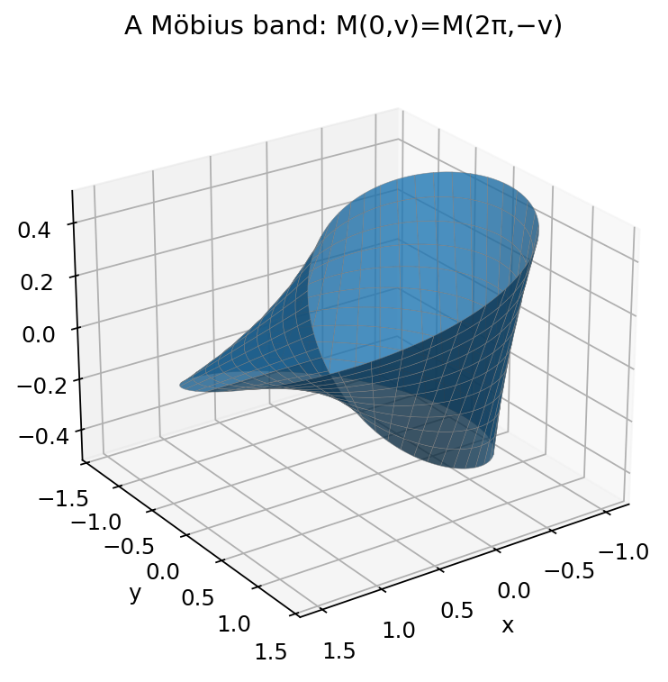

# Toán 12 · Hoạt động 2. Vẽ 3D bằng GeoGebra — ảo giác Penrose và mặt Möbius

SGK KẾT NỐI TRI THỨC · TẬP HAI · HOẠT ĐỘNG THỰC HÀNH TRẢI NGHIỆM

Học bản chất trước công thức, đọc hình gốc, thử làm trước rồi chủ động đối chiếu. Có đường tự học không cần cài GeoGebra. Không chấm Mastery.
<nav class="thpt-r4-lesson-tabs g12-xp-nav"><a href="../">Tổng quan</a><a href="../trai-nghiem-1/">← Thực hành trước</a>Thực hành sau →<a href="../luyen-tap-trai-nghiem/">Core và Luyện tập</a><a href="../tu-kiem-tra-trai-nghiem/">Tự kiểm tra</a></nav>

## 1. Vì sao cần học?
Một hình 3D được nhìn qua màn hình 2D nên góc nhìn có thể tạo ảo giác không tồn tại trong cấu hình không gian thật. GeoGebra 3D giúp ta xây mô hình tái lập và **phản biện bằng tọa độ**, từ tam giác Penrose (ảo giác do hình chiếu) đến mặt Möbius (dải bị vặn nửa vòng).

## 2. Tiền đề
Điểm Oxyz, đoạn thẳng và mặt phẳng trong 3D, phép chiếu lên Oxy, đơn vị đo, tam giác/lăng trụ, lượng giác cơ bản nếu chọn phương án Möbius có tham số.

## 3. Bản chất trước công thức
**Tam giác Penrose:** đường nét trên màn hình trông khép kín nhưng cấu hình thật có thể đứt rời về độ sâu. Phải kiểm tọa độ/giao nhau trong Oxyz, không chỉ screenshot. **Mặt Möbius:** một dải vật liệu nối hai đầu sau vặn nửa vòng; tham số hai biên bị đổi dấu sau một chu kỳ (`v ↔ −v`). Đây là trải nghiệm hình học không gian có mở rộng tôpô, **không phải định lí Core cần học thuộc**.

## 4. Đọc hình
- PROJECTION: hai đoạn z=0 và z=2 tách nhau trong không gian; khi nhìn xuống Oxy thì trùng nét. Sự mất chiều sâu chính là nguồn ảo giác.
- MOBIUS: một dải 3D với mép ghép đảo chiều; một ảnh không chứng minh tính một mặt, cần đọc công thức ghép `M(0,v)=M(2π,−v)`.

<figure class="thpt-r4-plot g12-xp-original-figure"><figcaption>Hình 1: hình chiếu giống nhau của hai đoạn tách nhau theo z.</figcaption></figure>

<figure class="thpt-r4-plot g12-xp-original-figure"><figcaption>Hình 2: mô hình tham số dải Möbius.</figcaption></figure>

## 5. Thực hành có thể tái lập
1. Mở **GeoGebra 3D**. Với lăng trụ, nhập từng điểm tọa độ trong Input/CAS hoặc bằng công cụ Point; tạo hai tam giác bằng `Polygon`, nối các đỉnh tương ứng hoặc dùng lệnh tạo lăng trụ tương ứng phiên bản hiện có.
2. Với ảo giác Penrose, dựng các phần thanh thẳng riêng và điều chỉnh góc nhìn sao cho hình chiếu có vẻ liền; tiếp đó **xoay góc nhìn** và chỉ ra vị trí các thanh không nối thật. Không đánh tráo hiệu ứng chiếu thành một hình tam giác 3D thật.
3. Với Möbius, tham số tham khảo: `M(u,v)=((1+v cos(u/2)/2)cos(u),(1+v cos(u/2)/2)sin(u),v sin(u/2)/2)`, `0≤u≤2π`, `−1≤v≤1`; dùng `Surface(x(u,v),y(u,v),z(u,v),u,0,2π,v,−1,1)` theo cú pháp phiên bản. Xoay để xem dải và giải thích quy tắc ghép mép, thay vì tự gán đặc tính tôpô chỉ từ ảnh.
4. Nếu không dùng được GeoGebra: dùng bản vẽ dưới đây + tính tọa độ, chứng minh hai hình chiếu có thể trùng nhưng hai đoạn 3D không giao; kiểm công thức ghép Möbius. **Đây là đường tự học độc lập** không phụ thuộc liên kết bên ngoài.
5. Lưu tọa độ, tham số, hai góc nhìn và giải thích điều kiện/giới hạn của mô hình. Không đoán số liệu từ một ảnh màn hình.

## 6. Tự thử trước Core

Hãy tự giải hoặc thao tác trên giấy trước khi mở đáp án.

**Tự thử 1.** P(1,2,0),Q(1,2,3) có cùng ảnh chiếu xuống Oxy không?

Tự mở đối chiếu sau khi làm

có; ảnh chiếu đều (1,2), nhưng khoảng cách thực là 3.

**Tự thử 2.** Dải Möbius vặn nửa vòng, khi đi hết u=0 đến u=2π thì v ghép với v hay −v?

Tự mở đối chiếu sau khi làm

ghép với −v, giải thích sự đảo bề ngang.

## 7. Kiến thức theo từng mục tiêu và ví dụ giải có suy luận

### 1. Phân biệt mô hình 3D và ảnh chiếu 2D gây ảo giác

**Vì sao:** Một ảnh có thể làm ta tin các đoạn nối nhau dù cấu hình 3D không nối.

**Tiền đề:** Biết biểu diễn điểm và trục Oxyz và khác biệt góc nhìn phối cảnh.

**Bản chất:** Hình Penrose lý tưởng tạo mâu thuẫn độ sâu nếu đòi là một tam giác vật chất liên tục với các thanh vuông chuẩn; dựng mô hình 3D có thể tạo ảo giác từ góc nhìn riêng.

**Lý do chọn phương pháp:** Đọc ảnh chiếu, xoay 3D để phát hiện chỗ lệch/tách rời; gọi đó là dựng ảo giác, không khẳng định vật vô khả thành khả.

**Điều kiện/giới hạn:** Ảnh 2D không đủ khẳng định hai điểm có cùng tọa độ z; góc nhìn khác làm lộ ảo giác.

**Ví dụ giải mẫu `EX-G12-EXP02-O01` (D2).** Hai đoạn trong Oxyz A(0,0,0)→B(1,0,0), C(0,0,2)→D(1,0,2) có ảnh chiếu xuống Oxy trùng nhau. Chúng có giao nhau không?

**Lời giải có suy luận:** Không; z=0 và z=2 nên hai đoạn rời nhau dù ảnh chiếu top-view trùng.

<a class="g12-xp-return" href="../luyen-tap-trai-nghiem/#exp02-1">Làm Core và Luyện tập cho nội dung này</a>

### 2. Dựng khối lăng trụ tam giác và kiểm bằng tọa độ

**Vì sao:** Muốn dựng hình 3D có thể kiểm chứng, cần các điểm, cạnh và mặt được xác định chính xác.

**Tiền đề:** Tọa độ Oxyz, véc-tơ, khoảng cách, mặt phẳng tọa độ; lệnh Point/Polygon/Prism tùy phiên bản GeoGebra.

**Bản chất:** Lăng trụ tam giác có 6 đỉnh, 9 cạnh, 5 mặt; diện tích đáy × chiều cao cho thể tích.

**Lý do chọn phương pháp:** Dựng A,B,C trên z=0 rồi A′,B′,C′ trên z=h; vẽ đa giác hai đáy và ba mặt bên, kiểm khoảng cách.

**Điều kiện/giới hạn:** Các đáy tam giác phải không thẳng hàng, hai đáy tương ứng song song/bằng nhau; kiểm điểm đồng phẳng.

**Ví dụ giải mẫu `EX-G12-EXP02-O02` (D2).** Dựng A(0,0,0),B(2,0,0),C(0,2,0), A′(0,0,3),B′(2,0,3),C′(0,2,3). Tính thể tích.

**Lời giải có suy luận:** Diện tích tam giác đáy =2, h=3 nên V=6 (đv³); 6 đỉnh, 9 cạnh, 5 mặt.

<a class="g12-xp-return" href="../luyen-tap-trai-nghiem/#exp02-2">Làm Core và Luyện tập cho nội dung này</a>

### 3. Chọn góc nhìn và kiểm chứng tính thật của hình dựng

**Vì sao:** Nhìn mô hình từ nhiều góc giúp phân biệt kết luận thật với hiệu ứng phối cảnh phụ thuộc người quan sát.

**Tiền đề:** Biết phép chiếu và thao tác xoay, ẩn hiện đối tượng trong khung 3D.

**Bản chất:** Một hướng nhìn có thể trùng nét; xoay để lộ sai khác, dùng tọa độ làm kiểm chứng độc lập ảnh chụp.

**Lý do chọn phương pháp:** Xuất ít nhất hai ảnh góc nhìn, mô tả góc/quy tắc nhìn và lưu tọa độ; so sánh trước–sau xoay.

**Điều kiện/giới hạn:** Hình hiển thị có thể bị che khuất; ảnh không thay thế điều kiện giao cắt trong 3D.

**Ví dụ giải mẫu `EX-G12-EXP02-O03` (D2).** Hai điểm M(1,0,0),N(1,0,3) cùng hình chiếu Oxy. Sau khi xoay góc nhìn sang bên, điều gì đổi?

**Lời giải có suy luận:** Khoảng cách hình chiếu thường thay đổi; tọa độ/độ dài MN=3 vẫn bất biến.

<a class="g12-xp-return" href="../luyen-tap-trai-nghiem/#exp02-3">Làm Core và Luyện tập cho nội dung này</a>

### 4. Khám phá mặt Möbius với tham số và ghép biên

**Vì sao:** Một dải vặn nửa vòng là ví dụ hấp dẫn về việc mô hình 3D chứa cấu trúc không giống băng giấy thông thường.

**Tiền đề:** Lượng giác cơ bản, tham số u và v, tọa độ Oxyz; trải nghiệm 3D ở mức mở rộng.

**Bản chất:** M(u,v)=((1+(v/2)cos(u/2))cos u,(1+(v/2)cos(u/2))sin u,(v/2)sin(u/2)), u∈[0,2π],v∈[-1,1]. Mép u=0 và u=2π phải ghép v↔−v.

**Lý do chọn phương pháp:** Nhập lệnh Surface tham số tương ứng trong GeoGebra 3D; xoay và dùng hai màu/đường biên để kiểm một vòng xoắn; giải thích biên bằng M(0,v)=M(2π,−v).

**Điều kiện/giới hạn:** Không suy tính một phía/một biên chỉ bằng một ảnh; tham số hóa có đường cắt giả tại u=0/2π, phải nhận dạng ghép mép.

**Ví dụ giải mẫu `EX-G12-EXP02-O04` (D2).** Với tham số trên, chứng minh M(0,1)=M(2π,−1).

**Lời giải có suy luận:** M(0,1)=(3/2,0,0); M(2π,−1)=(3/2,0,0).

<a class="g12-xp-return" href="../luyen-tap-trai-nghiem/#exp02-4">Làm Core và Luyện tập cho nội dung này</a>

### 5. Thiết kế báo cáo mô hình 3D tái lập và nhận diện giới hạn

**Vì sao:** Trải nghiệm hình học phải tạo khả năng trình bày kiểm chứng, không chỉ một hình đẹp.

**Tiền đề:** Hiểu mô hình tọa độ, thao tác lưu tệp và chú thích hình vẽ.

**Bản chất:** Một báo cáo tái lập cần giả thiết, tọa độ/tham số, công cụ/lệnh, hai góc nhìn kiểm chứng, quan sát và giới hạn.

**Lý do chọn phương pháp:** Đưa checklist, lưu GeoGebra ggb, gắn alt-text/caption, giải thích dữ liệu nào đo được và cái nào chỉ là ảo giác.

**Điều kiện/giới hạn:** Không lấy một screenshot thay bằng chứng rằng tam giác Penrose là vật thể thật hoặc mặt Möbius đã được kiểm chứng mọi tính chất.

**Ví dụ giải mẫu `EX-G12-EXP02-O05` (D2).** Viết kế hoạch kiểm 3D Penrose: chọn góc nhìn thuận/đối, tọa độ rời nhau và giải thích kết luận.

**Lời giải có suy luận:** Bản tái lập cần điểm/cạnh/mặt, 2 ảnh, góc nhìn, minh chứng không nối thật trong 3D.

<a class="g12-xp-return" href="../luyen-tap-trai-nghiem/#exp02-5">Làm Core và Luyện tập cho nội dung này</a>

## 8. Bắt đầu luyện tập

- <a href="../luyen-tap-trai-nghiem/#exp02-core">Mở Core, Luyện tập, Vận dụng và Tự luận của Hoạt động 2</a>
- <a href="../tu-kiem-tra-trai-nghiem/">Tự kiểm tra sau khi học cả hai hoạt động</a>
