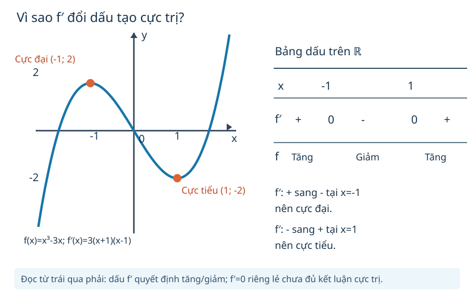
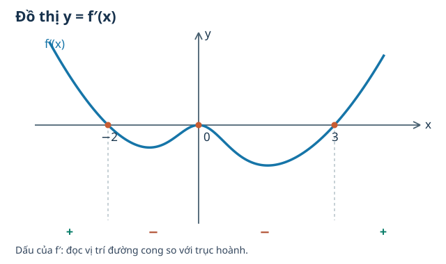

# Bài 1. Tính đơn điệu và cực trị của hàm số

TOÁN 12 · CHƯƠNG I · KIẾN THỨC SGK KNTT · TẬP MỘT

Từ dấu đạo hàm, nhận biết hàm số tăng hay giảm, tìm những vị trí đổi chiều biến thiên và đọc bảng biến thiên.

<nav class="thpt-r4-lesson-tabs"><a href="../">Chương I</a><a href="../luyen-tap/#b01-core">Core/Luyện tập</a><a href="../tu-kiem-tra-chuong/">Tự kiểm tra cuối chương</a><a href="../bai-2/">Bài tiếp theo</a></nav>

=== "Khám phá kiến thức"

    ### 1.1. Tính đơn điệu của hàm số

    Khi một chiếc xe chuyển động trên một đường thẳng, vị trí của nó có thể tăng hoặc giảm theo thời gian. Nếu vận tốc dương, xe chuyển động theo chiều dương đã chọn; nếu vận tốc âm, xe chuyển động theo chiều ngược lại. Điều quyết định **chiều thay đổi của vị trí** là dấu vận tốc, chứ không phải dấu của chính vị trí. Vì vận tốc là đạo hàm của tọa độ theo thời gian, ta có một gợi ý: có thể dùng đạo hàm để nhận biết chiều thay đổi của một hàm số bất kì.

    Trước hết, xét hàm số \(f(x)=x^2\). Khi đi từ \(x=-3\) đến \(x=-2\) rồi \(x=-1\), giá trị hàm giảm từ \(9\) xuống \(4\), rồi xuống \(1\). Nhưng khi đi từ \(x=1\) đến \(2\) rồi \(3\), các giá trị tăng từ \(1\) lên \(4\), rồi lên \(9\).

    Ta nói hàm số **nghịch biến** trên \((-\infty;0)\) và **đồng biến** trên \((0;+\infty)\). Nói đồng biến không chỉ có nghĩa là hai điểm cụ thể cho giá trị tăng: bất kì \(x_1<x_2\) trong khoảng đang xét đều phải có \(f(x_1)<f(x_2)\). Tương tự, nghịch biến nghĩa là \(f(x_1)>f(x_2)\). Trên đồ thị, hãy luôn đọc **từ trái sang phải**: đường cong đi lên biểu thị đồng biến, đi xuống biểu thị nghịch biến.

    Dấu đạo hàm giúp ta biết điều ấy mà không cần vẽ chính xác toàn bộ đồ thị. Đạo hàm \(f'(x)\) cho độ dốc tiếp tuyến tại \(x\). Khi mọi tiếp tuyến trong một khoảng đều có độ dốc dương, đồ thị đi lên trên khoảng ấy; khi mọi độ dốc đều âm, đồ thị đi xuống. Đây là định lí liên hệ dấu đạo hàm và tính đơn điệu, không phải quy tắc xét dấu của \(f(x)\).

    Một tiếp tuyến nằm ngang tại một điểm chưa làm hàm ngừng tăng trên cả khoảng. Ví dụ \(f(x)=x^3\) có \(f'(x)=3x^2\ge0\), chỉ bằng \(0\) tại \(x=0\). Hàm vẫn đồng biến trên \(\mathbb R\), vì đồ thị tiếp tục đi lên qua \(0\). Nếu đạo hàm không âm trên một khoảng, chỉ bằng \(0\) tại hữu hạn điểm của khoảng ấy, hàm vẫn đồng biến. Trường hợp không dương cũng tương tự. Nhưng nếu đạo hàm bằng \(0\) **ở mọi điểm** của khoảng thì hàm không đổi.

    Với hàm số có nhiều đoạn tăng và giảm, **bảng biến thiên** giúp tập hợp các thông tin cần thiết. Xét \(f(x)=x^3-3x\). Hàm xác định trên \(\mathbb R\), có đạo hàm \(f'(x)=3(x+1)(x-1)\). Hai nghiệm \(-1,1\) chia trục số thành ba khoảng. Thử \(x=-2,0,2\) lần lượt trong ba khoảng. Hai nhân tử \(x+1,x-1\) lần lượt cùng âm, trái dấu, cùng dương; do đó tích có dấu \(+,-,+\). Ta được hình sau:

    <figure class="thpt-r4-plot thpt-r4-calculus-figure"><figcaption><strong>Cách đọc hình:</strong> nhìn hàng dấu \(f'\) bên phải rồi đối chiếu đường cong bên trái. Dấu \(+\) ứng với đoạn đi lên, dấu \(−\) ứng với đoạn đi xuống. Tại \(x=-1\), đường chuyển từ đi lên sang đi xuống; tại \(x=1\) thì ngược lại.</figcaption></figure>

    Bảng biến thiên đầy đủ còn ghi giá trị hàm ở những mốc cần thiết và giới hạn tại đầu khoảng. Với hàm trên, \(f(-1)=2,\ f(1)=-2\); ở hai đầu vô cực, số hạng \(x^3\) chi phối nên các giới hạn lần lượt là \(-\infty,+\infty\).

    | \(x\) | \(-\infty\) | \((-\infty;-1)\) | \(-1\) | \((-1;1)\) | \(1\) | \((1;+\infty)\) | \(+\infty\) |
    | :-- | :--: | :--: | :--: | :--: | :--: | :--: | :--: |
    | \(f'(x)\) | | \(+\) | \(0\) | \(-\) | \(0\) | \(+\) | |
    | \(f(x)\) | \(-\infty\) | ↗ | \(2\) | ↘ | \(-2\) | ↗ | \(+\infty\) |

    Đọc hàng cuối: hàm đồng biến trên \((-\infty;-1)\) và \((1;+\infty)\), nghịch biến trên \((-1;1)\). Hai khoảng đồng biến được nêu **riêng**, không gộp bằng dấu hợp rồi áp dụng định nghĩa đồng biến cho mọi cặp điểm ở hai khoảng.

    Không phải mọi mốc đều là nghiệm của đạo hàm. Nếu hàm \(g(x)=1/(x-1)\), điểm \(1\) không thuộc tập xác định. Dù \(g'(x)=-1/(x-1)^2<0\) tại mọi điểm xác định, hàm chỉ nghịch biến **trên từng khoảng** \((-\infty;1)\), \((1;+\infty)\). Thật vậy, \(g(0)=-1<g(2)=1\), nên không thể kết luận nghịch biến trên toàn tập xác định. Khi lập bảng, ta phải tách hai phía bằng vạch đôi tại \(1\). Một mốc mà hàm có giá trị nhưng đạo hàm không tồn tại, như \(0\) của \(|x|\), cũng cần đưa vào để xét riêng hai phía.

    **Vận dụng.** Tìm các khoảng đơn điệu của \(f(x)=x^3-12x\). Lập bảng biến thiên, ghi giá trị của hàm tại những mốc đạo hàm bằng \(0\).

    ??? question "Đối chiếu"

        Tập xác định là \(\mathbb R\). Ta có \(f'(x)=3(x-2)(x+2)\). Hai mốc là \(-2,2\), với \(f(-2)=16,\ f(2)=-16\).

        | \(x\) | \(-\infty\) | \((-\infty;-2)\) | \(-2\) | \((-2;2)\) | \(2\) | \((2;+\infty)\) | \(+\infty\) |
        | :-- | :--: | :--: | :--: | :--: | :--: | :--: | :--: |
        | \(f'(x)\) | | \(+\) | \(0\) | \(-\) | \(0\) | \(+\) | |
        | \(f(x)\) | \(-\infty\) | ↗ | \(16\) | ↘ | \(-16\) | ↗ | \(+\infty\) |

        Hàm đồng biến trên \((-\infty;-2)\), \((2;+\infty)\), nghịch biến trên \((-2;2)\).

    ??? tip "Kiểm lỗi"

        Nếu chỉ ghi \(x=\pm2\), em mới tìm được các mốc chứ chưa xét tính đơn điệu. Thử \(x=-3,0,3\) vào \(f'\) để xác định dấu từng khoảng, rồi điền mũi tên tương ứng.

    Trở lại câu chuyện chuyển động: giả sử tọa độ \(s(t)=t^3-9t^2+15t\) (m), với \(t\ge0\) tính bằng giây. Vận tốc là \(v(t)=3(t-1)(t-5)\) (m/s). Trên \(0<t<1\) và \(t>5\), vật chuyển động sang phải; trên \(1<t<5\), vật chuyển động sang trái. Tại \(t=1,5\), vận tốc bằng \(0\), và hướng chuyển động thay đổi qua mỗi mốc. Ở \(t=0\), vận tốc ban đầu là \(15\) m/s theo chiều dương. Đây là xét sự biến thiên của **tọa độ**, không phải xét tốc độ \(|v|\) tăng hay giảm.

    ### 1.2. Cực trị của hàm số

    Trên đồ thị \(f(x)=x^3-3x\), điểm có hoành độ \(-1\) cao hơn các điểm lân cận, còn điểm có hoành độ \(1\) thấp hơn các điểm lân cận. Ta gọi \(x=-1\) là điểm cực đại của hàm số, với giá trị cực đại \(f(-1)=2\); \(x=1\) là điểm cực tiểu, với giá trị cực tiểu \(f(1)=-2\). Điểm cực đại của **đồ thị** là cặp tọa độ \((-1;2)\), điểm cực tiểu của đồ thị là \((1;-2)\).

    Điều quan trọng là chữ **lân cận**. Cực đại không nhất thiết là giá trị lớn nhất trên toàn miền xác định. Hàm bậc ba này có cực đại bằng \(2\), nhưng \(f(3)=18>2\); tương tự cực tiểu \(-2\) không phải giá trị nhỏ nhất trên toàn \(\mathbb R\). Bài sau sẽ học cách tìm giá trị lớn nhất, nhỏ nhất trên một tập cho trước.

    Tại một điểm trong miền xác định mà hàm liên tục, nếu đạo hàm dương ngay bên trái, âm ngay bên phải thì hàm tăng tới điểm ấy rồi giảm đi: đó là cực đại. Ngược lại, dấu âm sang dương cho cực tiểu. Vì vậy, ta dùng chính bảng biến thiên đã học ở mục trước để tìm cực trị. Chú ý rằng dấu phải được xét **trên các khoảng hai bên**.

    Có hai tình huống dễ nhầm:

    - Với \(f(x)=x^3\), đạo hàm bằng \(0\) tại \(0\), nhưng dương ở hai bên. Hàm vẫn tăng qua \(0\), nên không có cực trị tại đó.
    - Với \(f(x)=|x|\), tại \(0\) đạo hàm không tồn tại (độ dốc bên trái là \(-1\), bên phải là \(1\)). Tuy nhiên \(f(x)>f(0)=0\) khi \(x\ne0\). Hàm có cực tiểu tại \(0\). Điều này cho thấy không được bỏ những điểm hàm xác định mà đạo hàm không tồn tại.

    Một điểm bị loại khỏi tập xác định thì không thể là cực trị, dù dấu đạo hàm ở hai phía khác nhau: ta không có giá trị hàm ở điểm ấy để so sánh với các giá trị lân cận.

    **Vận dụng.** Tìm cực trị của \(g(x)=-x^3+3x^2+1\).

    ??? question "Đối chiếu"

        Hàm xác định trên \(\mathbb R\). Ta có \(g'(x)=-3x(x-2)\), bằng \(0\) tại \(0,2\). Dấu đạo hàm trên ba khoảng lần lượt là \(-,+,-\).

        | \(x\) | \(-\infty\) | \((-\infty;0)\) | \(0\) | \((0;2)\) | \(2\) | \((2;+\infty)\) | \(+\infty\) |
        | :-- | :--: | :--: | :--: | :--: | :--: | :--: | :--: |
        | \(g'(x)\) | | \(-\) | \(0\) | \(+\) | \(0\) | \(-\) | |
        | \(g(x)\) | \(+\infty\) | ↘ | \(1\) | ↗ | \(5\) | ↘ | \(-\infty\) |

        Hàm đạt cực tiểu tại \(x=0\), giá trị cực tiểu bằng \(1\); đạt cực đại tại \(x=2\), giá trị cực đại bằng \(5\).

    ??? tip "Kiểm lỗi"

        Nếu kết luận cực đại tại \(0\), em đã đọc ngược quy tắc đổi dấu. Hãy đi từ trái sang phải: \(-\) rồi \(+\) là đi xuống rồi đi lên, tạo đáy; \(+\) rồi \(-\) tạo đỉnh.

    Chẳng hạn, vật được ném lên có độ cao \(h(t)=2+24{,}5t-4{,}9t^2\) mét sau \(t\) giây, trong thời gian còn ở trên mặt đất. Đạo hàm \(h'(t)=24{,}5-9{,}8t\) dương trước \(t=2{,}5\) và âm sau mốc này. Độ cao tăng rồi giảm, nên vật đạt độ cao lớn nhất tại \(t=2{,}5\) giây trong mô hình. Ở đây ta có thể kết luận lớn nhất vì đã xét chiều biến thiên trên **toàn thời gian vật ở trên mặt đất**, không chỉ vì \(h'(2{,}5)=0\).

=== "Kiến thức SGK"

    ### 2.1. Tính đơn điệu của hàm số

    
<strong>Định nghĩa — Đồng biến, nghịch biến</strong>
Giả sử \(K\) là một khoảng, đoạn hoặc nửa khoảng và \(f\) xác định trên \(K\). Với mọi \(x_1,x_2\in K\), nếu \(x_1\lt x_2\) luôn kéo theo \(f(x_1)\lt f(x_2)\) thì \(f\) đồng biến trên \(K\); nếu luôn kéo theo \(f(x_1)\gt f(x_2)\) thì \(f\) nghịch biến trên \(K\). Hai trường hợp gọi chung là đơn điệu trên \(K\).

    **Đọc đồ thị:** từ trái sang phải, đồ thị đi lên khi hàm đồng biến, đi xuống khi hàm nghịch biến. Khi đề yêu cầu tìm các khoảng đơn điệu, hãy bắt đầu từ tập xác định rồi xét từng khoảng thích hợp. Nếu tập xác định bị tách thành nhiều khoảng, không gộp chúng thành một khoảng đơn điệu chỉ vì đạo hàm cùng dấu. Muốn khẳng định đơn điệu trên một tập cụ thể, phải kiểm điều kiện so sánh trong định nghĩa.

    
<strong>Định lí — Dấu đạo hàm và tính đơn điệu</strong>
Cho hàm số \(f\) có đạo hàm trên khoảng \(K\). Nếu \(f'(x)\gt 0\) với mọi \(x\in K\) thì \(f\) đồng biến trên \(K\). Nếu \(f'(x)\lt 0\) với mọi \(x\in K\) thì \(f\) nghịch biến trên \(K\).

Nếu \(f'(x)\ge0\) (tương ứng \(\le0\)) trên \(K\), chỉ bằng \(0\) tại hữu hạn điểm của \(K\), thì \(f\) vẫn đồng biến (tương ứng nghịch biến) trên \(K\). Nếu \(f'(x)=0\) tại mọi điểm của \(K\), hàm số không đổi trên \(K\).

    **Các bước xét tính đơn điệu:**

    1. Tìm tập xác định.
    2. Tính đạo hàm, tìm các điểm đạo hàm bằng \(0\) hoặc không tồn tại; chú ý các điểm bị loại khỏi miền xác định.
    3. Sắp xếp mốc theo thứ tự, xét dấu đạo hàm trên từng khoảng thích hợp. Lập bảng biến thiên, ghi giá trị hàm tại mốc xác định và các giới hạn ở đầu khoảng khi cần.
    4. Kết luận rõ từng khoảng đồng biến, nghịch biến. Nếu hàm liên tục tại đầu mút hữu hạn thuộc miền xác định, có thể kiểm định nghĩa để mở rộng khoảng đơn điệu tới đầu mút; không đi qua điểm mà hàm không xác định.

    Với \(f(x)=x^3-3x\), đọc hình để kiểm lại mối liên hệ giữa dấu đạo hàm và chiều biến thiên.

    <figure class="thpt-r4-plot thpt-r4-calculus-figure"><figcaption>Hai nghiệm của đạo hàm là \(-1,1\). Dấu \(+,-,+\) cho ba khoảng tăng, giảm, tăng; các giá trị tại mốc là \(2,-2\).</figcaption></figure>

    Nếu đề cho **đồ thị \(y=f'(x)\)** chứ không phải đồ thị \(y=f(x)\), hãy đọc vị trí của đường \(f'\) đối với trục hoành: ở phía trên thì \(f'>0\), phía dưới thì \(f'<0\). Không đọc độ dốc của chính đường \(f'\) để xét đơn điệu của \(f\).

    ### 2.2. Cực trị của hàm số

    
<strong>Định nghĩa — Cực đại, cực tiểu</strong>
Cho hàm số \(f\) xác định trên khoảng \((a;b)\) chứa \(x_0\). Nếu tồn tại \(h\gt 0\) sao cho \((x_0-h;x_0+h)\subset(a;b)\) và \(f(x)\lt f(x_0)\) với mọi \(x\) trong lân cận ấy, \(x\ne x_0\), thì hàm đạt cực đại tại \(x_0\). Nếu \(f(x)\gt f(x_0)\) với mọi \(x\) như trên thì hàm đạt cực tiểu tại \(x_0\).

\(x_0\) là điểm cực trị của hàm số, \(f(x_0)\) là giá trị cực trị; \(M(x_0;f(x_0))\) là điểm cực trị của đồ thị. Kí hiệu giá trị cực đại \(y_{CĐ}\), giá trị cực tiểu \(y_{CT}\).

    
<strong>Quy tắc — Tìm cực trị bằng dấu đạo hàm</strong>
Giả sử \(f\) liên tục trên khoảng \((a;b)\) chứa \(x_0\), có đạo hàm trên \((a;x_0)\) và \((x_0;b)\). Nếu \(f'\gt 0\) trên khoảng bên trái, \(f'\lt 0\) trên khoảng bên phải thì \(x_0\) là điểm cực đại. Nếu \(f'\lt 0\) bên trái và \(f'\gt 0\) bên phải thì \(x_0\) là điểm cực tiểu.

    | Dấu \(f'\) bên trái \(x_0\) | Dấu \(f'\) bên phải \(x_0\) | Chiều biến thiên qua \(x_0\) | Kết luận (theo giả thiết trên) |
    | :--: | :--: | :--: | :-- |
    | \(+\) | \(-\) | ↗ rồi ↘ | Cực đại |
    | \(-\) | \(+\) | ↘ rồi ↗ | Cực tiểu |
    | \(+\) | \(+\) | ↗ rồi ↗ | Không có cực trị tại \(x_0\) |
    | \(-\) | \(-\) | ↘ rồi ↘ | Không có cực trị tại \(x_0\) |

    **Cách tìm:** thực hiện các bước tìm miền xác định, đạo hàm, mốc và bảng biến thiên như mục 2.1. Từ mũi tên và dấu hai phía, xác định điểm cực trị, sau đó tính giá trị hàm tại từng điểm đó. Điều kiện liên tục và tồn tại đạo hàm trên hai khoảng rất quan trọng; không áp dụng quy tắc qua một điểm bị loại khỏi miền xác định.

    **Lưu ý:** Nếu hàm khả vi tại điểm cực trị nằm trong một khoảng xác định, đạo hàm ở điểm đó bằng \(0\). Chiều ngược lại không đúng: \(f(x)=x^3\) có \(f'(0)=0\) nhưng không có cực trị. Hàm \(f(x)=|x|\) có cực tiểu tại \(0\) dù đạo hàm không tồn tại tại đó. Cực trị là khái niệm cục bộ, khác giá trị lớn nhất/nhỏ nhất trên toàn tập đang xét.

=== "Ví dụ"

    ### 3.1. Đọc chiều biến thiên và cực trị từ bảng

    **Đề bài.** Cho hàm số liên tục trên \(\mathbb R\), có bảng biến thiên:

    | \(x\) | \(-\infty\) | \((-\infty;-2)\) | \(-2\) | \((-2;1)\) | \(1\) | \((1;+\infty)\) | \(+\infty\) |
    | :-- | :--: | :--: | :--: | :--: | :--: | :--: | :--: |
    | \(f'(x)\) | | \(-\) | \(0\) | \(+\) | \(0\) | \(-\) | |
    | \(f(x)\) | \(+\infty\) | ↘ | \(-3\) | ↗ | \(4\) | ↘ | \(-\infty\) |

    Tìm khoảng đơn điệu, các điểm cực trị của hàm số và các điểm cực trị của đồ thị.

    **Phân tích:** Không cần tìm công thức của \(f\). Hàng \(f'\) cho chiều biến thiên; hàng \(f(x)\) cho giá trị tại mốc.

    

<strong>Lời giải.</strong> Hàm nghịch biến trên \((-\infty;-2)\), \((1;+\infty)\), đồng biến trên \((-2;1)\). Dấu đổi từ âm sang dương tại \(-2\): điểm cực tiểu \(x=-2\), giá trị cực tiểu \(-3\); từ dương sang âm tại \(1\): điểm cực đại \(x=1\), giá trị cực đại \(4\). Đồ thị có điểm cực tiểu \((-2;-3)\) và điểm cực đại \((1;4)\).

    **Kiểm lại:** Đọc hàng mũi tên từ trái sang phải: xuống, lên, xuống. Giá trị cực đại \(4\) không phải giá trị lớn nhất trên \(\mathbb R\) vì giới hạn phía trái là \(+\infty\).

    ### 3.2. Đa thức có nhiều mốc đổi dấu

    **Đề bài.** Xét tính đơn điệu và tìm cực trị của \(y=x^4-8x^2+3\).

    **Phân tích:** Đạo hàm bậc ba phân tích được thành nhân tử. Cần giữ cả nghiệm \(0\), không chia hai vế cho \(x\).

    

<strong>Lời giải.</strong> Tập xác định \(\mathbb R\). \(y'=4x(x^2-4)=4x(x-2)(x+2)\). Các nghiệm là \(-2,0,2\). Lần lượt thử \(-3,-1,1,3\) trong bốn khoảng: dấu của ba nhân tử \(x,x-2,x+2\) lần lượt là \((-,-,-)\), \((-,-,+)\), \((+,-,+)\), \((+,+,+)\). Vì \(4>0\), đạo hàm có dấu \(-,+,-,+\). Ta tính \(y(-2)=y(2)=-13,\ y(0)=3\); tại hai đầu vô cực, \(y\to+\infty\).

    | \(x\) | \(-\infty\) | \((-\infty;-2)\) | \(-2\) | \((-2;0)\) | \(0\) | \((0;2)\) | \(2\) | \((2;+\infty)\) | \(+\infty\) |
    | :-- | :--: | :--: | :--: | :--: | :--: | :--: | :--: | :--: | :--: |
    | \(y'\) | | \(-\) | \(0\) | \(+\) | \(0\) | \(-\) | \(0\) | \(+\) | |
    | \(y\) | \(+\infty\) | ↘ | \(-13\) | ↗ | \(3\) | ↘ | \(-13\) | ↗ | \(+\infty\) |

    Vậy hàm nghịch biến trên \((-\infty;-2),(0;2)\), đồng biến trên \((-2;0),(2;+\infty)\). Hàm có hai điểm cực tiểu \(x=-2,2\), cùng giá trị \(-13\); một điểm cực đại \(x=0\), giá trị \(3\).

    **Kiểm lại:** \(y=(x^2-4)^2-13\) cho thấy \(-13\) đạt ở cả hai điểm \(\pm2\). Đồ thị đối xứng qua trục tung, phù hợp bảng.

    ### 3.3. Nghiệm đạo hàm không làm đổi dấu

    **Đề bài.** Xét tính đơn điệu và cực trị của \(y=(x-1)^3+2\).

    **Phân tích:** Đạo hàm là bình phương nhân với một số dương. Phải xét dấu tại hai phía của nghiệm, không tự kết luận cực trị.

    

<strong>Lời giải.</strong> \(D=\mathbb R\); \(y'=3(x-1)^2\ge0\), bằng \(0\) duy nhất tại \(1\). Theo định lí, hàm đồng biến trên toàn \(\mathbb R\). Đạo hàm dương ở hai bên \(1\), nên không có cực trị tại \(1\); các điểm khác có đạo hàm dương, do đó hàm không có cực trị.

    **Kiểm lại:** \(f(0)=1<f(1)=2<f(2)=3\). Hàm đi lên qua tiếp tuyến nằm ngang tại \(1\).

    ### 3.4. Phân thức có hai khoảng xác định

    **Đề bài.** Xét chiều biến thiên và cực trị của \(y=(2x+1)/(x-2)\).

    **Phân tích:** Xác định điểm loại trước khi tính đạo hàm; tách hai nhánh ở mốc đó.

    

<strong>Lời giải.</strong> \(D=\mathbb R\setminus\{2\}\). Ta viết \(y=2+5/(x-2)\), nên \(y'=-5/(x-2)^2&lt;0\) với \(x\ne2\). Hàm nghịch biến trên từng khoảng \((-\infty;2),(2;+\infty)\). Hàm không có cực trị, vì không có nghiệm \(y'=0\), và \(2\) không thuộc miền xác định.

    | \(x\) | \(-\infty\) | \((-\infty;2)\) | \(2^-\) | \(x=2\) | \(2^+\) | \((2;+\infty)\) | \(+\infty\) |
    | :-- | :--: | :--: | :--: | :--: | :--: | :--: | :--: |
    | \(y'\) | | \(-\) | | Không xác định | | \(-\) | |
    | \(y\) | \(2\) | ↘ | \(-\infty\) | ‖ | \(+\infty\) | ↘ | \(2\) |

    **Kiểm lại:** \(f(1)=-3\), \(f(3)=7\), nên không thể nói hàm nghịch biến trên toàn tập \(D\).

    ### 3.5. Phân thức có cực trị và điểm loại

    **Đề bài.** Tìm các khoảng đơn điệu và cực trị của \(y=x+4/x\).

    **Phân tích:** Mốc \(0\) chia miền xác định, còn nghiệm đạo hàm cho hai mốc khác. Dùng dấu tử vì mẫu \(x^2>0\) trên \(D\).

    

<strong>Lời giải.</strong> \(D=\mathbb R\setminus\{0\}\). \(y'=1-4/x^2=(x-2)(x+2)/x^2\). Hai nghiệm \(-2,2\). Xét bốn khoảng với các mốc \(-2,0,2\), dấu lần lượt \(+,-,-,+\). Tính \(y(-2)=-4,\ y(2)=4\).

    | \(x\) | \(-\infty\) | \((-\infty;-2)\) | \(-2\) | \((-2;0)\) | \(0^-\) | \(x=0\) | \(0^+\) | \((0;2)\) | \(2\) | \((2;+\infty)\) | \(+\infty\) |
    | :-- | :--: | :--: | :--: | :--: | :--: | :--: | :--: | :--: | :--: | :--: | :--: |
    | \(y'\) | | \(+\) | \(0\) | \(-\) | | ‖ | | \(-\) | \(0\) | \(+\) | |
    | \(y\) | \(-\infty\) | ↗ | \(-4\) | ↘ | \(-\infty\) | ‖ | \(+\infty\) | ↘ | \(4\) | ↗ | \(+\infty\) |

    Hàm đồng biến trên \((-\infty;-2),(2;+\infty)\), nghịch biến trên \((-2;0),(0;2)\); đạt cực đại tại \(-2\) với giá trị \(-4\), cực tiểu tại \(2\) với giá trị \(4\).

    **Kiểm lại:** \(0\) không phải điểm cực trị; \(y(-2)=-4\) nhỏ hơn \(y(2)=4\) không mâu thuẫn, vì cực đại/cực tiểu chỉ so với các điểm lân cận.

    ### 3.6. Hàm căn trên miền hữu hạn

    **Đề bài.** Xét tính đơn điệu và cực trị của \(f(x)=\sqrt{9-x^2}\).

    **Phân tích:** Miền xác định là đoạn, nhưng công thức đạo hàm chỉ có nghĩa ở phần trong. Kiểm cả hai đầu mút khi đọc đồ thị, không tự coi chúng là điểm cực trị theo định nghĩa trên khoảng.

    

<strong>Lời giải.</strong> \(D=[-3;3]\). Trên \((-3;3)\), \(f'(x)=-x/\sqrt{9-x^2}\), dương khi \(x&lt;0\), âm khi \(x&gt;0\), bằng \(0\) tại \(0\). Hàm đồng biến trên \((-3;0)\), nghịch biến trên \((0;3)\). Hàm đạt cực đại tại \(x=0\), giá trị \(3\). Không có cực tiểu ở điểm trong miền xác định.

    | \(x\) | \(-3\) | \((-3;0)\) | \(0\) | \((0;3)\) | \(3\) |
    | :-- | :--: | :--: | :--: | :--: | :--: |
    | \(f'\) | Không có | \(+\) | \(0\) | \(-\) | Không có |
    | \(f\) | \(0\) | ↗ | \(3\) | ↘ | \(0\) |

    **Kiểm lại:** Hàm liên tục đến hai đầu mút, nên cũng đồng biến trên \([-3;0]\), nghịch biến trên \([0;3]\). Hai đầu mút cho giá trị nhỏ nhất \(0\) trên đoạn, nhưng không có lân cận hai phía nằm trong \(D\), nên không gọi là điểm cực tiểu theo định nghĩa của bài.

    ### 3.7. Cực trị tại điểm không khả vi

    **Đề bài.** Tìm cực trị của \(f(x)=2-|x-1|\).

    **Phân tích:** Tách trị tuyệt đối để đọc hai nhánh; kiểm tính liên tục tại \(1\).

    

<strong>Lời giải.</strong> \(D=\mathbb R\). Với \(x&lt;1\), \(f(x)=1+x\), \(f'=1\); với \(x&gt;1\), \(f(x)=3-x\), \(f'=-1\). Hai nhánh liên tục tại \(1\) và \(f(1)=2\). Đạo hàm không tồn tại tại \(1\) nhưng dấu đổi từ dương sang âm, nên hàm đạt cực đại tại \(1\), giá trị \(2\); không có cực tiểu.

    **Kiểm lại:** Với \(x\ne1\), \(|x-1|>0\) nên \(2-|x-1|<2=f(1)\). Điều này xác nhận trực tiếp định nghĩa.

    ### 3.8. Đọc dấu từ đồ thị đạo hàm

    **Đề bài.** Hàm \(f\) khả vi trên \(\mathbb R\). Đồ thị \(y=f'(x)\) cắt trục hoành tại \(x=-2\) và \(x=3\), tiếp xúc trục hoành tại \(x=0\). Đường \(f'\) nằm phía trên trục hoành trên \((-\infty;-2)\), phía dưới trên \((-2;0)\) và \((0;3)\), phía trên trên \((3;+\infty)\). Xét tính đơn điệu và điểm cực trị của \(f\).

    <figure class="thpt-r4-plot thpt-r4-calculus-figure"><figcaption>Đọc dấu theo vị trí đường cong so với trục hoành; chú ý tại \(0\), đường chỉ chạm trục rồi quay lại phía dưới.</figcaption></figure>

    **Phân tích:** Ta chỉ cần dấu của \(f'\), không cần biết độ cao cụ thể của \(f\) hay độ dốc của đường \(f'\).

    

<strong>Lời giải.</strong> \(f\) đồng biến trên \((-\infty;-2)\), \((3;+\infty)\). Trên \((-2;3)\), \(f'\le0\) và chỉ bằng \(0\) tại \(0\), nên \(f\) nghịch biến trên cả khoảng \((-2;3)\). Hàm đạt cực đại tại \(-2\), cực tiểu tại \(3\). Điểm \(0\) không có cực trị do đạo hàm không đổi dấu qua nó. Đề không cung cấp \(f(-2),f(3)\) nên chưa biết các giá trị cực trị.

    **Kiểm lại:** Mọi hàm \(f+C\) có cùng đạo hàm nhưng giá trị cực trị thay đổi theo \(C\). Vì thế không lấy tung độ \(0\) của đồ thị đạo hàm làm giá trị cực trị của \(f\).

    ### 3.9. Ứng dụng — hướng chuyển động

    **Đề bài.** Một chất điểm có tọa độ \(s(t)=t^3-12t^2+36t\) (m), \(t\ge0\) tính bằng giây. Tìm các khoảng thời gian vật chuyển động theo chiều dương, chiều âm, và các thời điểm đổi chiều.

    **Phân tích:** Lấy đạo hàm theo thời gian, giải \(v=0\) rồi xét dấu trên miền thời gian của mô hình.

    

<strong>Lời giải.</strong> \(v(t)=3t^2-24t+36=3(t-2)(t-6)\) (m/s). Vật đi theo chiều dương trên \(0&lt;t&lt;2\) và \(t&gt;6\), theo chiều âm trên \(2&lt;t&lt;6\); vận tốc ban đầu \(v(0)=36\) m/s. Vật đứng yên tức thời và đổi chiều tại \(t=2\) và \(t=6\).

    **Kiểm lại:** \(v(1)=15>0\), \(v(4)=-12<0\), \(v(7)=15>0\). Kết quả nói về hướng chuyển động, không kết luận tốc độ tăng hay giảm.

    ### 3.10. Ứng dụng — tốc độ bán hàng

    **Đề bài.** Số sản phẩm đã bán theo một mô hình logistic là \(N(t)=1000/(1+4e^{-t})\), \(t\ge0\) tính bằng năm. Tốc độ bán hàng \(N'(t)\) lớn nhất tại thời điểm nào, giả sử mô hình vẫn đúng?

    **Phân tích:** Cần tìm cực đại của **hàm tốc độ bán hàng** \(v(t)=N'(t)\), không phải cực đại của tổng số sản phẩm \(N(t)\). Vì vậy phải xét dấu của \(v'(t)=N''(t)\).

    

<strong>Lời giải.</strong> Đặt \(u=4e^{-t}>0\), \(u'=-u\). Khi đó \(v(t)=1000u(1+u)^{-2}\). Dùng quy tắc tích và hàm hợp, ta có \(v'=1000[u'(1+u)-2uu']/(1+u)^3\). Thay \(u'=-u\), suy ra \(v'=1000u(u-1)/(1+u)^3\). Vì \(u=4e^{-t}\) giảm, \(u&gt;1\) khi \(t&lt;\ln4\) và \(u=1\) khi \(t=\ln4\), \(v'>0\) với \(0&lt;t&lt;\ln4\) và \(v'&lt;0\) khi \(t&gt;\ln4\). Do đó \(v\) tăng rồi giảm trên toàn miền thời gian; tốc độ bán hàng lớn nhất tại \(t=\ln4\approx1{,}39\) năm và bằng \(1000/(1+1)^2=250\) sản phẩm/năm.

    **Kiểm lại:** \(v(t)>0\) với mọi \(t\ge0\) nên tổng số sản phẩm vẫn tăng; chính tốc độ tăng đạt đỉnh rồi giảm. \(v(0)=160<250\), \(\lim_{t\to+\infty}v(t)=0\), phù hợp kết luận.

=== "Lỗi thường gặp"

    ### 4.1. Xét dấu hàm số thay vì dấu đạo hàm

    **Sai ở đâu:** Thấy \(f(x)>0\) rồi kết luận hàm đồng biến.

    **Vì sao sai:** Dấu của \(f\) nói vị trí đồ thị đối với trục hoành, không cho biết đồ thị đi lên hay xuống.

    **Cách sửa:** Tính \(f'\) và xét dấu của nó. Ví dụ \(f(x)=x^2+1>0\) trên \(\mathbb R\) nhưng vẫn nghịch biến trên \((-\infty;0)\).

    ### 4.2. Gộp hai khoảng rời nhau thành một miền đơn điệu

    **Sai ở đâu:** Hàm \(f(x)=1/x\) có \(f'(x)<0\) tại mọi điểm xác định nên nghịch biến trên toàn \(\mathbb R\setminus\{0\}\).

    **Vì sao sai:** Định lí dấu đạo hàm dùng trên một khoảng. Hai nhánh bị tách bởi \(0\).

    **Cách sửa:** Kết luận nghịch biến trên \((-\infty;0)\) và \((0;+\infty)\) riêng biệt; thử \(f(-1)=-1<f(1)=1\) để thấy không thể gộp.

    ### 4.3. Coi mọi nghiệm đạo hàm bằng không là cực trị

    **Sai ở đâu:** \(f'(x_0)=0\) nên chắc chắn \(x_0\) là điểm cực trị.

    **Vì sao sai:** Hàm có thể tiếp tục tăng hoặc giảm qua tiếp tuyến nằm ngang.

    **Cách sửa:** Xét dấu trên hai khoảng kề. Với \(x^3\), hai dấu đều dương nên \(0\) không là điểm cực trị.

    ### 4.4. Bỏ điểm đạo hàm không tồn tại hoặc nhận điểm ngoài miền

    **Sai ở đâu:** Loại tất cả điểm không có đạo hàm khỏi việc xét cực trị.

    **Vì sao sai:** Điểm hàm không xác định phải loại; điểm hàm xác định nhưng đạo hàm không tồn tại vẫn có thể có cực trị, như đỉnh chữ V.

    **Cách sửa:** Tách hai loại mốc, kiểm tính liên tục và dấu đạo hàm hai phía tại mốc thuộc miền.

    ### 4.5. Nhầm điểm cực trị với giá trị cực trị

    **Sai ở đâu:** Với đồ thị có đỉnh \((2;5)\), viết hàm có cực đại tại \(x=5\).

    **Vì sao sai:** Hoành độ \(2\) là điểm cực đại của hàm, tung độ \(5\) là giá trị cực đại.

    **Cách sửa:** Viết riêng \(x_{CĐ}=2,\ y_{CĐ}=5\), điểm cực đại đồ thị là \((2;5)\).

    ### 4.6. Đọc nhầm đồ thị đạo hàm

    **Sai ở đâu:** Thấy đường \(f'\) đi xuống rồi kết luận \(f\) nghịch biến.

    **Vì sao sai:** Đường \(f'\) đi xuống mô tả sự thay đổi của đạo hàm; để biết \(f\) tăng/giảm cần dấu \(f'\).

    **Cách sửa:** Nhìn đường \(f'\) ở trên hay dưới trục hoành. Nếu \(f'\) đi xuống nhưng vẫn dương thì \(f\) vẫn đồng biến trên khoảng đó.

    ### 4.7. Đồng nhất cực đại với giá trị lớn nhất

    **Sai ở đâu:** Mọi giá trị cực đại đều là giá trị lớn nhất trên miền xác định.

    **Vì sao sai:** Cực trị chỉ so sánh lân cận. Một phần khác của đồ thị có thể cao hơn.

    **Cách sửa:** Đọc cả bảng biến thiên, miền xét và đầu mút/giới hạn khi đề hỏi giá trị lớn nhất hoặc nhỏ nhất.

    **Học tiếp:** [Core và Luyện tập Bài 1](../luyen-tap/#b01-core) · [Tự kiểm tra cuối chương](../tu-kiem-tra-chuong/).

    
Nguồn đối chiếu: SGK KNTT Toán 12 tập 1, trang in 5–14.

