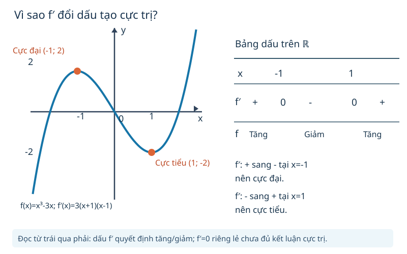

# Toán 12 · Bài 1. Tính đơn điệu và cực trị của hàm số

TOÁN 12 · CHƯƠNG I · SGK KẾT NỐI TRI THỨC · TẬP MỘT · TRANG 5–14

Học trọn bài tại đây: hiểu bản chất, xem hình, ví dụ có suy luận, tự thử, Core, Luyện tập, Vận dụng, Tự luận và các hướng dẫn tự khắc phục.

<nav class="thpt-r4-lesson-tabs"><a href="../">Chương I</a><a href="../">Tổng quan chương</a><a href="../bai-2/">Bài tiếp theo</a></nav>

## 1. Vì sao cần học?

Tại một thời điểm, một vật có thể đi về bên phải rồi đổi hướng đi về bên trái. Vị trí s(t) tăng hay giảm phụ thuộc vào dấu vận tốc tức thời v(t), không phụ thuộc vào việc vị trí s(t) đang dương hay âm. Khi thay vị trí s(t) bằng độ cao, lợi nhuận, hay bất kỳ đại lượng f(x), ta cần biết f đang **tăng hay giảm**, và khi nào chuyển từ tăng sang giảm (đỉnh) hoặc ngược lại (đáy). Đạo hàm giúp chuyển câu hỏi này thành kiểm tra **dấu**; bản thân phép tính f′(x) chưa thay thế bước hiểu ý nghĩa biến thiên.

**Mục tiêu có thể tự kiểm:** người học phải giải thích vì sao f′>0 cho hướng tăng, lập bảng dấu/bảng biến thiên có các khoảng xác định đúng, phân biệt cực trị với điểm chỉ có f′=0, và phân tích tình huống chuyển động trong khoảng t≥0.

## 2. Kiến thức tiền đề

- Miền xác định D của biểu thức (không chia 0, tôn trọng điều kiện nếu là thời gian/kích thước).
- So sánh x1<x2 và giá trị f(x1), f(x2); hiểu khoảng mở/đóng.
- Đạo hàm cơ bản: (x^n)′=n x^(n−1), (1/u)′=−u′/u² khi u≠0, đạo hàm tổng và tích.
- Trục hoành của đồ thị là đầu vào x; đỉnh/đáy cục bộ khác giá trị lớn nhất/nhỏ nhất toàn bộ D.

Nếu chưa tự tính được (x³−3x)′, nên quay về phần đạo hàm lớp 11 trước khi vào ví dụ tiếp theo; kết nối chỉ để hỗ trợ, không thay giải thích dưới đây.

## 3. Hiểu bản chất trước công thức

### 3.1. Đồng biến và nghịch biến

Trên một **khoảng** K thuộc D, hàm f đồng biến nghiêm ngặt khi với mọi x1,x2∈K, x1<x2 kéo theo f(x1)<f(x2); nghịch biến khi f(x1)>f(x2). Chẳng hạn f(x)=x² không tăng trên cả ℝ: khi x đi từ −2 tới −1 thì f giảm từ 4 xuống 1, nhưng từ 1 đến 2 thì f tăng từ 1 lên 4.

Nếu f khả vi trên K và f′(x)>0 tại mọi x thuộc K thì f tăng nghiêm ngặt trên K; f′(x)<0 thì giảm nghiêm ngặt. Đạo hàm **không đổi dấu** giải thích hướng biến thiên của tiếp tuyến, nhưng phải xét **trong từng khoảng liên thông của miền xác định**.

### 3.2. Bảng dấu đạo hàm và cực trị

Đầu tiên tìm D, sau đó tìm f′, giải phương trình f′=0 và các điểm mà f′ không tồn tại trong D, rồi chia D thành các khoảng có dấu đạo hàm ổn định. Cuối cùng mới suy ra khoảng tăng/giảm. Tại điểm **nội** x0∈D mà hàm liên tục và f′ chuyển từ dương sang âm, f đạt cực đại tại x0; chuyển âm sang dương, f đạt cực tiểu. Nếu f có cực trị tại điểm trong D và khả vi tại đó thì f′(x0)=0; chiều đảo lại **không đúng**.

Một điểm gián đoạn hoặc không thuộc D **không** được vẽ thành cực trị. Giá trị tại điểm cực trị (f(x0)) khác với tọa độ x0 của điểm đạt cực trị.

### 3.3. Hai phản ví dụ cần hiểu để không học mẹo

- f(x)=x³: f′(x)=3x², f′(0)=0 nhưng không đổi từ dương sang âm/âm sang dương; f tăng trên ℝ, **không có cực trị tại 0**.
- f(x)=|x|: tại 0, f′ không tồn tại nhưng hàm đạt **cực tiểu** f(0)=0; vậy điều kiện đạo hàm bằng 0 không phải điều kiện bắt buộc khi hàm không khả vi.

## 4. Đọc hình và dữ liệu

FIG-G12-B01-01: `G12_B01_FIG01_DERIVATIVE_SIGN_R00.svg` — original authored SVG, không sao chép ảnh SGK. Bước đọc: (1) nhìn trục x và xác định x=−1, x=1; (2) đọc lần lượt dấu f′: +, 0, −, 0, +; (3) liên hệ hướng đồ thị f: tăng, giảm, tăng; (4) chỉ ra đỉnh (−1,2) là cực đại và đáy (1,−2) là cực tiểu; (5) kiểm tra trên hàm riêng f=x³, dù f′(0)=0 nhưng đồ thị không đổi từ tăng sang giảm tại đó.

<figure class="thpt-r4-plot g12-chi-figure"><figcaption>Hình minh họa 1 · Xem hướng dẫn đọc hình ngay phía trên.</figcaption></figure>

## 5. Ví dụ có suy luận và lý do chọn phương pháp

### Ví dụ 1
**Bài toán biên soạn mới:** Xét f(x)=x²−4x+1 trên ℝ. Xác định khoảng đơn điệu và cực trị.

**Lý do chọn phương pháp:** Đây là đa thức nên f khả vi mọi x; dấu đạo hàm cho ta bảng biến thiên có đủ mọi khoảng trong D. Tính f′(x)=2x−4. Khi x<2, f′<0; khi x>2, f′>0. Vì dấu đổi **âm sang dương**, x=2 là điểm cực tiểu, giá trị f(2)=−3. Hàm giảm trên (−∞,2), tăng trên (2,+∞). Kiểm tra bằng f=(x−2)²−3 khớp kết luận; đây là đối chiếu, không thay cho chứng minh dấu ở bước học này.

### Ví dụ 2
**Bài toán biên soạn mới:** Xét f(x)=x³−3x trên ℝ; tìm cực trị và đọc SVG.

f′(x)=3x²−3=3(x+1)(x−1). Khi x<−1: hai nhân tử cùng âm nên f′>0; khi −1<x<1: tích âm nên f′<0; x>1: tích dương nên f′>0. Vì vậy f tăng trên (−∞,−1), giảm trên (−1,1), tăng trên (1,+∞); cực đại tại x=−1 với f(−1)=2, cực tiểu tại x=1 với f(1)=−2. **Tại sao không chỉ giải f′=0?** Hai nghiệm chỉ là ứng viên; phải kiểm tra sự đổi dấu.

### Ví dụ 3
**Bài toán biên soạn mới:** Xét f(x)=1/(x−1).

D=ℝ\{1}; f′(x)=−1/(x−1)²<0 với mọi x∈D. Kết luận chính xác: hàm nghịch biến trên **mỗi** khoảng (−∞,1) và (1,+∞). Không viết \"nghịch biến trên cả miền D\" theo định nghĩa so sánh x1<x2 nằm hai bên điểm loại trừ: f(0)=−1 và f(2)=1, trái chiều giảm. Đây là giới hạn của phép kiểm tra đạo hàm theo khoảng.

### Ví dụ 4
**Tình huống mới khác số SGK:** Vị trí trên trục là s(t)=t³−6t²+9t (m), t≥0 (s).

v(t)=s′(t)=3t²−12t+9=3(t−1)(t−3) m/s. Trong 0<t<1 và t>3: v>0, vật đi theo chiều dương; trong 1<t<3: v<0, vật đi theo chiều âm. t=1 và t=3 là thời điểm tức thời đứng yên, trước khi đổi chiều; s(1)=4 m, s(3)=0 m. Không đồng nhất \"vận tốc âm\" với \"vị trí âm\". Phân biệt \"đi theo chiều dương\" với \"tốc độ tăng\" (cần thêm gia tốc và dấu va).

## 6. Tự thử trước Core

Tự thử A: Với f′(x) dương trước x0 và âm sau x0, hàm sẽ chuyển hướng như thế nào? Trả lời bằng lời trước khi đọc phần Core; không có điểm chính thức.

Tự thử B: Nếu đạo hàm bằng 0 tại x0, có chắc chắn x0 là cực trị không? Nghĩ tới x³.

Tự thử C: Một hàm phân thức không xác định tại x=1 có thể được kết luận nghịch biến trên cả hai miền hợp lại chỉ từ f′<0 hay không? Hãy thử x=0 và x=2.

## 7. Core, Luyện tập, Vận dụng, Tự luận và hỗ trợ

Đang mở bài tập đã kiểm duyệt...

<nav class="thpt-r4-lesson-tabs"><a href="../">Chương I</a><a href="../bai-2/">Bài tiếp theo</a></nav>

