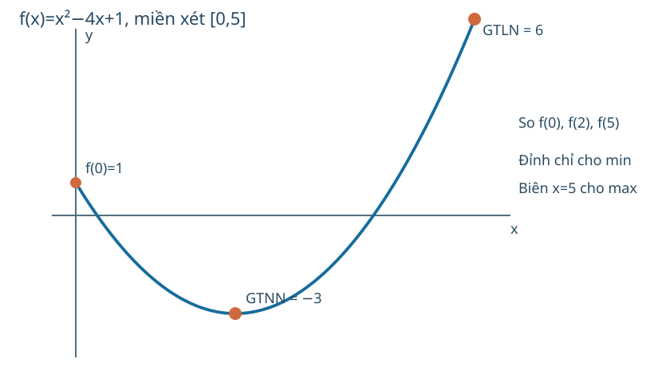

# Toán 12 · Bài 2. Giá trị lớn nhất và giá trị nhỏ nhất của hàm số

TOÁN 12 · CHƯƠNG I · SGK KẾT NỐI TRI THỨC · TẬP MỘT · TRANG 15–19

Học trọn bài tại đây: hiểu bản chất, xem hình, ví dụ có suy luận, tự thử, Core, Luyện tập, Vận dụng, Tự luận và các hướng dẫn tự khắc phục.

<nav class="thpt-r4-lesson-tabs"><a href="../">Chương I</a><a href="../bai-1/">Bài trước</a><a href="../bai-3/">Bài tiếp theo</a></nav>

## 1. Vì sao cần học?

Một xưởng phải chọn kích thước thùng để thể tích lớn nhất, nhưng mô hình chỉ cho phép x thuộc một đoạn vật lý. Điểm cực đại cục bộ (gần đó hàm nhỏ hơn) **không nhất thiết** có giá trị lớn nhất trên cả miền. Khi cần quyết định thực tế, ta phải so sánh tất cả ứng viên và điểm biên được phép, chứ không chỉ giải f'(x)=0. Bài học này đi từ định nghĩa đến thuật toán tìm GTLN/GTNN có điều kiện và mô hình hóa.

## 2. Kiến thức tiền đề

Miền xác định D; liên tục trên [a,b]; bảng dấu f' và điểm tới hạn; đọc giá trị f(x) trên đồ thị; điều kiện vật lý (độ dài không âm, điểm biên có hay không). Nếu quên vì sao f'=0 mới chỉ là ứng viên, xem ví dụ phản chứng x³ ở Bài 1 (giải thích dưới đây vẫn đầy đủ độc lập).

## 3. Hiểu bản chất trước công thức

Số M là **giá trị lớn nhất** của f trên D nếu (i) có x0 thuộc D với f(x0)=M và (ii) với mọi x thuộc D, f(x)≤M. Tương tự m là **giá trị nhỏ nhất** khi f(x0)=m và f(x)≥m với mọi x thuộc D. Điều kiện **đạt được** tại một x0 trong D là bắt buộc: f(x)=x trên (0,1) có cận trên đúng 1, cận dưới đúng 0 nhưng **không đạt GTLN/GTNN** vì 0,1 không thuộc D. Phân biệt "giá trị cực đại" địa phương với GTLN toàn cục.

Hàm **liên tục trên đoạn đóng, hữu hạn** [a,b] luôn đạt cả GTLN lẫn GTNN. Để tìm chúng khi f khả vi trong (a,b), ta so sánh f(a), f(b) với f(c) tại mọi c thuộc (a,b) mà f'(c)=0 hoặc f' không tồn tại. Với đoạn nửa mở, khoảng mở hoặc miền vô hạn, không áp dụng máy móc định lý đoạn; cần xét giới hạn ở biên và khả năng **không đạt**.

### PED4: Cách đọc bảng biến thiên

Đọc hàng x và đánh dấu *các biên được lấy* bằng ngoặc vuông hoặc chấm đặc, dấu tròn rỗng nếu bị loại; đọc hàng f' để xác định đỉnh/đáy; đọc hàng f và đối chiếu **giá trị tại điểm biên**. Chỉ có bảng dấu và cực trị cục bộ chưa đủ nếu không so các biên. Hình tự vẽ khi cần: đường parabol y=−(x−3)²+8 trên [0,4] đạt GTLN ở 3; GTNN là f(0)=−1 chứ không ở một cực tiểu nội.

## 4. Đọc hình và dữ liệu

FIG-G12-B02-01 (G12_B02_FIG01_GLOBAL_MIN_MAX_CLOSED_INTERVAL_R00.svg): đồ thị chính xác của f=x²−4x+1 chỉ trên [0,5], đánh dấu cả ba ứng viên x=0,2,5 bằng chấm đặc. Bước đọc: (1) nhận diện 0,5 là biên được lấy; (2) xác định đỉnh x=2, f=−3; (3) so f(0)=1, f(2)=−3, f(5)=6 để thấy GTLN ở biên x=5; (4) thay đoạn mở (0,5) thì không thể kết luận vẫn có max6 ở biên. Nét đồ thị ngoài đoạn không phải phần miền đang xét.

<figure class="thpt-r4-plot g12-chi-figure"><figcaption>Hình minh họa 1 · Xem hướng dẫn đọc hình ngay phía trên.</figcaption></figure>

## 5. Ví dụ có suy luận và lý do chọn phương pháp

### Ví dụ 1
Trên [0,5], f(x)=x²−4x+1. **Vì sao chọn so các điểm?** f liên tục trên đoạn và khả vi bên trong. f'=2x−4=0 tại x=2. Tính f(0)=1, f(2)=−3, f(5)=6. Vậy GTNN =−3 tại x=2, GTLN=6 tại x=5. Nếu chỉ tìm f'=0 sẽ bỏ sót **GTLN ở biên**.

### Ví dụ 2
Trên (0,1), g(x)=x. g tăng và tiến tới 0,1 ở hai đầu nhưng hai đầu không thuộc miền. Không có x nào trong (0,1) đạt giá trị 1 hay 0; **không có GTLN/GTNN**. Không được nhầm sup=1 với max=1.

### Ví dụ 3
Trên [0,4], h(x)=−x²+6x−1. h'=−2x+6; h' đổi +→− ở x=3. Các ứng viên 0,3,4 cho h(0)=−1, h(3)=8, h(4)=7. GTLN=8 tại 3; GTNN=−1 tại 0. Lưu ý đỉnh cho GTLN còn GTNN nằm ở biên.

### Ví dụ 4
Trên [0,+∞), q(x)=x/(x²+1). q'=(1−x²)/(x²+1)²; tăng (0,1), giảm (1,+∞). q(0)=0, q(1)=1/2, lim∞q=0, và q(x)≥0. Do đó GTLN=1/2 tại x=1, GTNN=0 tại x=0. **Giới hạn 0 khi x→∞ không phải một điểm đạt được**, nhưng lần này 0 được đạt tại x=0.

### Ví dụ 5
Một khu vườn hình chữ nhật có chu vi 24 m. Đặt chiều rộng x m, chiều dài 12−x m; điều kiện 0<x<12. A(x)=x(12−x), A'=12−2x, dấu +→− tại x=6. Diện tích lớn nhất 36 m² khi hình vuông 6×6 m. Diện tích tiến gần 0 ở hai biên không hợp lệ, nên **không có GTNN** trên miền hình chữ nhật không suy biến (0,12); phải nói rõ điều kiện mô hình.

## 6. Tự thử trước Core

A. Hàm có cực đại tại x=2 nhưng liên tục trên [0,5], giá trị ở x=5 cao hơn: GTLN ở đâu? Nêu lý do.
B. Hàm f(x)=x, 0<x<1, "gần 1" khác "đạt 1" như thế nào?
C. Khi tối ưu một chiều dài x, vì sao cần ghi 0<x<12 trước khi đạo hàm?
Tự ghi dự đoán, chỉ sau đó mở từng Core. Nếu sai: đi tới đúng thẻ D6, thử lại mục khác rồi mới trở về câu gốc.

## 7. Core, Luyện tập, Vận dụng, Tự luận và hỗ trợ

Đang mở bài tập đã kiểm duyệt...

<nav class="thpt-r4-lesson-tabs"><a href="../">Chương I</a><a href="../bai-3/">Bài tiếp theo</a></nav>

